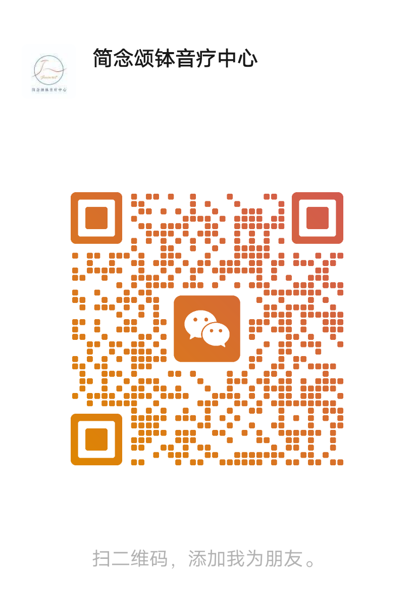

# 颂钵疗愈师培训 7.0（大字版）· 开源教材

> **颂钵疗愈 / 声音疗愈 / 音疗师培训** 完整教材 · Markdown 免费开源版本（CC BY-NC-SA 4.0）

本仓库收录《颂钵疗愈师培训 7.0（大字版）》教材的 Markdown 格式全文，是一套系统、免费、可传播的**声音疗愈（Sound Healing）与音疗师培训教程**。内容涵盖颂钵起源、钵之型质、敲磨技法、声音/振动/能量理论、脉轮与经络、个案实操、颂钵音乐会、自然疗法与疗愈师职业素养，适合颂钵疗愈爱好者、疗愈师学员与培训机构用于学习、教学与二次创作（需以相同协议共享，且不得用于商业用途）。

**核心关键词**：颂钵疗愈师培训 · 声音疗愈 · 音疗师培训 · 颂钵教程 · 颂钵疗愈课程 · 脉轮音疗 · 身心放松 · 助眠减压 · Tibetan Singing Bowl · Sound Healing · Sound Therapy Training · Chakra Healing

## 内容概览

| 章节 | 内容 |
|------|------|
| 第一章 初识颂钵 | 什么是钵、钵之名与质、缘起与发展、各类颂钵、制作、选钵、鉴别、配件 |
| 第一节 使用技法 | 请钵、持钵、敲钵、磨钵、移钵、放钵、止音、丁夏、清洁保养、呼吸实践 |
| 第二章 理论课题 | 声音基础、振动基础、能量基础、疗愈原理、脉轮节奏、穴位经络 |
| 第三章 实践操作 | 案例实操、颂钵音乐会演奏、个案精品体验流程 |
| 第四章 颂钵生命智慧 | 人生观、世界观、价值观、疗愈师专业要求、元气自我修复 |
| 自然疗法（初中高） | 呼吸、瑜伽、芳香、颂钵、音乐、水晶、饮食、香道、冥想、气功 |
| 附件 | 参考资料 |

全文约 6700+ 行，配图 250 余张（`docs/media/`）。

## 在线阅读

- **官方站点（GitHub Pages）**：https://q1z2q3-debug.github.io/singing-bowl-healer-training/ — 带 SEO 落地页，含结构化数据，更易被搜索引擎收录
- **GitHub 仓库全文**：直接打开 [`docs/颂钵疗愈师培训7.0.md`](docs/颂钵疗愈师培训7.0.md)，GitHub 会自动渲染 Markdown 与图片

也可以下载仓库后用 Typora、Obsidian、VS Code 等任意 Markdown 编辑器阅读。

## 目录结构

```
singing-bowl-healer-training/
├── docs/
│   ├── 颂钵疗愈师培训7.0.md    # 教材正文
│   └── media/                   # 教材配图
├── scripts/                     # docx -> markdown 转换流水线
│   ├── convert.py               # pandoc 转换（含图片提取）
│   ├── cleanup.py               # 目录/标题/空行清理
│   ├── emf2png.py               # EMF 矢量图转 PNG
│   └── fix_img_paths.py         # 图片相对路径修复
├── assets/
│   └── wechat-qrcode.jpg       # 微信联系二维码
├── LICENSE
└── README.md
```

## 复现转换流程

如需从 Word 原稿重新生成 Markdown：

```bash
pip install pypandoc-binary
python scripts/convert.py     # docx -> gfm markdown + 提取图片
python scripts/cleanup.py     # 清理目录页码、标题空格、多余空行
python scripts/emf2png.py     # EMF 转 PNG（GitHub 可渲染）
python scripts/fix_img_paths.py  # 绝对路径改相对路径
```

## 免责声明

- 本教材内容仅用于**学习与培训**目的，不构成医疗建议。
- 颂钵疗愈属于辅助性身心放松方法，**不能替代专业医疗诊断与治疗**。如有身体或心理不适，请及时就医。
- 练习时请注意音量与距离，避免长时间近距离使用影响听力。

## 许可协议

本作品采用 [CC BY-NC-SA 4.0](https://creativecommons.org/licenses/by-nc-sa/4.0/deed.zh)（署名—非商业性使用—相同方式共享 4.0 国际）协议开源：

- ✅ 自由阅读、下载、转发、教学使用
- ✅ 允许改编与二次创作（需以相同协议共享）
- ❌ 不得用于商业用途
- ✌️ 转载时请注明出处

## 联系我们

简念颂钵音疗中心 · 欢迎扫码交流：

<p align="center">
  
</p>

## 贡献

欢迎通过 Issue / Pull Request 提交勘误、补充说明或排版优化。
