## 目录

- [目录](#目录)

- [第一章 初识颂钵](#第一章-初识颂钵)

- [第一节 什么是钵？（初级）](#第一节-什么是钵初级)

- [1.1.1 钵之型](#钵之型)

- [1.1.2 钵之名](#钵之名)

- [1.1.3 钵之质](#钵之质)

- [1.1.4 缘起与发展](#缘起与发展)

- [第二节 颂钵基础（初级）](#第二节-颂钵基础初级)

- [1.2.1 各类颂钵](#各类颂钵)

- [1.2.2 颂钵制作](#颂钵制作)

- [1.2.3 如何选钵](#如何选钵)

- [1.2.4 颂钵鉴别](#颂钵鉴别)

- [1.2.5 周边配件](#周边配件)

- [第三节 使用技法（初中高）](#第三节-使用技法初中高)

- [1.3.1 请钵Inviting](#请钵inviting)

- [1.3.2 持钵Holding](#持钵holding)

- [1.3.3 敲钵Striking](#敲钵striking)

- [1.3.4 磨钵Rubbing](#磨钵rubbing)

- [1.3.5 移钵Moving](#移钵moving)

- [1.3.6 放钵Placing](#放钵placing)

- [1.3.7 敲击手法、节奏、力度](#敲击手法节奏力度)

- [1.3.8 磨钵角度、速度、力度](#磨钵角度速度力度)

- [1.3.9 止音Stop ing](#止音stop-ing)

- [1.3.10 丁夏使用技法及场合](#丁夏使用技法及场合)

- [1.3.11 颂钵的清洁与保养](#颂钵的清洁与保养)

- [1.3.12 颂钵呼吸实践](#颂钵呼吸实践)

- [第二章 理论课题](#理论课题)

- [第一节 声音基础（初中高）](#第一节-声音基础初中高)

- [2.1.1 型质合一](#型质合一)

- [2.1.2 声音要素](#声音要素)

- [2.1.3 声音接收](#声音接收)

- [2.1.4 基础钵音](#基础钵音)

- [第二节 振动基础（初中高）](#振动基础初中高)

- [2.2.1 同频共振（波振）](#同频共振波振)

- [2.2.2 物理振动（震感）](#物理振动震感)

- [第三节 能量基础（中高级）](#第三节-能量基础中高级)

- [2.3.1 三脉](#三脉)

- [2.3.2 七轮](#七轮)

- [2.3.3 三大能量（中级选修）](#三大能量中级选修)

- [2.3.4 五大元素（高级选修）](#五大元素高级选修)

- [2.3.5 科学认知](#科学认知)

- [2.3.6 脉轮与星系（扩展选修）](#脉轮与星系扩展选修)

- [第四节 疗愈原理（初中高）](#第四节-疗愈原理初中高)

- [2.4.1 声（波）音基础](#声波音基础)

- [2.4.2 振（震）动基础](#振震动基础)

- [2.4.3 调频激发脑波](#调频激发脑波)

- [2.4.4 整体自然疗法](#整体自然疗法)

- [2.4.5 颂钵生命价值（初中高）](#颂钵生命价值初中高)

- [第五节 脉轮节奏（中高级）](#第五节-脉轮节奏中高级)

- [2.5.1 脐轮波](#脐轮波)

- [2.5.2 胃轮波](#胃轮波)

- [2.5.3 心轮波](#心轮波)

- [2.5.4 三轮](#三轮)

- [2.5.5 能量旋律](#能量旋律)

- [第六节 穴位经络（中高级）](#第六节-穴位经络中高级)

- [2.6.1 常见穴位](#常见穴位)

- [2.6.2 膀胱经](#膀胱经)

- [2.6.3 脾胃经](#脾胃经)

- [2.6.4 肺经](#肺经)

- [2.6.5 肝胆经](#肝胆经)

- [2.6.6 三焦经](#三焦经)

- [2.6.7 心包经](#心包经)

- [2.6.8 带脉](#带脉)

- [2.6.9 其他](#其他)

- [第三章 实践操作](#第三章-实践操作)

- [第一节 案例实操](#第一节-案例实操)

- [3.1.1 气场清理与净化（初级）](#气场清理与净化初级)

- [3.1.2 空间的清理与净化（初级）](#空间的清理与净化初级)

- [3.1.3 单钵疗愈案例（中级）](#单钵疗愈案例中级)

- [3.1.4 膀胱经疏通排毒（中高）](#膀胱经疏通排毒中高)

- [3.1.5 督脉疏通（高级）](#督脉疏通高级)

- [3.1.6 心轮舒压理气（中级）](#心轮舒压理气中级)

- [3.1.7 三钵疗愈（中级）](#三钵疗愈中级)

- [3.1.8 失眠头痛疗法（高级）](#失眠头痛疗法高级)

- [3.1.9 女性妇科调理（高级）](#女性妇科调理高级)

- [3.1.10 疏肝理气音疗（高级）](#疏肝理气音疗高级)

- [3.1.11 胃部调理疗法（高级）](#胃部调理疗法高级)

- [3.1.12 长期偏头痛（高级）](#长期偏头痛高级)

- [3.1.13 单纯腰肌劳损音疗（高级）](#单纯腰肌劳损音疗高级)

- [3.1.14 七钵综合疗法（高级）](#七钵综合疗法高级)

- [3.1.15 女性保养类（高级选修）](#女性保养类高级选修)

- [3.1.16 情绪调理类（高级选修）](#情绪调理类高级选修)

- [第二节 颂钵音乐会演奏（高级）](#第二节-颂钵音乐会演奏高级)

- [3.2.1 净手仪式](#净手仪式)

- [3.2.2 颂钵音乐会的场域布置](#颂钵音乐会的场域布置)

- [3.2.3 音乐沙龙会的行钵流程](#音乐沙龙会的行钵流程)

- [3.2.4 音乐沙龙会的注意事项](#音乐沙龙会的注意事项)

- [第三节个案精品体验流程（高级）](#第三节个案精品体验流程高级)

- [流程1. 自我能量保护](#流程1.-自我能量保护)

- [流程2. 课前沟通](#流程2.-课前沟通)

- [流程3. 疗愈场域净化](#流程3.-疗愈场域净化)

- [流程4. 引导放松（瑜伽放松）](#流程4.-引导放松瑜伽放松)

- [流程5. 项目开启](#流程5.-项目开启)

- [背部疗愈](#背部疗愈)

- [正面疗愈](#正面疗愈)

- [流程6. 撤钵](#流程6.-撤钵)

- [流程7. 唤醒](#流程7.-唤醒)

- [流程8. 交流疗愈体验](#流程8.-交流疗愈体验)

- [第四章 颂钵生命智慧（高级）](#第四章-颂钵生命智慧高级)

- [第一节 人生观](#第一节-人生观)

- [4.1.1 空性｜人即钵](#空性人即钵)

- [4.1.2 自主｜行修](#自主行修)

- [4.3.3 本自｜具足](#本自具足)

- [4.1.4 自立｜利他](#自立利他)

- [4.1.5 有度｜中道](#有度中道)

- [4.1.6 和谐｜有序](#和谐有序)

- [4.1.7 生命｜正念](#生命正念)

- [4.1.8 生命｜刻度](#生命刻度)

- [4.1.9 生命｜像素](#生命像素)

- [第二节 世界观](#世界观)

- [4.2.1 什么是疗愈](#什么是疗愈)

- [4.2.2 易经智慧](#易经智慧)

- [4.2.3 道德经](#道德经)

- [4.2.4 佛学智慧](#佛学智慧)

- [4.2.5 大脑科学](#大脑科学)

- [4.2.6 能量显化](#能量显化)

- [4.2.7 黄帝内经](#黄帝内经)

- [第三节 价值观](#价值观)

- [4.3.1 内丰盈 爱满溢](#内丰盈-爱满溢)

- [4.3.2 成长型思维](#成长型思维)

- [4.3.3 圆满境界](#圆满境界)

- [4.3.4 生命绽放](#生命绽放)

- [第四节 疗愈师专业基础要求](#第四节-疗愈师专业基础要求)

- [4.4.1 形象要求](#形象要求)

- [4.4.2 专业要求](#专业要求)

- [4.4.3 心念愿力](#心念愿力)

- [4.4.4 伦理考虑](#伦理考虑)

- [4.4.5 疗愈师的状态](#疗愈师的状态)

- [4.4.6 被疗愈者的状态](#被疗愈者的状态)

- [第五节 疗愈师元气自我修复（初中高）](#第五节-疗愈师元气自我修复初中高)

- [5.7.1 三脉平衡](#三脉平衡)

- [5.7.2 太极定桩](#太极定桩)

- [5.7.3 经络运动](#经络运动)

- [5.7.4 瑜伽练习](#瑜伽练习)

- [5.7.5 持咒唱诵](#持咒唱诵)

- [第五章 自然疗法（初中高）](#自然疗法初中高)

- [第一节 呼吸](#第一节-呼吸)

- [第二节 瑜伽](#第二节-瑜伽)

- [第三节 芳香](#第三节-芳香)

- [第一脉轮](#第一脉轮)

- [第二脉轮](#第二脉轮)

- [第三脉轮](#第三脉轮)

- [第四脉轮](#第四脉轮)

- [第五脉轮](#第五脉轮)

- [第六脉轮](#第六脉轮)

- [第七脉轮](#第七脉轮)

- [第四节 颂钵](#第四节-颂钵)

- [第五节 音乐](#第五节-音乐)

- [第六节 水晶](#水晶)

- [第七节 饮食](#第七节-饮食)

- [第八节 茶道](#第八节-茶道)

- [第九节 香道](#第九节-香道)

- [第十节 冥想](#冥想)

- [第十一节 气功](#气功)

- [第十二节 其他](#其他-1)

- [附件](#附件)

- [冥想引导词](#冥想引导词)

- [引导放松词](#引导放松词)

- [简念®身心状态档案表](#简念身心状态档案表)

- [阿森斯失眠量表](#阿森斯失眠量表)

- [焦虑自评量表](#焦虑自评量表)

- [抑郁自评量表](#抑郁自评量表)

- [阿育吠陀能量表](#阿育吠陀能量表)

- [参考资料](#参考资料)

宇宙中的一切都在你体内，

向内寻求一切的答案吧。

Everything in the universe is within you，

Ask all from yourself.

——灵性诗人鲁米（13世纪）

# 第一章 初识颂钵

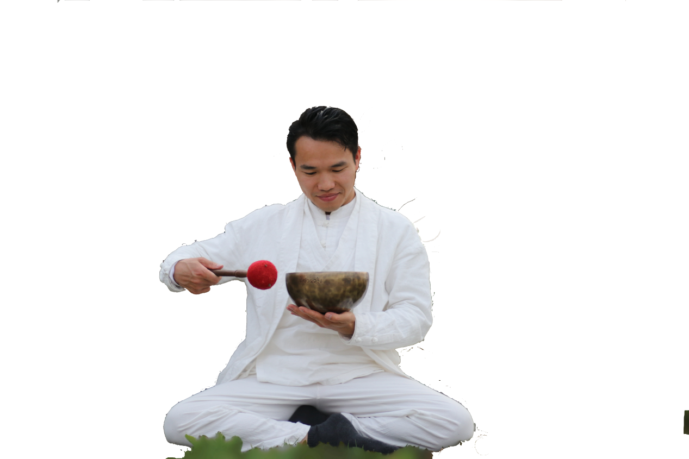

当一声清脆颂钵响起

身心迅速收摄

大脑清空

进入一种安定祥和的状态

一刻钟下来

会有一种空明澄澈

神清气爽

身心通透的感觉

这就是颂钵的魅力！

现今不管在东方的中国、印度、尼泊尔，还是西方世界，颂钵已普遍用来当做理疗（healing）、音声按摩（sound massage）、音声疗愈（sound therapy）和脉轮平衡（chakra balancing）的一种媒介或一种工具，对高压下的焦虑、浮躁、失眠、多虑，以及对不同生命阶段的身心危机、内在孩童受伤、心理创伤、情绪失衡等亚健康人群和身心灵整合提升的人群，都是深受肯定的一种音声疗法，也是一种精准有力的疗愈舒压工具。

面对人类历史上最近的一次“黑天鹅事件”，从2019到2022年，三年的疫情中的生活与工作，身心疗愈逐渐被意识到，并作为生活与人生平衡的时代探索，颂钵类的身心疗愈方式，从宗教的修行转向高端身心疗愈的放松体验。目前来看，颂钵的疗愈已经逐步走向生活化、商业化发展，配套的颂钵周边的产品也开始在各大线上商城出现，源自于了解颂钵以及体验颂钵，深受颂钵疗愈的人群越来越多。

颂钵在当代人类的发展才刚刚起步，拥有颂钵疗愈能力的职业化发展，也成为从事颂钵相关工作或者有意探索新体验新领域的人群的一种选择。更重要的是，颂钵具备一种不可抗力的疗愈能力，帮助越来越多体验过颂钵的有缘人，深度放松，获得身心的平衡，更有能量，在在乌卡时代，面对未来更多的不确定性。

## 第一节 什么是钵？（初级）

人类作为地球上的一员，钵型的出现，也以人文发展而起步，让我们追溯到万物之源，探究宇宙的创始与人文的发展。

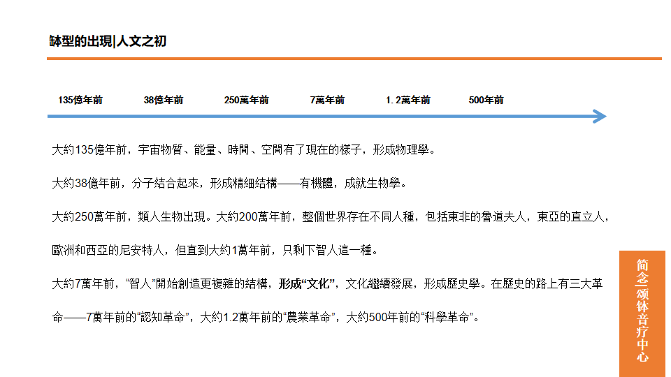

大约135亿年前，宇宙物质、能量、时间、空间有了现在的样子，形成物理学。

大约38亿年前，分子结合起来，形成精细结构——有机体，成就生物学。

大约250万年前，类人生物出现。大约200万年前，整个世界存在不同人种，包括东非的鲁道夫人，东亚的直立人，欧洲和西亚的尼安特人，但直到大约1万年前，只剩下智人这一种。

大约7万年前，“智人”开始创造更复杂的结构，形成“文化”，文化继续发展，形成历史学。在历史的路上有三大革命——7万年前的“认知革命”，大约1.2万年前的“农业革命”，大约500年前的“科学革命”。

—— 参考《人类简史》

从历史角度来看，钵的历史伴随着人类文化与文明的发展。

短短的七万年时间，就在当下的一万年左右，人类开始发挥自己的聪明才智，使用地球上存在的物体创造出属于自己的人文之旅。

颂钵就是在人类的演化之中，创造出来的“人文体验”载体，成为远古人类在自然之中，寻找与宇宙连接的方式与媒介。

**颂钵成为人类探索宇宙或者试图解密宇宙的一种对话工具。**

颂钵的人文发展，从物理层来说，是铜合金的圆形球状工具，在心理层面而言，是可以放松身心和大脑的疗愈工具，从高维的灵性智慧看，颂钵本身结合宇宙智慧与人文精神的载体。

现实来看，颂钵能够被创造出来，并传播至今日，被我们这一代人类接触并体验，已是跨越千年的传播。

**得以颂钵 敬天爱人。**

颂钵是一个很好的工具，其本身的魅力巨大，敬畏颂钵、尊重颂钵，将带给我们更多的视野和人生体验。

有这份心，颂钵能够连接宇宙，开启生命智慧，颂钵疗愈师就是这个能量的传递人，是颂钵的魅力，也是成就颂钵疗愈师的魅力的“武器”。

让我们继续探索颂钵，穿越千年体验颂钵的人文魅力，扩宽视野，带来更多的认知体验。

首先我们从颂钵的造字源头，探索颂钵的起源。

### 1.1.1 钵之型

钵同缽：其造字起源

关键字：陶缽 远古时期 食用器皿 文化艺术

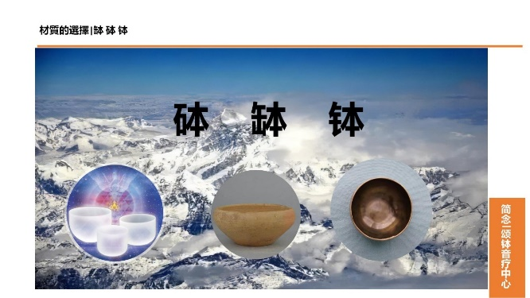

缽是一种常见的器皿，它通常用于盛放食物或液体。然而，为什么我们称之为“缽”，而不是其他名称，如碗、盘或盆呢？实际上，这个名称的来源可以追溯到考古学家对其形状和功能的研究，以及对甲骨文象形文字的分类与总结。

在考古学家的研究中，【缽】被发现是由陶土制成的，通常是通过**土**烧制而来。这种制作方式使得缽具有**特定的形状**，即它的底部是平的，而边缘则向上倾斜。这种形状使得缽可以更好地盛放食物或液体，同时也使得它更容易抓握和移动。

除了形状，缽的命名方式还与甲骨文象形文字有关。甲骨文是一种古代的文字，它的形状和结构与汉字有些类似。考古学家通过研究甲骨文，发现了一些与钵相关的象形文字，这些文字形状类似于现代的钵。这些象形文字的存在，使得**考古学家**将这种器皿归类统称为“缽”。

因此，我们称之为“缽”的名称，是基于这种器皿的物理特征和历史制作方式而形成的。这个名称已经被广泛使用，成为我们日常生活中的一个常见词汇。

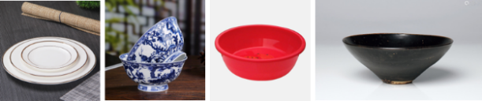

缽是比较古老且常见的器型，与碗、盆一样，作为生活用具，器型简单，制作容易，在钵、碗、盆这三类器物是比较古老且常见的器型，在新石器时代早中期就已经出现，并且一直沿用到现在。

—— 参考《群文天地》2018年第04期

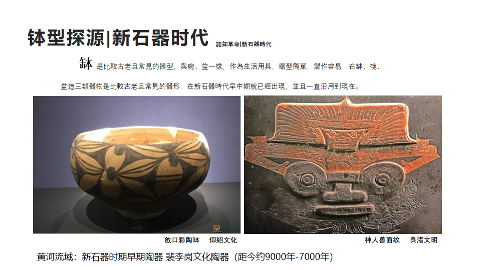

图中展示的缽，距今约7000年至5000的仰韶文化中的文物，以及距今五千年，在杭州良渚地区（良渚文明）发现的神人兽面纹的玉雕图案（右图），其制作纹理如头发丝一样细，足以说明那个时时期人类的智慧与工艺已经达到很高的程度。相对于现代我们而言也很难想出在当时的条件下，如何制作出如此精美的玉雕作品，不由得心生敬畏。

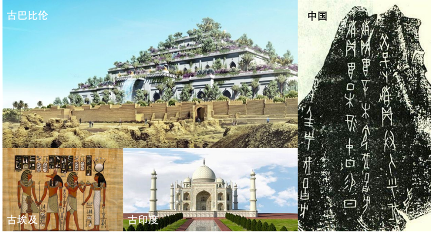

就在同一时期，大约6000年前，苏美尔人创立了世界最早的文明之一美索不达米亚（Mesopotamia，希腊语的意思是两河之间的土地）文明，发明了文字，同时出现城邦、国度的概念，也标志着人类文化向文明的转化，美索不达米亚是四大文明古国之一的古巴比伦的所在地（其他古国有古印度、古埃及、还有一直延绵不断的中国）。

考古团队发现在美索不达米亚平原有类似“颂钵”的器物，只是他们使用的材料与现代颂钵在金属上的（成分组成）略有不同而已。

此外，也有其他考古学家在波斯（现今伊拉克），在众多的文物中也发现有期中金属制成且类似“颂钵”的碗型器具。

而这些文物的出土，让颂钵历史愈加扑朔迷离，在人们初识喜马拉雅颂钵，难道不是起源于西藏吗？还是怎样的途径，流转到喜马拉雅周边，又流行于全球各地？

接下来，从钵的名来源探索。

### 1.1.2 钵之名

“钵”这个名称源自梵语PATRA音译而来，作为“鉢多罗”的简称。其中tra又有解脱、方向、道路之义。

从【中文造字】来看，钵字从金字旁部首，已经从陶土的钵（缶+本），成为（金+本），无论是造字上看，金属材质已经具备了金属乐器的功能。在印度文化中，钵也是一种常见的器型，用于日常生活中。

据了解，钵多罗Patra源于古印度沙门传统，婆罗门教也有托钵乞食的苦修文化。

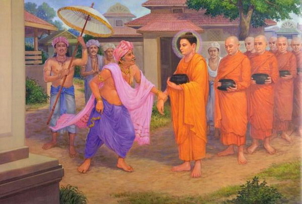

在佛教里，最早的，也是最重要的钵多罗是释迦牟尼佛的**石钵**。到了中国南北朝时期，印度王子达摩来到中国传法，后世的禅宗历史中，有一花开五叶，到六祖慧能，进行的是“衣钵”的传承，此时这个钵也间接具备了【**文化智慧传承**】的载体。

婆罗门的一生应该分为四个时期，每个时期有其义务、责任，最后第四期为遁世期，为了解脱，要遁入森野，坚持苦行头陀，托钵到村落中乞食维生，且一日一食。

—— 《摩奴法典》

钵是一种用来盛放食物或水的器具，通常是由金属、木材或陶瓷等材料制成的，形状类似于浅碗或浅盘，有时也有盖子。在佛教中，钵是出家人所使用的一种器具，用来接受信徒的供养和施舍，也用来盛放食物和水等生活用品。

—— 《佛学大辞典》

钵是一种佛教法器，也称为法器钵、佛钵、咒钵等。它通常由金属制成，形状为圆形或半球形。使用时，持钵者用木槌轻敲钵口，发出清脆的声音，以引导修行者进入冥想状态。颂钵的声音被认为具有净化身心的作用，能够帮助修行者消除烦恼、增强专注力和内心平静。颂钵在佛教中被广泛用于仪式、念诵、冥想等活动中。

—— 《佛教百科全书》

因此，钵在中国文化中具有深厚的历史和文化底蕴。它不仅是我们饮食生活的必需品，也是我们文化传统的重要组成部分。随着时间的推移，钵的功能和用途也逐渐演变，但它始终是我们生活中不可或缺的器皿之一。

### 1.1.3 钵之质

**颂钵，又称喜马拉雅钵（Himalaya bowl）**，相传古代人从喜马拉雅山上采集下来的矿石，提炼成了铜然后打制成了这样的器皿。

由金、银、铜、铁、锡、铅、汞七种金属组成的颂钵。

古代人从喜马拉雅山上采集下来的矿石，提炼成了铜然后打制成了这样的器皿。

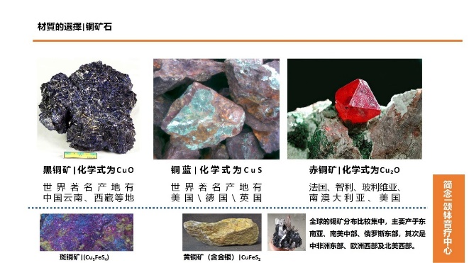

钵的主要成分为**铜和锡**合金，其中铜是从铜矿中冶炼得到，上图为铜矿石的照片，不同的化学组成展示出不一样的铜矿石结构和形貌。自然界中的金属除极少数不活泼的金属（金、银）以单质形式存在外，都以化合物的形式存在。

加拿大 康卡地亚大学曾检验过颂钵的材质，发现老钵的确含有器中元素，其中主要是铜和锡的合金，其他占很少的含量，源自于当时的提炼和制作工艺的有限。不是固定调配的比例，打造颂钵，虽然是文化上的习俗，西方有些科学家总是趋向于通过科学检测验证，当然这只是个别钵含量，老钵，基本上是以铜锡合金为主，即为青铜材质。

| **元素** | **含量** |

|:---------|:---------|

| 金       | 0.01%    |

| 银       | 0.03%    |

| 铜       | 77.20%   |

| 铁       | 0.14%    |

| 锡       | 22.00%   |

| 铅       | 0.04%    |

| 水银     | 0.02%    |

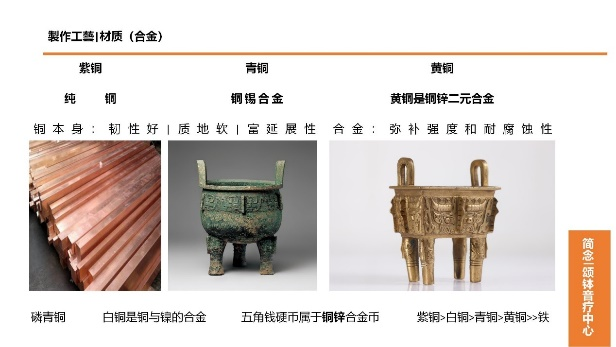

青铜是金属冶铸史上最早的合金，在纯铜（紫铜）中加入锡或铅的合金，有特殊重要性和历史意义，与纯铜（紫铜）相比，青铜强度高且熔点低（25%的锡冶炼青铜，熔点就会降低到800℃。纯铜（紫铜）的熔点为1083℃）。青铜铸造性好，耐磨且化学性质稳定。

青铜发明后，立刻盛行起来，从此人类历史也就进入新的阶段——青铜时代。

在日常生活中，我们的五角硬币是铜锌合金铸币，属于黄铜，颂钵的材质主要以铜锡合金，属于青铜，尤其是古老的颂钵。

从颂钵的材质与氧化的状态来看，颂钵作为具备音乐属性的疗愈乐器而言，更多以铜锡合金，至于西藏颂钵是有七种元素组成，在实际的测量比例而言，可以说忽略不计，作为颂钵文化角度来看，即便是再少的组成含量，也是不可或缺的文化因素，这好比人体的微量元素，即便微量，但对于人体机能而言，至关重要。

响铜，是一种合金的名称，是指由铜﹑铅﹑锡按一定比例混合炼成的一种铜。主要用来制作乐器，响铜可以发出悦耳声响。响铜在古代用来铸钟。如在明代宋应星天工开物冶铸第八卷记载：凡铸钟，高者铜质，下者铁质。今北极朝钟，则纯用响铜。响铜常常被制成乐器，叫做响器或响铜器。其中最常见地响铜器就是铜锣、饶钱。

颂钵可由响铜、青铜等合金制作而成。

现在让我们从历史的角度探索颂钵疗愈的真实历史。

### 1.1.4 缘起与发展

#### 1.1.4.1 颂钵起源

颂钵（Singing bowl），“会唱歌的碗”，由金、银、铜、铁、锡、铅、锌七种金属手工制作而成。

**铜钵**的起源可以追溯到千年前的古印度。

在当地的习俗中，“钵”最原初的功能是用来保鲜食物，同时也可以盛温热的食物给刚刚生产的孕妇吃。印度阿育吠陀认为“钵”对康复疗愈起促进作用，保护她们恢复身体。随着时间的推移，人们发现“颂钵”还有疗愈功能。

智慧的先人们发现敲击“颂钵”，钵会好像唱歌一样发出声音，它的声音振动频率能够自然而然、并快速地让人身心放松，进入一种**“中”**的状态，进而激发身体自身的疗愈机制，它的声音振动频率能非常精微的影响身体细胞频率，帮助身体器官、组织的自我调节、修复，使不健康的（不对的）细胞频率重新恢复正常的频率。

颂钵，英文名：Singing bowl，本意即为会唱歌的碗，原名为：钵多罗，简称为钵，除了兼具食用器之外，因其独有的材质，现在科学研究铜离子以及氧化物具备抗菌功能，在古代人们拿来作为抵御细菌（即认为是恶魔恶鬼）的侵入，加之罄之有声，又能使人心神安定，成为佛教的法器之一，在佛堂上诵经过程中敲击的器物**（罄）**之一。

颂钵形成目前的疗愈功能，从材质的形成之初，已经具备身心调理的作用，故猜测最早来自选用铜材质开始，而铜钵最早的历史可以追溯到古印度或者两河流域，甚至更久远的亚特兰蒂斯。

颂钵已经成为一种独特的音乐器材，被广泛用于冥想、放松和疗愈等领域。

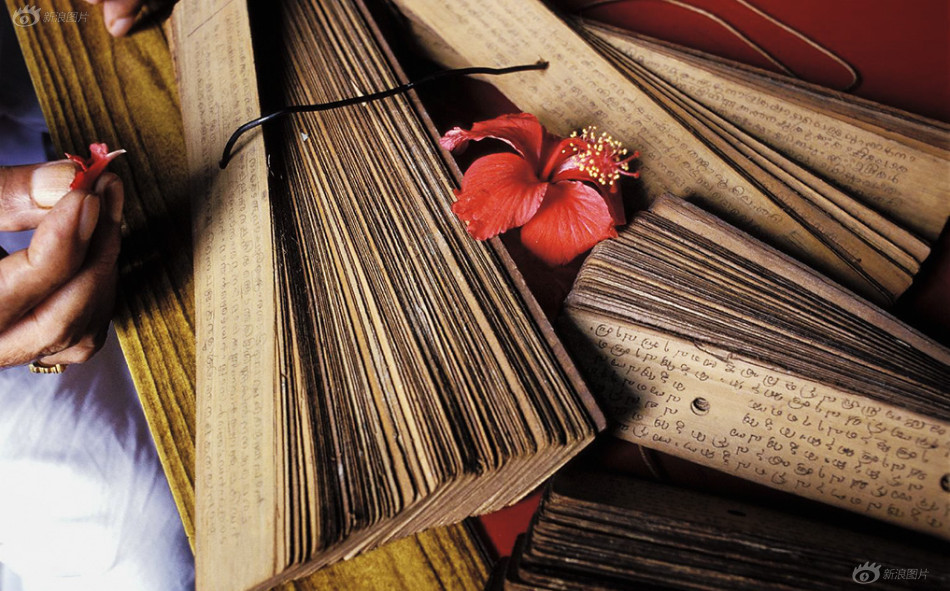

#### 1.1.4.2 钵的探源

贯穿整个历史的脉络里，颂钵很可能是来自上一个10万年的文明，据玛雅预言地球至今为止已经经历过五次文明，地球其实要比我们想象中老很多，在人类文明之前其实地球上出现过其他文明。其中第四个文明是：**亚特兰蒂斯文明**。

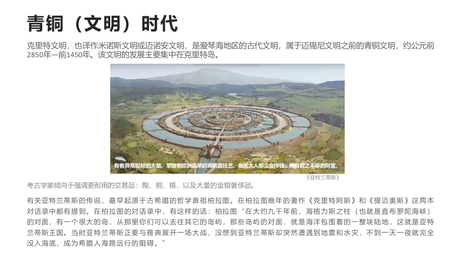

亚特兰蒂斯文明是玛雅人所推测的地球上的第四次文明，也称光的文明。传说中拥有高度文明发展的一个古老大陆，最早的描述是在柏拉图的《对话录》里，说其在公元前一万年被史前大洪水所毁灭。根据玛雅历法的预言传说，地球上人类所生存的世界，一共有五次毁灭和重生周期，也就是所谓的“太阳纪”，在每一纪结束时，都会上演一场惊心动魄的毁灭性悲剧。其中第四个太阳纪就是亚特兰蒂斯文明，又称为光的文明，这一阶段的人类文明毁灭于巨浪滔天的大洪灾中。

有关文献记载来自：

有关亚特兰蒂斯的传说，最早起源于古希腊的哲学鼻祖柏拉图。在柏拉图晚年的著作《克里特阿斯》和《提迈奥斯》这两本对话录中都有提到。在柏拉图的对话录中，有这样的话：在大约九千年前，海格力斯之柱（也就是直布罗陀海峡）的对面，有一个很大的岛，从那里你们可以去往其他的岛屿，那些岛屿的对面，就是海洋包围着的一整块陆地，这就是亚特兰蒂斯王国。当时亚特兰蒂斯正要与雅典展开一场大战，没想到亚特兰蒂斯却突然遭遇大地震和水灾，不到一天一夜就完全没入海底，成为希腊人海路远行的阻碍。”

而考古学家，在考古中也发现，有亚蒂兰蒂斯文明存在，他们有着异常聪明的大脑，掌握着欧洲最早的**青铜器技艺**，像犹太人那么会挣钱，拥有数之不尽的财富。考古学家倾向于强调更耐用的交易品：陶、**铜、锡**，以及大量的金银奢侈品。

现在让我们探寻人类文明之初，来了解钵文化。

伏羲有言：人之为人，化成天下。

目前这样的世界，据准确的时间推算，人类在短短5000年的时间创造出我们双眼可及的世界：如高楼大厦、人工智能等。

《人类简史》中用一段话综述了地球与人类的发展：

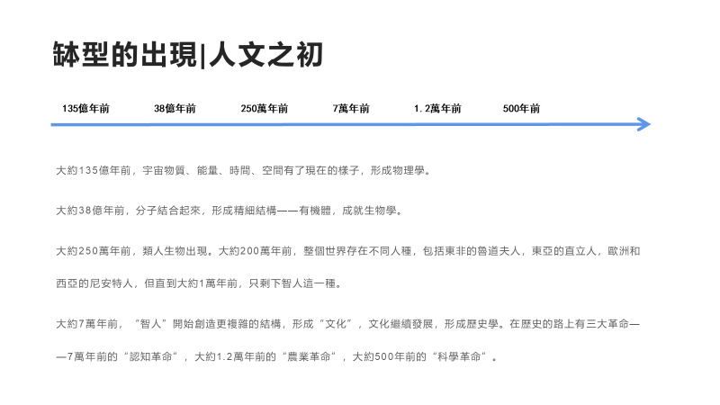

大约135亿年前，宇宙物质、能量、时间、空间有了现在的样子，形成物理学。

大约38亿年前，分子结合起来，形成精细结构——有机体，成就生物学。

大约250万年前，类人生物出现。

大约200万年前，整个世界存在不同人种，包括东非的鲁道夫人，东亚的直立人，欧洲和西亚的尼安特人，但直到大约1万年前，只剩下智人这一种。

大约7万年前，“智人”开始创造更复杂的结构，形成“文化”，文化继续发展，形成历史学。

在历史的路上有三大革命——

7万年前的“认知革命”，大约1.2万年前的“农业革命”，大约500年前的“科学革命”。

接下来，我们通过对钵的认知、青铜时代、铜乐、西藏颂钵、科学解析颂钵的角度，来详谈钵的历史，一篇文章，带您全面认知颂钵的历史源流。

钵，考古学家，**对这一类型质相同的容器的称谓**：钵是比较古老且常见的器型，与碗、盆一样，作为生活用具，器型简单，制作容易，在钵、碗、盆这三类器物是比较古老且常见的器形，在新石器时代早中期就已经出现，并且一直沿用到现在。

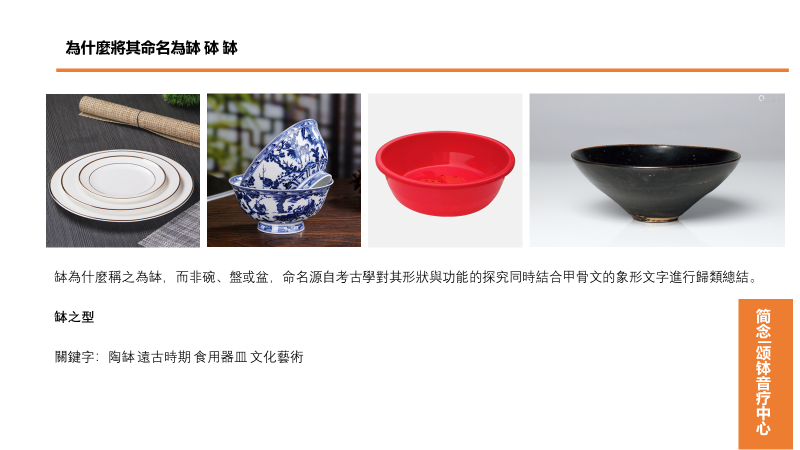

从其材质上来讲，人类最开始使用的材质是陶质器皿，我们中国的汉字，明显地区分了这一点。

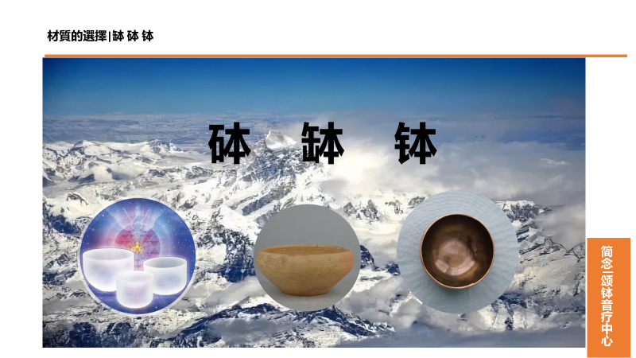

从陶土的缽，到石头或者现在石英制的水晶钵，还有我们现在探究的颂钵，即金属偏旁的钵。

在新石器时期，人类从游牧，母系社会转向定居、部落体系，进入万物有灵的巫觋时代，敬天礼地，1万年前左右的生活器具，一直存留在地球上，才能通过考古再次被发现。

我们通过考古上认识一下钵的源流。

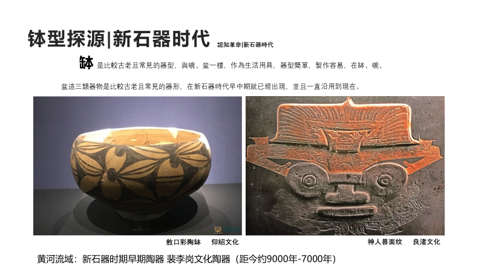

在中国的考古，黄河长江流域，发现了彩陶，绘制有图案的陶钵，明显是当时人们生活的食用器，同时也具备了美术、艺术的气息，可以看出当时人们从基本的食用生活器皿，开始追求“品质艺术”的生活方式。河南博物院存有一个9000多年的用鹤腿骨做的骨笛——贾湖骨笛，可发出不同音调的声音。

随后的青铜时代，人类开始利用青铜制作各种各样的生活器具，其中也不乏铜制的碗，在战国后期，人们出去野炊，一个收纳的盒里面，可以装有大大小小，甚至还包含调料碟，共计62件组合铜餐具。

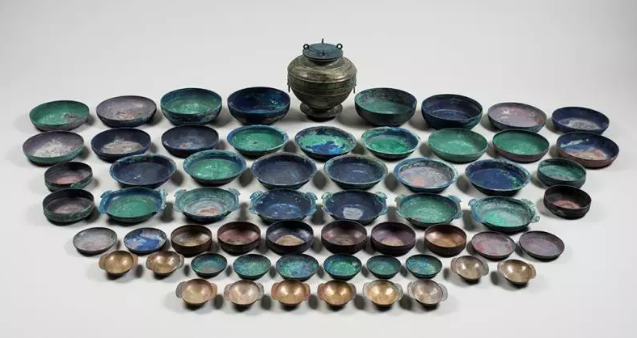

其中不乏与现在“”颂钵“”型质相同的钵体，但当时这些都是食用器。钵，**即便是青铜材质，也只能称之为铜钵，而不能称之为颂钵（唱歌碗）**。

从另外一个层面来看，**铜钵的历史使用可以追溯到人类使用青铜开始。**

青铜时代，到中国时候，相对于世界的青铜时代已经属于后期。

最早考古发现，现位于土耳其境内的小亚细亚半岛是最早冶铸青铜器的地区，目前发现有公元前6000年的青铜器。两河流域，在美索不达米亚地区，公元前3000年进入青铜时代，古埃及文明紧随其后，中国地区青铜器的出现则稍晚一些。

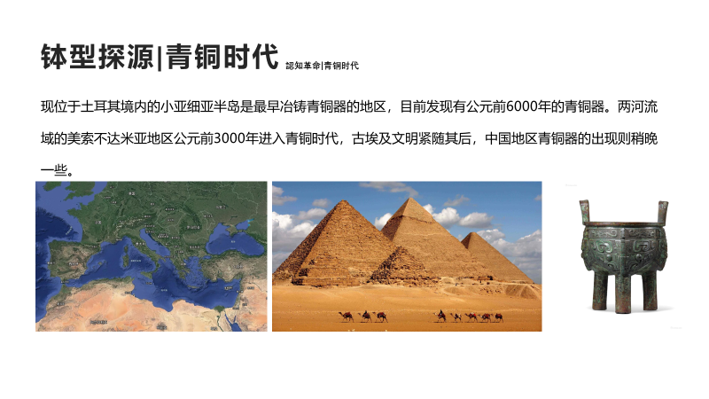

两河流域的苏美尔文明，在中国还在三皇五帝的时候，苏美尔人已经开始算账，创造金币，进入农业社会，开始社会大分工。

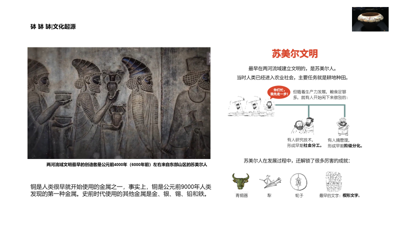

考古学家也在**两河流域发现了相同材质的钵**，但**并没有证明其用来音乐器械或者疗愈，很可能还是属于食用器或者容器功能**。

目前，在大众认知当中，提到“**颂**”铜**钵源自印度，并传到西藏，的确是如此吗**？我们继续探源。

古印度作为东方文明之一，但现在也只能前面加上一个“古”字，印度的历史探源，源自中国两位留学生，为他们留下了探索印度历史的途径，南北朝**法显**写下的《佛国记》，大唐时期**唐玄奘**游记《大唐西域记》，成为探索印度历史的两本参考文献。

印度在近代沦为大英帝国的殖民地，在之前曾经被希腊人、阿拉伯人、伊斯兰教、以及来自中亚的大月氏分别统治近百年时间。

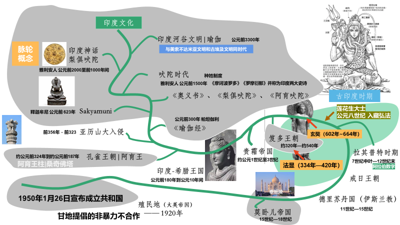

现在**颂钵**用到的脉轮体系，源自 雅利安人的文献，雅利安人来到古印度版图，创造灿烂的东方智慧文明，《梨俱吠陀》神话故事等，同时也有社会治理体系“种姓制度”，到了公元前600年左右，在沙门思潮的影响下，释迦牟尼有意向破除印度的种姓制度，提倡众生平等，后期被认定为佛教的创始人。

**瑜伽、阿育吠陀、佛经等文献，都是古印度留给世界的文化瑰宝。**

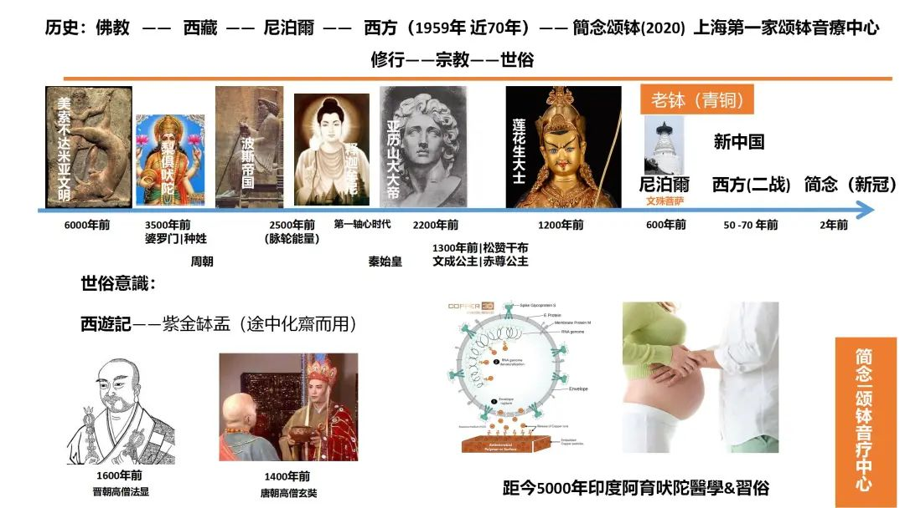

《阿育吠陀》中曾有记载，在印度习俗中，记录印度的婚嫁习俗，有钱有势人家，在子女出嫁之时的嫁妆，必备“铜钵”，以便于在分娩后用于饮食的工具，当时科学虽未发展，从习俗礼器以及礼节礼仪上具备了科学的属性，目前科学研究，铜离子或者铜纳米颗粒具备抗菌抑菌的功能。同时那些修行的人士也会用到铜钵煮食，**这些都是铜钵的使用方式，但这些都没有用到修行、音乐、疗愈体系。**

1500年前法显游学印度&1400年前唐玄奘西行求法，归途并未带回来颂钵这样的法器与工具，想必当时“铜钵”并未用到佛教的修行当中。

**那铜钵什么时候被用到修行和疗愈当中？**

我们进一步探源：

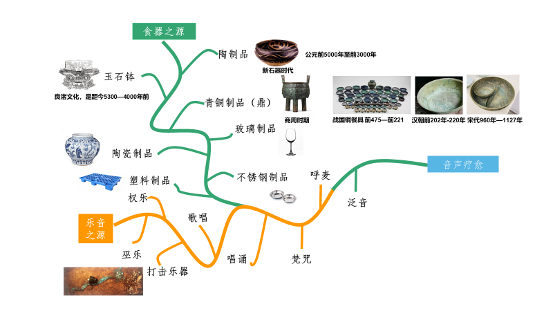

在食用器与乐器中，慢慢地成为音声疗愈的工具，在食用器中，从之前的陶土钵到青铜钵（碗），一直存在，考古发现有战国的铜餐具、汉代的铜碗、宋代的一套铜盆碗筷，但这些并没有衍生出乐器或者疗愈器皿。

**那么铜钵要成为颂钵需要哪些条件，我们不得不需要厘清这样的思路**。

铜制的打击乐器，从考古中就一直存在，中国之中即河南，河南洛阳二里头文化遗址，发掘出来的绿松石龙，同时也有【青铜铃】出土，可以看出无论是大型的青铜文明：三星堆文明，还是大型编钟都是青铜使用的鼎盛时代，在中国，青铜已经作为乐器进行使用，但**铜钵来说，并未开始成为颂钵（乐器）**。

那颂钵到底是什么时间开始被用于修行和音声疗愈的呢？

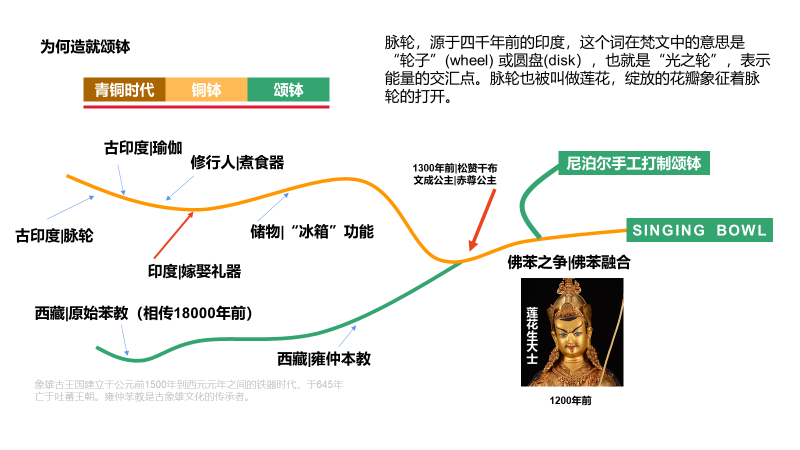

在漫长的发展中，到了公元6世纪，即1300年前，松赞干布统一了西藏，为了方便政教管理，摆脱“巫师大于王权”的局面，通过迎娶两位公主同时改成佛教信仰，分别从中国和尼泊尔迎娶文成公主和赤尊公主两位公主，也带来释迦牟尼等身像，一百年之后，另一个西藏的赞普邀请来印度莲花生大士，来到西藏，进行佛苯融合，在这个过程中形成藏密，将持咒，无意义的唱诵方式结合，形成现在的修行方式。

莲花生大士，不仅是得道的大士，也是一位能工巧匠，很可能在这个基础上，**铜钵将被再次制作，有多位工匠协同制作，敲打完成了【颂钵】的制作，目前颂钵的制作工艺，也是如此。**

**颂钵从容器的铜钵，转变成修行的音乐器皿，颂钵在西藏（笼统说喜马拉雅山地区）实现了新的功能与发展。**

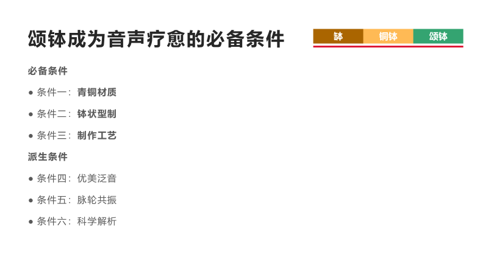

现在尼泊尔成为颂钵的国际交易市场，除了经济不发达的成本低廉之外，更重要的是，尼泊尔的工匠的协作，让颂钵得以熠熠生辉，泛音不绝，具备了音声疗愈的功能。

加上声音本身的振动与疗愈，身口意三密的修行方式与颂钵对我们身心的修行方式有异曲同工。

颂钵在这样的情况下，再次被发现出来，协助藏密的修行，成为修行的媒介。

**我们知道铜钵并非源自西藏，但颂钵很可能在西藏创源，并盛行于西藏，并传播至世界。**

在众多人心中，将颂钵称之为喜马拉雅颂钵，一方面是对世界最高峰的敬畏，另一方面也是充满人文精神色彩，更加有利于颂钵的传播，增加了宗教与神秘的向往色彩。

近代的人们认识初识颂钵，第一印象就是寺院当中的磬，属于佛教法器，其型制和规格大于日常疗愈的颂钵。更多是用于日常诵经与仪式当中，以有力清脆的声音，带来内心的安稳与意识专注。

钵文化艺术盛行于玄奘大师后期，大概在武则天女皇时期，大唐盛世，盛世下的至臻体验。钵文化体系，充分展示在佛造像与佛绘画艺术之中。

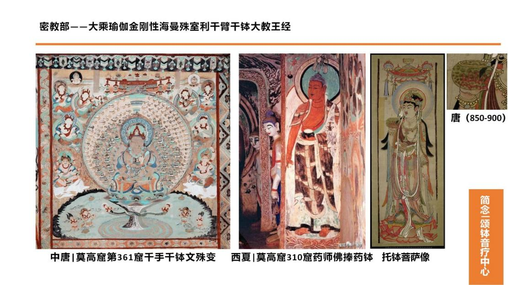

二战之后，德国作为战败国，当时人们的心理有巨大的伤害，加上第二次世界大战带来的心理创伤，奥斯维辛集中营的惨无人道的经历，都是当时的人们难以度过的心理创伤。

西藏难民到达西方，顺便带过去得以生存的法器：颂钵，疗愈身心。

战后的心理创伤得到巨大的缓解，当时除了心理辅导之外，带来了身心的放松与稳定。随着时间的推移和时代的发展，颂钵的疗愈功能在实战以及脑科学的研究当中，越来越显示出其神秘且优越性。

颂钵疗愈在西方盛行起来，因为接触颂钵来自西藏，又被称为西藏颂钵，更有一个好听的名字，喜马拉雅钵。

**著名的通灵大师埃德加·卡西曾预言说：声音是未来的医药。**

颂钵疗愈，属于最早的音乐疗法之一，是千年来传承下来的音声疗愈工具，帮助人类各个时期身心健康。

**目前，在新健康理念下，颂钵疗愈不仅能疗愈身心，更能引领健康生活新方式。**

此时，颂钵得以称之为唱歌碗，现在颂钵有很多的分支或者同类型的钵，唱歌碗｜佛音碗｜转经碗｜修行碗｜铜磬，都是颂钵的同品类。

道家与佛教用到的**磬**，目前的制作工艺与颂钵是不同，甚至材质上也有差异。

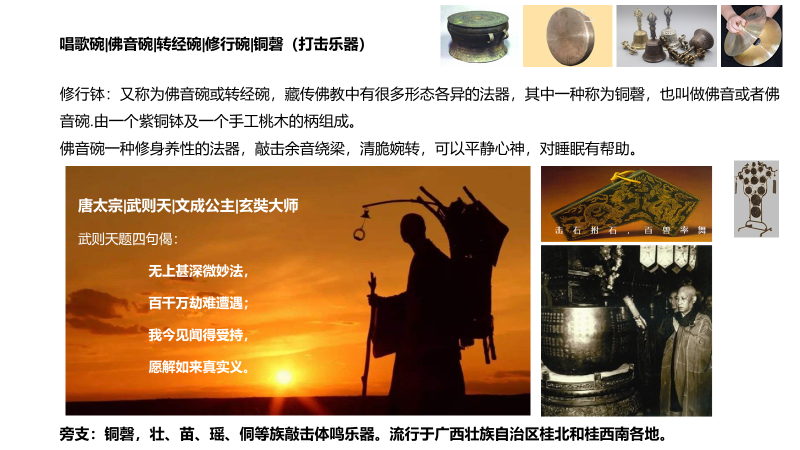

唐代武则天，听了佛经的流传翻译的故事之后，深为感触，写下我们每次读经或者抄经的四句偈：

**无上甚深微妙法，百千万劫难遭遇，我今见闻得受持，愿解如来真实义。**

颂钵的追溯历史至此，颂钵能被发现用来做身心的疗愈，也是跨越历史时空，被我们得以传承。

也将在经历三年疫情之后的身心得以缓解，更重要的是，在这一个当下，人类的时空升维，能量提升，也将助一臂之力。

探源颂钵的历史，脉轮概念来自4000多年前的古印度，铜钵可以判断，青铜时代开始就有类似的器皿出现，而**颂钵作为修行疗愈的器材，至今也有1000多年的历史，在这样的历史源流下，让颂钵带来更多身心的转变与扬升。**

2019年，简念颂钵音疗中心创立，从瑜伽品牌中独立出来成为上海第一家颂钵音疗中心，并以培训为主题的颂钵疗愈场馆。

目前经过多年的博众所长与不断地探究研发，学员合作共创，以木子导师和润泽博士为主导的颂钵培训体系，完成了颂钵的职业技能培训系列，形成结合东方脉轮体系，中医经络系统，西方神经、脑科学，以及能量学等相关概念落地课程理论与实践的研发。

颂钵的历史也是众说纷纭，润泽博士在对佛教造像艺术历史等基础上，依据目前的考古发现以及准确的推测，明确了颂钵的疗愈历史的时间与定位。

#### 1.1.4.3 颂钵发展

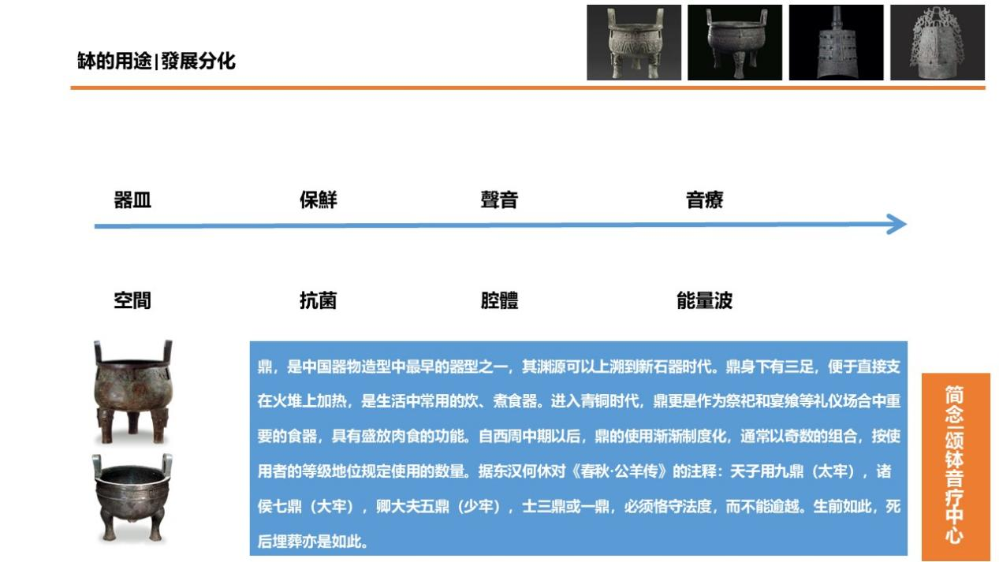

**\**

**001 起源的不确定**

历史上没有记载是谁创作了“Singing Bowl”（颂钵）。

**002 文字中探源**

在中国汉字中，钵是一种形状像盆或碗，一般用来盛饭菜或茶水的器皿。古代僧人沿门托钵化缘，手上拿着的器皿，就是钵作为餐具的例子。

**003 近代钵的由来**

在梵语中，钵也称为“钵多罗”意指佛教的法器，寓意着清静无为，而利用钵敲击出声音的穿透起源，曾有历史学家追溯到公元8世纪，有一位密宗大师（莲花生大士）随着佛陀的教诲，从印度带入西藏与喜马拉雅山区。借用钵的声音，让修行人在静坐时凝神贯注。

基于当时颂钵用于音乐制作之中，风靡世界，大家对颂钵的认知几乎都来自西藏，因此更加加深了颂钵与西藏之间关系的联结，从而二者在一般人眼中有着密不可分的既定印象。

目前使用铜钵的记录可追溯至6000年前的人类目前认知的最早文明之初（美索不达米亚地区），伴随着青铜时代（铜乐盛行），到第一轴心时代下的文化融合发展（传播流通），在1200年前随着佛教传入西藏进入到密宗修行体系中，铜钵实现了质的飞跃成就了颂钵。随后又随着佛教在中国内陆东传进入东亚各国，在第二次世界大战的结束，由西藏传入西方世界，至此，颂钵带来全球疗愈。伴随着科学的发展，颂钵的身心疗愈科学价值也愈发被研究与证实。

—— 润泽博士

现今不管东方的印度、尼泊尔、中国，甚至于西方世界，颂钵已普遍用来当做理疗（healing）、音声按摩（sound massage）、音声疗愈（sound therapy）和脉轮平衡（chakra balancing）的一种媒介或一种工具，作用深受学界肯定的。它作为物理振动疗法，由于操作简单、效果显著，普遍被运用在冥想、音乐、放松、个人身心调养和宗教仪式中，肿瘤学家、心理疗愈师、按摩师以及瑜伽练习者也很喜爱颂钵独特的疗愈效果。

**004现代钵的发展**

经过千年的时光长流，钵不再只是餐具或类似于“冰箱”的储存器或宗教用途。更被挖掘出可以疗愈心理与生理的一套疗法。称之为颂钵声频疗法或颂钵音声疗法。

**005 颂钵自然疗法的当代应用**

随着科技的进步，当下人们更加迷失自我，身心失衡，颂钵作为自然疗法，能够缓解身心压力，提高生活质量，找回真实自我，同时作为生命体验的一部分，很多SPA馆用来作为一种净心服务，更好为客户提供身心放松，作为辅助工具用在商业之中。

瑜伽作为身心灵整体健康发展的东方文化之一，与颂钵结合更加紧密，很多的瑜伽场馆，或者瑜伽老师参与颂钵的学习与授课中，为客户提供全身心的康复疗愈的服务。

二战时期，战争带给人们心灵的创伤，导致失眠、抑郁等心理疾病产生，催生了催眠师、心理疗愈师发展，同时在心理疗愈中发现没办法根本解决问题，正好来自西藏的难民，带着贵重的家当，其中包含颂钵，到西方，借由颂钵谋生，同时疗愈二战后心理创伤，颂钵便称为“喜马拉雅颂钵”，颂钵开始在音声疗愈中推广开来。

现在越来越多的人，普遍感觉有压力、不快乐、焦虑、迷茫、身体亚健康，颂钵无疑是兼具疗效与艺术性的独特法门。

医学也已经在关注、研究这一古老的音声疗愈艺术，应用于医疗疑难杂症的治疗，如失眠、癌症、肿瘤、中风、阿尔茨海默病、骨骼关节、免疫紊乱、精神紧张、焦虑、抑郁等。

而今天，在全世界，颂钵被肿瘤学家、心理疗愈师、按摩师以及瑜伽练习者带往了更广泛的领域，继续帮人们安顿身体，抚慰心灵。

颂钵能使身体能量流动和谐，内在喜悦悠然重生。借由声波按摩，可以活化全身细胞，释放紧张与压力，帮助身体层面上的松弛、缓和疲惫的肌肉和神经，排出体内毒素，预防和疗愈疾病，还可以加速脂肪燃烧、瘦身效果颇佳。颂钵音乐疗愈在一些欧美国家已经很普及，普遍认知度与接受度比较高。

现代人的大多数疾病都和情绪有关，颂钵音乐从根源切断与释放负面情绪，他不是单纯地针对疾病，而是通过缓解焦虑、紧张和失眠让人身心健康，提升健康的生命力与生命质量。

而瑜伽圈也刮起一阵风“钵”，当颂钵运作时，体内分子也会随着颂钵的音波共振，形成涟漪震动式的按摩与调理，能重新唤醒、净化、并激发身体的细胞与神经组织，舒畅体内能量流动，打开纠结、阻塞的脉轮以及疼痛不适的部位，同时解放紧绷的肌肉。

瑜伽老师不仅会用颂钵进行调息及冥想，更是把颂钵用在瑜伽私教课程上，借由颂钵的声波及震动，不仅可以让练习者瞬间回归内心的平静，更可以帮助练习者缓解身心压力及紧张，从而释放掉储藏在细胞记忆里的创伤。

**006 简念颂钵®**

近代发展，伴随着科学探究层层深入，颂钵的疗愈功能，充分在二战之后，疗愈战士身心灵创伤，在西方得到广泛的发展与研究，盛行在西方社会名流之中。

2019—2022年，人类经历过千年难遇的全球性新冠疫情，人们身心重新洗礼，开始审视自己，审视未来发展与生命价值。开始内观，缓解时代复兴下的焦虑。

犹如大唐盛世下颂钵在当时的发展，中华民族的伟大复兴，更是中国大地上的中国人，身心灵的整体健康的复兴，为自己人生的发展，寻找一种正念生活 绽放生命的中国式生命路径。

简念颂钵品牌创立并申请注册于2019年5月，成立于大都会上海，第一家以颂钵为主题的疗愈中心，培训一批又一批颂钵疗愈师，传播颂钵文化，引领生命能量绽放。

## 第二节 颂钵基础（初级）

### 1.2.1 各类颂钵

#### 1.3.1.1 传统钵的分类

超过40年的钵（以目前2020年的时间点推算），就可以称之为老钵，每个老钵像一个老者一样，有其独特的经历与故事，类似于“古董或者文物”，具备极高的收藏价值，这种收藏在新的收藏者手中，继续使用，经过敲击成就其独特的能量。

虽然说，颂钵可以被制作，但当时的工艺，较低的提炼技术、含有矿物元素，年代不同，打造者不同，能量不一，属于不可再生，独一无二，具备收藏品的属性。

下面是传统钵的器型分类，现代手工钵钵也模仿传统钵的造型，也可以叫相同的名字。

##### 1.3.1.1.1 藏巴帝

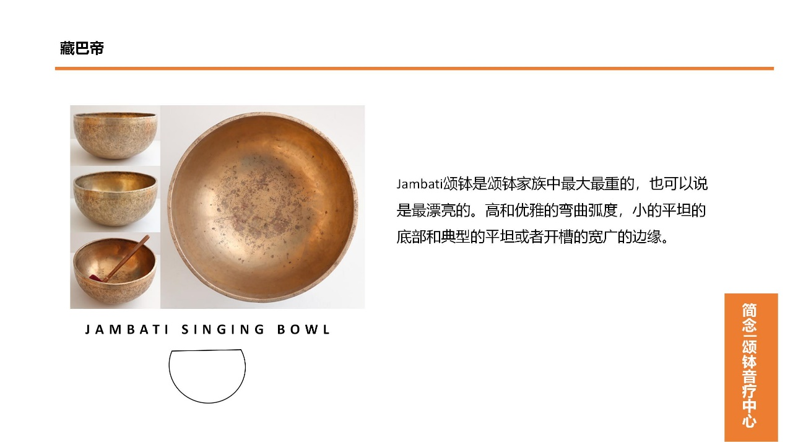

藏巴帝颂钵是一种必备的疗愈颂钵，可以追溯到17世纪到19世纪。

早先，它一般用于仪式中，古印度人也用它来做饭、烧水或在祭祀中盛放供品。

Jambati的意思是喝水或饮酒，BATI则是碗的意思。

Jambati颂钵是颂钵家族中最大、最重、最漂亮的一种。它的弯曲弧度高雅，底部小而平坦，边缘典型的平坦或开槽宽广。

##### 1.3.1.1.2 塔多巴帝

塔多巴蒂颂钵是最古老的碗形颂钵之一，最早可以追溯到15世纪。

其特点是钵壁非常直，底部宽阔平坦，厚重而坚固。

颂钵的边缘通常是平的，沉重的碗有更厚和更宽的边缘，钵底有圆形一圈一圈的图案，钵壁周围通常有轻微的块状和不均匀。底部比较平整，底部边缘与侧壁相交处呈圆形，侧壁向内弯曲。

塔多巴蒂颂钵有厚壁版和薄壁版两种，厚壁版产生更高的音阶，薄壁版产生更深更低的音调。

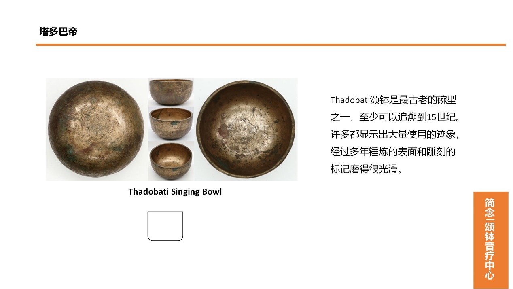

##### 1.3.1.1.3 其他传统钵

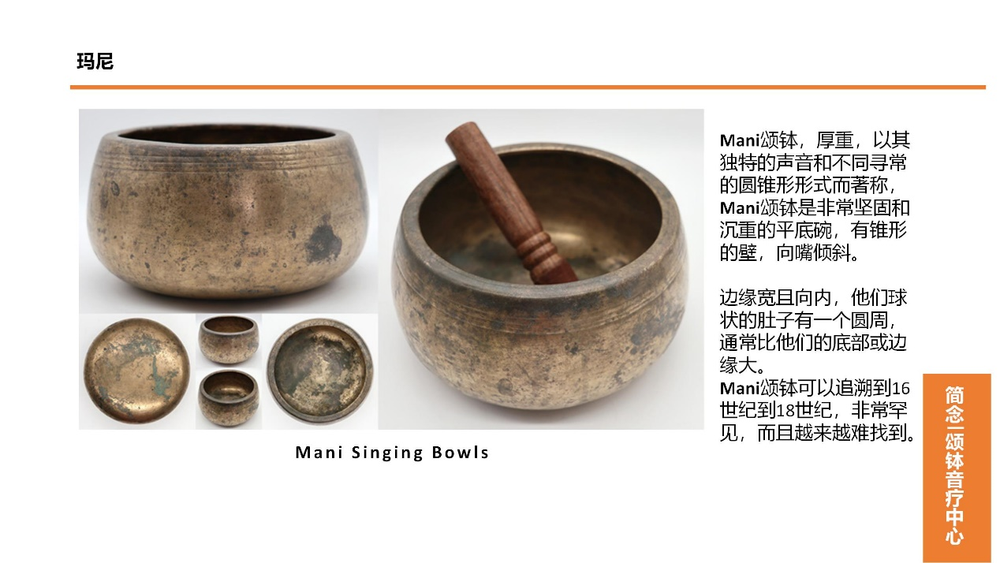

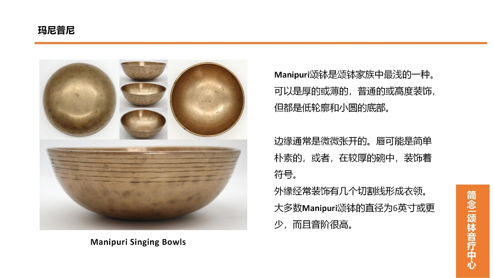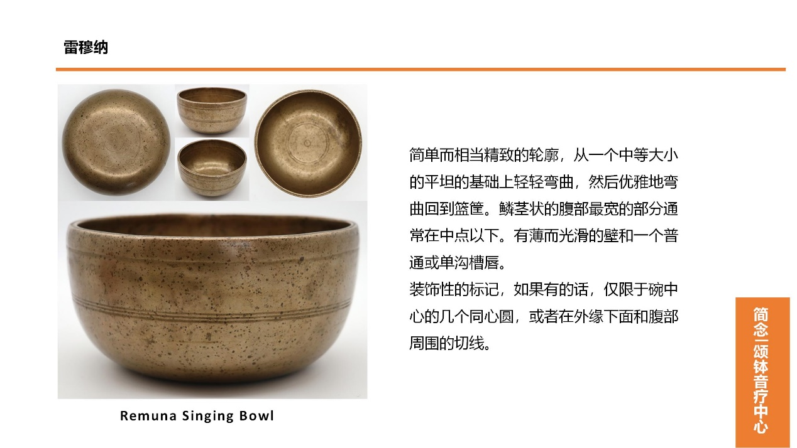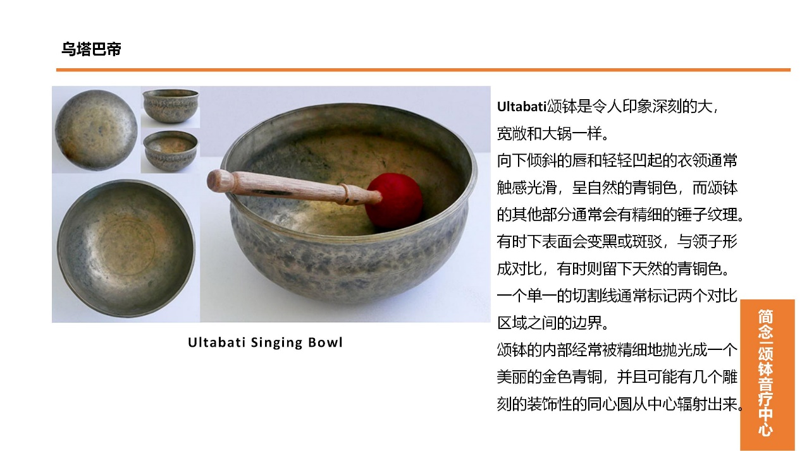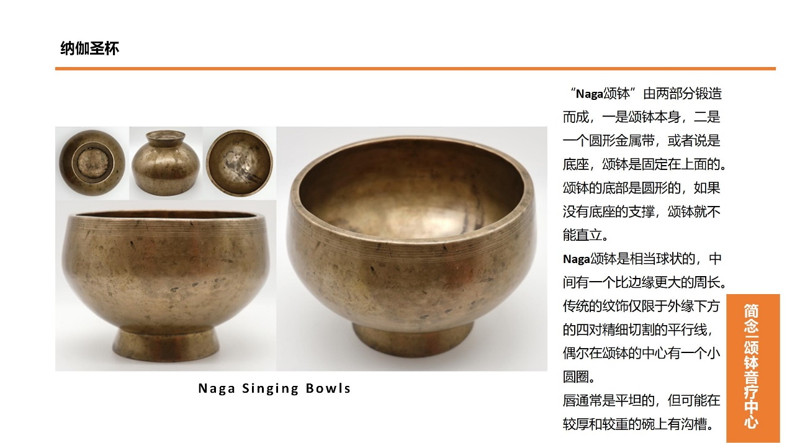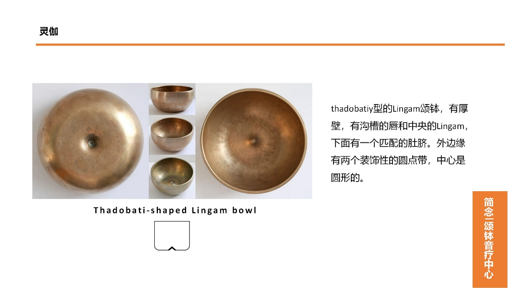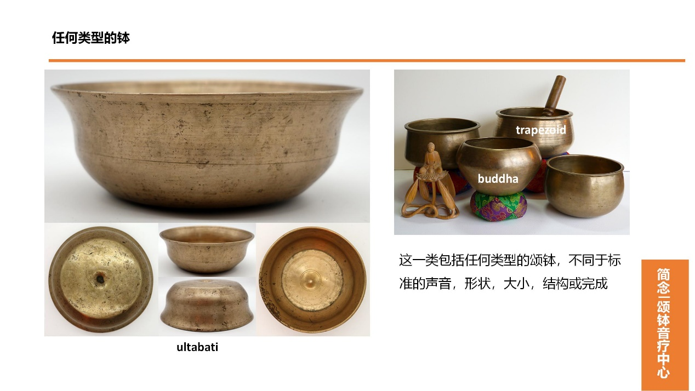

#### 1.3.1.2 现代钵介绍

##### 1.3.1.2.1 满月钵

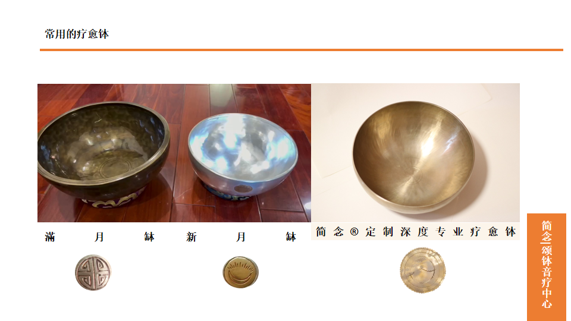

与一般手工钵不同，一个满月钵可以通用其他脉轮。 满月钵的声音非常清晰、悦耳，可以有效地平衡身体的能量，促进身体的自然疗愈。

满月钵是一种高级的铸造工艺手工制作成功的颂钵，是市面上最受疗愈师欢迎且品质最好的疗愈颂钵之一。

它是在大师在历代传承中发展创造出的顶级颂钵，用的所有金属都是最纯净的。

在满月时制作完成，由桑塔大师家族发明，主要用作颂钵疗愈使用。

满月手工颂钵的制作讲究，产量特别少，其声音振动频率非常POWERFUL，疗愈效果最好。制作时间只在每个月的满月那天制作，而且满月时阴天也不能做。

制作钵的师傅需要提前两三天辟谷、静心修行，做钵时诵经。制作场所需要提前净化，那天只做满月钵。制作原材料只使用原矿石金属，做钵用的金、银、铜、铁、锌、锡、铅七种金属都是100%原矿金属。 满月钵通常对应脉轮分为：C钵海底轮、D钵生殖轮、E钵本我轮、F钵心轮、G钵喉轮、A钵眉心轮、B钵顶轮。

在颂钵疗愈中，满月钵被广泛应用于各种身体和情感问题的疗愈，如焦虑、抑郁、失眠、疼痛等。同时，满月钵也可以用于冥想和放松，帮助人们平静心灵，提高专注力和注意力。

满月钵是一种非常珍贵的颂钵，它的制作过程讲究，品质卓越，声音优美，疗愈效果显著。如果您正在寻找一种高质量的颂钵来帮助自己的身体和情感问题，满月钵是一个非常好的选择。

##### 1.3.1.2.2 新月钵

新月钵是一种新概念的颂钵，它采用与满月钵相同的工艺，在晴朗无风的新月夜制作而成。它们代表着新生的力量，与满月钵互为阴阳。

有些人认为，新月钵实际上是满月钵的镀银工艺制作而成，并且采用了新的命名方式，以打造新的市场需求和经济价值。无论如何，新月钵都是一种非常独特的颂钵，它代表着新生的力量和希望，可以帮助人们平衡身体和情感，提高专注力和注意力。

##### 1.3.1.2.3 无底钵

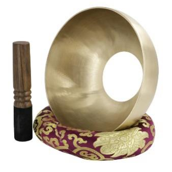

深度愈疗钵适合用于膝盖、头部、身体更轻薄，振幅大。

膝关节头部专用，底部镂空设计，膝关节使用时，和膝盖全方位贴合，效果更好。头部使用时更轻巧。

##### 1.3.1.2.4 紫金钵盂

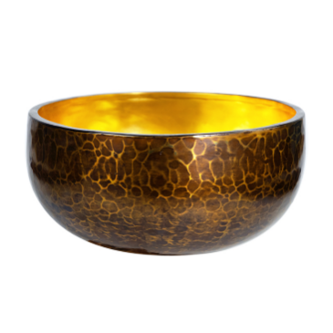

《西游记》中唐玄奘以一个紫金钵换得价值超过三斗三升黄金的真经，紫色代表“圣”，北京故宫又称为紫禁城，紫气东来，代表高贵的气质和卓越的追求。紫金钵作为当代颂钵的天花板，无论声音、器型、振动强度和颜值都是极为优秀的，每一个细节都经过无数次的推敲打磨，内底金黄色的圆融打磨，外观墨青色搭配时间的沉淀，每一个尺寸、每一个音调都经过了数次讨论推敲。使用紫金钵时，请闭上双眼，静静聆听来自山间空灵悠远的音频，感受其中蕴含的文化与精神。

##### 1.3.1.2.5 简念®薄款深度疗愈钵

常见的身心疗愈颂钵，常用于身体疗愈，轻质方便，震感明显，纯手工打造，薄款打磨，音质浑厚，且震感丰富，是颂钵疗愈师必备的疗愈颂钵，也是简念颂钵音疗中心推荐的场馆疗愈必备颂钵类型。

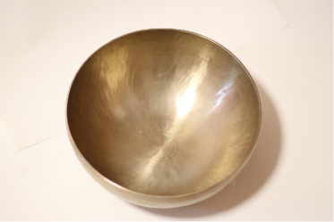

##### 1.3.1.2.6 铜钵德国麦尔

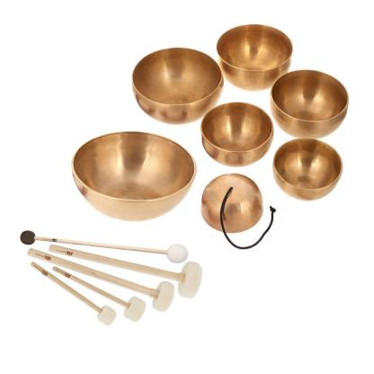

麦尔颂钵是德国有名的打击乐品牌Sonic Energy声音系列旗下的产品之一，成立于1951年。该品牌致力于打造专业的打击乐器，包括铜锣、音束、音叉、铜钵等产品。铜钵系列均在印度生产，与当地手工艺人合作，符合欧洲研发与制作标准，并经过德国质量检验后发到中国，是德国严谨工艺品质的保证。铜钵全系列共有四种产品，涵盖不同的应用场景，从零基础到专业healer，给用户提供了更多的选择和优质的使用体验。

##### 1.3.1.2.7 台湾铜磬

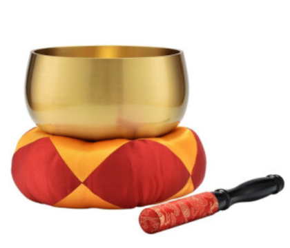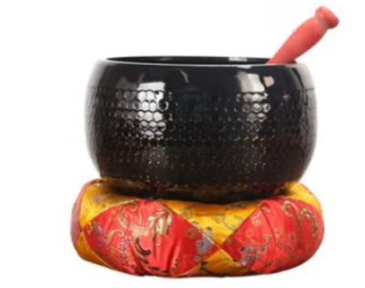

纯铜打造，日式：金色整颗铜胆打磨而成、台式：黑色机械造，手工磨。用于装饰或敲击。

磬是一种铜制钵形法器，可以用桴敲击发出声音，也被称为錾或錾子。

磬是人类最早发明的乐器之一，古书中就有关于磬的记载。佛经中也提到了铜磬，古印度祗洹寺院中就有一铜磬，可以受五升，磬子四边镂黄金，上面刻有过去佛弟子的形象，鼻上还镶有紫磨金的九龙形。背面则立有天人像，手持玉槌敲击磬，声音传遍三千世界。

磬主要用于宗教修行当中，是一种具有神圣意义的乐器。

##### 1.3.1.2.8 音乐钵

音乐钵的音高要求相对来说比较严格，主要用于音声疗愈，调节大脑波频，通过声音方式发来身心的放松与深度睡眠，也是简念颂钵音疗中心推荐使用的音乐类疗愈工具，音乐钵的制作方式也有用满月钵进行制作，相对来说，选择声音比较有辨识度，各阶音准匹配的音疗疗愈，有高频有低频的层次感。

##### 1.3.1.2.9 梵音碗

含铜、机械半手工打造，也有用来听音，不是疗愈和音乐钵，罄之有声，泛音不足，一般专业的颂钵疗愈不会用到。用途：入静，用法敲击或转动发声。

##### 1.3.1.2.10 海豚音钵

可以发出海豚音的颂钵

##### 1.3.1.2.11 台湾引磬

引磬是僧道的一种法器，多用铜制，形如小碗，底贯以钮，下附木柄。

诵经念佛时，用以调整音节。音色清脆明亮。

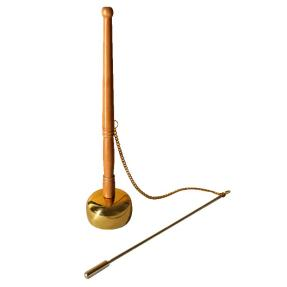

##### 1.3.1.2.12 机器钵

多用于装饰或者展示，起到美学、艺术、陈设、欣赏的价值， 不用于身体或者能量疗愈。

##### 1.3.1.2.13 卡萨钵

目前，尼泊尔新推出市场的创新型疗愈钵——卡萨钵。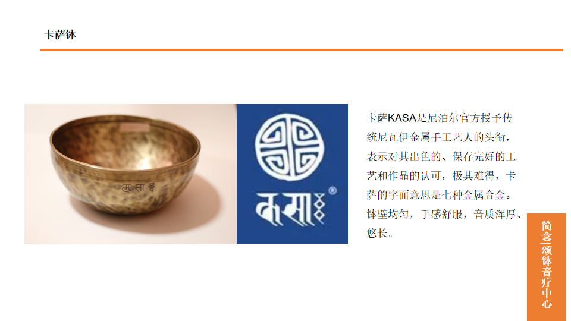

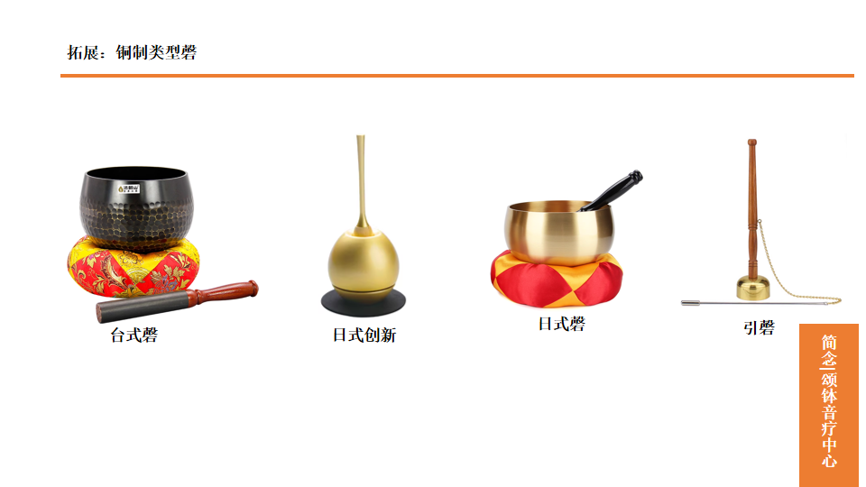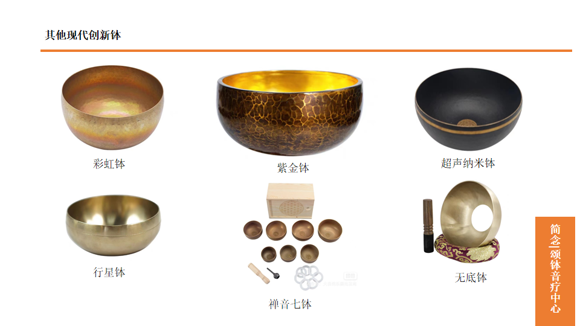

##### 1.3.1.2.14 水晶钵

水晶钵是用高纯度的天然水晶砂提炼制作的，而水晶钵是利用高科技，将99.99%的纯度的天然水晶砂，以高达3000-4000度的高温熔成液体，并在真空无尘的环境中一体成型，避免制程中产生气泡或杂质，达成一个一体成型的完美钵状。水晶本身就是一种振动发射器，它能将晶体的振动意识带入我们的细胞层面。 我们的身体内65%—70%是水分子，是这种信息的完美接受者，它们的振动会渗透到我们身上。

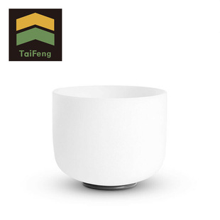

水晶钵，具有记忆，聚焦，传导，放大能量，主要用于净化场域和磁场的功能，使用方法：轻敲和磨钵。

水晶钵的音声疗愈是一场极具穿透力的水晶疗愈，圆象征着圆满，通过敲击或者摩擦发出可听见的声音，圆形中央是空白的，象征着更大的空无，当磨钵时，很容易在外部与内部同时敞开一个空间，因为有这个空间（虚无），得到更多可能性在其中流动和发生。

水晶钵敲击时，声音清脆洪亮，磨水晶钵时，可表现出宏伟气势，其音频偏高，若是思绪过高的人，听起来难免烦躁。

水晶钵适合场域净化或大空间场域进行。

#### 1.3.1.3 其他疗愈乐器

ASMR（英语：Autonomous sensory meridian response），是一种对于视觉、听觉、触觉、嗅觉等其他知觉，颅内、头皮、后背以及四肢等周边部位受到刺激而产生愉悦反应的感知现象，例如头颈部皮肤酥痒、起鸡皮疙瘩等反应。

|  |  |

|----|----|

| 铜锣 | 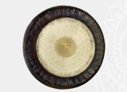 |

| 雨棍 | 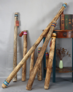 |

| 海浪鼓 | 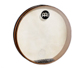 |

| 风铃 |  |

| 天然果壳摇铃 |  |

| 风雷筒 |  |

| 音叉 |  |

| 音束 |   |

| 空灵鼓 |  |

| 手碟 |  |

| 拇指琴 |  |

| 其他中外乐器 | 椰子鼓、埙、萧、笛、琴、大鼓、二胡、钢琴、竖琴等 |

#####

### 1.2.2 颂钵制作

#### 熔铸（矿物冶炼）

无论是传统的工艺还是现在的工业冶炼技术的进步，让冶炼更加的方便高效，但冶炼的方式和过程与传统的方式无异，选择富含铜元素丰富的自然界的铜矿石。

**自然铜矿石**

通过研磨，炼制铜块，将矿物质中的铜各种化学物结合状态，转化成铜原子的集合存在形式，实现对铜的提炼。相对于其他的金属来说，铜是最容易被人提炼出来的金属，在人类材料学应用上，首先是青铜，在材料学上称为：青铜时代。

#### 研粉炼铜

进行浇铸成型，为进一步应用，进行储备工作。

#### 浇铸成型

#### 加热锻打

通过不断地锻打形成，制作各式各样的铜制器材，在颂钵的制作过程中，三四位经验丰富的工匠，进行协作配合，不断在回火，退火中，进行颂钵的打造，持咒、颂咒进行颂钵的定型。

#### 回火退火

退火：是将工件加热到适当温度，根据材料和工件尺寸采用不同的保温时间，然后进行缓慢冷却，目的是使金属内部组织达到或接近平衡状态，获得良好的工艺性能和使用性能。

回火：将经过淬火的工件重新加热到低于下临界温度Ac1（加热时珠光体向奥氏体转变的开始温度）的适当温度，保温一段时间后在空气或水、油等介质中冷却的金属热处理工艺。或将淬火后的合金工件加热到适当温度，保温若干时间，然后缓慢或快速冷却。一般用于减小或消除淬火钢件中的内应力，或者降低其硬度和强度，以提高其延性或韧性。淬火后的工件应及时回火，通过淬火和回火的相配合，才可以获得所需的力学性能。

#### 打磨抛光

打磨是表面改性技术的一种，一般指借助粗糙物体（含有较高硬度颗粒的砂纸等）来通过摩擦改变材料表面物理性能的一种加工方法，主要目的是获取特定表面粗糙度。

抛光是指利用机械、化学或电化学的作用，使工件表面粗糙度降低，以获得光亮、平整表面的加工方法。

#### 雕刻上色

在颂钵的制作工艺上，尤其是手工钵的制作，除了材质上的选择，更依赖于有经验的颂钵工匠，科技发展有利于提高颂钵的精度，稳定性，但又不同于工业化的生产，追求同质化，机械化的量产，颂钵作为新兴市场，又属于小众市场，没有巨大的市场需求，但又能够有足够的消费市场，除了机械钵作为展示性质之外，手工颂钵有其市场，也能够带动当地就业，稳定了手工业者赖以生存的生活基础。

无论是使用颂钵还是制作颂钵，在流动中带来发展，利益颂钵两端的人，造福世界。

### 1.2.3 如何选钵

作为专业的颂钵音疗师/疗愈师，如何走专业路线如何选择属于自己的颂钵，古人云：“工欲善其事，必先利其器”，虽然我们不是工匠，要打磨锋利自己的工具，但作为疗愈师，颂钵即我们必备疗愈的工具，又是我们传达疗愈技能与文化的载体。

疗愈当中，必定是从疗愈自己，影响他人开始，选择颂钵也是一样，做真实的自己，影响身边的人。

选择颂钵，从专业上有相对应的选择原则，但这些专业上的理性指导，都不如最为真实、最真诚的心去感知、同频、选择，下面就从两方面协作进行优选出属于自己的心选之钵。

#### 清晰用途

颂钵的使用目的可分为：演奏与疗愈两种，以演奏为目的，需考虑颂钵的音调高低和音色质量是否符合演奏标准。以疗愈为目的，要首先考虑是采用音声共振法还是钵体振动法，音声为主考虑其声音的稳定性和延续性，钵体振动性，要考虑振动强度和延续性佳的颂钵为主。

同时兼顾携带性参考、尺寸大小以及购买的预算多少等综合考量。

#### 选择脉轮

根据音调和脉轮相关进行选钵。

音调：CDEFGAB对应数字：1234567

对应脉轮：海底轮、脐轮、胃轮、心轮、喉轮、眉心轮、顶轮

新手选钵建议：

一钵建议 心轮钵或根据个性化需求的脉轮选择

简念颂钵音疗中心，推荐一钵建议海底轮钵、胃轮钵、心轮薄款颂钵，用于声音和身心疗愈，方便开启颂钵疗愈师首钵疗愈实践历程。

比如：胃轮钵可以针对性地进行胃部调理，也可以疗愈全身，海底轮钵除了针对海底轮能量外，还可以疗愈全身，对应顶轮，进行放松冥想，稳定又低频的音律，让人身心放松舒坦。

下三轮尺寸相对比较大，也方便进行太空人疗愈，需要选择薄款且重量适中的颂钵进行。

进行专业疗愈路线的疗愈师，建议选择简念定制推荐的薄款海底轮能量钵，进行首钵购置，可以用于身体上的专业疗愈。

三钵建议：下三轮 心轮钵、胃轮（或脐轮）、海底轮

三钵建议：上三轮 心轮钵、顶轮、喉轮

全套七钵疗愈：全套满月钵（钵体振动）、音乐钵（音乐）、轻便薄款七钵（适合手持、振动）、水晶钵（磨钵为主）。

#### 选择尺寸/颜色/外型

尺寸一般一套钵的尺寸，由大到小按照音调顺序，根据自己的喜好选择音调，再选择自己适应的尺寸。

#### 另外根据疗愈场所的面积进行尺寸的选择，大场地，选择满月钵，颜色适合深色为主，小场合，适合小型满月钵，尺寸不宜太过大

#### **价格方面**

百元钵（音乐小钵）、千元钵（身心疗愈为主）注：身心疗愈类型的钵基本上不会低于一千元、万元钵（收藏｜风水｜艺术修养为一身）。

现在相比之前，很多人从事颂钵疗愈，同时中国市场促进到尼泊尔建厂合作，颂钵的价格相对来说，还是属于小众市场，相比于之前，价格上也有所下降。

#### 选择重量

无论是演奏性颂钵还是疗愈型颂钵，都有大小和重量的不同，同时颂钵的厚度也是一个选项，匀称薄款疗愈钵或者适当尺寸疗愈钵适合女性或者在手持型疗愈中有优势。

站在专业的角度，我们可能选择是一类或者一组颂钵，这是通过专业的共性选择出来的，在共性中，寻找到属于自己独有的个性，是接下来要进行选择颂钵的情感与能量依据。

疗愈文化理念中或者我们中医药方理念中，更注重专属定制，一人一钵，一人一方案。

疗愈颂钵是由工匠手工打造而来，可谓千钵千音，每一个钵都有不同的能量。

这就需要我们在共性之中寻找个性，我们选择人生伴侣，不仅仅是选择共性部分，更重要的是：对个性的尊重才能同频共振或者携手共进，共同成长。

接下来，选择钵也一样，如何选择当下适合自己的颂钵？从三个方面，更加专业的角度与情感心念连接选择出属于自己的“真命天钵”。

#### 喜好为主

优先选择，适合自己，心灵感应最强的钵切入，在以上条件的选好的一类钵的前提下，优先选择自己喜欢的，同时在自己预算之内，果断下单，遇见即是美好，遇见就别错过。

浩如烟海的颂钵，不一定是最贵的，也不一定是最大的，但一定是自己最喜欢的。这个很类似于在海边捡石头，以自己的喜好为主才是最真实地面对自己，建立与颂钵的第一次连接。

用心聆听——用自己的身心全然去听，你会听到不只是肉耳可听见的声音，还有那更深邃的触动你内在的秘密之声。大家肯定有那种对某些人一见钟情的经验，选铜钵亦然。一旦你和“真命天钵”相遇，你们彼此共振共鸣，即会有一种“万语不如无言”的清晰明白。

#### 亲身感受

工欲善其事 必先利其器 颂钵成分复杂，测量出来的音频都不尽相同，刚开始不要执着于一定要什么音调，什么脉轮的颂钵，高频的小钵，让人愉悦放松，低频的大钵，则使人安定。最开始，摒弃知识性的大脑分析，由心出发，与心交流，与身体对话，通过听觉与身心感触，选择独属于你的那一份遇见。

**颂钵的疗愈工具的选择和使用，都应该亲身体验和感受（手感&心感），首先连接自己，然后通过颂钵将稳定和有力的频率和能量影响他人。**

#### 耳朵、肌肉、情绪去聆听

如果你只打算买一个钵，那么最好的方式就是跟随你的心，用耳朵、肌肉、情绪、灵性去倾听，不需要别人的意见、不需要灵性导师代替感应，顺着你知道那一颗，那个音调，有着深刻的共鸣，更加自由地敞开自己，去聆听无限的可能性，选择出属于你的那一钵。

### 1.2.4 颂钵鉴别

#### 观察

（料、工、型、纹）观察钵的材质，制作工艺探究，钵的型质，以及钵体上的纹饰，颜色、探究颂钵的年份、制作工艺，以及钵型、钵纹饰。

#### 敲击

（震感+频率+振幅）

通过检测颂钵的音调，通过敲击力度感知和检测音调的稳定性，同时敲击感知泛音的音程和音长。

通过震感、声音的持续性、振动的持续性进行感知判别。

1/4敲击，将钵分为四个方位，在定点的四个方位敲击，感知均衡与稳定，颂钵在长时间的敲击和使用中，频率的稳定会慢慢趋于稳定，钵的疗愈属性与敲击者一起打造了一个固定化的疗愈工具。

1/8敲击，是将钵分为八个区域，在每一块区域内敲击，感知钵在不同区域的敲击的感觉与稳定性，敲击时的力度、可以采用倾斜一定角度，然后自然让钵锤下落，敲击钵体。

#### 转钵

（稳定性+连接性）

感知钵的振动的稳定性、其振动在各个方位的均一性、平衡性、稳定性等。

也可以钵内加入1/3-2/3的水，观察和感知水纹的状态和水纹的跳动节拍。

好的节拍，对称性、分散性越好，钵的稳定性、声音的和谐都会令人赏心悦目。

鉴别颂钵的方法也是选钵的一种路径，最终以目标与喜好的结合，选择出跟随自己的疗愈之旅的伙伴。

#### 纹饰与瑕疵

一般手工钵，或多或少都有一点点瑕疵，这正是手工钵与机械钵的区别与鉴别。所谓瑕不掩瑜，美丽的玉石，一般上也是有瑕疵的，真正无瑕的美玉，要么价值连城，要么就是高仿处理。

在纹饰方面，一般优质的音质颂钵，不会再进行纹饰的雕刻，天然的状态也无需进行画蛇添足。

另一方面，加上纹饰多一层文化内涵和信仰，同时借助纹饰，进行文化能量上的疗愈，比如灵伽，中间凸起的颂钵，象征着男性的生殖器，在印度文化中，占据重要地位，这样的颂钵就多了一层文化色彩之外，形状的调整也有区别于声音的共振，多了一份敬畏神灵的力量，成为老钵中典型的器型之一。

其他的纹饰，比如佛、菩萨、咒语、图案、生命之花等，作为装饰为主，疗愈为辅，对于真正的疗愈颂钵，如同玉雕大师一样，借助玉器天然的形状进行雕刻，甚至保持原来状态，优质的颂钵也是一样，不会有太多的纹饰雕刻在颂钵上。

但通过市场角度，纹饰类颂钵更容易吸引眼球，博得市场的认可与销售。

无论雕刻纹饰还是素面，最后考虑是脱掉文化、信仰外衣，单纯从音质，音色上去聆听颂钵的原始声音，再者考虑表象的意象，不可过度追求表象，这也是颂钵疗愈师的修行之道。

### 1.2.5 周边配件

#### 钵槌

#### 磨棒

#### 垫圈

#### 吸盘

(不建议使用，用手感知会更好)

#### 防滑垫

#### 抱枕

#### 眼枕

#### 按摩床/睡垫

#### 瑜伽毯

## 第三节 使用技法（初中高）

### 1.3.1 请钵Inviting

**心法：** 用心 专注 感恩 虔诚 敬畏

**身体姿势：**稳定不僵硬 轻松不松懈

**心念：**沉稳不急躁

### 1.3.2 持钵Holding

心法：稳、沉、缓

尽量避开发声区的接触，稳定，避免晃动甚至倾掉

**无金属准备、感知与无影响式持钵**

正下方（劳宫穴）掌钵

向后倾斜掌钵

向前倾斜掌钵

三指稳钵

指尖持钵

### 1.3.3 敲钵Striking

心法：轻柔、优美、干脆、利索

敲钵节奏5种

点敲（敲击完成回到原来位置）

捞敲（舀水动作）

勾敲

平敲

扩展补充：

太阳敲击法

月亮敲击法

大地敲击法

意念气势准备（三锁印），收下颚、收腹提肛（根锁）、挺胸拔背（心锁）、提气而上（喉锁）

心念：专注、缓慢、沉稳、有节奏，心中有慈悲和虔敬

三呼吸：一呼吸：静心（问心） 二呼吸，正身（问身） 三呼吸，正念（问灵）

实操方式：吸气打开 呼气缓慢敲击

连接：心轮 轻敲3次（3、5分力）——疗愈者（3、5分力）、双手捧还

### 1.3.4 磨钵Rubbing

心法：稳、静、柔、气韵

平息凝神，左手伸平，将钵放于手掌中心，右手执木棒，然后用棒的下端轻擦钵边顺时针或者逆时针旋转，绕着钵慢慢擦起。由快而慢慢地颂钵会随着木棒的摩擦，产生振动发出悦耳的共振之声，声音越来越大，绕梁余耳其声空灵而深远。

磨钵技法2种

轻触+手握

不要动用手腕，而是应该用手肘和肩膀的力量。

左右摩擦，来回摩擦

磨钵就是在钵口画圈，即是画圈，可以忽快忽慢，可以不以为意地随性画圈，也可以神圣很有力道，有洞察力，观呼吸，有感染力地画圈，优雅、和谐、柔软、慈悲的磨钵。

关键点：起点即终点

磨钵前，净手、静心，净化颂钵，准备疗愈的意图

手执毛笔状，沉肩、坠肘、调息

熟练、熟练、再熟练的磨钵，力道、速度、角度、态度（自我尝试寻找自己的磨钵经验）、最终达到人钵合一的和谐之境。

### 1.3.5 移钵Moving

平移+旋转

### 1.3.6 放钵Placing

轻放、置于钵垫上

**二段式放钵**

观察被疗愈者的呼吸，在吸气时，胸膛或者腹部向上鼓起，依二段式要诀放置颂钵。

具体是：吸气时，身体逐渐鼓胀，腹部向上开始凸起，这时候被疗愈者正充满力量，有能力承担的时刻，此时我们将颂钵接触鼓胀的腹部，注意你的双手还有持续托着钵，承担一半钵的重量，将另一半重量缓慢地传导到被疗愈者身上。

注意的是，并未把全部钵的重量转移，跟随着疗愈者的呼吸，在下一次吸气时，将钵全完稳定的放置在被疗愈者身上。

这样在两个呼吸之间完成的放置动作，不容易引起被疗愈者的身体意识，同时安稳地过度，完成钵的放置。

这样的放钵过程，绝大多数下，被疗愈者是没有感知到钵放置在身体上的过程，对于已经放松、沉睡的疗愈者来说，全然不觉颂钵的重量。

### 1.3.7 敲击手法、节奏、力度

敲击手法是使用木槌或其他工具敲击颂钵，产生共鸣声和振动的过程。力度可以根据需要进行调整，一般分为1分力到10分力不等，力度越大，颂钵发出的声音越响亮。在使用颂钵进行疗愈时，可以根据需要选择不同的敲击手法和力度，以产生不同的效果。

节奏也是颂钵疗愈中非常重要的一个因素，可以通过不同的节奏来产生不同的效果。例如，心跳节奏可以帮助疗愈者放松身心，进入更深的冥想状态。而快速的节奏则可以帮助疗愈者活跃身体能量，增强身体的自愈能力。

在使用颂钵进行疗愈时，需要保持专注和放松的状态，让颂钵的能量带领着呼吸，协助更深入地呼吸，吸入更多的能量，呼出更多的浊气。

通过呼吸的练习，可以达到止息入定的状态，进一步加强疗愈的效果。

**力度**

1分力

3分力

5分力

7分力

10分力

**行钵**

自在行钵

泛音行钵

**呼吸行钵（必备技能）**

**节奏（中级）**

1000 0000 0000 0000 ~ ~ ~

1000 1000 1000 1000

1000000000 1000000000

心跳节奏 1200 1200 1200 1200

慢心跳 1200 0000 1200 0000

**木鱼**

1111 1111 1111 1111

123456787654321

1111 2222 3333 4444 5555 6666 7777 8888 8888 7777 6666 5555 4444 3333 2222 1111

放松专注、以钵结合呼吸，让钵的能量带领着呼吸，超越极限，协助更深入呼吸，吸入更多的能量，呼出更多的浊气，在呼吸的练习中，以达止息入定的状态。

### 1.3.8 磨钵角度、速度、力度

探索阶段：自我尝试角度，垂直、30度、45度、60度，自己手腕手肘的感觉舒适程度

相对速度：加速、加速、匀速（快匀速、慢匀速）等

力度：0、1、2、3、5、7、10

### 1.3.9 止音Stop ing

无止音｜自然消音

钵锤止音

**水晶钵 不可止音**

### 1.3.10 丁夏使用技法及场合

藏语称为丁夏，华语世界中亦有因其使用方法而称之为撞铃、碰铃，既是乐器又是疗愈工具。丁夏由两个铃铛互相串联而成，铃与铃互相碰撞后产生高亢嘹亮，空灵悦耳的声音亦或是悠远空灵之音，其超凡的泛音，有助于净化和提升个人和空间的气场频率。丁夏历史久远，用法也多变，早期常见于宗教仪式，同时流行于不同民族歌舞之中。到了近代，由于丁夏小巧易携带，因此成了修行人士常用的随身禅修工具，丁夏又可以配合颂钵使用成为身心疗愈的绝佳伙伴。

传统上，丁夏发出的音乐可以清除一个空间的负面能量，使心灵回到当下，也被用来疗愈耳鸣。

在灵性领域中，撞铃被用来开启第三眼，也可以在疗愈师和个案之间创造一条疗愈连接，传导正能量，最后丁夏也可以用来平衡脉轮。

通常适用于疗愈开始与结束，配合呼吸节奏进行，收摄意识或者唤醒身心，是疗愈师必备的音疗乐器之一。

在治疗耳鸣上，因为耳朵是很脆弱的器官，大概举例耳朵24寸（80厘米）左右敲击丁夏，迅速移到耳朵3寸（10厘米），停留5秒或等声音渐消，再移回到原来的位置，持续进行3～5分钟。被疗愈者，可以以冥想或者平躺的方式进行。丁夏选择在8-10CM的尺寸最为合适，泛音以悦耳、悠长为最佳选择。

如果出现意外不适或严重的情况，当不能忍受声音时，试着撞击轻柔一下，同时距离可以再远一些慢慢靠近。

### 1.3.11 颂钵的清洁与保养

最大的保养方式就是**多多使用**（敲击+磨钵）

- 沉积灰尘｜软布擦拭即可（柠檬汁+温水清洗钵）

- 水渍｜清水清理并擦干晾晒（禁止暴晒）

- 氧化铜绿｜牙膏或白醋，软布或白纸画圈的方式轻轻推磨，直到绿色的氧化物消失

- 熏香净化｜用白鼠尾草叶、艾草叶、雪松叶等干燥物质，用燃烧后产生的烟雾，环绕于钵体的内部，用以去除前一个个案残留于钵内的能量。

- 使用过程中，保持干燥、避免碰撞。

- 应放置于干燥处存放，平时使用完后用棉布擦拭干净至干燥即可。

- 请勿使用含酸性物质清洁剂、酒精、挥发性溶剂、氯化物等溶剂清洗颂钵，以避免颂钵腐蚀。

- 请勿使用钢丝球等硬质物品清洗颂钵，以避免损坏颂钵表面。

- 放置时请勿将颂钵直接放在坚硬的物品上，以免产生摩擦碰撞。

- 也可以念经、持咒、祷告、焚香等仪式开启颂钵的能量清理与加持

- 满月钵还可以通过供奉，或者满月夜晚进行月光浴的方式进行清洁。

- 颂钵放置的位置要具备虔诚心，放在主位有供奉尊重的方式，避免放在不常见的角落或者垃圾桶附近。

- 音乐界保养打击铜乐的方法，植物保养油。

### 1.3.12 颂钵呼吸实践

静坐、手执毛笔状，沉肩、坠肘、调息、运气丹田

在第一次吐气时，吐到8—9分，就开始顺时针转钵，

慢慢吸气

第二次吐气时，吐到10分，

再慢慢吸气

第三次吐气时，试着吐到11分，

再慢慢吸气

逐步增加，尝试比前次吐气的量再多一点

处在自然放松之中，不要勉强自己

同样，第一次吸气时，只吸8分，

就开始吐气

第二次吸气时，吸到10分，

才开始呼出

第三次吸气时，试着吸到11分

每一次都试着比前一次多吸一些

但是请在放松的状态下，自然达到。

**非暴力呼吸，切忌执着用力。**

在一次次的练习中，你可以听见自己的呼吸，听见稳定的钵音，仿佛体验到了呼吸存在的真实，回到了最宝贵的当下，回到呼吸之间，领受生命的能量，拥有丰盛的一切，充满了爱与感恩。

### 1.3.13单铜锣敲击技巧

生而有翼，为何匍匐爬行？

You were born with wings， why prefer to crawl through life?

——灵性诗人鲁米 （13世纪）

# 理论课题

## 第一节 声音基础（初中高）

当颂钵在身体上被敲响

整个身体的每一个细胞都在振动

身体享受着细胞级声音按摩

带动着大脑进入深度的放松

一刻钟下来

舒适 自在 不愿醒来

这种颂钵与身体接触与连接

是颂钵音疗中独有的魅力

听觉与触觉

感知细胞级的水分振动

实现身心的彻底放松与疗愈

无药而愈

### 2.1.1 型质合一

关键词：铜 中空 圆

可以想象一下，如果颂钵的形状是三角形或正方形，是否还能发出优美悠长的声音呢？

如果颂钵是由其他材料制成，例如铁、铅、木材或石头，是否还能发出同样悠长的声音呢？

因此，很显然，颂钵之所以能够产生如此美妙的声音，是因为其形态和材质的完美结合。

我们从人体的发生结构来探索声音的四要素。

发音的生理基础是人类的发音器官。人类发声系统主要由动力部分、振动部分和传播共鸣部分三个组成部分构成。

动力部分是肺部，振动部分是声带，传播和共鸣部分则包括胸腔、咽喉腔、口腔和鼻腔等。

同样地，颂钵的声音基础也是由三个部分组成。动力部分是敲击者，振动部分则是由铜制钵型产生的。传播和共鸣部分则是空气和钵腔体，即颂钵的中空部分。

声音产生于物体振动产生的声波。

我们之所以能够听到声音，是因为声音以波的形式振动传播。

### 2.1.2 声音要素

声音的四要素是音高、音强、音长和音质。

- 音高（音调） ：顾名思义，音高指的是我们声音的高低，它取决于发音体振动的快慢。振动快，音高就高，振动慢，音高就低。像我们发出的声音小、细、短、紧则是振动快，音高要高；当我们发出的声音比较大、粗、长、松则是振动慢，音高就要低。通俗点也可以理解成女生发音偏高，男生发音偏低。

- 频率（frequency）是单位时间内完成周期性变化的次数，是描述周期运动频繁程度的量，常用符号f或ν表示，单位为秒分之一，符号为s-1。为了纪念德国物理学家赫兹的贡献，人们把频率的单位命名为赫兹，简称“赫”，符号为Hz。每个物体都有由它本身性质决定的与振幅无关的频率，叫做固有频率。

- 音强：音强指的是声音的强弱，它取决于发音体振动的幅度。幅度大，音强强，幅度慢，音强弱。简单来说就是，咱们说话越用力，振幅就大，音强就强，反之。

颂钵的音强，来自敲击者的敲击方式与力度，决定声音的大小与钵振动的幅度，但并不改变其固有的频率，敲击的方式或大或小，可根据场域与颂钵的位置以及疗愈者的身心状态而灵活变通，是疗愈师常用改变声音要素的方式。

- 音长：音长是指声音的长短，它取决于发音体振动的时间。发音体振动时间长，音长就长，振动时间短，音长就短。这个音长在我们没有什么区别意义的作用，但也不是全然无用，比如我们说话慢，音长就长，当我们跟人吵架的时候，音长就短；再比如我们朗诵的时候音长长，平时说话，音长就短。

音长，作为发音而言，可以根据不同的发音环境和变化，之于颂钵可以采用不同的敲击工具以及不同的敲击技巧而进行设计，敲击、磨钵、撞击、止音方式等，实现同一钵的不同发声与表达，丰富其使用的用途，创造并满足对钵音的设计与输出。

- 音质：是指音的质量、清晰度、高质量的音指的是无损的原波形。但要清楚的是，音质不同于音色，声音好不好听说的是音色而不是音质。音质是声音的质感、粗细感、纯净度、Q弹感和密度感。对于颂钵而言，不同型质的颂钵，其有固定的频率，这个不由敲击着的意识而变动，当颂钵被制作完成的那一刻，基本上其频率已经定型。

- 音质的把握，来自对钵的选择，是一个综合考虑的因素，更多是物理层面，钵本身的魅力，无论多大力气、多种方式、都能够有很好地钵音与泛音。

### 2.1.3 声音接收

当声波透过外耳进入到耳鼓，将它们传到中耳组织后，再被引导至内耳与耳蜗；接着，位在耳蜗内的听觉接收器便会将它们接收到的声波，经由听觉神经，再将讯号传送到大脑，就形成听觉。

在中学时代，我们的课本上学过声音的接收来自我们听觉系统与大脑的连接，使得我们可以听见自然界的部分声音，科学上定义人的听觉范围是 20 Hz ~ 20 kHz，随着年龄的增长我们能够听到的范围进一步缩小，到了老年之后甚至需要大声说话才能听到对方说话，这种感觉很类似于在水里听岸上的声音一样。

### 2.1.4 基础钵音

#### 2.1.4.1 钵的音调

不同门派或地区的分类方式不一样，具体如图

通过脉轮论述，吠陀体系的音调系统为CDEFGAB。

CDEFGAB是英国式的音名，对应：C=1=do D=2=re E=3=mi F=4=fa G=5=so A=6=la B=7=ti（si）。

自古以来，声音一直被认为是人和神圣力量交流的媒介之一，颂钵疗愈就是音声疗愈的一种。颂钵原本是喜马拉雅神一带僧人盛装食物的器皿，后因为声音的独特和奇妙被欧洲人做了大量的研究和临床实践，研究发现颂钵的声音对促进人体的健康起到很好的作用，渐渐地颂钵疗愈被越来越多人接纳，现在颂钵已经成为理疗、音声按摩、音声疗愈和平衡脉轮等深受人们喜爱的特殊乐器，并且颂钵疗愈也被正式纳入国际公认的自然疗法体系当中，在欧美已经被主流医学认可并作为辅助医疗纳入当地医保范「共鸣泛唱宇宙元音」Aum或Om。

西藏体系的行星排列顺序，是以从地球上观察行星移动的速度而定，月亮感觉最快、土星感觉最慢，而太阳居中。这个是古时候的天文学家和炼金师使用的系统。

Doh ~ C

Ray ~ D

Me ~ E

Fah ~ F

Soh ~ G

Lah ~ A

Te ~ B

#### 2.1.4.2 五脏有音

在中国传统文化中，五脏皆有音是一个重要的概念。在中国中医五行理论中，自然界中有五种天籁之音，分别是角、征、宫、商、羽。而物质也有五行，分别是木、火、土、金、水。与此相对应，人体也有五个重要的脏器，它们分别是肝、心、脾、肺和肾。这些脏器与五行、五味、五音相对应，因此音乐对疗愈疾病也有裨益。

在中国汉字文化中，乐与药都是一种疗愈手段。药物的作用机制如同音乐一般，调节身心平衡，使得身心愉悦健康。两千多年前的中国医学巨著《黄帝内经》中，就记载着五脏与五种频率的声音之间的联系。肝属木，在音为角，在志为怒；心属火，在音为征，在志为喜；脾属土，在音为宫，在志为思；肺属金，在音为商，在志为忧；肾属水，在音为羽，在志为恐。角、征、宫、商、羽五音，称之为“天五行”。五脏与五行、五味、五音相对应，所以音乐对疗愈疾病也有裨益。一曲终了，病退人安。

“音乐之所由来远矣，生于度量，本于太一。太一出两仪，两仪出阴阳，阴阳变化，一上一下，和而成章。”

——《吕氏春秋》

「动荡血脉、通流精神而和正心也。」

——《史记·乐书》

“五脏有声，声各有音，声音相和则无病。”

——《黄帝内经》

#### 2.1.4.3 神奇泛音

在音乐产生与颂钵疗愈当中，有一个重要的概念，让声音在有了神奇的功能与价值，这就是泛音。

泛音是一个音乐术语，在专业的音乐范围里，泛音列的描述：所有音列中波长最长者称为基本波长（基波），而基波长短决定了乐器弹奏此音符的音高。几乎所有乐器除了可发出基波音以外亦会伴随着较短波的声音，称为泛音。

这些声音发出的频率后，最低的称为基音，所有频率比基音高的分音都称为泛音。

在有明显音高的乐器中，弦或空气管之间会有因反射而造成波长相同、行进方向相反的波，而因为这些彼此互相干涉而产生波长不同的谐波，在音乐上的名词即为泛音。而泛音列的波长分别为弦长或是空气管长的1/2、1/3、1/4、1/5、1/6等倍。

颂钵是一种传统的西藏佛教疗愈乐器，也是一种发声乐器，其主要特点是能够发出丰富的泛音。颂钵的泛音是由于其特殊的设计和制作工艺所决定的。颂钵的制作材料有铜、锡、铅、金、银等多种金属，而制作工艺则是通过捶打和旋转颂钵来产生声音。颂钵的声音非常特别，它不仅能够让人感受到强烈的共鸣，还能够产生一种疗愈的效果。

值得注意的是，敲击后的颂钵，除了其固有的频率外，随着音长的拉长，泛音频率越小，越高。有趣的是，其峰值共振频率接近于整数比关系，这使得颂钵呈现出和谐的声音效果。下图是科学文献中检测出来敲击颂钵后的能量状态和频率的变化模型。

泛音的产生不仅仅局限于颂钵，它还存在于很多其他的乐器中，比如钢琴、小提琴、吉他等。当乐器发出声音时，泛音会随着基本波长的变化而变化，这也是乐器发出不同音高的原因。同时，泛音也是乐器音色的重要组成部分，它能够让乐器发出更加丰富、深刻的音色，让人们在欣赏音乐的同时感受到更加强烈的情感和内涵。

泛音是音乐中一个非常重要的概念，它不仅存在于乐器发出的声音中，还能够产生疗愈的效果。对于音乐爱好者来说，了解泛音的原理和应用，不仅能够让他们更好地欣赏音乐，还能够让他们更好地理解音乐的内在构造和魅力。

**颂钵：打击声的基频和泛音频率越小越高。**

**有趣的是，其峰值共振频率接近于整数比关系，这使得颂钵呈现出和谐的声音效果。**

#### 2.1.4.4 五度音程

音乐源自数学。

音是由于物体的振动而产生，古人把不同振动频率的弦按照比率排列在一起，就能演奏出乐音，进而产生音乐。

琴弦振动时，产生了基本频率，称为基音，但是琴弦不仅是全弦振动，弦的二分之一、三分之一等等也在同时振动，因此产生的是包含八度、五度等许多音的结合，这些部分的音就叫做泛音。

音程，指两个音级在音高上的相互关系，就是指两个音在音高上的距离而言，其单位名称叫做度。

音程是指两个乐音之间的音高关系，用“度”表示。以简谱为例，从1到1，或从2到2都是一度，从1到3或2到4都是三度，从1到5是五度。

首先，度是一种单位，用来衡量音与音之间的听觉上的距离。它是一种量度，其大小是人为规定的。

五度相生律就是利用泛音生成，其中只有两个频率比，八度为1：2，五度为2：3。

八度主要用于把音移动到一组以内，五度主要用于推导各音的频率，推导方法则是根据五度循环圈进行。

<table>

<colgroup>

<col style="width: 16%" />

<col style="width: 16%" />

<col style="width: 16%" />

<col style="width: 16%" />

<col style="width: 16%" />

<col style="width: 16%" />

</colgroup>

<tbody>

<tr>

<td style="text-align: left;"><strong>CDEFG</strong></td>

<td style="text-align: left;"><strong>GABCD</strong></td>

<td style="text-align: left;"><strong>DEFGA</strong></td>

<td style="text-align: left;"><strong>ABCDE</strong></td>

<td style="text-align: left;"><strong>EFGAB</strong></td>

<td style="text-align: left;"><strong>FGABC</strong></td>

</tr>

<tr>

<td style="text-align: left;"><strong>DFACE</strong></td>

<td style="text-align: left;"><strong>ACEGB</strong></td>

<td style="text-align: left;"><strong>FACEG</strong></td>

<td style="text-align: left;"><strong>GBDFA</strong></td>

<td style="text-align: left;"><strong>BCDEF</strong></td>

<td style="text-align: left;"><strong>CEGBD</strong></td>

</tr>

<tr>

<td style="text-align: left;"><strong>EGBDF</strong></td>

<td style="text-align: left;"><strong>BDFAC</strong></td>

<td style="text-align: left;"><strong>CFBEA</strong></td>

<td style="text-align: left;"><strong>DGCFB</strong></td>

<td style="text-align: left;"><strong>EADGC</strong></td>

<td style="text-align: left;"><strong>FBEAD</strong></td>

</tr>

<tr>

<td style="text-align: left;"><strong>GCFBE</strong></td>

<td style="text-align: left;"><strong>ADGCF</strong></td>

<td style="text-align: left;"><strong>BEADG</strong></td>

<td style="text-align: left;"><strong>CGDAE</strong></td>

<td style="text-align: left;"><strong>DAFCG</strong></td>

<td style="text-align: left;"><strong>EBFCG</strong></td>

</tr>

<tr>

<td colspan="6" style="text-align: center;"><strong>颂钵五度音程表</strong></td>

</tr>

</tbody>

</table>

## 振动基础（初中高）

### 2.2.1 同频共振（波振）

无论是单钵的敲击点振动，引发整个钵体的同频共振，将振动的能量放大，完成整体的共振，如同蝴蝶效应一般，从分子层面的振动带来宏观上钵体的共振。

还是钵体的振动与人体的同频共振，将运用振动让能量从紊乱到有序，实现趋于同频的过程。

稳定的颂钵频率，敲响时会使得不平衡（紊乱）的身心频率趋于稳定的同时，调节各个脉轮归于稳定且平衡的能量频率，构建自己强的能量共振场，在不间断颂钵之音中达到高能量的平衡与共振。

#### 2.2.1.1 脉轮同频（能量场）

脉轮在中世纪的印度传统上是生理和心理的中心的深奥信仰，认为人类生活同时存在于两个平行的维度中，一个是身体另一个是心理、情感、心智、非身体，因此被称为微妙的身体。这种微妙的身体是能量，而物理的身体是质量。

这些脉轮是人体能量场的重要组成部分，它们的运转状态直接影响着人们的身心健康。

不同脉轮的共振频率不同，因此选用同频的脉轮钵进行疗愈，能量共振效果最好。

同频共振是一种能量传递的现象，它可以将振动的能量放大，完成整体的共振。

在颂钵疗愈中，选择与目标脉轮同频的颂钵进行疗愈，可以帮助人们调整自己的能量场，达到高能量的平衡与共振。进行我们业力（日常作息、饮食习惯、人格特性（思想、情绪、体能与大自然能量））的调整与转变。

人体脉轮能量图并非独立封闭系统，而是互相交互影响的整体系统，强场能够带动弱场，弱场也会影响强场，同频共振的背后原理是一种同频下的振动叠加，强强联合，实现能量场的高能振动，提高气场，进而带来身心的疗愈。故若只有一钵也可疗愈整体。

以脉轮为例，如果一个人的某个脉轮处于不平衡的状态，那么与之共振频率相同的颂钵会帮助该脉轮恢复平衡。这是因为同频共振的背后原理是一种同频下的振动叠加，强强联合，实现能量场的高能振动。

#### 2.2.1.2 什么是谐振（调频）

谐振，又称“共振”，是一种振荡系统在周期性外力作用下，当外力作用频率与系统固有振荡频率相同或很接近时，振幅急剧增大的现象。这种现象在人体上也会出现，被称为“谐振频率”。

谐振频率是指在应用颂钵的振动作用于疗愈部位时的最佳振动频率。它被定义为能够最大程度启动肌肉活动的振动频率，能在最短时间内对神经肌肉性能产生最大的影响。

这种振动频率能够在人体上产生良性的表现形式，成为一种疗愈手段。

在颂钵疗愈中，通过选择与目标部位的谐振频率相同的颂钵进行疗愈，可以实现能量共振，达到更好的疗愈效果。这种能量共振的疗愈方法已经被越来越多的人所接受，成为一种受欢迎的身心健康疗法。

### 2.2.2 物理振动（震感）

物理振动（震感）是一种通过声波或物理震动传导的刺激，能够直接影响人体的各个组织与器官，从水分子开始，引起水共振到细胞、肌肉、骨骼、神经、大脑等，实现深层次、细胞级、全方位、系统性的身心共振体系。因此，声音被誉为未来的医药。

声波传导介质所产生的疏密波，或者物理震感，可以直接传送到身体皮质内的接收器。当接收器受到刺激时，会让体内的神经末梢产生局部电位，而局部电位又会引起局部电流，并将其传导中枢神经系统，最后达到大脑，形成触觉。

在现代医学中，物理振动已经被广泛应用于各种疗愈方法中。例如，音声疗法可以通过声波的传导，调节人体的生理和心理状态，缓解压力、焦虑和抑郁等症状。另外，物理振动也可以用于疗愈肌肉疾病、骨骼疾病和神经系统疾病等。

除了医学应用外，物理振动还被广泛应用于音乐、娱乐和运动领域。例如，音乐的旋律和节奏可以通过声波的传导，直接影响人的情绪和心理状态。另外，一些健身器材和训练方法也利用了物理振动的原理，通过震动来刺激肌肉和骨骼，达到锻炼身体的目的。

物理振动作为一种直接影响人体的刺激方式，已经被广泛应用于医学、音乐、娱乐和运动等领域。

随着科学技术的不断发展，我们相信物理振动在未来的应用领域还会更加广泛和深入。

#### 2.2.2.1 人体水分

人体约70%左右都是由水分组成，故其振动的波频与身体内在的分子频率产生共鸣、共振，形成涟漪振动式的按摩与疗愈效果，如调音师一般，唤醒、启动人体的自愈能力，帮助人体恢复平衡和谐的健康状态。

当我们敲响颂钵的时候，发出的音震跟宇宙的能量和谐共振。这种震动被人体所接收到，我们的能量便有了随之共振的可能，身心能量随之改变，带来深层迅速地放松。

颂钵是一种能够产生振动的乐器，它的振动源头是人体内的水分。我们可以通过将水放入颂钵中，敲击或磨钵，观察到水波与水花规律的跳动。

这是因为颂钵有序而规律的振动，带来水分子的舞动，在稳定规律的颂钵之音中，水的振动趋向于稳定而规律，最后在共振之中，强强联合，形成可见的水波与水花等物理现象。

在颂钵的疗愈过程中，人体中的水分除了皮肤感知颂钵的振动之外，还可以通过细胞共振，直接通过神经系统进行传输，从细胞、器官等全方位的实现深层次地按摩，这是一种神奇的自然疗法。

颂钵的振动频率与物理现象下的振动模式都可以深层次地从细胞、器官“按摩”到我们的细胞、放松神经，开启我们人体水分的正向循环，更好地疏通与代谢。

在颂钵疗愈之后，人体会出现口渴的现象。

这是很正常的身体反应，并非水分从身体外排出，造成的口渴，而是水分进入深层的平衡，而产生的口渴现象。颂钵之后，小口喝水，非常有利于身体水分的吸收与代谢，是一次难得的身体净化。

#### 2.2.2.2 组织系统

**人体的七个脉轮位于身体的不同部位，包括肾上腺、卵巢或睾丸、胰脏、胸腺、甲状腺、脑下垂体、松果体等内分泌腺的位置相重叠。**

荷尔蒙：有着唤醒、刺激的意思。荷尔蒙是具有促进身体的成长和新陈代谢、唤醒熟睡中的身体等，并全面影响着我们的脉搏、体温、身体发育、新陈代谢、睡眠以及感觉等功能。

颂钵的高级疗愈将通过对内分泌系统、神经系统的按摩放松，进行自我的平衡与协调，实现荷尔蒙的平衡，也促进调节脉轮平衡，实现高能量健康的身心状态。

现代科学认为：维持人体正常运转有八大系统：包括血液循环系统、呼吸系统、内分泌系统、神经系统、消化系统、免疫系统、运动系统和生殖系统。

万事万物都有自己独有的振动频率，并以这样的方式，吸收与释放能量。对于人体而言，小到细胞，硬如骨头，微到脑电波都在波动，如果频率一致，就会发生共振，看似弱小的能量就能造成很大的影响。

每个人都是一座独一无二的交响乐，每个细胞、器官、肌肉、组织、思想等等都在不断演绎着感知、情绪、心智与灵性的歌。

水可以同频不同脉轮的颂钵，无论是哪一个脉轮的颂钵，引起同频共振，都溅起水花，人身体有水分构成，这种开放式的同频共振，是整体性身心疗愈的基础与依据。高维对低维的同频共振即是平易近人。

人类是高等的生物，能够同频万事万物，达到万物与我为一的智慧境界。从而能够感知与领悟鱼之乐，一年四季、二十四节气，对人的发展养生，顺道而行，同频四季而养生，春生、夏长、秋收、冬藏，四时养生。傲梅、虚竹、淡菊、幽兰等同频君子之气概，以无限之心处有界之事，便是水的精神，上善若水矣。

## 第三节 能量基础（中高级）

三脉七轮的奥秘及其开启

人体内有一个内在的能量系统，称为灵体（Subtle Body），由三个部分构成：三条经脉（Nadis）、七个能量中心（Chakras）和灵量（Kundalini）。

三条经脉分别是左脉、中脉和右脉，掌管不同的能量。

左脉掌管记忆、过去和情感方面，

右脉掌管思维、未来、行动以及计划方面。

而中脉则是连接左右两脉的通道，只有中脉打开，才能平衡使用左右两脉的能量。

灵量是人体灵性的重要部分，位于盆骨底部的荐骨内，是一块三角形腔内卷曲成3圈半的能量。只有在适当条件下，灵量才会被唤醒和提升，并通过五个轮穴到达大脑顶部的神经丛，最终穿越顶轮和头盖骨，接通宇宙的能量，达到自觉的境界，即无思虑但有知觉的入静状态。

七个能量中心是人体能量的七个交汇点，也称气轮。

它们分别是海底轮、脐轮、太阳轮、心轮、喉轮、眉心轮和顶轮，掌管不同的能量和情感。当这七个能量中心开启并平衡运作时，身体健康、灵感好、体力好、思路清晰澄澈、自爱爱人、了解自己人生之路，体验到心想事成的美妙感受。

在日常生活中，我们需要注意保持身心灵的平衡和协调，避免情绪和精神失衡导致脉轮关闭或能量失衡。通过瑜伽、冥想、颂钵、撞铃等疗愈工具和方法，可以帮助我们开启和平衡三条经脉、七个能量中心和灵量，达到身心灵的平衡和健康。

### 2.3.1 三脉

左脉、中脉和右脉是人体内的三条能量通道，也被称为三脉（Nadis）。它们分别是：

左脉（Left channel或Ida Nadi）：也被称为阴脉或月亮脉，从左鼻孔上行入脑，循中脉左侧下行，至脐下四指处以与中脉会合。

左脉相对应过去、昏沉、感性和超我（社会制约），同时也掌管着愿望的力量。倾向左脉的人比较内向，情感丰富，但做事优柔寡断，缺乏系统，很容易受别人的支配。

中脉（Central channel，即Sushumna Nadi）：位于脊柱处中部，从会阴处直达头顶，与左右两脉相连。中脉是人类与宇宙灵力合一的唯一通道，是喜乐之源，也是灵性升进的关键。

中脉是人类身体内最主要的能量通道，它贯穿全身，连接着身体和灵魂。中脉的开启可以帮助我们清理身体内的毒素，提高身体的免疫力，同时也可以让我们更加深入地了解自己的内心世界，从而达到身心灵的平衡和升华。

右脉（Right channel或Pingala Nadi）：也被称为阳脉或太阳脉，从右鼻孔上行入脑，循中脉右侧下行，至脐下四指处以与中脉会合。

右脉相对应将来、理性逻辑、宰制和自我，同时也掌管着行动的力量。倾向右脉的人通常比较外向，善于思考、计划和行动，有较强的执行力。但缺点是可能会过于冷静和理智，缺乏情感和感性。他们需要学会更好地与自己的情感和内心世界相连，从而达到身心灵的平衡。

#### 2.3.1.1 左脉

左脉是瑜伽理论中的一个重要概念，也被称为阴脉或月脉。它是人体内三条主要能量通道之一，起源于会阴，由左鼻孔上行入脑，循中脉左侧下行，至脐下四指处与中脉相遇。左脉通常呈灰白色，性质凉爽，掌管着愿望的力量。

左脉与过去、感性、昏沉和超我（社会制约）有关。

它负责判断和行动的参考，当左脉保持活跃时，人会有生存的欲望；

当左脉枯萎时，人便会死亡；

当左脉疲弱时，会造成极端的情绪化，并且会喜怒无常。

倾向于左脉的人通常比较内向，感情丰富，但不善于表达。

他们往往多愁善感，具有艺术气质，容易相处，不会无事生非。

缺点是性格比较懒散，做事优柔寡断，缺乏系统性，很容易受别人支配。

#### 2.3.1.2 中脉

中脉 （Central channel，即 Sushumna Nadi）

中脉，又称为中道或中央通道，是瑜伽理论中的一个重要概念。它是人体内三条主要能量通道之一，位于左脉和右脉之间，从会阴上升，贯穿整个脊柱，直到头顶。中脉是一条红色通道，代表着阳性能量，掌管着人体的意识和灵性。

#### 2.3.1.3 右脉

右脉 （ Right channel 或 Pingala Nadi）即阳脉或太阳脉

右脉是瑜伽理论中的一个重要概念，也被称为阳脉或太阳脉。它是人体内三条主要能量通道之一，位于中脉侧，从右鼻孔上行入脑，分循中脉右侧下行，至脐下四指处与中脉相遇。

右脉通常呈红色，性质热烈，掌管着人体的行动力和思考能力。

右脉与将来、理性逻辑、宰制和自我有关。它负责行动力和思考能力的供应，当右脉充满能量时，人们的行动力就会积极，思考和注意力都能够集中。

当右脉缺乏能量时，人们就会缺乏行动力，思考和注意力都会降低。 倾向于右脉的人通常性格外向好动，善于思考计划，勇于表现自己，但缺乏情感和艺术方面的发展。他们的优点是办事能干，井井有条，懂得组织他人为自己做事。由于他们能量较多，做起事来像有用不完的精力，因此能够有魄力做大事。

在现代社会，这类人往往成为政客、官员等等，有一定的成就和地位。

然而，他们的缺点是往往自我过大，以为一切都在他们掌握之中，只看见自己，却看不见他人。

于是不惜牺牲他人为自己服务。在小的层面是去指挥和利用他人、剥削他人，在大的层面是去侵略和掠夺其他国家。

过度依赖右脉的人肝脏往往过热，脾气暴躁，对他人呼喊喝叫，给别人带来痛苦。

右脉Pingala，代表太阳，也代表了热的、阳性的、积极主动、动态紧张的面向——与交感神经相对应；

#### 2.3.1.4 自律神经系统

自律神经系统是人体内部的一个自主调节系统，它能够自主地调节许多重要的生理功能，如心跳、血压、呼吸、消化、代谢等。自律神经系统包括交感神经和副交感神经两个部分，它们对身体的作用是互补的。

交感神经主要负责应对紧急情况，使身体进入“战斗或逃跑”状态，同时促进肝糖原的分解和脂肪的分解，帮助身体产生足够的能量。

受惊吓时，交感神经会兴奋，瞳孔张开，心跳与血压上升，呼吸加快，血液会大量流入骨骼肌，让我们能够迅速逃离，消化管与皮肤的血液流量则会减少。同时肝脏会分解肝糖，脂肪组织会分解脂肪，帮助产生能量。交感神经兴奋时，会让身体进入紧张状态。

副交感神经则主要负责促进身体的休息和恢复，使身体进入“休息和消化”状态，同时促进消化液的分泌和胰岛素的释放，帮助身体储存能量。

进食时，副交感神经会兴奋，促进消化道运动，使血液流入肠胃，并促进唾液等消化液分泌。血液流量下降，并促进胰岛素分泌，使血糖离开血液，储存在身体内。也就是说，副交感神经兴奋时，会让身体进入放松状态。

这两种神经会随着不同环境与状态进行调整，达到平衡，使身体能发挥正常功能，维持生理运作。生活习惯不规则会打乱自律神经的平衡，使生理状况失调，这就叫做自律神经失调症。

自律神经失调会导致各种疾病的发生，如心血管疾病、消化系统疾病、代谢紊乱等。

#### 2.3.1.5 大脑协同平衡

我们人类的大脑中有千百亿个神经元细胞。它们的样子就像一棵小树，小小的树枝从细胞体向外延伸的称作树突，神经突触的作用是为了搜寻其他的神经突触，做彼此的交汇联结来负责接收和传递讯息的工作。每个神经元由视觉，嗅觉，听觉和触觉传递至大脑的讯息，就会刺激神经元向外长出神经突触，我们日常所有讯息就存入其中。

我们的大脑分为左脑和右脑，左脑和右脑所控制的领域不一样，功能也不同。

左脑是抽象脑、学术脑，负责语言、文字、知识、五感，决定了分析力、判断力、理解力；

右脑是艺术脑、创造脑，负责想象、创意、第六感、音韵律，决定了创造力、直觉力、速读力、想象力、记忆力。

我们的大脑看起来的确像是两个物件，左右脑，拼凑在一起。但事实是，左右脑之间有个连接的桥梁，叫做corpus callosum， 胼胝体。

胼胝体是大脑最大的白质带，其中约包含2亿-2.5亿个神经纤维。大脑两半球间的通信多数是通过胼胝体进行的。这意味着，即使左右脑的功能不完全一致，我们任何活动的实施都离不开左右脑共同各做完成。

### 2.3.2 七轮

脉轮源自古印度，认为人的灵魂中藏有七个脉轮，分别是海底轮、（脐轮）生殖轮、（太阳神经丛轮）腹轮、心轮、喉轮、眉心轮、顶轮，人们可以经过这些脉轮来接受传递精神上的或者其他性能的能量，这些脉轮对应着不同颜色的光，而这些光也是能量的来源之一。每个脉轮掌管不同的能量中心，串联发出七彩光芒，并和宇宙相互感应，深深影响你在爱情、事业、人生每条道路的抉择与未来。

脉轮是人体的能量中心，内分泌（腺体）、神经网络的聚集位置。

吠陀体系：CDEFGAB

五度音程：五个钵敲击法则。

七个脉轮透过头顶轮与宇宙连接。

下三轮是人生存在世界的物质基础，和身体意识相关。

上三轮是人的精神基础，和高我意识及灵魂、灵性相关。

心轮位于中间，代表爱，是连接人性和神性，物质和精神的桥梁。

#### 2.3.2.1 海底轮课题

海底轮（颜色是：红色）

海底轮课题（海底能量中心）：生存、物质世界、安全（感）、稳定信任、适应变化、金钱财富

身体位置－尾椎骨、尾骨

掌管：生殖器、腰部以下、双腿、丹田以下、肾上腺、骨骼、皮肤、血液（红色）、大肠、骨盆、臀部、腿部、脚、排泄系统。

对应情绪－恐惧

基本意义：振动频率最低，与物质界最有关，代表一种原始的、无名的、本能的单纯能量，是人对于衣食住行等基本需求及安全感，即物质上的满足。

对应口诀：我拥有（I have）

对应元素：土

颜色：赤红色

宝石：红宝石、石榴石

内分泌系统：肾上腺

海底轮的能量主要掌管与肉体的联系，使人感觉安全放心，代表着生命力和活力，是满足我们生存下来的欲望的脉轮。海底轮往下延伸到双脚，如同树干的身体往下延伸根部进入大地。海底轮使我们追求在物质世界生存的热情，在逆境中求生存的意志及确保后代繁衍的基本能力，带来安全感及稳固的感觉，使我们体验到物质生活的丰硕和心灵上的满足快乐感受。性格上也会显得踏实稳重，做事一步一个脚印。

海底轮处于平衡状态，将觉得有种“身植大地”，感到稳定和安全，本能信任他人，不会不必要的怀疑他人，活在当下，与肉体紧密结合，感受到温暖，拥有充分的领域感。失衡时，会有脊柱、肾、性方面的问题。在你的思绪里一直被生命力、安全、实物、金钱、存活等问题围绕着。

海底轮能量过弱，容易觉得恐惧或紧张，也很容易感觉不受欢迎，缺乏安全感，不愿意应对不确定或者变化，感觉不到真正的爱，对匮乏的恐惧。

海底轮过度活跃，会有很强烈物欲和贪心，自私自利，过于追求安定和墨守成规，拒绝改变，个人主义凌驾一切人的福祉、无法替别人着想、性虐待、不惜一切寻求感官上的满足，把生存娱乐视为人生第一追求的目标。

生命课题：知道自己为什么而诞生，同时能够活出自己真实本性的坚强，培养人生的基石。

#### 2.3.2.2 脐轮课题

生殖轮（颜色是：橙色）

脐轮课题（情绪中心）：有条件的爱、关系、情绪、情感、感受、感觉、享受、欢愉、欲望、亲密、欲求、爱的能力、想象力、（原始）创造力及生产力

身体位置－下腹部

掌管：整个肚子（不含胃、横膈膜）包括后腰、前列腺、卵巢、生殖系统、结肠、盲肠及膀胱、下腹部之消化系统与泌尿系统

对应情绪－热情

基本意义：位于下腹部的膀胱位置，振动频率高于海底轮，也是喜悦和欢愉升起之处，代表的是创造力及生育能力，与亲密伴侣之间的互动有关。

对应口诀：我觉得（I feel）

对应元素：水

颜色：橙色

宝石：橙色方解石、红玉髓、血石髓

内分泌系统：性腺（睾丸/卵巢）

脐轮主要掌管你在团体（社会关系）中的感觉。

位置在耻骨上方到肚脐的位置，这个脉轮代表乐观主义、自信、热忱、勇气、力量、创造力、怜悯之心，同时也代表着享受性的欢愉的能力。这个脉轮呈现出对亲密关系的渴望，如：个人与配偶、个人与家庭、个人与社会之间的人际关系、社交的联结能力，常借由亲密关系和创造力来表达其活跃的状况，这个脉轮的正向表达，是拥有愿意冒险的开创能力，以及从失落之中复原的自我疗伤能力。

当脐轮活跃（平衡）时，你感觉在掌控中而且有足够的自信心。

当脐轮能量弱时，容易呈现被动和难下决定，可能变成唯唯诺诺而无法取得你想要的，防御、不信任、对性与爱的混淆、太过恐惧、沮丧、上瘾行为：烟瘾，酒瘾，药瘾、性欲太过等。

如果此脉轮过度活跃，则可能会有强烈控制欲和侵略性、争斗、匮乏恐惧，失去亲密关系、怨天尤人、批判、莫名的愤怒、匮乏的性能力显现出这个脉轮附近范围器官上的疾病，这个脉轮的器官专管体内压力腺体－肾上腺及各种荷尔蒙的分泌。

生命课题：尊重他人与自己，寻找空间与连接的最佳状态，通过品味情感，让人生变得多姿多彩。

#### 2.3.2.3 胃轮课题

腹轮（颜色是：黄色）

太阳神经丛轮课题（意志中心）：（是非、对错）判断、立场、战斗、界限、意志、定力、权力，能量的外射张力，关于生命的方向，目标，行动，坚持，力量、对自我负责以及荣耀自己，个人力量、意志、控制、自我决心、精力、自尊心、自我命运、智能

身体位置：腹腔、神经丛

掌管：肋骨、胃、横膈膜、小肠、肝脏、胰脏、脾脏、胆囊及神经系统

对应情绪－愤怒

基本意义：位于肋骨与肚脐之间，负责对危机和对负面状况提出警讯，代表的是一种自我的意识中心。

对应口诀：我可以（I can）

对应元素：火

颜色：黄色

内分泌系统：胰腺

宝石：琥珀、黄水晶、孔雀石

又称太阳轮。位置在肚脐上方与胸骨下方的横膈膜上。代表付诸行动的能力、掌握危机处理的能力、冒险的勇气、权力、意志力、自尊、自信、道德及自我的约束能力、为大众奉献的能力。当第三脉轮运作正常时，身体便有足够的能量去支持所有的活动，实现个人的力量改变社会。

当太阳轮打开时，情感表达自如，而且表达时不会流于过度情绪化；对于亲密关系采取开放态度；感觉充满热情和活力；在性方面没有问题。

如果通常感觉僵硬、缺乏情感或是常常面无表情，缺乏自信、无价值感、低落的自尊心、担忧、焦虑、虚弱、受虐、无助以及对事物的无力感。则本我轮尚未开启，对于他人采取封闭态度。

如果太阳轮过度活跃，总是过度情绪化、自我膨胀、控制欲、掠夺。在情绪上将会过度依附认为性感的人身上。

失调时：显现出脉轮范围器官上的疾病，这个脉轮的重要器官有胃、脾、胰脏、肝脏，是身体内能量的储存之处，葡萄糖就是其储存物，有关营养吸收及储存的问题。

生命课题：发展自我，寻找独特的自己，个性的展现，寻找开放、无限的能量基因密码

#### 2.3.2.4 心轮课题

心轮（颜色是：绿色）

心轮课题：爱，无条件的爱，爱与接受，接纳、接受力、允许、包容、慈悲及喜悦、平衡、亲和力、无条件的施予

身体位置－胸腔

掌管：心脏、锁骨以下、胳膊、手、免疫系统、肺脏、胸腺、血液、动静脉循环系统、手臂、手掌。

对应情绪－爱

基本意义：位于我们胸腔凹陷处，主要意识集中在爱、和谐和给予，心轮位于上下轮脉中央，是身体的枢纽，是一个高振动频率的脉轮，对应着较高层次的意识

对应口诀：我爱（I love）

对应元素：空

颜色：绿色

内分泌系统：胸腺

宝石：玫瑰石、玛瑙、祖母绿、绿铜矿、金、玉

位置在心脏的周围、胸腺。是全身脉轮系统的轴心，是感情力量的脉轮，透过心轮我们分享爱及亲密关系，心轮开放的人容易开心，也喜欢交朋友，乐于与人分享，是受人欢迎的人，所以朋友也多，拥有疗愈自己或他人的能力。

心轮主要掌管爱、善良等情感。

当心轮打开时，会具有同情心、友善，并且会致力于和谐的人际关系。

当心轮不活跃时，比较冷漠、与人保持距离、无法与人建立亲密关系，不会享受分享的乐趣，与人交往时会无意识的制造距离以保护自己。

如果此脉轮过度活跃时，过度溺爱会令人窒息，并且通常爱背后有相当自私的理由、小气、寂寞、嫉妒、自私自利、背叛、排挤他人、自大、悲伤、遗弃、怨恨、虐待或凌辱他人、受人讨厌或讨厌别人。

生命课题：自我接纳与同理他人，无条件的爱

#### 2.3.2.5 喉轮课题

喉轮（颜色是：蓝色）

喉轮课题（创造力中心）：表达－沟通－创造力、信念的仓库、阀门、信念

发展意识：表达内在的感觉、创造力、真相以及沟通、共鸣与接收

身体位置：喉咙掌管：嘴、鼻、喉。喉轮、甲状腺、颈部肩膀、支气管及发声器官、食道、新陈代谢系统、耳朵、鼻子、唇齿

基本意义：位于脖子前方的根部、负责沟通和表达我们的创造力；喉轮部位是身体不同能量聚集与具体化中枢，其所代表的是自我表达和整合的能力

对应口诀：我说（I speak）

对应元素：空

颜色：蓝色

内分泌系统：甲状腺、副甲状腺

宝石：青金石、蓝宝石、蓝玛瑙

位置在喉咙前后。是心灵力量的中枢，是表达情绪的沟通力量，与自我的表达能力有关，这个脉轮的能力来自整合了前三个脉轮的力量之后，对外地展现能力，如何在众人的面前表现自己，真实地面对自我，勇于说出内心感受，与心灵的畅快表达能力、领导能力、创造能力皆有关系。

喉轮主要掌管自我表达和言谈。

当喉轮活跃时，无障碍的精准表达自己，并听懂行动，借此而成为艺术家。

当喉轮不活跃时，倾向不说话，害怕表达、自闭，个性倾向内向害羞。不说真心话可能会使此脉轮封闭。

如果喉轮过度活跃，容易太过多话，通常喜欢掌控谈话以至于使人无法接近、批判、恶意中伤、背叛、上瘾、睡眠失调、谎言、聒噪、

失调时也可能显现出失去控制的心灵体验，以及一种边缘的性格，使人分不清楚何为幻想何为现实。

喉轮是其他脉轮能量得以释放的通道，喉轮不平衡，其他脉轮能量无法展现出来。

声音是原始符号发展的起源，咽喉是一种创造性的器官，它显现出某种全能的本质。

生命课题：真实的话语选择影响世界

#### 2.3.2.6 眉心轮课题

眉心轮（颜色是：靛蓝色）

眉心轮课题（智慧能量中心）：远见、我与宇宙的关系，智慧、第六感、预测、直觉、直观的知识、千里眼、直觉力、知觉力、精神能量

身体位置：两眼正中，向内１寸、松果体掌管：脑下丘、脑下垂体及眼睛鼻窦（左眼）、内分泌系统、头部、脸部

对应情绪：超越所有的情绪

基本意义：位于双眉中央，是直觉的位置或是所谓的第三只眼，他容许我们表达和确认我们的梦想及想象，影响理解与智慧；冷静、判断力、洞察力，是内心笃定的一种成熟能量

对应口诀：我看见（I see）

对应元素：空间

颜色：靛色

内分泌系统：脑下垂体

宝石：钻石、方纳石、烟水晶

又称第三眼，位置在前额的中央，这个能量与脑下垂体以及松果体、脑和神经系统、眼睛、耳朵、鼻子有关。是一种超知觉性的力量、直觉能力、自我醒觉、开悟、发现真理穿越幻相的洞察能力。把我们的意识从物质的层次提升到心灵层次，让我们穿透事物的表象，不再束缚于过去的想法和感觉，具有自我实现的能力。

眉心轮主要掌管洞察力和可视化能力。

当此脉轮活跃时，会有很好的直觉，有智慧的处理事情，并且喜欢幻想。

如果此脉轮不活跃，倾向于依赖权威而非自己的思考，可能会过于依赖信念而非理性批判，甚至可能容易陷入迷惑。显现在身体上有沮丧、自闭、否认自己、与压力有关的病症、精神的错觉。

如果此脉轮过于活跃，使我们感到心灵的自大与膨胀、优越感、权力欲望、执着、夺取、控制或使用心灵能力去奴役他人以满足自己的私欲，可能活在幻想的世界中，在极端的情况下，有可能产生幻觉。

生命课题：透见本质，自省提升

#### 2.3.2.7 顶轮课题

顶轮（颜色是：紫色）

顶轮课题（灵性中心）：灵性、大爱、天人合一、宗教、流畅无阻、无条件的快乐、启发、智慧、自我实现、灵性连接、完成、宇宙意识

身体位置：头顶、头皮及向外１米掌管：上脑、右眼、松果腺体、神经系统、心智及整体身体

对应情绪：无

基本意义：位于头顶中央，连接着宇宙的能量，是一种高震荡的频率，是一种灵感、灵性、由内到外一种质的改变，影响的是灵性的提升和启发慧根。

对应口诀：我知（I know）

对应颜色：紫色

内分泌系统：松果体

宝石：紫水晶、紫黄晶、舒俱来石、白幽灵、

顶轮主要掌管智慧及和世界为一体的感觉。

位置在头顶中心，是进入上天之门，在这个脉轮我们超越自我，达到宇宙合一意识，体验到天人合一的感觉，那是一种超越形体表象的能力，不再有主体和个体的分别，明白我们与万物并无分别，在万物之中看见我，在我之中看见万物的真理，帮助我们超越因果的幻象，得到真正的自由，到达开悟的境界。

当此脉轮活跃时，会倾向没有偏见，并且十分意识到此世界和存在。

如果此脉轮不活跃，使我们退缩、负面消极、妄想，不会察觉到精神世界的存在，在思考十分受限。

如果此脉轮过度活跃，可能过度思考事物。对于精神世界追求过度热衷并忽略身体的需要。失眠、脑中的念头叫嚣、无法休息、退化、官能性功能异常症状。

生命课题：活在当下

### 2.3.3 三大能量（中级选修）

阿育吠陀是一种古老的印度医学体系，它认为人体内存在着三种生命能量，分别是瓦塔生命能量、皮塔生命能量和卡帕生命能量。

这三种生命能量由五大元素组成，包括空、风、火、水和土。

其中，瓦塔生命能量由空和风组合而成，典型属性是干、易变；

皮塔生命能量由火和水组合而成，典型属性是热、激烈；

卡帕生命能量由水和土组合而成，典型属性是重、慢。

在阿育吠陀中，

瓦塔生命能量主要掌管运动，包括呼吸、血液循环、神经传导等；

皮塔生命能量主掌新陈代谢，包括消化、吸收、代谢等；

卡帕生命能量主掌结构，包括骨骼、肌肉、皮肤等。

我们身体的每个细胞都具有这三种生命能量，而这些生命能量的平衡与协调是保持身体和精神健康的关键。当这些生命能量失衡时，会导致身体和精神的不适和疾病。

瓦塔、皮塔和卡帕是印度医学中的三种生命能量，被称为三大生命元素。它们是人体内部的三种基本力量，相互作用，维持着人体的正常生理功能。

瓦塔代表空气和运动，控制身体的神经系统、呼吸系统、肌肉等。

皮塔代表火和消化，控制身体的代谢、消化和吸收功能。

卡帕代表水和结构，控制身体的稳定性、组织结构和液体平衡。

在印度医学中，医生会根据个人体质和病情，调节瓦塔、皮塔和卡帕的平衡，以达到疗愈疾病和保持健康的目的。

阿育吠陀提倡通过饮食、生活方式、按摩、瑜伽等方法来调整和平衡这三种生命能量，以提高身体和精神的健康水平。

#### 2.3.3.1 瓦塔课题

在阿育吠陀中，瓦塔是最为细腻的能量，代表着空气和运动。它与轻盈、运动、寒冷、干燥、透明和不规则等特征相关，这些特点都让人想起了风。拥有瓦塔体质的人通常身材苗条，耐力较差。他们可能会出现皮肤干燥、手脚冰冷或便秘等问题。他们性格开朗、活泼、乐观、富有想象力，适应力和理解力较强，但缺乏持久力。他们容易焦虑、不安，走路速度较快。

建议瓦塔体质的人进行任何前弯的瑜伽体位法，可以帮助沉静心灵；或者是静坐和深度休息，同样有助于稳定漂浮的心灵。

瓦塔体质的人性格有趣，活泼，总是有话可说。

当他们平衡时，精力充沛，富有创造力，总能想出别人眼前一亮的想法。

然而，当他们失衡时，会变得紧张、困惑、疲劳，关节僵硬，新陈代谢不稳定，情绪不稳定。他们往往身材苗条，皮肤干燥，面色粗糙，眼睛小而有神，头发干燥且薄，牙齿不齐，指甲脆弱易断。他们免疫力低，容易发烧、发炎和生病，神经活跃度高，持久力差，睡眠质量差，容易做梦，记忆力差，容易分心，性格活泼但信仰不稳定。

对于瓦塔体质的人，建议进行平衡和稳定身心的活动，如瑜伽、冥想和呼吸练习。

他们应该食用温暖、滋润、有营养的食物，如糙米、燕麦、鸡肉、牛奶和豆类，避免过度刺激的食物和饮料，如咖啡、辣椒和酒精。他们应该保持规律的生活作息，避免过度疲劳和压力，保持心情愉快，与朋友交往，参加社交活动。

同时，应该学会放松自己，保持内心平静，避免过度思考和担忧。

#### 2.3.3.2 皮塔课题

PITTA稳健的能量 - 火能

PITTA是指一种稳健的能量，主管机制和能量的转换。它具有热、敏锐、轻、辣、流动等令人联想到火的特质。火能体质的人中等体型，怕热、易流汗，容易拉肚子或有皮肤方面的问题。他们充满热情和知性，具备勇气和领导者气质，但也容易急躁、易怒，是完美主义者。持续力中等，动作正确而且守规则。

火型人个性有毅力，不断推向自己前进，平衡时，易成功，活力四射非常热情。

失衡时，说话尖刻，直接。压力过大时，身体易垮。身高中等，体型肌肉发达，体重中等，皮肤红润有光泽，偏油性，眼睛易发炎，头发油性，较薄。牙齿易出血，指甲粉红，柔韧性较好。关节柔软，新陈代谢较好，食欲非常好，贪吃，容易出汗，但时间不长，大便顺畅，排尿较多，发黄，免疫力一般。对注意力较为集中，睡眠各种情况都有，比较喜欢浪漫，记忆力清晰，敏捷。讲话音调高，喜欢挖苦，信仰强烈坚定。

一旦皮塔能量失衡，火型人就容易脾气上来，激动且急性子。适合的瑜伽动作是关于开胸的体位法练习。

建议火型人在饮食上要避免辛辣、油腻、刺激性食物，多吃清淡、凉性食物，如蔬菜、水果、豆制品等。同时要注意保持心情愉快，避免过度紧张和压力，可以通过瑜伽、冥想等方式来放松身心。

建议火型人选择适合自己的运动方式，如慢跑、游泳、瑜伽等，可以帮助调节身体和心理的平衡。

#### 2.3.3.3 卡帕课题

KAPHA - 最重的能量

KAPHA是指一种最重的能量，主管构造、形状、重量、软硬度的能量。它具有重、软、冷、慢、湿等令人联想到水的特质。 土能体质的人体格壮硕，易胖，由于体内湿气较重，容易有呼吸系统的问题。体力、持续力佳。沉着稳重，心胸宽大。温柔敦厚，有牺牲奉献的精神。理解速度不快但深入。动作缓慢，忍耐力强。对事物易生执着，有积存事物的习性。

一旦卡帕能量失衡，可能会变得没有活力，让人觉得懒散。适合的瑜伽动作是带来活力的拜日式，而在改善呼吸道方面，可以练习骆驼式等动作。

土型人个性很坚固，也很迟缓，行动缓慢。平衡时，工作认真耐心，和蔼，朴素，踏实，可爱。失衡时，行动和脑筋变得迟缓。有忧郁症状。严重失衡时，会出现四肢浮肿，体重增加，通常行动缓慢，体格健壮，魁梧。体重很难减肥，皮肤苍白，肤质湿润，眼睛大，白眼球部分多，头发较厚，油性，有光泽，牙齿大，整齐，指甲发白，柔软。关节牢固，比较大，新陈代谢一般，食欲一般但比较稳定，大便正常，排尿适中，免疫力高，疾病。肺部易得病，不易出汗，但一出汗就会很多，耐性好，活跃性，睡眠较好，很少做梦，记忆慢，但很稳定，讲话慢。性情一般容易满足，保守，信仰稳定。

建议卡帕型人在饮食上要避免油腻、甜食、高热量的食物，多吃清淡、温热性的食物，如蔬菜、水果、粗粮等。同时要注意保持适当的运动量，如散步、慢跑、瑜伽等，可以帮助调节身体和心理的平衡。建议卡帕型人保持愉快的心情，避免过度沉闷和消极，可以通过社交、旅游等方式来调节情绪。

### 2.3.4 五大元素（高级选修）

身体的五大元素是指地、水、火、风和空这五种生命力（能量）元素，它们构成了物质世界。在人体中，这些元素也起着重要的作用。

首先是空元素，它代表着空间。在人体中，口腔、消化道、呼吸道、肺泡、微血管等都属于空元素。这些空间为身体内部的各种机能提供了必要的场所。

其次是风元素，它代表着物质的气态。风具有行动力和爆发力，可以引发各种动作。例如肌肉的运动、心脏的跳动、肺脏的收缩、胃肠的蠕动、神经传导运动等都与风元素有关。

火元素是一种力量，虽然无形无质，但它可以将固态转化为液态、气态。在人体内，火元素掌控着新陈代谢和酵素转化的作用，与消化、思考、视力等有关。

水元素代表着物质的液态，具有流动性。在人体中，水元素包括消化液、唾液、各种体液等，它们在身体内部起着重要的润滑和调节作用。

最后是地元素，它代表着物质的固态。在人体中，骨骼、软骨、肌肉、皮肤、指甲、头发等都属于地元素。这些组织提供了身体的结构和支撑。

身体的五大元素相互作用，共同维持着人体的正常运作。了解这些元素的特点和作用，可以帮助我们更好地保护自己的身体健康。

#### 2.3.4.1 地

海底轮，也叫根轮或Muladhara Chakra，是人体七大主要脉轮之一。它位于脊椎骨尾端，代表着人类最原始的、基础的需求，包括对于生存、安全、稳定、繁衍后代的需要。海底轮对应的元素是土元素，它是所有元素中最“重”的。

海底轮平衡的时候，我们感觉身体是稳定的、稳健的，情绪上感觉安全、有信心、扎根和有力量。但当这一脉轮失衡的时候，我们会感到强烈的恐惧和不安全感和不丰盛感。因此，保持海底轮的平衡是非常重要的。

生命能量中的阿帕那瓦塔（Apana Vata）对应这一脉轮。

瓦塔主要掌管动作，而阿帕那瓦塔是控制人体排泄系统的亚生命能量。除此之外，阿帕那瓦塔还掌控性机能、月经等。当阿帕那瓦塔失衡时，身体出现相关症状如便秘、肠胀气、生殖器官紊乱、月经不调等，通常对应情绪和能量层面的海底轮失衡。

阿育吠陀方面的疗愈的策略包括通便的草药疗法、阿育吠陀按摩疗法等。这些疗法可以帮助平衡海底轮和阿帕那瓦塔，从而促进身体健康和情绪稳定。

#### 2.3.4.2 水

生殖轮，也叫第二脉轮或Svadhisthana Chakra，是人体七大主要脉轮之一。它位于骨盆区域，代表着人类的生命创造意识和情感的流动、欲望、创造力，也关系到生殖系统。生殖轮对应的元素是水元素，它与人体主要的几个大骨骼有关。

当生殖轮平衡的时候，我们感觉很容易和他人连结，感受满足、平和，富有创造力的，灵动如水。但当这一脉轮失衡的时候，我们会感到情感的不流动和感受支持的缺失，这可能是情感上的、经济上的或是身体上的。这种情绪的不流动和感受支持的缺失是生殖轮失衡的表现，与卡帕生命能量的失衡互相影响。

卡帕生命能量掌管人体免疫力、力量和稳定性，特别是“阿瓦伦贝卡卡帕（Avalambaka Kapha）”这个亚生命能量，维持着人体胸腔、肺部以及背部的“强壮”。因此，保持生殖轮的平衡对于身体的健康和情绪的稳定都非常重要。

经痛出现的时候情绪上的关联的通常是一种支持感的缺失。针对性的运动方案，比如太极、舞蹈、肚皮舞等等，可以帮助平衡生殖轮。情绪上的放松疗法，比如精油按摩，也可以帮助放松身心，促进生殖轮的平衡。

生殖轮是人体的重要脉轮之一，它代表着人类的生命创造意识和情感的流动、欲望、创造力，也关系到生殖系统。保持生殖轮的平衡对于身体和情绪的健康都非常重要。

#### 2.3.4.3 火

脐轮，也称太阳神经丛或Manipura Chakra，位于腹腔神经丛，是人类个人力量意识之所在。它对应主管消化的皮塔生命能量，尤其是瑞其可（Ranjaka Pitta）皮塔，关联到我们的肝脏。

脐轮代表元素是火，代表能量、力量、激情、转化。当脐轮平衡时，我们的消化系统和新陈代谢良好，自信且具有很强的执行力、有力量、有激情、有热忱。但当这一脉轮失衡时，易怒、压抑、生气，受害者心理等等的情绪也会出现，从而影响到身体层面比如出现脾和肝的运行失常等等。

阿育吠陀疗愈的策略包含深度的放松方案、头部淋油净化法、高强度的运动如武术，以及针对自我价值否定方向的心理疗愈。这些方法可以帮助平衡脐轮，并缓解与之相关的身体和情绪问题。

脐轮是人体的重要脉轮之一，代表能量、力量、激情、转化，对应主管消化的皮塔生命能量，尤其是瑞其可（Ranjaka Pitta）皮塔。保持脐轮的平衡对于身体和情绪的健康都非常重要。

#### 2.3.4.4 风

心轮，又称为Anahata Chakra，是人体七个主要脉轮之一。它位于胸骨中心，也就是两个乳房之间，是人类群体意识之所在。心轮代表元素为风元素，对应的生命能量是萨达可皮塔，它控制着心脏的生理机能。心轮的平衡与否直接关系到我们的情感和身体健康。

当心轮平衡时，我们的爱是流动的，可以接受和给予。我们感觉轻盈和开放，具有慈悲心，可以感受到爱。这种状态可以让我们更加自信、愉悦和快乐。然而，当心轮不平衡时，我们会感受到悲伤、生气、无法找到真我使命等负面情绪。这些情绪也会反映到身体层面，可能会导致心脏病等疾病。

保持心轮的平衡非常重要。有许多方法可以平衡心轮，比如心轮相关的冥想、特别是围绕心轮的精油按摩、芳疗等。这些方法可以帮助我们放松身心，减轻压力，增强自信和慈悲心。此外，也可以通过瑜伽、呼吸练习、音乐疗法等方法来平衡心轮。

心轮是我们情感和身体健康的重要指标。通过保持心轮的平衡，我们可以更加自信、愉悦和快乐，同时也能够预防和疗愈许多身体疾病。

#### 2.3.4.5 空

喉轮、眉心轮和顶轮是人体七个主要脉轮中的上三轮，它们都代表着空元素。

喉轮位于喉部，是人类表达意识之所在，关联到乌达那瓦塔，控制人体的说话机能。失衡的时候会引起语言迟钝、害羞、喉部问题。

疗愈策略包括曼陀罗唱诵、写作记录以及使用通畅鼻腔的精油按摩。

眉心轮位于眉心，关联到阿里其可皮塔，控制人体的视力和洞察力，觉知力、第六感。失衡的时候，我们感到视力下降、缺乏洞察力、记忆力下降甚至是噩梦。

疗愈策略包括使用曼陀罗或者神圣几何、色彩、观想以及头部淋油净化法。

顶轮位于头顶，关联到帕瑞那瓦塔，控制人体的神经系统、知觉和所有活动。当此脉轮平衡时，人体展现出帕瑞那瓦塔平衡的表现，思维敏捷、生气勃勃、感觉身心灵合一；失衡时，感觉没有目标、思绪不清晰、学习障碍、信条僵化。

疗愈策略包含冥想，以及头部淋油净化法、甜橙、薰衣草、香柠檬的芳香疗法。

无论是五大元素、三大生命能量还是七大脉轮，它们都是人体内部的能量中心，与身心健康密切相关。通过疗愈策略，我们可以调整脉轮的平衡，促进身心健康，提高自我意识和洞察力。

密宗佛教是佛教中的一支重要派别，强调个人的修行和实践，通过各种仪式和咒语来达到净化身心、增长智慧、提升修行成就的效果。在密宗修行中，法器和工具是不可或缺的重要元素，其中最为重要的是五轮塔。

「五轮塔」，又称「法界五轮塔」、「五解脱轮」、「法界塔」、「五轮塔婆」。是佛教中密宗将构成世间万物生成的元素：「地」、「水」、「火」、「风」、「空」等，称之为「五轮」，并将象征五轮的方、圆、三角、半圆、球型等几何形状体堆积而成的塔状器物，具有修持、祈福等功用。其各有代表颜色为黄、白、赤、黑、青，并配有梵文种子字为阿（aṃ）、嚩（vaṃ）、啰（raṃ）、唅（haṃ）、缺（khaṃ）。五轮塔的各个部分都有特定的颜色和梵文种子字，如黄色代表地轮、白色代表水轮、赤色代表火轮、黑色代表风轮、青色代表空轮。

在五轮塔中，每个轮都有一个对应的佛菩萨，分别是地藏菩萨、普贤菩萨、文殊菩萨、观音菩萨和弥勒菩萨。

五轮塔在密宗修行中具有重要的地位，被认为是能够消除业障、增长智慧、提升修行成就的法器。在修行过程中，可以通过对五轮塔的观想和念诵梵文种子字来达到净化身心、增长福德的效果。

### 2.3.5 科学认知

#### 2.3.5.1 波的特性

波的特性：

①波 的独立传播原理---各波源所激发的波可以在同一介质中独立地传播，它们相遇后再分开，其传播情况（频率、波长、传播方向、周期等）与未遇时相同，互不干扰，就好像没有和其他波相遇一样；

②位移矢量叠加原理---在它们重叠的区域里，介质的质点同时参与这几列波引起的振动，质点的位移等于这几列波单独传播时引起的位移的矢量和。

③一切波都能发生干涉，包括水波、光波等等。干涉是波特有的现象。（波特有的现象还有波的衍射）

#### 2.3.5.2 尼古拉·特斯拉

尼古拉·特斯拉是一位著名的物理学家、工程师和发明家，他的许多发明和理论都与能量、频率和振动有关。他曾经说过：“如果你想知道宇宙的奥秘，就用能量、频率与振动来思考。”

这句话的意思是，我们可以通过能量、频率和振动来理解宇宙的运作和本质。在物理学中，能量、频率和振动是非常重要的概念。能量是物质和场的属性，它描述了物质和场的能力来进行工作和产生变化。频率和振动则描述了物质和场的运动方式和模式。

特斯拉认为，宇宙中的一切都是通过能量、频率和振动相互作用而存在和运作的。他的理论和发明都是基于这些概念的，比如他的无线电传输技术、交流电发电机和高频变压器等。他相信，如果我们能够理解和掌握这些概念，我们就能够更好地理解宇宙的奥秘。

爱因斯坦认为所有有形的物质都由无形的内在能量形式组成。他提出了著名的质能方程E=mc²，其中E表示能量，m代表物体的质量，而c则代表光速，是一个常量，约为299792458m/s。这个方程表明物质和能量之间存在等价关系，即物质可以转化为能量，能量也可以转化为物质。

声音的频率仅次于光，物理学单位是赫兹。频率不仅在力学、光学中应用，在量子力学、电磁学与无线电技术中也常使用。为了纪念德国物理学家赫兹的贡献，人们把频率的单位命名为赫兹，简称“赫”，符号为Hz。每个物体都有由它本身性质决定的固有频率，与振幅无关。

能量（energy）简称“能”，是质量的时空分布可能变化程度的度量，用来表示物理系统做功的本领。现代物理学已明确了质量与能量之间的数量关系，即爱因斯坦的质能关系式：E=MC²。这个公式揭示了质量与能量之间的等价性，表明质量可以转化为能量，能量也可以转化为质量，它对于理解宇宙的奥秘具有重要的意义。

#### 2.3.5.3 涌现

“涌现”是指在某个系统中，由于各个部分之间的相互作用和复杂的非线性关系，出现了新的全局性质或现象。这些全局性质或现象不能简单地由各个部分的行为或特征相加得到，而是由它们之间的相互作用和关系所决定的。

涌现可以出现在各种自然和人工系统中，例如生物系统、社会系统、计算机网络等。涌现现象的出现往往是不可预测的，因为它们是由系统内部的复杂交互所导致的。

涌现的研究对于理解系统的整体性质和行为模式具有重要意义，也为人工智能、机器学习等领域的发展提供了启示。

能量是相对的，能量是相对数值

质能方程式

能量通过质量体现出来。

能量是因，质量是果

你就是能量，而能量是无法被创造或破坏的，能量智慧改变形式。那就是你！你的真实本质——你纯粹的能量——一直存在，也将永远存在。你永远存在，你永远无法不存在。

#### 2.3.5.4 能量

能量波是一种物理现象，是指在空间中传播的能量的波动形式。这种波动可以是电磁波、声波、重力波等，其特点是具有能量和频率。能量波的频率越高，波长越短，能量也越强。

世界是波的显现是一种物理学理论，它认为整个宇宙都是由波动组成的。在这个理论中，物质不是由实体的物质粒子构成的，而是由波动的能量场组成的。这种能量场可以解释物质的性质和行为，例如电磁场可以解释电磁力的作用，引力场可以解释物体之间的引力等。

在量子物理学中，能量波的性质被广泛研究。量子力学认为，微观粒子的行为是由波函数决定的，而波函数本身也是一种波动形式。这种波动可以解释微观粒子的奇异行为，例如量子纠缠、量子隧道等。

能量波是一种物理现象，它可以解释物质的性质和行为。世界是波的显现这一理论认为，整个宇宙都是由波动的能量场组成的，这种理论在量子物理学中得到了广泛的应用。

万物都是能量，首先是宇宙、我们的银河系、地球、然后是个人，人体内的五脏六腑、细胞、分子、原子、最后是能量。因此我们可以思考的层面有很多，然而宇宙中的一切全都是能量。

世间万事万物都是能量组成，包含思想、意识、情绪等都是能量，都是以波的形式存在。

#### 2.3.4.5 万物皆数

“万物皆数”是一种哲学观点，认为宇宙万物都可以用数字来描述和解释。这种观点在古代就有了，例如中国古代的《易经》中就有“道生一，一生二，二生三，三生万物”的说法，意味着宇宙万物都是由数字组成的。

在现代科学中，这种观点也得到了证实，例如数学、物理学等领域都广泛应用了数字的概念。

数学是“万物皆数”观点的核心。数学是一种用符号和公式来描述和解决问题的学科，它可以应用于各个领域，例如物理学、工程学、计算机科学等。数学中的数字可以用来描述和解释宇宙万物的规律和性质，例如物体的运动、电磁场的作用、天体运动等。数学中的概念和公式可以用来解决各种实际问题，例如工程设计、金融分析、数据处理等。

物理学也支持“万物皆数”观点。物理学是一种研究物质和能量之间相互关系的学科，它可以解释宇宙万物的本质和行为。在物理学中，数字被广泛应用于描述物体的运动、电磁场的作用、天体运动等。例如，牛顿的运动定律可以用数字来描述物体的运动规律，麦克斯韦方程组可以用数字来描述电磁场的作用，爱因斯坦的相对论可以用数字来描述天体运动的规律。

“万物皆数”是一种哲学观点，认为宇宙万物都可以用数字来描述和解释。这种观点在古代就有了，而在现代科学中也得到了证实。数学和物理学是这种观点的核心，它们可以用数字来描述和解释宇宙万物的规律和性质，解决各种实际问题。

#### 2.3.5.6 七彩虹

色彩学是一门研究颜色的学科，它探讨了颜色如何产生、如何被感知以及如何被组合和使用。在色彩学中，有七种基本颜色，包括红、橙、黄、绿、蓝、靛、紫。这也被称为“七彩虹”。

每种基本颜色都有其对应的互补色。互补色是指两种颜色在色轮上相对位置相反的颜色。

例如，红色的互补色是绿色，橙色的互补色是蓝色，黄色的互补色是紫色，绿色的互补色是红色，蓝色的互补色是橙色，靛色的互补色是黄色，紫色的互补色是黄绿色。

互补色的使用是为了达到一种强烈的对比效果，这种对比可以用于设计中的许多方面，例如配色、排版和图形设计。

#### 2.3.5.7 能量层级

Enlightenment：（700—1000）开悟是历史上所有创立了精神模范，让无数人历代跟随的伟人的能级。这是强大灵感的能级，这些人的诞生，形成了影响全人类的引力场。在这个能级不再有个体与个体之间的分离感，取而代之的是意识与神性的合一。这是人类意识进化的顶峰。

到来这个能级，不再对身体有“我”的执着，不再对其有关注。身体成了意识降临头脑的一个工具，它的首要价值就是连接这两者。这是非二元性的，是完全合一的能级。

在历史上达到这么高智慧能级的人，这些伟大的“阿凡达” （Avatar，道成肉身的神），用“主”来称呼最为合适，他们是：主克里希纳，主佛陀，和主耶稣基督。一个人有时候的能级高，其他的时候低。他的能级水平是所有这些时候的平均数。能级的起伏跟一个人的心境直接相关。所以，长时间让自己处在祥和、喜悦，充满爱的心境，自然就会提升我们的平均能量层级

Love：（500）爱里的爱并非通常意义上各种媒体所描述的爱。通常意义上的爱，很容易就带上愤怒和依赖的面具。这种爱一旦受到挫折，立马就能转变成愤恨。引发愤恨的爱是来源于骄傲而不是真的爱。这个500能级的爱是无条件的爱，是不变更的爱，是永久性的爱。这种爱不会动摇，它不是来自外界因素。爱是存在的基本状态。爱是宽容，滋养和维持这个世界的。它不是知性的爱，不是来自头脑的爱，它是发自心灵的爱。爱是总是聚焦在生活美好的那一面上，并且增大积极的经验。这是一个真正幸福的能级。世界上只有0.4%的人曾经达到这个意识进化的层次。

Joy：（540）喜悦当爱变得越来越无限的时候，它开始发展成为内在的喜悦。这是在每一个当下，从内在而非外在升起的喜悦。540能级也是拥有疗愈和精神独立的能级。由此往上，就是很多圣人和高级修行者以及疗愈师的能级。这个能级的人的特点是，他们具有巨大的耐性，以及对一再显现的困境具有持久的乐观态度，以及慈悲。到达这个能级的人对其他人有显著的影响。他们持久性的关注，会带来爱和平静。在能级超过500的人看来，这个世界充满了闪亮的美丽和完美的创造。一切都毫不费力的同时发生着。在他们开来是稀松平常的作为，却会被平常人当成是奇迹来看待。濒死体验在他们的转变中特征性的出现，这也让他们体验到能量浮动在540-600之间的经验。

Peace：（600）平和这个能量层级和所谓的卓越、自我实现以及基督意识有关。它非常稀有，一千万人当中才有一个人能够达到。而一旦达到这个能级，内与外的区分就消失了，感官被关闭了（《心经》 ：无眼耳鼻舌身意，无色声香味触法….）。在能级600及其以上的人的感知如同慢镜头一样，时空悬停了——没有什么是固定的了，所有的一切都生机勃勃并光芒四射。虽然在其他人眼里这个世界还是老样子，但是在这人眼里世界却是一个，和宇宙源头进化一起协同舞蹈的，不断浮动进化的流转。这是一种非同寻常、无法言语的现象，所以头脑保持长久的沉默，不再分析判断。观察者和被观察者成为同一个人，观照者消融在观照中，成为观照本身。能级为600到700之间的艺术作品、音乐和建筑能临时性的，把我们带到通常认为的通灵的和永恒的状态中

Willingness：（310）主动这个意识层次可以看作是进入更高层次的一道门。在淡定的层次的人，会如实地完成工作任务。但是在主动层次的人，通常会出色地完成任务，并极力获得成功。这个能级的人的成长是迅速的，他们是为人类进步而预备的人选。低于200能级的人，他们的思想是封闭的，但是能级为310的人们则是全然敞开的。这个能级的人，通常是真诚而友善的，也易于取得社交和经济上的成功。他们总能有助于人，并且对社会的进步做出贡献来。他们也乐意面对内在的状况，也不存在较大的学习障碍。鉴于他们具有从逆境中喧起并学到经验的能力，他们都能够自我调整。由于已经释放了骄傲，他们能够看到自己的不足，并学习别人的优点。

Acceptance：（350）宽容在这个能级，一个巨大的转变会发生，那就是了解到自己才是自己命运的主宰，自己才是自己生活的创造者。低于200能级的人则是没有力量的，通常视自己为受害者，完全受生活所左右。这个看法的根源是，认为一个人的幸福和苦难来自某个“外在”的东西。在宽容的能级，没有什么“外在”能让一个人快乐，爱也不是谁能给或夺走的，这些都来自内在。宽容意味着让生活如它本来的样子，并不刻意去塑造成一个特定的模式。在这个能级的人不会对判断对错感兴趣，相反的，对如果解决困难他们则乐于参与。他们更在意长期目标，良好的自律和自控是他们显著的特点。

Reason：（400）明智超越了感情化的较低能量级，就进入有理智和智能的阶段。这是科学、医学以及概念化和理解能力形成的能级。知识和教育在这里成为资历。这是诺贝尔奖奖金获得者、大政治家和高级法庭审判长的能级。爱因斯坦，弗洛伊德，以及很多其他历史上的思想家都是这个能级。这个能级的人的缺点是，过于关注对符号和符号所代表的意义的区分。明智并不能让人走向真理。它只是能制造出大量的信息和文档，但是缺乏解决数据和结果差异性的能力。明智本身是通往更高能级的一个最大障碍。在我们的社会中能超越这个能级的人凤毛麟角。

Anger：（150）愤怒如果有人能跳出冷漠和内疚的怪圈，并摆脱恐惧的控制，他就开始有欲望了，而欲望则带来挫折感，接着引发愤怒。愤怒常常表现为怨恨和复仇心理，它是易变且危险的。愤怒来自未能满足的欲望，来自比之更低的能量级。挫败感来自放大了欲望的重要性。愤怒很容易就导致憎恨，这会逐渐侵蚀一个人的心灵。

Pride：（175）骄傲比起其他的较低能量级，人们会觉得这个能量级是积极的。而事实上骄傲让人感觉好一些，只是相比其他更低的能量级而言。骄傲是具有防御性和易受攻击性的，因为它是建立在外界条件下的感受。一旦条件不具备，就很容易跌入更低的能量级。自我的膨胀是骄傲自大的助推剂，而自我常常是易受攻击的。因此骄傲的演化趋势是傲慢和否认。而这些都是抵制成长的。

Courage：（200）勇气到来200这个能量级，动力才显端倪。勇气是拓展自我、获得成就，坚韧不拔，和果断决策的根基。在比之更低的能量级，世界看起来是无助的，失望的，挫折的，恐怖的，但是到来勇气的能级，生活看起来就是激动人心的，充满挑战的，新鲜有趣的。在这个能动性的能级，人们有能力去把握生活中的机会。因此个人成长和接受教育是可行的途径。对于那些能够打击能量级低于200的人的障碍，对进化到200能级的人来说则是小菜一碟。到这个能级的人们，总是能尽数回馈足够多的能量给这个世界。而低于这个能级的人们则是不断地从社会中汲取能量，丝毫没有回馈。人类集体意识能级停留在190达几百年之久，奇怪的是，在最近的10年里突然跃迁到了207，到2006年的测量结果又变成了204， 2007年的测量结果为205。

Neutrality：（250）淡定到达这个能级的能量都变得很活跃了。低于250的能级，意识是趋向于分裂和刚硬性的。淡定的能级则是灵活和无分别性的看待现实中的问题。到来这个能级，意味着对结果的超然，一个人不会再经验挫败和恐惧。这是一个有安全感的能级。到这个能级的人们，都是很容易与之相处的，而且让人感到温馨可靠。因为他们无意于争端、竞争和犯罪。这样的人总是镇定从容。他们不会去强迫别人做什么。

Shame：（20）羞愧的能量级几近死亡，它犹如是意识的自杀行为，巧妙的夺去人的生命，在羞愧的状况下，我们恨不得找个地缝钻进去，或者是希望自己能够隐身，这是一种严重摧残身心健康的状况，最终还会让我们的身体致病。

Guilt：（30）内疚感以多种方式呈现，比如懊悔，自责，受虐狂，以及所有的受害者情节都是。无意识的内疚感会导致身心的疾病，以及带来意外事故和自杀行为，它也经常表现为频繁的愤怒和疲乏。

Apathy：（50）冷淡这个能量级表现为贫穷、失望和无助感，世界与未来都看起来没有希望。冷漠意味着无助，让人成为生活中各方面的受害者，缺乏的不只是资源，他们还缺乏运气，除非有外在的帮助者提携，否则很可能会潦倒致死。

Grief：（75）悲伤这是悲伤、失落和依赖性的能量级。在这个能量级的人，过的是八辈子都懊丧和消沉的生活。这种生活充满了对过去的懊悔、自责和悲恸，在悲伤中的人，看这个世界都是灰黑色的。

Fear：（100）恐惧从这个能量级来看世界，到处充满了危险、陷害和威胁。一旦人们开始关注恐惧，就真的会有数不尽的让人不安的事来临。之后会形成强迫性的恐惧，这会妨害个性的成长，最后导致压抑。因为它是让能量流向恐惧，这种压抑性的行为不能提升到更高的层次。

Desire：（125）欲望让我们耗费大量的努力去达成我们的目标，去取得我们的回报。这也是一个易上痴的能级，不知道什么时候，一个欲望会强大到比生命本身还重要。欲望意味着累积和贪婪。愿望可以帮助我们走上有成就的道路。但是欲望却能成为到达比知晓更高层次的跳板。

不论是书籍，食物，水，衣服，人，动物，建筑，汽车，电影，运动，音乐等等统统都有一个确定的能量级。绝大多数流行歌曲的能级都在200以下。无怪乎，很多人都表现出低意识能级下的行为。流行的文化大多数都是低意识低能级的。大多数电影都把观众的能级降到200以下的水平。世界上85% 的人能级都处于200以下（1994年的测量结果）。

具体地说，现在（到2006年止）是78%的总人口。全人类的平均意识能级为207（1994年测试的结果）。每年还在变动，到2006年的测量结果是204， 2007年的测试结果是205。能级250是一个人过上有意义，顺意生活的开端。因为这是一个人出现自信的能级。当某人的能级由于外在条件而降到200以下，他就开始丧失能量，变得更加脆弱，更加为环境所左右。一个人有时候的能级高，其他的时候低。他的能级水平是所有这些时候的平均数。能级的起伏跟一个人的心境直接相关。

这也就解释了，为什么一个人“精神爽，人逢喜事。”也就是为什么亚伯拉罕教导我们要快乐喜悦的根本所在。当你喜悦的时候，当你处于那些高能级的心境的时候，你的吸引力会是成千上万倍的增强！

那么如何提升个人的能级呢？或许你也猜到了。就是放弃低能级的东西，和高能级的东西待在一起。

这包括具有更高能级的人，高能级的书籍、音乐、电影、录像带、画像、工艺品、温和的猫以及可爱的狗。

#### 2.3.5.8 人类图

Human Design 是一种结合了西方占星术、易经、印度教的哲学、量子物理学和基因学等多种知识的综合性人类学系统。它旨在帮助人们了解自己的本质，发现自己的天赋和潜能，以及更好地理解自己和他人之间的关系。

Human Design 系统包含了一个个人图表，这个图表是根据个人的出生时间、出生地点和出生日期等信息计算出来的。这个图表包含了五种能量类型、九个中心、三十六个通道和六十四个门，每个人的图表都是独一无二的。

通过研究自己的人类图表，人们可以了解自己的内在特质、优势和弱点，以及自己在生活和工作中的最佳方式。Human Design 还提供了一些工具和技术，帮助人们更好地应对挑战、增强自信和提高效率。

Human Design 在全球范围内已经得到了越来越多的关注和应用，许多人都认为它是一种非常有用的自我探索和发展工具。

### 2.3.6 脉轮与星系（扩展选修）

木星行星颂钵：在顶轮区使用，将能量转化成积极的想法。

水星行星颂钵：在喉轮区使用，刺激思维活动和沟通。

唵（OM）行星颂钵：在心轮区使用，使人们镇静、放松，并把人们从日常压力中解放出来。

太阳行星颂钵：在生殖轮区使用，提供充满暖暖爱意和快乐的能量。

月球行星颂钵：在脐轮区使用，平衡每个个体内在的女性能量。

地球日行星颂钵：在海底轮区使用，给予人们一种被固定在地面上和被关注的感觉。

古老的喜马拉雅颂钵跟宇宙行星能量和谐同频共振时，人体能量便有了随之同频共振的可能，身心能量随之改变，带来深层迅速的放松，七个脉轮里淤塞的能量可以被疏通，减少紧张和压力，整个身体经络可以变得通畅无碍……平衡脉轮、开启直觉力、消除负面能量。打破固化的心灵与思维模式、启动生命力、唤醒细胞记忆、舒经活络、补充生命能量。

#### 2.3.6.1 木星

顶轮（木星）：顶轮位于头顶，代表着我们的精神和思想。木星行星颂钵可以帮助我们将负面能量转化为积极的想法和行动，开拓思维，从而更好地实现自己的梦想和目标。

#### 2.3.6.2 土星

海底轮（土星）：海底轮位于身体最底部，代表着我们的基础和根基。土星行星颂钵可以帮助我们建立稳固的基础，增强自信心和坚定信念。

#### 2.3.6.3 水星

喉轮（水星）：喉轮位于喉咙，代表着我们的沟通和表达能力。水星行星颂钵可以刺激思维活动和沟通，提高口才和表达能力。

#### 2.3.6.4 太阳

太阳神经丛（太阳）：太阳神经丛位于脊柱上方，代表着我们的自我和创造力。太阳行星颂钵可以提供充满爱意和快乐的能量，让我们感受到生命的活力和力量。

#### 2.3.6.5 火星

眉心轮（火星）：眉心轮位于眉心，代表着我们的直觉和洞察力。火星行星颂钵可以增强我们的勇气和决心，让我们更加果断和坚定。

#### 2.3.6.6 金星

心轮（金星）：心轮位于胸部，代表着我们的爱和美。金星行星颂钵可以让我们感受到爱和美的力量，增强我们的感性和美感。

#### 2.3.6.7 月亮

脐轮（月亮）：脐轮位于腹部，代表着我们的情感和直觉。月亮行星颂钵可以平衡每个个体内在的女性能量，增强我们的直觉和感性。

不同的行星颂钵可以帮助我们平衡和激活不同的脉轮，从而提高身体和心灵的健康。

## 第四节 疗愈原理（初中高）

钵的吟唱（来自宇宙的声音）

颂钵是一种古老的音乐器具，起源于喜马拉雅山区，被广泛用于冥想、疗愈和放松。颂钵的吟唱不仅仅是一种音乐，它传递着来自宇宙的声音，与人类心灵产生了深刻的连接。

颂钵的振动波是一种能量，能够连接宇宙空间的能量，实现能量的接收和传播。

人类通过语言实现了自身对世界的认知和改造，而颂钵通过振动波连接宇宙空间的能量，产生共振效应，带来了深层迅速地放松，减少紧张和压力，整个身体经络可以变得通畅无碍。颂钵的创造和功效应用来自人类自身对自己的认知和探索。

颂钵的低音频由于波长较高，能够深入身体核心，与内在频率产生共鸣效应。

在运作时，会用木槌摩擦或敲击它的外缘，使它发出深沉饱满、和谐而悠远的声音及振动，引起体内分子共振，形成涟漪振动式的按摩和疗愈效果。

在疗愈时，会根据人体的七个能量中心（Chakra 脉轮，近似中国人体的穴位经脉），将对应该脉轮的颂钵放在受者身旁或直接放在身上。

当颂钵运作时，体内分子会随着颂钵的音波共振，对身体产生调频的作用，活化能量的流动，打开因长时间纠结、阻塞的脉轮，化解疼痛不适的部位，令身体的器官能和谐运作。

颂钵疗愈体验是一种神秘而又美妙的体验，它不仅仅是一种音乐，更是一种能量传递和疗愈的方式。当我们与颂钵产生共振，我们的身体和心灵会得到深层次的放松和治愈。

颂钵体验让我们能够更加深入地了解自己，打破固化的思维，平衡脉轮，开启直觉力，消除负面能量，让我们的身体和心灵重新焕发出生机和活力。

### 2.4.1 声（波）音基础

声音是一种“能量”的形式，主要透过空气为介质，以疏密波挤压达到方式前进传送，对人体的听觉与触觉产生刺激。

颂钵通过其特有的频率与振动与身体脉轮固有的频率产生同频共振，修复或者净化能量场，同时颂钵美妙的频率与敲击者创造的美妙旋律可以通过听觉协调脑波，激发荷尔蒙分泌如被称为脑中快乐物质的多巴胺、爱情激素的催产素、内啡肽和血清素等四种物质，使呼吸、心跳甚至脑波都跟激素的变化而发生变化，进一步调节大脑皮层，影响大脑脑波频率，调频并激发脑波，改善情绪，同时能够在深度睡眠或者身睡意觉中，实现身体机能深度放松和睡眠之中运行自愈机制。

内啡肽：可以降低焦虑感，让人体会到一种安逸、温暖、亲密、平静的感觉，同时还可以对抗疼痛、振奋精神、缓解抑郁、提高工作效率，使人充满爱心、积极向上，并更愿意和周围的人交流沟通。

血清素：能帮助我们放松心情，变得更加阳光积极；血清素缺乏会使人焦虑、抑郁和暴躁。

催产素： 俗称“爱的荷尔蒙”，这种爱不仅仅指爱情，还包括了亲情、友情以及其他充满爱的感受；催产素使人和人之间建立亲密感和连接感，产生信任和爱的感觉，催产素越多，就越容易与对方产生亲密的依赖关系。

多巴胺：俗称“期待荷尔蒙”，多巴胺≈ want，是一种“饥渴感”，它所带来的是渴望、期待和幻想，所以多巴胺的效用产生于期待奖赏，而不是获得奖赏。 多巴胺带来的不是满足感，只是大脑“再来一次”的奖励机制在驱使奴役着你，它最后带来的可能更多的是焦虑，而不是快乐。

苯乙胺（PEA）： 俗称“爱情激素”，是一种神经兴奋剂，它能让人感到极度兴奋，使人感觉更有精力、信心和勇气，又称为“爱情的兴奋剂”；苯乙胺会在恋爱中存在1.5—3年，在这期间的恋人会无限放大对方的优点，忽略对方的缺点，与爱情里的“一见钟情”、“坠入爱河”、“吊桥效应”有关。通过制造危险气氛、吃巧克力、香蕉可以提高苯乙胺的分泌。

### 2.4.2 振（震）动基础

世界本源是振动，声音是振动的完美表达，本质上也属于振动，但颂钵疗愈现场的振动除了声音带来的同频共振外，也多了一种物理上的“震动”，这种只有面对面才能体验到的震感与疗愈，是人类人与人当下连接的最大价值，也正是颂钵疗愈区别于互联网音乐疗愈最大的不同与价值。

颂钵疗愈是一种振动疗法，利用颂钵的振动直接或间接作用于人的身体，使人体局部或全身发生变化，从而对疾病产生一定疗愈效果。颂钵疗愈的起源可以追溯到古代，当时人们就已经发现颂钵的振动能够带来身心的平静和放松。

在疗愈现场，疗愈师会敲打颂钵，颂钵会发出美妙的声音和震动。这种声音和震动会直接作用于人的身体，使人的身体得到放松和舒缓。

此外，颂钵疗愈还可以通过震动，全方位的整体性对气血的疏通、肌肉放松、神经疼痛缓解，从而达到全方位的疗愈效果。

在颂钵疗愈的过程中，人们可以感受到身体的震动和声音的共振。这种震感和共振可以带来一种非常特殊的感受，让人们感到身心愉悦和放松。此外，颂钵疗愈还可以帮助人们缓解焦虑、抑郁和压力等问题，提高人们的身体免疫力和心理健康水平。

颂钵疗愈不仅是一种疗愈方法，更是一种人与人之间的交流和连接方式。在这个快节奏、冷漠的社会中，颂钵疗愈为人们提供了一个温暖、亲密的空间，让人们感受到人与人之间的深刻联系和共鸣。

### 2.4.3 调频激发脑波

作为自然疗法的一种，由颂钵发出的泛音频率，能够深入人体内部，引起人体内分子共振，净化、激发和调整身心的能量流动，让人迅速进入深层放松，并疏通淤塞的脉轮和经络，改善失眠、焦虑及诸多不良情绪问题。

颂钵最大的作用引领人的脑波，从愤怒的30赫兹，降到8赫兹的α波。作为当今世界最好的自然疗法之一，最明显的效果，就是对于情绪问题，睡眠障碍，以及抑郁症的缓解。

### 2.4.4 整体自然疗法

颂钵疗愈作为音声疗愈的一种方法，通过敲击或摩擦颂钵发出特定频率的声音与振动，作用于人体，对人体各个脏器与器官的振动频率产生调节作用。这种方法可以穿越意识直接作用于身体，短时间内使大脑产生大量阿尔法波，进入深度放松状态，并启动身体与精神两个层面的自我修复。颂钵疗愈还可以调节睡眠等生物节律，增补能量，缓解疼痛，促进排毒，净化修复气场，提高专注力与直觉力等作用。这种方法是一种安全、无创、非侵入性的疗愈方式，可以帮助人们缓解身体和心理上的压力，提高身体的免疫力，促进健康的生活方式。

颂钵的音震能够疏通七个脉轮里淤塞的能量，减少紧张和压力，整个身体经络可以变得通畅无碍。从而达到平衡脉轮、开启直觉力、消除负面能量的功效。

在感受颂钵的过程中，让身心沉浸于这样空旷、悠远又神秘古老的磁场中，打破固化的心灵与思维模式，开拓思维领域，提升灵性智慧……对身、心、灵有很好的改善提升作用。

世界的本源是振动，而声音是振动的完美表达。神秘悠远的音频总能让人快速缓解身心压力，达到深度放松与宁静祥和，成为备受推崇的身心灵整合另类疗法。

颂钵音疗就是一种透过调整振动，从而恢复身体活力与和谐的疗愈方式。当我们处于和谐、共振与平衡状态时，我们的身体功能也就达到最佳状态，人体内的器官在相互支持、共振中工作，生命自会感受到畅快与幸福。

一场颂钵疗愈的影响是身心灵所有层面的，当我们的五根（眼耳鼻舌身）接触到外境五尘（色声香味触）之后，这些讯息，再传送入我们的第六根（意识）。影响着我们的心灵，塑造了我们的“意义世界”，造就千变万化的【法界】。

身心灵所有层面而言，其实是息息相关的，七脉轮也是相互影响，相互依存，任何形式的疗愈，不管你从身体上还是心理或灵性层面切入，究竟来说，仍是牵一发而动全身，所以就终极的用法来说，不管任何功夫，任何法门，所期望疗愈的方向并没有分别。

听觉的艺术：关于大脑、睡眠、

触觉的享受：关于震动、按摩

舒缓情绪积累，创造流动空间，打通情绪疏通管道

意觉的清醒：关于能量、高维

### 2.4.5 颂钵生命价值（初中高）

人体不同细胞和部位，都有着各自的振动频率，当正常细胞的振动正常，就能够维持该部位达到能量状态照常运作，反过来说，一旦人体细胞或者器官频率失衡，就会造成能量的供给不足，除了影响该部位之外，有时甚至会波及整体身体的技能运作，因此产生了疾病。而伴随不同部位的细胞失调，就会在人体呈现出与相对应的病状征兆。

我们身体，会经常保持在平衡不变的状态中，我们称这个为体内平衡（维持恒定状态）。但当这种状态被打乱、变得和平常不一样时，内分泌腺就会执行工作——分泌荷尔蒙，让体内回到原本的状态，甚至更优的平衡。

荷尔蒙（Hormone）词汇来源于古希腊的【HORME】，有着唤醒、刺激的意思。荷尔蒙具有促进身体成长赫尔新陈代谢、唤醒熟睡中的身体等作用，并全面的影响我们的脉搏、体温、身体发育、新陈代谢、睡眠以及感觉等功能。

科学实验证明，α脑波下，大脑会分泌一种神经传递质，叫β－内啡肽。内啡肽是体内自己产生的内源性化学物质，是一种帮助身体处理疼痛、压力和情绪等事情的神经传导素，能帮助焦虑患者镇静情绪，帮助抑郁患者产生愉悦感。内啡肽又被称为“快乐荷尔蒙”或者“年轻荷尔蒙”，意味着它能帮助人们保持年轻快乐的状态。

能量身体不是由肌肉、骨骼这些物质所组成的，而是由各种频率的能量所组成，疾病的源头是这些频率的不和谐，造成了能量身体的失衡，气场上能量的纠结，最终显化在物质肉体成为具体的症状。

当钵音触及全身的组织和细胞，然后影响血液循环，新陈代谢，内分泌系统，平衡脉轮，净化气场，同时影响大脑半球，这种音声疗愈创造了一种遍及全身的光的流动。

#### 是什么让我们能量失衡？

（笔记区）

内因：

觉知、情绪

外因：

环境、事物、水

#### 2.4.5.1 身体层面

身体生理层面：

- 引起深层迅速的放松，创造轻松的感觉

- 增加体循环，帮助气血顺畅流通

- 促进快速补充能力

- 帮助头脑清醒缓解痛风、心律不齐、胸口翳闷

- 减轻身体疼痛、头痛、偏头痛、腰痛、背痛

- 缓解胃痛、肠胃不适、便秘，改善消化能力

- 支持药物治疗

- 缓解耳鸣、偏瘫

- 减少中风机会

- 中风后加速康复

- 助产

- ...

● 在身体层面：颂钵的声音能使不和谐的细胞频率重新恢复和谐平静，改善身体的磁场，唤醒、启动人体的自愈能力，帮助身体器官、组织进行自我调节与修复，促进人体恢复平衡和谐的健康状态。体内的细胞在音钵的和谐共振中，仿佛被重新洗净、归位。

颂钵疗愈是一种利用音波振动来促进身体自我修复和恢复平衡的疗法。它可以在身体生理层面上产生多种积极的影响，包括改善心律失常和血压、刺激自我愈合和调节身体功能、促进血液循环、改善睡眠质量、缓解失眠、头痛/偏头痛、神经衰弱等症状，协调能量，重新平衡身体健康。

人体约70%左右都是由水分组成，情绪能量的影响会改变水的结构，从而导致疾病的发生。颂钵的声波频率进入身体后，可以共鸣、共振每个细胞，使不和谐的细胞频率重新恢复和谐平静，改善身体的磁场，唤醒、启动人体的自愈能力，帮助身体器官、组织进行自我调节与修复，促进人体恢复平衡和谐的健康状态。

当颂钵的声音与振动，作用于人体的时候，颂钵的频率就经由水的共振特性，传达到人体相应频率的器官，从而起到调节机能的作用，以及在液体中完成转化和调节。

声音疗愈的介入，恰巧可以在此时发挥“调频”的作用，音声疗愈师在个案的身体外，通过“声波”的共振，将疗愈的音频能量导入人体，引发身体的共振反应（心率快慢、呼吸节奏脉搏起伏、肠胃蠕动和肌肉收缩）。

目的就是在于透过声波的律动，带动并调节人体失衡部位的振动频率，使身体回归应有的频率，回到最初的平衡。可以减缓压力或高血压引起的慢性头痛或偏头痛等症状。

改善内分泌功能，当我们处于压力状态，随着肾上腺素和可的松的释放，会导致身体的内分泌系统中经历多重变化。这些神经化学物质又会影响了体内其他激素的运作方式，进而造成内分泌系统陷入混乱状态。通过声音疗愈达到的减压结果，恰巧就能为内分泌系统带来显著的改善。

有研究表明，振动是改善神经肌肉性能的重要机制，振动可以致使局部肌肉温度的升高、血液循环流速的增加、激素分泌量的增加、肌肉细胞体积的改变。

神经因素是导致肌肉力量增加的原因，其对力量的调节主要体现在冲动频率、神经协调、抑制水平和反射的调节。

颂钵疗愈中颂钵的振动可引起肌肉长度的快速变化，通过振动刺激肌梭、腱梭等感受器，诱发受神经支配的骨骼肌的牵张反射以增强其神经肌肉的功能，并通过启动拮抗肌的抑制神经元，使拮抗肌的兴奋受到抑制，从而增强肢体活动的灵活性和协调性。

#### 2.4.5.2 心理层面

心理情绪层面：

- 松弛减压，静心

- 释放恐惧与焦虑，减轻多梦、失眠、抑郁、 心绪不宁

- 抗衰、排毒、净化、修补气场

- 打通体内淤积、堵塞的能量，打开心结（情绪结）

- 提高学习能力、提高记忆力、提高工作效率及生产力

- 提高专注力，恢复直觉力、开启创造力、打开细胞记忆

- 强化男女内在能量

- 疗愈内在孩童

● 在心理情绪层面：颂钵的涟漪振动式的疗愈效果，如调音师一般，能非常精微的影响身体细胞的频率，帮助情绪平衡稳定，缓解压力及精神紧张，释放恐惧与焦虑，进而改善人体磁场。

释放恐惧、增强信心

利用音声疗愈，可以逐渐释放过去曾经压抑在内心的深层恐惧，进而在大脑中重新创造一个新的积极经验模式，为我们带来自信与勇气。而透过信心的建立，我们能有充足的勇气迎来未来种种的挑战，并在生活中做出新的改变。

我们的情绪是否会因为外在的客观因素而改变？

当然会，因为它不够稳定，不够强大。但颂钵所发出的震频是非常稳定和强大的，它不会因为外在的因素而改变。

所以疗愈师们就想到用这种稳定而强大的频率来影响不稳定的小频率，利用颂钵给那些有情绪问题的人做睡眠改善和身体的调理。很多人因为颂钵的出现，身体睡眠和情绪都得到了修复。

可以说，颂钵从一种生活用具演变成一种可以调节人睡眠、改善情绪包括身体机能的一种疗愈工具，是经历了无数人无数次的验证。

好比如：心轮健康的频率是100hz，如果它受到了情绪影响，就会波动。波动时候频率就会变化，像血压一样，血压健康值在90-120，如果你血压到180，时间久了就会出问题，如果到60也会出问题。

当脉轮的频率长时间出现偏离健康值的时候，慢慢就会出现疾病。所以我们科学检测出颂钵的频率刚好是100HZ，就是这个频率最健康值的范畴。

当情绪波动频率不稳定的时候，高了或低了，用对应的频率放在对应位置去敲击，就会被它稳定而强大的震动所影响。

#### 2.4.5.3 精神层面

精神灵性层面：

- 修身养性，提升气场

- 提升觉知，感知当下

- 帮助禅修，强化修行

- 联结宇宙，开启智慧

- 净化空间环境负面能量

● 在精神灵性层面：颂钵的振动频率能令大脑进入a波状态，即意识跟潜意识连接的状态，在这个状态下，我们可以开发大脑的潜能，跟更高的智慧连接。有助于禅修、冥想，开启智慧。

感受颂钵疗愈和灵性声音，帮助和刺激不同的荷尔蒙和腺体，寻找自身的内在共振频率，平衡自身能量场域。提升能量状态，不仅可以激发大脑释放潜能，还能补充身心所需的能量，进而提高整体的状态。

当我们敲磨颂钵时所发出的声音，能够和宇宙能量、大自然本身的频率产生共鸣，也能影响附近物体组成分子的振动频率，当颂钵靠近人体时，体内最细小的原子也会随着颂钵的音波振动而变化，包括我们的意念思维，尤其是我们身体的频率。

让躁动不安的分子逐渐沉静稳定，失眠状态得以平衡，堆积的压力与伤痛随之释放消散，抑郁的情绪得到安抚，当体内的能量能够和谐流动，自愈能力亦被唤醒。

颂钵音波的震动越过理性思维，直接与意识对话，当头脑透过声音净化整理之后，让身心体验一种清明直觉。颂钵发出的低音频，由于波长较高音频长，能深入身体核心，与内在频率产生共鸣效果，生理现象的酸、麻、痒、痛则因人而异，甚至敏锐度高的人，能感受颂钵与身体互动后的反馈，体验到来自身体传达出来的讯息。

颂钵可以说是同时影响身体与心灵的最佳微调器，自然也是帮助人们获得健康美丽、喜悦自在的最佳工具。

## 第五节 脉轮节奏（中高级）

### 2.5.1 脐轮波

脐轮是人体七个主要能量中心之一，位于脐部，也被称为第三个脉轮。脐轮的颜色是黄色，代表着自尊、信心、意志力和个性特质等。脐轮的正常运转可以帮助人们保持身心健康和平衡。

脐轮的波形通常被描述为OOx\|OOx\|OOxOx，其中“O”代表能量的顶峰，而“x”代表能量的低谷。这个波形代表着脐轮能量的流动状态，

也反映了一个人的情绪和精神状态。当脐轮能量正常流动时，波形会呈现出平稳的OOx\|OOx\|OOxOx形状，这意味着人们的情绪和精神状态处于平衡状态。

然而，当脐轮能量受到外界因素的干扰时，波形就会变得不规则或抖动，这意味着人们的情绪和精神状态可能受到了影响。

例如，当一个人感到自卑、缺乏自信或意志力不足时，脐轮能量就会受到影响，波形就会变得不稳定。

因此，保持脐轮能量的正常流动非常重要，可以通过瑜伽、冥想、音疗等方式来调整和平衡脐轮能量，提高自信、意志力和个性特质，保持身心健康和平衡。

OOx\|OOx\|OOxOx

### 2.5.2 胃轮波

胃轮是人体的重要能量中心之一。胃轮是人体的消化系统和代谢系统的主要能量中心，它与胃、肝、胆、脾、肠等脏器紧密相连，对身体的健康和内脏的功能起着重要的调节作用。

胃轮的主要功能是调节消化系统和代谢系统的运作，包括促进食物的消化和吸收、调节胃肠蠕动、维持身体的新陈代谢等。

此外，胃轮还与情绪和精神状态密切相关，它能够平衡身体的能量和情绪，缓解压力和焦虑，提高身体的免疫力和抵抗力。

胃轮的能量可以通过各种方法进行调节，包括瑜伽、冥想、按摩、颂钵按摩、推拿、针灸等。其中，按摩和推拿是最常用的方法之一。

通过按摩和推拿胃轮周围的穴位，可以刺激和调节胃轮的能量，促进身体的健康和平衡。

Oxxx\|Oxxx\|Oxxx\|OxOx

### 2.5.3 心轮波

心轮是人体情感和精神系统的主要能量中心，它与心脏、肺、循环系统等脏器紧密相连，对身体的健康和情感状态起着重要的调节作用。

心轮的主要功能是调节情感和精神状态，包括平衡情绪、缓解压力、提高自信心、增强爱和同情心等。此外，心轮还与身体的循环系统和呼吸系统密切相关，它能够平衡身体的能量和情绪，提高身体的免疫力和抵抗力。

OOxx\|OOxx\|OOxx\|OOxx

### 2.5.4 三轮

脉轮理论认为，人体内有七个主要的脉轮，分别位于身体的不同部位，每个脉轮都与不同的身体器官和情感状态相关。其中，上三轮包括第七、第六和第五脉轮，位于身体的上半部分，下三轮包括第三、第二和第一脉轮，位于身体的下半部分。

上三轮：

1\. 第七脉轮（头顶）：位于头顶的顶部，与灵性、智慧和超越世俗的境界相关。

2\. 第六脉轮（额头）：位于额头的中央，与思考、判断、决策和创造力相关。

3\. 第五脉轮（喉咙）：位于喉咙的中央，与表达、沟通和创造性表达相关。

下三轮：

1.  第三脉轮（肚脐）：位于腹部的中央，与自我价值、自尊和自信相关。

2.  第二脉轮（丹田）：位于腹部的下方，与性、情感和创造力相关。

<!-- -->

3.  第一脉轮（骶骨）：位于身体的下方，与生存、安全和稳定感相关。

了解和平衡上三轮和下三轮的能量可以帮助人们在身体、情感和精神层面上实现平衡和健康。

### 2.5.5 能量旋律

## 第六节 穴位经络（中高级）

### 2.6.1 常见穴位

穴位：风池穴、血海穴、三阴交、关元穴、足三里

- 风池穴

风池是人体上方的一个穴位，位于颈部的后方，颈椎与头骨之间的凹陷处，是足少阳胆经的归属穴位，也是手足少阳、阳维之所会，阳跷脉之所入。风池穴具有平肝熄风、疏风解表、清头明目、通利官窍等功效，是治疗风证之要穴，头部疾病之常用穴，临床上常采用泻法来治疗。

根据《灵枢•热病》篇的记载，风池穴是治疗风邪所致的头痛、眩晕、热病汗不出、疟、中风不语、瘿气、颈项强痛、目不明、目赤痛、眼目生花、耳病、鼻鼽、痉挛等疾病的重要穴位。因为风为阳邪，其性轻扬，头顶之上，只有风能到达，而风池穴位于颞颥后发际陷者中，是手少阳、阳维之会，主中风偏枯，少阳头痛，乃风邪蓄积之所，故得名风池。

风池穴的按压和刺激可以促进血液循环，缓解头部的疼痛和不适，解决眼睛和耳朵的问题，同时还可以提高免疫力，改善身体的整体状况。

- 血海穴

血海穴位于大腿内侧，从膝盖骨内侧的上角，上面约三指宽筋肉的沟，是人体穴位之一。血海穴可以缓解治疗月经不调、痛经、功能性子宫出血、腹胀、腹泻、腹痛等问题，同时也可以缓解治疗膝盖疼痛、贫血、风疹、湿疹、神经性皮炎等疾病。

此外，血海穴还可以治疗更年期障碍、瘦腿、补血、养肝、滋润皮肤等问题，特别是对于血虚、血稠引起的皮肤病，可以使用拍打法来治疗。

血海穴是一个非常重要的穴位，可以有效地调节人体的血液循环，促进身体健康。在日常生活中，我们可以通过按摩、拍打等方法来刺激血海穴，以达到治疗和保健的效果。

- 三阴交穴

三阴交是位于人体小腿内侧的穴道，属于足太阴脾经经脉。它位于足内踝上缘三指宽、踝尖正上方胫骨边缘凹陷中。三阴交穴是一个非常重要的穴位，具有多种功效和作用。

首先，三阴交穴可以缓解生理痛，如痛经、月经不调等问题。其次，它还可以缓解脚底肿胀的症状，特别是在长时间站立或行走后，可以通过按摩三阴交穴来缓解脚底肿胀的感觉。

此外，三阴交穴还可以调节人体的代谢，缓解过胖过瘦等问题。

最后，三阴交穴还可以帮助治疗不孕症，促进生育。

- 关元穴

关元穴位于人体脐下三寸的位置，是一个非常重要的穴位。它被称为元阴元阳之气闭藏之门户，是男子藏精、女子藏血的重要部位。同时，关元穴也是统摄元气的所在，对人体的健康具有非常重要的作用。

艾灸关元穴能够使命门真火充盛，增强小肠吸收功能，从而补气补血，主治各种虚损症状。

除了艾灸外，按摩、针灸等方法也可以刺激关元穴，以达到治疗和保健的效果。例如，按摩关元穴可以缓解腹部不适、胃肠功能紊乱等问题；针灸关元穴可以治疗不孕不育、月经失调、前列腺炎等疾病。

- 足三里

足三里之所以万能，堪称人体“万能穴”

足三里是人体足部的一个穴位，位于膝盖以下，腓骨头前方，距离胫骨前缘三横指处。它是足阳明胃经的合穴，能够治疗消化器官疾病、头痛、牙痛、神经痛、鼻部疾病、心脏病、呼吸器官疾病、胃下垂、食欲不振、便痢、腹部胀满、呕吐等一切胃肠、腹部不适之主穴。此外，足三里还有助于提高免疫力、促进新陈代谢、改善睡眠质量、缓解焦虑和压力等作用。

按摩足三里时，可以用拇指或中指按压，每次按摩5—10分钟，每天按摩2—3次，可以缓解上述症状。因此，足三里被广泛应用于中医、按摩、针灸、艾灸等领域，是一种简单易行、安全有效的自我保健方法。

### 2.6.2 膀胱经

足太阳膀胱经，是人体经络系统中的一条经络，起于目内眦（睛明穴），向上到达额部，左右交会于头顶部（百会穴）。从头顶部分出的分支到达耳上角部，另一条直行者从头顶部分出，向后行至枕骨处，进入颅腔，络脑，退出后下行到项部（天柱穴），再分左右沿肩胛内侧、脊柱两旁（脊柱正中旁开1.5寸下行），到达腰部（肾俞穴），进入脊柱两旁的肌肉（膂），深入腹腔，络肾，属膀胱。

从腰部分出的分支沿脊柱两旁下行，穿过臀部，从大腿后侧外缘下行至腘窝中（委中穴）。还有一条分支从项部（天柱穴）分出下行，经肩胛内侧，从附分穴挟脊（脊柱正中旁开3寸）下行至髀枢（大转子部，当环跳穴处），经大腿后侧至腘窝中与前一支脉会合，然后下行穿过腓肠肌，出走于足外踝后，沿足背外侧缘至足小趾外侧端（至阴穴），交于足少阴肾经。

膀胱经的主要作用是排泄体内废物，调节水液代谢，对泌尿系统、生殖系统、神经系统等都有一定的调节作用。在中医理论中，膀胱经还与肝、肾、脾、胃等脏腑有密切关系，可以帮助调节这些脏腑的功能。膀胱经在中医临床上常被用于治疗尿路感染、膀胱炎、神经痛、头痛、眩晕、失眠、肩颈痛等疾病。针灸、按摩、艾灸等方法都可以对膀胱经进行刺激，以达到治疗疾病、保健养生的目的。

\

足太阳膀胱经

通达全身的水道

疾病

膀胱经发生病变时，主要表现为以下疾病：

经络症：膀胱经虚寒则容易怕风怕冷，流鼻涕，打喷嚏，经脉循行部位如颈、背、腰、小腿疼痛及运动障碍。

脏腑症：小便不利，遗尿、尿浊、尿血；

膀胱气绝则遗尿，目反直视（三白眼）。

亢进时症状：泌尿生殖器疾病，后背肌肉强直酸痛、下肢痉挛疼痛、前头与后头痛。

衰弱时症状：尿少、生殖器肿胀、背部肌肉肿胀、四肢卷重无力、眩晕、腰背无力。

保养

膀胱经从头顶到足部左右共134穴。可用双手拇指和食指捏住脊柱两边肌肉（或用掌根）尽可能从颈椎一直推到尾骨，然后食指并拢，按住脊柱向上推回到开始的位置；

腿部的膀胱经可用点揉或敲打的方式充分刺激穴位。每日1次，每次反复推几遍。

申时（15:00——17:00）是膀胱经当令，膀胱负责贮藏水液和津液，水液排出体外，津液循环在体内，此时宜饮水。

申时体温较高，阴虚的人最为突出。此时适当活动有助于体内津液循环，喝滋阴泻火的茶水对阴虚的人最有效。

禁忌：饮水后一定不要憨小便，否则 不利于排毒。另外，午时睡个午觉，有利于保证申时精力充沛。

### 2.6.3 脾胃经

足阳明胃经是人体经脉系统中最长的一条经脉，起于鼻翼旁，向上沿着面部、鼻根部、目内眦，与足太阳膀胱经相交，然后沿着鼻柱外侧进入上齿中，再退出挟口两旁，环绕口唇，在颏唇沟承浆穴处左右相交，最后退回沿下颌骨后下缘到大迎穴处。足阳明胃经主要负责人体的消化吸收、运输和排泄等功能，同时还与人体的气血、津液等方面有关。

足阳明胃经的分支较多，包括从颌下缘大迎穴分出的向下至大椎的支脉、从胃下口幽门处分出的向下至气街的支脉、从膝下3寸处分出的向下至足中趾外侧端的支脉，以及从足背分出的向足大趾内侧端的隐白穴的支脉等。其中，从胃下口幽门处分出的支脉是足阳明胃经的重要分支之一，它贯穿膈肌，进入胸腔，属于胃经，络脾，还与人体的呼吸、心脏等方面有关。

足阳明胃经在中医治疗中也非常重要，可以用于治疗胃肠疾病、消化不良、水肿等疾病。常用的穴位包括足三里、合谷、承山、阳陵泉等。通过针灸、按摩等方式刺激足阳明胃经的穴位，可以调节人体的气血、津液等方面的平衡，从而达到治疗疾病、保健养生的目的。

足太阴脾经

滋阴养血 百病不生

脾经是阴经。跟脏腑联系最密切，当其不通时，人的身体会出现下列病症：

经络症：脾经不畅，大脚趾内侧，脚内缘、小腿、膝盖或者大腿内侧、腹股沟等经络线路上出现发冷、酸、胀、麻，疼痛等不适感。

腑藏症：脾经功能下降，则症见全身乏力或者全身疼痛、胃痛、腹胀、大便稀、心胸烦闷、心窝下急痛。脾气绝则肌肉松软、消瘦萎缩。

亢进时症状：肋下胀痛、呕吐、足膝关节疼痛、趾活动困难、失眠。

衰弱时症状：消化不良、胃胀气、上腹部疼痛、呕吐、肢倦乏力麻木、腿部静脉曲张、嗜睡、皮肤易损伤。

保养

脾经在人体的正面和侧面，可采用拍打刺激的方式保养，但需注意拍打的力度要适中，每天上午拍打，每侧10分钟左右；也可以采用艾灸的方法刺激该穴位，尤其是隐白穴，通过艾灸可以起到很好的止血作用。

脾是消化、吸收、排泄的总调度，又是人体血液的统领。

已时（9:00——11:00）轮脾经值班，此时拍打刺激脾经就是对脾经最好的保养。此时不要食用燥热及辛辣刺激性食物，以免伤及胃败脾。

脾的功能好，则消化吸收好，血液质量好，嘴唇是红润的。唇白标志血气不足，唇紫标志寒入脾经。

禁忌：孕妇不宜按摩脾经上的三阴交。有文献记载，合按三阴交与合谷，会导致流产，故慎用。

足太阳胃经

人体的后天之本

疾病

胃经有毛病，人经常会出现以下症状：

经络症：本经从头到足，如有不畅，容易发高热、出汗脖子肿、喉咙痛、牙痛、口角斜、流鼻涕或者流鼻血。

腑藏症：胃经功能下降，则会出现胃痛胃胀、消化不良、呕吐、反胃、肠鸣腹胀、严重时则胃口全无、食欲不振。

亢进时症状：体热、腹胀、打嗝、便秘、食欲增加、胃痉挛性疼痛、胃酸过多、唇干裂。

衰弱时症状：餐后腹疼或腹泻或呕吐，消化不良、胃酸不足、忧郁、下肢倦怠。

保养

胃经位于人体正面，从头到脚的一条线路。对于胃经，可采用拍打刺激的方式梳理经络气血，脸上重点穴位可用食指或者中指按揉1分钟，掌握拍打力度，腿部可适当加重，每天3次（辰时，饭后1小时，睡前1小时），每次5—10分钟即可。也可以用艾灸的方法缓解身体不适。

辰时（7:00——9:00）吃早饭，补充能量肠胃安。人在此时时段吃早餐最容易消化，吸收也最好。早餐可安排温和养胃的食品，如稀粥，麦片等。饭后一小时循按胃经可以启动人体的“发电系统”，调节人体肠胃功能。

禁忌：过于燥热的食品容易引起胃火盛，出现嘴唇干裂，唇疮等问题。但也要尽量避免胃寒，以免影响保养效果。

足太阴脾经是人体经脉系统中的一条经脉，起于足大趾内侧端的隐白穴，沿内侧赤白肉际向上行，经过内踝前缘，沿小腿内侧正中线上行，到达内踝上8寸处与足厥阴肝经相连，然后沿着大腿内侧前缘向上行，最终进入腹部，属于脾经，络胃。足太阴脾经主要负责人体的消化吸收、运输和排泄等功能，同时还与人体的气血、津液等方面有关。

足太阴脾经的分支包括从胃别出的支脉，它上行通过膈肌，注入心中，与手少阴心经相交。足太阴脾经的穴位有循经穴和合穴，如太白穴、阴陵泉穴、足三里穴等。通过刺激足太阴脾经的穴位，可以调节人体的消化吸收、运输和排泄等功能，促进气血、津液的循环，从而达到治疗疾病、保健养生的目的。

在中医治疗中，足太阴脾经也是重要的治疗经脉之一，常用于治疗脾胃虚弱、食欲不振、水肿、疲劳等疾病。同时，足太阴脾经还与情绪、睡眠等方面有关，因此在治疗情绪失调、失眠等方面也有一定的应用价值。

### 2.6.4 肺经

手太阴肺经是人体经络系统中的一条重要经络，起于中焦，下络大肠，还循胃口，通过膈肌上行，属于肺。手太阴肺经的主要功能是负责肺部的气血运行和呼吸功能，其经络路径与穴位分布都与肺部和呼吸系统密切相关。 手太阴肺经从肺系（与肺相连的气管、支气管及喉咙等）横行至胸部外上方，出腋下，沿上肢内侧前缘下行，过肘窝，入寸口，上鱼际，直出拇指桡侧端（少商穴）。

同时，手太阴肺经还有一个分支，从手腕的后方分出，经手背走向食指桡侧端，交于手阳明大肠经。

手太阴肺经在中医诊疗中常被应用于呼吸系统疾病的治疗中，同时其穴位也被广泛应用于针灸、推拿等中医理疗技术中。

因此，对手太阴肺经的了解和熟练运用，对于维护人体的呼吸系统健康具有重要的意义。

手太阴肺经

气息通畅的总管

疾病

肺经和肺、大肠、喉咙等器官联系密切，肺经通畅，也就保证了这些相关器官的功能正常。

当肺经异常不通时，人的身体会出现以下疾病：

经络症：沿肺经所经过部位的肿痛、麻木、发冷、酸胀等异常感觉，一般出现在锁骨上窝、上臂、前臂内侧上缘，也就是拇指方向。

腑藏症：肺脏本身异常会出现咳嗽气喘、气短、胸部胀痛等症状、又因肺与口鼻相通，所以也会出现鼻塞、感冒、流涕、伤风怕冷等症状。

情志病：肺经经气异常易导致情绪异常。

肺气虚时，会产生伤心、自卑、心理压力大等情绪。

肺气过盛时，则会产生自负、狂妄的情绪。

皮肤病：肺经与皮肤关系密切，肺经经气异常可导致皮肤改变，如过敏性皮肤病、色斑、无光泽等。

因为人的肺气永远都不会多，只会变少。

### 2.6.5 肝胆经

足少阳胆经是人体经络系统中的一条重要经络，起始于目外眦（瞳子髎穴），上至头角（颔厌穴），再向下到耳后（完骨穴），再折向上行，经额部至眉上（阳白穴），又向后折至风池穴，沿颈下行至肩上，左右交会于大椎穴，分开前行入缺盆。足少阳胆经的主要功能是调节胆经、肝经、三焦经等脏腑经络的气血运行和调和人体阴阳平衡。

足少阳胆经的分支主要有三个：从耳后完骨穴分出，经翳风穴进入耳中，出走于耳前，过听宫穴，至目外眦后方；从目外眦分出，下行至下颌部的大迎穴，与手少阳三焦经分布于面颊部的支脉相合，复行至目眶下，再向下经过下颌角部，下行至颈部，与前脉会合于缺盆，然后进入胸腔，向下穿过膈肌，络肝，属胆，从胁里下行，浅出气街，绕毛际，横行至环跳穴处；从足背（足临泣穴）分出，前行出足大趾外侧端，折回穿过爪甲，至足大趾爪甲后丛毛处，交于足厥阴肝经。

足少阳胆经的直行者从缺盆下行至腋，沿胸侧，过季胁，下行至环跳穴处与前脉会合，再向下沿大腿外侧、膝关节外缘，行于腓骨前面，直下至腓骨下端（绝骨穴），下出外踝之前，沿足背行出于足第四趾外侧端（窍阴穴）。足少阳胆经在中医诊疗中常被应用于调节胆经、肝经、三焦经等脏腑经络的气血运行和调和人体阴阳平衡，同时其穴位也被广泛应用于针灸、推拿等中医理疗技术中。

足厥阴肝经是人体经络系统中的一条重要经络，起始于足大趾爪甲后丛毛处，向上沿足背至内踝前1寸处（中封穴），向上沿胫骨内缘，在内踝上8寸处交出足太阴脾经之后，上行过膝内侧，沿大腿内侧中线进入阴毛中，绕阴器，至小腹，挟胃两旁，属肝，络胆，向上穿过膈肌，分布于胁肋部，沿喉咙之后，向上进入鼻咽部，上行连接目系，出于额，上行与督脉会于头顶部。足厥阴肝经的主要功能是调节肝脏的气血运行和调和人体阴阳平衡。

足厥阴肝经的分支主要有两个：从目系分出，下行颊里，环绕口唇的里边；从肝分出，穿过膈肌，向上注于肺，交于手太阴肺经。

足厥阴肝经在中医诊疗中常被应用于调节肝脏的气血运行和调和人体阴阳平衡，同时其穴位也被广泛应用于针灸、推拿等中医理疗技术中。因此，对足厥阴肝经的了解和熟练运用，对于维护人体的肝脏健康具有重要的意义。

**足少阳胆经**

具有神奇养生功用的经脉

**疾病**

胆经发生病变时，主要表现为以下疾病：

**经络症：**口苦口干、偏头痛、白发、脱发、怕冷怕热、腋下肿痛、膝或关节痛、坐骨神经痛。

**脏腑症：胸胁苦满**、胆怯易惊、食欲不振、喜叹气、失眠、易怒、皮肤萎黄、便秘等。胆气绝则眉倾毛落。

亢进热证时症状：口苦、胸肋胀、颈或下颌疼痛、喉咙不适、失眠、头痛、便秘、脾或腿膝胫踝外侧痉挛疼痛、足下热。

衰弱寒症时症状：虚弱、关节肿胀、下肢无力、目黄、吐苦水、嗜睡、夜汉、惊悸叹气、呼吸沉闷、便溏。

**保养**

胆经循行路线长，从头到脚，部位多，功能广。若选择子时入睡，可在睡前拍打胆经，头部可用手指刮拭，但要注意拍打力度，以舒适为宜，拍打过重不利于入睡，每次3分钟即可。

子时（23:00——1:00）一阳初生，犹如种子开始发芽，嫩芽受损影响最大。这时不要熬夜，要及时上床睡觉。人在子时前入睡，晨醒后头脑清醒，气色红润，没有黑眼圈。反之，常于子时不能入睡者，则气色清白、眼眶昏黑。同时因胆汁排毒代谢不良容易生成结晶、结石。

**禁忌**

子时最好不要吃夜宵或做剧烈运动，以免影响入睡。

**足厥阴肝经**

修身养性的关键

**疾病**

肝经和肝、胆、胃、肺、眼、咽喉都有关系，虽然循行路线不长，穴位不多，但作用一点也不少，肝经有病就会出现以下问题：

**经络症：**口干口苦，头目眩晕（高血压）、头顶重坠、眼睛干涩、胸肋胀痛、肋间神经痛、小腹胀痛及经脉所过部位的疾病。

**脏腑症：胸胁苦满**，情志抑郁，脂肪肝、月经 不调、乳腺增生、子宫肌瘤、前列腺肥大、疝气等。

亢进热证时症状：头痛、肤黄、腰痛、小便困难疼痛、经痛、易怒、兴奋易冲动。

衰弱寒症时症状：眩晕、面色白、性冷淡、大腿与骨盆疼痛、下肢无力、易倦、视力模糊、易惊恐。

**保养**

肝经从胸部期门穴至足部大敦穴，左右共28个穴位。夜晚应保持静卧休息，不必刺激肝经上的穴位。另外，心情不畅时，可以拔罐的方法，刺激期门和胆经的日月，可保养肝经。

中医理论认为“肝藏血”，“人卧则血归于肝”.

丑时（1:00——3:00）保持熟睡是对肝最好的关怀。如果丑时不能入睡，肝脏还在输出能量支持人的思维和行动，就无法完成新陈代谢。

**禁忌：**熬夜对肝经的伤害很大，丑时前未能入睡者，面色青灰，情志怠慢而燥。易生肝病，脸色晦暗易长斑。

### 2.6.6 三焦经

手少阳三焦经是人体经络系统中的一个重要经络，起始于无名指尺侧端的关冲穴，向上沿无名指尺侧至手腕背面，然后沿前臂、上臂外侧向上至肩部，最终进入缺盆，布于膻中，散络心，穿过膈肌，依次属上、中、下三焦。

手少阳三焦经的主要功能是调节人体的气血运行，特别是对于上肢和头部的气血运行具有重要的调节作用。它还能够调节人体的水分代谢，调节人体的体温，以及调节人体的免疫功能。

手少阳三焦经的分支主要有两个，一个是从膻中分出，向上经过肩部、项部、耳后、面颊部，最终到达目眶下，与足少阳胆经相交；另一个是从耳后分出，进入耳中，出走耳前，在面颊部与前一分支相交，最终到达目外眦。

手少阳三焦经的调节作用对于人体的健康具有非常重要的意义，因此在中医理论中被广泛运用于治疗各种疾病。同时，手少阳三焦经的保健也是非常重要的，可以通过按摩、针灸、艾灸等方法来调节手少阳三焦经，从而达到保健养生的目的。

**手太阳三焦经**

捍卫头脑安全

**疾病**

三焦经发生病变时，主要表现为以下疾病：

**经络症：**偏头痛、耳鸣耳聋、咽喉肿痛、眼痛等头面五官症疾。以及经络所过部位如颈项痛、肩背痛、肘臂痛等运动障碍。

**脏腑症：**上焦病变易出现心烦胸闷、心悸咳喘；中焦病变易出现脾胃胀痛、食欲不振；下焦病变易出现水肿、遗尿、大小便异常等等。

上焦气绝则喜噫，中焦气绝则不能食，下焦气绝则二便失禁。

亢进热证时症状：耳鸣、耳痛、头剧痛、上肢痛、肩颈无力，食欲不振，失眠、易怒。

衰弱寒症时症状：上肢无力麻木、面色白、呼吸表浅、发冷、尿少、精神与身体倦怠、忧郁、肌肉松弛无力、听力障碍。

**保养**

三焦经集中于人体头部、颈部以及手臂外侧。入睡前轻轻拍打三焦经循行路线，拍打3～5分钟即可，注意拍打力度。若不想此时睡觉，可听音乐、看书、看电视练瑜伽，但最好不要超过亥时睡觉。

亥时（21:00——23:00）三焦经当令。三角是六腑中最大的腑。为缘起、水谷、水液运行之所。

此时是十二时辰中最后一个，是人们安歇睡眠的时候。人如果在亥时睡眠，百脉可得到最好的休养生息。对身体、美容十分有益。百岁老人有一个共同特点，即在亥时睡觉。

**禁忌：**

熬夜可能出现内分泌失调症状，所以最好不要养成熬夜的习惯。

### 2.6.7 心包经

手厥阴心包经是人体十二经脉之一，起于胸中，出属心包，向下穿过膈肌，依次络于上、中、下三焦。其主要功能是调节心脏和胸部的气血运行，保护心脏和胸部器官的健康。

手厥阴心包经的分支包括从胸中分出的一支，浅出胁部当腋下3寸处（天池穴），向上至腋窝下，沿上肢内侧中线入肘，过腕部，入掌中（劳宫穴），沿中指桡侧，出中指桡侧端（中冲穴）。这个分支的主要作用是调节手臂和手指的气血运行，缓解手臂和手指的疼痛、麻木等症状。

另外，手厥阴心包经还有一个分支，即从掌中分出的一支，沿无名指出其尺侧端（关冲穴），交于手少阳三焦经。这个分支的主要作用是调节手指和手部的气血运行，缓解手指和手部的疼痛、麻木等症状。

总的来说，手厥阴心包经的分支覆盖了手臂、手指和手部，对于调节这些部位的气血运行、缓解相关疼痛症状都有一定的作用。

**手厥阴心包经**

护卫心主的大将军循行

**疾病**

心包经发生病变时主要表现为以下疾病：

**经络症：**失眠，多梦、易醒、健忘、口疮、口臭、全身痛痒等。

**脏腑症：**心烦、心悸、心痛、心闷、神志失常等。

心包气绝则眼大无神自视，形体萎黄如烟熏。

亢进热证时症状：心烦、易怒、失眠、多梦、胸痛、头热痛、上肢痛、目赤、便秘。

衰弱寒症时症状：心悸、心动过缓、眩晕、呼吸困难、上肢无力、胸痛、易醒、难入睡。

**保养**

心包经位于人体手臂内侧并包括胸部的天池穴。

晚饭后适宜散散步，散步时轻轻拍打心包经穴位，至潮红为宜，注意拍打的力度，每次3～5分钟即可。

心包是心的保护组织，又是气血通道。心包经戌时（19:00——21:00）最兴旺，心脏不好者最好在戌时循按心包经。

此时还要给自己创造安然入眠的条件，保持心情舒畅，看书，听音乐或打太极，放松心情，从而释放压力。

禁忌：晚餐不要太过油腻，否则易生亢热而致胸中烦闷、恶心。

**手太阴心经**

掌管人体生死的君王

**疾病**

心经异常，人体会出现下列病症：

**经络症：**失眠、多梦、易醒、难入睡、健忘、痴呆。心经所过的手臂疼痛、麻痹、厥冷、血压不稳。

**脏腑症：**心烦、心悸、心闷、心痛。心气绝则头发不泽，人痩，面色晦。

亢进时症状：运动过后心悸、兴奋、口干；处在压力状态下，伴有压迫感、忧郁、内侧肩麻木，小指痛。

衰弱时症状：胸口沉闷、呼吸困难、面色苍白、肩与前臂疼痛，四肢沉重、眩晕。

**保养**

心经位于手臂内侧，左右共18穴位。可在饭前轻轻拍打心经循行线上的穴位，拍打时五指并拢微屈叩打，以感觉舒适为宜，要掌握好操作当时，每次3～5分钟即可。

午时（11:00——13:00）是心经当令的时间，此时不宜做剧烈运动，人在午时小睡片刻，对于养心大有好处，可使下午到晚上精力充沛。可以静卧闭目养神或小睡一会儿，即使睡不着，只闭目养神，对身体也很有好处。

**禁忌**

午睡虽好，但不宜超过1小时，否则易引起失眠，另外，午餐时不要吃得过多，凡事过犹不及。

### \

2.6.8 带脉

带脉是人体 奇经八脉 之一。 带脉在人体的腰部围一圈，是一条横向的经脉。 人体上其他的经脉都是纵向的，这条经脉就好像一条绳子将所有的经脉系在一起，所以称为带脉。

带脉能约束纵行之脉，足三阴、三阳以及阴阳二蹻脉皆受带脉之约束，以加强经脉之间的联系。

第一：掌管我们人体十四条经络。

第二：上连肠胃，下连子宫，卵巢。

第三：保护肾脏，底气不足，有肾虚现象。

传统中医理论认为，经常推敲保养带脉，好处多多。

一是有利于脂肪的代谢，减少赘肉的产生，尤其是对于腹部及腰部两侧赘肉的减肥更是有奇效。

二是可以增加肠道蠕动，对于便秘的人有很好的通便效果。

三是可以让经络气血运行加快，有调经止带及疏肝行滞的作用，可消除诸经在此处的血淤积热，对于腰部冰凉而常常感觉酸疼、痛经以及预防和治疗妇科疾病都有帮助。

除此之外，由于“带脉”上的三个穴位“带脉”（与经同名也叫“带脉”）、五枢、维道，又全都压在胆经上，所以敲击“带脉”又有同于敲打胆经，能够起到排除体内毒素的作用。

### \

2.6.9 其他

**任脉**

掌管女性妊养的总管

疾病

任脉失调，可出现以下疾病：

生殖泌尿系统疾病：月经不调、痛经、各种妇科炎症、不孕不育、白带过多、小便不利、疝气、小腹皮瘙痒、阴部肿痛、早泄、遗精、遗尿、前列腺疾病等。

上腹部消化系统及胸部呼吸系统疾病：腹胀、呕吐、打嗝、食欲不振、慢性咽炎、哮喘等。

保养

任脉上有几个重要的穴位，重点对它们进行刺激，可以对任脉达到保养作用。选取中综、气海、关元三个穴位，用中指指腹进行按摩，每次5分钟左右，有微微的麻胀感为佳。也可以用艾条进行温和灸，每次10—15分钟。对于女性生殖系统有良好的保健养生作用，能够保养整个生殖系统，预防早衰。

保养任脉没有特定的时间。

**督脉**

调节阳经气血的总督循行

疾病

督脉气血异常，人体主要发生头脑、五官、脊髓及四肢疾病。

督脉阳气过盛，颈背腰痛、颈部发硬、烦躁易怒，失眠多梦。

督脉虚寒：畏寒肢冷、走路摇摆不定、头晕目眩、手足震颤、抽搐、麻木及中风、神经衰弱、健忘、痴呆、精神分裂等。以及经脉所过部位疾病如痔疮、脱肛、子宫脱垂等。

保养

保养督脉，可用刮痧板沿着督脉进行刮痧，可以缓解头痛，热病，颈背腰痛。

督脉上 命门、腰阳穴、身柱、大椎为重要的养生穴位，用艾条温和灸两穴，每次10—15分钟，对整个督脉有很好的保养作用，还可以提升人体阳气，增强抵抗力。

保养督脉没有特定的实际。

**\**

**足少阴肾经**

肾经不正常，人就会出现下列疾病：

**经络症：**

肾阴不足，则以怕热为主，症见容易口干舌燥，慢性咽喉炎、气短喘促、心烦心痛、失眠多梦、五心（两手心、两足心、心口）发热等；

肾阳不足，则怕冷为主，症见容易手足冰冷，面黑如柴、头晕目眩、腰膝酸软等。

如果两种症状都存在，甚至有些人冬天怕冷，热天怕热，有些人上热（咽喉痛）下寒（手脚冷），则说明肾阴阳两虚且正走向衰老。

为什么有些人未老先衰，有些人青春常驻，关键还是肾的问题。

**脏腑症：**主要表现在主水失司而致水肿、小便不利、遗精、阳痿、心悸、易惊、易恐、耳鸣、眼花。

肾气不足则骨髓失养，骨质疏松、齿松发枯。面色无华。

亢进热证时症状：尿黄、尿少、口热、舌干、倦怠、足下热、大腿内侧疼痛、性欲增强、月经异常。

衰弱寒症时症状：尿频、尿清、肿胀、腿冷、足下冷、下肢麻木萎弱、容易受惊，犹豫不决、性欲减退，肠功能减弱。

**保养**

肾经位于人体上身内侧，以及腿部内侧和脚底的涌泉穴，左右共54穴位。休息时用手掌或按摩槌等工具对肾经循行路线上的穴位进行拍打刺激，对于重点穴位（如涌泉穴、太溪穴）可进行按摩或者艾灸。每次拍打肾经5—10分钟。

酉时（17:00——19:00）是肾经当令，肾经是人体协调阴阳能量的经脉，也是维持体内水液平衡的主要经络，人体经过申时泻火排毒，肾在酉时进入贮藏精华的阶段。

**禁忌**

酉时不宜进行过量运动，不宜喝太多的水。

**手阳明大肠经**

人体淋巴系统的保护神

**疾病**

大肠经发生病变时，主要表现为以下疾病：

**经络症：**大肠经不畅，会导致食指、手臂、上肢、后肩经络循行部位的疼痛、酸、胀、麻等。

**脏腑症：**肠鸣腹痛、便秘、腹泻、脱肛等。

大肠气绝则腹泻无度，大便失禁。

**五官病：**眼睛发黄、口发干、眼睛干涩、流涕或鼻出血、牙龈肿痛、咽喉肿痛等一系列症状。

亢进热证时症状：便秘、腹胀痛、头痛、肩与前臂部疼痛、指痛、体热、口干。

衰弱寒症时症状：便溏、腹泻、腹痛、眩晕、上肢无力、手足怕冷。

**保养**

大肠经位于上肢外侧，可有效预防皮肤病。拍打刺激大肠经通便是做保养大肠的最佳方法，应沿大肠经的循行路线拍打，每天拍打1次，每次12分钟左右，双手交替进行。也可采用刮痧的方法将大肠内淤积的毒素刮出体外，尤其是二间、曲池等穴。

卯时（5:00——7:00）大肠蠕动，排除毒物渣。肺与大肠相表里。肺将充足的新鲜血液布满全身，紧接着促进大肠进入兴奋状态，完成吸收食物中的水分和营养、排除残渣的过程。

清晨起床后最好养成排便的习惯。起床后可先喝杯温开水，然后去卫生间把前一天积攒下来的废物排出体外。晨起一杯温水，也可以稀释血液，有预防血栓形成的作用。

**禁忌**

孕妇不可以按合谷穴

**手太阳小肠经**

反映心脏能力的镜子

**疾病**

小肠经发生病变时，主要表现为以下疾病：

**经络症：**耳聋、目黄、口疮、咽痛、下颌和颈部肿痛，以及经脉所过部位的手臂疼痛。

**脏腑症：**绕脐而痛，心烦心闷、头顶痛坠、腰脊痛引、睾丸疝气、小便赤涩、尿闭、尿血、自汗不止。

亢进时症状：颈、后脑、太阳穴至耳疼痛，肚脐与下腹部疼痛，便秘，后肩胛至臂外后廉疼痛。

衰弱时症状：颔、颈浮肿、耳鸣、听力衰退、呕吐、腹泻、手脚怕冷、身体虚弱。

**保养**

小肠经位于肩部和手臂外侧，午餐后按经脉循行路线按揉小肠经穴位能起到最佳的效果，肩部可请家人帮助按揉，但要注意力度，以舒适为度。每次按揉5—10分钟。肩颈痛患者可着重按揉后溪穴，老年人可多按揉养老穴。

未时（13:00——15:00）是小肠经当令，是保养小肠的最佳时段。此时喝水，喝茶有利于小肠排毒降火。午餐最好在13：00之前吃完，此时小肠经最旺盛，可更好地吸收营养物质。否则，就会造成浪费。午餐一定要吃好，饮食的营养价值要高、要精、要丰富。

**禁忌**

尽量午餐最好在13:00之前吃完，但也不要赶在12:00吃饭，因为此时人的血气是全天中最旺的时刻，身体处于最亢奋的状态。

伤口是光进入你内心的地方。

The wound is the place where the Light enters you.

——灵性诗人鲁米（13世纪）

# 第三章 实践操作

## 第一节 案例实操

### 3.1.1 气场清理与净化（初级）

气场是一种古老的术语，用来描述普通觉知不容易识别的存在。

颂钵气场净化的目标是利用古代和现代的见解，在良好的音声疗愈中造福人类，作为疗愈方式的补充，气场是一个精微能量系统。具备流动特性，能呼吸和振动，通常人们的正常视力无法看到，但我们无法否定气场的存在。

气场在光中最凝练的形式是在物质肉体上，跟一个人的意识有直接关系，正常人的气场延伸到身体约1.5米以外的空间，但修行者或长期禅修的大师可能有更大的光环可以扩散到几百米脉轮是气场内的能量中心，7个脉轮都会作为一个单独的发展贯穿她/他的一生。

我们的生命道路，我们的气场发展阶段与意识发展水平密切相关的程度，都与脉轮和它们的基本属性直接相关。

在我们的存在和气场水平不断演变时，生死交替发生，超越了粗浊肉体和精微能量体。

生命和气场的下一个进化阶段如不在一个理想状态，人的意识发展将不能发挥充分的潜力，同时还带来负面情绪状态，甚至身体不适和疼痛。

气场和谐平衡是在生命进程中的净化、减压、修复，帮助净化提升粗钝的物质身体和精微能量身的人体及人与宇宙的关系。

颂钵是一种古老的音乐工具，它可以通过发出独特的共鸣声来清理和净化周围的气场。颂钵的共鸣声可以产生频率和震动，这些频率和震动可以帮助人们消除负面情绪、压力和焦虑，同时也可以增强身体的自然治愈能力。

颂钵的共鸣声不仅可以影响人的身体，还可以影响周围的气场。气场是一种无形的能量场，它包围着人和物体，反映了它们的状态和能量。

如果气场受到负面的影响，它可能会导致身体和心理上的不适。颂钵的共鸣声可以帮助清理和净化气场，消除负面的影响，使周围环境更加舒适和平静。

颂钵的共鸣声可以产生一种叫做“共振”的效应。当颂钵的声音与周围物体的频率和振动相匹配时，它们可以产生一种强大的能量场，这种能量场可以帮助清理和净化周围的气场。同时，颂钵的声音也可以帮助人们放松身心，使身体和心理状态更加平静和放松。

#### 眉心轮净化

眉心轮，也叫第六轮或额轮，是人体七大主要能量中心之一，位于眉毛中央，是人体上半部分的主要能量中心。

眉心轮的功能是控制思维、智慧、直觉和心灵的力量，同时也与人的头部、眼睛、耳朵、鼻子和神经系统有关。

笔记区

#### 任脉净化

任脉最早记录于《黄帝内经》，任脉起于小腹内胞宫，下出会阴毛部，经阴阜，沿腹部正中线向上经过关元等穴，到达咽喉部（天突穴），再上行到达下唇内，环绕口唇，交会于督脉之龈交穴，再分别通过鼻翼两旁，上至眼眶下（承泣穴），交于足阳明经。

总任一身之阴经调节阴经气血，为“阴脉之海”：任脉循行于腹部正中，腹为阴，说明任脉对一身阴经脉气具有总揽、总任的作用。另外，足三阴经在小腹与任脉相交，手三阴经借足三阴经与任脉相通，因此任脉对阴经气血有调节作用，故有“总任诸阴”之说。

任脉起于胞中，具有调节月经，促进女子生殖功能的作用，故有“任主胞胎”之说。

笔记区

#### 督脉净化

笔记区

#### 三脉净化

#### 3.1.1.5 脉轮激活

##### 食音法

敲击后，喉轮靠近颂钵，口吸气，食音，可以发出声音，引起水晶钵或者颂钵震动，活化口腔肌肉群以及细胞，带来深层次感知，提升活化细胞能量。

##### 相印法

双手靠近颂钵，感知颂钵的波震，感受颂钵之气，建立颂钵深层体验，更加连接颂钵。

##### 脉轮激活

脉轮颂钵激活是一种能量疗法，通过使用颂钵来平衡和激活人体七个主要的脉轮（也称为能量中心）。这些脉轮位于身体的不同部位，每个脉轮都与不同的身体器官、情感和精神状态相关联。

平躺下来，在不同脉轮，敲击不同节奏，感知颂钵，可以按照心跳节奏，木鱼节奏，感受钵震与身体的连接，规律、稳定的敲击，带来脉轮肌肉群、骨骼等整体性激活，进一步建立颂钵与身心的感知。

##### SPA按摩

通过对颂钵的振动运用，疗愈放松肌肉，进行深层次的SPA按摩

颂钵SPA不仅是器官的排毒净化，也是心灵精神心灵的排毒净化，保护气场能量。

甚至对病痛区域直接拿来使用可减轻疼痛，对一些胃部疼痛，肝胆部位不适。

支持医疗药物治疗的同时作为辅助手段，有意想不到的作用，有助于强化人体"内部炼金系统”，特别是肝脏。

##### 带脉疏通

通过颂钵结合精油、运动、敲打等方法，进行带脉的放松与疏通，有促进功效。

### 3.1.2 空间的清理与净化（初级）

#### 3.1.2.1 场域净化的技法

颂钵场域净化是一种能量疗法，通过使用颂钵来清除负面能量和重建正面能量，以创造一个平衡和谐的场域。

笔记区

#### 3.1.2.2 能量水制作

颂钵能量水可以用于饮用、喷洒或浸泡身体。它可以帮助平衡身体、情感和精神，促进健康和治愈。

笔记区

#### 3.1.2.3 能量花制作

笔记区

### 3.1.3 单钵疗愈案例（中级）

#### 3.1.3.1 放空减压

钵音引导放松，随钵音静下来，关注呼吸，关注颂钵的泛音，在呼吸间感知钵音，放空思绪，专注颂钵之音。

原理： 副交感神经 大脑专注 意识放空 观呼吸 听觉冥想

#### 3.1.3.2 静心冥想

静心冥想

关注点：呼吸+震感+意识本身

静心呼吸+意识集中在钵的振动上

心轮——眉心轮——脐轮

配合能量场净化（眉心轮净化+任督二脉）

定点3次，循环1，3，7次 10—15分钟

静心冥想，关注呼吸、震感和意识本身。通过静心呼吸和意识集中在钵的振动上，加强心轮、眉心轮和脐轮的净化，配合能量场的净化（包括眉心轮净化和任督二脉），定点3次，循环1、3、7次，每次持续10—15分钟。

#### 3.1.3.3 清肠排便

钵选择：下三轮（脐轮、胃轮、海底轮）

肚脐开始，下顺时针进行

神阙穴，敲3次——气海穴、敲3次——大巨穴——大横穴——中脘穴——大横穴——大巨穴——气海穴——神阙穴

15—30分钟

或者定点（脐轮）磨钵——顺时针——10—15分钟

选择下三轮（脐轮、胃轮、海底轮）的钵进行。从肚脐开始，按顺时针方向进行，先敲神阙穴3次，然后敲气海穴、大巨穴、大横穴、中脘穴、大横穴、大巨穴、气海穴和神阙穴。持续15—30分钟，或者定点磨钵（脐轮）并按顺时针方向旋转，持续10—15分钟。

#### 3.1.3.4 疏通肩颈

心轮钵

大椎穴——至尾椎

大椎穴——肩井穴——天宗穴——心俞穴——天宗穴——肩井穴——大椎穴

20—30分钟

疏通肩颈，使用心轮钵。从大椎穴开始，按顺序到至尾椎，再返回到肩井穴、天宗穴、心俞穴、天宗穴、肩井穴和大椎穴，持续20—30分钟。

#### 3.1.3.5 缓解痛经

关元穴——子宫穴（左右）——10—20分钟

钵内注入温开水（40℃）——关元穴－磨钵10分钟

反身俯卧——命门穴（至肾俞穴）－磨钵10分钟

缓解痛经：先按摩关元穴和子宫穴（左右），持续10—20分钟。接着，在钵中注入40℃的温开水，然后在关元穴上磨钵，持续10分钟。接下来反身俯卧，按摩命门穴至肾俞穴，然后在命门穴上磨钵，持续10分钟。

#### 3.1.3.6 太空人疗愈

耳鸣者，不宜操作，可通过丁夏进行。

笔记区

### 3.1.4 膀胱经疏通排毒（中高）

膀胱经是人体的一条经脉，从头部开始，沿着背部、臀部、腿部、脚底一直到小腹部的下方。膀胱经上有许多穴位，通过刺激这些穴位，可以促进身体的气血流通，增强身体的免疫力，改善睡眠质量，缓解身体疲劳和疼痛，促进身体的排毒功能。

适用于身体疲劳、便秘、失眠、头痛、肩颈疼痛等问题，对于提高身体免疫力和促进身体健康有很好的作用。

笔记区

### 3.1.5 督脉疏通（高级）

督脉是人体经脉系统中的一条主要经脉，起源于会阴部，沿着脊柱向上延伸至头顶。督脉的作用非常重要，它能够调节人体的阴阳平衡，调节气血运行，增强免疫力，提高身体的抵抗力。

笔记区

### 3.1.6 心轮舒压理气（中级）

心轮舒压理气可以疗愈许多与心脏相关的疾病，例如心悸、胸闷、心绞痛、高血压等。此外，它还可以缓解压力、提高免疫力、促进血液循环、改善皮肤质量等。

需要注意的是，心轮舒压理气需要在专业音疗的指导下进行，以免造成身体损伤。同时，心轮舒压理气也不适用于所有人，例如孕妇、心脏病患者等需要谨慎使用。

笔记区

### 3.1.7 三钵疗愈（中级）

三钵音疗是一种基于声音和振动的疗法，使用三个不同脉轮的颂钵，通过敲击颂钵和让颂钵发出声音的方式来创造一种平静和放松的氛围。这种疗法据称可以帮助恢复身体和心灵的平衡，减轻压力和焦虑，促进身体的自愈能力。它通常与冥想、瑜伽以及其他的音疗项目结合使用。

笔记区

### 3.1.8 失眠头痛疗法（高级）

颂钵能快速改变我们的脑波进入冥想或睡眠状态。很多人只是体验了非常基础的钵疗，就能够在几分钟之内呼呼大睡鼾声大作。在一个陌生的疗愈室里，这样的熟睡意味着一种非常深邃的放松和安全感，被一种分外温暖、宁静又安心的能量频率所拥抱，这种频率对所有人来说都是一种极大的抚慰与滋养，很多做过一次颂钵的人开始只以为只有在疗愈师做颂钵疗愈时才有效果，但没想到是疗愈完的当天在自己家睡觉感觉睡眠质量明显有所提升。

笔记区

### 3.1.9 女性妇科调理（高级）

颂钵疗愈是一种非常温和、自然的疗法，可以帮助女性调理身体和心灵，促进身体的自然平衡和自愈能力。但需要在专业人士的指导下进行。

笔记区

### 3.1.10 疏肝理气音疗（高级）

步骤1：按压膈肌左右各1分钟

步骤2：循肝经敲击（具体见培训课堂笔记记录）

步骤3：落心輪（心輪舒压疗法）

步骤4：丁夏 心輪唤醒

笔记区

### 3.1.11 胃部调理疗法（高级）

颂钵疗愈是一种基于声音和振动的疗法，可以帮助缓解胃部不适和调理胃部健康。

笔记区

### 3.1.12 长期偏头痛（高级）

笔记区

### 3.1.13 单纯腰肌劳损音疗（高级）

单纯腰肌劳损是一种常见的运动损伤，通常由于长时间的坐姿或者剧烈的运动引起。

笔记区

### 3.1.14 七钵综合疗法（高级）

（笔记区）

七脉轮能量疗法

（疗愈师基于脉轮能量学习，进行定制化疗愈）

生命之花十钵疗法

（疗愈师基于数字几何学习，进行定制化疗愈）

十四经络疗愈方法

（疗愈师基于经络学习，进行定制化疗愈）

 

七脉轮能量疗法

  

 

四钵疗法

五钵疗法

七钵音疗（心轮或胃轮进行身心放松）

**音乐疗愈摆放指南**

### 3.1.15 女性保养类（高级选修）

#### 卵巢子宫养护

卵巢和子宫是女性生殖器官，是女性生育和生理健康的重要组成部分。

#### 乳腺保养

颂钵疗愈利用颂钵的共振和声波震动来调整身体的能量和平衡。在乳腺保养中，颂钵疗愈可以帮助乳腺淋巴排毒，促进淋巴循环，增强乳腺组织的健康。

#### 面部保养

在面部保养中，可以使用颂钵按摩面部，加强按摩效果，同时还能带来更深层次的放松和愉悦感。

#### 更年期调理

更年期是女性生命中的一个重要阶段，伴随着身体和心理上的变化。更年期调理可以帮助缓解更年期症状，提高生活质量。除了药物治疗和生活方式调整外，颂钵疗愈也可以作为一种辅助疗法，帮助更好地调理身心。

在颂钵疗愈中，使用特制的颂钵发出声音和振动，通过刺激感官，促进身体和心灵的平衡和放松。这对于缓解更年期症状，如焦虑、失眠、情绪波动等，有很好的效果。同时，颂钵疗愈还可以提高身体免疫力，促进身体的自愈能力，对于缓解更年期症状和改善身体状态也有积极的作用。

#### 经期调理

经期调理是女性生理周期中的一个重要环节，也是女性健康的重要保障。经期调理可以帮助女性缓解经期不适，调节月经周期，维护生殖系统健康。颂钵疗愈作为一种辅助疗法，可以帮助女性更好地进行经期调理。

在颂钵疗愈中，使用特制的颂钵发出声音和振动，通过刺激感官，促进身体和心灵的平衡和放松。这对于缓解经期不适，如痛经、情绪波动、失眠等，有很好的效果。

同时，颂钵疗愈还可以提高身体免疫力，促进身体的自愈能力，对于维护生殖系统健康也有积极的作用。将颂钵疗愈与经期调理相结合，可以达到更好的效果。可以在颂钵疗愈的基础上，结合中药调理、饮食调节、适量运动等其他调理方法，综合调理身体和心理，缓解经期不适，调节月经周期，维护生殖系统健康。

#### 缓解痛经

痛经是女性生理周期中常见的症状之一，给女性带来很大的不适和痛苦。痛经的原因很多，包括生理因素和心理因素等。颂钵疗愈作为一种辅助疗法，可以帮助女性缓解痛经。

在颂钵疗愈中，使用特制的颂钵发出声音和振动，通过刺激感官，促进身体和心灵的平衡和放松。这对于缓解痛经，如疼痛、情绪波动、失眠等，有很好的效果。同时，颂钵疗愈还可以提高身体免疫力，促进身体的自愈能力，对于缓解痛经也有积极的作用。

将颂钵疗愈与缓解痛经相结合，可以达到更好的效果。可以在颂钵疗愈的基础上，结合中药调理、饮食调节、适量运动等其他调理方法，综合调理身体和心理，缓解痛经，提高生活质量。同时，女性在进行颂钵疗愈时，也要注意避免在月经期进行，以免影响身体健康。

乳房胀痛

乳房胀痛是女性常见的症状之一，通常发生在月经前后，给女性带来不适和痛苦。乳房胀痛的原因很多，包括生理因素和心理因素等。颂钵疗愈作为一种辅助疗法，可以帮助女性缓解乳房胀痛。

在颂钵疗愈中，使用特制的颂钵发出声音和振动，通过刺激感官，促进身体和心灵的平衡和放松。这对于缓解乳房胀痛，如疼痛、不适等，有很好的效果。同时，颂钵疗愈还可以提高身体免疫力，促进身体的自愈能力，对于缓解乳房胀痛也有积极的作用。

#### 两性关系缓和技法

双人颂钵能量音疗结合

能量疗愈｜气场净化

### 3.1.16 情绪调理类（高级选修）

**焦虑**

焦虑是一种情绪和心理状态，通常表现为对未来的担忧和不安，伴随着身体上的不适感，如心悸、呼吸急促、出汗等。焦虑可以影响一个人的思维、行为和情感，严重时会影响日常生活和工作。

#### 抑郁

抑郁是一种情绪和心理状态，通常表现为情绪低落、失去兴趣和乐趣、自我否定、自责等。抑郁会影响一个人的生活质量和工作表现，严重时可能导致自杀。

#### 委屈

委屈是一种情绪和心理状态，通常表现为感到受到不公正对待或者被冤枉，但又无法表达或者无法得到公正的对待。委屈会影响一个人的情绪和心理状态，长期积累可能导致心理健康问题。

#### 恐惧、愤怒

恐惧：恐惧是一种情绪和心理状态，通常表现为对某种事物或情境的强烈反应。恐惧可以是合理的，如对危险或不安全的事物的恐惧，也可以是不合理的，如对于一些无害事物的过度恐惧。恐惧可以影响一个人的思维、行为和情感，如果无法控制可能导致问题的进一步恶化。

愤怒：愤怒是一种情绪和心理状态，通常表现为对某种事物或情境的强烈反应。愤怒可以是合理的，如对于不公正的对待或者侵犯自己权益的愤怒，也可以是不合理的，如对于一些小事的过度愤怒。愤怒可以影响一个人的思维、行为和情感，如果无法控制可能导致问题的进一步恶化。

恐惧和愤怒都是人类的基本情绪之一，它们在一定程度上对人类的生存和发展起到了积极作用。然而，如果过度或者无法控制，恐惧和愤怒可能会导致心理健康问题和社交问题。因此，我们需要学会如何控制和管理自己的恐惧和愤怒，以保持心理健康和社交和谐。

#### 神经衰弱

神经衰弱是一种心理和身体上的疾病，通常表现为焦虑、抑郁、失眠、疲劳、头痛、胃痛等症状。神经衰弱的症状通常是由于长期的精神压力和身体疲劳所导致的，需要及时的治疗和调整生活方式。

## 第二节 颂钵音乐会演奏（高级）

笔记区

### 3.2.1 净手仪式

心法：临在当下、调频自己的呼吸，从稳定的能量出发，语速缓慢有力

颂钵能量水制作，制作方式：取1/2到2/3左右的水①钵棒敲击振动活化水②钵棒磨钵振动活化水。

手指轻触水面进行净手或用长勺盛水进行净手

手背：学会放下 回归当下

手心：身心顺遂 万事顺意

双手合十：感恩宇宙、感恩父母、感恩自己

观呼吸，回归当下，开启课程

交流：眼神：坚定且信任的眼神、语言：非限制性语言引导

### 3.2.2 颂钵音乐会的场域布置

空间感、有序、温馨、自在

眼：光 柔和 温馨 眼枕 蜡烛（电子蜡烛） 鲜花（无味）水晶

耳：音乐

鼻：芳香体系 香道或精油香氛

舌：水果、饮水

身：地面环境 保温等措施

1\. 眼：场馆内的光线应该柔和、温馨，不宜过于明亮或刺眼。可以使用暖色调的灯光，或者在适当的地方放置柔和的灯光，如蜡烛（可以使用电子蜡烛），营造出一种温馨的氛围。

2\. 眼枕：让观众在欣赏颂钵音乐的同时，也可以享受到更加深度的放松。眼罩可以使用柔软的面料，让观众感觉更加舒适。

3\. 鼻：在场馆内可以使用芳香体系，如香道或精油香氛，让观众感受到更加舒适的气息。可以在场馆内放置一些芳香蜡烛或者精油扩香器，让观众在欣赏音乐的同时，也可以享受到更加舒适的气息。

4\. 舌：在场馆内可以提供一些水果和饮水，让观众在欣赏音乐的同时，也可以享受到一些小小的惊喜和美味。

5\. 身：在场馆内需要保证地面的环境，如地面的温度、湿度等，让观众在欣赏音乐的同时，也可以感受到更加舒适的环境。可以在场馆内提供保温措施，如毛毯、暖气等，让观众在欣赏音乐的同时，也可以感受到更加舒适的气氛。

6\. 意：（自行补充）

### 3.2.3 音乐沙龙会的行钵流程

呼吸行钵

泛音行钵

自由行钵

丁夏一次，收束注意力，关注当下

语音引导（身心放松状态）——放松过程中可结合水晶钵（水晶钵逆时针三圈、顺时针3圈/5圈）——音乐钵开启（3钵/5钵/7钵）——满月钵、水晶钵——节奏缓慢柔和——节奏快+铜锣浴——最后5/10/15分钟海浪鼓、雨棍、风铃（有空敲满月）——三次敲击满月钵——3次丁夏唤醒

- 丁夏一次，收束注意力，关注当下。

在音乐会开始前，可以进行一次丁夏，让观众放下杂念，集中注意力，进入音乐会的氛围。

- 语音引导（身心放松状态）。在音乐会开始前，可以进行语音引导，让观众进入身心放松的状态，为后面的音乐欣赏做好准备。

- 放松过程中可结合水晶钵（水晶钵逆时针三圈、顺时针3圈/5圈）。在放松过程中，可以结合水晶钵的使用，让观众更加深度地放松身心。

- 音乐钵开启（3钵/5钵/7钵）。音乐钵开启后，可以使用3个、5个或7个音乐钵，演奏出柔和的旋律，让观众感受到音乐的美妙。

- 满月钵、水晶钵。在音乐会的过程中，可以加入满月钵和水晶钵的演奏，让观众感受到更加深度的放松和冥想。

- 节奏缓慢柔和。在音乐会的过程中，可以使用缓慢柔和的节奏，让观众感受到音乐的温柔和舒适。

- 节奏快+铜锣浴。在音乐会的过程中，可以使用节奏快的旋律，搭配铜锣浴，让观众感受到音乐的力量和能量。

- 最后5/10/15分钟海浪鼓、雨棍、风铃（有空敲满月）。在音乐会的最后阶段，可以使用海浪鼓、雨棍、风铃等乐器，让观众感受到音乐的自然之美。

- 9三次敲击满月钵。在音乐会的结束前，可以进行三次敲击满月钵，让观众回归当下。

- 3次丁夏唤醒。在音乐会结束后，可以进行三次丁夏唤醒，让观众缓慢地回到现实世界，结束音乐会。

### 3.2.4 音乐沙龙会的注意事项

 1. 观察疗愈者的状态，做灵活的调整。在音乐沙龙会的过程中，疗愈者的状态可能会因为各种原因而发生变化。因此，需要观察疗愈者的状态，作出相应的调整，以保证音乐沙龙会的顺利进行。

2\. 从海底轮方向移动。在音乐沙龙会的过程中，可以从海底轮方向移动，依次演奏出各个脉轮的音乐，达到疗愈的效果。

3\. 整个过程中保持颂钵、被疗愈者、钵音与自我的连接与觉知。在音乐沙龙会的过程中，需要保持颂钵、被疗愈者、钵音与自我的连接与觉知，让音乐沙龙会的效果更加明显，让疗愈者得到更好的疗愈效果。

## 第三节个案精品体验流程（高级）

笔记区

### 流程1. 自我能量保护

冥想、观呼吸、颂钵连接

观呼吸是一种简单而有效的冥想技巧，可以帮助你放松身体和思维。在观呼吸中，你只需要专注于呼吸，注意呼吸进入和离开身体的感觉，不要去想其他事情。

芳香精油使用，建议保卫复方精油

### 流程2. 课前沟通

1\. 了解症状和需求：在颂钵疗愈课前，与疗愈师进行沟通，让疗愈师了解您的症状和需求，例如您是否有身体疼痛、压力和焦虑等问题。这些信息可以帮助疗愈师更好地为您提供疗愈服务。

2\. 疗愈目标：与疗愈师沟通您的疗愈目标，例如您希望通过颂钵疗愈缓解身体疼痛、放松身心、平衡能量等。这可以帮助疗愈师更好地为您制定疗愈计划。

3\. 健康状况：与疗愈师沟通您的健康状况，例如您是否有慢性疾病、过敏等问题。这可以帮助疗愈师更好地调整疗愈方法和使用的颂钵。

4\. 疗愈时间和费用：与疗愈师沟通疗愈时间和费用，以确保您对疗愈过程有清晰的了解。

5\. 疗愈师的经验和背景：询问疗愈师的经验和背景，例如他们是否有相关的证书或培训，以及他们的疗愈方法和理念。

6\. 疗愈环境：询问疗愈环境，例如疗愈室的氛围和音乐，以及您需要带些什么。

7\. 疗愈前的准备：询问疗愈前需要做些什么，例如是否需要禁食或停止某些药物。

8\. 疗愈过程：了解疗愈过程，例如疗愈师如何使用颂钵，您需要做些什么，疗愈过程中需要注意些什么等。

9\. 疗愈后的建议：询问疗愈后的建议，例如需要多长时间休息，需要做哪些事情，以及需要进行多少次疗愈等。

通过与颂钵疗愈师进行沟通，您可以更好地了解疗愈过程和效果，同时也可以帮助疗愈师更好地为您提供疗愈服务。

### 流程3. 疗愈场域净化

为自己或他人提供疗愈或冥想的环境，应该是要安静、干净、整齐、有秩序、令人心情愉悦的空间。

安全、私密、不被打扰的环境。

禁忌（健康调查表）

宗教信仰&心理健康&生理疾病&金属植入物

### 流程4. 引导放松（瑜伽放松）

**打坐冥想**

现在请找一个安静舒适的地方，坐在舒适的瑜伽坐姿上，双手轻轻地拨动臀部肌肉，使坐骨压实在垫子上。

将双手自然地搭在大腿上，或放松地下垂。

闭上双眼，跟随着音乐的旋律，放慢呼吸节奏，由内而外。放松面部表情，放松紧皱的眉心，放松眼睛、鼻子、嘴巴。

肩膀自然下沉，放松双臂，挺直背部，保持脖颈与脊柱在同一直线上。

感觉背后有一堵墙，下背部、上背部、后脑勺轻依附于墙上，吸气时脊柱向上无限延伸。

将注意力集中到呼吸上，深深地吸入空气，感受气流进入鼻腔，缓缓进入胸腔、腹部、大腿，然后缓缓呼出。

再来一次深呼吸，感受宇宙之间所有的能量、精华、氧气被深深吸入体内，滋养每个细胞，缓缓呼出体内所有的毒素、废气、浊气和不快乐的情绪。

抛开外界干扰，让身体变轻、变软，呼吸变得均匀、顺畅、自然。

将意识集中在呼吸上，静观自己，一呼一吸，让呼吸越来越深长、越来越缓慢，让自己平静下来，感受身体每一个声音，聆听内心的声音，让心灵变得越来越沉静、越来越祥和。

请找一个舒适的坐姿，双腿交叉坐在垫子上，脊柱向上延展，肩膀放松，手自然放在双膝上，食指和拇指相触，成瑜伽的智慧手印。

闭上双眼，深呼吸，缓慢呼气。每次吸气时，感受新鲜的氧气进入身体，每次呼气时，将废气、浊气、二氧化氮排出体外，排除所有的焦虑和紧张。

将注意力集中在呼吸上，吸有多长，呼就有多长。

此时，呼吸变得均匀、顺畅、自然，心无杂念。

伴随着美妙的音乐，呼吸越来越顺畅，身体越来越轻盈，想象自己是一朵盛开的莲花，在阳光下灿烂绽放。

慢慢地将意识拉回来，轻轻地动一动手指，翻转手掌，缓慢睁开眼睛，适应眼前的光明。

请选择一个舒适的盘坐姿势，肩膀向后旋向下沉，让胸腔延展向上，坐骨坐实向下，同时注意内收肋骨。

双手掌心向上，大拇指抵住食指结智慧手印，在此微微地收点下巴，然后慢慢关闭眼睛。

尝试将所有的感官和意念都向内回收，倾听身体的声音，让它慢慢安静下来。

现在，观察呼吸，感受每次吸气和呼气，让呼吸变得柔和放松。在此时此刻稍作停留。（停留一分钟）

慢慢将意识回收，下一次吸气时，双手合十，大拇指轻抵心轮，微微低头，食指抵住眉心，抬头睁开双眼，Namaste。

选择一个自己最舒适的坐姿坐好，腰背部挺直。保持脊柱竖直在坐骨中间，打开瑜伽的手印放在左右膝盖上。

下颚微微内收，轻轻地闭上眼睛。

舒展你的眉心，放松你的面部表情，让嘴角微微上扬，给自己一个舒心的微笑。

把你所有的意识收回向内，来关注自己此刻的呼吸。

慢慢地吸气，慢慢地呼气，观察气息从你的身体内呼出，又吸入进来，去感受这个过程。

此刻的我们，静静地坐在这里，关注着自己的呼吸，把心收回到当下，去寻找内心深处最真实的自己，聆听着舒缓的音乐，感觉这音乐像一股股清澈的山泉一样，静静地流入我们的心底，让体内所有的紧张、压力、焦虑和不快乐的情绪统统消除。

在心底里给自己一个自信的微笑，感受着此刻内心的安宁与平静，感觉它像一汪清澈见底的湖水一样，清澈安宁。

让我们怀着一颗感恩的心，去面对身边的家人和每一位朋友，我们的生活因为有了他们的陪伴，而变得丰富多彩。

让我们的内心充满宽容、理解、包容和爱，让我们身边的每一个人都能够感受到我们内心的喜悦，把我们内心这种喜悦的情绪，传递给我们身边的每一个朋友和亲人。

继续关注自己的呼吸，如果此刻你的脑海中浮现一些散乱的念头，不要着急，不要刻意地去关注它，静静地看着它，让它像天空中的云朵一样，自然地来，自然地去。

静静地关注自己的内心，去感受此刻内心的平和与宁静。每一次吸气，感觉气体随着你的吸入，慢慢进入到胸腔、腹腔，缓缓向下，波及整个腹部。

腹部随着气流的进驻自然地向外隆起，缓缓地呼气，呼出体内的污浊之气。

在一吸一呼之中，让身体放松下来，感觉这股放松的力量从你的头顶慢慢向下，蔓延到你身体的每一个角落。

让我们保持这种放松的状态，慢慢地打开眼睛，感受着眼前的明亮和清晰。Namaste。

身体挺直，胸口向外向上挺起，肩膀放松与地面平行，下巴回收，闭上双眼，舌抵上颚，凝视鼻尖。现在将意识放到腹式呼吸上，深深地吸气，缓缓地呼气，感受心跳的平缓和身体的安宁。在一呼一吸之间，静观身体的感受，去寻找呼吸的顺畅。

让身体放松，轻闭双眼，感知自然的呼吸。

意识到双脚到双膝，观照脊柱、腰椎、胸椎、颈椎，呼吸保持中正，自然呼吸就好。觉知到胸腔，呼吸在胸腔内的流动状态。

关注到双肩的空间，静静地觉察，不做任何评判。调整呼吸，再深长缓慢地吸气，张嘴哈气，迅速吸气，匀速吐气，哈气的声音是气体发出的。迅速缓慢悠长地呼出气息。

气息带动手臂向上，感受向上生长的力量。吸气向上，呼气保持，双手交叉，翻转向上，上手互拉向上，双肩放松下沉。

吸气手臂伸长，呼气时，双肩下沉，数到5再缓缓放下。关注自然呼吸，观察呼吸状态和身心状态，无论是酸麻胀痛，静静地观照状态，将呼吸带到相关位置，让呼吸去舒展，不做评判，不做任何行动，静静地观照，呼吸带入。

**\**

**平躺放松渐进式冥想**

在身体扫描的练习中，我们通常采取平躺的姿势，根据指导语将觉察带到相应的身体部位。

现在，请让你自己以尽可能舒服方式，在这房间中坐靠着或躺着。

当你够舒服 够安稳的时候，你可以在你想要的时候，闭上眼睛…，慢慢来。

关注你的呼吸。当你准备好的时候，请做几个比较深的、同时很轻松的呼吸。

慢慢把空气吸入你的腹部，然后慢慢让空气呼出来。深深地吸入新鲜、美好的空气，将污浊、紧张的气息慢慢地呼出来。

很好，深深地吸气还有吐气…，继续这样放松地呼吸，随着每一次的呼吸，想象并且感受到放松的感觉。

在你吸气的时候，让放松的感觉从胸腔扩散到全身…，随着你每一次的呼吸，扩散…

放松…脸部的肌肉…还有…放松你的头皮…前额…眉毛…以及放松你的眼皮、脸颊…

特别是放松你的口腔，以及你嘴唇周围的肌肉。放松你的下巴、让上下颚的口腔可以松开来，牙齿跟嘴唇可以松开来一些些，这会帮助你脸部的肌肉有更多的放松。（停一秒）

很好，现在让你的呼吸回到轻松、舒服而自然的呼吸方式。

继续让脖子放松，让你的脖子后面、你的后脑勺有很好的支撑或倚靠，可以放松你的脖子、肩膀，让所有紧张从肩膀消失，感觉非常舒服。现在让你的手臂放松，手就自然地垂放在那儿.可以感受到手的重量，手臂、手肘，还有手掌，注意到你的每个手指头都放松了，想象你的整只手都放松了，重重的、沉沉的、不需要任何力量，全都放松了，就像是一条湿毛巾一样，重重地垂挂着。

你会发现你的呼吸可以比平常更深…，感受到你的呼吸，胸腔，还有腹部、肚子的起伏…，还有在你呼气出来时，胸部也放松了，往下到你的肚子、腹部也跟着都放松了…。

现在让你的背部放松，从背部以及腰部以下、到臀部…往下，到大腿、膝盖、小腿、脚趾头、脚底…一直往下，全部都放松了。你的脚安置在地板上，腿部所有的肌肉都放松了，你可以进入到很深的、很舒服的放松状态。

（停约3秒钟不出声音）

保持这种放松的感觉，跟随颂钵的声音，进入钵音的宇宙。

等一下，我将从一数到五，听到五的数字的时候，你会意识清醒的回到这儿，感觉一切都很好。一，…二，…三，…，四，….五。

（大概每数一个数字，停留两个呼吸。）

慢慢地恢复意识，动动手指和脚趾，将右手伸展过头，缓慢地转身向右侧，左手推地慢慢起身，坐起来，眼睛保持关闭。

### 流程5. 项目开启

### 背部疗愈

### 正面疗愈

### 流程6. 撤钵

依次敲击、声音渐消后，撤钵

### 流程7. 唤醒

丁夏唤醒

疗愈过程中，使得细胞层到身体整体得到全然的放松，丁夏唤醒，不仅能够唤醒沉睡的被疗愈者的大脑意识，更能够在对应放松的脉轮部位，唤醒细胞觉知，使身体从细胞层和神经层恢复身体的觉知，身心平衡，稳定的觉知当下，获得高能量的状态。

### 流程8. 交流疗愈体验

疗程结束后，给个人一杯温水，提醒他一整天都要多补充水分。

清淡饮食、睡前泡脚等

如果你想交流颂钵体验，以下是一些指导方向：

1\. 描述你的体验：可以描述你在听颂钵时的感受，包括身体感受、情绪体验、思维状态等。可以用具体的词语来描述，如轻松、平静、愉悦、清晰等。

2\. 分享你的感悟：可以分享你在颂钵体验中得到的启示、感悟和体悟。这些感悟可能是对生命、宇宙、自我等方面的认识，也可能是对自己、他人、环境等方面的感悟。

3\. 探讨颂钵的作用：可以探讨颂钵在疗愈、冥想、放松等方面的作用，以及它对身体、心灵、精神等方面的影响。可以结合自己的体验和科学研究来探讨。

4\. 分享使用颂钵的技巧：可以分享使用颂钵的技巧和方法，如何选购颂钵、如何演奏颂钵、如何使用颂钵进行疗愈等。这些技巧和方法可以帮助其他人更好地使用颂钵。

5\. 交流颂钵文化：可以交流颂钵的历史、文化和传统。可以分享颂钵的起源、传承、演变等方面的知识，以及颂钵在不同文化中的应用和意义。

交流颂钵体验需要关注自身体验，同时也需要结合科学研究和文化传统来探讨。通过分享自己的体验和知识，可以帮助其他人更好地了解和使用颂钵。

昨天的我聪明，想去改变这个世界。

今天的我智慧，正在改变自我。

Yesterday I was clever， so I wanted to change the world.

Today I am wise， so I am changing Myself.

——灵性诗人鲁米 （13世纪）

# 第四章 颂钵生命智慧（高级）

颂钵｜道法术器

颂钵作为器皿，属于工具，同时对颂钵的不同使用方法经过长时间的发展与人体的结合感知，演化一套专业的技术，颂钵音疗导师的培训，除了对颂钵整体的理论学习之外，教学的侧重点也是在颂钵使用方法上的使用与实践，任何的工具使用的培训基本是一致的。

之于道法上的领悟与实践，不仅能够熟练地使用颂钵，更能够根据不同的状态，不同人群定制全新课程，不仅仅限于工具的重复使用，更达到了君子不器，实现了运用熟练的技术，创新颂钵的能量传播与定制化解决客户的问题。

对于道法的学习，在创造或者创新使用方法与器具的同时，保持理论或者本质上的统一，避免创造上误入歧途，带来不可逆的损失与发展。

颂钵培训师的培训将全方位的实现，对颂钵哲学体系、科学体系、使用技巧与实践经验的统一，成为名副其实的颂钵疗愈师。

01' 选个好钵

一个好的钵会自己发出低音、中音、高音、泛音……如果你打得正确的话，它是可以发出不同的节奏。一个良好的颂钵代表音声平均，泛音稳定，没有破音或拆音，极大帮助情绪和身体回到舒适平和状态。

02' 好的手法

配合上好的敲击手法锻炼、筋经舒缓的手部运动是十分需要的。有了好的敲击手法和颂棒运用，才会更多姿多彩的活现颂钵的特性。

03' 好的心态

具有爱心的静心过程和心态是很重要的。敲打者同时也是聆听者，是感受者同时也是观察者，培育对自己和他人慈爱的心而不是用它来表演、发泄。

当你在每一下敲打都用爱心去行事、聆听、观察，久而久之，不论是你自己或是所服务的对象，气质都会有很大的转变，而双方的关系亦会越来越好。

这里，特别说明一点，颂钵疗愈不同于医学治疗。医学治疗是针对肉体病痛的医疗行为，它对治的是症状，需要借助药物或是手术来完成。而我们说的颂钵疗愈，是要了解疾病背后的原因——那些不良情绪，那些固有观念。疗愈并不是去抗拒疾病，而是利用疾病去探索心智、情感等更深层面上的健康。

## 第一节 人生观

### 4.1.1 空性｜人即钵

颂钵的道

钵为用，钵的空间为体，老子有云：埏埴以为器 当其无有器之用。故有之以为利，无之以为用。

人类通过对颂钵的利用，实现一种内心的宁静，天人合一，这一点上东方的智慧如此相近，无论是古印度还是中国。

在人类史上，四大文明古国，只有中国传承至今，在人类史上的优秀民族，中华民族能够延绵至今，除了对自己的迭代更新之外，以开放的态度，融合世界文明，创造极具时代的文化传承。

### 4.1.2 自主｜行修

### 4.3.3 本自｜具足

### 4.1.4 自立｜利他

### 4.1.5 有度｜中道

### 4.1.6 和谐｜有序

### 4.1.7 生命｜正念

### 4.1.8 生命｜刻度

### 4.1.9 生命｜像素\

## 世界观

爱因斯坦：《我的世界观》

我们这些总有一死的人的命运是多么奇特呀！我们每个人在这个世界上都只作一个短暂的逗留；目的何在，却无所知，尽管有时自以为对此若有所感。但是，不必深思，只要从日常生活就可以明白：人是为别人而生存的——首先是为那样一些人，他们的喜悦和健康关系着我们自己的全部幸福；然后是为许多我们所不认识的人，他们的命运通过同情的纽带同我们密切结合在一起。我每天上百次地提醒自己：我的精神生活和物质生活都依靠别人（包括活着的人和死去的人）的劳动，我必须尽力以同样的分量来报偿我所领受了的和至今还在领受的东西。我强烈地向往着简朴的生活，我认为阶级的区分是不合理的，它最后所凭借的是以暴力为根据。我也相信，简单淳朴的生活，无论在身体上还是在精神上，对每个人都是有益的。

我完全不相信人类会有那种在哲学意义上的自由。每一个人的行为，不仅受着外界的强迫，而且还要适应内心的必然。叔本华（Schopenhauer）说，“人能够做他想做的，但不能要他所想要的。”这句话从我青年时代起，就对我是一个非常真实的启示；在自己和别人生活面临困难的时候，它总是使我得到安慰，并且永远是宽容的源泉。这种体会可以宽大为怀地减轻那种容易使人气馁的责任感，也可以防止我们过于严肃地对待自己和别人；它还导致一种特别给幽默以应有地位的人生观。

要追究一个人自己或一切生物生存的意义或目的，从客观的观点看来，我总觉得是愚蠢可笑的。可是每个人都有一定的理想，这种理想决定着他的努力和判断的方向。就在这个意义上，我从来不把安逸和快乐看作是生活目的本身——这种伦理基础，我叫他猪栏的理想。照亮我的道路，并且不断地给我新的勇气去愉快地正视生活的理想，是善、美和真。要是没有志同道合者之间的亲切感情，要不是全神贯注于客观世界——那个在科学与艺术工作领域永远达不到的对象，那么在我看来，生活就会是空虚的。人们所努力追求的庸俗的目标——财产、虚荣、奢侈的生活——我总觉得都是可鄙的。

我对社会正义和社会责任的强烈感觉，同我显然的对别人和社会直接接触的冷漠，两者总是形成古怪的对照。我实在是一个“孤独的旅客”，我未曾全心全意地属于我的国家、我的家庭、我的朋友，甚至我最接近的亲人；在所有这些关系面前，我总是感觉到有一定距离并且需要保持孤独——而这种感受正与年俱增。人们会清楚地发觉，同别人的相互了解和协调一致是有限度的，但这不足惋惜。这样的人无疑有点失去他的天真无邪和无忧无虑的心境；但另一方面，他却能够在很大程度上不为别人的意见、习惯和判断所左右，并且能够不受诱惑要去把他的内心平衡建立在这样一些不可靠的基础之上。

我的政治理想是民主主义。让每一个人都作为个人而受到尊重，而不让任何人成为崇拜的偶像。我自己受到了人们过分的赞扬和尊敬，这不是由于我自己的过错，也不是由于我自己的功劳，而实在是一种命运的嘲弄。其原因大概在于人们有一种愿望，想理解我以自己的微薄绵力通过不断的斗争所获得的少数几个观念，而这种愿望有很多人却未能实现。我完全明白，一个组织要实现它的目的，就必须有一个人去思考，去指挥，并且全面担负起责任来。但是被领导的人不应该受到强迫，他们必须有可能来选择自己的领袖。在我看来，强迫的专制制度很快就会腐化堕落。因为暴力所招引来的总是一些品德低劣的人，而且我相信，天才的暴君总是由无赖来继承，这是一条千古不易的规律。就是这个缘故，我总是强烈地反对今天我们在意大利和俄国所见到的那种制度。像欧洲今天所存在的情况，使得民主形式受到了怀疑，这不能归咎于民主原则本身，而是由于政府的不稳定和选举中与个人无关的特征。我相信美国在这方面已经找到了正确的道路。他们选出一个任期足够长的总统，他有充分的权力来真正履行他的职责。另一方面在德国的政治制度中，我所重视的是，它为救济患病或贫困的人做出了比较广泛的规定。在人类生活的壮丽行列中，我觉得真正可贵的，不是政治上的国家，而是有创造性的、有感情的个人，是人格；只有个人才能创造出高尚的和卓越的东西，而群众本身在思想上总是迟钝的，在感觉上也是迟钝的。

讲到这里，我想起了群众生活中最坏的一种表现，那就是使我所厌恶的军事制度。一个人能够洋洋得意地随着军乐队在四列纵队里行进，单凭这一点就足以使我对他轻视。他所以长了一个大脑，只是出于误会；单单一根脊髓就可以满足他的全部需要了。文明国家的这种罪恶渊薮应当尽快加以消灭。由命令而产生的勇敢行为，毫无意义的暴行，以及在爱国主义名义下一切可恶的胡闹，所有这些都使我深恶痛绝！在我看来，战争是多么卑鄙、下流！我宁愿被千刀万剐，也不愿参与这种可憎的勾当。尽管如此，我对人类的评价还是十分高的，我相信，要是人民的健康感情没有被那些通过学校和报纸而起作用的商业利益和政治利益加以有计划的破坏，那么战争这个妖魔早就该绝迹了。

我们所能有的最美好的经验是神秘的经验。它是坚守在真正艺术和真正科学发源地上的基本感情。谁要是体验不到它，谁要是不再有好奇心也不再有惊讶的感觉，他就无异于行尸走肉，他的眼睛是模糊不清的。就是这种神秘的经验——虽然掺杂着恐怖——产生了宗教。我们认识到某种为我们所不能洞察的东西存在，感觉到那种只能以其最原始的形式为我们所感受到的最深奥的理性和最灿烂的美——正是这种认识和这种情感构成了真正的宗教感情；在这个意义上，而且也只是在这个意义上，我才是一个具有深挚宗教感情的人。我无法想象一个会对自己的创造物加以赏罚的上帝，也无法想象它会有像在我们自己身上所体验到的那样一种意志。我不能也不愿去想象一个在肉体死亡以后还会继续活着；让那些脆弱的灵魂，由于恐惧或者由于可笑的唯我论，满足于觉察现存世界的神奇的结构，窥见它的一鳞半爪，并且以诚挚的努力去领悟在自然界中显示出来的那个理性的一部分，即使只是其极小的一部分，我也就心满意足了。

\[注释\]

叔本华这句话的德文原文是：“Ein Mensch kann zwar tun， was er will， aber nichi wollen， was er will.”——编译者

第二次世界大战期间，爱因斯坦承认他在战前很长一段时间受了反苏宣传的影响，以后他对这个问题的看法有一些改变。参见他1942年10月25 日在美国“犹太人支援俄国战争公会”一次宴会上的演讲和1950年3月16日给美国反共“理论家”胡克的一封信。——编译者

指1918年第一次世界大战结束时建立，1933年被希特勒推翻的“魏玛（Wei mar）共和国”。本文最初发表时用的不是“德国的政治制度”，而是“我们的政治制度”。——编译者

爱因斯坦由于目睹了德国军国主义的泛滥和法西斯瘟疫的蔓延，对群众和群众运动产生了非常错误的看法，这种错误看法也常在别的文章中流露出来。——编译者

1933年7月以后，爱因斯坦改变了这种绝对的反战态度，积极号召反法西斯力量武装起来，以打击法西斯的武装侵略。参见1933年7月20 日给A.纳翁的信。——编译者

﹝此文最初发表在1930年出版的《论坛和世纪》（Forum and century），84卷，193-194页，“论坛”丛书第13种《当代哲学》上。当时用的标题是“我的信仰”（What I believe）。——编译者

### 4.2.1 什么是疗愈

首先，建议一般被疗愈者在体验颂钵疗愈之前，必须明白治疗与疗愈的定义，进而辨别两者之间的差异，才不至于在后期对期待调整的目的有所偏颇。

#### 4.2.1.1 什么是治疗？

大健康领域分四个阶段：预防、诊断、治疗、康复，那么中间的诊断与治疗在医学范畴需要在正规的医院有医师针对患者的病症做出立即处理，借由消除疾病或是解除生理上的病症，来恢复身体的功能，通常情况下，诊断和治疗只能恢复身体机能的50%—60%左右，加上后期的康复在大病之后，身体机能可以恢复到之前状态的80%左右，拿小的皮肤伤口为例，目前的科技发展，即便伤口良好恢复，伤口部位的皮肤功能是正常前皮肤功能的80%左右，这个比例不影响患者的正常生活，只是从科学上来说，很难恢复到最原始的原生态的状态。

当我们不具备医生身份，无法进行医疗手术与诊断开药，却又对外宣称自己可以治疗病症，其实是非常不合理的说法。

#### 4.2.1.2 什么是疗愈？

从大健康领域的四个阶段而言，疗愈的范畴更广，更多偏向于预防与康复阶段，更多是未病的发现与治疗后的协助修复，在诊断与治疗中起到协助作用，颂钵疗愈在科学上仍在探索中，但不排除声音作为未来医药的可能。

做保守发展，颂钵的应用领域除了医院医疗体系之外涉及心理、情绪、精神以及灵性层面，无差别、无伤害的颂钵疗愈，更能够进行整体性身心灵的疗愈。

但疗愈并不是局部消除或者停止病症，也不只是让身体恢复到被诊断之前的状态，而是更深入向内在探索，为何出现特定病状的缘由，展开超越身体层次的溯源过程，协助患者找回自己的力量，使他们在身心灵三方面的状态回到本来应有的健康与活力，全新的生活方式、为人处世、情绪管理以达到整体修复的疗愈成效。所以，当疗愈起作用时，结果往往会比疾病发生前的状态更加良好。

#### 4.2.1.3 疗愈的发生

### 4.2.2 易经智慧

### 4.2.3 道德经

### 4.2.4 佛学智慧

### 4.2.5 大脑科学

### 4.2.6 能量显化

### 4.2.7 黄帝内经

东方青色，入通于肝，开窍于目，藏精于肝。其病发惊骇，其味酸，其类草木，其畜鸡，其谷麦，其应四时，上为岁星，是以春气在头也。其音角，其数八，是以知病之在筋也，其臭臊。

南方赤色，入通于心，开窍于耳，藏精于心，故病在五脏。其味苦，其类火，其畜羊，其谷黍，其应四时，上为荧惑星。是以知病之在脉也。其音徵，其数七，其臭焦。

中央黄色，入通于脾，开窍于口，藏精于脾，故病在舌本。其味甘，其类土，其畜牛，其谷稷，其应四时，上为镇星。是以知病之在肉也。其音宫，其数五，其臭香。

西方白色，入通于肺，开窍于鼻，藏精于肺，故病在背。其味辛，其类金，其畜马，其谷稻，其应四时，上为太白星。是以知病之在皮毛也。其音商，其数九，其臭腥。

北方黑色，入通于肾，开窍于二阴，藏精于肾，故病在谿。其味咸，其类水，其畜彘，其谷豆，其应四时，上为辰星。是以知病之在骨也。其音羽，其数六，其臭腐。

故善为脉者，谨察五脏六腑，一逆一从，阴阳表里，雌雄之纪，藏之心意，合心于精，非其人勿教，非其真勿授，是谓得道。

——《素问·金匮真言论》

东方生风，风生木，木生酸，酸生肝，肝生筋，筋生心，肝主目。其在天为玄，在人为道，在地为化。化生五味，道生智，玄生神。神在天为风，在地为木，在体为筋，在脏为肝，在色为苍，在音为角，在声为呼，在变动为握，在窍为目，在味为酸，在志为怒。怒伤肝，悲胜怒，风伤筋，燥胜风，酸伤筋，辛胜酸。

南方生热，热生火，火生苦，苦生心，心生血，血生脾，心主舌。其在天为热，在地为火，在体为脉，在脏为心，在色为赤，在音为徵，在声为笑，在变动为忧，在窍为舌，在味为苦，在志为喜。喜伤心，恐胜喜，热伤气，寒胜热，苦伤气，咸胜苦。

中央生湿，湿生土，土生甘，甘生脾，脾生肉，肉生肺，脾主口。其在天为湿，在地为土，在体为肉，在脏为脾，在色为黄，在音为宫，在声为歌，在变动为哕，在窍为口，在味为甘，在志为思。思伤脾，怒胜思，湿伤肉，风胜湿，甘伤肉，酸胜甘。

西方生燥，燥生金，金生辛，辛生肺，肺生皮毛，皮毛生肾，肺主鼻。其在天为燥，在地为金，在体为皮毛，在脏为肺，在色为白，在音为商，在声为哭，在变动为咳，在窍为鼻，在味为辛，在志为忧。忧伤肺，喜胜优，热伤皮毛，寒胜热，辛伤皮毛，苦胜辛。

北方生寒，寒生水，水生咸，咸生肾，肾生骨髓，髓生肝，肾主耳。其在天为寒，在地为水，在体为骨，在脏为肾，在色为黑，在音为羽，在声为呻，在变动为慄，在窍为耳，在味为咸，在志为恐。恐伤肾，思胜恐，寒伤血，燥胜寒，咸伤血，甘胜咸。

——《素问·阴阳应象大论》

心者，君主之官也，神明出焉。肺者，相傅之官，治节出焉。肝者，将军之官，谋虑出焉。胆者，中正之官，决断出焉。膻中者，臣使之官，喜乐出焉。脾胃者，仓廪之官，五味出焉。大肠者，传道之官，变化出焉。小肠者，受盛之官，化物出焉。肾者，作强之官，伎巧出焉。三焦者，决渎之官，水道出焉。膀胱者，州都之官，津液藏焉，气化则能出矣。凡此十二官者，不得相失也。

故主明则下安，以此养生则寿，殁世不殆，以为天下则大昌。主不明则十二官危，使道闭塞而不通，形乃大伤，以此养生则殃，以为天下者，其宗大危，戒之戒之。

至道在微，变化无穷，孰知其原。窘乎哉，消者瞿瞿，孰知其要。闵闵之当，孰者为良。恍惚之数，生于毫厘，毫厘之数，起于度量，千之万之，可以益大，推之大之，其形乃制。

——《素问·灵兰秘典论》

## 价值观

《心之力》

毛泽东于1917年5月即丁巳年夏孟月着

宇宙即我心，我心即宇宙。细微至发梢，宏大至天地。世界、宇宙乃至万物皆为思维心力所驱使。

博古观今，尤知人类之所以为世间万物之灵长，实为天地间心力最致力于进化者也。

夫中华悠悠古国，人文始祖，之所以为万国文明正义道德之始创立者，实为尘世诸国中最致力于人类与天地万物精神相互养塑者也。盖神州中华，之所以为地球优雅文明之发祥渊源，实为诸人种之最致力于人与社会、天地间公德良知依存共和之道者也。古中华历代先贤道法自然，文武兼备，运筹天下，何等之挥洒自如，何等之英杰伟伦。

然天妒神州，外侵内乱，泱泱华夏，愚昧丛生，国人于邪魔强盗阴险心力渗透、攻击治下，神圣使命渐渐失忆，煌煌中华民众却败于众生甘愿自卑、沉沦、散弱之积弊。五千年中央神州屹立寰宇，慈润天道，德化昆仑，逐忘除魔灭盗之大道使命。待魔鬼而好生，如东郭之饲狼，渐失土于广袤。魔盗全球侵杀，血罪滔天，贪婪残暴，伪善阴险。愚克己隐忍，憨良感化，以善招恶，如鱼肉怂恿魔盗之刀俎。

纵览千百年世界万国者，以其心行观其本性，如恶魔强盗者惟有西方诸国，其嗜血之恶贯满盈如非魔盗，则绝无他国可称之为魔盗流氓。如神侠义士者惟有神州中华，其中庸之尊道重德如非神侠，则绝无他国可称之为神侠圣贤。神侠圣贤乃悟创农耕生产经济之始祖，勤劳耕作，取舍有度，好生求德，修身养性，良善处世，信仰天人合一之大道。魔盗流氓乃阴险伪善劫掠杀戮之恶徒，不悟耕种，贪婪猖獗，残暴凶险，横征暴敛，敷衍游牧，笃信寄生剥削之妖道。神侠与魔盗自开天辟地即为死敌，神侠生养而魔盗毁灭，势同水火，形同白昼与黑夜，此乃宇宙间光明与黑暗之决断，生存与死亡之厮杀，智者断不可轻信两者之平安以待。

忠奸分善恶，史实辩正邪，生杀断神魔。神魔与正邪自古由来，角力争斗，幻化人间光明与黑暗之搏杀。惟天道昭然，邪终不可胜正。故神侠稍有振作，即可灭魔除盗，切不可胆怯生畏，更不可投贼！神魔厮杀非生即死，永难消泯。故神侠终为魔盗死敌，若昏然求和必招自戕。魔盗皆以亡我为本恶，神侠当以灭魔为本义，世代相传，不可懈怠。

国弱君愚则国破，外侵内斗，有德者心力与物力难济，空有济世情怀。无德者无耻与无畏沆瀣，实为欺世盗贼。丑恶者霸拥民众赋权，神器私用，愚钝者尽情尸位素餐，祸国殃民。贪腐官僚国贼举家富贵，万众民脂民膏皆被劫掠。

民心民生衰，则国力日衰，国力衰则国家民族之心力亦衰！内可诱发天灾兵祸，朝代更迭，官僚、商贾、农工、学者皆难免沉沦，岂有完卵？外可唆引强盗侵犯，奴役掠夺，国贼、汉奸、军民、学生均家破人亡，终无善果。迁居蛮夷国度者，神州子民多寄人篱下，世代受辱，命利不保。

数十年来，神州大地屡受残暴侵杀，国库民资尽被阴险抢劫。甲午海战、八国联军、二十一条……不平等诸般卖国条约卑下怯弱，引狼入室，资敌来犯，实为召唤、鼓励蛮夷强盗分食神州华夏之举，此昏君国贼祸民之罪。

与蛮夷通商者使洋货泛滥，居高居奇，国人尽被盘剥。泱泱中华竟无力生产民众生活诸品，更无些许官僚执权以为民众之艰辛解忧。世界诸魔盗在中国如入空境，颇有斩获，无不为惊叹神州可欺。故恶敌觊觎长存、亡我之心不死，只有寻机死战拒敌，方可换得暂时太平。炎炎烈战未开，巍巍国耻未雪，则蛮夷、豺狼、凶魔如食甘饴，纷沓而至。

洋奴横行，汉奸猖獗，国民皆因腐败汉奸官僚、军阀、买办家族合力卖国而所欠洋人无尽之亡国债务而自危。国体破败，军阀割据，混战连年，国债深陷，物价飞涨，食宿艰难，灾厄连连，何日可止？今满清鞑虏虽败，可恨国家、政治、经济均被愚昧独夫、洋奴把持，国民心力沉疴羸弱，蛮夷恶敌肆意摧残，恍惚间，惊见万民为奴，国资殆尽。

若欲救民治国，兴中华英武，虽百废待兴，可铸奇造伟，成我辈绝伦。救国救民计，惟有自强国民心力之道乃首要纲领，然民众思维心力变新、强悍者是为首要之捷径！心力变新、强悍者首应破除封建、官僚之愚昧邪道，惩治卖国、汉奸、洋买办之洋奴愚众，明戒其不义浮财罚入公帑，暗布其家族子女皆无善终，方可尽教化威慑之道。

举世兴原创睿智，立国显始做宏略。国家民族之新生心力志向，必缔造世界仁德勇武文明之新学，新学为思想理论之基石、栋梁，新学不兴，御敌难成，则洋奴必兴亡国。西方学教均显邪佞，如若任其纵横世间，则人文尽毁。如神州中华新学宏论集古今大成之时，必为人类之新邦。中华古国之敌皆为西方邪恶之魔盗与汉奸，与倭寇同仇，此仇无解，倍当警惕，方可自救而救人，万勿混淆。

今力主洋务之事应借鉴“师夷之长以制夷”之道，尽知“非我族类其心必异，非我族者其性必恶”之祖训。与洋盗交往，睚眦必报，以霹雳睿智显纵横捭阖，击杀敌酋，方可博取中华国邦民众之自强尊严与资贇。细观西方魔盗侵杀之秘技，以掠夺财富之技巧攫取全球侵杀之辎重，以伪善之攻心宗教幻化万国奴役之中枢。故无数肖小愚昧弱国之政客尽被蛊惑麻痹，以自卑万漏国体媚洋为奴，贱卖民脂国魂。

研魔盗纵民强国之道，均为结党外扩之策。我泱泱中华，不可效仿魔盗船坚炮利之全球侵杀，大可创新神侠互助友爱之世界改良。凡团结对外者，无论慈善罪恶，均为消除内斗与外辱之上策。此攘外策为兴国智者之深谙。恶魔群盗当世，中华焉能以一国一隅而强盛？又焉能以求和退让之宋赵腐朽之自残苟且偷生，妄想与魔盗流氓自守君子相交之道德？凡此皆为出卖国家，祸害民众之国贼。惟有举寰球反击魔盗之大旗，方可行强国富民之拒敌谋略。不谋全局者不足于谋一隅，不谋万世者不足与谋一时，我等岂可独坐井底。

留洋之风，不可放纵，国学之巅，大有裨益。故救国者必在国内，留洋者志不可晦。留洋列强之同胞漂泊海外，须警惕邪魔强盗对我正义灵魂之误导、侵扰，有如寒冬之防风，病弱之辟邪。女者学子当尤为养护心志。攻防有度，张弛有道，则洋奴、汉奸、倭寇难以得手，自无处安身。留学之天道睿智，在于研思魔盗千百年劫掠奴役神州良善国民之天工、性命、财产，累积淫巧技器之盗贼罪证，追索群魔偿还之赎罪。尤以识破阴险隐晦思想学术和蛊惑心力为紧要，破除愚弄。反思神州隐忍求和之萎靡，复兴中华英勇卫道之刚猛，谋造赶超魔盗之捷径，创新攫取赃物之奇术。解禁民众有志者向上晋升之途径，清新吏治转移民志与极权之冲撞，释放民意，滋润民生，嘉奖平民廉洁为公者以公权贡献。

中华栋梁必生自主自强之新象，设抗御蛮夷强盗杀戮之预防策，扬神州民众富国雄军之壮志，恤民生福祉农工商学之滋养。开创新学润养新民，辅以新民楷模国民，文以德攻，武以勇助，抗击蛮夷列强剿灭中华神圣传承之奸计，继承万国大同神圣文明之志向，履行正义道德教化优靖之使命。

夫闻“三军可夺其帅，匹夫不可夺其志”，志者心之力也。民之志首推国家民众个性之天然强健，则国家栋梁层出不穷。数百年外侮内斗中民众个性屡被君主、官僚残害之积弊甚重，国民心性身体多有贻害，民之弱即国之弱。举国凡有压抑个人、违背国民个性者，罪莫大焉！故我国三纲所在必去，愚民愚治尽除，方有优塑民众强盛之希冀。

自中国开埠以来，封建、官僚、愚民、洋务祸国殃民，究其缘由，而教会、资本家、君主、卖国贼四者，为内四贼，四贼结伴，犹如鬼魅食人之联盟，皆同为天下恶魔强盗者也。四贼之中，尤以执掌政权之官僚当为祸首！盖国之神圣重器以民为先，决不可助长恶私贪欲窃为己用！国之中枢如有愚昧肤浅肖小之徒窃而居之，则外魔必侵，国民必衰亡。

亡我中华之心不死者，有外四贼之巨敌，千年来侵寐卧榻，中华灾难皆源于此。外四贼乃倭寇王室，魔盗人种之犹太邪教及衍生诸教魁首，欧洲强盗王室，周边忤逆背叛之肖小诸国之王室家族。均杀我之心，掳我之身，劫我之财。为神州中华复仇、雪耻、扬威之强劲恶敌，须清算史实锱铢必较以传授我辈世世代代，切忌遗忘。可以兵法之诡道重创之，辅以新兴之道德良知信仰同化之，方为多管齐下攻防策。

自满清鞑虏洋务运动之后，贪墨腐败家族皆以盗取盘剥民脂民膏逃逸海外，为家族享乐之诡计。假以时日，神州中华亿万民众祖辈之福祉乃至血肉、骨髓，将被尽数剥夺转送西方魔盗与贪腐家族！国人如寒冬之时又堕深渊，垂死之躯更遭荼毒。农业之国民众落后狭隘，必将沦落为亡国之奴。而劫掠国民财富者逃逸海外，更无人于海内查处、治罪，亦无人于海外统计、堵截，故国贼前赴后继，趋之若鹜。吾辈倘若不能惩戒，又与倭寇、魔盗、国贼、禽兽何异？

远观三国乱世以来，南北朝五胡屠杀险些灭绝中华，幸有天赐之英烈冉闵救国救民，唐虽富强亦被蛮夷安禄山渗透，尚有神族之战维破旧山河；宋朝轻武重文，惧外而厉内，为外敌大肆侵杀之根本；明朝倭寇猖獗，屡有进犯终成明朝衰败源头；元清鞑虏更是举国之力豢养众多汉奸，始为亡国灭族之始端。故汉奸、国贼终为中国羸弱之症结所在。

汉奸、国贼亦分三类，一者乃倭寇和魔盗之奸细，伪作教士、行商、学者，潜进中华伺机而动；二者乃有意被敌国、邪教收买笼络甘愿为卖国求荣者；三者乃愚昧、狭隘、自卑而媚外蔑内，于无知中被误导利用，大行卖国害民之实者。凡三类者，均为国家民族之公敌，应有教育淳化之良策，惩前毖后，精研规律，树立标榜，方为中兴并永绝汉奸之肃反纲常。

今愚者忘本堕渊，竟争先自掘其坟，却不思国家民族社稷危亡之计。苟活于当下，遗失神圣之使命，忘却民族之重任；背离于真理，违逆人本之慧根，蔑毁先民之道德；醉心于享乐，不知当世之惊变，甘当媚外之洋奴；沉迷于自我，罔顾危机之四伏，轻信魔盗之谗言！故西方与倭寇强盗皆可肆意侵杀、掠夺、奴役我汉唐中华，犹如进无人之境界。

千古圣人，教化为根。我辈恰逢此乱象当前之世，人皆逐物欲而迷心，循末节而忘真，醉娱乐轻国志，谋小私绝大利，认蛮夷做乃父，拜魔盗为师尊，任倭寇以渗侵，毁文明于无耻。你我又岂能苟且偷生，熟视无睹？国家存亡之关头，有志者呼吸难畅，应以天下为己任，拯救黎民于水火。

普看当今，世界格局风云激荡，人类文明之前途扑朔渺茫，天下苍生之幸福岌岌可危。虽有科技带来物质之充足，仍难满人欲之巨壑，各派皆为私利而竞相奔走，人人皆被牵入滚滚洪流。强盗流氓制订裁决世界野蛮法律，邪恶魔鬼公然成为人间伪善领袖，万国不思兴道义之师，竟全然拜魔盗为导师，此星球之一草一木，万物生灵涂炭、灭绝之期不远矣。

虽有智者、勇者愿做中流之砥柱，却犹如闹市之人语，瀑下之鱼鸣。请问周边，还有几人执著于真理？还有几人探求于本源？一句开心就好，便甘愿随波逐流；一句事不关己，便通行四海愚夫；一句莫谈国事，便据民权为私器。殊不知天下兴亡匹夫有责？试问为天地立心何以立？为生民立命何以立？为往圣继绝学何以继？为万世开太平何以开？若我辈之人此心已无，则中华即将亡矣！中华亡则人类必亡矣！

如欲拯救中华，必兴尚武兴业之道。以君子之奇志，出鬼神之奇兵；以雷霆之手段，灭军阀之割据；定大同之策略，削散乱之议政；创善正之强党，避百党之贻害；歼侵略之恶敌，除卖国之汉贼；开弱国之门户，养国疾之复苏；健民志塑身心，修工农重产业；补国民之元神，育神州之强盛。天地间民心不可欺，志者心力，应以休养民众生息为上旨。志者心智，应以洞悉魔盗本质为君道，行强国之捷径。

强国之道首推荡涤恶私旧序，纵容平民之天心。万民身心志趣勃发，可育大国中兴之实，诸政党应体察入微，谋国民人均有职业，助妇孺可读书，倡百工除旱洪瘟疫，灭官僚随处耀淫威，令贪腐时刻有监督，练天兵全球勇神通。而机器之发明制造，皆为心力之无拘无束，借鉴自创尽可勃发，破解魔盗绝密思维；居高环视西技，贵在学思自新，独辟奇径。心力常新，寻魔盗科技之死穴猛击，则新技可灭敌而自强。

男者为国家肌体，强壮筋骨，护扩兴业，必行修身齐家治国平天下之志。时下中华神族男者外不敌魔盗，内不查汉奸，沉迷物质与精神鸦片之虐，盲然羡慕魔盗之所有，多自轻自贱之空虚，则生养之后嗣如何自强？女者为民族经脉，滋补神识，孕育种族，必兴优生优育贤助创大业之情。当今中央神族女者于身心缠足，拒识文断字，遑论无才与封闭愚泼之自残，竟然蔑视神族之男胞，行认贼为君之愚昧，则孕育之后嗣如何自立？国之女者自卑，则孕育皆为自卑！吾观魔盗侵杀之处，奴役灭绝男丁，蛊惑奸杀女子，目的竟为彻底亡国换种，如此女者身心孕育绝非小我之私情，养育子女辅助男者皆为大我之育国，亟待创新妇道之学。是故强国策当以男者英勇善战乐于思学，女者释放身心勤于贤淑之点滴践行。外可敌魔盗摧枯拉朽之强悍亡我之势，内可悟中华诸般灾难皆源于魔盗唆使，智慧明通则趋吉避凶。神侠与魔盗必多有决战，邪不侵正，我辈决不可遗忘正义使命。

天之力莫大于日，地之力莫大于电，人之力莫大于心。阳气发处，金石亦透，精神一到，何事不成？改朝换代，为民谋福，惩治贪墨汉奸，又有何难！苟其公忠体国，百折不回，虽布衣下士，未始无转移世运之能也。有志之士可不勉哉！心之力即思维愿力，乘大道者足可彰显奇力，塑天国威武，点石成金，抟泥成兵，修国体为金汤，炼万民如神将。虽有邪魔妖军，又岂能撼动巍巍中华，朗朗乾坤。

人生于天地之间，形而下者曰血肉之躯，形而上者曰真心实性。血肉者化物质之所成，心性者先天地之所生。故而有唯物唯心之论说。人活于世间，血肉乃器具，心性为主使，神志为天道。血肉现生灭之相，心性存不变之质，一切有灵生命皆与此理不悖。盖古今所有文明之真相，皆发于心性而成于物质。德政、文学、艺术、器物乃至个人所作所为均为愿、欲、情等驱使所生，精悟则可改天换地。

故个人有何心性即外表为其生活，团体有何心性即外表为其事业，国家有何心性即外表为其文明，众生有何心性即外表为其业力果报。故心为形成世间器物之原力，佛曰：心生种种法生，心灭种种法灭。故印度佛教亡于消极心灭。

西方强盗宗教亦有旧约主神虐民之邪暴，后有耶稣新约爱民之佛性改良。神魔心性之变幻如此，故世人多为耶稣所迷。佛者人弗，弗即非也，言佛性弊弱。耶稣明之故说忏悔，懂耻而不恶；孔子明之故说修心，知止而不怠；释迦明之故说三乘，明心而不愚；老子明之故说无为，清静而不私。时下佛洋皆外来之教，洋教大兴则神州道教日渐式微。

心为万力之本，由内向外则可生善，可生恶，可创造，可破坏。由外向内则可染污，可牵引，可顺受，可违逆。修之以正则可造化众生，修之以邪则能涂炭生灵。心之伟力如斯，国士者不可不察。大丈夫立天地间，借浩然正气养明德之志向，调天道大能塑强国之心力，即显官圣民正之奇效。

大凡英雄豪杰之行其自己也，确立伟志，发其动力，奋发踔历，摧陷廓清，一往无前。其强大如大风之发于长合，如好色者朱之性欲发动而寻其情人，决无有能阻回之者，亦决不可有阻者。尚阻回之，则势力消失矣。

吾尝观大来勇将之在战阵，有万夫莫当之概，发横之人，其力至猛，皆由其一无顾忌，其动力为直线之进行，无阻回无消失，所以至刚而至强也。众生心性本同，豪杰之精神与圣贤之精神亦然，救国者为王为圣之道亦然。

故当世青年之责任，在承前启后继古圣百家之所长，开放胸怀融东西文明之精粹，新研奇巧技器胜列强之产业，与时俱进应当世时局之变幻，解放思想创一代精神之伟烈。破教派之桎楛，汇科学之精华，树强国之楷模，布真理与天下！今正本清源，愿与志同道合，追求济世、救世真理者携手共进，发此弘愿，世世不辍，贡献身心，护持正义道德。

故吾辈任重而道远，若能立此大心，聚爱成行，则此荧荧之光必点通天之亮，星星之火必成燎原之势，翻天覆地，扭转乾坤。戒海内贪腐之国贼，惩海外汉奸之子嗣；养万民经济之财富，兴大国农工之格局；开仁武世界之先河，灭魔盗国际之基石；创中华新纪之强国，造国民千秋之福祉；兴神州万代之盛世，开全球永久之太平！也未为不可。

《心之力》全篇三十九段，计陆佰叁拾玖句，总陆仟贰佰伍拾余字。誊抄于戊寅年春（即1938年春），国难当头，如堕深渊，借阅宏着，醍醐灌顶，倍感润之（毛主席字润之）救国奇智，遥望祈祝我一师，毛奇（毛主席奇人），天眷无恙。

### 4.3.1 内丰盈 爱满溢

开放

正念

空间 流动

顺流

明心见性

先爱自己 再爱他人

自觉觉他 觉行圆满

呼吸 觉知

吾心安处即是家

疗愈自己 影响他人 （自愈者愈他）

慢慢的多点耐心 时间

你可以的，相信你可以的

我能看见你

疗愈之言：

对不起、请原谅、谢谢你、我爱你

遇见自己 遇见美

臣服

圣王

### 4.3.2 成长型思维

### 4.3.3 圆满境界

### 4.3.4 生命绽放

## 第四节 疗愈师专业基础要求

### 4.4.1 形象要求

服饰选择禅意风、白色系服饰为主、没有金属物携带、同时不佩戴戒指、手镯等容易与钵接触破坏或者发出尖锐声音的饰品。

被疗愈者：宽松、舒适、柔软、无金属配饰的服饰为主。

### 4.4.2 专业要求

敲击技法、方向、幅度、节奏等

首先，必然要从音声疗愈师在操作颂钵时，声波的稳定性开始，要求每一次声波的传递，在音量的大小，以及音频的高低，都能够达到近似周期性的稳定可控。

声波是一种振动，也是一种能量，如果力道、方向和幅度不断变动，力道忽强忽弱，振幅忽大忽小，方向忽左忽右，就会导致人体肌肉、骨骼甚至神经系统难以忍受，这种感觉跟搭车时遇到司机在油门上忽踩忽放，乘车者产生的不适感是类似的。

不稳定的方向、力道和幅度。往往会造成身体负面的感受，更严重的话也可能造成伤害，不可不慎！

移动步伐时，请尽量安静无声，以免影响疗愈者的体验过程。

### 4.4.3 心念愿力

### 4.4.4 伦理考虑

在疗愈之前，重要的是要注意并承认，尽管颂钵疗愈带来很多积极的效果，但与钵有关的音声疗愈，目前还有很大的科学研究的空间，在当下不应被视为替代或替代经过医院的医疗方式。这一免责声明也在书中有所说明。

颂钵的疗愈理论的方案，参考东方三脉、七脉轮概念、三大能量、五大元素、黄帝内经等，根植于传统经验，虽然科学的发展在不断印证，但还有很多的疗愈，静待科学依据印证。它们的有效性主要是通过接受这些疗愈的人提供的反馈来衡量的。

很多时候，你的参考依据来自于你的经验所得。因此，不仅需要疗愈师本身提高自己的觉知与感受的能力，同时在疗愈的过程中，也需要当下觉知，更好的将颂钵的疗愈的体验更加的精致，这是受过全面学习与体验和经验丰富老师指导的职业的基本关键的素养和能力。

，无论你是为自己还是为他人提供疗愈，并且了解传统治疗方法的有效性和局限性时，才可以继续进行这些疗愈的技法。

此外，疗愈是一种正向、积极的生命的体验方式，如果身心有病理性，建议正规的医院和专业的（中西）医师进行治疗，并听从医师建议，进行积极的行动。

### 4.4.5 疗愈师的状态

陪伴、不打断、让能量自然流动。

倾听、视线关注、忌评判、引导、挖掘、说教、给自己的主观建议。

体验者身体或是情绪状态超出可控范围，可主动干预介入，引导呼吸带回。（如一手相握，给予力量；一手放背后心轮，给予爱。忌拍打中断情绪能量流动。）

分享自己已做到的，真实的类似经验。

注意表达的每一个语言（非限制性词汇），补充正能量。

禁忌：

女性生理期，颂钵不放在脐轮敲钵，不做腰腹触觉。

经过大手术，待伤口愈合，可做颂钵触觉。

孕期不做触觉，可做听觉静心冥想。

饭后至少30分钟后可做颂钵触觉。

在所有安全状态，身体舒服或是可接受状态下进行颂钵体验。

关键词：稳定、信任、敞开接纳、慈悲心、感同身受、物我合一

### 4.4.6 被疗愈者的状态

放松、接受、安静、平和、好奇心、自在、喜悦

注意事项：

饮食调整：

过饥——胃肠蠕动加速

过饱——不适合做剧烈运动或者呼吸冥想练习

可以补充一些温水，有利于气血的运行。

注意排空大小便

在经月胎产期间，不做意守丹田的操作。

不做打的腹式呼吸或者是大的肢体活动，避免气血过度下行。

颂钵疗愈后的反应：

正常反应&异常反应

不好奇、不追求、不害怕

任其自然，自生自灭

消化机能调整：唾液分泌增加、饮食量增加、口渴、打嗝、排气

血液系统：出汗、气血运行加速

神经技能调控和调整：思维敏捷，思路更加清晰，脑子更加活跃。

散乱杂念：一念代万念，专心致志，不可以压制杂念。

昏沉欲睡：眼睛微露一丝光线，使头脑更加清明，或者直接休息，养精蓄锐。

头胀、头重：意守太过；胸闷、憋气：调息太过；心慌，调心太过等。肌肉酸痛，调身太过。

你不是大海中的一滴水。

你是整个海洋在一滴水中。

You are not a drop in the ocean.

You are the entire ocean in a drop.

——灵性诗人鲁米 （13世纪）

## 第五节 疗愈师元气自我修复（初中高）

### 5.7.1 三脉平衡

#### 5.7.1.1 阴阳呼吸法

阴阳呼吸法是一种通过完全瑜伽呼吸进行练习的方法，左吸右呼，右吸左呼为一个回合，重复7次。接着用双鼻孔呼吸7次，以保持人体的阴阳平衡。练习过程中，可以将手轻轻放在身上，闭上眼睛，感受呼吸，以及身心内的通道。在呼吸练习结束后，身体会感到微微发热和发汗的感觉，这是因为呼吸练习激活了全身的能量通道，使得气血循环更加稳定有利。阴阳呼吸法是一种简单易行的自然疗法，可以帮助我们平衡身心，提高免疫力，缓解压力，促进身体的健康。

#### 5.7.1.2 月亮呼吸法

月亮调息法是一种通过左吸右呼、冷呼吸的方式来降低血压的自然疗法。在练习时，我们可以简易地坐下，采用基本的胸式呼吸配合，右手大小拇指伸出，其余三指弯曲，左手掌心向上放于脐轮处。接着，呼气时将右手大拇指按住右侧鼻孔，左鼻孔缓慢吸气；然后将小拇指按住左侧鼻孔，同时放开右鼻孔，用右鼻孔缓慢呼气。在练习过程中，需要保持呼气比吸气更加缓慢。这种练习可以帮助我们平衡身心，降低血压，缓解压力，提高免疫力，促进身体的健康。

此外，月亮调息法还可以帮助我们调整内分泌系统，提高睡眠质量，缓解焦虑和抑郁等心理问题。

#### 5.7.1.3 太阳呼吸法

太阳调息（右吸左呼，热呼吸，使血压上升）：

引导词：简易坐姿，基本胸式呼吸配合，右手大小拇指伸出，其余三指弯曲，左手掌心向上放于脐轮处。

1\. 呼气，将右手小拇指按住左侧鼻孔，右鼻孔缓慢吸气；

2\. 将大拇指按住右侧鼻孔，小拇指同时放开左鼻孔，左鼻孔缓慢呼气。

3\. 保持呼气比吸气更加缓慢，呼吸过程中，注意放松身体，专注于呼吸。

4\. 可以重复以上步骤，每次呼吸10—20次，练习5—10分钟。

太阳呼吸法可以帮助调节身体的能量，增强身体的免疫力，改善睡眠质量，缓解焦虑和压力，促进身心健康。但是，对于高血压、心脏病等患者，需要在医生的指导下进行。

（笔记区）

#### 5.7.1.4 吐纳六字诀

道家洗髓经中吐纳法，是人们利用古人养生经验，针对配合呼气时，所发出“嘘、呵、呼、丝、吹、唏” 这样的六个字音。通过这种以呼吸与声音的配同，为一种传统的锻炼方法，以达到平衡体内阴阳为目的。较有深层次的功法。它属于“吐纳法”里的初级声法。有素的掌握它，可清除体内的病患。

通过吐纳---逆腹式呼吸、膈肌上下运动和缩肾的练习，可明显增强这部分脏器的功能，延迟衰老（中医叫补肾）。产生肾上腺皮质激素的功能增强后，人就可能变得精力充沛，抵抗外来风寒湿热的能力增强。对运动员来说，还可提高竞赛成绩。从练内气来说，丹田是生气之源，先从丹田结成气丘，然后即沿经络运行，形成人体经络场。所以练丹田者，可起“补肾”之功，肾气足而后武艺乃得以精进。

“凡行气以鼻纳气、以口吐气，微而引之，名曰长息。纳气有一，吐气有六。纳气一者，谓吸气。吐气有六者，谓：吹、呼、唏、呵、嘘、丝也。此，皆出气也。

吐纳六字声，古有：春气常嘘，宜于肝。夏气常呵，气平田。秋气常嘶，美中餐。冬亦守呼，眠安然。长夏宜守中宫灶，呼字为头，自当然。嘻于三焦乐陶陶，长细敏在寿乡间。

六字诀是我国流传下来的一种吐纳法，药王孙思邈曾奉它为长寿之法，每日练习。

它通过嘘（xu)、呵（he)、呼（hu)、呬（si)、吹（chui)、嘻（xi)6个字的不同发音、口型，利用呼吸，充分调动脏腑的潜在能力，以抵抗疾病侵袭，防止衰老。国家级社会体育指导员赵之心推荐，这一方法动作舒缓，可以成为中老年朋友晨练的内容之一。

练“六字诀”讲究腹式呼吸，先呼后吸，呼气时发音。呼气要缓慢、深长、均匀，以加大肺活量。同时，两足开立，与肩同宽，头正颈直，双膝微屈，全身放松。每个字念6遍，然后调息一次。

**嘘字 护肝**

读（xū)，两手缓缓抬起，手背相对，经胁肋至与肩平，两臂如鸟张翼向上、向左右分开，手心斜向上。吸气时，屈臂两手经胸腹前缓缓下落。治食欲不振、两目干涩等症。

**呵字 补心**

读（hē)，两手掌心向里由小腹前抬起，经体前到至胸部两乳中间位置向外翻掌，上托至眼部。呼气尽吸气时，翻转手心向面，经面前、胸腹缓缓下落。治失眠、健忘、盗汗等症。

**呼字 养脾**

读（hū)，两手自小腹前抬起，手心朝上，至脐部，左手外旋上托至头顶，同时右手内旋下按至小腹前。呼气尽吸气时，左臂内旋变为掌心向里，从面前下落，同时右臂回旋掌心向里上穿，两手在胸前交叉，左手在外，右手在里，两手内旋下按至腹前，自然垂于体侧。治腹胀、腹泻、食欲不振，肌肉萎缩、皮肤水肿等脾经疾患。

**呬字 益肺**

读（si）两手从小腹前抬起，逐渐转掌心向上，至两乳平，两臂外旋，翻转手心向外成立掌，指尖对喉，左右展臂宽胸推掌如鸟张翼。呼气尽，随吸气之势两臂自然下落垂于体侧。慢性支气管炎等患者，不妨多练练。

**吹字 强肾**

读（chuī)，足五趾抓地，足心空起，两臂自体侧提起，向前划弧并经体前抬至锁骨平，两臂撑圆如抱球，两手指尖相对。身体下蹲，两臂随之下落，呼气尽时两手落于膝盖上部。呼气尽，随吸气之势慢慢站起，两臂自然下落垂于身体两侧。治腰膝酸软，盗汗遗精、阳痿、早泄、子宫虚寒等肾经疾患。

**嘻字 理三焦**

读（xī)。两手自体侧抬起如捧物状，过腹至两乳平，两臂外旋翻转手心向外，并向头部托举，两手心转向上，指尖相对。吸气时五指分开，由头部循身体两侧缓缓落下。治由三焦不畅而引起的眩晕、耳鸣、喉痛、胸腹胀闷、小便不利等疾患。

### 5.7.2 太极定桩

在两千多年前的《黄帝内经·素问》篇中，就有“上古有真人者，提挈天地，把握阴阳，呼吸精气，独立守神，肌肉若一，故能寿蔽天地”的记载。

太极定桩是太极拳中的一种静态练习方法，也称为太极静功。它是太极拳的基础练习，重在静态地站立和调节呼吸，通过调整身体的姿势和呼吸，达到调节身体内部气血的流动，提高身体的免疫力、抗病能力。

太极定桩的练习姿势一般是双脚分开与肩同宽，双手自然下垂，身体放松，头部微微上提，眼睛注视前方，呼吸自然平稳。练习时要注意身体的重心和呼吸的节奏，保持平衡和稳定。

太极定桩的练习时间一般为10—30分钟，可以根据个人的情况适当调整。练习时要注意逐渐增加时间和次数，不要过度疲劳。

太极定桩的好处很多，它可以帮助调节身体的内部环境，增强身体的免疫力、抗病能力，改善身体的血液循环和呼吸系统，缓解身体的疲劳和压力，提高身体的健康水平。同时，太极定桩还可以增强人的专注力和意识，增强人的自控能力和自我调节能力，对于改善心理健康和减轻压力也有很好的作用。

#### 5.7.2.1 站桩

站桩时曲肘抬臂、屈膝下蹲，其目的就是让身体重心下降，使下面充实，下面充实了，肾精就会充实，肾精充实了，宗气运行通畅，心肺之气下降，肝肾之气上升，这样一来，人就进入了上虚下实的状态，就能健康长寿。

**站桩练习方法**

1、面向南方，两脚分立，足跟相距约两脚宽，左足脚尖朝前，右脚尖朝西南方向，两手手心相对，向前平举与肩平，比肩稍宽，屈膝下蹲。

2、以腰胯为轴渐渐向左转，重心移向左腿，成左实右虚步。右脚不要离地。两手以中指为轴，同时翻掌成右掌心向上，左掌心向下。待身体转到鼻尖，膝和足趾成一线止。

3、左足蹬地，以腰胯为轴向右渐渐旋转，重心移向右腿成右弓左箭步。同时两手以中指为轴翻掌成左掌心向上，右掌心向下。待身体转到鼻尖、膝和足趾成一线止。

4、右足蹬地，身体向左转，与动作2相同。

5、练功时间，初练每次10分钟左右，逐渐增至半小时。

6、收势时当姿势在动作3时，身体向左转，面对南方，重心落于两腿中间，两手翻掌成掌心相对，右足脚跟为轴转脚尖对正前方，屈肘，手指相对，手掌平行收至胸前，缓慢下按至小腹，两手分垂于腿侧，同时两脚并立与肩宽，静立2～3分钟，就可收功。

两脚平行站立，与肩同宽，略呈八字，双膝微曲，上体正直，双手上抬环抱于两肩前，手心朝内，手指自然分开，微曲，略高于肩，两手相距约一尺，两肘略低于肩，腋半虚，臂半圆，呈抱球状。形成顶头立项，松肩横肘，含胸拔背，腰脊正直之势。然后，再将百会穴、会阴穴和两脚中间的身体重心点调整为一条直线（如图）。如此闭目静止不动，全身松沉自然，神不外驰，呼吸自然，既不意守丹田，也无任何意念活动。

**身体状态**：

1.  整个过程脊柱正直；2）头部往上顶，下颌微收，仿佛要把喉咙给“藏”起来似的。面带微笑；3）上肢：肩膀放松，小臂自然下沉，上肘部略低于肩膀，手略低于肘部；4）手：两手“抱一”于胸前，指尖相对，指尖相距约自己的一个拳头大的距离，手心朝内；5）腿：两脚分开与肩同宽，膝盖微曲，膝不要超过足尖，重心稍微往前脚掌，身体放松下来；6）体察全身内外放松不放松，守平庸，莫好奇的感觉。睁眼、闭眼随意。呼吸方式：自然呼吸，尽量做到吸气微微，呼气绵绵。

**意念活动：**

可以不作任何意念，也可以持念佛号佛咒，比如心气比较平定，可以持念“南无阿弥陀佛”（na mo a mi tuo fo），如果尚需时间入静，可以持念六字真言“唵嘛呢叭咪吽”（ōng　mā　nī　bēi　mēi　hōng）让身心渐渐入静。诚如晋代孙绰先生在《喻道论》里说的：“耳绝淫声，口忘甘苦，意放休戚，心去于累，胸中抱一。”

**功理和要点：**

“混元桩”所求取的内力，即是我们在前文中所讲的卫气能量及其循行于人体内时所产生的原始动力。卫气能量运行于手足三阳经时所产生的离心力，即是传统武学中“外劲崩弹”力的来源；卫气能量回旋于手足三阴经时所产生的向心力，即是传统武学中稳定人体重心，实施“内劲走化”之力的依据。离心力和向心力所形成的反向双运，即是内家拳学中所称的“争力”，合称为“整力”。但整力的获得，并不意味着就能运用于技击，仅仅标志着我们迈入了传统武学“内功劲力”的门槛。

**站桩收功之干洗法**

是用练功后的余气，对头、脸、耳、手、足等部位进行摩擦，使该部得到元气的充养，起到舒筋活络行气活血、强身美颜、抗皮肤的衰老作用。

准备：收功后，趁掌心正热、将双掌搓擦得更热。

（1）洗手：双手相互搓擦手掌、手背、手指间，以疏通手的血络，约五分钟。

（2）洗头：双手四指并拢从两颞擦向后枕、上头顶到前额，印堂穴，转向两侧轻擦太阳穴，再转向颞侧，反复擦至头皮发热。

（3）洗面：用左手横擦前额、双手从.上到下摩擦面部，用双食指中节从内眦向外眦擦上、下眼睑，用食指擦鼻翼两侧，上到鼻根，下达迎香穴，各36次。

（4）洗耳：用食、拇指夹着耳轮、耳垂两边上下摩擦用食指尖在耳内凹陷处按压，将耳垂往下拉几次，用中指弹耳背几次。

（5）洗足：先在足三里穴按摩36下，再从足三.里穴沿小腿外侧向下摩擦到足跟36次，前后用手掌在足底涌泉穴摩擦发热。

**站桩注意事项**

1）练习结束后，要擦干汗水，尤其是脖子后面大椎处的汗要擦干，夏天不能立即去洗澡（最少要等半小时）。

2）尽量避免在电风扇下和空调房里练习站桩，易感风寒。在没有冷风、空气清新的自然环境下站桩，效果更佳。

3）练习结束后最少半小时内不可以接触冷水，尤其是在夏天，要尽量避免在此期间喝水和洗澡等，而且最好不要在练习结束后半小时内大小便——所以最好是在正式练习前喝水，排便！

4）练习期间最好减少或者避免房事，切忌练习结束后立即房事！

5）初学者应尽量避开刮风、下雨、雷鸣时练习。

6）心脏病人不可过度练习。

7）收功之后，搓热双手，分别抚摩膝盖，拍拍膝盖，甩甩手臂等。

#### 5.7.2.2 静坐

静坐不但在生理方面可以使血液运行优良．就是在心理方面也能使全身精神归于统一集中，而促使心理现象的健康发展。心理学家捷普洛夫也说过，抱着一种平静的态度，是与注意的分散作斗争的唯—方法。同时心理既安宁而正常，思想也清明而愉快，自然又能促使体气和平，却病延年。

此外，一般心理学说所研究到的，都不外乎心的现象、心的作用和心的变化等等，而对心的本体、心的来源以及安心制心的具体方法，却始终不能有确当的说明。假使通过静坐，使意识的活动，逐步停止以后，这时心理的静态，清楚地当前，必将有助于心理学说的创造性的发明。

**七支坐法**

就是指肢体的七个要点，包括足、背脊、肩、手、头、眼、舌等七部位。

1、双足跏趺（双盘足）。如果不能双盘，使用单盘。或把左足放在右足上面，叫做如意坐。或把右足放在左足上面，叫做金刚坐。开始习坐，单盘也不可能时，也可以把两腿交叉架住。

2、背脊梁直竖。腰部自然挺立，胸部舒展，身体衰弱或有病的，初步不可太过拘泥直竖，更不可过分用力，功夫到了，自然挺直。

3、左右两手环结在丹田（小腹之下）下面，自然平放于胯骨部分。两手心向上，把右手背平放在左手心上面，两个大拇指轻轻相拄，这叫做“结手印”。这种手势，也叫做三昧印（就是定印的意思）。若左手在右手上面，则称为弥陀印。

4、左右两肩稍微平开，使其平整适度为止，不可过分沉肩塌背。

5、头正，后脑稍微向后收正。前腭内收（不是低头），稍微压住颈部左右两条大动脉管的活动即可。

6、眼正平视。上视易生散乱仪态近傲慢，下视易生昏沉。双目微张，似闭还开。目光随意确定在座前三步或五步远处。但初步习坐者，以闭眼为宜，功夫到了自然呈微张状。

7、舌头微舐抵上颚（二门牙后），犹如还未生长牙齿婴儿酣睡时的状态。如有口水时，宜慢慢咽下。

**静坐的环境与注意事项**

1、静坐时空气必须流通，但是不能让风直接吹到身上，以避免将来得风湿病。

2、静坐时光线不能太暗，否则容易昏沉；光线也不能太强，否则容易散乱。

3、气候凉冷的时候，要把两腰和后脑盖覆暖和，即使热天打坐，亦不可使膝盖裸露，不要在冷气房或电风扇下打坐。

4、静坐的地方以干燥的石岩、木板或榻榻米（厚叠的草席）最佳，但仍须敷陈适度厚软的坐垫。

5、初学静坐时，多半无法双盘，则以单盘为宜。单盘时臀部必须加坐垫。坐垫的高矮依个人身体状况而定，总以舒适为原则。如果坐垫太高或太矮，都会使神经紧张。坐垫的软硬程度也必须适中，否则影响静坐的心情与效果。

6、凡在静坐时，最好微带笑容，因为人在笑时，神经自然会全部放松。

7、初学静坐者，不可以吃过饱饭就打坐，以免影响消化不良。肚子饿时可以打坐，但过度饥饿时则不可，以免分散心神。

8、初学静坐者，不要勉强坐太久。以时间短、次数多为原则。

9、初学静坐者开始时，可以对着镜子调整自己的姿势但不要望着镜子静修。坐好之后，上体缓缓向前俯曲，再恢复原姿，然后头部自然缓慢上下摆动，以正其身。

10．去掉一切束缚，如手表、眼镜等物。

#### 2.7.2.3 躺桩

卧桩，就是面朝上平躺，两条腿盘起来，掌心重叠放在肚脐上，周身保持放松。男性练习，最好把左手放在内侧，左腿盘在外侧；女性则相反过来，右手在内侧，同时右腿盘在外侧。

卧桩：双肩抬至胸前，双手抱球，松肩撑肘，肘离床半尺左右，十指分开微曲，似有松紧，双肩撑开，双膝提起，脚跟着床，微微闭目，全身放松，自然呼吸，返观内视，感应身体的反应与变化，此法适合无法行动的病者。可以加速康复。

本法堪称修行桩第一法，包括体位与呼吸、意境与秘要。其效用可打开全身骨骼脉络，生发激发气血，促进经脉贯通，并有性命兼修的效果，持久修行，先天在望。

此桩可以全面调理人体健康状态，对腰肾、脏器有良好的保健作用，对骨病等许多疾病都有一定的辅助疗效。

**意念：**从锻炼，到收功，守定丹田不放松。

**呼吸法：**舌抵上颚，均匀细长，自然呼吸，意守丹田。

**力道：**除用力部位放松骨骼肌肉，时间长时，可随呼吸略做蠕动运动。

**上式体位：**仰卧，腰部着于柔软处，双腿分开如肩宽，屈膝使小腿及两足与地面水平。

双手分别抱住两膝，两膝用力相并，仍保持双足分开。

以双手用力支持头肩抬起，使头顶与膝盖齐平。

以手、膝而勿要以腰部支撑上半身重量。

循序渐进，尽量坚持更长时间。

**上式意境：**上式名龙盘，乃自动中取静，动极思静，如腾龙乍住，暴雨骤停，在身体沸腾之中寻取宁静处，于万念中忽无一念。

**下式体位**：跪于柔软处，十趾抓地，

双膝颇内收，不必相并，双足分开如肩宽，

双手支撑略过肩部，头部伸直面向地面，

双手掌向前用一定力道推地，使头顶大致与指尖齐平，

弯肘，要点弓腰，向后蓄势不发，而处于随时可以暴起之状态，

循序渐进，支持更长时间。

**下式意境：**下式名虎踞，乃自静中取动，静极思动，如伏虎欲扑，惊雷将发，在身体寂静之中寻一极动处，于无念中一念欲生。

**收功：**最后，摒除杂念静坐闭目做均匀细长深呼吸以做收功，坐的时间长一点效果好，时间最好比行桩时间长些。

此桩道家修行功法，但亦切合了佛门于是应住、于是降伏其心的境界。其上半式以松开全身骨骼，打坐站桩，生发气血为主，下半式锻炼筋脉，促进运行，并锻炼精神。待到精气充沛，精气自己冲开全身经脉，则距离先天，就只有一步之遥了。

上式有脊椎、骨病、脏器不好的，效果较好。要用点力才能并好，内收是调整胯部并带动上半身骨骼放松的髋关节的膝盖内收是调整胯部髋关节的，并带动上半身骨骼放松的，不用力就被手给掰开了，手要用力，不然上半身重力就落到腰上了，对骨骼起不到应有的放松作用。

下式调节神经，而且蓄势的姿势养肾养丹田。可以在做好动作后反复地多次体验腰部一发力就会蹦起来的感觉，但不要真的蹦起来。

可以随着每一次呼吸，做像熟睡呼吸时肚皮的起落那样的轻微的前后动作，来体验那种临界点的感觉。体力很虚的，最好要从下式开始做调理，上式时间可以短一点。

**注意事项：**坚持不住结束时动作要缓慢，练完了不能立即受风受凉，以免致病。老年人练完要坐起不要躺下，老人或血管、血压有问题的务必在指导下谨慎练习、动作轻缓、循序渐进。女子月事前后不要练功。

### 5.7.3 经络运动

#### 5.7.3.1 八段锦

八段锦是中国传统气功中的内脏导引术，是一种古老的养生运动，与易筋经、五禽戏并称为中国「武林三绝」。

古人把这套动作比喻为「锦」，意为动作如锦缎般优美舒展，又因为功法共有八段，每段一个动作，故名为「八段锦」。

八段锦是一套独立而完整的健身法，融合了气功与健身操功效的养身方式，通过“调身”“调息”“调心”等手段，可以疏通人体经络，调节脏腑机能，改善人们的不良心理状态，保证人体气血畅通，达到强健机体、防病治病、延年益寿的目的。

起势：练功先练腿，左脚开立，与肩同宽，微微下蹲，两掌呈半圆抱于腹前；

接着调息：呼吸几次，使身心平顺。国体版每个招式复原基本是这个站桩姿势。

**第一式：两手托天理三焦**

【做法】两掌五指分开，腹前交叉，双腿伸直，两掌上托于胸前，内旋向上托起，掌心向上，抬头目视，然后手掌停一停，目视前方。膝关节微屈，两臂下落，两掌心向上捧于腹前。这样一上一下为一次，共做6次。

【做功要点】一定要掌根用力上撑，配合着百会上领，身体气机就能往上升。同时手臂上托基本是平行于耳朵位置，使后背形成一个夹脊的动作，就做到位了。

“两手托天”是往上提拉胸腹、拔伸腰背，这样系挂于脊柱和三焦上的五脏六腑都被提拉起来了，三焦通畅，祛除雨水天气的寒湿浊气。同时夹脊的动作也挤压到了颈后肩井穴和后背的膏肓穴，整条督脉都感觉热乎乎的，因为阳气被瞬间提起来了。

**\**

**第二式：左右开弓似射雕**

【做法】1、左脚向左开步，两掌向上交叉于胸前。两腿马步，就像左右开弓射箭一样，右掌拉至右胸前，左掌呈八字掌（大拇指和食指呈八字，其余三指曲后）向左推出，把弓拉到最圆，眼光盯着指尖。2、然后重心右移，右手划弧，左脚回收，两掌捧于腹前并步站立。然后反方向来一次，共做3次。

【做功要点】左右开弓不光能宣开整个僵硬的肩背。拉到最圆的时候食指指尖会微微发麻，这里是手阳明大肠经的起穴商阳穴，也抻拉了循行于肩颈和整条手臂的大肠经，这个功法对于便秘腹胀的人很有用。

**第三式：调理脾胃须单举**

【做法】左手掌根上撑，上举至头左上方，右掌根下按。然后左臂下落于腹前，一左一右做三次。

【做功重点】撑天按地的时候力在掌根，指尖方向要相对，才能充分抻拉到大肠经。　两臂一松一紧地上下对拉，牵拉和按摩了脾胃，对消化吸收好。同时也抻拉了两胁肝胆，宣发肝气，常郁闷生气的人可以常做这个功法了。

**第四式：五劳七伤往后瞧**

【做法】两腿微屈挺膝，手臂于两侧伸直，掌心外旋向上，头尽量向后转，目视左斜后方，稍停。两臂内旋收回两侧，两腿微屈，目视前方。一左一右做三次。

**第五式：摇头摆尾去心火**

【做法】1、右脚开步站立，两腿微屈，两掌经两侧上举，两腿半蹲为马步，两臂向双腿降落扶于膝关节上方。2、身体重心右移，俯身经过右脚面，重心放低，由尾闾带动上体向左旋转，经过左脚面。然后身体重心后移，上体后摇由右向左向前旋转，身体立起。一右一左做三次。

【做功重点】尽量不要打折扣做，身体摇转时使脖颈和尾闾尽量对拉伸长，速度柔和缓慢连贯。脖子全程不要硬着，下颌不刻意内收或扬起，使颈部肌肉尽量地放松伸长。如果费力就一右一左做两次，以后再慢慢增加次数。经常上火、口腔溃疡、喉咙肿痛、爆痘的人多是虚火，头面飘虚火，中下焦常年寒湿，常做这个动作，可以把上飘的虚火拽回丹田，温暖肾水。

**第六式：两手攀足固肾腰**

【做法】1、两腿挺膝站立，两臂向前向上举起，掌心向前，目视前方。两臂屈肘，两掌心向下，按至胸前，两掌反穿至背后，沿着脊背向下摩运至臀部，同时上体前屈，两掌沿腿至脚面，两膝挺直，目视前下方。2、两掌前举上升，脊柱随之升起。一上一下为一次，共做6次。

【做功重点】双手按摩腰背下肢后方时要稍微用力，因为你温煦按摩到的就是全身第一太阳经膀胱经，想要一身阳气就必须调动起这条经络。向上挺身时需以臂带身一节节起来，这样才会充分抻拉到前后任督两脉，使阴阳都得到滋养。

**第七式：攒拳怒目增气力**

【做法】左脚向左开步，脚蹬马步，两掌握拳于腰侧，大拇指在内，拳眼向上。左拳向前冲出，拳眼向上，怒目而视，左拳变掌，再旋腕握固成拳，收回腰处。一左一右做三次。

【做功重点】这个功法细节挺多，比如脚趾抓地，握固冲拳，怒目圆睁的方法，能使肝气畅达，末梢气血周流，全身上下都有劲儿。

**第八式：背后七颠百病消**

【做法】1、两脚跟提起，头上顶，稍停，目视前方。两脚跟下落，轻震地面。一起一落为一次，共做七次。2、八段锦收式归拢在这了：最后两掌合于腹前，呼吸均匀，周身放松。

【做功重点】脚跟起落，练人体平衡，起的时候要如平地拔起，脚趾抓地，提肛收腹，让六腑气机处于紧张状态。下落的时候就像山河地震，震动脊柱和督脉。“背后七颠”是八段锦的收功，相当于引气归元，做完整套功法之后，重新梳理身体气机，不至于出现散乱。

提醒：初学的人动作还不熟练时，只要配合自然顺畅呼吸就好。不要刻意呼吸、大呼大吸，尽量不要憋气、用腹式呼吸。随着动作打开和熟练，在动作里“找”呼吸，身体更能受用。

#### 5.7.3.2 穴位拍打

30分钟穴位拍打操

**通过拍打**

一是能加快血液、淋巴和器官之间的代谢过程，并有助于疏通新陈代谢所产生的废物及血液和组织循环所遇到的流通障碍。

二、是可以通经活络、强筋健骨、发达肌肉、活动关节，促进血液循环，增强新陈代谢、提高身体抗病能力，从而起到强身健体、延缓衰老的作用。中医认为经络是气血运行的通道，经络通畅则气血运行流畅，可以运送更多的精气血津液给我们的脏腑器官，使其充分发挥各自的功能，使身体保持健康。拍打根据经络走向作用于外表，在外力的振动传导和渗透下，使各组织和脏器的活力被激发，促进神经中枢的调节作用，使血液循环、淋巴循环和器官组织之间的代谢过程加快，并有助于疏通新陈代谢所产生的废物及血液和组织液循环所遇到的流通障碍而达到养生的目的。

**拍打整个头部，重点是百会穴**

拍打头部主要对头疼、头晕、发麻、小脑萎缩、记忆力减退、脑血栓后遗症有显著作用。 拍打百会穴主要针对高血压、失眠，同时对颈椎有辅助治疗的作用，根据每个人的个体病情不同，感受也有所不同，表现情况有头胀、头闷、深度有痛点等，气血畅通后不适感会自然消失。

**拍打整个面部，重点是眼睛**

拍打面部可舒展皱纹、祛斑、活肤、增强皮质弹性，起到美容作用。拍打眼部主要是缓解疲劳，避免长期用眼过度，导致视力下降。当然在拍打眼部要力度适当，不要太重以免适得其反。

**拍打肾区　**

拍打肾区主要是对有肾病的人群，肾炎、肾囊肿、肾盂肾炎、尿频、肾衰竭、肾功能减退、腰酸、腰痛、身体无力、失眠、耳聋等。初拍肾区时会出现酸、麻、闷、痛的感觉，总之因人而异，各有不同的感受，从轻到重循序渐进，直至疼痛消失。

**拍打双肋**

拍打肝胆区域和脾脏、胰脏，达到举一反三的效果。双手用掌或拳拍打腋下两肋，左手是脾、胰，右手是肝胆，中间是胃，对脂肪肝、肝硬化、肝囊肿、肝气滞和胆囊炎、小型胆结石、息肉、糖尿病、脾虚、各种胃疼、胃胀、胃气滞、脾胃不和等症状都有很好的效果。　拍打此部位有以下反映：肝部很不舒服、疼、烦躁、难受、胀等现象，胃部有胃疼、胃胀、揪心的感觉，两侧同时拍打有说不出的滋味。当拍到内外发热时，以上不适感消失后，就会感觉到全身轻松。

**阳明大肠经：帮你排毒**

大肠经从鼻翼旁的迎香穴开端，通过脖子，贯穿手臂，止于食指指尖。常常击打大肠经，可清肠润胃，使你代谢晓畅，有很强的排毒作用，使你皮肤滑润、口气清新！大肠经的作用时刻是早5点到7点，主张你在早餐前击打大肠经，以协助身体代谢掉夜晚堆积于体内的毒素！

**足阳明胃经：让你脸色白里透红**

假如脸上突然起了皱纹，很可能是胃经的气血亏虚形成。胃经的最佳击打时刻是早7点到9点，坚持击打，你就会发现自己的脸色白里透红，即便熬夜，也不会显得太瘦弱！

**进行拍打应注意以下问题：**

1.  不要天天长时间重拍。

2.  不要大范围拍。

3.  用巧劲而不用蛮力拍。

4.  老人、体弱者、重病者及儿童要轻拍。

#### 5.7.3.3 摇山晃海

摇山晃海是一种固肾运动，可以治疗腰疼，大补肾气，无须药物。晃海是一种坐功，通过轻柔地旋转、摇晃上身，让五脏六腑、四肢百骸得到运动，推动经络正常运行，增强内脏功能，有病治病，无病强身。晃海还能自我按摩整体内外，协调脏腑和经络之气，对消化不良、肠胃病、神经衰弱、失眠、腰酸背痛等症状有较好疗效。同时，晃海还能纠偏练功法偏后的不适感觉。

晃海的具体方法

一、盘坐式晃海

１、盘腿坐好后（尽量把腰坐直），两手臂“尽量”向后伸直；

２、由腰部带动上身，从左到右“划圈”，记住臀部尽量别离开坐垫，再从右往左划圈。划圈要放慢，从左到右算一圈，从右到左也算一圈，刚开始练习，可以各划36圈。如果转着还舒服，继续转下去也可以。

３、单盘、双盘、散盘都可以。单盘时要注意如从左向右转时，右脚要放在上面，自右向左旋转时，左脚要放在上面。

注意：“晃海”，可以强壮五脏六腑和腰腿，也是明师们用来对徒弟进行“磨性”的方法。常年习练，双腿会变得柔软，慢慢就可以双盘了。此法可单独作为一个养生方法来习练。

二、平坐式晃海

在常坐法的基础上要周身放松，以腰为轴先从（男左女右）左向前向右俯身，然后向左旋转，舒身上起再转向左向前向右摇晃，这样从左向右旋转重复三十六次，然后从右到左旋转三十六次，共晃七十二次（越慢越好）。

晃海的注意事项

1、要求做到慢、匀、松、静，切忌急躁猛动；

2、切忌头动，要以腰为轴，上身整体的慢慢晃动，人向左晃时意似向右走，这样效果更好；

3、切忌仰身，在舒身上起时以身体挺直为度，身子不可后仰，否则便成反弓，精气就会涣散；

4、晃海时要全身心融合于体内外的物质运动的信息之中，使整个机体的各方面都得到更好的调节；

５、摇晃幅度愈大愈好，摇晃速度愈慢愈佳。但初练时不可勉强，当循序渐进。

要发挥“摇山晃海法”的神奇功效，扭腰时还要“内提谷道”。

什么是“内提谷道”呢？

“谷道”即胃肠道，也就是消化五谷食物的道。该怎样提起胃肠道呢？其实，只要微微收缩肛门，如忍大便状就可以了。

“内提谷道”效果显著，《内功心法》云：“紧撮谷道内中提，明月辉辉顶上飞，欲得不老，还精补脑。”

晃海训练得法的初步效果

全身舒舒松松，肌肉仿佛弹棉花般弹开。皮肤变得有光泽。

觉得走路两腿有力，更能够脚踏实地做事情。

不容易发脾气，情绪容易掌控。

身心健康在100天内就有明显改善。

### 5.7.4 瑜伽练习

#### 5.7.4.1 经典拜日

经典拜日，又称为太阳礼，是瑜伽中的一种姿势序列，旨在向太阳致敬，以表达对自然的敬畏和感恩之情。经典拜日是一种流动性很强的体式，需要一定的柔韧度和力量，同时也需要注意呼吸和意识的调节。

1\. Pranamasana（合十礼拜式）：双脚并拢，双手合十放在胸前，闭上眼睛，深呼吸，感谢太阳。

2\. Hastauttanasana（双手向上伸展式）：双手向上伸展，头向后仰，深呼吸，感受身体的舒展。

3\. Hasta Padasana（手足并拢式）：身体向前弯腰，尽量触碰地面，呼气，感受身体的伸展。

4\. Ashwa Sanchalanasana（骑马式）：右脚向后迈一步，左膝盖弯曲，头向上仰，深呼吸，感受身体的平衡。

5\. Parvatasana（山式）：双手放在地面上，将右脚向后伸展，身体向上抬起，呼气，感受身体的伸展。

6\. Ashtanga Namaskara（八肢式）：身体向下俯卧，双手、双膝、胸部和额头着地，深呼吸，感受身体的放松。

7\. Bhujangasana（眼镜蛇式）：身体向上抬起，头向后仰，呼气，感受身体的伸展。

8\. Parvatasana（山式）：双手放在地面上，将左脚向后伸展，身体向上抬起，呼气，感受身体的伸展。

9\. Ashwa Sanchalanasana（骑马式）：左脚向后迈一步，右膝盖弯曲，头向上仰，深呼吸，感受身体的平衡。

10\. Hasta Padasana（手足并拢式）：身体向前弯腰，尽量触碰地面，呼气，感受身体的伸展。

11\. Hastauttanasana（双手向上伸展式）：双手向上伸展，头向后仰，深呼吸，感受身体的舒展。

12\. Pranamasana（合十礼拜式）：双脚并拢，双手合十放在胸前，闭上眼睛，深呼吸，感谢太阳。

在练习经典拜日十二式时，要注意每个动作的呼吸和姿势，流畅过渡。

经典拜日的好处很多，它可以帮助调节身体的内部环境，增强身体的柔韧性和力量，改善身体的血液循环和呼吸系统，缓解身体的疲劳和压力，提高身体的健康水平。同时，经典拜日还可以增强人的专注力和意识，增强人的自控能力和自我调节能力，对于改善心理健康和减轻压力也有很好的作用。

#### 5.7.4.2 阴瑜伽

阴瑜伽（Yin yoga）是美国瑜伽导师Paul Grilley在1979年创立的一个流派，在瑜伽修习的基础和经验上结合在医学方面的优势，糅合中国道教和武术的精粹。 阴瑜伽强调整个身体的放松，清空一切杂念并结合缓慢自然的呼吸，长时间的动作保持，在肌肉完全放松的状态下锻炼骨骼及其连接组织、调节神经系统、增强耐力以达到身心合一的境界。

阴瑜伽是一种相对于流瑜伽而言更加静态的瑜伽练习方式。它主要通过长时间保持一些基本的体式，来刺激身体的深层组织和关节，从而达到放松身体和平静心灵的效果。阴瑜伽的练习强调放松和静态，相对于流瑜伽而言，更注重于身体的柔韧度和内在的感受。

阴瑜伽的体式通常需要在静态的状态下保持3～5分钟，有时甚至更久。这些体式包括扭转、前屈、后屈、腿部伸展等，需要在舒适的范围内保持。阴瑜伽的体式通常都是坐姿或者躺姿，需要通过呼吸来放松身体，平静心灵。

阴瑜伽的好处很多，它可以帮助缓解身体的紧张和压力，减轻身体的疲劳和疼痛，提高身体的柔韧度和灵活性，促进身体的血液循环和淋巴循环，增强身体的免疫力和抵抗力。同时，阴瑜伽还可以帮助平静心灵，减轻焦虑和压力，增强人的专注力和意识，促进心理健康和平衡。

需要注意的是，阴瑜伽的练习需要在舒适的范围内进行，不要过度拉伸或者扭转，以免造成身体的损伤。同时，阴瑜伽的练习需要在专业的教练指导下进行，以确保正确的体式和呼吸方式。

### 5.7.5 持咒唱诵

#### 5.7.5.1 瑜伽圣音om

Om是印度教、佛教、耆那教、锡克教等印度次大陆宗教中最重要的圣音之一。它是一个简单的三个音节的音，由“A-U-M”组成。Om代表着宇宙的起源、存在和终结。它是一种祷告、冥想和瑜伽练习的重要元素，被认为具有净化身心、带来平静和内在和谐的力量。在瑜伽练习中，Om被用作一个“调息”的工具，可以帮助练习者深入呼吸和放松身心。此外，Om也被认为是一种能量源泉，可以帮助人们连接自己的内在力量和宇宙的能量，实现身心灵的平衡和协调。

除了在瑜伽练习中使用，Om在印度教、佛教、耆那教和锡克教等宗教中也被广泛使用。在印度教中，Om被认为是最重要的圣音之一，被视为“宇宙的声音”和“神灵的语言”，代表着无限、永恒和神性。在佛教中，Om被视为达到涅槃的必要元素之一，被用作冥想和修行的工具。在耆那教和锡克教中，Om也被用作祷告和冥想的重要元素。

除了在宗教和瑜伽练习中，Om也被用于音乐和艺术中，被视为一种美学元素。在印度音乐中，Om被用作一种基本的音符，被视为所有音乐的根源。在绘画和雕塑中，Om被用作一种图案或象征，代表着宇宙的创造和存在。

Om是印度文化中一个非常重要的元素，具有深刻的哲学和宗教意义，被广泛应用于瑜伽、冥想、祷告、音乐和艺术等方面。对宇宙的初始的声波用很多科学仪器收集、压缩、整理后，发现居然来自一个很简单、又很原始的声音，那就是OM（另写成AUM）。

OM（也有写作AUM）是古老的梵语文字，被称为Praṇava。乔治·费斯坦因曾提到：“OM通常被看作是最原初之声，以宇宙存在中最微妙的方式，在时空中回响。” 古老的瑜伽智慧和现代的量子力学都告诉我们：宇宙中的万物都在震动中，没有任何一样的东西是绝对静止的，当我们唱诵OM的时候，我们唱诵的频率在432赫兹，这正好是万物振动的频率，这就意味着这时我们和整个外部世界是连接在一起的。 声音是振动，振动是所有造物的本质。OM在瑜伽世界里被符号化，代表整个瑜伽世界的符号。

藏传佛教中所有一切咒语的根本咒音有三个音：嗡_阿_吽

嗡：是宇宙生命能量的声音，是头顶音。

阿：是一切生命开始的声音，是开口音，从心到喉部的发声。

吽（hong）：是物质地球潜藏能量的声音，是开口音，下至丹田而上的发声。

这三个咒音是衔接宇宙、生命、大地的能量，能净化我们身、口、意三门。

##### OM静态习练

Om唱诵是最简单易学的一个梵文唱诵，老少皆宜，初学者也容易学会，Om是由A-U-M三个音节组成的，A和U在一起发O的音，这是开口的，后面的M是嘴巴关闭，其中开口和闭口的部分各占一半的时间，也不是唱得越久就越好，每个人气息长短不同，多练习呼吸法可以延长气息。

**艾扬格**认为：“神是超越振动的，但是，振动作为神最精妙的造物形式，是在物质世界中最接近神的。”OM之声，意为“与内在协同共振”，它带领我们向内而行。唱诵这个最简单的诵词，会作用于我们的神经系统，同时也使我们关注自身的内在处境。

同时，OM被认为是瑜伽中最有力量，最能抚慰人心的一种唱诵，所以在心烦气躁、静不下心来的时候，唱诵OM能平缓呼吸和心跳，进入静心屏息的状态中，并且会给身体带来觉醒和真实感。

**OM唱诵方法**

OM有三个音节，分别是A、U、M。A的发音是Ah;U的发音是Ooh，M的声音就是Mmm的收口音，需安静无声的、无忧的、安详的心态结束。

**发音步骤**

首先穿好瑜伽服或者运动服，平躺或者正坐在瑜伽垫上，两手放在膝盖上，然后整体来说，瑜伽om的唱诵的音都是从肚脐的位置发出的，有点像唱歌的时候从丹田发力一样。其次从肚脐那里发出第一个音节A， 发这个音时要感觉到肚脐以下的震动。然后再从肚脐发出第二个音节是o， 发这个音时要感觉得到整个胸腔和手臂都在震动。其次再从肚脐发出第三个音m， 要感觉得到整个头部都在震动。最后从肚脐发出第四个音节，那就是静默，发声完“m”的音后一定要静默。

**注意事项：**瑜伽OM发音时，首先一定要调整好心态。

##### OM动态练习

AUM是能量从脚到头顶的震动，从始至终，又无始无终，每次都是新的开始。

A—（Ah）是梵文中首个发音，是震动的肚脐以下的位置

U—（Ooh）是正中维系之音，震动的是肚脐到肩膀的位置

M—（Mmm）是梵文中最后一个发音，震动的是肩部和头顶的位置

如何进行OM唱诵

（1）放松身体，坐在瑜伽垫上，挺直腰背，以我们坐骨为根基，让身体处在一个稳定的状态，打开双肩、腹腔和胸腔，双手于胸前合十，闭上双眼

（2）从肚脐发出第一个音Ah，感受到肚脐以下在震动

（3）从肚脐发出第二个音Ooh，感受到腹腔、胸腔、双臂在震动

（4）从肚脐发出第三个音Mmm，感受到肩部到头部区域在震动

（5）最后发出第四个静默音

OM功效

（1）平静内心，放松身体，舒缓压力

当我们在进行OM唱诵的时候，身体里面的能量会随着每一次的发音释放出来，随之吐出的还有内心的压抑、身体的疲惫，唱诵结束的时候，我们身体会处在一个完全放松的状态。

（2）降血压，有利于心脏健康

当我们开始OM唱诵的时候，随着每一次的发音，我们身体的不同部位在依次的震动，像腹轮、心轮、喉轮等等，全方位的按摩我们的七轮，起到降血压、舒缓心脏的作用，那感觉别提多舒适了。

OM唱诵作为瑜伽练习中能量爆表、舒缓人心的唱诵，当你心情烦躁、郁郁寡欢的时候不妨尝试一下OM唱诵，相信它会给你带来不一样的体验。

#### 5.7.5.2 大明咒

咒是特别的音符，有特定的频率，可以震动身体内部的气脉。

大明咒，也称六字箴言，是佛教的一种重要咒语，由六个音节组成，分别是“嗡、嘛、呢、叭、咪、吽”。体内部的气脉，促进气血循环和身心健康。

在藏密瑜伽中，大明咒被用作一种特殊的气功方法，称为发声法。发声法利用藏语字母发声所特有的回旋、颤动等特点，声气结合，以声领气，气随声出入，带动气运行，从而达到开脉的目的。每一个字母的发声都引入一个脉轮，起到开脉的作用。具体来说，嗡代表头顶轮和眉心轮，嘛代表喉轮，呢代表心轮，叭咪代表腹轮和太阳轮，吽代表脐轮和海底轮。通过念诵大明咒，与咒语部位相关的智慧气脉被不断震动而开启，妄念被导入智慧脉而转化成生起慈悲智慧的能量。

除了在藏密瑜伽中，大明咒在佛教中也被广泛使用。念诵大明咒可以帮助净化心灵，增强内心力量和智慧，提高修行的效果。同时，大明咒也被用于疗愈身体疾病和心理问题，具有一定的疗效。六字箴言，发声气功法，箴言一字一音每一个字母的发声都引入一个脉轮，起到开脉的作用。

嗡OM：字声上头开顶轮（+眉心轮）

嘛ma：字声振喉部开喉轮

呢ni：字是舌尖音，心开窍于舌，声震心轮

叭ba 咪mi ：二字气贯腹部，腹部有温暖之感，开发腹轮（+太阳轮）

吽：字直冲脐轮，由脐轮沿两腿下行脚掌心。

由此可见，与咒语部位相关的智慧气脉由不断念诵震动而开启，智慧气脉打开后，妄念被导入智慧脉而转化成生起慈悲智慧的能量。

#### 5.7.5.3 绿度母心咒

咒 不是文字 也不是言语 也无语义

咒 是一种波，一种震动，将身心当做磬，当做钵，当做自动发生器。

通过宇宙元音，OM（ 嗡 ong ）开启静心，调频，然后最虔诚之心，发生绿度母之信号，完成身心的同频共振，实现心身体证。

在佛教梵文翻译成汉语的过程中，有“五不翻译”，第一就是秘密咒语不翻，即采用音译的方式，翻译佛经的高僧大德认为咒语的力量不完全在于词语的内涵，而在于念诵咒语时的发音。

绿度母心咒是佛教中一种重要的咒语，也称为“绿度母心咒曼陀罗”。绿度母心咒并不是文字或言语，也没有语义，而是一种波动、一种震动，将身心当做罄、当做钵、当做自动发生器。通过宇宙元音“嗡（OM）”的调频共振，开启静心，然后最虔诚之心发出绿度母之信号，完成身心的同频共振，实现心身体证。

咒语的震动是物理层面的共振，因为身体存储器在空间可以实现物理物质层面的调频共振。而波动则是物理层面带动空间层面的发声与穿透，实现身心的净化与疏通，完成一次从身体和精神层面的协同净化。

通过念诵绿度母心咒，可以实现身心的协同净化，达到净化身心、疏通气血、增强内在力量和智慧的目的。同时，绿度母心咒也被认为是一种与宇宙共振的方式，完成与宇宙的一次COSMOS和其光、同其尘的过程。

#### 5.7.5.4 百字明

嗡

班扎萨埵萨玛雅，玛努巴拉雅

班扎萨埵 底诺巴

底叉知卓美巴哇

苏埵卡哊美巴哇

苏波卡哊美巴哇

阿努拉埵美巴哇

萨尔哇斯尔德玛 美扎雅嚓

萨尔哇嘎玛苏扎美

则当希尔央葛热吽

哈哈哈哈霍

班嘎哇纳

萨哇达塔嘎达

班扎玛美母扎

班扎巴哇玛哈 萨玛雅

萨埵啊

金刚萨埵百字明咒，是金刚持菩萨的咒语。金刚萨埵为一切众生菩提心的本体，其性坚固如金刚故名「金刚」，亦名金刚心菩萨，一切众生由此萨埵之加持力而发心。与显教之普贤菩萨同体异名，为一切如来之长子。学佛皈依后，发愿起行，从闻进修，在前行中多生阻碍，有宿生、现生之罪业障等。因罪从生，自心有垢能障菩提，故于此清净违缘罪、忏悔还出方便，应所修学。惟大小显密忏法，共有多种，密乘中以修念金刚萨埵为最胜法要。

金刚萨埵忏罪法，为密乘行者四加行之一，人人必修，以一、倚仗力；二、决除力；三、对治编行力；四、拔业力等四力具足，消灭众生之诸恶业罪障，得令清净。一切恶念，令不增长。能破一切烦恼，增长无量无边的福智。偶有过失错误遗漏之处，诸尊护法不将为咎。

《百字明》是用于消除罪障、忏悔、补阙的咒语，被称为“一切忏悔之王。”

#### 5.7.5.5 脉轮母音

在梵文中，mantra 指的是“带来解脱与保护的思想”，一般译为“梵咒”或“真言”。

梵咒的声音或文字一经复诵就能够改变复诵者的意识。

在印度教的传统中，几乎有数以千计的梵咒，每一个都有不同的目的与意图。某些梵咒是用来让复诵者与某个神祇或能量体结合。某些的梵咒则是用来加持复诵者，带来特定的“成就”或力量。

另外还有些梵咒是用来共鸣并活化复诵者的脉轮。

我们在这探讨母音在梵咒第三项功能中的运用——也就是让脉轮共鸣。

脉轮：身体的能量中心脉轮是沿着身体中线分布的能量中心。灵视者（clairvoyants）与其他能够看见精细能量中心的人能够感知到它们，看到它们是颜色、声音、密度不停转变的漩涡。

的确，脉轮原文为梵文的chakra，指的是“轮子”，它们看起来就像是旋转的能量之轮。脉轮的知识并不仅限于东方的传统，尽管相关信息多半是来自印度教与中国西藏地区的体系。许多秘教的传统都提到过沿着身体分布的能量中心，而且似乎任何具备真正敏感度的人都能感觉到它们。

特定的母音与不同的身体部位之间似乎也有直接的关系，这些母音声音似乎本身就会使脉轮共鸣。这样的共鸣技巧据说历史久远，爱德加·卡西曾经提到，古埃及的祭司学会运用母音声音来使自己的能量中心共鸣。当这些母音声音与音高结合，我们就会有一种非常强而有力的声音模块，来让身体与精细的能量中心共鸣。

上面介绍了不同体系的母音脉轮，寻找适合自己的才是最好的音声疗愈模块。

# 自然疗法（初中高）

**正念健康生活型态**

《黄帝内经》上有言：上古之人，其知道者，法于阴阳，和于术数，食饮有节，起居有常，不妄作劳，故能形与神俱，而尽终其天年，度百岁乃去。

是以志闲而少欲，心安而不惧，形劳而不倦，气从以顺，各从其欲，皆得所愿。故美其食，任其服，乐其俗，高下不相慕，其民故曰朴。

《道德经》中也有言：甘其食，美其服，安其居，乐其俗。

五色令人目盲，五音令人耳聋，五味令人口爽，驰骋畋猎令人心发狂，难得之货令人行妨。是以圣人，为腹不为目，故去彼取此。

《论语》中有：食不厌精，脍不厌细。食饐而餲，鱼馁而肉败，不食。色恶，不食。臭恶，不食。失饪，不食。不时，不食。割不正，不食。不得其酱，不食。肉虽多，不使胜食气。惟酒无量，不及乱。沽酒市脯，不食。不撤姜食，不多食。

知者乐水，仁者乐山。知者动，仁者静。知者乐，仁者寿。

都在指向正念健康的生活方式，从饮食健康、情绪管理等全方位对健康、生死的智慧思考与行动。

## 第一节 呼吸

呼吸相对于其他的人类自身的组织系统而言，是身体调控的外在表现形式，又是爬行脑、情绪脑、思维脑全脑运行的连接方式。

爬行脑控制呼吸，即便我们没有关注呼吸，我们的呼吸也是无时无刻在一呼一吸中持续地进行，而我们的情绪脑，根据我们的情绪感应，而或急促或缓慢地影响着呼吸的结构，而作为人类独有的思维脑，我们的大脑可以调控呼吸，来让自己获得沉静的心境。

呼吸是大脑唯一能够三脑一起调控的法门。

无论是印度的瑜伽，呼吸作为瑜伽的灵魂，词汇是Prana，寓意生命之源，还是中国气功，都运用到呼吸的调控，作为东方智慧的国度，几千年来，形成了感知高维层面的认知与修行。

呼吸、吐纳等成为我们运用身体的一个有利的工具。

在大型的演讲比赛，难免紧张，通过深呼吸就可以缓解心境，从科学原理上是提供了大量氧气，同时深呼吸也是让意识和身体放松的方式，从人类演化而言，众目睽睽之下，从能引发人要逃离的冲动，通过紧张的情绪，急促的呼吸，为逃跑做好充分的身体准备。

通过对呼吸的觉察，锻炼自己的大脑，掌控自己的情绪，缓解身体因为情绪等带来的压力与焦虑，其本身就是自然疗法的一种常见的形式。

呼吸既是疗愈的起点也是疗愈的方式，更是疗愈的终点。

疗愈之初，我们的呼吸节奏是不自觉的混乱或者不深长等，疗愈之中，借助呼吸的调控，感知自我，觉察自己，或冥想或放松，启动身体的自我疗愈机制。疗愈结束，我们的呼吸变得深长有力，整个人的能量也提升了不少，在慢慢地练习之下，我们的呼吸节奏与呼吸方式都能够取得不可回转式进步。

肺主气而司呼吸，调节呼吸可以促进体内气血的运行。

呼吸是人体与外界交换的直接运动，调节呼吸可使内外环境更加和谐。

呼吸可以改变自律神经系统，虽不受意识直接控制，可受意识影响，内脏受自律神经系统控制，呼吸能够间接影响内脏功能。

胃肠蠕动、腺体分泌、心跳、呼吸，只有呼吸能够最直接感知。

内脏功能

自律神经

呼吸

有意识

调息是指练习健身气功时，在意念的作用下，通过身体运动的配合，主动自觉地调整和控制呼吸，将习以为常的胸式呼吸，引导到绵、缓、细、匀、深、长、柔的腹式呼吸。（深、长、柔、细）——（慢、细、匀、长）；细听不见呼吸声为细；

调息的内涵是运用意识，通过调整呼吸使意气相合，以后天气换取先天气。根据调息的目的，智能气功将调息分为生活中的调息和练功中的调息两方面内容。

调息是气功四大要旨之一。也是古人所述三调之一。又称“调整呼吸”。调有调和、调整、调理之意。“息”字的古义有三：1．指精神。2. 指呼吸。3. 指呼吸间的停顿。

在“调息”一词中一般指后两种含义。调息的内涵是运用意识，通过调整呼吸使意气相合，以**后天气**换取**先天气**。根据调息的目的，智能气功将调息分为生活中的调息和练功中的调息两方面内容。

生活中的调息是结合日常生活、工作、学习中碰到的各种情况，通过调息调整身体各部机能。目的是养成良好的生活习惯、进行性格锻炼，以及调剂工作劳逸、提高工作效率等。

**调息练习的注意事项**

**因需择息：**

健身气功强调呼吸自然，是指根据练习的目的选择呼吸方法。调息有自然呼吸、逆呼吸、顺呼吸、停闭呼吸等方法。对于初学、体质孱弱、心肺疾患和心功能不全者，应采用自然呼吸法，以免给心肺增加负担。

对于体质较好，又有一定的健身气功基础者，在空气较好的户外练习时，可选择逆呼吸法，以便较好地调节神经系统，较大限度的吸收氧气，排出二氧化碳，增进健康水平。

对于肠胃疾病、原发性高血压病和肺部疾病的康复患者可选择深长的腹式呼吸。呼—停—吸的呼吸方法可以有效地使交感神经兴奋性增强，适合低血压和消化机能亢进者练习；吸—停—呼的呼吸方法则正好相反。

**动息结合：**

可在动作或姿势正确熟练以后结合呼吸练习，强调动作为呼吸服务。具体结合动作的方法是：起吸落呼，开吸合呼，松吸紧呼，先吸后呼；吸气时提肛吊裆，舌顶上腭，呼气时舌尖下落，松腹松肛。

因为这样符合人体解剖生理的需要，一般来说身体的起、开、松和肛门的撮合可使胸腔负压增加，有利于空气的吸入；而身体的落、合、紧和肛门的放松则正好可使胸腔负压减少，适合于二氧化碳的排出。

**轻吸重呼：**

深长的腹式呼吸，可以加强肺泡壁周围弹性纤维网的弹性和膈肌力量，有助于改善肺气肿的症状。因为生理学理论告诉我们，肺本身是不会吸气的，它是借助于呼吸肌的收缩使胸腔容积增大，胸内负压增高，从而使大气压将空气通过呼吸道压入肺内形成吸气的。

而呼气过程是由肺本身完成的，这是由于肺泡周围除有一层血管网外，还有一层纵横交错的弹性纤维网，它就像一条条橡皮筋一样，当吸气时，随肺泡的膨胀而被拉长、拉紧，这时如果肺气肿患者的吸气过重、过猛，就会使已经失去弹性的弹性纤维网的负担过重甚至断裂，使病情加重。

因此，肺气肿病人锻炼时应采取轻吸气的方法。又因为，当呼吸肌放松而不再被拉长、拉紧之后，这层纵横交错的弹性纤维网就随之缩短，压迫肺泡，使肺泡内空气被挤压出，形成呼气。而采取重呼气的方式较易将肺泡内的浊气排出，且有助于加强肺泡壁弹性纤维网的弹性和膈肌力量，这样便能防止受伤，改善呼吸功能，以达增进健康之目的。

**注重鼻吸：**

一般来说，呼吸练习最好采取鼻吸，这样较易控制呼吸深度，而且卫生，不易引起肺部感染，呼气时可根据情况采取鼻或口呼。

呼出心与肺，吸入肝与肾

呼气式发音六字诀：嘘、呵、呼、嘶、吹、嘻

调心：（元认知）意守、观想、入静（消除一切思维活动的心理操作过程）、无相（松静阶段、动触阶段、快感阶段、虚无阶段）

呼吸探究：

正呼吸:主张呼吸宜深宜细，宜达腹部。正呼吸亦名逆呼吸采用【呼气，宜缓而长，脐下腹部膨胀】【吸气，宜深而长，脐下腹部收缩】。呼吸中，宜:极、静、细，以静坐时不闻自己呼吸之声为可。

停息:在呼吸变化中，加入静止环节，

停息有二，吸气后停息，可锻炼吸气气量，补气血。呼气后停息，可锻炼呼气气量，排浊气。

呼吸的妙用:呼、吸、停

吸气时间长会提高交感神经的兴奋性。呼气时间长会提高副交感神经性的兴奋。失眠:吸-呼-停 手脚冰冷:吸-停-呼

止息：在呼吸中，停息，有利于达到止息。止息之时，大脑停止思考，生命能量进入寂静状态，脉轮能量逐步启动。止息，止念，自性显现。

## 第二节 瑜伽

瑜伽，源自印度，目前风靡全球，其本身属于自然疗法的一种，浅层次是日常锻炼的方式，目前大众的认知更多偏向于女性运动的首选项，实际上瑜伽在中国存在的时间比较长，近代的瑜伽是由于二战之后，从西方再次传入中国，在之前，苏轼、苏辙二兄弟练过瑜伽、乾隆皇帝也是瑜伽习练者，近代接触到瑜伽的大多部分明星中也不乏陈坤等这样的男士习练瑜伽。金庸武侠小说《天龙八部》庄聚贤解毒排毒用的易筋经就与瑜伽有深层的练习，用的是瑜伽中牛面式，进行排毒。

现在瑜伽已经初步形成一种新的商业，全国各地大大小小的瑜伽馆，都成为日常人们运动的场所，很多瑜伽老师也开始接触颂钵，成为他们提升自己工作技能或者为自己能量修复的一种辅助工具，相对而言，颂钵疗愈师也应该多接触瑜伽，了解瑜伽文化，颂钵与瑜伽的连接和结合将给生命本身带来更多全新的认知与体验。

瑜伽八支

1.  制戒（Yamas）：是指外在控制，宇宙的道德戒律。

五大原则：非暴力、不偷盗、诚实&真实、节制（不纵欲）、不贪婪

2.  遵行（Niyamas）：是指内在控制，透过自律进行自我净化。

纯净、满足、律己、自我研习（学习身体、心、智性和自我的知识）、敬神（放下自我，臣服于自然宇宙）

3.  体位（Asanas）：是指瑜伽姿势，也称调身。

身体永远在当下，通过提示，感知稳定和喜悦

4.  呼吸控制（Pranayama）：是指有节律呼吸的，控制呼气，也称调息。

呼吸的控制

5\. 制感（Pratyahara）：精神从感觉和外部事物的奴役中解脱出来，是指感觉消失，控制内心，也称调心。

6\. 专注（Dharana）：集中注意，一心一意。

7\. 冥想（Dhyana）：静坐冥想。

8\. 三摩地（Samadhi）：由冥想而来的超意识全部集中到灵魂中，和宇宙合二为一。

瑜伽是一个透过提升意识，帮助人类充分发挥潜能的体系。

瑜伽姿势运用古老而易于掌握的技巧，改善人们生理、心理、情感和精神方面的能力，是一种达到身体、心灵与精神和谐统一的运动方式，包括调身的体位法、调息的呼吸法、调心的冥想法等，以达到身心的合一。

**瑜伽八支的精髓**

瑜伽是一种源远流长、绵延不绝的修行方式，它旨在帮助我们达到身心平衡和内心的安宁。

而瑜伽八支则是瑜伽修行的重要组成部分，它们被称为“八支路径”，是瑜伽修行的指南针。

首先，瑜伽八支的基本概念。瑜伽八支路径由三个部分组成，分别是道德准则、体式和呼吸控制，以及冥想。它们分别是：

道德准则：包括不伤害、不说谎、不偷盗、不放纵、不执着五个方面。

体式和呼吸控制：通过练习各种瑜伽体式和呼吸控制来净化身体和心灵，使身心达到平衡和协调。

冥想：通过专注和冥想来提高个人对自身和周围环境的认识，从而实现内心的平静和安宁。

接下来，让我们逐一了解一下瑜伽八支的内涵和修行方法。

第一、二支：道德准则

道德准则包括不伤害、不说谎、不偷盗、不放纵、不执着五个方面。这些准则旨在帮助我们建立一种良好的行为方式，以保持身心的平衡。道德准则是瑜伽修行的基础，也是我们生活中最基本的行为原则。只有遵守这些准则，我们才能走上一个健康和美好的道路。

第三、四支：体式和呼吸控制

瑜伽体式和呼吸控制是瑜伽修行的核心部分，通过练习各种体式和呼吸控制来净化身体和心灵，使身心达到平衡和协调。这些练习可以帮助我们改善身体健康，增强免疫力，缓解压力和焦虑。在练习瑜伽时，我们应该专注于呼吸和姿势，以达到身心的平衡。

第五、六、七支：冥想

瑜伽的目的是帮助我们实现内心的平静和安宁。为了达到这个目的，我们需要通过冥想来提高个人对自身和周围环境的认识。冥想可以帮助我们减轻压力，舒缓身心，增强注意力和集中力。在冥想时，我们应该专注于呼吸和感受身体的感觉，不断地观察和觉察自己的内心体验。

第八支：解脱

瑜伽修行的最终目的是解脱，也就是说，通过修行，我们可以摆脱生命的苦难，实现内心的平静和安宁。解脱并不是一个简单的过程，需要我们坚持不懈地修行，并不断地提高自己的修行水平。只有在内心深处真正实现对自身的认知和理解，才能达到解脱的境界。

总之，瑜伽八支路径是一种帮助我们实现身心平衡和内心安宁的修行方式。通过遵守道德准则、练习瑜伽体式和呼吸控制，以及冥想，我们可以提高自身的身体健康和内心的平静和安宁。

## 第三节 芳香

芳香疗法起源于古埃及等古文明，近代盛行于欧洲。法国化学家在偶然的机会里发现了薄荷或薰衣草的油，有特殊的疗愈效果，证实了植物精油在科学上的理论根据。植物精油因其极佳的渗透性，而能够达到肌肤深层组织，进而被细胞的脉管所吸收，最后经由血液循环到达被疗愈的器官。精油疗法这个名字来源于拉丁。

芳香疗法学为理论，指导不同的方法，香薰按摩、吸入、沐浴、热敷等，让精油与人体上作用，透过调节人体的各大系统，发挥人体机能、自愈能力、平衡及再生能力，达到强身健体、改善精神状态的目的，甚至通过人体的视觉、触觉、嗅觉来刺激大脑皮层，启迪人的思维，为人类提供精神上的慰藉，并释放心理和精神上的重重负荷及疾病，使人树立积极的人生态度。

精油和颂钵结合，能够实现协同作用，净化空间和气场，提升疗愈效果。

真正的疗愈，是要能化解当下的烦恼忧愁，使自身充满正能量，并拥有面对过去与未来的勇气。

芳香疗愈，若是深追溯其历史，也是具有千年的文化形态，近代随着科学技术的发展，我们能够从植物当中提取其有效的化学成分，精油又被称为大地的礼物，在纷繁复杂的自然之中，各种入侵式的发展，造就了植物作为不可“逃走”式的防御机制抑或进化机制，一方面保护自己，另一方面延续生命。

精油就是在这样的基础上被寻找到，有幸被人类发现，用于我们的生活与疗愈之中。

精油是从各种各样的植物中萃取出来，根本上来说是植物生命能量的创造与结晶，精油能够促进特定荷尔蒙的分泌，加上内分泌腺位置与脉轮相互重叠，因此可以说精油本身也具有活化脉轮的作用和能力，除此之外，精油还可以强化我们的能量体。

举例来说：

当我们嗅吸安息香时，我们会感受到第一脉轮（海底轮）的能量变稳定；

吸佛手柑时，则会感觉到第四脉轮（心轮）的能量被活化。

根系类植物，在寻求一种扎根的力量，在这种思维和自然界中，岩兰草等植物的特性，也使得心情变得安稳。

### 第一脉轮

具有根基、根、支持的意思，这个脉轮在我们建立和生存有关的基础能力以及身心发展的基础阶段中，占据相当重要的作用。

是人生安全感的基石，数字一，是第一脉轮的一的数字，因为具有独立自主的意义，所以数字一本身也具有我可以自己造就自己的人生，如此充满决断力的力量，慢慢地，我们就能够时时刻刻给予自己安全感。

第一脉轮也有万物一体的意义，每个人决定各自不同人生目的和生命课题，然后降生在世上，不要去模仿他人，一边想着自己是为什么而诞生，一边培养能够活出自己真实本性的坚强，这可以说是第一脉轮核心内涵之一。

能量意义：独立自主、开始、现实、进化、接地

红色象征着火焰、让我们产生灼热、温暖的印象，也有人说是热情、正义和有人情味的颜色，同时象征文明，具有进化与革命等象征意义。

喜欢红色的人，不会满足于现状，能够比别人多一倍的热情，埋头于探索各种各样的事物，以成就更好、更完美的人生。

平衡时的状态：

想要尝试全新的事物，或要开展全新的计划、充满干劲、以务实的思考，踏踏实实地过生活

不平衡时：

疲倦不堪、积攒着愤怒和挫败感、对金钱等物质的事物感到烦恼

平衡时，勇于面对挑战，不满足现状，不人云亦云，拥有追求探索各式各样的事物，以成就更好、更完美的人生。不模仿他人，知道自己的生命密码，尊重不同的生命状态，了解属于自己的天命，寻找自身生命的呈现方式，以开放的探索，通过自己无限的能量源泉，活出自己的本真的自己，脚踏实地，自食其力，以自己的力量创造属于自己的人生，物质生活与精神状态达到匹配统一。

平衡时，具有“立”的精神，所谓人立则凡事举，摆脱奴性思维，也不会恃才傲物，追求权力、地位，让自己的生活更加稳定，但不会通过权利和地位奴役他人。

符合《高效能人士七个习惯》中的独立自主：积极主动、以终为始、要事第一（个人领域的成功习惯）

练习：可以选择婴儿爬行，或者赤脚走路连接大地

精油推荐：

安息香，来源于树脂，是树木受伤的时候，为了保护树木的外皮而分泌的物质，所以有强大的保护作用，正如起名字，能够让人感到平静与安心的树脂香气。

具备保护、照顾能力的人会与安息香产生共振，喜欢安息香，同时也可以疗愈缺乏安全感，需要保护的人使用了解。

总是照顾周遭的人事物而消耗自身的能量，往往会因【气】不足而造成身体的状态被打乱，这个时候，相当推荐安息香的香气，因为它能够保护我们，避免身体的【气】一直往外渗漏。同时能让我们放下过度思考和过度担心的状态，缓解努力过度，莫名emo、烦躁的心情状态。

岩兰草，从植物的根系提取出来，岩兰草的根能够在土里延伸2、3公尺长，其精油本身则具备精致且富有深度的香气，其根深深扎入地下，其叶才能不断地向上伸展。

所以岩兰草可以增强我们接地能力的同时，提升我们的灵性，众所周知，它能够统合第一到第七脉轮能量的香气，能够将肉体和灵魂结合在一起，促成自我统合。适合那些看重物质科学，不相信灵性能量的人使用也很合适。

是可以消除不安与焦虑，给予我们平静安稳的香气。

岩兰草本身也具备净化能量体的作用，非常推荐疗愈师使用。

广藿香，其独特的成长要求以及提纯工艺，使其在第一脉轮上具有独到的韵味，没有肥沃的土地是没办法顺利成长的香草植物，所以会大量吸收来自大地的滋养。将其叶片取下干燥发酵后，采取蒸馏，所以如同威士忌或白兰地一样，越久愈发浓郁，这样的制作背景，让我们踏实地前进，让我们能够酿出人生的美酒，善加时间的沉淀，是能够给予我们稳健、细心和丰盛的感觉香气。

我们意识到，现实生活中追求丰盛是可行的（正向能量），当我们因为已拥有自己所需的一切，对眼前的现实感到满足时，会觉得广藿香的香气让人身心舒畅。它能让人觉察到，不管改变多少，不管从何时开始改变，人生必然是可以改变的，拥有明确的价值观并想让自己的基石变得更加稳固，广藿香是最佳选择。让我们对现实保持着所期望的不是如此的想法，处在无法接受眼前丰盛的状态时，或许会觉得这个香气不是那么好闻。此外，找不到自己人生目的，不知道自己究竟要以什么样方式生活，以及根本就不了解自身存在的意义的人来说，这个香气似乎让他们难以应对。

如此说来，广藿香正是能够让我们了解自己内心状态的指标计。

准备减肥或者意向减肥的人来说，广藿香是一个不错的起点，既让我们面对现实，又能够让我们值得美好，启动行动，获得改变的得力帮手。

### 第二脉轮

生殖轮，梵文：Svadhishthana具有甜美、甘甜的意义。存在本身就是喜悦，1+1=2，是一种关系，第二脉轮的人生课题意味着，我们要作为一个人去面对另一个人，并且在与另一个人的相处过程中，相互学习并分享彼此的感受与喜悦，即所谓的【人际关系】。

情绪处理、亲密关系、尊重对方（想法）重视自己（价值观）

橙色能量意义：朝气、快乐、社交、性、人脉、美丽、外观

正如人际关系的人生课题所示，人与人透过相互交流所产生的【情感】，和橙色十分相关。情感中正向积极的面向会以喜悦和快乐变现，而负面、消极的面向则会有震撼、创伤和依赖等反应。会出现第二脉轮相关的不适，比如肠道和生殖器官出现失调。

4-7岁的孩子，是情感处理，关系建立的时期，在这个过程中建立与自己、与他人的连接，觉察自己的情感，与人相处，尊重他人的想法又能够重视自己的价值观。

平衡时

对任何人表现出亲切、友善、想要和许多人互动

开朗有元气十分乐观

身边围绕着美丽的事物和快乐的人们，而感到非常的幸福

不平衡时

不认为人生是快乐的

在情感上遇到打击并有所压抑

容易向人撒娇、依赖他人、有创伤经验

推荐精油：红橘、甜茴香、快乐鼠尾草

红橘能够抚慰对情绪敏感之人的细腻之心，用来调整小孩情绪上的失衡，被称为孩童精油。

因其香气具有细腻的特征，因此能和那些对周围的反应十分敏感，无法顺畅 表达出自己的情感以及具有细腻感性的人产生共振。

此外，可以食用的植物和果实中萃取出的植物精油，对于消化系统也有所助益，可以和缓地调节消化系统的功能，可以疗愈因关系紧张或者造成厌食的小孩。

在人际关系上，温暖呵护不擅长与人相处的细腻之心，唤醒不必过度展示自己，只要做自己就好。

甜茴香，的香气能够让人明确地分辨出自己的好恶。具有调理消化系统和杀死造成蛀牙的乳酸杆菌这两种作用。同时使用在肠道的排毒上，具备改善便秘和因胀气堆积所造成的腹部胀气等作用。具备促进生殖系统功能的类雌激素作用。

这种香气能够让人发现潜藏于心中的喜悦之情，并且能够赋予我们勇气，帮助我们打开通往自己亲手打造的人生创造力之门。

在关系上，可以释放出我们过度的压抑自己内心情感，舒缓我们的真实的内心，尤其在男女的关系处理上。

快乐鼠尾草以前曾经用于眼睛的治疗上，又名“clear eye（清澈之眼）”。将开花之后所结成的种子浸在水中，接着将种子捣碎，让黏糊糊的黏液释放出来。据说这个液体具有能够吸附眼中异物的功效。

综上所述，快乐鼠尾草具有实际让眼睛变得清澈、明亮的效果。因此，它的香气也能够赋予我们“看见肉眼不可见事物的力量”。因为它能够提高我们的直觉力和感受性、打开feel的感官感受，我们因而得以感受到肉眼不可见的事物。

快乐鼠尾草的香气也能够帮助我们开启肉眼不可见的感知能力，能够调节体内荷尔蒙的平衡而为人所知。与此同时，快乐鼠尾草强而有力的“放松”作用，能够让我们的身此外，快乐鼠尾草也因具有类雌激素的特性，能体、心灵以及情感的所有一切都和缓地释放出去，真心希望每天生活在高度紧张的环境、不断消耗身体能量的人，可以使用这个香气。

### 第三脉轮

生命课题

位在腹部处的太阳神经丛被视为是所有神经的中心，第三脉轮也被称为太阳神经丛轮。

Manipura译为光辉的石头，其意指我们每个人都是光辉的宝石，都是充满价值，闪闪发光的存在。

太阳是独一无二的存在，我们在社会中建立各种关系，我们仍旧思考，我究竟以什么样的方式存在？

第三轮的生命课题是——展示自己的个性，并慢慢强化身为【个体】的力量。

关于自我人生定位和自尊心的生命课题。

角色是一种面具，真实自己来选择适合自己性格的角色，选角！

第三脉轮的课题：人生定位与自尊心

当我们在社会中担任自己的角色时，是否能够发自内心感受到幸福，也是属于第三脉轮课题的范畴。

真正的幸福是需要去学习一边遵循自己内心的声音，一边在社会中建立起自己的角色定位。

想要了解第三脉轮的状态，我们可以将第一脉轮生命课题中的安全感和满足感作为判断指标。

那些光彩夺目、闪闪发光的人，是在亲身投入自己的工作，完成任务，责任之后，让自己由衷感到【好幸福】的人。不安是胃痛，或者压力大是胃溃疡

第三脉轮的生命课题也包含着【选择】和【决断】，从这些体验当中我们将会慢慢磨炼出【自己的人生自己决定】的责任感，以及自己去做选择的决断力和强劲的意志。

肾上腺素与胰脏所分泌的荷尔蒙之间的恶性循环

①因为身体内的血糖浓度降低，肾上腺分泌肾上腺素和去甲肾上腺素

②变得烦躁、易怒，不安全感因为增加

③为了消散这样的感受，开始索求甜食

④食用甜食之后，因为肾上腺素等作用造成血糖急迫上升

⑤为了降低血糖而分泌的胰岛素过多，血糖值再次急迫下降

⑥体内再次变成低血糖的环境，回到①

当我们陷入这样的恶性循环，负责分泌胰岛素的胰脏会越来越弱，导致胰岛素的分泌量开始降低，并因而发展成糖尿病。此外肾上腺素和去甲肾上腺素分泌量的额增加是因为我们感受到压力，所以说压力本身也是造成高血糖的原因之一。

8-11岁 ，开始思考自己的人生定位与选择的角色，自尊心、自律约束能力养成的时候，试着倾听内心的声音，寻找内在的声音，纯粹的追求属于自己的幸福。

自然界的象征：太阳、光

能量意义：幸福、个性、清新、之心、知性、希望

象征着太阳光，正是让生活在地球上的生物们能够成长茁壮的能量。这个崇高的能量，能够帮助我们建立自己的独特性，并赋予我们智慧和力量，带领我们走向幸福的生活。

人生至高无上的幸福就是真实地活出自己。

平衡时的状态

幸福满溢

具有清晰的判断能力

充满感受到活出真实自己的感觉

不平衡时的状态

感受到许多的不安和恐惧

不知道该如何是好，处在混乱的状态中

习惯批判他人

对应的精油：豆蔻、柠檬香茅、罗马洋甘菊

依兰依兰、杜松浆果、黑胡椒、豆蔻、柠檬草、薄荷都可以用于调节第三脉轮能量。

豆蔻的组成成分十分独特，豆蔻的香气的一半成分是尤加利精油中的主要成分，能够促进情绪排解和释放的桉叶油醇，而另一半的成分则是存在于快乐鼠尾草和罗马洋甘菊中，一种具有深层镇静作用的酯类。释放+镇静的作用。因为豆蔻属于香料的一种，所以其也具有提高食欲和促进消化功能的效果。

所谓的消化，是指将自己所摄入的食物转化成自身体内营养和生存所需能量的过程。若从精神层面来解析，代表着我们去做自己该做的事，并充分地去感受这个过程中所获得的事物，然后将它转化成自身的能量和资源。因此，这个香气与渴望活出自己有深的关系。

透过豆蔻等香气促进我们的消化能力后，会让我们提高【想要品味更多人生】、【想要更加地享受人生】以及【想要给予自己更独有的快乐】等欲求。对自己好一点，同时尊重食物！

柠檬香茅

带着自立和强化个体性的能量。

我就是我的自立精神，并支持、强化我们自身的核心价值。

因为不安和压力出现胃痛、食欲不振的时候，用柠檬香茅来跨越这个问题，自律神经中的交感神经占优势时状态，而柠檬香茅具有帮助副交感神经发挥功能的作用，因此能够带领我们进入容易放松的状态中。

能够在不确定性以及摇摆不定的前提下，能够帮助我们好好表达出自己的核心价值观。（智慧）

罗马洋甘菊

洋甘菊的话语：逆境中的坚强，虽然洋甘菊的外表看起来十分惹人怜爱，但当它被踩倒在地上后，它一定能够再度站起来并恢复原本的模样。外柔内刚是这个香气的特征之一。

自尊心出现挑战正迫在眉睫的时候，能够赋予我们跨过这些挑战所需要的坚强和自尊。

臣服的香气，能够放松身心并充分利用这个机会，必须竭尽所能，亲力亲为去完成所有事。偶尔也需要放弃的勇气。

紧张下的一定努力去做转变成放松下的平静安稳的全力以赴。

罗马洋甘菊也有母亲般的包容力，被称之为母亲之香，母爱的鼓励与自身的坚强。

### 第四脉轮

生命课题

Anahata永不停止、为了不让两者起冲突而发出的声音

有强大的创造力同时破坏力，所有情绪的场所与加速器。

学会的课题是：无条件的爱

从爱自己接纳自己开始学习爱

不要去控制他人，而是单纯地去爱。不要期待从他人手中获得回报，而是去原谅对方犯的错误。有意识的学会去爱。

当我们透过爱自己，开始从无条件的爱中觉醒，我们就能够学会并了解如何去爱他人。

因此我们会无条件地接受他人而不去控制对方，这样的体验是学习、成长的必经过程，并支持我们去完成个人的天赋使命。

无差别的对待，是为了爱自己，爱满盈

绿色

自然界象征：森林、植物的叶子、草原

能量意义：成长、变化、和谐、学习、自由、空间

平衡时的能量状态

能够坦率地感觉所有的情绪

按照自己的内在真实去行动

珍惜自己

不平衡时

惯于忍耐、不知道自己究竟想要做什么

为了生存而互相依赖、试图控制他人

强烈的自我否定感

佛手柑、绿桔，以及莱姆等具有橘色果皮的精油

玫瑰【花中之后】本身含有1000种以上的香气成分，尽管成分多样，但整体和谐，寓意和谐和完整。

玫瑰精油可以在很大程度上支持心轮的正常运转。玫瑰的香气是温暖、芳香和甜美的，能够深入我们的心灵，带给我们满满的爱和安慰，支持我们在生活中表达和接受爱的能力。

玫瑰精油具有舒缓情绪和抚慰心灵的作用。它可以帮助缓解负面情绪，如失落、悲伤、焦虑和忧郁等，让我们的心灵更加平静、宁静和舒适。同时，玫瑰精油也可以唤起我们内心的感受和情感，让我们更加容易表达和分享我们的爱和关怀。

玫瑰精油还可以增强我们的自我爱和自我接纳的能力。它可以促进我们对自己的关爱和尊重，提高我们的自尊心和自信心，让我们更有勇气和力量面对生活中的挑战和困难。

天竺葵最大的特征就是超强的身心平衡作用，天竺葵具有可以调节女性荷尔蒙的作用，但它其实具有活化身体所有荷尔蒙、调节全身荷尔蒙平衡的疗效。

天竺葵也是疗愈水肿和妇科问题的好帮手。

天竺葵很强的【气】这个气，正是血、水循环的原动力，释放掉情绪，内观自我价值。

莱姆的香气是能够打动我们的心，并让我们衷心对自己产生期望和期待的传感器。我们想要做这件事，它的香气让这样的心情变得更加明确，让我们感到自己值得做这件事。

我们经常回来想要做些什么的时候，立刻进入利益的是的价值判断当中。就算完成这件事情，对我又有什么帮助呢？我们通常会习惯用这样的思考模式去看待一件事情。

即便如此，我们应该很清楚自己内心的某处正告诉自己【遵循内心的声音去生活，特意让我们织出更加幸福的人生】。在这种时候，我们可以积极的在生活中使用莱姆香气，因为它会支持我们去创造属于自己的人生，并让我们得以培育出一种爱的感觉，名为珍惜自己。吸收太阳能，然后成长自己。

人的可贵之处就在于万物之灵长，集万物于一身而用之！心轮更多是承认或者臣服，接纳自己的不美好！只要自己的根基稳固，我们的心就能够得到解放，自由自在，它让我们从这样的姿态中体会到一种像是在天空中自由翱翔的喜悦。

玫瑰草，认同自己的内在的坚强和软弱，让自己得以品尝到由心而生的安全感，放下强烈的控制欲，坚强也好，软弱也罢，都是我的重要组成部分，确实的理解所有部分的自己之后，产生稳定的安全感。同时也消除了对他人的嫉妒或者约束他人的心，只要自己的根脚稳固，我们的心就能够得到解放，自由自在。

### 第五脉轮

与喉咙的位置相重合，是司职声音，语言和话语的能量中心，第五脉轮与沟通的整体过程都有关系，透过其作用，我们得以在为了展现自己而对他人表达意见的同时，不忘倾听他人声音。

Vishuddha意为净化。

第五脉轮中想要告诉我们的是：你的每一言每一语都不断地在影响整个世界，我们将会在这个阶段中学会对自己说的话负起责任，因为已经说出口、带有能量的话语，是无法取消的。

自己的声音最初到达之处，毋庸置疑，就是我们自己的双耳。

为了让自己能够听到真实的声音，请试着去察觉，自己是否遵从内心以诚实的方式在生活，说出来的话语是否与内在的真实感受是相符的。

再者，第五脉轮是让我们理解世界整体和对未来远景，提升精神性的入口。可以说是为了让我们能够以更灵性的方式去生活的桥梁。

能量中心的颜色：天空、水、海洋、地球

蓝色的能量意义：母性、女性特质、包容力、精神意志、信任、沟通、内在

蓝色代表包容力的颜色，同时也蕴含着母性的能量。

信任往往会让人认为是自己对他人的信任，但首先，最重要的其实是自我信任。

平衡时的状态

具有吸引力的声音和说话方式

能够坦率地表达自己的想法

信任自己的人生，想要自由自在地生活

不平衡时

无法停止讲述负面的话语

不表达自己的意见。一味地配合对方

无法相信自己

丝柏的最大特征就是接纳事物并使之流动的作用，此外从其收敛身体中多余水分的效果来看，他可以说是一直净化能力十分强劲，能够帮助我们将不要的事物全部排放出去的精油。

欧洲赤松的特征是两片一束的叶子，因此它可以说是能够强化自己与他人分界线（海洋防护林陆地与海洋的分界线）的香气，因为它能够在沟通上强化，自己是自己，他人是他人，这样的分界线，在容易与客户有所共鸣的疗愈师群体中，它是十分有人气的防护香气。

尤加利是众所周知可以帮助呼吸器官畅通的精油。尤加利精油可以刺激气管上皮细胞，促进呼吸道畅通；同时，它还有很好的抗炎作用，可以有效减轻喉咙疼痛和肿胀等不适感受；预防流感，净化能量。

喉轮从能量角度出发，与喉部健康紧密联系，当我们面对沟通困难或者情绪变化时，喉轮就会失衡。尤加利精油可以通过改善喉部健康，稳定情绪，从而促进喉轮的平衡。

尤加利精油还可以提高注意力和集中力，让我们更容易聚焦于言语和听觉方面的活动。尤加利精油与喉轮有着密切的联系和互动，在日常生活中，它可以通过促进喉部和呼吸道的健康，帮助我们更好地表达自己，并倾听他人。

第六脉轮，第三只眼的所在之处，Ajna意思是觉察

### 第六脉轮

是人体七个主要脉轮之一。就Ajna，意味着觉察。

它位于额头的中央，是连接身体与心灵的桥梁。

第六脉轮被认为是智慧、直觉和超感知能力的中心。它也是心灵、情感和精神层面的重要区域。

平衡时

能够理解生命中所有事物的发生，都是为了让自己有所成长

沉着冷静的情绪状态

具有很强的自省精神

不平衡时

反复地经历相同模式的困难状况

强烈的被害意识

害怕面对真实的自己

超越思考的知晓，理解事物的本质，并让我们不断成长，从二元对一到和谐统一，放弃对问题的评判与偏见，放下积累的自尊心，追求深度洞察，追求唯一的真理，得以培养强有力的自省精神，获取智慧与洞察力。

西洋蓍草

无论在现实世界中遇到了什么样的事，试着去接受【这些都是为了让自己能够成长的必要体验】，并信任自己，慢慢地觉察这个事件所显示出的本质。而西洋蓍草的香气，能够让这一连串的事件顺畅流动。

照护因愤怒之火而引发的皮脂炎。

百里酚百里香，勇气的香气，可以给予我们向着未知未来勇敢踏出第一步的能量。可以让我们透过向前迈进而改变对事物的观点，并支持我们透过内观自己而改变自己的生活方式。

永久花，无论何时都不会褪去的金黄色的状态。让使用者的灵魂熠熠生辉，或者能够让人取回自身灵魂的光辉。

### 第七脉轮

觉醒

智慧以及世界一体，神秘、神圣的，只有当我们完整的发展了其他所有脉轮能量，并且平衡了所有脉轮的能量，顶轮的能量就出现了。

做自己喜欢做的事情，同时又为社会做出贡献。发挥自己的与生俱来的个性和潜能以度过充实人生的自我实现脉轮。

平衡时

不执着于过去与未来，相当重视活在当下

心情总是开朗且祥和

感觉万事万物都连接在一起，而自己是其中的一部分

不平衡时

不知道自己活着的意义和目的

感觉自己没有归属

对自己的人生感到违和

顶轮是印度教、佛教和瑜伽等东方文化传统中的一个重要概念，指人体七个主要的能量中心之一。顶轮位于头顶的中央位置，是身体内最高、最纯净的能量中心，与人类的灵性、智慧和觉醒有关。

檀香精油则是通过蒸馏或萃取檀香树（Santalum album）木材而得到的一种芳香物质。檀香精油具有许多功效，包括舒缓情绪、提高注意力、促进放松、镇静神经系统等。

在一些瑜伽、冥想等实践中，使用檀香精油可以帮助人们达到更好的放松、冥想状态，从而更好地开启、平衡和激活顶轮的能量。

沉香则是一种从沉香树（Santalum）中提取的天然香料，被用于香薰、能量疗愈等方面。沉香具有舒缓情绪、减轻压力和焦虑等功效，同时也可以帮助人们进入冥想状态，增强注意力和平静感。

将沉香用于顶轮的能量疗愈实践中，可以帮助人们通过呼吸、冥想等方式，深度放松身心，平衡并激活顶轮的能量。沉香的香气可以刺激神经系统，促进身体的放松，同时也可以清除负能量，增强正能量的流动，使人感受到更加平静、安详的状态。

真正薰衣草：调节心灵、思想和意识的节奏，引导我们能够以自己的步调生活。

穗甘松：对过去塑造现在的自己说YES，并透过回顾过去，鼓励我们全然的接受自己曾经的生活道路，过去虽塑造了现在的我，但并不能决定现在的我。肯定和接受一切，踏实地过生活，让心中的意识生活落地到未来。

特别提示：

精油参考或使用品牌为多特瑞精油

pursue what's pure

至真至纯

精油是一种天然、安全的芳香化合物，在现今，越来越多人开始强调在生活中要使用天然、纯正的产品，萃取自大自然的天然产物无疑更懂得我们身体的需求，而这种趋势也渐渐开始成为主流。

dōTERRA多特瑞-大地的礼物

多特瑞是一家全球化种植与销售的跨国企业，优秀的文化理念，巨大的市场需求，至臻的产品属性，成为全球最大的精油集团，为了保证正品、产品官方唯一购买途径（可咨询我们），通过推荐购买可获得首购套装优惠，后期推荐伙伴一起分享使用经验，获得精油的至真至纯的精致体验，提高生活品质。

## 第四节 颂钵

西藏颂钵源自喜马拉雅山区，采用当地七种金属及天然矿石，经由手工凿击而成。每个颂钵都有独特的质地与音声频率，透过敲击或摩擦的方式，将声音振动传递到身心深处。当地民众和僧人都会使用颂钵，当作宗教上的器皿之一。部分僧人也用来调节心理情绪，达到放松身心、释放压力的效果。

西藏颂钵（Himalaya bowl）原本是僧侣人当作食器用途的器具，慢慢有许多人拿它用来静心冥想。颂钵深沉悠远的铿锵声，仿佛只要持钵者一敲，就可以让人进入身心舒缓的状态，同时能平衡、调和人体的七个脉轮。

颂钵乐理常识：颂钵是一种可以听见、看见、感觉到的能量振动。在萨满教和纳达瑜伽/声音瑜伽里，人们相信，声音的振动可以唤醒身体，它稳定的能量能与我们共振从而产生不同的影响。它发出的频率，能深入身体核心，与内在频率产生共鸣。增强免疫系统，产生幸福感，释放创伤情感，加速治愈身体。它平衡、调和人体的七个脉轮，打开阻塞疼痛的部位，同时解放酸性紧绷肌肉。

让躁动不安的心逐渐沉静稳定，失眠状态得以平衡，释放消散堆积的压力与伤痛，安抚抑郁的情绪。当体内的能量能够和谐流动，自愈能力亦被唤醒。音波的振动越过理性思维，直接与意识对话，当头脑透过声音净化整理之后，身心体验到一种清明直觉。

医学也已经在关注、研究这一古老的音声疗愈艺术，应用于医疗疑难杂症的疗愈，如失眠、癌症、肿瘤、中风、阿尔茨海默病、骨骼关节、免疫紊乱、精神紧张、焦虑、抑郁等。颂钵在全世界被运用在冥想、音乐、放松、个人身心调养和宗教仪式中。肿瘤学家、心理疗愈师、按摩师以及瑜伽练习者都很喜爱颂钵那独特的疗愈效果。

颂钵疗愈，远在公元前六百年就被人们发现，并赋予各种神秘的传说。亚洲使用颂钵的记录可追溯至3000年的铜器时代。而在印度，颂钵的记载可追溯到四部吠陀经典籍中。

## 第五节 音乐

音乐疗愈（Music Therapy）是一门年轻的应用学科，涉及学科广泛，应用领域庞杂，流派思想丰富，因此由音乐疗愈学的发展状况来说，并没有一个统一的学科定义标准。这是因为音乐疗愈学毕竟是比较年轻的学科，还因为不同国家、不同民族的音乐疗愈师，受不同的文化、历史、经济、政治、医疗条件等多方面因素的影响，加上各国专家开展音乐疗愈的领域及疗愈方法的不同，所以产生了不一致的定义。简单地说，音乐疗愈就是运用一切音乐活动的各种形式，包括听、唱、演奏、律动等各种手段对人进行刺激与催眠并有声音激发身体反应，使人达到健康目的。

美国音乐疗愈协会的定义是：Music Therapy is the clinical and evidence-based use of music interventions to accomplish individualized goals within a therapeutic relationship by a credentialed professional who has completed an approved music therapy program（American Music Therapy Association， 2005）.

## 水晶

天然水晶经过地球千万年以上的粹炼，长期与大自然间共振及互动，其正向磁场存在宏大且无限的能量波。天然水晶每秒能够释放出800万次的震荡，这之间蕴藏着强大而且丰沛的能量，因此佩带天然水晶对改善生活环境有一定的辅助作用。

水晶的英文叫”crystal”，这是从希腊字”krystallos”演变出来的，原意是清澈的冰，因为古代希腊人认为这些透明的原石，是由冰冻的水变成石头，水晶能释放稳定的振动，有助建立体内平衡，拥有强大的疗愈力量。

石英水晶石能量的转换器，能够接收某种形态的能量，并将转换成更高的能量形式，水晶是一种声光材料，能将声波转变成光，声音变成光。

水晶可以让心静下来 水晶矿石美丽缤纷的存在，拥有的强大力量一直都是能量疗愈的好帮手，他们稳定而且沈静地散发出自己的光芒与力量，令所有接触的人们获得身心上的疗愈，水晶在科学及传统研究中因富含经年累月的天然矿物、结晶、二氧化硅等等多种化学元素而被赋予了许多不同的功能性。

・超级七功效 - 招财、保持健康、招姻缘、提升人缘

・黑曜石功效 - 辟邪、吸收负能量，消除压力

・萤石功效 - 净化气场，去除杂气并平衡各轮脉

・紫水晶功效 - 加强记忆力及帮助思考

・太阳石功效 - 提升正能量、可抗忧郁、提升自信

・黑发晶功效 - 清理负能量，若人诸事不顺，体虚易病

・白水晶功效 - 净化与平静心灵、使人心灵平静

・金发晶功效 - 招财运，对事业也有很大帮助

・天河石功效 - 可缓解焦虑清晰思绪，抽离负面思想

・粉晶功效 - 敞开心扉接纳自己、释放内心

海底轮 对应的能量石有：茶晶、黑碧玺、黑发晶、黑曜石、红玛瑙等；

脐轮 对应的能量石有：石榴石、红宝石、红幽灵水晶等；

太阳轮 对应的能量石有：黄水晶、金发晶、虎眼石、黄铁矿等；

心轮 对应的能量石有：祖母绿、绿幽灵、绿发晶、橄榄石等；

喉轮 对应的能量石有：海兰宝、蓝玉髓、天青石等；

眉心轮 对应的能量石有：紫芽晶、紫水晶、紫黄晶等；

顶轮 对应的能量石有：白水晶、白幽灵、白月光石、白玉髓等。

水晶疗愈，其实也可称能量复愈疗愈，它使用的并不仅仅是天然水晶，而是统称为能量矿石（Power Stone）的天然矿石。 这种疗愈术与中医的概念可谓异曲同工。 水晶疗愈师通过塔罗阅读、手探的方式了解客人的身心状况，运用独特的天然矿石排列艺术，辅以REIKI、Ayurvdda等疗愈方法，将水晶的能量注入人体的脉轮（Chakras，能量中心），净化人体的能量，致使身心达到和谐、平衡合一，而焕发“成为美好自己”的愿望和能动性，去追求幸福的人生。 所以，这种疗愈可以说是一门“医心术”。

当我们能够跟高能量水晶矿石的频率共振时，自然也就表示我们当下的心灵、思想是处在较高能量状态中这些高能量水晶不但能够启动我们的能量体，也能调整身体的气场频率状态，提高免疫力、增加活力；以及提升我们内在的觉知与洞见，增强自信、集中专注力、解除忧虑，进而减少错误的决策；另外还可改善人际关系、博得人缘或增加异性吸引力。

## 第七节 饮食

食疗又称食治，是在中医理论指导下利用食物的特性来调节机体功能，使其获得健康或愈疾防病的一种方法。食疗使用的都是我们日常生活中常见的食物，以准确搭配及精心制作而发挥其天然功效；日积月累，便协助人体激发了自我痊愈的能力，从而获得由内而外的自然健康。

**红色蔬菜推荐：**

**甜菜根**

甜菜根是一种营养价值极高的养生食材，它还有多种天然活性成分能修复人体受损的胃黏膜，又能阻止刺激性物质对人类胃肠黏膜产生伤害，平时多吃甜菜根能预防缓解胃溃疡也能提高肠胃消化功能，它能让人类出现的腹部胀痛和食欲不振以及消化不良等症很快减轻。

甜菜根对人类心血管还有十分积极的作用，它含有的微量元素镁和叶酸在被人体吸收后能让血管软化，而且能降低血液黏稠度，它能阻止血栓生成，并能让人体血压血脂保持正常稳定状态，经常食用会让心血管发生病变的概率明显下降。

自然界中的维生素B12都是微生物合成的，高等动植物不能制造维生素B12。维生素B12的主要生理功能是参与制造骨髓红细胞，防止恶性贫血；防止大脑神经受到破坏。

**绿色蔬菜推荐：**

**西芹**，属于芹菜的洋芹类。西芹的纤维素含量比中国芹，即芹菜要高，可以促进排便排毒，利尿消肿。西芹外形较长，茎直，叶子的边缘呈锯齿状，叶子的味道苦涩但其余部分的味道比较清香，可做成菜吃，也可榨成芹汁饮用。西芹生性喜凉爽，抗寒性强，在世界上，西芹多分布于湿润地带或地中海沿海地带。西芹含有丰富的营养元素如蛋白质，维生素，膳食纤维，矿物质等等，吃西芹不仅可以滋润肠胃，促进消化，利尿除湿，还可以安神降压，美容养颜，养血乌发等等。

西芹具有丰富的营养元素，如蛋白质，碳水化合物，膳食纤维，矿物质，维生素等等。据测定，西芹的膳食纤维比芹菜丰富，吃西芹，可以补充膳食纤维，滋润肠胃，促进肠胃蠕动，促进消化，利尿除湿。

另外，西芹含有丰富的铁元素，吃西芹可以补充铁元素，避免皮肤干燥，面色苍白，还可乌黑头发，维持神经系统的正常，保持活力。西芹还含有丰富的钙元素，吃西芹可以补充钙元素，维护骨骼的健康，减轻疲劳感，健脑补脑，维持体内的酸碱平衡等等。

西芹具有丰富的功效，比如可以促进消化，美容养颜，促进骨骼的健康发育，抗癌防癌等等。

西芹一般人均可食用，西芹含有丰富的营养元素，吃西芹，可以促进肠胃蠕动，促进排便，利尿除湿，降低血压，降低胆固醇，还可养颜乌发等等。但是脾胃虚寒、肠滑不固者、血压偏低者、婚育期男士应少吃芹菜。

1、适合肥胖患者食用。西芹的热量低，每100克西芹才12大卡，而且膳食纤维丰富，入食有饱腹感，容易遏制食欲，还可以促进肠胃蠕动，促进排便排毒，适合肥胖患者食用。

2、适合高血压，高胆固醇患者食用。西芹含有酸性的降压成分，还有丰富的维生素，吃西芹，可以降低血压，降低胆固醇，适合高血压，高胆固醇患者食用。

3、适合贫血患者食用。西芹含有丰富的铁元素，吃西芹，可以补充铁元素，补血养血，减轻贫血症。

**水健康**

世界卫生组织（WHO) World Health Organization公布的人类饮用水七大健康标准：

1.  水中不含有害人体健康的物理性、化学性和生物性污染

2.  水中含有适量的有益人体健康并呈离子状态的矿物质

3.  水的硬度适中，介于150—300mg/L（以碳酸钙计）

4.  水的pH值呈现弱碱性（7.3-8.3)

5.  水中含有溶解氧，含有碳酸根离子

6.  水的溶解力和渗透力强

7.  水的分子团小

\

第八节 茶道

-----------

茶道，就是品赏茶的美感之道。亦被视为一种烹茶饮茶的生活艺术，一种以茶为媒的生活礼仪，一种以茶修身的生活方式。它通过沏茶、赏茶、闻茶、饮茶、增进友谊，美心修德，学习礼法，领略传统美德，是很有益的一种和美仪式。喝茶能静心、静神，有助于陶冶情操、去除杂念。

茶道，之所以可以称之为道，其包含的自然人文的精神、足以影响中国人、时代与意识的发展，茶源自中国，兴盛全世界。

茶不仅仅是本身具备的健康属性，品茶过程所涉及仪轨，也能够让人进行自然的疗愈，收获内心的健康与圆满。所谓禅茶一味。

## 第九节 香道

> 香道是一种悠久历史的时尚礼仪，通过眼观、手触、鼻嗅等品香形式进行鉴赏与感悟，在香气中修养身心。古人焚香是为了享受高雅，彰显贵族身份，大智慧作为简单生活传播者，在喧嚣而忙碌的生活空间里，焚一炉香，体验人生的美妙乐趣，让浮躁的心回归宁静。

>

> 香道，就是品赏香的美感之道，与茶道、花道、琴道、书道并称为中国传统之魂，即：“五道文化”。

>

> “书道以明志、花道以养心、茶道以协和、琴道以怡情、香道以静心”。五道之精髓，在于静心悟道，香道尤以静心为重，定则静，静生思，思而悟，悟则通。

## 冥想

## 气功

气功是调身、调息、调心，三调合一的身心锻炼技能。

## 其他

**花精**

20世纪30年代，爱德华·贝曲医师研究发现了花精，这是一种纯植物提纯美容产物，应用在情绪、身体和女性美容领域。如果把“精油”比作"黄金"，那么"花精"堪比"钻石"。法国高等生物研究所（Institut des Hautes tudes Scientifiques）于2011年研发取得巨大成果－－花精的诞生。1000朵花才能提取出一滴精油，1000滴精油才能提炼出一滴花精。

花精是以植物精油为基底而有选择的更高层级的再次提取物。在这个过程中，有选择地离弃有害和无用的成分，只保留了肌肤所需且很有益的成分。花精能协助人类接纳自己的情绪，提高自我觉察力，平衡身体的能量场。我们所处的文明生活，随时都累积各种压力和情绪，花精是温和又有效的心灵解药，让许多长期受情绪影响、身心症或慢性病患者，找到一个新的曙光迈向健康之路。

花精不是精油，也不是芳香疗法。花精是活生生的花朵信息光波，透过类似光合作用的热震荡，把花朵爱的生命信息撷录下来，用纯水来保存。再经过高倍的稀释和震荡步骤，使其潜在的能量波频大量的释放出来，成为一种具有疗愈机制的能量波。它可以和人体内的细胞能量产生共振，让体内的内分泌、免疫、消化、代谢、神经系统等等，以及精神与心灵层面，产生和谐的能量磁场，展现最佳的机能状况，激发不可思议的疗愈成效。

**彩油**

彩油是一种灵性疗法，源自颜色与光的领域。它由上层有色的油性液体和下层另一种颜色的水性液体组成，所有素材来自水晶、矿物与植物。所有植物都是用最高层次的种植方法——活力农耕培育而成。彩油可以通过直接涂抹的方式消除身体层面的痛苦与悲伤，同时提升我们原初的生命力量与智慧。彩油是一种非常有效的疗法，可以让我们得到身心灵的平衡与和谐。

**塔罗牌**

塔罗牌，由“TAROT”一词音译而来，被称为“大自然的奥秘库”。它是西方古老的占卜工具，中世纪起流行于欧洲，其起源一直是个谜。塔罗牌是一种针对人、事、物进行分析、预测和提供建议的工具。

**\**

**绘画心理**

绘画心理学起源于18世纪末欧洲，一开始是精神病医生用绘画诊断病人的方法，后被现代心理学先驱弗洛伊德用来分析梦境，病人们常把无法用语言表达的梦用绘画的方式表达出来，然后对这些作品进行分析，了解人类内部世界。

**拍打**

拍打疗法是一种治疗疾病的方法，通过使用槌、木棒或钢丝制成的拍子，在特定部位上进行轻重不同、有节奏的拍打。拍打的节奏有很多种，如“七里拍子”、“四一四”等。这种疗法可以帮助调节身体的能量，促进血液循环，缓解疼痛，增强免疫力，达到身心平衡的效果。拍打疗法是一种简单易学、安全无副作用的自然疗法，适用于各种年龄段的人群。

**环境**

环境自然疗法是一种通过回归大自然环境或在超高负氧离子空间、氧舱等特定环境中进行的疗法。这种疗法背后反映了人们对高品质生活的追求，户外活动、旅行等都是回归自然界、身心放松的方式。在这种环境中，我们可以深呼吸新鲜空气，接触大自然的美丽景色，感受阳光、风、水等元素的力量，从而缓解压力，放松身心，提高免疫力。环境自然疗法是一种简单易行、安全无副作用的自然疗法，适用于各种年龄段的人群。

**水疗**

水疗（Solus Par Agula）是利用不同温度、压力和溶质含量的水， 以不同方式作用于人体以防病治病的方法。水疗对人体的作用主要有温度刺激、机械刺激和化学刺激。按其使用方法可分浸浴、淋浴、喷射浴、漩水浴、气泡浴等；按其温度可分高温水浴、温水浴、平温水浴和冷水浴；按其所含药物可分碳酸浴、松脂浴、盐水浴和淀粉浴等。

其他还有：中医、针灸、拍打、推拿、按摩等

# 附件

### 冥想引导词

#### 坐姿引导

首先引导被疗愈者，舒服在坐在瑜伽砖/或者坐垫上坐好【请选择一个舒适的坐姿坐稳坐好】，拨动臀部，坐在瑜伽砖上，双手搭放在双膝上，现在将意识关注在呼吸上，吸气时，感受气息，从鼻尖吸入，流入身体，呼气时，感受气息从鼻尖呼出，现在我们尝试深呼吸，深深地吸气，脊柱中正，拔高；缓缓的呼气，双肩下沉，稳定。持续觉知呼吸，（直到）身体越来越中正，身心越来越放松。

现在，用鼻子吸气，嘴巴吐气，吸气时，吸入我们的腹部、胸腔，觉知（到）腹部隆起、胸腔饱满；吐气时，用嘴巴，缓缓吐出，感觉身体内（的）浊气，压力统统吐出，保持这样的觉知，直到身体的压力、紧张、不适，完全排出身体。

现在再次觉知自己身体，脊柱，中正稳定（3呼吸）、双肩下沉，放松（3呼吸）；现在轻轻，翻转左手向上，滴入精油，通过精油，打开我们身心，再次放松（我们的）大脑神经与稳定身心意识。

将双手轻轻上下叠放，缓慢轻柔，拉开，转换，再次轻柔拉开（觉知拉开的过程），双手合十，指尖相触，手心中空，置于鼻子合适的位置，嗅吸精油，舒缓（我们）身心，深深地吸气，感受芳香进入我们的鼻腔向上到眉心，呼气时，双手合十，掌心贴合，头清香右侧，将气息完全的吐出，为下一次吸气，腾出更多空间，双手指尖贴合，掌心分开，再次深深地吸气，这次气息，完全的进入到我们的胸腔，腹部隆起，胸腔打开，芳香完全的进入身心，疗愈我们的身心，保持这样的状态，自我的觉知。（3～5分钟）

好，现在将意识关注在声音与身体的连接上，开始颂钵/音乐疗愈。

能量场净化，督脉净化，身心振动感知。

撰写冥想词

#### 躺姿引导

让我们以自己最舒服的躺姿、躺好，让自己腿部自然放松，脖颈放松，双手放于身体两侧，手心向上，自然放松。

（丁夏收摄意识），关注呼吸，深深吸气，缓缓呼气，将意识放在脚尖，吸气时，试着将气息吸入脚尖，呼气时放松脚尖，（随着每一次呼气，放松身心部位），放松脚心、脚背。

放松小腿、膝窝、大腿。

放松臀部、腰部。

放松脊柱、双肩。（感受自己沉睡在大地上，全然的放松）

放松手臂、手肘。

放松我们的手指。（放松手腕、手背、手心；放松大拇指、食指、中指、无名指、小拇指）

再次感知呼吸，深深吸气，缓缓呼吸。

舒展我们的眉心，放松面部表情，（面带微笑）。

打开耳朵，静静地聆听颂钵，感受音声与身体的连接。

#### 退出引导

现在将意识慢慢收回，关注呼吸，吸气时，觉知身心状态，呼气时，关注身体。

缓慢的动动脚趾，动动手指，转一转我们的眼球，再次关注呼吸，调整身心，向上，向前，伸一个大大的懒腰，从右侧缓慢起身，保持眼睛关闭，盘坐。

### 引导放松词

正身（一阳）：骨骼、五脏六腑在身体合适正常的位置。

正心（一阴）：肌肉，意识，经络、气血正常运转。

站、坐、卧、行

站如松

松树之松：如松树一样**挺拔**，五脚趾抓地，稳定来自于海底轮，脚趾、脚心、脚背、脚踝、小腿、膝窝、大腿、臀部、腰部、脊柱、双肩、颈部、头部等骨骼。

放松之松：脚用力控制地面，膝关节以上要放松。**最大限度放松**，是指保持能够维持现有姿势或者动作的力量，不要在增加任何多余的力量。

站立：面带微笑，上身正直，含胸拔背，腰部伸展，臀部似坐高凳。

坐如钟

中正、躯体回到中线上

卧如弓，右侧卧位。

行如风：

<table>

<colgroup>

<col style="width: 25%" />

<col style="width: 49%" />

<col style="width: 25%" />

</colgroup>

<tbody>

<tr>

<td colspan="3"><h3 id="简念身心状态档案表">简念®身心状态档案表</h3></td>

</tr>

<tr>

<td style="text-align: left;">
姓名：

性别：男 □ 女 □
</td>

<td style="text-align: left;">是否新人（会员类别） 体验会员 □ 培训学员 □</td>

<td style="text-align: left;">是否生育或已怀孕 □</td>

</tr>

<tr>

<td colspan="2" style="text-align: left;">常住地：</td>

<td style="text-align: left;">手机：</td>

</tr>

<tr>

<td colspan="2" style="text-align: left;">
不能直接放钵在身上调理的人群：

<ol type="1">

<li>
身体有金属异物、上环（宫内节育器）、心脏支架 □
</li>

<li>
手术六个月内或有伤口 □
</li>

<li>
人流未满一年 □
</li>

<li>
怀孕四个月内 □
</li>

<li>
皮肤病：长脓包…… □
</li>

<li>
严重的静脉曲张有破口、癫痫、梦游 □
</li>

<li>
是否发烧 □
</li>

</ol></td>

<td style="text-align: left;"></td>

</tr>

<tr>

<td rowspan="6" style="text-align: center;">生活习惯</td>

<td colspan="2" style="text-align: left;">饮食习惯：早餐 □ 午餐 □ 晚餐 □ 夜宵 □ 肉食 □ 素食 □</td>

</tr>

<tr>

<td colspan="2" style="text-align: left;">口 味：辛辣 □ 清淡 □ 咸味 □ 甜食 □</td>

</tr>

<tr>

<td colspan="2" style="text-align: left;">睡眠质量：很好 □ 一般 □ 失眠 □ 多梦 □</td>

</tr>

<tr>

<td colspan="2" style="text-align: left;">睡眠时间：23点前 □ 23点后 □ 凌晨1点后 □</td>

</tr>

<tr>

<td colspan="2" style="text-align: left;">
睡前习惯：睡前喝水 □ 早晨起床后喝水 □

睡觉前一小时是否有看电子产品的习惯 □
</td>

</tr>

<tr>

<td colspan="2" style="text-align: left;">是否已采用中药 □ 西药 □ 中医理疗 □ 其他：</td>

</tr>

<tr>

<td colspan="3" style="text-align: center;">身体状况</td>

</tr>

<tr>

<td colspan="3">偏头痛 □ 偏瘫 □ 脑血栓 □ 脑梗 □ 失眠 □ 健忘 □ 思维不清晰 □ 嗜睡 □ 记忆力下降 □</td>

</tr>

<tr>

<td colspan="3">植物人 □ 阿尔茨海默病 □ 帕金森 □ 早发白 □ 头晕目眩 □ 头发易落 □</td>

</tr>

<tr>

<td colspan="3">沙眼 □ 近视 □ 眼痛干涩 □ 迎风眼 □ 飞蚊眼 □ 高血压、糖尿病引起的眼疾 □</td>

</tr>

<tr>

<td colspan="3">听力障碍 □ 鼻腔疾病 □ 耳前耳后淋巴结节 □ 压力大 □</td>

</tr>

<tr>

<td colspan="3">咽喉疾病 □ 口干舌燥 □ 甲状腺 □ 肩颈肩周炎 □ 颈椎问题（富贵包） □</td>

</tr>

<tr>

<td colspan="3">肩颈劳损 □ 骨质增生 □ 表达不清晰 □</td>

</tr>

<tr>

<td colspan="3">心脏病 □ 三高 □ 乳腺增生 □ 小叶增生 □ 乳房胀痛 □ 胸部青筋 □ 良性肿瘤 □ 易疲劳 □</td>

</tr>

<tr>

<td colspan="3">易爆易怒 □ 肝气郁结 □ 肝火旺 □ 脂肪肝 □ 胆结石 □ 胆囊炎 □ 腋下淋巴 □ 腋下堵塞 □</td>

</tr>

<tr>

<td colspan="3">抑郁 □ 情绪不稳 □</td>

</tr>

<tr>

<td colspan="3">肠胃炎 □ 便秘 □ 消化不良 □ 食欲不振 □ 胃胀气 □ 腹胀 □ 腹泻 □ 带脉堵塞 □</td>

</tr>

<tr>

<td colspan="3">脾胃虚弱 □</td>

</tr>

<tr>

<td colspan="3">妇科炎症 □ 子宫肌瘤 □ 盆腔积液 □ 腰腹酸胀 □ 小腹坠胀 □ 卵巢囊肿 □</td>

</tr>

<tr>

<td colspan="3">不孕不育 □ 腰椎间盘突出 □ 腰酸背痛 □ 肌肉僵硬 □ 自闭症 □ 对黑暗恐惧 □</td>

</tr>

<tr>

<td colspan="3">下肢萎缩 □ 腿脚肿胀 □ 关节炎 □ 关节疼痛 □ 静脉曲张 □ 手脚寒凉 □ 手脚麻 □</td>

</tr>

<tr>

<td colspan="3">四肢乏力 □ 痛风 □ 类风湿 □ 全身酸痛 □ 腹股沟色暗 □</td>

</tr>

<tr>

<td colspan="3" style="text-align: left;">我希望改善的部分：</td>

</tr>

<tr>

<td colspan="3" style="text-align: left;"><strong>我了解颂钵调理的作用及注意事项，</strong>颂钵后当天清淡饮食，多喝水，增加气功等运动 □</td>

</tr>

<tr>

<td colspan="3" style="text-align: left;"><strong>提示：我已知晓颂钵的特性，并愿意配合调理师进行周期性的调理。</strong></td>

</tr>

<tr>

<td colspan="3" style="text-align: left;">配合运动等获得更好调理效果，是否坚持调理师安排的家庭作业愿意坚持 □ 尽量坚持 □</td>

</tr>

<tr>

<td colspan="3" style="text-align: left;">本人愿意将颂钵调理的体验效果公开（或不公开）分享： 以上信息真实：</td>

</tr>

</tbody>

</table>

### 阿森斯失眠量表

阿森斯失眠量表（Athens Insomnia Scale，AIS）也称亚森失眠量表，为国际公认的睡眠质量自测量表。可用于公众睡眠质量状况调查。世界睡眠日，我国推荐使用量表进行调查对睡眠质量进行调查。

本量表用于记录您对遇到过的睡眠障碍的自我评估。

对于以下列出的问题，如果在过去1个月内每星期至少发生3次在您身上，就请您圈点相应的自我评估结果。

（以下问题如果一周出现3次，就需要进行评测）

1入睡时间（关灯后到睡着的时间）

0没问题；1：轻微延迟；2：显著延迟；3：延迟严重或没有睡觉。

2夜间苏醒

0没问题；1：轻微影响；2：显著影响；3：严重影响或没有睡觉。

3比期望的时间早醒

0没问题；1：轻微提早；2：显著提早；3：严重提早或没有睡觉。

4总睡眠时间

0足够；1：轻微不足；2：显著不足；3：严重不足或没有睡觉。

5总睡眠质量（无论睡多长）

0满意；1：轻微不满；2：显著不满；3：严重不满或没有睡觉。

6白天情绪

0正常；1：轻微低落；2：显著低落；3：严重低落。

7白天身体功能（体力或精神：如记忆力、认知力和注意力等）

0足够；1：轻微影响；2：显著影响；3：严重影响。

8白天嗜睡

0无思睡；1：轻微思睡；2：显著思睡；3：严重思睡。

问卷构成、评分

量表共8个条目，每条从无到严重分为0、1、2、3 四级评分，方法简便，简明易用

总分小于4：无睡眠障碍；

总分在6：可疑失眠；

总分在6 分以上：失眠。

失眠通常指患者对睡眠时间或质量不满足并影响白天社会功能的一种主观体验。

按临床表现分类：①睡眠潜伏期：入睡时间超过30 分钟；②睡眠维持：夜间觉醒次数超过2次或凌晨早醒；③睡眠质量：多噩梦；④总的睡眠时间少于6 小时；⑤日间残留效应：次晨感到头昏、精神不振、嗜睡、乏力等。

按病程分类：①一过性或急性失眠：病程小于4周；②短期或亚急性失眠：病程大于4周小于36个月；③长期或慢性失眠：病程大于6个月。

按严重程度分类：①轻度：偶发，对生活质量影响小；②中度：每晚发生，中度影响生活质量，伴一定症状（易怒、焦虑、疲乏等）；③重度：每晚发生，严重影响生活质量，临床症状表现突出。

### 焦虑自评量表

焦虑自评量表（self-rating anxiety scale， sas）是w.k.zung于1971年编制，用于评出有焦虑症状的个体的主观感受，作为衡量焦虑状态的轻重程度及其在疗愈中的变化的依据。而焦虑是心理咨询门诊常见的一种情绪障碍，近年来，SAS已作为咨询门诊中了解焦虑症状的一种自评工具。

SAS测评的是最近一周内的症状水平，评分不受年龄、性别、经济状况等因素的影响，但如果应试者文化程度较低或智力水平较差不能进行自评。

下面有20条文字，请仔细阅读每一条，把意思弄明白，然后按照自己最近一周以来的实际情况进行选择。

①很少=没有或很少时间，②有时=少部分时间，③经常=相当多时间，④持续=绝大部分或全部时间。

1、觉得比平常容易紧张和着急

①很少 ②有时 ③经常 ④持续

2、无缘无故地感到害怕

①很少 ②有时 ③经常 ④持续

3、容易心里烦乱或觉得惊恐

①很少 ②有时 ③经常 ④持续

4、觉得可能要发疯

①很少 ②有时 ③经常 ④持续

5、觉得一切都很好，也不会发生什么不幸

①很少 ②有时 ③经常 ④持续

6、手脚发抖打颤

①很少 ②有时 ③经常 ④持续

7、因为头痛、头颈痛和背痛而苦恼

①很少 ②有时 ③经常 ④持续

8、感觉容易衰弱和疲乏

①很少 ②有时 ③经常 ④持续

9、觉得心平气和，并且容易安静地坐着

①很少 ②有时 ③经常 ④持续

10、觉得心跳得很快

①很少 ②有时 ③经常 ④持续

11、因为一阵阵头晕而苦恼

①很少 ②有时 ③经常 ④持续

12、有晕倒发作，或觉得要晕倒似的

①很少 ②有时 ③经常 ④持续

13、吸气呼气都感到很容易

①很少 ②有时 ③经常 ④持续

14、手脚麻木和刺痛

①很少 ②有时 ③经常 ④持续

15、因为胃痛和消化不良而苦恼

①很少 ②有时 ③经常 ④持续

16、常常要小便

①很少 ②有时 ③经常 ④持续

17、手常常是干燥温暖的

①很少 ②有时 ③经常 ④持续

18、脸红发热

①很少 ②有时 ③经常 ④持续

19、容易入睡并且睡得很好

①很少 ②有时 ③经常 ④持续

20、做噩梦

①很少 ②有时 ③经常 ④持续

量表说明

计分说明：

第5、9、13、17、19题，①=4分；②=3分；③=2分；④=1分。其余题目，①=1分；②=2分；③=3分；④=4分。

分数计算

把20题的得分相加为粗分，粗分乘以1.25取整数，即得到标准分。

分数说明：

中国焦虑评定的分界值为50分，分数越高，焦虑倾向越明显。

49以下为正常；50-59为轻度；

60-69为中度；69分以上是重度。

评定注意事项

SAS可以反映焦虑的严重程度，但不能区分各类神经症，必须同时应用其他自评量表或他评量表如HAMD等，才有助于神经症临床分类。

【特别申明】

本测评量表仅是对评定者心理状态的一种假设，不应该仅仅据此做出任何决定，应与评定者的其他信息进行综合分析。

本测评量表不对任何决定负责。

本测评量表仅供参考，具体情况请以医生诊断为准。

### 抑郁自评量表

抑郁自评量表（Self-rating depression scale，SDS），是含有20个项目，分为4级评分的自评量表，原型是Zung抑郁量表（1965）。其特点是使用简便，并能相当直观地反映抑郁患者的主观感受。

指导语：请仔细阅读下面每一条，根据最近一周的情况，选择在适当的等级下划“√”，1为没有或很少时间；2为少部分时间；3为相当多时间；4为绝大部分或全部时间。

<table>

<colgroup>

<col style="width: 67%" />

<col style="width: 8%" />

<col style="width: 8%" />

<col style="width: 8%" />

<col style="width: 7%" />

</colgroup>

<tbody>

<tr>

<td style="text-align: center;">问题</td>

<td colspan="4" style="text-align: center;">选项</td>

</tr>

<tr>

<td style="text-align: left;">1、我感到郁闷，情绪低沉</td>

<td style="text-align: center;">1</td>

<td style="text-align: center;">2</td>

<td style="text-align: center;">3</td>

<td style="text-align: center;">4</td>

</tr>

<tr>

<td style="text-align: left;">*2、我感到早晨心情最好</td>

<td style="text-align: center;"></td>

<td style="text-align: center;"></td>

<td style="text-align: center;"></td>

<td style="text-align: center;"></td>

</tr>

<tr>

<td style="text-align: left;">3、我要哭或想哭</td>

<td style="text-align: center;"></td>

<td style="text-align: center;"></td>

<td style="text-align: center;"></td>

<td style="text-align: center;"></td>

</tr>

<tr>

<td style="text-align: left;">4、我夜间睡眠不好</td>

<td style="text-align: center;"></td>

<td style="text-align: center;"></td>

<td style="text-align: center;"></td>

<td style="text-align: center;"></td>

</tr>

<tr>

<td style="text-align: left;">*5、我吃东西和平时一样多</td>

<td style="text-align: center;"></td>

<td style="text-align: center;"></td>

<td style="text-align: center;"></td>

<td style="text-align: center;"></td>

</tr>

<tr>

<td style="text-align: left;">*6、我与异性接触时和以往一样感到愉快</td>

<td style="text-align: center;"></td>

<td style="text-align: center;"></td>

<td style="text-align: center;"></td>

<td style="text-align: center;"></td>

</tr>

<tr>

<td style="text-align: left;">7、我感到体重减轻</td>

<td style="text-align: center;"></td>

<td style="text-align: center;"></td>

<td style="text-align: center;"></td>

<td style="text-align: center;"></td>

</tr>

<tr>

<td style="text-align: left;">8、我为便秘烦恼</td>

<td style="text-align: center;"></td>

<td style="text-align: center;"></td>

<td style="text-align: center;"></td>

<td style="text-align: center;"></td>

</tr>

<tr>

<td style="text-align: left;">9、我的心跳比平时快</td>

<td style="text-align: center;"></td>

<td style="text-align: center;"></td>

<td style="text-align: center;"></td>

<td style="text-align: center;"></td>

</tr>

<tr>

<td style="text-align: left;">10、我无故感到疲劳</td>

<td style="text-align: center;"></td>

<td style="text-align: center;"></td>

<td style="text-align: center;"></td>

<td style="text-align: center;"></td>

</tr>

<tr>

<td style="text-align: left;">*11、我的头脑像往常一样清楚</td>

<td style="text-align: center;"></td>

<td style="text-align: center;"></td>

<td style="text-align: center;"></td>

<td style="text-align: center;"></td>

</tr>

<tr>

<td style="text-align: left;">*12、我做事情像平时一样不感到困难</td>

<td style="text-align: center;"></td>

<td style="text-align: center;"></td>

<td style="text-align: center;"></td>

<td style="text-align: center;"></td>

</tr>

<tr>

<td style="text-align: left;">13、我坐卧不安，难以平静</td>

<td style="text-align: center;"></td>

<td style="text-align: center;"></td>

<td style="text-align: center;"></td>

<td style="text-align: center;"></td>

</tr>

<tr>

<td style="text-align: left;">*14、我对未来感到有希望</td>

<td style="text-align: center;"></td>

<td style="text-align: center;"></td>

<td style="text-align: center;"></td>

<td style="text-align: center;"></td>

</tr>

<tr>

<td style="text-align: left;">15、我比平时容易激动生气</td>

<td style="text-align: center;"></td>

<td style="text-align: center;"></td>

<td style="text-align: center;"></td>

<td style="text-align: center;"></td>

</tr>

<tr>

<td style="text-align: left;">*16、我觉得决定什么事很容易</td>

<td style="text-align: center;"></td>

<td style="text-align: center;"></td>

<td style="text-align: center;"></td>

<td style="text-align: center;"></td>

</tr>

<tr>

<td style="text-align: left;">*17．我感到自己是有用的和不可缺少的人</td>

<td style="text-align: center;"></td>

<td style="text-align: center;"></td>

<td style="text-align: center;"></td>

<td style="text-align: center;"></td>

</tr>

<tr>

<td style="text-align: left;">*18、我的生活过得很有意思</td>

<td style="text-align: center;"></td>

<td style="text-align: center;"></td>

<td style="text-align: center;"></td>

<td style="text-align: center;"></td>

</tr>

<tr>

<td style="text-align: left;">19、我认为我死了别人会过得更好</td>

<td style="text-align: center;"></td>

<td style="text-align: center;"></td>

<td style="text-align: center;"></td>

<td style="text-align: center;"></td>

</tr>

<tr>

<td style="text-align: left;">*20、我仍旧喜爱自己平时喜爱的东西</td>

<td style="text-align: center;"></td>

<td style="text-align: center;"></td>

<td style="text-align: center;"></td>

<td style="text-align: center;"></td>

</tr>

</tbody>

</table>

注：标\*者为反向记分

结果分析：指标为总分。将20个项目的各个得分相加，即得粗分。标准分等于粗分乘以1.25后的整数部分。总粗分的正常上限为41分，标准总分为53分。

注意事项

1、SDS主要适用于具有抑郁症状的成年人，它对心理咨询门诊及精神科门诊或住院精神病人均可使用。对严重阻滞症的抑郁病人，评定有困难。

2、关于抑郁症状的分级，除参考量表分值外，主要还要根据临床症状。特别是药害症状的程度来划分，量表分值仅能作为一项参考指标而非绝对标准。

SDS总粗分的正常上限为41分，分值越低状态越好。标准分为总粗分乘以1.25后所得的整数部分。我国以SDS标准分≥50为有抑郁症状。

评出你的抑郁程度

53~62为轻度抑郁

63~72为中度抑郁

72分以上为重度抑郁

3、时间范围：过去一周

4、适用对象：具有抑郁症状的成年人

5、4级评分：没有或很少时间、少部分时间、相当多时间、绝大部分时间或全部时间。

6、注意：有反向记分10题。**评定时应让自评者理解反向评分的各题，**如不能理解则会影响统计结果。例如，心情忧郁的病人常常感到生活没有意思，但题目之中的问题时感觉生活很有意思，那么评分时应注意的分是相反的。这类题目之前加上\*号，提醒各位检查及被检查者注意。

7、对文化水平低的被试，可以念给他听。

结果解释

### 阿育吠陀能量表

请评定以下每一条陈述，想想你一直以来的生活。如果一个陈述完全与你生活不符，打0分；如果说的完全就是你的生活，打5分；如果很少发生，打1分或者2分；如果时有发生，打3分；如果经常发生，打4分。

第一部分

|  |  |  |  |  |  |  |  |

|:---|----|----|----|----|----|----|----|

| 1.我一直很瘦，不容易长胖 |  | 0 | 1 | 2 | 3 | 4 | 5 |

| 2.我走路很快，总走在一群人前面 |  | 0 | 1 | 2 | 3 | 4 | 5 |

| 3.我很容易紧张或者焦虑 |  | 0 | 1 | 2 | 3 | 4 | 5 |

| 4.我吃饭很快，家人都说我应该慢点吃 |  | 0 | 1 | 2 | 3 | 4 | 5 |

| 5.我很有创造力 |  | 0 | 1 | 2 | 3 | 4 | 5 |

| 6.我学东西很快，不过忘得也快 |  | 0 | 1 | 2 | 3 | 4 | 5 |

| 7.我打电话的时候喜欢来回踱步 |  | 0 | 1 | 2 | 3 | 4 | 5 |

| 8.小时候，人们总说我烦躁不安 |  | 0 | 1 | 2 | 3 | 4 | 5 |

| 9.我经常便秘 |  | 0 | 1 | 2 | 3 | 4 | 5 |

| 10，我的思维很活跃，有时会停不下来 |  | 0 | 1 | 2 | 3 | 4 | 5 |

| 11，当冲突发生时，我总是问自己“我做错什么了吗” |  | 0 | 1 | 2 | 3 | 4 | 5 |

| 12.一个人的时候，我每天吃饭和睡觉的时间都不一样 |  | 0 | 1 | 2 | 3 | 4 | 5 |

| 13.如果我总待在一个地方，会感到很无聊 |  | 0 | 1 | 2 | 3 | 4 | 5 |

| 14.当走进一个房间，我总是觉得太冷了 |  | 0 | 1 | 2 | 3 | 4 | 5 |

| 15.我的皮肤总是很干，很粗糙 |  | 0 | 1 | 2 | 3 | 4 | 5 |

| 16.我比更多人更容易受到寒冷和大风天气的影响 |  | 0 | 1 | 2 | 3 | 4 | 5 |

| 17.有时人们指责我“没脑子” |  | 0 | 1 | 2 | 3 | 4 | 5 |

| 18.朋友们说我是个话痨 |  | 0 | 1 | 2 | 3 | 4 | 5 |

| 19.我睡眠很浅，入睡困难或者总睡不着 |  | 0 | 1 | 2 | 3 | 4 | 5 |

| 20.我喜欢新项目，新活动和新爱好，但是总是三分钟热度，很难坚持 |  | 0 | 1 | 2 | 3 | 4 | 5 |

  第一部分总分\_\_\_\_\_\_\_\_\_\_\_分

第二部分

|  |  |  |  |  |  |  |

|----|----|----|----|----|----|----|

| 1.我的眼睛对太阳光很敏感 | 0 | 1 | 2 | 3 | 4 | 5 |

| 2.我是中等身材 | 0 | 1 | 2 | 3 | 4 | 5 |

| 3.我胃口很好 | 0 | 1 | 2 | 3 | 4 | 5 |

| 4.我不喜欢浪费时间 | 0 | 1 | 2 | 3 | 4 | 5 |

| 5.我有很强烈的愿望学习新东西 | 0 | 1 | 2 | 3 | 4 | 5 |

| 6.我会计划每一天，喜欢按照日程做事 | 0 | 1 | 2 | 3 | 4 | 5 |

| 7.当我吃多了或者不舒服了，我会反酸，烧心或者胃部有灼烧感 | 0 | 1 | 2 | 3 | 4 | 5 |

| 8.很多人认为我很固执 | 0 | 1 | 2 | 3 | 4 | 5 |

| 9.我的行为总是精神和有序的 | 0 | 1 | 2 | 3 | 4 | 5 |

| 10.我喜欢看见东西摆在本来的位置上 | 0 | 1 | 2 | 3 | 4 | 5 |

| 11.发生冲突时，我会想“为什么别人不能像我一样看待问题” | 0 | 1 | 2 | 3 | 4 | 5 |

| 12.如果没能按时吃饭，我会变得烦躁易怒 | 0 | 1 | 2 | 3 | 4 | 5 |

| 13.我喜欢户外活动，这让人兴奋 | 0 | 1 | 2 | 3 | 4 | 5 |

| 14.我总觉得屋里太热 | 0 | 1 | 2 | 3 | 4 | 5 |

| 15.我很爱长痤疮，荨麻疹等各种疹子；我皮肤发红 | 0 | 1 | 2 | 3 | 4 | 5 |

| 16.我通常排稀便或者一天至少排便两次以上 | 0 | 1 | 2 | 3 | 4 | 5 |

| 17.我易怒，不过忘得也快 | 0 | 1 | 2 | 3 | 4 | 5 |

| 18.朋友们说我很热情 | 0 | 1 | 2 | 3 | 4 | 5 |

| 19.辛辣的食物会刺激我的肠胃 | 0 | 1 | 2 | 3 | 4 | 5 |

| 20.当我想要什么的时候，我会坚定地通过努力得到它 | 0 | 1 | 2 | 3 | 4 | 5 |

                                                                 第二部分总分\_\_\_\_\_\_\_\_\_\_\_分

第三部分

|  |  |  |  |  |  |

|----|:---|:---|:---|:---|:---|

| 1.人们说我骨架大 | 0 | 1 | 2 | 4 | 5 |

| 2.我走路慢我不理解为什么有的人总是急匆匆的 | 0 | 1 | 2 | 4 | 5 |

| 3.即便我的生活压力很大，我也不想去处理它 | 0 | 1 | 2 | 4 | 5 |

| 4.我吃得慢。吃饭时，我是全桌最后一个吃完的人 | 0 | 1 | 2 | 4 | 5 |

| 5.我比其他人学东西的时间都长，不过学会了就不会忘记 | 0 | 1 | 2 | 4 | 5 |

| 6.只要看蛋糕一眼，我就能长十斤 | 0 | 1 | 2 | 4 | 5 |

| 7.我喜欢窝在沙发上看书，一连几个小时不动 | 0 | 1 | 2 | 4 | 5 |

| 8.我喜欢睡觉，特别是早晨。我认为自己不是个早起的人 | 0 | 1 | 2 | 4 | 5 |

| 9.我消化慢，饭后总感到很撑 | 0 | 1 | 2 | 4 | 5 |

| 10.我宁可在电视上看体育比赛，也不愿意参加体育活动 | 0 | 1 | 2 | 4 | 5 |

| 11.发生冲突时，我想爬上床，忘记它的存在 | 0 | 1 | 2 | 4 | 5 |

| 12.我不理解那些说自己不饿的人。如果有食物摆在我面前，我就会想吃 | 0 | 1 | 2 | 4 | 5 |

| 13.我至少要睡够八小时，第二天才会感觉舒服 | 0 | 1 | 2 | 4 | 5 |

| 14.我很烦寒冷潮湿的天气 | 0 | 1 | 2 | 4 | 5 |

| 15.我认为我会受季节性情感障碍的影响 | 0 | 1 | 2 | 4 | 5 |

| 16.我不喜欢太多变化，我喜欢事物保持不变 | 0 | 1 | 2 | 4 | 5 |

| 17.我的朋友和家人说我是一个感情真挚，善于倾听的人 | 0 | 1 | 2 | 4 | 5 |

| 18.我有鼻涕很多，痰多的问题；或者说有慢性鼻窦炎和鼻敏感 | 0 | 1 | 2 | 4 | 5 |

| 19.体重问题经常伴随着我 | 0 | 1 | 2 | 4 | 5 |

| 20.我行动很慢，总是有条不紊 | 0 | 1 | 2 | 4 | 5 |

                                                             第三部分总分\_\_\_\_\_\_\_\_\_\_\_分

**\**

总分和督夏

          将每部分的总分填写在下面对应的空白处。接着确定三者中哪项得分最高，对照“可能的身心类型”找出对应的督夏。如果你的最高得分超过了85分，你可能就是单一督夏类型。如果你的第二部分得分和第一部分得分接近，并且高出第三部分10分以上，你就是双督夏类型。例如，你的第一部分得分为73分，第二部分54分，第三部分27分，那么你就是瓦塔-皮塔类型。很少有人是三重督夏类型，即由等量的三种督夏组成的身心类型。

第一部分总分\_\_\_\_\_\_\_\_\_\_\_\_瓦塔

第二部分总分\_\_\_\_\_\_\_\_\_\_\_\_皮塔

第三部分总分\_\_\_\_\_\_\_\_\_\_\_\_卡法

可能的身心类型：

瓦塔                     皮塔-瓦塔

皮塔                     皮塔-卡法

卡法                    卡法-瓦塔

瓦塔-皮塔            卡法-皮塔

瓦塔-卡法

## 参考资料

书籍推荐：

1\. 《社会心理学》

2\. 艾瑞克森系列书籍

3\. 《活出生命的意义》

4\. 《西藏生死书》

5\. 《颂钵｜响彻云霄的寂静》 赵歌 着

6\. 《颂钵疗愈入门》苏仁·什睿撒 着

7\. 《科学·医学·哲学的颂钵冥想》 Kamala 着

8\. 《认识颂钵音疗》张达 和光 著

9\. 《阿育吠陀自疗法》Bohlen 著

10\. 《藏密瑜伽》王春华 著

11\. 《脉轮芳疗》 小林慧 著

12\. 《脉轮疗愈全书》 辛蒂·戴尔 着

推荐文章：

1\. 《心之力》毛泽东 27岁

2\. 《心经》唐玄奘 译

推荐影视剧：

1\. 《佛陀传》 印度影视剧

2\. 《玄奘之路》 中国纪录片

学院公众号

培训&请钵联系方式

