# Singing Bowl Healer Training 7.0 — English Edition

> Working translation of [`../docs/颂钵疗愈师培训7.0.md`](../docs/颂钵疗愈师培训7.0.md).
> Framing material and glossary are also summarized in [`README.md`](README.md).
> Chapters are translated section by section; remaining `<!-- TODO -->` blocks await translation.
> Contribute via [`../TRANSLATION.md`](../TRANSLATION.md).

---

## Preface (Editor's Note)

*Singing Bowl Healer Training 7.0 (Large-Print Edition)* is a systematic textbook for singing-bowl healing enthusiasts and aspiring healers. It begins with the *instrument*, bridges through *theory*, lands in *practice*, and finally returns to *life wisdom* and *natural therapies*.

We hope this open-source textbook lets more people encounter sound healing at low cost and zero barrier, and gives practitioners a teachable, self-study-friendly, and verifiable reference. The techniques and viewpoints herein come from long-term practical teaching. Limited by space and context, some expressions lean toward felt sense and experience; we welcome community revisions.

## Who This Is For

- Singing-bowl healing enthusiasts with zero foundation;
- Aspiring healers who want systematic study;
- Practitioners in yoga, meditation, and mind-body-spirit industries;
- Training institutions as a teaching outline.

## How to Use

- **Study order**: We recommend progressing along "Acquaint → Theory → Practice → Wisdom → Natural Therapies" — entering the Dao through the instrument.
- **Self-check tools**: Each chapter opens with "Learning Objectives" and closes with "Chapter Summary" and "Reflection Questions" to self-assess mastery.
- **Illustrations**: All figures are in the `docs/media/` folder; refer to them alongside the text.
- **Open collaboration**: This textbook is open-sourced under CC BY-NC-SA 4.0. Revisions are welcome via the repository (see `CONTRIBUTING.md`).

## Healing Safety Notice

> ⚠️ Singing-bowl healing is a *complementary* method for physical-emotional relaxation and self-exploration; it cannot replace medical diagnosis or treatment. For clear illness, seek timely medical care.

Contraindications and cautions:

- Pregnancy (especially the first trimester): avoid placing bowls directly on the abdomen or strong vibration;
- Pacemaker implants or metal in the body: avoid strong magnetic-field / strong-vibration areas;
- History of epilepsy: use caution with intense striking and strobe-like guidance;
- Acute severe mental illness: proceed only under professional medical guidance;
- Moderate volume: avoid prolonged loud striking that damages hearing;
- Before every individual session, always complete "Self Energy Protection" and "Pre-session Communication" (see Chapter 3 individual-session flow).

For more professional ethics and state requirements, see Chapter 4, *Basic Professional Requirements for Healers*.

---

# Chapter 1 — Acquainting with the Singing Bowl

### Learning Objectives of This Chapter

- Recognize the bowl's "form, name, substance" and its origins and development;
- Distinguish traditional vs. modern bowls, full-moon bowls, and other common categories;
- Master the basic technique chain: inviting, holding, striking, rubbing, moving, placing, and stopping;
- Understand key points for bowl selection and peripheral accessories.

**Further reading**: Healing theory and energy systems — see [Chapter 2, Theoretical Topics](../docs/颂钵疗愈师培训7.0.md#第二章-理论课题).


When a clear singing-bowl tone rings out,

body and mind quickly gather,

the brain empties,

entering a calm and peaceful state.

After a quarter of an hour,

there is a sense of clarity and lucidity,

refreshment,

and a feeling of body-mind transparency —

this is the charm of the singing bowl!

Today, whether in the East — China, India, Nepal — or in the Western world, the singing bowl has become a widely used medium or tool for physiotherapy (healing), sound massage, sound therapy, and chakra balancing. For sub-healthy populations and those seeking mind-body integration — people under high pressure suffering anxiety, restlessness, insomnia, and overthinking, as well as those facing life-stage crises, inner-child wounds, psychological trauma, and emotional imbalance — it is a deeply affirmed sound therapy and a precise, powerful healing and stress-relief tool.

Facing the most recent "black swan event" in human history — the three years of pandemic life and work from 2019 to 2022 — body-mind healing gradually came to be recognized, and as an exploration of life-balance in our era, singing-bowl healing shifted from religious practice toward a high-end, relaxing healing experience. At present, singing-bowl healing is steadily moving toward everyday life and commercial development; supporting singing-bowl products have begun appearing on major online marketplaces; and growing numbers of people, drawn by curiosity and experience, have come to know and love singing-bowl healing.

Singing-bowl healing in contemporary human development is only just beginning. A professional path built on singing-bowl healing ability has also become an option for those working with bowls or wishing to explore new experiences and new fields. More importantly, the singing bowl possesses an irresistible healing power, helping more and more fortunate souls who have experienced it to deeply relax, regain body-mind balance, and gain more energy — to face future uncertainties in this VUCA era.

## Section 1 — What Is a Bowl? (Beginner)

As a member of life on Earth, the emergence of the bowl form also began with human cultural development. Let us trace back to the source of all things and explore the genesis of the universe and the development of human culture.


About 13.5 billion years ago, the matter, energy, time, and space of the universe took their present form, giving rise to physics.

About 3.8 billion years ago, molecules combined into fine structures — organisms — giving rise to biology.

About 2.5 million years ago, hominids appeared. About 2 million years ago, different human species coexisted across the world — including *Homo rudolfensis* in East Africa, *Homo erectus* in East Asia, and Neanderthals in Europe and West Asia — but only *Homo sapiens* remained, about 10,000 years ago.

About 70,000 years ago, "Homo sapiens" began creating more complex structures, forming "culture," which continued to develop into history. On history's path were three great revolutions — the "Cognitive Revolution" about 70,000 years ago, the "Agricultural Revolution" about 12,000 years ago, and the "Scientific Revolution" about 500 years ago.

— Reference: *Sapiens: A Brief History of Humankind*

From a historical perspective, the history of the bowl accompanies the development of human culture and civilization.

In a mere 70,000 years — just the most recent 10,000 or so — humans began exercising their ingenuity, using objects existing on Earth to create their own human-cultural journey.

The singing bowl is a "human-cultural experience" vessel created within human evolution, becoming the ancient human's way and medium for connecting with the universe in nature.

**The singing bowl became a dialog tool for humanity to explore — or attempt to decipher — the universe.**

The human-cultural development of the singing bowl: physically, it is a bronze-alloy spherical tool; psychologically, it is a healing tool that relaxes body-mind and brain; and from a higher-dimensional spiritual wisdom, the singing bowl itself is a vessel combining cosmic wisdom and human spirit.

In reality, that the singing bowl could be created and spread to today, and be encountered and experienced by our generation, is already a transmission across millennia.

**Through the bowl, we revere heaven and love humanity.**

The singing bowl is an excellent tool with immense charm. To revere and respect the bowl will bring us broader vision and life experience.

With this mind, the singing bowl can connect to the universe and open life wisdom. The singing-bowl healer is the transmitter of this energy — the charm of the bowl, and also the "weapon" that achieves the charm of the singing-bowl healer.

Let us continue exploring the singing bowl, traversing millennia to experience its human-cultural charm, broadening our vision and bringing richer cognitive experience.

First, let us explore the origin of the bowl's written character, to trace the bowl's origins.

### 1.1.1 The Form of the Bowl (钵之型)

Bowl (缽, *bō*): its character origin.

Keywords: pottery bowl · ancient times · eating vessel · culture and art


The 缽 (*bō*) is a common vessel, usually used to hold food or liquid. Yet why do we call it "缽" rather than other names such as bowl (碗, *wǎn*), plate (盘, *pán*), or basin (盆, *pén*)? In fact, the origin of this name can be traced to archaeologists' study of its shape and function, as well as the classification and summary of oracle-bone pictographs.

In archaeological research, the 缽 was found to be made of clay, typically fired from **earth**. This method gives the 缽 its **distinctive shape**: a flat bottom with edges sloping upward. This shape lets it better hold food or liquid, while also making it easier to grasp and move.

Beyond shape, the naming of the 缽 is also related to oracle-bone pictographs. Oracle bone script is an ancient writing whose shapes and structures resemble Chinese characters. Through studying it, archaeologists found some pictographs related to the bowl, whose shapes resemble the modern bowl. The existence of these pictographs led **archaeologists** to classify and collectively name this vessel "缽."

Thus, the name "缽" is formed on the basis of the vessel's physical features and historical making method. This name has been widely used and become a common word in daily life.


The 缽 is a relatively ancient and common vessel form. Like the bowl and basin, as a household utensil its form is simple and easy to make. Among the three vessel types — bowl, basin, and 缽 — it is ancient and common, appearing as early as the early and middle Neolithic period and used continuously to this day.

— Reference: *Qunwen Tiandi* (群文天地), 2018, Issue 04


The 缽 shown in the image is a cultural relic from the Yangshao Culture, about 7,000 to 5,000 years ago, as well as a jade-carved "deity-and-beast mask" pattern (right image) found in the Liangzhu area of Hangzhou (Liangzhu Civilization), about 5,000 years ago. Its carved textures are as fine as a hair — enough to show that human wisdom and craftsmanship had already reached a very high level at that time. Compared to us today, it is hard to imagine how such exquisite jade carvings were made under then-existing conditions, inspiring awe.


In the same period, about 6,000 years ago, the Sumerians founded one of the world's earliest civilizations — Mesopotamia (from Greek, "the land between the rivers"). They invented writing and gave rise to the concepts of city-state and nation, marking the transformation of human culture into civilization. Mesopotamia is the site of ancient Babylon, one of the four great ancient civilizations (the others being ancient India, ancient Egypt, and the unbroken continuity of China).

Archaeological teams discovered in the Mesopotamian plain objects similar to the "singing bowl," only differing slightly from the modern singing bowl in the metal (composition) used.

In addition, other archaeologists in Persia (present-day Iraq) found among numerous relics metal bowl-shaped implements similar to the "singing bowl."

The unearthing of these relics makes the history of the singing bowl ever more enigmatic: when people first met the Himalayan singing bowl, wasn't it originated in Tibet? Or by what path did it circulate to the Himalayas and then become popular worldwide?

Next, let us explore from the origin of the bowl's name.

### 1.1.2 The Name of the Bowl (钵之名)

The name "钵" (*bō*) comes from the Sanskrit transliteration of *PATRA*, as the shortened form of "鉢多罗" (*bōduōluó*). Within it, *tra* also carries the meanings of liberation, direction, and path.

From the perspective of **Chinese character formation**, the bowl character uses the metal radical (钅): from the earthen bowl (缶 + 本), it became (金 + 本). Whether viewed through character formation or not, the metal material already possessed the function of a metal instrument. In Indian culture, the bowl is also a common vessel form used in daily life.

It is understood that *Patra* (钵多罗) originated from the ancient Indian Śramaṇa (ascetic) tradition; Brahmanism also had the austere culture of carrying the bowl and begging for food.


In Buddhism, the earliest and most important *patra* was the **stone bowl** of Shakyamuni Buddha. By the time of the Northern and Southern Dynasties in China, the Indian prince Bodhidharma came to China to transmit the Dharma. In later Chan (Zen) history, "one flower with five petals" led to the Sixth Patriarch Huineng, who carried on the transmission of the "robe and bowl" (衣钵, *yībō*). At this point the bowl also indirectly became a vessel of **cultural-wisdom transmission**.

A Brahman's life should be divided into four periods, each with its duties and responsibilities; the fourth and final is the renunciate period. For liberation, one retreats into forest and wilderness, persists in ascetic practice (*dhūta*), carries the bowl to villages to beg for food, eating only once a day.

— *Manusmṛti* (The Laws of Manu)

The bowl is a vessel for holding food or water, usually made of metal, wood, or ceramic, shaped like a shallow bowl or plate, sometimes with a lid. In Buddhism, the bowl is a utensil used by monastics to receive offerings and alms from believers, and to hold food, water, and other daily necessities.

— *Buddhist Dictionary* (佛学大辞典)

The bowl is a Buddhist ritual instrument, also called the dharma-instrument bowl, Buddha bowl, or mantra bowl. It is usually made of metal, round or hemispherical in shape. In use, the holder lightly strikes the bowl's rim with a wooden mallet, producing a clear sound to guide practitioners into a meditative state. The singing bowl's sound is believed to have the effect of purifying body and mind, helping practitioners dispel afflictions, enhance concentration, and attain inner peace. The singing bowl is widely used in Buddhism for rituals, chanting, meditation, and other activities.

— *Encyclopedia of Buddhism* (佛教百科全书)

Therefore, the bowl holds profound historical and cultural depth in Chinese culture. It is not only a necessity of our dietary life but also an important component of our cultural tradition. Over time, the bowl's functions and uses have gradually evolved, yet it has always remained one of the indispensable vessels in our lives.

### 1.1.3 The Substance of the Bowl (钵之质)

**The singing bowl, also called the Himalayan bowl**, is said to have been made by ancient people who mined ore from the Himalayas, refined it into copper, and then forged it into such a vessel.

The singing bowl is composed of seven metals: gold, silver, copper, iron, tin, lead, and mercury.

Ancient people mined ore from the Himalayas, refined it into copper, and forged it into such a vessel.


The bowl's main composition is a **copper–tin alloy**, where copper is smelted from copper ore. The image above shows a photo of copper ore; different chemical compositions display different copper-ore structures and morphologies. Except for a very few inactive metals (gold, silver) that exist in elemental form, metals in nature exist as compounds.

Concordia University in Canada once tested the material of singing bowls and found that old bowls indeed contained the elements mentioned, mainly a copper–tin alloy with other elements in very small proportions — a result of the limited refining and crafting techniques of the time. The proportions were not fixed. Crafting the singing bowl, though a cultural custom, some Western scientists always tend to verify through scientific testing. Of course this is only the content of individual bowls; old bowls are basically copper–tin alloy, i.e., bronze.

| **Element** | **Content** |
|:-----------|:------------|
| Gold       | 0.01%       |
| Silver     | 0.03%       |
| Copper     | 77.20%      |
| Iron       | 0.14%       |
| Tin        | 22.00%      |
| Lead       | 0.04%       |
| Mercury    | 0.02%       |


Bronze is the earliest alloy in the history of metal casting — an alloy of tin or lead added to pure copper (red copper). It holds special importance and historical significance. Compared with pure copper (red copper), bronze has higher strength and a lower melting point (with 25% tin, bronze's melting point drops to 800°C; pure copper's is 1083°C). Bronze has good castability, wear resistance, and chemical stability.

After bronze was invented, it immediately flourished, and human history entered a new stage — the Bronze Age.

In daily life, our five-jiao coin is a copper–zinc alloy coin, belonging to brass. The singing bowl's material is mainly copper–tin alloy, belonging to bronze — especially the ancient singing bowls.

From the perspective of the singing bowl's material and oxidation state, as a healing instrument with musical attributes, it is more often copper–tin alloy. As for the "seven-element" Tibetan singing bowl, in actual measured proportions it is negligible; yet from the perspective of singing-bowl culture, even the smallest compositional content is an indispensable cultural factor — like the trace elements in the human body: tiny, yet crucial to bodily function.

*Xiǎngtóng* (响铜, "sounding copper") is the name of an alloy — copper, lead, and tin mixed and smelted in certain proportions. Mainly used to make instruments, *xiǎngtóng* can produce pleasant sounds. In ancient times it was used to cast bells. As recorded in the Ming-dynasty *Tiangong Kaiwu* (天工开物), Chapter 8 on smelting and casting: "For casting bells, the higher ones are of copper quality, the lower of iron quality. Today's northern morning bell is made purely of *xiǎngtóng*." *Xiǎngtóng* is often made into instruments called *xiǎngqì* (sounding instruments) or *xiǎngtóngqì*. The most common *xiǎngtóng* instruments are the gong (锣, *luó*) and cymbals (铙钹, *náo bó*).

The singing bowl can be made of *xiǎngtóng*, bronze, and other alloys.

Now let us explore the true history of singing-bowl healing from a historical perspective.

### 1.1.4 Origins & Development

#### 1.1.4.1 The Origin of the Singing Bowl

The singing bowl — "the bowl that sings" — is handcrafted from **seven metals**: gold, silver, copper, iron, tin, lead, and zinc.

The origin of the **bronze bowl** can be traced back thousands of years to ancient India. In local custom, the "bowl" was first used to keep food fresh, and to hold warm nourishment for women who had just given birth. Indian *Āyurveda* held that the bowl aided recovery and healing, protecting new mothers as they regained their strength. Over time, people discovered that the singing bowl also carried a healing function of its own.

The wise ancients found that when you strike a bowl, it "sings" — its sound-vibration frequency naturally and rapidly relaxes the body and mind, drawing one into a state of **"zhōng" (centered equilibrium)**, and thereby awakening the body's own self-healing mechanisms. Its frequency acts with great subtlety upon the cells, helping the body's organs and tissues self-regulate and repair, restoring unhealthy (mis-tuned) cellular frequencies back to normal.

The singing bowl's English name, *Singing bowl*, literally means "the bowl that sings." Its original name was *bōduōluó* (Sanskrit *pātra*), shortened to *bō* (bowl). Beyond being a vessel for food, its unique material — modern science shows that copper ions and copper oxides possess antibacterial properties — meant that in ancient times people used it to ward off bacteria (then understood as demons and evil spirits). Combined with the fact that it produces sound that settles the spirit, it became one of the Buddhist ritual instruments: a *qìng* (磬) struck during sutra chanting.

The bowl's present-day healing function was, from the very birth of its material, already a means of regulating body and mind. It is therefore guessed that the earliest bowls arose from the choice of copper; and the bronze bowl's earliest history may reach back to ancient India, the twin-river region, or even farther — to Atlantis.

The singing bowl has since become a distinctive musical instrument, widely used in meditation, relaxation, and healing.


#### 1.1.4.2 Tracing the Bowl's Source

Following the thread of all history, the singing bowl very likely comes from a civilization of the last 100,000 years. According to Maya prophecy, the Earth has already passed through five civilizations; the planet is far older than we imagine, and other civilizations existed before our own. The **fourth** of these was the **civilization of Atlantis**.


Atlantis, the Maya's conjectured fourth Earth civilization, is also called the "civilization of light." The earliest description appears in Plato's dialogues, which say it was destroyed by a great flood around 10,000 BCE. According to Maya-calendar lore, humanity's world undergoes five cycles of destruction and rebirth — the so-called "Sun Ages" — each ending in a cataclysmic tragedy. The fourth Sun Age is Atlantis, the civilization of light, which perished in a towering deluge.

The relevant written records:

The Atlantis legend originates with Plato, the fountainhead of ancient Greek philosophy, who mentions it in his late dialogues *Critias* and *Timaeus*. In Plato's words: some nine thousand years ago, opposite the Pillars of Heracles (the Strait of Gibraltar), there lay a great island from which one could reach other islands, and beyond those, a whole continent encircled by ocean — the kingdom of Atlantis. As Atlantis prepared for war with Athens, it was suddenly struck by earthquake and flood, and in less than a day and a night sank entirely beneath the sea, becoming an obstacle to Greek seafaring.

Archaeologists, too, have found evidence of an Atlantean civilization: people with extraordinarily keen minds who mastered Europe's earliest **bronze-casting** craft, who were as adept at making money as the Jews, and who possessed unfathomable wealth. Archaeologists lean toward emphasizing more durable trade goods: pottery, **copper, tin**, and abundant gold-and-silver luxuries.

Now let us trace the very beginning of human civilization to understand bowl culture. As Fuxi said: "To be human is to transform the world."

In the mere 5,000 years we can precisely date, humanity has built the world visible to our eyes — skyscrapers, artificial intelligence, and more.

*Sapiens* summarizes the Earth's and humanity's development in a single passage:


- About 13.5 billion years ago, matter, energy, time, and space took their present form — physics was born.
- About 3.8 billion years ago, molecules combined into intricate structures — organisms — giving rise to biology.
- About 2.5 million years ago, hominid beings appeared.
- About 2 million years ago, the world held different human species — *Homo rudolfensis* in East Africa, *Homo erectus* in East Asia, Neanderthals in Europe and West Asia — but by about 10,000 years ago only *Homo sapiens* remained.
- About 70,000 years ago, *Homo sapiens* began building more complex structures, forming "culture," which in turn developed into history.
- On history's road lie three great revolutions — the "Cognitive Revolution" (70,000 years ago), the "Agricultural Revolution" (about 12,000 years ago), and the "Scientific Revolution" (about 500 years ago).

Next, we examine the bowl's history through the lens of our understanding of the bowl, the Bronze Age, bronze music, the Tibetan singing bowl, and the scientific analysis of the bowl — one article to give you a complete picture of the singing bowl's origins.

The **bowl**: archaeologists use this name for vessels of this same material and form. The bowl is an ancient and common shape; like the bowl-shaped basin and the tub, it served as a daily utensil, simple in form and easy to make, and appeared as early as the early-to-middle Neolithic, continuing in use to the present day.


In terms of material, humanity's earliest vessels were pottery. Our Chinese characters make this distinction clearly.


From the pottery *bō*, to stone or (now) quartz crystal bowls, to the metal-radical bowl we are studying — the singing bowl.

In the Neolithic period, humanity moved from nomadism and a matriarchal society toward settlement and tribal systems, entering an animist age of revering heaven and honoring earth. Utensils from around 10,000 years ago survived on Earth and were rediscovered through archaeology.


In Chinese archaeology, painted pottery bowls with decorative patterns have been found in the Yellow and Yangtze River basins — clearly daily eating vessels of the time, yet already bearing an artistic sensibility, showing that people had begun to pursue a "quality-art" way of life beyond basic utility. The Henan Museum holds a 9,000-year-old bone flute made from a crane's leg bone — the Jiahu bone flute — capable of producing different tones.

Later, in the Bronze Age, humanity began using bronze to make all manner of daily vessels, among them bronze bowls. In the late Warring States period, a single storage box for outings could hold a nesting set of bronze tableware — large and small, even including condiment dishes — sixty-two pieces in all.


Among them were bowls identical in form and material to today's "singing bowls" — but they were eating vessels. A bowl, **even of bronze, can only be called a bronze bowl, not a singing bowl (singing bowl).**

From another angle, **the bronze bowl's history of use traces back to the very beginning of humanity's use of bronze.**

By the time of the Bronze Age, China's was already a late one. The earliest archaeological evidence places the first bronze casting in Anatolia (modern Turkey), with bronzes dated to 6000 BCE. Mesopotamia entered the Bronze Age around 3000 BCE, with ancient Egypt close behind; China's bronzes appeared somewhat later.


In Mesopotamia's Sumerian civilization — while China was still in its Three Sovereigns and Five Emperors era — the Sumerians were already keeping accounts, minting coins, entering agricultural society, and undertaking the great social division of labor.


Archaeologists have also **found bowls of the same material in Mesopotamia**, but **there is no proof they were used as musical instruments or for healing — they were very likely still eating vessels or containers.**

Today, in popular understanding, the "singing" bronze bowl is said to originate in India and to have spread to Tibet. Is that truly so? We continue tracing.

Ancient India is one of the Eastern civilizations, yet now we must prefix it with "ancient." The path to exploring Indian history was opened by two Chinese scholar-monks: in the Northern and Southern Dynasties, **Faxian** wrote *Record of Buddhist Kingdoms*; in the Tang, **Xuanzang** wrote *Great Tang Records on the Western Regions* — the two reference works for exploring Indian history.

India became a colony of the British Empire in modern times; before that it had been ruled for nearly a century each by Greeks, Arabs, Islam, and the Yuezhi from Central Asia.


The chakra system now used with the singing bowl originates in **Aryan** literature. The Aryans came to the lands of ancient India and created a brilliant Eastern wisdom civilization — the *Rigveda* myths and more — along with a social governance system, the "caste system." Around 600 BCE, under the influence of the *śramaṇa* movement, Siddhārtha intended to break India's caste system and preached the equality of all beings; he was later recognized as the founder of Buddhism.

**Yoga, Āyurveda, and the Buddhist scriptures are all cultural treasures that ancient India left to the world.**


*Āyurveda* records an Indian custom: among the wealthy and powerful, a daughter's dowry was required to include a "bronze bowl" for use as a dietary vessel after childbirth. Although science had not yet developed, this custom and ritual already bore a scientific attribute — modern research shows copper ions or copper nanoparticles possess antibacterial and bacteriostatic properties. Monks, too, used bronze bowls for cooking. **These are all uses of the bronze bowl, but none entered the systems of spiritual practice, music, or healing.**

Faxian's 1,500-year-ago study-tour of India, and Xuanzang's 1,400-year-ago westward pilgrimage, brought back no such ritual instrument as the singing bowl — suggesting that in their time the "bronze bowl" was not yet used in Buddhist practice.

**So when did the bronze bowl come to be used in practice and healing?**

We trace further:


Between eating vessel and instrument, it slowly became a tool of sound healing. Among eating vessels, from the earlier pottery bowl to the bronze bowl (and basin), they always existed; archaeology has found Warring States bronze tableware, Han bronze bowls, and a Song-era set of bronze basin, bowl, and chopsticks — but none of these branched into instrument or healing vessel.

**Then what conditions were needed for the bronze bowl to become a singing bowl? We must clarify this line of thinking.**

Bronze percussion instruments have existed throughout archaeology. In China — in Henan — the Erlitou culture site yielded a turquoise dragon and, alongside it, a **bronze bell**, showing that whether in the great Bronze civilization of Sanxingdui or in the large assembled bell-sets, bronze was at its zenith of use, and in China bronze was already employed as an instrument — but **the bronze bowl had not yet become a singing bowl (instrument).**

Then at what time did the singing bowl begin to be used for practice and sound healing?


In the long course of development, by the 6th century CE — 1,300 years ago — Songtsen Gampo unified Tibet. To facilitate the governance of religion and state and to escape the situation where "the shaman outranked the king," he married two princesses and converted to Buddhism, taking Princess Wencheng from China and Princess Bhṛkutī from Nepal, who brought statues of Śākyamuni. A century later, another Tibetan ruler invited the Indian master **Padmasambhava** to Tibet to synthesize Buddhism and Bon; in this process Tibetan Buddhism (Vajrayāna) formed, merging mantra recitation with meaning-free chanting into the practice we know today.

Padmasambhava was not only an attained master but also a skilled craftsman; very likely on this basis **the bronze bowl was made anew — multiple artisans collaborating, striking to complete the making of the [singing bowl] — and the singing bowl's craft remains so to this day.**

**The singing bowl transformed from a container-like bronze bowl into a spiritual musical vessel; in Tibet (broadly the Himalayan region) it attained a new function and development.**


Nepal has now become the international trading market for singing bowls. Beyond the low cost of an underdeveloped economy, what matters more is the collaboration of Nepalese artisans, which lets the singing bowl shine with unending overtones and a sound-healing function.

Added to this, sound itself vibrates and heals; the practice of the "three mysteries of body, speech, and mind" resonates with the singing bowl's way of cultivating our body and mind.

Under these circumstances the singing bowl was rediscovered, assisting Tibetan Buddhist practice and becoming a medium of spiritual cultivation.

**We know the bronze bowl did not originate in Tibet — but the singing bowl was very likely created in Tibet, flourished in Tibet, and spread to the world.**

In many minds the singing bowl is called the Himalayan singing bowl — on one hand out of reverence for the world's highest peak, and on the other because it is steeped in humanistic spirit, which aids the bowl's spread and adds a religious and mysterious allure.

When modern people first encountered the singing bowl, their first impression was the *qìng* (磬) of the temple — a Buddhist instrument larger in form and specification than the everyday healing bowl. It was used more in daily sutra chanting and ritual, its powerful, crisp sound bringing inner stability and concentrated awareness.

Bowl culture flourished after Master Xuanzang, roughly in the era of Empress Wu Zetian of the Tang — the great Tang heyday and its supremely refined experience. The bowl-culture system is fully displayed in Buddhist sculpture and painting art.


After the Second World War, Germany as a defeated nation bore immense psychological wounds; the inhuman experiences of Auschwitz were traumas its people could hardly survive.

Tibetan refugees reached the West, bringing with them the ritual instruments that meant survival: singing bowls, to heal body and mind.

The post-war psychological trauma was greatly eased; beyond psychological counseling, the bowls brought bodily and mental relaxation and stability. As time passed and the age advanced, the singing bowl's healing function showed ever more of its mystery and superiority in practice and in brain-science research.

Singing-bowl healing gained popularity in the West; because contact with the bowl came from Tibet, it was also called the Tibetan singing bowl, and given the lovelier name the Himalayan bowl.

**The famed psychic Edgar Cayce once prophesied: "Sound is the medicine of the future."**

Singing-bowl healing is among the earliest music therapies — a sound-healing tool handed down over a thousand years, helping humanity's physical and mental health in every era.

**Today, under new concepts of health, singing-bowl healing can not only heal body and mind but lead a new way of healthy living.**

At this point the bowl earned the name "singing bowl." Now the singing bowl has many branches and similar bowls — singing bowl | Buddha-sound bowl | prayer-turning bowl | practice bowl | bronze qìng — all of the same category as the singing bowl.

The *qìng* (磬) used by Daoism and Buddhism differs in craft from the singing bowl, and even in material.


After hearing the story of the sutra's translation and transmission, Tang Empress Wu Zetian was deeply moved and wrote the four-line verse we recite or copy at every sutra session:

> *The unsurpassed, profound, and wondrous Dharma —\
> met in hundreds of thousands of eons, so hard to encounter;\
> I now see and hear it, receive and uphold it,\
> vowing to understand the Tathāgata's true meaning.*

The tracing of the singing bowl's history ends here; that the singing bowl could be discovered for the healing of body and mind crosses historical time and space, and is inherited by us.

It will also ease the body and mind after three years of pandemic; and more importantly, in this very present moment — humanity's dimensional ascension and energy uplift — it will lend a hand.

Tracing the singing bowl's history: the concept of chakras comes from ancient India over 4,000 years ago; the bronze bowl can be judged to have appeared since the Bronze Age; yet **the singing bowl as an instrument of practice and healing already has a history of more than 1,000 years, and under such historical source-flow the singing bowl brings ever more transformation and elevation to body and mind.**

In 2019, the Jiannian Singing Bowl Sound-Therapy Center was founded, spun off from a yoga brand to become Shanghai's first singing-bowl sound-therapy center, and a training-focused singing-bowl healing venue.

After years of absorbing the strengths of many and continuous inquiry and R&D, with student co-creation and the singing-bowl training system led by Mentor Muzi and Dr. Runze, the professional-skills training series was completed — a course system grounded in theory and practice that joins the Eastern chakra system, the TCM meridian system, Western neural and brain science, and energy studies.

The history of the singing bowl is varied; Dr. Runze, building on the history of Buddhist art and based on present archaeological finds and precise inference, has clarified the timeline and positioning of the singing bowl's healing history.

#### 1.1.4.3 The Development of the Singing Bowl


**001 The uncertainty of origins**

History records no one as the creator of the "Singing Bowl."

**002 Tracing in written language**

In Chinese characters, *bō* (钵) is a vessel shaped like a basin or bowl, generally used to hold food or tea. In antiquity, monks begging door-to-door carried such a vessel — an example of the bowl as tableware.

**003 The modern origin of the bowl**

In Sanskrit the bowl is also called *pātra*, meaning a Buddhist ritual instrument, implying purity and non-action. The penetrating origin of the sound produced by striking the bowl has been traced by historians to the 8th century CE, when a tantric master (Padmasambhava), following the Buddha's teachings, brought it from India into Tibet and the Himalayan mountains. Borrowing the bowl's sound, practitioners could concentrate during seated meditation.

Because the singing bowl was then used in music-making and swept the world, nearly everyone's understanding of it came from Tibet — which deepened the bond between the singing bowl and Tibet, so that in the popular mind the two became inseparable.

Records of bronze-bowl use reach back 6,000 years to the dawn of humanity's earliest known civilization (Mesopotamia), accompanying the Bronze Age (when bronze music flourished), through the cultural fusion of the first Axial Age (its spread), and 1,200 years ago, with Buddhism's entry into Tibet, into the Vajrayāna practice system — where the bronze bowl achieved a qualitative leap and became the singing bowl. Subsequently, with Buddhism's eastward transmission into East Asia, and after the end of the Second World War, from Tibet into the Western world — and thus the singing bowl brought global healing. With the advance of science, the scientific value of the singing bowl's body-mind healing is ever more researched and confirmed.

— Dr. Runze

Now, whether in Eastern India, Nepal, and China, or in the Western world, the singing bowl is commonly used as a medium or tool for therapy (healing), sound massage, sound therapy, and chakra balancing — its effect affirmed by academia. As a physical vibration therapy, simple to perform and markedly effective, it is widely applied in meditation, music, relaxation, personal bodily cultivation, and religious ritual; oncologists, psychotherapists, massage therapists, and yoga practitioners alike prize its distinctive healing effect.

**004 The development of the modern bowl**

Through a thousand years of flowing time, the bowl is no longer merely tableware, or a "refrigerator"-like storage vessel, or a religious object. Its capacity to heal the psychological and the physiological has been unearthed — a therapy called singing-bowl sound-frequency therapy, or singing-bowl sound therapy.

**005 The contemporary application of the singing-bowl natural therapy**

With technological progress, people today are more lost and imbalanced. As a natural therapy, the singing bowl relieves bodily and mental stress, improves quality of life, and helps recover one's true self; as part of the experience of life, many SPAs use it as a mind-purifying service to better provide clients with bodily and mental relaxation, and as an auxiliary tool in business.

Yoga, as one of the Eastern cultures of holistic body-mind-spirit health, is ever more closely knit with the singing bowl; many yoga venues and teachers study and teach the singing bowl, providing clients with whole-body healing services.

During the Second World War, the war brought psychological trauma — insomnia, depression, and other mental illnesses — giving rise to hypnotists and psychotherapists. Yet in psychological healing it was found that the root could not be solved; just then Tibetan refugees arrived in the West carrying their valuables, among them singing bowls, making a living through the bowls while healing post-war trauma — and the singing bowl came to be called the "Himalayan singing bowl," beginning to spread through sound healing.

Now more and more people commonly feel stress, unhappiness, anxiety, confusion, and sub-health; the singing bowl is undoubtedly a unique path that unites efficacy with artistry.

Medicine, too, has begun to attend to and study this ancient sound-healing art, applying it to the treatment of difficult and complex conditions — insomnia, cancer, tumors, stroke, Alzheimer's, bone and joint ailments, immune disorders, mental tension, anxiety, depression, and more.

And today, worldwide, the singing bowl is carried by oncologists, psychotherapists, massage therapists, and yoga practitioners into ever broader fields, continuing to settle the body and comfort the spirit.

The singing bowl harmonizes the body's energy flow, and inner joy is reborn. Through sound-wave massage it activates the body's cells, releases tension and stress, aids physical relaxation, soothes weary muscles and nerves, expels toxins, prevents and heals disease, and even accelerates fat burning with a notable slimming effect. Singing-bowl music healing is already widespread in some European and American countries, with high general awareness and acceptance.

Most modern illnesses are tied to emotion; singing-bowl music cuts off and releases negative emotion at its root. It does not merely target the disease, but through relieving anxiety, tension, and insomnia brings bodily and mental health, enhancing healthy life-force and life quality.

The yoga circle, too, has caught a "bowl" wind: when the singing bowl sounds, the molecules within the body resonate with its sound waves, forming a ripple-like vibrational massage and regulation that reawakens, purifies, and activates the body's cells and nerve tissue, smooths the flow of energy, opens blocked chakras and painful areas, and liberates tense muscles.

Yoga teachers not only use the singing bowl for breath regulation and meditation, but apply it in private yoga classes; through the bowl's sound waves and vibration they let practitioners instantly return to inner peace, and help them release the trauma stored in cellular memory.

**006 Jiannian Singing Bowl®**

In its modern development, as scientific inquiry deepened layer by layer, the singing bowl's healing function — fully evident after the Second World War in healing warriors' body-mind-spirit trauma — developed and was researched widely in the West, flourishing among Western society's celebrities.

From 2019 to 2022, humanity lived through a once-in-a-millennium global pandemic; people's body and mind were rebaptized, and they began to examine themselves and the future's development and life's value. They began to look inward, easing the anxiety of an era in revival.

As the singing bowl developed under the great Tang heyday, so the great rejuvenation of the Chinese nation is also the rejuvenation of the holistic body-mind-spirit health of the Chinese people on Chinese soil — seeking, for the development of one's own life, a Chinese life-path of mindful living and blossoming life.

The Jiannian Singing Bowl brand was founded and registered in May 2019, established in the metropolis of Shanghai as the first singing-bowl-themed healing center, training batch after batch of singing-bowl healers, spreading singing-bowl culture, and leading the blossoming of life energy.

## 1.2 Bowl Basics

### 1.2.1 Types of Singing Bowls

#### Traditional Bowl Categories

A bowl older than 40 years (measured from the 2020 reference point) may be called an "old bowl." Each old bowl is like an elder, with its own unique experience and story — akin to an antique or cultural relic — possessing extremely high collectible value. In the hands of a new owner this collection continues to be used, and through being struck it develops its own unique energy.

Although singing bowls can be made, the craft of that time — lower refinement techniques, the presence of mineral elements, differing eras, different makers, and varying energies — means they are non-renewable, one-of-a-kind, and bear the attributes of a collectible.

Below are the shape categories of traditional bowls. Modern handmade bowls also imitate traditional shapes and may be called by the same names.

##### Jambati


The Jambati is an essential healing singing bowl, traceable to the 17th–19th centuries. Earlier it was generally used in rituals; ancient Indians also used it to cook, boil water, or hold offerings in sacrifice.

"Jambati" means to drink water or wine; "bati" means bowl. The Jambati is the largest, heaviest, and most beautiful of the singing-bowl family. Its curvature is elegant, its bottom small and flat, and its rim characteristically flat or with a wide groove.

##### Thadobati

The Thadobati is one of the oldest bowl-shaped singing bowls, traceable as far back as the 15th century. Its characteristic is very straight walls, a broad flat bottom — heavy and sturdy.

The rim is usually flat; heavier bowls have thicker and wider rims; the bottom bears concentric circular patterns; the walls usually show slight lumps and unevenness. The bottom is fairly flat; where the bottom edge meets the side wall it is rounded, and the side walls curve inward. The Thadobati comes in thick-wall and thin-wall versions; the thick-wall produces a higher register, the thin-wall a deeper, lower tone.


##### Other Traditional Bowls


#### Modern Bowl Introductions

##### Full-Moon Bowl


Unlike ordinary handmade bowls, a full-moon bowl can serve multiple chakras. Its sound is very clear and pleasing, effectively balancing the body's energy and promoting natural healing. The full-moon bowl is a top-tier cast, handmade singing bowl — one of the most popular and highest-quality healing bowls on the market.

It is a premier singing bowl developed and created by masters across generations of transmission, using the purest metals. Completed at the time of the full moon, invented by the Santa master family, it is used mainly for singing-bowl healing.

The making of the full-moon handmade bowl is exacting, with very low output; its sound-vibration frequency is very powerful and its healing effect the best. It is made only on the day of the full moon each month — and not even if it is overcast that day. The master who makes the bowl must fast and purify the mind two or three days in advance, and chant scriptures while making it. The workspace must be purified beforehand; only full-moon bowls are made that day. The raw materials use only original-ore metals: the seven metals — gold, silver, copper, iron, zinc, tin, lead — are all 100% raw-ore metal. Full-moon bowls are usually matched to chakras by note: **C = Root, D = Sacral, E = Navel, F = Heart, G = Throat, A = Brow, B = Crown**.

In singing-bowl healing, full-moon bowls are widely used for various physical and emotional issues — anxiety, depression, insomnia, pain, and more. They can also be used for meditation and relaxation, helping people calm the mind and improve focus and attention. The full-moon bowl is a very precious singing bowl — exacting in process, excellent in quality, beautiful in sound, and remarkable in healing effect. If you are looking for a high-quality bowl to help with physical and emotional issues, the full-moon bowl is an excellent choice.

##### New-Moon Bowl

The new-moon bowl is a new-concept bowl made with the same craft as the full-moon bowl, completed on a clear, windless new-moon night. They represent the power of rebirth and are the yin-yang complement of the full-moon bowl. Some believe the new-moon bowl is actually made by silver-plating a full-moon bowl, with a new naming to create new market demand and economic value. Regardless, the new-moon bowl is a very unique singing bowl, representing the power and hope of rebirth; it can help people balance body and emotion and improve focus and attention.

##### Bottomless (Deep-Therapy) Bowl


The deep-therapy bowl suits the knee and head; the body is thinner and lighter, with large amplitude. Designed specifically for the knee joint and head, with a hollowed-out bottom — when used on the knee it fits all around for a better effect; when used on the head it is lighter.

##### Purple-Gold Bowl (Zijin)


In *Journey to the West*, Tang Xuanzang exchanged a purple-gold bowl for true scriptures worth "more than three *dou* and three *sheng* of gold." Purple represents the sacred; the Forbidden City in Beijing is also called the Purple Forbidden City; "purple qi comes from the east" represents noble temperament and excellent aspiration. The purple-gold bowl, as the ceiling of contemporary singing bowls, is superb in sound, form, vibration intensity, and beauty — every detail honed and polished countless times; the inner bottom is rounded golden polish, the exterior ink-green with the sedimentation of time; every dimension and every tone discussed and refined several times. When using the purple-gold bowl, close your eyes and quietly listen to the ethereal, distant tones from the mountains, feeling the culture and spirit they contain.

##### Jiannian® Thin Deep-Therapy Bowl

A common body-mind healing bowl, often used for body healing; light and convenient, with obvious vibration, purely handmade, thin-polished, rich and full timbre, and abundant vibration — an essential healing bowl for the singing-bowl healer, and the type recommended by the Jiannian Singing-Bowl Sound-Therapy Center for venue healing.


##### Meinl Bronze Bowl (Germany)


The Meinl singing bowl is one of the products under *Sonic Energy*, the renowned German percussion brand founded in 1951. The brand is devoted to crafting professional percussion instruments, including gongs, sound bars, tuning forks, and bronze bowls. The bronze-bowl series is all produced in India in cooperation with local artisans, conforms to European R&D and manufacturing standards, and is quality-inspected in Germany before shipping to China — a guarantee of German rigorous craft and quality. The bronze-bowl series has four products covering different application scenarios, from zero-basis to professional healer, giving users more choice and a quality experience.

##### Taiwanese Bronze Qing


Made of pure copper; Japanese style: polished from a whole golden copper core; Taiwanese style: black, machine-made, hand-polished. Used for decoration or striking. The *qing* is a bronze bowl-shaped ritual instrument struck with a mallet; it is also called a *zan*.

The qing is one of humanity's earliest invented instruments, recorded in ancient books. Buddhist scriptures also mention the bronze qing; in ancient India's Jetavana monastery there was a bronze qing that could hold five *sheng*, its four sides inlaid with gold, engraved with images of the Buddha's past disciples, and a nine-dragon shape of purple-finished gold on the nose. On the back stands a celestial figure holding a jade mallet striking the qing, its sound spreading throughout the three thousand worlds. The qing is used mainly in religious practice — an instrument of sacred meaning.

##### Music Bowl

The music bowl has relatively strict pitch requirements, used mainly for sound healing, regulating brain-wave frequencies, and through sound bringing bodily and mental relaxation and deep sleep. It is also a music-type healing tool recommended by the Jiannian center. Music bowls can also be made from full-moon bowls; the sound is relatively distinctive, with matched pitches for each level of sound healing, with a layered sense of high and low frequencies.

##### Sanskrit-Sound Bowl (Fanyin)

Made of copper, machine semi-handmade; also used for listening, not a healing or music bowl; it produces sound but with insufficient overtones, and is generally not used in professional singing-bowl healing. Uses: entering stillness, struck or spun to produce sound.

##### Dolphin-Sound Bowl

A singing bowl that can produce dolphin sounds.

##### Taiwanese Yin-Qing

The yin-qing is a ritual instrument of monks and Daoists, mostly made of copper, shaped like a small bowl, with a button through the bottom and a wooden handle beneath. Used during sutra chanting and Buddha-name recitation to adjust the syllable. Bright, crisp timbre.


##### Machine-Made Bowl

Mostly used for decoration or display, with aesthetic, artistic, and ornamental value; not used for body or energy healing.

##### Khasa Bowl

Currently, Nepal has newly launched an innovative healing bowl on the market — the Khasa bowl.


##### Crystal Bowl

The crystal bowl is made by refining high-purity natural crystal sand. Using high technology, 99.99%-pure natural crystal sand is melted into liquid at temperatures as high as 3000–4000°C and formed in one piece in a vacuum, dust-free environment, avoiding bubbles or impurities in the process, achieving a perfect one-piece bowl shape. Crystal itself is a vibration emitter, able to bring the vibration consciousness of the crystal into our cellular level. Our bodies are 65%–70% water — perfect receivers of this information; their vibrations permeate us.


The crystal bowl has memory, focus, conduction, and energy-amplification functions, mainly used for purifying space and field. Method of use: light striking and rubbing. Crystal-bowl sound healing is a deeply penetrating crystal healing; the circle symbolizes perfection; through striking or friction it emits audible sound; the center of the circle is empty, symbolizing greater emptiness — when rubbing the bowl it is easy to open a space both outside and inside simultaneously; because of this space (nothingness), more possibilities flow and arise within. When the crystal bowl is struck, the sound is crisp and loud; when rubbed, it shows a grand momentum; its pitch is relatively high, and for those with overactive thoughts it may sound irritating. The crystal bowl suits space purification or large-space fields.

#### Other Healing Instruments

ASMR (Autonomous Sensory Meridian Response) is a perceptual phenomenon in which stimulation of vision, hearing, touch, smell, and other senses — and of the intracranial, scalp, back, and limb regions — produces a pleasant response such as scalp tingling or goosebumps.

| Instrument | Image |
| --- | --- |
| Gong 铜锣 |  |
| Rain Stick 雨棍 |  |
| Ocean Drum 海浪鼓 |  |
| Wind Chime 风铃 |  |
| Natural Shell Shaker 天然果壳摇铃 |  |
| Wind-Thunder Tube 风雷筒 |  |
| Tuning Fork 音叉 |  |
| Sound Bar 音束 |   |
| Kongling Drum 空灵鼓 |  |
| Handpan 手碟 |  |
| Thumb Piano / Kalimba 拇指琴 |  |
| Other Chinese & Western instruments 其他中外乐器 | coconut drum, *xun*, *xiao*, *dizi*, *qin*, bass drum, *erhu*, piano, harp, etc. |

### 1.2.2 Making the Singing Bowl

#### Smelting (Mineral Smelting)


Whether traditional craft or modern industrial smelting advances make smelting more convenient and efficient, the method and process are no different from tradition — selecting copper-rich natural copper ore.

**Natural copper ore**


Through grinding, copper ingots are refined, transforming the various chemical compound states of copper in the minerals into a collection form of copper atoms, achieving copper extraction. Compared with other metals, copper is the easiest for humans to extract; in the application of human materials, bronze came first — called in materials science the Bronze Age.

#### Grinding Powder and Refining Copper


Casting into shape is performed, preparing for further application.

#### Casting into Shape

#### Heating and Forging


Through continuous forging it takes shape, making various copper implements. In the making of the singing bowl, three or four experienced artisans collaborate, repeatedly tempering and annealing, shaping the singing bowl, reciting and chanting mantras to fix its form.

#### Tempering and Annealing

*Annealing*: heating the workpiece to an appropriate temperature, holding according to material and workpiece size, then slow cooling — aimed at bringing the metal's internal structure to or near equilibrium, obtaining good process and service performance.

*Tempering*: reheating a quenched workpiece to an appropriate temperature below the lower critical temperature Ac1 (the start temperature at which pearlite transforms to austenite on heating), holding for a time, then cooling in air or in media such as water or oil. Or heating an alloy workpiece after quenching to an appropriate temperature, holding for some time, then slow or fast cooling. Generally used to reduce or eliminate internal stress in quenched steel, or lower its hardness and strength to improve ductility or toughness. Quenched workpieces should be tempered promptly; only through the combination of quenching and tempering can the required mechanical properties be obtained.

#### Grinding and Polishing

*Grinding* is a surface-modification technique — generally using a rough object (sandpaper containing higher-hardness particles, etc.) to change the material's surface physical properties through friction, mainly to obtain a specific surface roughness. *Polishing* is a processing method that uses mechanical, chemical, or electrochemical action to reduce the workpiece's surface roughness, obtaining a bright, smooth surface.

#### Carving and Coloring


In the craft of making singing bowls, especially handmade bowls, beyond material selection it depends more on experienced singing-bowl artisans; technological development helps improve the bowl's precision and stability, but differs from industrialized production that pursues homogenization and mechanical mass output. As an emerging and niche market, the singing bowl has no huge market demand, yet has a sufficient consumer market; aside from machine-made bowls used for display, handmade bowls have their market and can drive local employment, stabilizing the livelihood basis on which artisans depend. Whether using or making singing bowls, development comes through flow, benefiting both ends of the bowl and blessing the world.

### 1.2.3 How to Choose a Bowl

As a professional singing-bowl sound therapist / healer, how does one walk the professional path and choose one's own singing bowl? The ancients said: "A worker who would do his work well must first sharpen his tools." Although we are not artisans sharpening our tools, as healers the singing bowl is both our essential healing tool and the carrier through which we convey healing skill and culture.

In healing, one must surely begin from healing oneself and influencing others; choosing a bowl is the same — be your true self and influence those around you. Choosing a bowl has corresponding professional principles, but none of this rational professional guidance surpasses perceiving, resonating, and choosing with the most real and sincere heart. Below, we collaborate from two aspects to select the bowl that belongs to you.

#### Clarify the Purpose

The purpose of using a singing bowl divides into two kinds: performance and healing. For performance purposes, consider whether the bowl's pitch and timbre quality meet performance standards. For healing purposes, first consider whether to use the sound-resonance method or the bowl-body vibration method — if sound is primary, consider the stability and sustain of its sound; if bowl-body vibration is primary, choose a bowl with good vibration intensity and sustain. Also weigh portability, size, and budget comprehensively.

#### Choose the Chakra

Choose by pitch and related chakra. Pitch: **C D E F G A B** correspond to numbers **1 2 3 4 5 6 7**. Corresponding chakras: Root, Navel (Sacral), Stomach (Solar Plexus), Heart, Throat, Brow, Crown.

**Advice for beginners:**
- *One bowl*: suggest a Heart-chakra bowl, or choose by individual chakra need. The Jiannian center suggests, for a first bowl: Root-chakra bowl, Stomach-chakra bowl, or thin Heart-chakra bowl, for sound and body-mind healing — convenient to begin the healer's first-bowl practice journey. E.g., the Stomach-chakra bowl can target stomach regulation and also heal the whole body; the Root-chakra bowl, besides targeting root energy, can also heal the whole body, corresponding to the Crown for relaxation and meditation — stable, low-frequency tones that make body and mind relaxed and comfortable. The lower three chakras are relatively larger and convenient for "spaceman" healing; choose a thin, moderately weighted bowl.
- For healers on the professional path, it is suggested to choose the Jiannian custom-recommended thin Root-chakra energy bowl for the first purchase, usable for professional body healing.
- *Three bowls (lower three)*: Root, Stomach (or Navel), Heart.
- *Three bowls (upper three)*: Heart, Crown, Throat.
- *Full seven-bowl healing set*: full set of full-moon bowls (bowl-body vibration), music bowls (music), light thin seven bowls (suitable for handheld, vibration), crystal bowls (mainly rubbing).

#### Choose Size / Color / Shape

Generally a set's sizes run from large to small in pitch order; choose the pitch by preference, then the size that suits you. Also choose size by the area of the healing space: large venues — choose full-moon bowls, color mainly dark; small occasions — suitable small full-moon bowls, size not too large.

**Price**

Hundred-yuan bowls (small music bowls), thousand-yuan bowls (mainly body-mind healing) — note: body-mind healing type bowls basically do not go below one thousand yuan; ten-thousand-yuan bowls (collecting | feng shui | artistic cultivation combined). Now, compared with before, many people engage in singing-bowl healing, and the Chinese market has promoted cooperation to build factories in Nepal; the price of singing bowls, while still a niche market, has also declined somewhat.

#### Choose Weight

Whether a performance bowl or a healing bowl, both differ in size and weight; the bowl's thickness is also an option — an even, thin healing bowl or an appropriately sized healing bowl suits women or has advantages in handheld healing. From a professional standpoint, we may choose a category or set of bowls selected through professional commonality; within the commonality, finding your own unique individuality is the emotional and energetic basis for choosing a bowl next.

In healing-culture philosophy, or in our TCM prescription philosophy, we emphasize exclusive customization — one person, one bowl; one person, one plan. Healing singing bowls are handmade by artisans — truly "a thousand bowls, a thousand sounds," each bowl with different energy. This requires us to find individuality within commonality. When we choose a life partner, it is not only about choosing the common parts, but more importantly: respect for individuality enables resonance and joint progress, common growth. Next, choosing a bowl is the same — how to choose the bowl suited to your present self? From three aspects, connect a more professional angle with emotion and intention to choose your "destined heavenly bowl."

#### Preference First

Prioritize choosing what suits you, with the strongest psychic resonance, as the entry point. On the premise of having selected a category of bowls by the above conditions, prioritize choosing what you like, within your budget — decide decisively. Meeting is beauty; once met, don't miss it. Among the vast sea of bowls, it need not be the most expensive or the largest, but it must be your favorite. This is much like picking up stones by the sea — following your own preference is the most real way to face yourself and build your first connection with the bowl.

Listen with your heart — use your whole body and mind to listen fully; you will hear not only the sound audible to the fleshly ear, but also that deeper secret sound that touches your inner being. You must have the experience of love at first sight with certain people; choosing a bronze bowl is the same. Once you meet your "destined heavenly bowl," you resonate with each other, and there is a clear understanding of "ten thousand words cannot compare with wordless."

#### Personal Experience

"A worker who would do his work well must first sharpen his tools." Singing bowls have complex composition; measured audio frequencies all differ. At the beginning, don't cling to needing a certain pitch or certain chakra bowl; a high-frequency small bowl makes one joyful and relaxed, a low-frequency large bowl makes one settled. At first, abandon knowledge-based brain analysis; set out from the heart, communicate with the heart, dialogue with the body, and through hearing and body-mind feeling choose the encounter that belongs uniquely to you.

**The choice and use of healing tools should both be experienced and felt personally (hand-feel & heart-feel); first connect with yourself, then through the singing bowl influence others with stable and powerful frequency and energy.**

#### Listen with Ears, Muscles, and Emotion

If you only intend to buy one bowl, then the best way is to follow your heart and listen with ears, muscles, emotion, and spirituality — no need for others' opinions, no need for a spiritual teacher to sense on your behalf. Follow the one you know, that pitch, with profound resonance; open yourself more freely to listen to infinite possibilities, and choose the bowl that belongs to you.

### 1.2.4 Identifying a Singing Bowl

#### Observation

*(material, craft, shape, pattern)* Observe the bowl's material, investigate its making craft, its shape and substance, and the decoration on the bowl body and color; investigate the bowl's age and making craft, as well as bowl shape and bowl decoration.

#### Striking

*(vibration-feel + frequency + amplitude)* Through testing the bowl's pitch, perceive and test the stability of the pitch through striking force, and while striking perceive the interval and length of the overtones. Perceive and judge through vibration-feel, sound sustain, and vibration sustain.

*1/4 striking*: divide the bowl into four directions, strike at the four fixed points, perceive balance and stability. Through long-term striking and use, the bowl's frequency stability will gradually settle; the bowl's healing attribute, together with the striker, forges a fixed healing tool.

*1/8 striking*: divide the bowl into eight regions, strike within each region, perceive the feel and stability of the bowl in different regions; the striking force may use a certain tilting angle, then let the mallet fall naturally to strike the bowl body.

#### Spinning the Bowl

*(stability + connectivity)* Perceive the stability of the bowl's vibration, its uniformity, balance, and stability in all directions. You can also add 1/3–2/3 water into the bowl and observe and perceive the state of the water ripples and their beating rhythm. Good rhythm, symmetry, and dispersion make the bowl's stability and sonic harmony a delight to behold. The method of identifying a singing bowl is also a path to choosing one; ultimately, combining goal with preference, choose the companion that will follow you on your healing journey.

#### Decoration and Flaws

Generally handmade bowls have more or less a few flaws — this is precisely the difference and identification between handmade and machine-made bowls. As the saying goes, "flaws do not obscure the jade"; beautiful jade generally also has flaws; truly flawless fine jade is either priceless or heavily processed imitation.

In terms of decoration, generally high-quality sounding bowls will not have decorative carving added; the natural state needs no gilding of the lily. On the other hand, adding decoration adds a layer of cultural meaning and faith, and through decoration also cultural-energy healing — such as the *lingam*, a bowl with a central protrusion symbolizing the male genital, occupying an important place in Indian culture; such a bowl gains an extra layer of cultural color, and the shape adjustment also differs from the sound resonance, adding a power of reverence for the gods, becoming one of the typical shapes among old bowls.

Other decorations — Buddha, Bodhisattva, mantras, patterns, Flower of Life, etc. — are mainly decorative, healing secondary. For a true healing bowl, like a jade-carving master, one carves following the natural shape of the jade, or even keeps the original state; a quality bowl is the same — not much decoration carved on it. But from a market perspective, decorated bowls more easily catch the eye and win market recognition and sales. Whether carved decoration or plain face, the final consideration is to shed the cultural and faith outer garments and simply listen to the bowl's original sound from timbre and tone; then consider the imagery of appearances, not over-pursuing appearances — this is also the cultivator's path of the singing-bowl healer.

### 1.2.5 Accessories

#### Mallet (Bowl Striker)


#### Rubbing Stick


#### Cushion Ring


#### Suction Cup

 *(not recommended; feeling with the hand is better)*

#### Anti-Slip Mat


#### Pillow


#### Eye Pillow


#### Massage Table / Sleep Mat


#### Yoga Blanket

## 1.3 Techniques of Use

### 1.3.1 Inviting the Bowl

**Mind method:** with heart · focus · gratitude · devotion · reverence.
**Body posture:** stable not stiff; relaxed not slack.
**Intention:** composed not hasty.

### 1.3.2 Holding the Bowl

Mind method: steady, sink, slow. Avoid contact with the sounding area as much as possible; hold stably, avoid shaking or even tipping.

**Non-metal preparation, perception, and non-influence holding:**
- Palming at the center below (Laogong point)
- Tilting-back palming
- Tilting-forward palming
- Three-finger steady hold
- Fingertip hold

### 1.3.3 Striking the Bowl

Mind method: gentle, graceful, crisp, clean.


**Five striking rhythms:** dot strike (return to original position after striking) · scoop strike (water-scooping motion) · hook strike · flat strike · (extension) sun striking method · moon striking method · earth striking method.

**Intent-and-momentum preparation (three locks):** tuck the chin; draw in the abdomen and lift the anus (root lock); expand the chest and straighten the back (heart lock); raise the qi upward (throat lock).

**Intention:** focused, slow, composed, rhythmic; with compassion and reverence in the heart.

**Three breaths:** first breath — quiet the mind (ask the heart); second breath — align the body (ask the body); third breath — right view (ask the spirit).

**Practical method:** inhale to open, exhale to strike slowly.

**Connection:** Heart chakra — light strike 3 times (3, 5 parts force) — to the healee (3, 5 parts force), then return with both hands cupping.

### 1.3.4 Rubbing the Bowl

Mind method: steady, still, soft, with breath-rhythm. Calm and focus the spirit; extend the left hand flat, place the bowl at the center of the palm; hold the wooden stick in the right hand, then with the lower end of the stick lightly wipe the bowl rim clockwise or counterclockwise, slowly circling. From fast to slow, as the bowl is rubbed it produces vibration and an agreeable resonant sound, growing louder, lingering and ethereal, deep and far.

**Two rubbing techniques:** light touch + hand grip; do not use the wrist, but the strength of elbow and shoulder. Left-right friction, back-and-forth friction. Rubbing is drawing circles at the bowl mouth — circles that may be fast or slow, casual and free, or sacred and forceful, insightful, breath-aware, contagious — elegant, harmonious, soft, compassionate rubbing.

**Key point:** the start is the end. Before rubbing: wash hands, quiet the mind, purify the bowl, prepare the healing intent. Hold the stick like a brush pen; sink the shoulders, drop the elbows, regulate the breath. Practice, practice, and practice again the rubbing — force, speed, angle, attitude (find your own rubbing experience through self-trial) — ultimately reaching the harmonious state of bowl-and-person as one.

### 1.3.5 Moving the Bowl

Translation + rotation.

### 1.3.6 Placing the Bowl

Place gently, on the bowl cushion. **Two-stage placing:** observe the healee's breathing; when inhaling, the chest or abdomen bulges upward; place the bowl according to the two-stage key.

Specifically: on inhalation the body gradually expands, the abdomen begins to bulge upward — this is the moment the healee is full of strength and able to bear; at this time we bring the bowl into contact with the bulging abdomen, noting that your two hands still support the bowl, bearing half its weight, slowly transmitting the other half to the healee. Note that we do not transfer the bowl's full weight; following the healee's breath, at the next inhalation place the bowl fully and stably on the healee. Such placing completed between two breaths does not easily arouse the healee's body awareness, while smoothly transitioning, completing the bowl's placement. In such a placing process, in the vast majority of cases the healee does not perceive the process of the bowl being placed on the body; for one already relaxed and asleep, the weight of the bowl is entirely unfelt.

### 1.3.7 Striking Technique, Rhythm, Force

Striking technique is the process of using a wooden mallet or other tool to strike the singing bowl, producing resonance and vibration. Force can be adjusted as needed, generally ranging from 1 to 10 parts; the greater the force, the louder the sound the bowl emits. When using the singing bowl for healing, different striking techniques and forces can be chosen as needed to produce different effects.

Rhythm is also a very important factor in singing-bowl healing; different rhythms produce different effects. For example, a heartbeat rhythm helps the healee relax body and mind and enter a deeper meditative state, while a fast rhythm helps activate bodily energy and strengthen the body's self-healing ability.

When using the singing bowl for healing, maintain a focused and relaxed state, letting the bowl's energy lead the breath, assisting deeper breathing — inhaling more energy, exhaling more turbid qi. Through breath practice one can reach the state of breath-ceasing and concentration, further strengthening the healing effect.

**Force:** 1 part · 3 parts · 5 parts · 7 parts · 10 parts.

**Bowl-moving (行钵):** free bowl-moving · overtone bowl-moving. **Breath bowl-moving (essential skill).**

**Rhythm (intermediate):**

```
1000 0000 0000 0000 ~ ~ ~
1000 1000 1000 1000
1000000000 1000000000
heartbeat rhythm   1200 1200 1200 1200
slow heartbeat     1200 0000 1200 0000
wood-fish (muyu):
1111 1111 1111 1111
123456787654321
1111 2222 3333 4444 5555 6666 7777 8888 8888 7777 6666 5555 4444 3333 2222 1111
```

Relaxation and focus, combining bowl with breath, letting the bowl's energy lead the breath, transcending limits, assisting deeper breathing — inhaling more energy, exhaling more turbid qi — in breath practice reaching the state of breath-ceasing and concentration.

### 1.3.8 Rubbing Angle, Speed, Force

**Exploration stage:** self-try angles — vertical, 30°, 45°, 60° — and your wrist/elbow comfort. **Relative speed:** accelerate, accelerate, constant (fast constant, slow constant), etc. **Force:** 0, 1, 2, 3, 5, 7, 10.

### 1.3.9 Stopping the Sound

No stopping | natural decay. Mallet stopping. **Crystal bowl — cannot be stopped.**

### 1.3.10 Ting-sha Technique and Occasions

In Tibetan called *ting-sha*; in the Chinese-speaking world also called collision bells or touch bells for their use — both instrument and healing tool. The ting-sha consists of two bells strung together; when the bells collide they produce a high, bright, ethereal, agreeable sound, or a distant ethereal tone; their extraordinary overtones help purify and elevate the frequency of personal and spatial auras. The ting-sha has a long history and varied uses; early on it was common in religious rituals and popular in the songs and dances of different peoples. In modern times, because the ting-sha is small and portable, it became a common carry-on meditation tool for practitioners; the ting-sha can also be used with the singing bowl to become an excellent partner in body-mind healing.

Traditionally, the music emitted by the ting-sha can clear the negative energy of a space and return the mind to the present; it is also used to heal tinnitus. In the spiritual domain, the collision bell is used to open the third eye, and to create a healing connection between healer and client, conducting positive energy; finally the ting-sha can also be used to balance the chakras. Usually applied at the beginning and end of healing, coordinated with the breathing rhythm, to gather or awaken body and mind — one of the essential sound-healing instruments for the healer.


For healing tinnitus, because the ear is a very delicate organ, strike the ting-sha about 24 inches (80 cm) from the ear, quickly move to 3 inches (10 cm) from the ear, hold for 5 seconds or until the sound fades, then move back to the original position; continue for 3–5 minutes. The healee may proceed in meditation or lying flat. A ting-sha of 8–10 cm is most suitable; overtones that are agreeable and long-lasting are the best choice. If accidental discomfort or a serious situation occurs and the sound cannot be borne, try striking gently, and keep a greater distance, slowly approaching.

### 1.3.11 Cleaning and Care of the Singing Bowl

The greatest care is to **use it often** (striking + rubbing).

- *Dust deposit* — wipe with a soft cloth (clean the bowl with lemon juice + warm water).
- *Water stains* — rinse with clean water and wipe dry, air-dry (no sun exposure).
- *Copper oxidation (patina)* — toothpaste or white vinegar, with a soft cloth or white paper in circular motion gently rub until the green oxide disappears.
- *Smudging purification* — use dry matter such as white sage leaves, mugwort leaves, cedar leaves; the smoke produced after burning circles inside the bowl body, to remove the energy left by the previous client in the bowl.
- During use, keep dry, avoid collision.
- Store in a dry place; after use wipe clean with a cotton cloth until dry.
- Do not use acidic cleaners, alcohol, volatile solvents, chlorides, etc. to wash the bowl, to avoid corrosion.
- Do not use steel wool or other hard objects to wash the bowl, to avoid damaging the surface.
- When placing, do not put the bowl directly on hard objects, to avoid friction and collision.
- You may also open the bowl's energy clearing and blessing through rituals such as chanting scriptures, mantras, prayer, burning incense.
- Full-moon bowls may also be cleaned by offering, or by moonlight bathing on full-moon nights.
- The bowl's placement should be with devotion; place it in a principal position with offering and respect; avoid placing it in an uncommon corner or near a trash bin.
- The music world's method for maintaining struck bronze instruments: plant maintenance oil.

### 1.3.12 Singing-Bowl Breath Practice

Sit quietly, hold the brush-pen posture, sink the shoulders, drop the elbows, regulate the breath, gather qi to the dantian. On the first exhale, exhale to 8–9 tenths, then begin to rotate the bowl clockwise, slowly inhale. On the second exhale, exhale to ten tenths, then slowly inhale. On the third exhale, try to exhale to eleven tenths, then slowly inhale. Gradually increase, trying to exhale a bit more than the previous time. Stay in natural relaxation; do not force yourself.

Likewise, on the first inhale, inhale only 8 tenths, then begin to exhale. On the second inhale, inhale to 10 tenths, then begin to exhale. On the third inhale, try to inhale to 11 tenths. Each time try to inhale a bit more than before. But please reach this naturally in a relaxed state.

**Non-violent breathing — avoid clinging to force.** Through repeated practice, you can hear your own breath, hear the stable bowl tone, as if experiencing the reality of breath's existence, returning to the most precious present, returning between breaths, receiving the energy of life, possessing abundant everything, full of love and gratitude.

### 1.3.13 Single Gong Striking Technique


> Born with wings, why prefer to crawl through life?
> — Rumi, the Sufi poet (13th century)

### Chapter 1 Summary

This chapter set out from "what is a bowl," systematically sorting the bowl's form, name, material, and historical context, and breaking down the complete operating techniques from inviting the bowl to stopping the sound. Vessel and feel are the foundation of all theory and practice that follow — first "be with" the bowl, then speak of healing.

### Reflection Questions

1. What are the differences between traditional and modern bowls in material, timbre, and use?
2. Why does the textbook list "personal experience" as the first standard for choosing a bowl?
3. What energy logic is implied among inviting, holding, and striking the bowl?

# Chapter 2 — Theoretical Topics

### Chapter Learning Objectives

- Understand the elements of sound and bowl tones (pitch, overtones, the fifth interval);
- Master the relationship between same-frequency resonance, physical vibration, and the energy field (three channels and seven chakras, five great elements);
- Build a science–philosophy unified framework of "healing principles."

## Section 1 — Sound Fundamentals (Beginner–Advanced)

When the singing bowl is struck upon the body, every cell in the whole body vibrates. The body enjoys a cellular-level sound massage, drawing the brain into deep relaxation. After a quarter of an hour, one is comfortable, at ease, unwilling to wake. This contact and connection between bowl and body is the unique charm of singing-bowl sound therapy. Hearing and touch perceive the cellular-level vibration of water, achieving complete bodily and mental relaxation and healing — healing without medicine.


### 2.1.1 Form and Substance as One


**Keywords:** copper · hollow · round.

Imagine: if the singing bowl were triangular or square, could it still emit beautiful, long-sustaining sound? If the bowl were made of other materials — iron, lead, wood, or stone — could it still emit such long-sustaining sound? Clearly, the reason the singing bowl can produce such wonderful sound is the perfect combination of its form and material.

Let us explore the four elements of sound from the human vocal structure.


The physiological basis of voice is the human vocal organs, mainly composed of three parts: the power part, the vibration part, and the transmission-resonance part. The power part is the lungs; the vibration part is the vocal cords; the transmission and resonance parts include the chest cavity, throat cavity, oral cavity, and nasal cavity.

Likewise, the sound basis of the singing bowl is also composed of three parts. The power part is the striker; the vibration part is produced by the copper bowl form; the transmission and resonance parts are the air and the bowl cavity — that is, the hollow part of the singing bowl. Sound is produced by sound waves generated from the vibration of an object. We hear sound because it propagates as waves.

### 2.1.2 Elements of Sound


The four elements of sound are **pitch, intensity, duration, and quality**.

- **Pitch (tone):** as the name suggests, pitch refers to how high or low our sound is; it depends on how fast the sounding body vibrates. Fast vibration → high pitch; slow vibration → low pitch. Generally, a small, thin, short, tight sound vibrates fast and is high-pitched; a large, thick, long, loose sound vibrates slow and is low-pitched. Colloquially, women's voices tend higher, men's lower.


- **Frequency:** the number of periodic changes completed per unit time — a measure of how frequent a periodic motion is. Commonly denoted *f* or *ν*, unit s⁻¹. In honor of German physicist Hertz, the unit is named the hertz (Hz). Every object has a frequency determined by its own nature, independent of amplitude — called its **natural frequency**.


- **Intensity:** intensity refers to the strength of sound; it depends on the amplitude of the sounding body's vibration. Large amplitude → strong intensity; small amplitude → weak intensity. Simply put, the harder we speak, the larger the amplitude and the stronger the intensity, and vice versa.


The singing bowl's intensity comes from the striker's striking method and force, determining the sound's volume and the bowl's vibration amplitude, but it does not change its inherent frequency. The striking method or force, large or small, can be flexibly adapted to the field, the bowl's position, and the healee's body-mind state — a common way the healer changes the sound's elements.


- **Duration:** duration refers to the length of sound; it depends on how long the sounding body vibrates. Long vibration → long duration; short vibration → short duration. Duration has little distinguishing significance for us as speech, but is not wholly useless — when we speak slowly, duration is long; when arguing, short; when reciting, long; in everyday talk, short.


As an instrument, duration can be designed according to different environments and changes — for the singing bowl, different striking tools and techniques (striking, rubbing, colliding, stopping) realize different sounds and expressions from the same bowl, enriching its uses and creating and satisfying the design and output of bowl tones.

- **Quality:** quality is the quality, clarity of sound — high-quality sound means a lossless original waveform. But be clear that quality differs from timbre: whether a sound is pleasant refers to timbre, not quality. Quality is the sound's texture, coarseness, purity, springiness, and density. For the singing bowl, different forms and substances have fixed frequencies, unaffected by the striker's intention; the moment the bowl is finished, its frequency is essentially set. Grasping quality comes from the choice of bowl — a comprehensive, mostly physical consideration; the bowl's own charm means that, regardless of force or method, it yields excellent bowl tones and overtones.

### 2.1.3 Sound Reception


When sound waves pass through the outer ear into the eardrum, they are transmitted to the middle-ear tissue, then guided to the inner ear and cochlea; the auditory receptors within the cochlea then transmit the received sound waves via the auditory nerve to the brain, forming hearing.

In school we learned that sound reception comes from the connection between our auditory system and the brain, letting us hear part of nature's sounds. Science defines the human hearing range as 20 Hz–20 kHz; as we age this range shrinks further, so that in old age one must speak loudly to be heard — a feeling much like hearing sounds from shore while underwater.

### 2.1.4 Basic Bowl Tones

#### 2.1.4.1 The Bowl's Pitch

Different schools or regions classify differently; see the figure.


Through the chakra discourse, the Vedic system's pitch system is C D E F G A B. C D E F G A B are the British note names, corresponding: C=1=do, D=2=re, E=3=mi, F=4=fa, G=5=so, A=6=la, B=7=ti (si).

Since ancient times, sound has been considered one of the media through which humans communicate with sacred power; singing-bowl healing is a kind of sound healing. The bowl was originally a vessel Himalayan monks used to hold food, but because of its unique and wondrous sound it was extensively studied and clinically practiced by Europeans, who found the bowl's sound plays a fine role in promoting human health; gradually singing-bowl healing has been accepted by more and more people. Now the singing bowl has become a special instrument beloved for physiotherapy, sound massage, sound healing, and chakra balancing, and singing-bowl healing has been formally included in the internationally recognized natural-therapy system, recognized by mainstream medicine in Europe and America and incorporated as auxiliary medicine into local health insurance. The resonant universal vowel is *Aum* or *Om*.

The Tibetan system's planetary order is determined by the speed at which planets appear to move from Earth: the Moon feels fastest, Saturn slowest, and the Sun in the middle. This is the system used by ancient astronomers and alchemists.

- Doh ~ C
- Ray ~ D
- Me ~ E
- Fah ~ F
- Soh ~ G
- Lah ~ A
- Te ~ B

#### 2.1.4.2 The Five Viscera Have Sound

In traditional Chinese culture, "the five viscera each have sound" is an important concept. In the Chinese TCM five-element theory, nature has five heavenly sounds — *jue*, *zhi*, *gong*, *shang*, *yu*; matter also has five elements — wood, fire, earth, metal, water; correspondingly, the human body has five important organs — liver, heart, spleen, lung, and kidney. These organs correspond to the five elements, five flavors, and five sounds, so music benefits the healing of disease.


In Chinese character culture, both *music* (乐) and *medicine* (药) are means of healing. The mechanism of medicine, like music, regulates body-mind balance, bringing joy and health. More than two thousand years ago, the Chinese medical masterpiece *Huangdi Neijing* (Yellow Emperor's Inner Canon) recorded the connection between the five viscera and five frequencies. Liver belongs to wood, its sound *jue*, its emotion anger; heart belongs to fire, its sound *zhi*, its emotion joy; spleen belongs to earth, its sound *gong*, its emotion thought; lung belongs to metal, its sound *shang*, its emotion worry; kidney belongs to water, its sound *yu*, its emotion fear. The five sounds *jue, zhi, gong, shang, yu* are called the "five heavenly elements." Because the five viscera correspond to the five elements, five flavors, and five sounds, music benefits the healing of disease. When a piece ends, the illness recedes and the person is at peace.


> "Music has distant origins; it is born of measure, rooted in the Great One. The Great One births the two modes; the two modes birth yin and yang; yin and yang transform, rising and falling, harmonizing into pattern."
> — *Lüshi Chunqiu* (Spring and Autumn Annals of Master Lü)

> "It stirs the blood and vessels, circulates the spirit, and harmonizes and rectifies the heart."
> — *Shiji · Book of Music* (Records of the Grand Historian)

> "The five viscera have sound; when sounds harmonize, there is no disease."
> — *Huangdi Neijing* (Yellow Emperor's Inner Canon)

#### 2.1.4.3 The Magic of Overtones

In music-making and singing-bowl healing there is an important concept that gives sound its magical function and value — the **overtone**.

An overtone is a musical term. In professional music, the description of the overtone series: among all wave trains the longest-wavelength one is called the fundamental wavelength (fundamental), and its wavelength determines the pitch of the note the instrument plays. Almost all instruments, besides emitting the fundamental, also emit shorter-wavelength sounds — called overtones.

After these sounds are emitted, the lowest frequency is called the fundamental; all partials with frequency higher than the fundamental are called overtones. In instruments with clear pitch, between the string or air column there are waves of the same wavelength traveling in opposite directions due to reflection; because they interfere with each other they produce harmonics of different wavelengths — in music called overtones. The wavelengths of the overtone series are respectively 1/2, 1/3, 1/4, 1/5, 1/6… of the string length or air-column length.

The singing bowl is a traditional Tibetan Buddhist healing instrument and also a sounding instrument; its main feature is the ability to emit rich overtones. The singing bowl's overtones are determined by its special design and craft. Its making materials include copper, tin, lead, gold, silver, and other metals, and the craft produces sound through hammering and rotating the bowl. The singing bowl's sound is very special — it lets one feel strong resonance and also produces a healing effect.

Notably, after the singing bowl is struck, besides its inherent frequency, as the duration lengthens the overtone frequency becomes smaller and higher. Interestingly, its peak resonance frequency approaches an integer-ratio relationship, which gives the singing bowl its harmonious sound effect. The figure below is a model of the energy state and frequency change after striking a singing bowl, detected in scientific literature.

Overtones are not limited to the singing bowl; they also exist in many other instruments — piano, violin, guitar, etc. When an instrument emits sound, overtones change with the fundamental's change — which is also why instruments produce different pitches. At the same time, overtones are an important component of an instrument's timbre, letting it emit richer, deeper tone, so people feel stronger emotion and meaning while appreciating music.

Overtones are a very important concept in music — they exist not only in the sounds instruments emit, but can also produce healing effects. For music lovers, understanding the principle and application of overtones not only lets them better appreciate music, but better understand its inner construction and charm.


**Singing bowl: the fundamental frequency and overtone frequency of the struck sound become smaller and higher.**
**Interestingly, its peak resonance frequency approaches an integer-ratio relationship, which gives the singing bowl its harmonious sound effect.**

#### 2.1.4.4 The Fifth Interval

Music originates from mathematics. Sound is produced by the vibration of objects; the ancients arranged strings of different vibration frequencies by ratio, and could play musical tones, thus producing music. When a string vibrates it produces a fundamental frequency, called the fundamental, but the string vibrates not only as a whole — its halves, thirds, etc. also vibrate simultaneously, thus producing a combination of many tones including the octave and fifth — these partial tones are called overtones.

An interval is the mutual relationship between two scale degrees in pitch — that is, the distance in pitch between two tones; its unit name is the "degree."

An interval refers to the pitch relationship between two musical tones, expressed in "degrees." Taking numbered notation as an example, from 1 to 1, or 2 to 2, is a first (unison); from 1 to 3 or 2 to 4 is a third; from 1 to 5 is a fifth.

First, the degree is a unit that measures the auditory distance between tones — a metric whose size is artificially defined.


The "fifths-generated temperament" (Pythagorean) uses overtone generation, with only two frequency ratios: the octave is 1:2, the fifth is 2:3. The octave is mainly used to move a tone within one group; the fifth is mainly used to derive each tone's frequency, by means of the circle of fifths.


| CDEFG | GABCD | DEFGA | ABCDE | EFGAB | FGABC |
| --- | --- | --- | --- | --- | --- |
| DFACE | ACEGB | FACEG | GBDFA | BCDEF | CEGBD |
| EGBDF | BDFAC | CFBEA | DGCFB | EADGC | FBEAD |
| GCFBE | ADGCF | BEADG | CGDAE | DAFCG | EBFCG |

*Figure: Singing-bowl fifth-interval table*

## Section 2 — Vibration Fundamentals (Beginner–Advanced)

**Related reading:** elements of sound see [2.1.2 Elements of Sound](#212-elements-of-sound); healing principles see [2.4 Healing Principles](#section-4--healing-principles-beginneradvanced).

### 2.2.1 Same-Frequency Resonance (Wave Vibration)


Whether it is the striking-point vibration of a single bowl triggering the whole bowl's same-frequency resonance, amplifying the vibration's energy and completing the overall resonance — like the butterfly effect, from molecular-level vibration bringing macroscopic bowl resonance — or the bowl's vibration resonating at the same frequency with the human body, using vibration to move energy from disordered to ordered, achieving a tendency toward the same frequency.

A stable singing-bowl frequency, when struck, makes the unbalanced (disordered) body-mind frequency tend toward stability while regulating each chakra back to a stable, balanced energy frequency, building one's own strong energy resonance field, reaching high-energy balance and resonance amid the unceasing bowl sound.

#### 2.2.1.1 Chakra Same-Frequency (Energy Field)


The chakra, in medieval Indian tradition, is a profound belief in physiological and psychological centers, holding that human life exists simultaneously in two parallel dimensions — one physical, the other psychological, emotional, mental, non-physical — thus called the subtle body. This subtle body is energy, while the physical body is mass.

These chakras are important components of the human energy field; their operating state directly affects people's physical and mental health. Different chakras have different resonance frequencies, so choosing a chakra bowl of the same frequency for healing yields the best energy-resonance effect. Same-frequency resonance is a phenomenon of energy transfer that can amplify the vibration's energy and complete the overall resonance.

In singing-bowl healing, choosing a singing bowl of the same frequency as the target chakra helps people adjust their energy field, reaching high-energy balance and resonance, and carrying out the adjustment and transformation of our karma (daily routine, eating habits, personality traits [thought, emotion, physical energy, and nature's energy]).


The human chakra energy map is not an independent closed system, but an interactive whole; a strong field can drive a weak field, and a weak field also affects a strong field. The principle behind same-frequency resonance is a superposition of vibrations at the same frequency — strong joining strong, realizing the high-energy vibration of the energy field, raising the aura, and thereby bringing body-mind healing. Hence even a single bowl can heal the whole.

Take the chakra as an example: if a person's certain chakra is unbalanced, the singing bowl with the same resonance frequency will help that chakra restore balance. This is because the principle behind same-frequency resonance is a superposition of vibrations at the same frequency — strong joining strong, realizing the high-energy vibration of the energy field.

#### 2.2.1.2 What Is Resonance (Tuning)


Resonance, also called "sympathetic vibration," is a phenomenon in which an oscillatory system, under a periodic external force, has its amplitude sharply increase when the external force's frequency is the same as or very close to the system's natural oscillation frequency. This phenomenon also appears in the human body and is called "resonance frequency."

Resonance frequency is the optimal vibration frequency when the singing bowl's vibration is applied to the healing site. It is defined as the vibration frequency that can most activate muscle activity, producing the greatest influence on neuromuscular performance in the shortest time. This vibration frequency can produce benign manifestations in the human body, becoming a healing means.

In singing-bowl healing, by choosing a singing bowl whose resonance frequency matches the target site, one can realize energy resonance and achieve better healing effect. This energy-resonance healing method has been accepted by more and more people, becoming a popular physical-and-mental health therapy.

### 2.2.2 Physical Vibration (Vibration Sensation)


Physical vibration (vibration sensation) is a stimulus conducted through sound waves or physical vibration, able to directly affect all tissues and organs of the human body — starting from water molecules, causing water resonance through to cells, muscles, bones, nerves, brain, etc., realizing a deep, cellular-level, all-around, systematic body-mind resonance system. Therefore, sound is called the medicine of the future.

The dense-rarefied waves produced by the sound-wave conduction medium, or physical vibration sensation, can be directly delivered to the receptors within the body's cortex. When the receptor is stimulated, it produces a local potential in the body's nerve endings, and the local potential in turn causes a local current, conducting it to the central nervous system, finally reaching the brain and forming touch.

In modern medicine, physical vibration has been widely applied in various healing methods. For example, sound therapy, through sound-wave conduction, can regulate the human body's physiological and psychological states, relieving stress, anxiety, depression, and other symptoms. In addition, physical vibration can also be used to heal muscle diseases, bone diseases, and nervous-system diseases.

Beyond medical applications, physical vibration is also widely used in music, entertainment, and sports. For example, music's melody and rhythm, through sound-wave conduction, can directly affect people's emotional and psychological states. Some fitness equipment and training methods also use the principle of physical vibration, stimulating muscles and bones through vibration to achieve the purpose of exercising the body.

As a stimulus that directly affects the human body, physical vibration has been widely applied in medicine, music, entertainment, and sports. With the continuous development of science and technology, we believe physical vibration's future applications will be even broader and deeper.

#### 2.2.2.1 Water in the Human Body


The human body is about 70% water; thus its vibration wave frequency resonates and co-resonates with the body's inner molecular frequency, forming a ripple-vibration massage and healing effect — like a tuner, awakening and activating the body's self-healing ability, helping the body restore a balanced, harmonious, healthy state.

When we strike the singing bowl, the emitted sound-vibration resonates harmoniously with the universe's energy. This vibration is received by the human body, giving our energy the possibility of resonating along with it, and the body-mind energy changes accordingly, bringing deep, rapid relaxation.

The singing bowl is an instrument that can produce vibration; its vibration source is the water within the human body. We can put water into the singing bowl, strike or rub it, and observe the regular jumping of water waves and splashes.

This is because the singing bowl's orderly and regular vibration brings the dancing of water molecules; within the stable, regular bowl sound, the water's vibration tends toward stable and regular, and finally, in resonance, strong joining strong, forms visible physical phenomena such as water waves and splashes.

In the singing-bowl healing process, the water in the human body, besides the skin perceiving the bowl's vibration, can also, through cellular resonance, be directly transmitted via the nervous system, realizing deep, all-around massage from cells and organs — a miraculous natural therapy.

The singing bowl's vibration frequency and its vibration mode under physical phenomena can deeply "massage" from our cells and organs, relax the nerves, open the positive circulation of our body's water, and better unblock and metabolize.

After singing-bowl healing, the human body experiences thirst. This is a very normal bodily response — not thirst caused by water being expelled from the body, but thirst arising because water enters a deep balance. After the bowl, drinking water in small sips is very beneficial to the body's water absorption and metabolism — a rare body purification.

#### 2.2.2.2 Tissue Systems


**The body's seven chakras are located at different parts of the body, overlapping the positions of endocrine glands such as the adrenals, ovaries or testes, pancreas, thymus, thyroid, pituitary, and pineal gland.**

Hormones: meaning to awaken and stimulate. Hormones promote the body's growth and metabolism, awaken the sleeping body, and comprehensively affect functions such as pulse, body temperature, physical development, metabolism, sleep, and sensation.

Advanced singing-bowl healing, through massage and relaxation of the endocrine and nervous systems, achieves self-balance and coordination, realizing hormonal balance, also promoting chakra-balance regulation, and realizing a high-energy, healthy body-mind state.

Modern science holds that eight major systems maintain the body's normal operation: the circulatory system, respiratory system, endocrine system, nervous system, digestive system, immune system, motor system, and reproductive system. All things have their own unique vibration frequency, and in this way absorb and release energy. For the human body, down to the cell, hard as bone, fine as brainwaves, all fluctuate; if frequencies are consistent, resonance occurs, and seemingly weak energy can cause great influence.

Each person is a unique symphony; every cell, organ, muscle, tissue, thought, etc. constantly performs the song of perception, emotion, mind, and spirit.

Water can co-resonate with singing bowls of different chakras; whichever chakra's bowl it is, causing same-frequency resonance, it splashes water. The human body is constituted of water; this open same-frequency resonance is the foundation and basis of holistic body-mind healing. High-dimension's same-frequency resonance with low-dimension is approachable.

Humans are advanced beings, able to resonate with all things, reaching the wise state of "all things and I are one." Thus one can perceive and comprehend the joy of fish, and the four seasons and twenty-four solar terms — for human development and health preservation, follow the Dao, resonate with the four seasons to preserve health: spring birth, summer growth, autumn harvest, winter storage — the health preservation of the four seasons. The proud plum, the humble bamboo, the plain chrysanthemum, the secluded orchid — resonating with the gentleman's bearing; with infinite mind dwelling in bounded affairs, is the spirit of water — "the highest good is like water."

## Section 3 — Energy Fundamentals (Intermediate–Advanced)

The mystery of the three channels and seven chakras and their opening.

The human body has an inner energy system called the subtle body, composed of three parts: three channels (*Nadis*), seven energy centers (*Chakras*), and the spiritual energy (*Kundalini*).

The three channels are the left channel, central channel, and right channel, governing different energies.

The left channel governs memory, the past, and the emotional aspect; the right channel governs thought, the future, action, and planning; the central channel is the passage connecting the left and right channels — only when the central channel is open can the energies of the left and right channels be balanced and used.

The *Kundalini* is an important part of human spirituality, located in the sacrum at the base of the pelvis — a triangular, coiled energy of three and a half turns. Only under appropriate conditions is the Kundalini awakened and raised, passing through the five chakras to the nerve plexus at the top of the brain, finally crossing the crown chakra and skull to connect with the universe's energy, reaching the state of self-realization — the thoughtless yet aware state of stillness.

The seven energy centers are the seven convergence points of human energy, also called chakras. They are, respectively, the Root, Navel (Sacral), Solar Plexus, Heart, Throat, Brow, and Crown chakras, governing different energies and emotions. When these seven energy centers are opened and operate in balance, the body is healthy, inspiration good, physical strength good, thought clear and lucid, self-love and love of others, understanding one's life path, experiencing the wonderful feeling of thoughts becoming reality.

In daily life, we need to maintain body-mind-spirit balance and coordination, avoiding emotional and spiritual imbalance leading to chakra closure or energy imbalance. Through healing tools and methods such as yoga, meditation, singing bowls, and collision bells, we can open and balance the three channels, seven energy centers, and Kundalini, reaching body-mind-spirit balance and health.


### 2.3.1 The Three Channels (*Nadis*)


The left channel, central channel, and right channel are the body's three energy passageways, also called the three channels (*Nadis*). They are:

**Left channel** (*Ida Nadi*): also called the yin or moon channel. It rises from the left nostril into the brain, descends along the left side of the central channel, and meets the central channel about four fingers below the navel.

The left channel corresponds to the past, dullness, the emotional, and the superego (social conditioning); it also governs the power of desire. Those inclined toward the left channel tend to be introverted, emotionally rich, but indecisive, unsystematic, and easily swayed by others.

**Central channel** (*Sushumna Nadi*): located along the middle of the spine, running from the perineum straight to the crown of the head, connecting with the left and right channels. The central channel is the only passage through which the human being unites with the universal spiritual force; it is the source of joy and the key to spiritual ascent.

The central channel is the body's most important energy pathway. It runs through the entire body, connecting body and soul. Opening the central channel helps clear toxins from the body, strengthens immunity, and lets us understand our inner world more deeply, thus achieving balance and elevation of body, mind, and spirit.

**Right channel** (*Pingala Nadi*): also called the yang or sun channel. It rises from the right nostril into the brain, descends along the right side of the central channel, and meets the central channel about four fingers below the navel.

The right channel corresponds to the future, rational logic, domination, and ego; it also governs the power of action. Those inclined toward the right channel are usually extroverted, good at thinking, planning, and acting, with strong execution. The downside is they may be overly cool and rational, lacking emotion and feeling. They need to learn to connect better with their own emotions and inner world, to attain body-mind-spirit balance.

#### 2.3.1.1 The Left Channel

The left channel is an important concept in yoga theory, also called the yin or moon channel. It is one of the body's three main energy channels, originating at the perineum, rising from the left nostril into the brain, descending along the left side of the central channel, and meeting the central channel four fingers below the navel. The left channel is usually grayish-white, cool in nature, and governs the power of desire.

The left channel is associated with the past, the emotional, dullness, and the superego (social conditioning).

It is responsible for the reference of judgment and action. When the left channel stays active, a person has the desire to survive; when the left channel withers, the person dies; when the left channel is weak, it causes extreme emotionality and moodiness.

Those inclined toward the left channel are usually introverted, rich in feeling, but not good at expression. They tend to be sentimental, artistic, easy to get along with, and won't make trouble without cause. The downside is a rather lazy character, indecision, lack of system, and being easily dominated by others.

#### 2.3.1.2 The Central Channel

The central channel (*Sushumna Nadi*).

The central channel, also called the middle path or central passage, is an important concept in yoga theory. It is one of the body's three main energy channels, located between the left and right channels, rising from the perineum and passing through the entire spine up to the crown of the head. The central channel is a red passageway, representing yang energy, governing the body's consciousness and spirituality.

#### 2.3.1.3 The Right Channel

The right channel (*Pingala Nadi*), also called the yang or sun channel.

The right channel is an important concept in yoga theory, also called the yang or sun channel. It is one of the body's three main energy channels, located beside the central channel, rising from the right nostril into the brain and descending along the right side of the central channel to meet it four fingers below the navel.

The right channel is usually red, hot in nature, and governs the body's action and thinking ability.

The right channel is associated with the future, rational logic, domination, and ego. It supplies action and thinking ability. When the right channel is full of energy, a person's action is vigorous and thinking and attention are focused. When the right channel lacks energy, a person lacks drive and both thinking and attention decline. Those inclined toward the right channel are usually extroverted and active, good at thinking and planning, and brave in showing themselves, but lack emotional and artistic development. Their strength is competence, orderliness, and the ability to organize others to work for them. Because they have abundant energy, they act as if they never run out, and thus can have the boldness to do great things. In modern society such people often become politicians, officials, etc., with some achievement and status. Yet their weakness is often an oversized ego — thinking everything is in their grasp, seeing only themselves and not others. They will then sacrifice others to serve themselves. On a small scale this means commanding and exploiting others; on a large scale it means invading and plundering other nations. Those who over-rely on the right channel often have an overheated liver, a hot temper, and shout at others, causing them pain. The right channel (*Pingala*), representing the sun, also represents the hot, yang, active, dynamic, tense aspect — corresponding to the sympathetic nervous system.

#### 2.3.1.4 The Autonomic Nervous System

The autonomic nervous system is an internal self-regulating system of the body. It autonomously regulates many important physiological functions, such as heartbeat, blood pressure, breathing, digestion, and metabolism. The autonomic nervous system includes the sympathetic and parasympathetic nervous systems, whose actions on the body are complementary.

The sympathetic nervous system is mainly responsible for responding to emergencies, putting the body into a "fight or flight" state, while promoting the breakdown of liver glycogen and fat to help the body produce enough energy. When startled, the sympathetic nervous system is aroused: pupils dilate, heartbeat and blood pressure rise, breathing quickens, and large amounts of blood flow into the skeletal muscles so we can flee quickly, while blood flow to the digestive tract and skin decreases. Meanwhile the liver breaks down glycogen and fat tissue breaks down fat to help produce energy. Sympathetic arousal puts the body into a tense state.

The parasympathetic nervous system is mainly responsible for promoting the body's rest and recovery, putting it into a "rest and digest" state, while promoting the secretion of digestive juices and the release of insulin to help the body store energy. When eating, the parasympathetic nervous system is aroused, promoting digestive-tract movement, sending blood into the stomach and intestines, and promoting the secretion of saliva and other digestive juices. Blood flow to the intestines rises and insulin secretion is promoted, drawing blood sugar out of the bloodstream and storing it in the body. In other words, parasympathetic arousal puts the body into a relaxed state.

These two systems adjust with different environments and states to reach balance, enabling the body to function normally and maintain physiological operation. Irregular living habits disrupt the balance of the autonomic nerves, causing physiological disorder — this is called autonomic nervous system disorder. Autonomic nervous disorder can lead to various diseases, such as cardiovascular disease, digestive-system disease, and metabolic disorders.


#### 2.3.1.5 Brain Coordination and Balance


The human brain contains tens of billions of neurons. They look like a small tree; the tiny branches extending outward from the cell body are called dendrites. The role of neural synapses is to seek out other synapses, making connections with each other to receive and transmit messages. Every neuron stimulated by visual, olfactory, auditory, and tactile messages transmitted to the brain will spur the neuron to grow synapses outward, and all our daily messages are stored within.

Our brain is divided into the left brain and the right brain, which control different domains and have different functions.

The left brain is the abstract, academic brain, responsible for language, text, knowledge, and the five senses, determining analytic ability, judgment, and comprehension.

The right brain is the artistic, creative brain, responsible for imagination, creativity, the sixth sense, and musical rhythm, determining creativity, intuition, speed-reading, imagination, and memory.

Our brain does indeed look like two objects — the left and right hemispheres — pieced together. But in fact there is a bridge of connection between the two hemispheres, called the corpus callosum. The corpus callosum is the brain's largest white-matter band, containing about 200–250 million nerve fibers. Most communication between the two hemispheres is carried out through the corpus callosum. This means that even though the functions of the left and right brains are not entirely the same, the implementation of any of our activities cannot be separated from the joint completion by both hemispheres.

### 2.3.2 The Seven Chakras

**Related reading:** for a quick reference of the seven chakras, see [Seven-Chakra Quick Reference](#seven-chakra-quick-reference).


The chakra system originates in ancient India, which holds that the human soul contains seven chakras: the Root chakra, (Navel/Sacral) Sacral chakra, (Solar Plexus) Abdominal chakra, Heart chakra, Throat chakra, Brow chakra, and Crown chakra. Through these chakras one can receive and transmit spiritual or other kinds of energy. These chakras correspond to lights of different colors, and these lights are also one source of energy. Each chakra governs a different energy center, strings together a seven-colored radiance, and resonates with the universe, deeply influencing every choice and future on your path of love, career, and life.

Chakras are the body's energy centers and the gathering points of endocrine (glands) and neural networks.

Vedic system: C D E F G A B.

Perfect fifth interval: the five-bowl striking rule.

The seven chakras connect with the universe through the crown chakra.

The lower three chakras are the material foundation of life in the world, related to body consciousness.

The upper three chakras are the spiritual foundation of the person, related to higher-self consciousness, soul, and spirituality.

The Heart chakra lies in the middle, representing love, the bridge connecting humanity and divinity, matter and spirit.

#### 2.3.2.1 The Root Chakra


Root chakra (color: red).

Root chakra theme (root energy center): survival, the material world, safety (security), stability and trust, adapting to change, money and wealth.

Body location — coccyx, tailbone.

Governs: genitals, below the waist, both legs, below the dantian, adrenal glands, bones, skin, blood (red), large intestine, pelvis, buttocks, legs, feet, excretory system.

Corresponding emotion — fear.

Basic meaning: the lowest vibration frequency, most related to the material world, representing a primitive, nameless, instinctual, simple energy — humanity's basic needs for food, clothing, shelter, and security, i.e., material satisfaction.

Corresponding mantra: *I have*.

Corresponding element: Earth.

Color: crimson red.

Gemstones: ruby, garnet.

Endocrine system: adrenal glands.

The energy of the Root chakra mainly governs the connection with the physical body, making one feel safe and reassured. It represents life force and vitality, the chakra that satisfies our desire to survive. The Root chakra extends downward through both feet, like the trunk of a tree extending its roots into the earth. The Root chakra gives us the passion to pursue survival in the material world, the will to survive adversity, and the basic ability to ensure the reproduction of offspring, bringing a sense of security and stability, letting us experience the abundance of material life and the satisfaction and joy of the spirit. In character one also appears grounded and steady, doing things step by step.

When the Root chakra is balanced, you will feel "planted in the earth," stable and safe, instinctively trusting others, not doubting others unnecessarily, living in the present, tightly bonded with the body, feeling warmth, with a full sense of territory. When imbalanced, there will be spine, kidney, and sexual problems. Your thoughts are constantly surrounded by issues of life force, security, possessions, money, and survival.

When the Root chakra energy is too weak, you easily feel fear or tension, feel unwelcome, lack a sense of security, are unwilling to face uncertainty or change, and cannot feel real love or the fear of scarcity.

When the Root chakra is overactive, there will be strong material desire and greed, selfishness, over-pursuit of stability and convention, refusal to change, individualism above everyone's welfare, inability to consider others, sexual abuse, seeking sensory satisfaction at all costs, treating survival and entertainment as the primary pursuit of life.

Life theme: know why you were born, and be able to live out the strength of your true nature, cultivating the cornerstone of life.

#### 2.3.2.2 The Sacral Chakra


Sacral chakra (color: orange).

Sacral chakra theme (emotional center): conditional love, relationships, emotion, feeling, sensation, enjoyment, pleasure, desire, intimacy, longing, capacity to love, imagination, (original) creativity and productivity.

Body location — lower abdomen.

Governs: the whole belly (excluding stomach and diaphragm) including the lower back, prostate, ovaries, reproductive system, colon, cecum, and bladder, the digestive and urinary systems of the lower abdomen.

Corresponding emotion — passion.

Basic meaning: located at the bladder position of the lower abdomen, with a vibration frequency higher than the Root chakra; it is also where joy and pleasure arise, representing creativity and fertility, related to the interaction between intimate partners.

Corresponding mantra: *I feel*.

Corresponding element: Water.

Color: orange.

Gemstones: orange calcite, carnelian, bloodstone.

Endocrine system: gonads (testes/ovaries).

The Sacral chakra mainly governs how you feel within a group (social relationships).

Located from above the pubic bone to the navel, this chakra represents optimism, confidence, enthusiasm, courage, strength, creativity, and compassion, and also represents the ability to enjoy sexual pleasure. This chakra shows a longing for intimate relationships, such as the relationship between individual and spouse, individual and family, individual and society — the ability to connect socially, often expressed through intimate relationships and creativity. The positive expression of this chakra is the willingness to take risks and the ability to recover and self-heal from loss.

When the Sacral chakra is active (balanced), you feel in control and have sufficient self-confidence.

When the Sacral chakra energy is weak, you easily appear passive and indecisive, may become submissive and unable to get what you want, defensive, distrustful, confused about sex and love, overly fearful, depressed, with addictive behaviors: smoking, alcohol, drug addiction, excessive sexual desire, etc.

If this chakra is overactive, there may be strong control and aggression, fighting, fear of scarcity, loss of intimate relationships, blaming others, inexplicable anger, weak sexual ability, showing disease of the organs in this chakra's vicinity. This chakra's organs specifically govern the body's stress glands — the adrenals and the secretion of various hormones.

Life theme: respect others and yourself, find the optimal state of space and connection, and let life become colorful through savoring emotion.

#### 2.3.2.3 The Solar Plexus Chakra


Abdominal chakra (color: yellow).

Solar Plexus chakra theme (will center): (right and wrong, true and false) judgment, stance, fighting, boundaries, will, concentration, power, the outward tension of energy, about the direction of life, goals, action, persistence, strength, responsibility for self, and glorifying self, personal power, will, control, self-determination, energy, self-esteem, self-destiny, wisdom.

Body location: abdominal cavity, nerve plexus.

Governs: ribs, stomach, diaphragm, small intestine, liver, pancreas, spleen, gallbladder, and nervous system.

Corresponding emotion — anger.

Basic meaning: located between the ribs and the navel, responsible for warning of crisis and negative conditions, representing a center of self-consciousness.

Corresponding mantra: *I can*.

Corresponding element: Fire.

Color: yellow.

Endocrine system: pancreas.

Gemstones: amber, citrine, malachite.

Also called the Solar wheel. Located at the diaphragm above the navel and below the sternum. It represents the ability to take action, the ability to handle crisis, the courage to take risks, power, willpower, self-esteem, confidence, morality, and self-restraint, and the ability to dedicate to the public. When the third chakra operates normally, the body has enough energy to support all activities, realizing personal power to change society.

When the Solar Plexus is open, emotional expression is natural and not overly emotional; one takes an open attitude toward intimate relationships; feels full of passion and vitality; has no problem with sexuality.

If you usually feel stiff, lacking emotion, or often expressionless, lacking confidence, low self-worth, low self-esteem, worry, anxiety, weakness, abused, helpless, and a sense of powerlessness over things, then the personal-self wheel has not yet opened and you take a closed attitude toward others.

If the Solar Plexus is overactive, you are always overly emotional, self-inflated, controlling, plundering. Emotionally you will overly attach to whoever you think is sexy.

When disordered: disease of the organs in this chakra's vicinity appears; this chakra's important organs are the stomach, spleen, pancreas, and liver — the body's place of energy storage, with glucose as its store, concerning nutrition absorption and storage.

Life theme: develop the self, find the unique self, express personality, find the open, infinite energy gene code.

#### 2.3.2.4 The Heart Chakra


Heart chakra (color: green).

Heart chakra theme: love, unconditional love, love and acceptance, receptivity, allowance, inclusion, compassion and joy, balance, affinity, unconditional giving.

Body location — chest cavity.

Governs: heart, below the collarbones, arms, hands, immune system, lungs, thymus, blood, arterial and venous circulation, arms, palms.

Corresponding emotion — love.

Basic meaning: located at the depression of our chest cavity, mainly focused on love, harmony, and giving. The Heart chakra lies at the center of the upper and lower chakras, the hub of the body, a high-vibration-frequency chakra corresponding to higher levels of consciousness.

Corresponding mantra: *I love*.

Corresponding element: Space.

Color: green.

Endocrine system: thymus.

Gemstones: rose quartz, agate, emerald, malachite, gold, jade.

Located around the heart, the thymus. It is the axis of the whole chakra system, the chakra of emotional power. Through the Heart chakra we share love and intimacy. Those with an open Heart chakra are easily happy and like to make friends, are glad to share with others, are popular and thus have many friends, and have the ability to heal themselves or others.

The Heart chakra mainly governs emotions such as love and kindness.

When the Heart chakra is open, one has compassion, is friendly, and devotes oneself to harmonious interpersonal relationships.

When the Heart chakra is inactive, one is rather cold, keeps distance from others, cannot build intimate relationships, does not enjoy the pleasure of sharing, and unconsciously creates distance to protect oneself when interacting with others.

If this chakra is overactive, over-indulgent love is suffocating, and usually love has quite selfish reasons behind it — stingy, lonely, jealous, selfish, betraying, excluding others, arrogant, sad, abandoned, resentful, abusing or humiliating others, disliked by or disliking others.

Life theme: self-acceptance and empathy for others, unconditional love.

#### 2.3.2.5 The Throat Chakra


Throat chakra (color: blue).

Throat chakra theme (creativity center): expression — communication — creativity, the storehouse of belief, valve, belief.

Developed consciousness: expressing inner feelings, creativity, truth, and communication, resonance and reception.

Body location: throat. Governs: mouth, nose, throat. Throat chakra, thyroid, neck and shoulders, bronchial and vocal organs, esophagus, metabolic system, ears, nose, lips and teeth.

Basic meaning: located at the root in front of the neck, responsible for communicating and expressing our creativity; the throat area is the body's central gathering and concretization of different energies, representing the ability of self-expression and integration.

Corresponding mantra: *I speak*.

Corresponding element: Space.

Color: blue.

Endocrine system: thyroid, parathyroid.

Gemstones: lapis lazuli, sapphire, blue agate.

Located front and back of the throat. It is the hub of mental power, the communicative power of expressing emotion, related to the ability of self-expression. This chakra's ability comes from integrating the power of the first three chakras and then displaying it outward — how to present oneself before others, face one's true self bravely, have the courage to speak inner feelings, and the smooth expressive power of the mind, leadership ability, and creativity are all related.

The Throat chakra mainly governs self-expression and speech.

When the Throat chakra is active, one expresses oneself precisely without obstacles and understands action, thereby becoming an artist.

When the Throat chakra is inactive, one tends not to speak, fears expression, is autistic, with an introverted and shy personality. Not speaking the truth may close this chakra.

If the Throat chakra is overactive, one easily talks too much, usually likes to control the conversation so others cannot approach, is critical, maliciously slanders, betrays, becomes addicted, has sleep disorders, tells lies, is noisy.

When disordered, one may also show uncontrolled mental experiences and a borderline personality, making one unable to distinguish fantasy from reality.

The Throat chakra is the passage through which the energy of other chakras is released; if the Throat chakra is unbalanced, the energy of other chakras cannot be manifested.

Sound is the origin of the development of primitive symbols; the throat is a creative organ, manifesting a certain omnipotent essence.

Life theme: the words of truth you choose affect the world.

#### 2.3.2.6 The Brow Chakra


Brow chakra (color: indigo).

Brow chakra theme (wisdom energy center): vision, my relationship with the universe, wisdom, the sixth sense, prediction, intuition, intuitive knowledge, clairvoyance, intuitive power, perceptual power, spiritual energy.

Body location: between the two eyes, 1 cun inward, pineal gland. Governs: hypothalamus, pituitary, and eyes, sinuses (left eye), endocrine system, head, face.

Corresponding emotion: transcends all emotions.

Basic meaning: located at the center of the eyebrows, the position of intuition or the so-called third eye. It allows us to express and confirm our dreams and imagination, influences understanding and wisdom; calm, judgment, insight — a mature energy of inner certainty.

Corresponding mantra: *I see*.

Corresponding element: Space.

Color: indigo.

Endocrine system: pituitary.

Gemstones: diamond, sodalite, smoky quartz.

Also called the third eye, located at the center of the forehead. This energy is related to the pituitary and pineal glands, the brain and nervous system, eyes, ears, and nose. It is a super-perceptual power, intuitive ability, self-awakening, enlightenment, the insight ability to discover truth and penetrate illusion. It raises our consciousness from the material level to the spiritual level, letting us penetrate the appearance of things, no longer bound by past thoughts and feelings, with the ability of self-realization.

The Brow chakra mainly governs insight and visualization ability.

When this chakra is active, one has good intuition, handles things wisely, and likes to fantasize.

If this chakra is inactive, one tends to rely on authority rather than one's own thinking, may rely too much on belief rather than rational criticism, and may even easily fall into confusion. Physically it manifests as depression, autism, denying oneself, stress-related illness, and mental illusion.

If this chakra is too active, it makes us feel mentally arrogant and inflated, a sense of superiority, desire for power, attachment, seizing, controlling, or using mental ability to enslave others to satisfy one's own desires; one may live in a fantasy world and, in extreme cases, may have hallucinations.

Life theme: see through essence, self-reflect and elevate.

#### 2.3.2.7 The Crown Chakra


Crown chakra (color: purple).

Crown chakra theme (spiritual center): spirituality, great love, unity of heaven and humanity, religion, smooth unblocking, unconditional happiness, inspiration, wisdom, self-realization, spiritual connection, completion, cosmic consciousness.

Body location: top of head, scalp, and 1 meter outward. Governs: upper brain, right eye, pineal gland, nervous system, mind, and the whole body.

Corresponding emotion: none.

Basic meaning: located at the center of the top of the head, connected to the energy of the universe, a high-oscillation frequency, an inspiration, spirituality, a qualitative change from inside to outside, influencing spiritual elevation and the awakening of wisdom roots.

Corresponding mantra: *I know*.

Corresponding color: purple.

Endocrine system: pineal gland.

Gemstones: amethyst, ametrine, sugilite, white phantom.

The Crown chakra mainly governs wisdom and the feeling of being one with the world.

Located at the center of the top of the head, it is the gate to enter heaven. In this chakra we transcend the self and reach the consciousness of cosmic oneness, experiencing the feeling of unity of heaven and humanity — an ability to transcend the appearance of form, no longer having the separation of subject and individual, understanding that we are no different from all things, seeing me in all things and all things in me, helping us transcend the illusion of cause and effect, gain true freedom, and reach the state of enlightenment.

When this chakra is active, one tends to be unbiased and highly aware of this world and existence.

If this chakra is inactive, it makes us shrink back, negative, delusional, unaware of the existence of the spiritual world, and very limited in thinking.

If this chakra is overactive, one may overthink things, be overly enthusiastic about the pursuit of the spiritual world and ignore the body's needs. Insomnia, clamoring thoughts in the brain, inability to rest, degeneration, functional abnormalities of the organs.

Life theme: live in the present.

### 2.3.3 The Three Great Energies (Intermediate elective)


Ayurveda is an ancient Indian medical system. It holds that there are three life energies within the human body: Vata, Pitta, and Kapha.

These three life energies are composed of the five great elements: space, air, fire, water, and earth.

Among them, Vata is composed of space and air, with typical attributes of dry and variable; Pitta is composed of fire and water, with typical attributes of hot and intense; Kapha is composed of water and earth, with typical attributes of heavy and slow.

In Ayurveda:

- Vata mainly governs movement, including breathing, blood circulation, and nerve conduction;
- Pitta governs metabolism, including digestion, absorption, and metabolism;
- Kapha governs structure, including bones, muscles, and skin.

Every cell in our body possesses these three life energies, and the balance and coordination of these life energies is the key to maintaining physical and mental health. When these life energies are imbalanced, it leads to physical and mental discomfort and disease.

Vata, Pitta, and Kapha are the three life energies in Indian medicine, called the three great life elements. They are the three basic forces inside the human body, interacting to maintain the body's normal physiological functions.

- Vata represents air and movement, controlling the body's nervous system, respiratory system, muscles, etc.
- Pitta represents fire and digestion, controlling the body's metabolism, digestion, and absorption functions.
- Kapha represents water and structure, controlling the body's stability, tissue structure, and fluid balance.

In Indian medicine, doctors regulate the balance of Vata, Pitta, and Kapha according to individual constitution and illness, to heal disease and maintain health.

Ayurveda advocates adjusting and balancing these three life energies through diet, lifestyle, massage, yoga, and other methods, to improve physical and mental health.


#### 2.3.3.1 The Vata Theme


In Ayurveda, Vata is the most subtle energy, representing air and movement. It is associated with lightness, movement, cold, dryness, transparency, and irregularity — all traits that remind one of wind. Those with a Vata constitution are usually slim with poor endurance. They may have dry skin, cold hands and feet, or constipation. They are cheerful, lively, optimistic, and imaginative, with strong adaptability and comprehension but lacking persistence. They are easily anxious and restless, and walk quickly.

It is suggested that those with a Vata constitution practice any forward-bending yoga posture, which can help calm the mind; or sitting meditation and deep rest, which also help stabilize the floating mind.

Those with a Vata constitution are interesting, lively, and always have something to say.

When balanced, they are energetic, creative, and always come up with ideas that brighten others' eyes.

However, when imbalanced, they become nervous, confused, and tired, with stiff joints, unstable metabolism, and unstable emotions. They tend to be slim, with dry skin, rough complexion, small but spirited eyes, dry and thin hair, uneven teeth, and fragile, easily broken nails. They have low immunity, easily catch fevers, inflame, and fall ill; high neural activity, poor persistence, poor sleep quality, many dreams, poor memory, easily distracted; lively in character but unstable in faith.

For those with a Vata constitution, activities that balance and stabilize body and mind are recommended, such as yoga, meditation, and breathing exercises.

They should eat warm, moist, nutritious foods, such as brown rice, oats, chicken, milk, and beans, and avoid overly stimulating foods and drinks such as coffee, chili, and alcohol. They should maintain regular routines, avoid excessive fatigue and stress, keep a happy mood, interact with friends, and participate in social activities. At the same time, they should learn to relax, keep inner peace, and avoid overthinking and worrying.

#### 2.3.3.2 The Pitta Theme


**PITTA** — a steady energy, the fire element.

PITTA refers to a steady energy that governs mechanism and energy transformation. It has the qualities of hot, sharp, light, pungent, and flowing — traits that remind one of fire. Those with a fire constitution are of medium build, fear heat, sweat easily, and easily have diarrhea or skin problems. They are full of passion and intellect, with courage and leadership temperament, but also easily irritable, hot-tempered, and perfectionist. Medium persistence, correct movements, and rule-abiding.

Fire-type people have perseverance and constantly push themselves forward. When balanced, they easily succeed, full of vitality and very passionate.

When imbalanced, they speak bitterly and directly. Under excessive stress, the body easily collapses. Medium height, muscular build, medium weight, ruddy and shiny skin, rather oily, eyes easily inflamed, oily and thin hair. Teeth easily bleed, nails pink, good flexibility. Loose joints, good metabolism, very good appetite, greedy eater, easy to sweat but not for long, smooth bowel movements, more urination, yellowish, average immunity. Rather focused attention, various sleep conditions, rather romantic, clear and agile memory. High-pitched tone of speech, likes to ridicule, strong and firm faith.

Once Pitta energy is imbalanced, fire-type people easily lose their temper, become agitated and impulsive. Suitable yoga movements are chest-opening postures.

It is recommended that fire-type people avoid spicy, greasy, and irritating foods in their diet, and eat more light, cooling foods, such as vegetables, fruits, and soy products. At the same time, pay attention to keeping a happy mood and avoiding excessive tension and stress, which can be relieved through yoga, meditation, etc.

It is recommended that fire-type people choose suitable exercise, such as jogging, swimming, and yoga, which can help regulate the balance of body and mind.

#### 2.3.3.3 The Kapha Theme


**KAPHA** — the heaviest energy.

KAPHA refers to the heaviest energy, governing structure, shape, weight, and softness/hardness. It has the qualities of heavy, soft, cold, slow, and wet — traits that remind one of water. Those with an earth constitution are sturdy, easily overweight; because of the heavy internal dampness, they easily have respiratory problems. Good physical strength and endurance. Calm and steady, broad-minded. Gentle and honest, with a spirit of sacrifice and dedication. Slow comprehension but deep. Slow movement, strong patience. Easily attached to things, with a habit of hoarding.

Once Kapha energy is imbalanced, one may become lacking in vitality, making people feel lazy. Suitable yoga movements are the energizing Sun Salutation, and for improving the respiratory tract, one can practice the Camel pose, etc.

Earth-type people have a very solid and slow character and slow action. When balanced, they work seriously and patiently, are kindly, plain, steady, and lovely. When imbalanced, action and mind become slow. They have depressive symptoms. In severe imbalance, there is limb edema, weight gain, usually slow action, sturdy and burly build. Hard to lose weight, pale skin, moist texture, large eyes with much white, thick oily shiny hair, large neat teeth, white soft nails. Firm and large joints, average metabolism, average but stable appetite, normal bowel movements, moderate urination, high immunity, few diseases. Lungs easily get sick, do not sweat easily but sweat a lot once they do, good patience and activity, good sleep, few dreams, slow but very stable memory, slow speech. Generally easily satisfied, conservative, stable faith.

It is recommended that Kapha-type people avoid greasy, sweet, and high-calorie foods in their diet, and eat more light, warm foods, such as vegetables, fruits, and coarse grains. At the same time, pay attention to maintaining appropriate exercise, such as walking, jogging, and yoga, which can help regulate the balance of body and mind. It is recommended that Kapha-type people maintain a happy mood, avoid excessive gloom and negativity, and regulate emotions through socializing, travel, etc.

### 2.3.4 The Five Great Elements (Advanced elective)


The five great elements of the body refer to the five life-force (energy) elements of earth, water, fire, air, and space, which constitute the material world. In the human body, these elements also play important roles.

First is the space element, representing space. In the human body, the oral cavity, digestive tract, respiratory tract, alveoli, and capillaries all belong to the space element. These spaces provide the necessary sites for the various functions inside the body.

Next is the air element, representing the gaseous state of matter. Air has drive and explosive power, and can trigger various movements. For example, muscle movement, heart beating, lung contraction, gastrointestinal peristalsis, and nerve conduction are all related to the air element.

The fire element is a kind of force. Although formless and substanceless, it can transform solids into liquids and gases. In the human body, the fire element controls the role of metabolism and enzyme conversion, related to digestion, thinking, and vision.

The water element represents the liquid state of matter, with fluidity. In the human body, the water element includes digestive juices, saliva, various body fluids, etc., which play an important lubricating and regulating role inside the body.

Finally the earth element, representing the solid state of matter. In the human body, bones, cartilage, muscles, skin, nails, and hair all belong to the earth element. These tissues provide the body's structure and support.

The five great elements interact to jointly maintain the normal operation of the human body. Understanding the characteristics and roles of these elements can help us better protect our own physical health.

#### 2.3.4.1 Earth

The Root chakra, also called the base wheel or Muladhara Chakra, is one of the body's seven main chakras. It is located at the bottom end of the spinal column, representing humanity's most primitive and basic needs, including the needs for survival, safety, stability, and reproduction. The Root chakra corresponds to the earth element, the "heaviest" of all elements.

When the Root chakra is balanced, we feel the body is stable and steady, and emotionally feel safe, confident, rooted, and powerful. But when this chakra is imbalanced, we feel strong fear, insecurity, and a sense of scarcity. Therefore, keeping the Root chakra balanced is very important.

The Apana Vata in life energy corresponds to this chakra.

Vata mainly governs movement, and Apana Vata is the sub-life-energy that controls the body's excretory system. In addition, Apana Vata also controls sexual function, menstruation, etc. When Apana Vata is imbalanced, the body shows related symptoms such as constipation, flatulence, reproductive-organ disorders, and irregular menstruation, usually corresponding to Root chakra imbalance at the emotional and energy level.

Ayurvedic healing strategies include purgative herbal therapy, Ayurvedic massage therapy, etc. These therapies can help balance the Root chakra and Apana Vata, thereby promoting physical health and emotional stability.

#### 2.3.4.2 Water

The Sacral chakra, also called the second chakra or Svadhisthana Chakra, is one of the body's seven main chakras. It is located in the pelvic region, representing humanity's life-creation consciousness and the flow of emotion, desire, and creativity, and is also related to the reproductive system. The Sacral chakra corresponds to the water element, and is related to several of the body's major bones.

When the Sacral chakra is balanced, we feel it is easy to connect with others, feeling satisfied, peaceful, creative, and agile like water. But when this chakra is imbalanced, we feel the non-flow of emotion and a lack of felt support — which may be emotional, financial, or physical. This non-flow of emotion and lack of felt support is the manifestation of Sacral chakra imbalance, interacting with Kapha life-energy imbalance.

The Kapha life energy governs the body's immunity, strength, and stability, especially the sub-life-energy "Avalambaka Kapha," which maintains the "strength" of the chest, lungs, and back. Therefore, keeping the Sacral chakra balanced is very important for physical health and emotional stability.

When menstrual pain appears, the emotional association is usually a lack of a sense of support. Targeted exercise programs, such as Tai Chi, dance, belly dance, etc., can help balance the Sacral chakra. Emotional relaxation therapy, such as essential-oil massage, can also help relax body and mind and promote Sacral chakra balance.

The Sacral chakra is one of the body's important chakras, representing humanity's life-creation consciousness and the flow of emotion, desire, and creativity, and is also related to the reproductive system. Keeping the Sacral chakra balanced is very important for physical and emotional health.

#### 2.3.4.3 Fire

The Abdominal chakra, also called the Solar Plexus or Manipura Chakra, is located at the abdominal nerve plexus and is the seat of human personal-power consciousness. It corresponds to the Pitta life energy that governs digestion, especially Ranjaka Pitta, which is associated with our liver.

The Abdominal chakra's element is fire, representing energy, power, passion, and transformation. When the Abdominal chakra is balanced, our digestive system and metabolism are good, and we are confident with strong execution, power, passion, and enthusiasm. But when this chakra is imbalanced, emotions such as irritability, repression, and anger, victim mentality, etc. will also appear, thereby affecting the physical level such as abnormal functioning of the spleen and liver.

Ayurvedic healing strategies include deep relaxation programs, Shirodhara (head oil-pouring purification), high-intensity exercise such as martial arts, and psychological healing aimed at self-worth denial. These methods can help balance the Abdominal chakra and relieve related physical and emotional problems.

The Abdominal chakra is one of the body's important chakras, representing energy, power, passion, and transformation, corresponding to the Pitta life energy that governs digestion, especially Ranjaka Pitta. Keeping the Abdominal chakra balanced is very important for physical and emotional health.

#### 2.3.4.4 Air

The Heart chakra, also called Anahata Chakra, is one of the body's seven main chakras. It is located at the center of the sternum, between the two breasts, and is the seat of human group consciousness. The Heart chakra's element is the air element, and its corresponding life energy is Sadhaka Pitta, which controls the physiological function of the heart. Whether the Heart chakra is balanced is directly related to our emotional and physical health.

When the Heart chakra is balanced, our love flows, and we can receive and give. We feel light and open, with compassion, able to feel love. This state lets us be more confident, cheerful, and happy. However, when the Heart chakra is imbalanced, we feel sadness, anger, and inability to find our true mission and other negative emotions. These emotions are also reflected at the physical level, possibly leading to heart disease and other diseases.

Keeping the Heart chakra balanced is very important. There are many ways to balance the Heart chakra, such as Heart-chakra-related meditation, especially essential-oil massage and aromatherapy around the Heart chakra. These methods can help us relax body and mind, reduce stress, and enhance confidence and compassion. In addition, the Heart chakra can also be balanced through yoga, breathing exercises, music therapy, etc.

The Heart chakra is an important indicator of our emotional and physical health. By keeping the Heart chakra balanced, we can be more confident, cheerful, and happy, and at the same time prevent and heal many physical diseases.

#### 2.3.4.5 Space

The Throat, Brow, and Crown chakras are the body's upper three chakras among the seven main chakras, all representing the space element.

The Throat chakra is located at the throat, the seat of human expression consciousness, associated with Udana Vata, which controls the body's speech function. When imbalanced it causes sluggish speech, shyness, and throat problems.

Healing strategies include mantra chanting, writing records, and essential-oil massage that clears the nasal passages.

The Brow chakra is located at the brow, associated with Alochaka Pitta, which controls the body's vision and insight, awareness, and the sixth sense. When imbalanced, we feel decreased vision, lack of insight, declined memory, and even nightmares.

Healing strategies include the use of mantras or sacred geometry, color, visualization, and Shirodhara (head oil-pouring purification).

The Crown chakra is located at the top of the head, associated with Prana Vata, which controls the body's nervous system, perception, and all activities. When this chakra is balanced, the body shows the manifestation of balanced Prana Vata — agile thinking, full of vitality, feeling the unity of body, mind, and spirit; when imbalanced, one feels aimless, unclear thoughts, learning disabilities, and rigid creeds.

Healing strategies include meditation, as well as Shirodhara, and aromatherapy with sweet orange, lavender, and bergamot.

Whether the five great elements, the three great life energies, or the seven main chakras, they are all energy centers inside the human body, closely related to physical and mental health. Through healing strategies, we can adjust the balance of the chakras, promote physical and mental health, and improve self-awareness and insight.


Esoteric Buddhism (Vajrayana) is an important branch of Buddhism, emphasizing personal cultivation and practice, achieving the effects of purifying body and mind, increasing wisdom, and elevating cultivation attainment through various rituals and mantras. In Vajrayana practice, implements and tools are indispensable and important elements, among which the most important is the Five-Wheel Stupa.

The "Five-Wheel Stupa," also called the "Dharma-realm Five-Wheel Stupa," "Five Emancipation Wheels," "Dharma-realm Stupa," "Five-Wheel Stupa." It is in Vajrayana Buddhism the elements that constitute the generation of all things in the world: "earth," "water," "fire," "air," and "space," called the "five wheels," and the stupa-shaped objects piled up from geometric shapes symbolizing the five wheels — square, circle, triangle, semicircle, sphere — with functions of cultivation and blessing. Their respective representative colors are yellow, white, red, black, and blue, paired with Sanskrit seed syllables A (aṃ), Va (vaṃ), Ra (raṃ), Ha (haṃ), and Kha (khaṃ). Each part of the Five-Wheel Stupa has specific colors and Sanskrit seed syllables, such as yellow representing the earth wheel, white representing the water wheel, red representing the fire wheel, black representing the air wheel, and blue representing the space wheel.

In the Five-Wheel Stupa, each wheel has a corresponding Buddha or Bodhisattva: Earth Store Bodhisattva, Samantabhadra Bodhisattva, Manjushri Bodhisattva, Avalokiteshvara Bodhisattva, and Maitreya Bodhisattva.

The Five-Wheel Stupa holds an important position in Vajrayana practice, believed to be an implement that can eliminate karmic obstacles, increase wisdom, and elevate cultivation attainment. During practice, one can purify body and mind and increase merit and virtue through visualization of the Five-Wheel Stupa and recitation of the Sanskrit seed syllables.


### 2.3.5 Scientific Understanding

#### 2.3.5.1 The Nature of Waves


The nature of waves:

① Principle of independent propagation of waves — the waves excited by each wave source can propagate independently in the same medium; after they meet and separate again, their propagation conditions (frequency, wavelength, propagation direction, period, etc.) are the same as before they met, not interfering with each other, as if they had not met other waves;

② Principle of displacement vector superposition — in the region where they overlap, the medium's particles participate simultaneously in the vibrations caused by these several waves, and the displacement of the particle equals the vector sum of the displacements caused by each wave propagating alone;

③ All waves can produce interference, including water waves, light waves, etc. Interference is a phenomenon unique to waves. (Diffraction is also a phenomenon unique to waves.)

#### 2.3.5.2 Nikola Tesla


Nikola Tesla was a famous physicist, engineer, and inventor; many of his inventions and theories are related to energy, frequency, and vibration. He once said: "If you want to find the secrets of the universe, think in terms of energy, frequency, and vibration."

This sentence means we can understand the operation and essence of the universe through energy, frequency, and vibration. In physics, energy, frequency, and vibration are very important concepts. Energy is the attribute of matter and fields, describing the ability of matter and fields to do work and produce change. Frequency and vibration describe the motion mode and pattern of matter and fields.

Tesla believed that everything in the universe exists and operates through the interaction of energy, frequency, and vibration. His theories and inventions are based on these concepts, such as his radio transmission technology, AC generators, and high-frequency transformers. He believed that if we can understand and master these concepts, we can better understand the secrets of the universe.

Einstein believed that all tangible matter is composed of intangible inner energy forms. He proposed the famous mass-energy equation E=mc², where E represents energy, m represents the mass of an object, and c represents the speed of light, a constant of about 299792458 m/s. This equation shows an equivalence between matter and energy: matter can be transformed into energy, and energy can also be transformed into matter.

The unit of sound frequency is second only to light, the physical unit is hertz. Frequency is applied not only in mechanics and optics, but also often in quantum mechanics, electromagnetism, and radio technology. To commemorate the contribution of German physicist Hertz, people named the unit of frequency hertz, abbreviated "Hz." Every object has a natural frequency determined by its own nature, independent of amplitude.

Energy (energy), abbreviated as "energy," is a measure of the possible degree of change in the spatiotemporal distribution of mass, used to express the ability of a physical system to do work. Modern physics has clarified the quantitative relationship between mass and energy, namely Einstein's mass-energy relation: E=MC². This formula reveals the equivalence between mass and energy, showing that mass can be transformed into energy and energy into mass, which is of great significance for understanding the secrets of the universe.

#### 2.3.5.3 Emergence

"Emergence" refers to the appearance of new global properties or phenomena in a system due to the interaction between its parts and complex nonlinear relationships. These global properties or phenomena cannot simply be obtained by adding up the behaviors or characteristics of the individual parts, but are determined by the interactions and relationships among them.

Emergence can appear in various natural and artificial systems, such as biological systems, social systems, computer networks, etc. The appearance of emergent phenomena is often unpredictable because they are caused by the complex internal interactions of the system.

The study of emergence is of great significance for understanding the overall properties and behavior patterns of systems, and also provides inspiration for the development of fields such as artificial intelligence and machine learning.

Energy is relative; energy is a relative value.

Mass-energy equation.

Energy is manifested through mass.

Energy is the cause, mass is the effect.


You are energy, and energy cannot be created or destroyed, energy only changes form. That is you! Your true essence — your pure energy — has always existed and will always exist. You exist forever, you can never not exist.

#### 2.3.5.4 Energy

An energy wave is a physical phenomenon, referring to the wave form of energy propagating in space. Such waves can be electromagnetic waves, sound waves, gravitational waves, etc., characterized by having energy and frequency. The higher the frequency of an energy wave, the shorter the wavelength and the stronger the energy.

"The world is the manifestation of waves" is a physical theory holding that the entire universe is composed of waves. In this theory, matter is not composed of solid material particles, but of wave-like energy fields. Such energy fields can explain the properties and behaviors of matter — for example, electromagnetic fields explain electromagnetic force, and gravitational fields explain the gravity between objects.


In quantum physics, the nature of energy waves is widely studied. Quantum mechanics holds that the behavior of microscopic particles is determined by wave functions, and the wave function itself is also a wave form. This wave can explain the strange behaviors of microscopic particles, such as quantum entanglement and quantum tunneling.

An energy wave is a physical phenomenon that can explain the properties and behaviors of matter. The theory that the world is the manifestation of waves holds that the entire universe is composed of wave-like energy fields, a theory widely applied in quantum physics.

All things are energy — first the universe, our galaxy, the earth, then the individual; within the human body the five viscera and six bowels, cells, molecules, atoms, and finally energy. Therefore there are many levels we can think about, yet everything in the universe is energy.


All things in the world are composed of energy, including thoughts, consciousness, and emotions — all are energy, all exist in the form of waves.

#### 2.3.5.5 All Is Number

"All is number" is a philosophical view holding that all things in the universe can be described and explained with numbers. This view existed in ancient times; for example, ancient China's *I Ching* (Book of Changes) has the saying "The Tao gives birth to the one, the one gives birth to two, two gives birth to three, three gives birth to all things," meaning that all things in the universe are composed of numbers.


In modern science, this view has also been confirmed; for example, mathematics, physics, and other fields extensively apply the concept of numbers.

Mathematics is the core of the "all is number" view. Mathematics is a discipline that uses symbols and formulas to describe and solve problems; it can be applied to various fields, such as physics, engineering, computer science, etc. The numbers in mathematics can be used to describe and explain the laws and properties of all things in the universe, such as the motion of objects, the action of electromagnetic fields, and celestial motion. The concepts and formulas in mathematics can be used to solve various practical problems, such as engineering design, financial analysis, and data processing.

Physics also supports the "all is number" view. Physics is a discipline that studies the interrelationship between matter and energy; it can explain the essence and behavior of all things in the universe. In physics, numbers are widely used to describe the motion of objects, the action of electromagnetic fields, celestial motion, etc. For example, Newton's laws of motion can be described with numbers to express the laws of object motion, Maxwell's equations can be described with numbers to express the action of electromagnetic fields, and Einstein's relativity can be described with numbers to express the laws of celestial motion.

"All is number" is a philosophical view holding that all things in the universe can be described and explained with numbers. This view existed in ancient times and has also been confirmed in modern science. Mathematics and physics are the core of this view; they can use numbers to describe and explain the laws and properties of all things in the universe and solve various practical problems.


#### 2.3.5.6 The Seven-Color Rainbow


Color science is a discipline that studies color, exploring how colors are produced, perceived, and combined and used. In color science there are seven basic colors, including red, orange, yellow, green, blue, indigo, and purple. This is also called the "seven-color rainbow."

Each basic color has its corresponding complementary color. A complementary color is the color opposite the given color on the color wheel.

For example, the complement of red is green, the complement of orange is blue, the complement of yellow is purple, the complement of green is red, the complement of blue is orange, the complement of indigo is yellow, and the complement of purple is yellow-green.

The use of complementary colors is to achieve a strong contrast effect, which can be used in many aspects of design, such as color matching, typography, and graphic design.

#### 2.3.5.7 Energy Levels


**Enlightenment (700–1000):** Enlightenment is the energy level of all great figures in history who established spiritual models followed by countless people for generations. This is the energy level of powerful inspiration; the birth of these people forms a gravitational field affecting all humanity. At this level there is no longer a sense of separation between individual and individual; instead, consciousness and divinity become one. This is the peak of human consciousness evolution.

Arriving at this level, there is no longer attachment to the body as "I," no longer attention to it. The body becomes a tool for consciousness to descend upon the head; its primary value is to connect the two. This is non-dual, a completely unified energy level.

Among those in history who reached such a high level of wisdom, these great "Avatars" (God incarnate) are most fittingly called "the Lord": Lord Krishna, Lord Buddha, and Lord Jesus Christ. A person's energy level is sometimes high and sometimes low. His energy level is the average of all those times. The rise and fall of energy level is directly related to a person's state of mind. Therefore, keeping oneself in a peaceful, joyful, love-filled mood for a long time will naturally raise our average energy level.

**Love (500):** The love in love is not the love described in the usual sense by various media. The usual love easily puts on the mask of anger and dependence. Once frustrated, this kind of love immediately turns into resentment. Love that triggers resentment comes from pride rather than true love. This 500-level love is unconditional love, unchanging love, permanent love. This love does not waver; it does not come from external factors. Love is the basic state of existence. Love is tolerance, nourishing and sustaining this world. It is not intellectual love, not love from the head, it is love from the heart. Love always focuses on the good side of life and amplifies positive experience. This is a truly happy energy level. Only 0.4% of people in the world have ever reached this level of consciousness evolution.

**Joy (540):** Joy — when love becomes more and more infinite, it begins to develop into inner joy. This is joy rising from within rather than from without, in every present moment. The 540 level is also the energy level of healing and spiritual independence. Above this are the levels of many saints, advanced cultivators, and healers. The characteristic of people at this level is that they have great patience and a persistent optimistic attitude toward repeatedly appearing difficulties, as well as compassion. Those who reach this level have a significant influence on others. Their persistent attention brings love and calm. In the eyes of those above level 500, the world is full of shining beauty and perfect creation. Everything happens effortlessly at the same time. What they do as a matter of course is regarded as a miracle by ordinary people. Near-death experiences characteristically appear in their transformation, which also lets them experience energy floating between 540–600.

**Peace (600):** Peace — this energy level is related to so-called excellence, self-realization, and Christ consciousness. It is very rare; only one in ten million people can reach it. And once reached, the distinction between inner and outer disappears, the senses are shut off (the *Heart Sutra*: "no eye, ear, nose, tongue, body, mind; no form, sound, smell, taste, touch, dharma…"). The perception of those at level 600 and above is like slow motion; time and space hang suspended — nothing is fixed, and everything is vibrant and radiant. Although the world looks the same to others, in this person's eyes the world is a continuously floating, evolving flow dancing in coordination with the evolution of the universe's source. This is an extraordinary, ineffable phenomenon, so the head remains silent for a long time, no longer analyzing and judging. The observer and the observed become the same person; the observer dissolves into the observing, becoming the observing itself. Works of art, music, and architecture at energy levels 600–700 can temporarily bring us to what is usually considered a psychic and eternal state.

**Willingness (310):** Willingness — this level of consciousness can be seen as a door to higher levels. Those at the calm level will faithfully complete work tasks. But those at the willingness level usually complete tasks excellently and strive for success. The growth of people at this level is rapid; they are the candidates prepared for human progress. Those below energy level 200 are closed-minded, but those at level 310 are fully open. People at this level are usually sincere and friendly, and easily achieve social and economic success. They are always helpful and contribute to social progress. They are also willing to face internal conditions and have no major learning obstacles. Given that they have released pride, they can see their own shortcomings and learn from others' strengths.

**Acceptance (350):** Acceptance — at this energy level a huge transformation occurs: realizing that one is the master of one's own destiny, the creator of one's own life. Those below level 200 are powerless, usually seeing themselves as victims, completely at the mercy of life. The root of this view is the belief that a person's happiness and suffering come from some "external" thing. At the acceptance level, no "external" thing can make a person happy, and love is not something anyone can give or take away — all come from within. Acceptance means letting life be as it is, not deliberately shaping it into a specific pattern. People at this level are not interested in judging right and wrong; instead, they are happy to participate in how to solve difficulties. They care more about long-term goals; good self-discipline and self-control are their salient features.

**Reason (400):** Reason — beyond the emotional lower energy levels, one enters the stage of reason and intelligence. This is the energy level where science, medicine, and the ability to conceptualize and understand are formed. Knowledge and education become qualifications here. This is the level of Nobel Prize winners, great politicians, and senior court judges. Einstein, Freud, and many other historical thinkers were at this level. The weakness of people at this level is excessive focus on the distinction between symbols and the meanings the symbols represent. Reason cannot lead people to truth. It can only produce a large amount of information and documentation, but lacks the ability to resolve differences in data and results. Reason itself is the biggest obstacle to reaching higher energy levels. In our society, very few people can transcend this level.

**Anger (150):** Anger — if one can jump out of the cycle of indifference and guilt, break free from the control of fear, one begins to have desire, and desire brings frustration, then triggers anger. Anger is often manifested as resentment and a revenge mentality; it is volatile and dangerous. Anger comes from unmet desire, from a lower energy level than it. Frustration comes from magnifying the importance of desire. Anger easily leads to hatred, which gradually erodes a person's mind.

**Pride (175):** Pride — compared with other lower energy levels, people feel this energy level is positive. In fact pride makes one feel better, only relative to other lower levels. Pride is defensive and vulnerable because it is a feeling based on external conditions. Once the conditions are absent, one easily falls into a lower energy level. Ego inflation is the booster of pride and arrogance, and the ego is often vulnerable. Therefore the evolutionary trend of pride is arrogance and denial. And these resist growth.

**Courage (200):** Courage — only when one arrives at the energy level of 200 does momentum appear. Courage is the foundation for expanding the self, achieving success, perseverance, and decisive decision-making. At lower energy levels the world looks helpless, disappointing, frustrating, terrifying, but at the courage level life looks exciting, challenging, fresh, and interesting. At this active energy level, people have the ability to seize opportunities in life. Therefore personal growth and receiving education are feasible paths. The obstacles that can strike those below energy level 200 are a piece of cake for those who evolve to level 200. People at this level always give back enough energy to the world. Those below this level constantly draw energy from society without giving back. The collective consciousness level of humanity stayed at 190 for hundreds of years; strangely, in the last 10 years it suddenly jumped to 207, and the 2006 measurement result became 204, the 2007 measurement result 205.

**Neutrality (250):** Neutrality — at this energy level the energy becomes very active. Below 250, consciousness tends toward division and rigidity. The neutrality level is flexible and non-discriminating in viewing the problems of reality. Arriving at this level means detachment from results; one no longer experiences frustration and fear. This is a safe energy level. People at this level are easy to get along with and make one feel warm and reliable. Because they have no intention of disputes, competition, or crime. Such people are always calm and composed. They will not force others to do anything.

**Shame (20):** Shame — the energy level of shame is close to death; it is like the suicide of consciousness, cleverly taking away a person's life. In the state of shame we wish we could find a crack to crawl into, or hope we could become invisible. This is a condition that seriously damages physical and mental health, and will eventually make our body sick.

**Guilt (30):** Guilt — guilt is presented in many ways, such as regret, self-blame, masochism, and all victim plots. Unconscious guilt leads to physical and mental illness, and brings accidental injury and suicidal behavior; it is also often manifested as frequent anger and fatigue.

**Apathy (50):** Apathy — this energy level is manifested as poverty, disappointment, and helplessness; the world and the future both look hopeless. Apathy means helplessness, making one a victim in all aspects of life, lacking not only resources but also luck; unless there is an external helper to promote them, they are likely to die in destitution.

**Grief (75):** Grief — this is the energy level of sadness, loss, and dependence. People at this energy level live a life of dejection and depression for eight lifetimes. This life is full of regret, self-blame, and mourning over the past; those in grief see the world as gray and black.

**Fear (100):** Fear — from this energy level the world is full of danger, traps, and threats. Once people begin to focus on fear, there really will be countless unsettling things coming. Then compulsive fear forms, which hinders personality growth and finally leads to repression. Because it directs energy toward fear, this repressive behavior cannot be raised to a higher level.

**Desire (125):** Desire — makes us expend great effort to achieve our goals and obtain our rewards. This is also an addictive energy level; one never knows when a desire will become more important than life itself. Desire means accumulation and greed. Wishes can help us get on the path of achievement. But desire can become a springboard to a higher level than knowing.

Whether books, food, water, clothing, people, animals, buildings, cars, movies, sports, music, etc., all have a definite energy level. The vast majority of pop songs are below level 200. No wonder many people show behavior at low consciousness levels. Popular culture is mostly low-consciousness and low-energy. Most movies lower the audience's energy level below 200. 85% of the world's people are at energy levels below 200 (1994 measurement result).

Specifically, now (as of 2006) it is 78% of the total population. The average consciousness level of all humanity is 207 (1994 test result). It changes every year; the 2006 measurement result is 204, the 2007 test result is 205. Energy level 250 is the beginning of a meaningful, smooth life, because this is the energy level where confidence appears. When someone's energy level drops below 200 due to external conditions, they begin to lose energy and become more vulnerable and more at the mercy of the environment. A person's energy level is sometimes high and sometimes low. His energy level is the average of all those times. The rise and fall of energy level is directly related to a person's state of mind.

This also explains why a person is "in high spirits when good things happen" — and the fundamental reason why Abraham teaches us to be happy and joyful. When you are joyful, when you are in those high-energy states of mind, your attractiveness is enhanced thousands of times!

So how to raise one's personal energy level? Perhaps you have guessed — give up low-energy things and stay with high-energy things.

This includes people with higher energy levels, high-energy books, music, movies, video tapes, paintings, crafts, gentle cats, and lovely dogs.


#### 2.3.5.8 Human Design


Human Design is a comprehensive anthropological system combining Western astrology, the *I Ching*, Hindu philosophy, quantum physics, and genetics. It aims to help people understand their essence, discover their talents and potential, and better understand the relationship between themselves and others.

The Human Design system contains a personal chart, calculated from the individual's birth time, birth place, and birth date. This chart contains five energy types, nine centers, thirty-six channels, and sixty-four gates; each person's chart is unique.

By studying one's own Human Design chart, people can understand their inner traits, strengths, and weaknesses, and their best way of living and working. Human Design also provides some tools and techniques to help people better cope with challenges, enhance confidence, and improve efficiency.

Human Design has received increasing attention and application worldwide, and many people consider it a very useful tool for self-exploration and development.

### 2.3.6 Chakras and the Galaxy (Extended elective)


Jupiter planetary singing bowl: used at the crown-chakra area, transforming energy into positive thoughts.

Mercury planetary singing bowl: used at the throat-chakra area, stimulating mental activity and communication.

Om planetary singing bowl: used at the heart-chakra area, calming and relaxing people and freeing them from daily stress.

Sun planetary singing bowl: used at the sacral-chakra area, providing energy full of warm love and joy.

Moon planetary singing bowl: used at the navel-chakra area, balancing each individual's inner feminine energy.

Earth-day planetary singing bowl: used at the root-chakra area, giving people a sense of being fixed to the ground and being attended to.

When the ancient Himalayan singing bowls resonate harmoniously and in unison with the energy of the cosmic planets, the human body's energy has the possibility of resonating in unison accordingly; body-mind energy changes accordingly, bringing deep and rapid relaxation, the clogged energy in the seven chakras can be unblocked, reducing tension and stress, and the whole body's meridians can become smooth and unobstructed… balancing the chakras, opening intuition, eliminating negative energy. Breaking fixed minds and thought patterns, activating life force, awakening cellular memory, smoothing the meridians, and replenishing life energy.


#### 2.3.6.1 Jupiter

Crown chakra (Jupiter): the crown chakra is located at the top of the head, representing our spirit and thought. The Jupiter planetary singing bowl can help us transform negative energy into positive thoughts and actions, expand thinking, and thus better realize our dreams and goals.

#### 2.3.6.2 Saturn

Root chakra (Saturn): the root chakra is located at the very bottom of the body, representing our foundation and root. The Saturn planetary singing bowl can help us build a solid foundation, strengthen self-confidence and firm belief.

#### 2.3.6.3 Mercury

Throat chakra (Mercury): the throat chakra is located at the throat, representing our communication and expression ability. The Mercury planetary singing bowl can stimulate mental activity and communication, improving eloquence and expression ability.

#### 2.3.6.4 Sun

Solar plexus (Sun): the solar plexus is located above the spine, representing our self and creativity. The Sun planetary singing bowl can provide energy full of love and joy, letting us feel the vitality and power of life.

#### 2.3.6.5 Mars

Brow chakra (Mars): the brow chakra is located at the brow, representing our intuition and insight. The Mars planetary singing bowl can enhance our courage and determination, making us more decisive and firm.

#### 2.3.6.6 Venus

Heart chakra (Venus): the heart chakra is located at the chest, representing our love and beauty. The Venus planetary singing bowl can let us feel the power of love and beauty, enhancing our sensibility and aesthetic sense.

#### 2.3.6.7 Moon

Navel chakra (Moon): the navel chakra is located at the abdomen, representing our emotion and intuition. The Moon planetary singing bowl can balance each individual's inner feminine energy, enhancing our intuition and sensibility.

Different planetary singing bowls can help us balance and activate different chakras, thereby improving the health of body and mind.


## Section 4 — Healing Principles (Beginner–Intermediate–Advanced)

*Related reading: practical contraindications and client protection — see [Healing Safety Notice](#healing-safety-notice).*

### The Singing Bowl's Chant — "The Sound from the Universe"

The singing bowl is an ancient musical instrument that originated in the Himalayan region and is widely used for meditation, healing, and relaxation. Its chant is more than mere music; it conveys a sound that comes from the universe and forms a profound connection with the human heart.

The vibrational waves of the singing bowl are a form of energy that can connect with the energy of cosmic space, enabling the reception and transmission of energy.

Through language, humanity has come to know and transform the world. The singing bowl, by contrast, connects with the energy of cosmic space through vibrational waves, producing a resonance effect that brings deep and rapid relaxation, reduces tension and stress, and allows the body's meridians to flow freely and unobstructed. The creation of the singing bowl and the application of its effects arise from humanity's own self-knowledge and self-exploration.

Because of its long wavelength, the singing bowl's low-frequency sound can penetrate deep into the body's core and resonate with the inner frequency.

In practice, a wooden mallet is used to rub or strike the bowl's rim, producing a deep, full, harmonious, and far-reaching sound and vibration. This induces molecular resonance within the body, creating a ripple-like massage and healing effect.

During healing, bowls corresponding to the body's seven energy centers (chakras — roughly analogous to the acupoints and meridians of Chinese medicine) are placed beside or directly on the recipient's body.

As the bowl sounds, the body's molecules resonate with its sound waves, tuning the body's frequencies, activating the flow of energy, opening chakras that have long been knotted or blocked, dissolving areas of pain and discomfort, and allowing the body's organs to operate in harmony.

The singing-bowl healing experience is a mysterious and wonderful one. It is not merely music, but a way of transmitting energy and healing. When we resonate with the bowl, our body and mind receive deep relaxation and restoration.

The bowl experience lets us understand ourselves more deeply, break through rigid thinking, balance the chakras, awaken intuition, clear negative energy, and renew the vitality and liveliness of our body and mind.

### 2.4.1 The Basis of Sound (Waves)

Sound is a form of "energy" that travels mainly through air as a medium, advancing by means of compression and rarefaction waves, stimulating the human body's sense of hearing and touch.


Through its unique frequency and vibration, the singing bowl produces same-frequency resonance with the inherent frequencies of the body's chakras, repairing or purifying the energy field. At the same time, the bowl's beautiful frequency and the lovely melody created by the striker can coordinate brainwaves through hearing and stimulate the secretion of hormones — dopamine (the brain's "happiness substance"), oxytocin (the "love hormone"), endorphins, and serotonin. These four substances cause breathing, heartbeat, and even brainwaves to shift along with hormonal changes, further regulating the cerebral cortex, influencing brainwave frequency, tuning and awakening the brainwaves, and improving mood. At the same time, during deep sleep or a state of "body asleep, mind awake," they enable the body's self-healing mechanisms to operate in a state of profound relaxation and sleep.

- **Endorphins**: Reduce anxiety and let one experience a sense of ease, warmth, intimacy, and calm. They also counteract pain, lift the spirit, relieve depression, improve work efficiency, and make a person more loving, positive, and willing to communicate with others.
- **Serotonin**: Helps us relax and become more sunny and positive; a lack of serotonin leads to anxiety, depression, and irritability.
- **Oxytocin**: Commonly called the "love hormone" — and this love refers not only to romance, but also to family affection, friendship, and other love-filled feelings. Oxytocin builds intimacy and connection between people, producing a sense of trust and love; the more oxytocin, the more easily one forms a close, dependent bond with the other.
- **Dopamine**: Commonly called the "anticipation hormone." Dopamine ≈ *want* — it is a kind of "thirst," bringing craving, expectation, and fantasy. Its effect arises from the anticipation of reward, not from obtaining the reward. Dopamine does not bring satisfaction; it is merely the brain's "one more time" reward mechanism driving and enslaving you, and what it ultimately brings is more likely anxiety than happiness.
- **Phenylethylamine (PEA)**: Commonly called the "love hormone," a neuro-stimulant that makes one feel extremely excited, more energetic, confident, and courageous; also known as the "love excitant." PEA is present in romantic love for 1.5–3 years, during which lovers infinitely magnify each other's virtues and overlook the flaws, related to "love at first sight," "falling in love," and the "suspension bridge effect." Eating chocolate or bananas and creating a sense of danger can raise PEA secretion.

### 2.4.2 The Basis of Vibration (Shock)

The origin of the world is vibration; sound is the perfect expression of vibration and is essentially also vibration. But beyond the same-frequency resonance brought by sound, the vibration at a live singing-bowl healing session adds a physical "shaking" — a sense of tremor and healing that can only be experienced face to face. This is the greatest value of human-to-human presence in the moment, and precisely the biggest difference and value that distinguishes bowl healing from internet-based music therapy.


Singing-bowl healing is a vibrational therapy that uses the bowl's vibration to act directly or indirectly on the human body, causing local or systemic changes and thereby producing a certain healing effect on illness. The origin of bowl healing can be traced back to antiquity, when people already discovered that the bowl's vibration brings peace and relaxation to body and mind.

At the healing site, the therapist strikes the bowl, which emits beautiful sound and vibration. This sound and vibration act directly on the human body, relaxing and soothing it.

Furthermore, through vibration, bowl healing can comprehensively and holistically unblock the flow of qi and blood, relax muscles, and relieve nerve pain, achieving an all-around healing effect.

During the process of bowl healing, one can feel the body's tremor and the resonance of sound. This trembling sensation and resonance bring a very special feeling, making people feel physically and mentally joyful and relaxed. In addition, bowl healing can help relieve anxiety, depression, and stress, and raise both the body's immunity and its mental-health level.

Bowl healing is not only a healing method, but also a way of communicating and connecting between people. In this fast-paced, indifferent society, bowl healing provides people with a warm, intimate space where they can feel the deep connection and resonance between human beings.

### 2.4.3 Tuning the Brainwaves


As a form of natural therapy, the overtone frequencies emitted by the singing bowl can penetrate deep into the human body, induce molecular resonance within, purify, awaken, and adjust the flow of physical and mental energy, quickly leading one into deep relaxation, unblocking congested chakras and meridians, and improving insomnia, anxiety, and many emotional problems.

The greatest effect of the singing bowl is to lead the brainwaves down — from the anger of 30 Hz to the 8 Hz alpha wave. As one of the best natural therapies in the world today, its most obvious effect is the relief of emotional problems, sleep disorders, and depression.


### 2.4.4 Holistic Natural Therapy

As a method of sound healing, bowl healing works by striking or rubbing the bowl to emit specific-frequency sound and vibration that act on the human body, regulating the vibrational frequencies of the body's various organs. This method can cross consciousness and act directly on the body, producing large amounts of alpha waves in the brain within a short time, entering a state of deep relaxation, and启动 both the physical and the spiritual levels of self-repair. Bowl healing can also regulate biological rhythms such as sleep, replenish energy, relieve pain, promote detoxification, purify and repair the aura, and improve focus and intuition. It is a safe, non-invasive, non-intrusive healing method that helps people relieve physical and psychological stress, raise the body's immunity, and promote a healthy lifestyle.


The bowl's sound and vibration can unblock the congested energy in the seven chakras, reduce tension and stress, and make the body's meridians flow freely and unobstructed — thereby achieving the effects of balancing the chakras, awakening intuition, and clearing negative energy.

In the process of experiencing the bowl, immerse body and mind in such a vast, far-reaching, mysterious, and ancient magnetic field; break through rigid minds and thought patterns; expand the field of thinking; and elevate spiritual wisdom… producing good improvement and elevation for body, mind, and spirit.

The origin of the world is vibration, and sound is the perfect expression of vibration. The mysterious, far-reaching audio always lets people quickly relieve physical and mental stress, reaching deep relaxation, tranquility, and peace, becoming a highly respected alternative therapy for the integration of body, mind, and spirit.

Sound healing with the bowl is a healing method that restores the body's vitality and harmony by adjusting its vibration. When we are in a state of harmony, resonance, and balance, our bodily functions reach their optimal state; the body's organs work in mutual support and resonance, and life naturally feels smooth and happy.

The influence of a bowl-healing session touches all levels of body, mind, and spirit. When our five roots (eye, ear, nose, tongue, body) contact the five external dusts (form, sound, smell, taste, touch), these messages are then transmitted into our sixth root (consciousness), influencing our mind and shaping our "world of meaning," giving rise to the ever-changing [Dharma-realm].

In terms of all levels of body, mind, and spirit, they are in fact closely interrelated; the seven chakras also influence and depend on one another. Any form of healing — whether you approach it from the physical, the psychological, or the spiritual level — ultimately moves the whole body with a single pull of one hair. Therefore, in the ultimate sense, no matter what skill or method is used, the direction of healing that is hoped for is not different.

- **The art of hearing**: about the brain, sleep…
- **The enjoyment of touch**: about vibration, massage
- **Easing the accumulation of emotion, creating space for flow, opening the channels of emotional unblocking**
- **The clarity of intention**: about energy, higher dimensions

### 2.4.5 The Life Value of the Singing Bowl (Beginner–Intermediate–Advanced)

Different cells and parts of the human body each have their own vibrational frequency. When a normal cell vibrates normally, it can maintain that part's energy state and operate as usual. Conversely, once the frequency of a body's cells or organs falls out of balance, it causes insufficient energy supply — affecting not only that part but sometimes even the functioning of the whole body — and thus disease arises. And with the disharmony of cells in different parts, corresponding symptomatic signs appear in the body.

Our body normally stays in a constant, unchanging state of balance, which we call homeostasis (maintaining a steady state). But when this state is disrupted and becomes different from usual, the endocrine glands go to work — secreting hormones to bring the body back to its original, or even a better, balance.

The word "hormone" comes from the ancient Greek *HORME*, meaning to awaken and stimulate. Hormones promote bodily growth and metabolism, awaken the sleeping body, and comprehensively affect our pulse, body temperature, physical development, metabolism, sleep, and sensory functions.

Scientific experiments prove that under alpha brainwaves the brain secretes a neurotransmitter called β-endorphin. Endorphin is an endogenous chemical produced by the body itself, a neuro-transmitter that helps the body deal with pain, stress, and emotion; it can calm the emotions of anxious patients and produce a sense of pleasure in depressed patients. Endorphin is also called the "happiness hormone" or "youth hormone," meaning it helps people maintain a young and happy state.

The energy body is not composed of substances such as muscle and bone, but of energies of various frequencies; the source of disease is the disharmony of these frequencies, which causes imbalance in the energy body and entanglement in the aura, ultimately manifesting in the material flesh as concrete symptoms.

When the bowl's sound touches the body's tissues and cells, it then affects blood circulation, metabolism, and the endocrine system, balances the chakras, purifies the aura, and simultaneously influences the brain hemispheres — this sound healing creates a flow of light that pervades the whole body.

#### What Causes Our Energy Imbalance?

*(notes area)*

- **Internal causes**: awareness, emotion
- **External causes**: environment, things, water


#### 2.4.5.1 The Physical Level

At the physical-physiological level:

- Induces deep, rapid relaxation and creates a feeling of ease
- Increases systemic circulation and helps qi and blood flow smoothly
- Promotes rapid energy replenishment
- Helps clear the head, relieve gout, arrhythmia, and chest tightness
- Relieves bodily pain, headaches, migraines, low-back pain, back pain
- Relieves stomach aches, gastrointestinal discomfort, constipation; improves digestion
- Supports drug therapy
- Relieves tinnitus, hemiplegia
- Reduces the chance of stroke
- Accelerates rehabilitation after stroke
- Assists childbirth
- …

At the physical level: the sound of the singing bowl can restore disharmonious cell frequencies to harmony and calm, improve the body's magnetic field, awaken and activate the body's self-healing ability, help the body's organs and tissues self-regulate and repair, and promote the restoration of a balanced, harmonious, healthy state. Within the bowl's harmonious resonance, the body's cells seem to be washed clean and returned to their rightful places.

Singing-bowl healing is a therapy that uses sound-wave vibration to promote the body's self-repair and restore balance. It can produce many positive effects at the physical-physiological level, including improving arrhythmia and blood pressure, stimulating self-healing and regulating bodily functions, promoting blood circulation, improving sleep quality, relieving insomnia, headaches/migraines, neurasthenia, and other symptoms, coordinating energy, and rebalancing physical health.

The human body is composed of roughly 70% water; the influence of emotional energy changes the structure of water, leading to the occurrence of disease. After the bowl's sound-wave frequency enters the body, it can resonate with every cell, restoring disharmonious cell frequencies to harmony and calm, improving the body's magnetic field, awakening and activating the body's self-healing ability, and helping the body's organs and tissues self-regulate and repair, promoting the restoration of a balanced, harmonious, healthy state.

When the singing bowl's sound and vibration act on the human body, the bowl's frequency is transmitted, via water's resonance characteristics, to the organs of corresponding frequency in the body, thereby regulating function and completing transformation and regulation within the fluids.

The intervention of sound healing can precisely play a "tuning" role at this moment: the sound healer, outside the client's body, uses the resonance of "sound waves" to import healing audio energy into the human body, triggering the body's resonance response (heart-rate speed, breathing rhythm, pulse rise and fall, gastrointestinal peristalsis, and muscle contraction).

The purpose is to use the rhythm of sound waves to drive and regulate the vibrational frequency of the body's imbalanced parts, returning the body to its proper frequency and original balance. It can ease chronic headaches or migraines caused by stress or high blood pressure.

It improves endocrine function: when we are under stress, the release of adrenaline and cortisol causes multiple changes in the body's endocrine system. These neurochemicals then affect how other hormones in the body operate, throwing the endocrine system into chaos. The stress relief achieved through sound healing happens to bring significant improvement to the endocrine system.

Research shows that vibration is an important mechanism for improving neuromuscular performance; vibration can cause a rise in local muscle temperature, an increase in blood-flow speed, an increase in hormone secretion, and changes in muscle-cell volume.

Neural factors are the reason for increased muscle strength; their regulation of strength is mainly reflected in impulse frequency, neural coordination, inhibition level, and reflex regulation.

In bowl healing, the bowl's vibration can cause rapid changes in muscle length; by vibrating and stimulating receptors such as muscle spindles and tendon organs, it induces the stretch reflex of neurally-innervated skeletal muscle to enhance its neuromuscular function, and by activating the inhibitory neurons of antagonistic muscles, suppresses the excitation of antagonistic muscles, thereby enhancing the flexibility and coordination of limb movement.

#### 2.4.5.2 The Psychological Level

At the psychological-emotional level:

- Relaxes and reduces stress, calms the mind
- Releases fear and anxiety, reduces excessive dreaming, insomnia, depression, and restlessness
- Anti-aging, detoxification, purification, repair of the aura
- Opens congested, blocked energy within the body, unties heart-knots (emotional knots)
- Improves learning ability and memory, raises work efficiency and productivity
- Improves focus, restores intuition, opens creativity, unlocks cellular memory
- Strengthens inner energy in both men and women
- Heals the inner child

At the psychological-emotional level: the bowl's ripple-like vibrational healing effect, like a tuner, can very subtly influence the frequency of the body's cells, helping emotional balance and stability, relieving stress and mental tension, releasing fear and anxiety, and thereby improving the body's magnetic field.

**Releasing fear, strengthening confidence**

Using sound healing, one can gradually release the deep fears once repressed within the heart, and thereby recreate a new, positive experiential pattern in the brain, bringing us confidence and courage. Through the building of confidence, we can have ample courage to meet the various challenges of the future and make new changes in life.

Will our emotions change because of external, objective factors?

Of course they will, because they are not stable or strong enough. But the vibration frequency emitted by the singing bowl is very stable and strong; it does not change because of external factors.

So healers thought of using this stable and powerful frequency to influence the unstable small frequencies — using the bowl to improve sleep and regulate the bodies of those with emotional problems. Many people, because of the appearance of the singing bowl, have had their sleep and emotions repaired.

It can be said that the singing bowl's evolution from a household utensil into a healing tool that can regulate people's sleep, improve emotion, and include bodily function has been verified by countless people, countless times.

For example: the healthy frequency of the heart chakra is 100 Hz. If it is affected by emotion, it will fluctuate. When it fluctuates, the frequency changes — like blood pressure: the healthy value of blood pressure is 90–120; if your blood pressure reaches 180, problems will appear over time, and if it drops to 60, problems will also appear.

When a chakra's frequency deviates from the healthy value for a long time, disease gradually appears. So we have scientifically measured that the frequency of the singing bowl happens to be 100 Hz — right within the range of the healthiest value.

When emotional fluctuation makes the frequency unstable — too high or too low — placing the corresponding frequency on the corresponding position and striking it, the person will be influenced by its stable and powerful vibration.

#### 2.4.5.3 The Spiritual Level

At the spiritual level:

- Cultivates character, elevates the aura
- Raises awareness, perceives the present moment
- Helps with meditation, strengthens spiritual practice
- Connects with the universe, opens wisdom
- Purifies negative energy in the space and environment

At the spiritual level: the vibration frequency of the singing bowl can lead the brain into an alpha-wave state — the state in which consciousness connects with the subconscious. In this state, we can develop the brain's potential and connect with higher wisdom. It helps with meditation and awakening wisdom.

Experiencing bowl healing and spiritual sound helps and stimulates different hormones and glands, seeks one's own inner resonance frequency, and balances one's own energy field. Elevating the energy state can not only stimulate the brain to release its potential, but also replenish the energy needed by body and mind, thereby raising the overall state.

When we strike and rub the singing bowl, the sound emitted can resonate with the frequency of cosmic energy and of nature itself, and can also influence the vibrational frequency of the molecules that compose nearby objects. When the bowl is close to the human body, the body's tiniest atoms also change with the bowl's sound-wave vibration — including our thoughts and thinking, especially the frequency of our body.

Let the restless molecules gradually settle and stabilize; the state of insomnia is balanced; the accumulated pressure and wounds are released and dissipated; depressed emotions are soothed. When the energy within the body can flow harmoniously, the self-healing ability is also awakened.

The vibration of the bowl's sound waves crosses rational thought and speaks directly to consciousness. After the mind is purified and organized through sound, body and mind experience a clear intuition. The low-frequency sound emitted by the bowl, because its wavelength is longer than that of higher frequencies, can penetrate deep into the body's core and resonate with the inner frequency; the physiological sensations of soreness, numbness, itch, and pain vary from person to person — and those with high sensitivity can even feel the feedback after the bowl interacts with the body, experiencing the messages transmitted from the body.

The singing bowl can be said to be the best fine-tuner that simultaneously influences both body and mind, and naturally it is also the best tool to help people attain health, beauty, joy, and ease.

## Section 5 — Chakra Rhythm (Beginner–Intermediate–Advanced)

### 2.5.1 The Navel-Chakra Wave

The navel chakra (the third chakra) is one of the body's seven major energy centers, located at the navel. Its color is yellow, representing self-esteem, confidence, willpower, and personality traits. The healthy functioning of the navel chakra helps people maintain physical and mental health and balance.

The wave pattern of the navel chakra is usually described as `OOx|OOx|OOxOx`, where "O" represents a peak of energy and "x" represents a trough. This waveform represents the flow state of the navel chakra's energy, and also reflects a person's emotional and mental state. When the navel-chakra energy flows normally, the waveform shows a steady `OOx|OOx|OOxOx` shape, meaning the person's emotion and mental state are balanced.

However, when the navel-chakra energy is disturbed by external factors, the waveform becomes irregular or jittery, meaning the person's emotional and mental state may have been affected.

For example, when a person feels inferior, lacks confidence, or has insufficient willpower, the navel-chakra energy is affected and the waveform becomes unstable.

Therefore, maintaining the normal flow of navel-chakra energy is very important. Yoga, meditation, and sound healing can be used to adjust and balance it, raising confidence, willpower, and personality traits, and keeping body and mind healthy and balanced.

`OOx|OOx|OOxOx`

### 2.5.2 The Stomach-Chakra Wave

The stomach chakra is one of the body's important energy centers. It is the main energy center of the digestive and metabolic systems, closely linked with the stomach, liver, gallbladder, spleen, intestines, and other organs, playing an important regulatory role in physical health and the function of the internal organs.

The main function of the stomach chakra is to regulate the operation of the digestive and metabolic systems, including promoting digestion and absorption of food, regulating gastrointestinal peristalsis, and maintaining the body's metabolism.

In addition, the stomach chakra is closely related to emotional and mental states; it can balance the body's energy and emotions, relieve stress and anxiety, and raise immunity and resistance.

The stomach chakra's energy can be regulated by various methods, including yoga, meditation, massage, singing-bowl massage, tuina (Chinese manipulative therapy), and acupuncture. Among these, massage and tuina are among the most commonly used.

By massaging and pressing the acupoints around the stomach chakra, its energy can be stimulated and regulated, promoting bodily health and balance.

`Oxxx|Oxxx|Oxxx|OxOx`

### 2.5.3 The Heart-Chakra Wave

The heart chakra is the main energy center of the body's emotional and mental systems, closely linked with the heart, lungs, circulatory system, and other organs, playing an important regulatory role in physical health and emotional state.

The main function of the heart chakra is to regulate emotion and mental state, including balancing emotions, relieving stress, raising self-confidence, and enhancing love and compassion. In addition, the heart chakra is closely related to the body's circulatory and respiratory systems; it can balance the body's energy and emotions and raise immunity and resistance.

`OOxx|OOxx|OOxx|OOxx`

### 2.5.4 The Three Upper and Three Lower Chakras

Chakra theory holds that there are seven major chakras in the human body, located in different parts of the body, each related to different organs and emotional states. Among them, the upper three chakras comprise the seventh, sixth, and fifth chakras, located in the upper half of the body; the lower three chakras comprise the third, second, and first chakras, located in the lower half of the body.

**The upper three chakras:**

1. Seventh chakra (crown): located at the top of the head, related to spirituality, wisdom, and a realm beyond the worldly.
2. Sixth chakra (brow): located at the center of the forehead, related to thinking, judgment, decision-making, and creativity.
3. Fifth chakra (throat): located at the center of the throat, related to expression, communication, and creative expression.

**The lower three chakras:**

1. Third chakra (navel): located at the center of the abdomen, related to self-worth, self-esteem, and self-confidence.
2. Second chakra (dantian): located below the abdomen, related to sexuality, emotion, and creativity.
3. First chakra (sacrum): located at the lower part of the body, related to survival, safety, and a sense of stability.

Understanding and balancing the energy of the upper and lower three chakras can help people achieve balance and health at the physical, emotional, and spiritual levels.

### 2.5.5 The Melody of Energy


## Section 6 — Acupoints & Meridians (Beginner–Intermediate–Advanced)

### 2.6.1 Common Acupoints

Acupoints: Fengchi (GB20), Xuehai (SP10), Sanyinjiao (SP6), Guanyuan (CV4), Zusanli (ST36).

- **Fengchi (Wind Pool)**


Fengchi is an acupoint at the upper part of the body, located at the back of the neck, in the depression between the cervical spine and the skull. It belongs to the Gallbladder Meridian of Foot-Shaoyang, and is also where the Shaoyang of hand and foot and the Yangwei vessel meet, and where the Yangqiao vessel enters. Fengchi has the effects of calming the liver and extinguishing wind, dispelling wind and releasing the exterior, clearing the head and brightening the eyes, and unblocking the orifices. It is an important point for treating wind syndromes and a commonly used point for head diseases, clinically often treated with reducing technique.

According to the chapter "Lingshu · Rebing" (Miraculous Pivot · Heat Diseases), Fengchi is an important acupoint for treating headache, dizziness, heat disease with no sweating, malaria, wind-stroke with aphasia, goiter, stiffness and pain of the neck, unclear vision, red and painful eyes, eye strain, ear diseases, nasal congestion, and convulsions caused by wind-pathogen. Because wind is a yang evil with a light, rising nature, and only wind can reach above the head, while Fengchi is located in the temporal depression behind the hairline — the meeting point of Hand-Shaoyang and Yangwei — it governs wind-stroke hemiplegia and Shaoyang headache, and is where wind-pathogen accumulates; hence its name, "Wind Pool."

Pressing and stimulating Fengchi can promote blood circulation, relieve head pain and discomfort, resolve eye and ear problems, and at the same time raise immunity and improve the body's overall condition.

- **Xuehai (Sea of Blood)**


Xuehai is located on the inner side of the thigh, in the groove of the muscle about three finger-widths above the upper inner angle of the kneecap. It is one of the body's acupoints. Xuehai can relieve and treat irregular menstruation, dysmenorrhea, functional uterine bleeding, abdominal distension, diarrhea, and abdominal pain, and can also relieve and treat knee pain, anemia, rubella, eczema, and neurodermatitis.

In addition, Xuehai can treat menopausal disorders, leg slimming, blood tonification, liver nourishment, and skin moisturizing — especially skin diseases caused by blood deficiency and blood viscosity, which can be treated with the patting method.

Xuehai is a very important acupoint that can effectively regulate the body's blood circulation and promote health. In daily life, we can stimulate Xuehai through massage, patting, and other methods to achieve therapeutic and health-care effects.

- **Sanyinjiao (Three Yin Intersection)**


Sanyinjiao is an acupoint on the inner side of the lower leg, belonging to the Spleen Meridian of Foot-Taiyin. It is located three finger-widths above the inner ankle, in the depression at the upper edge of the tibia directly above the ankle tip. Sanyinjiao is a very important acupoint with multiple effects and functions.

First, Sanyinjiao can relieve physiological pain such as dysmenorrhea and irregular menstruation. Second, it can also relieve swelling of the soles of the feet — especially after prolonged standing or walking, massage of Sanyinjiao can relieve the feeling of swollen soles.

In addition, Sanyinjiao can regulate the body's metabolism and relieve problems of being overweight or underweight.

Finally, Sanyinjiao can also help treat infertility and promote fertility.

- **Guanyuan (Gate of Origin)**


Guanyuan is located three cun below the navel — a very important acupoint. It is called the gateway where the primordial yin and yang qi are stored and concealed, and is an important site where men store essence and women store blood. At the same time, Guanyuan is also the seat that commands the primordial qi, playing a very important role in human health.

Moxibustion on Guanyuan can make the true fire of the Gate of Life (Mingmen) abundant, strengthen the small intestine's absorption function, thereby tonifying qi and blood, and mainly treating various deficiency conditions.

In addition to moxibustion, methods such as massage and acupuncture can also stimulate Guanyuan to achieve therapeutic and health-care effects. For example, massaging Guanyuan can relieve abdominal discomfort and gastrointestinal dysfunction; acupuncture on Guanyuan can treat infertility, menstrual disorders, and prostatitis.

- **Zusanli (Three Miles on Foot)**


Zusanli is an acupoint on the foot, located below the knee, in front of the fibular head, three finger-widths from the anterior border of the tibia. It is the He-Sea point of the Stomach Meridian of Foot-Yangming, and can treat diseases of the digestive organs, headache, toothache, neuralgia, nasal diseases, heart disease, respiratory-organ diseases, gastroptosis, poor appetite, dysentery, abdominal distension, vomiting, and all other chief complaints of the stomach, abdomen, and intestines. In addition, Zusanli also helps raise immunity, promote metabolism, improve sleep quality, and relieve anxiety and stress.

When massaging Zusanli, press with the thumb or middle finger for 5–10 minutes each time, 2–3 times a day, to relieve the above symptoms. Therefore, Zusanli is widely used in traditional Chinese medicine, massage, acupuncture, and moxibustion — a simple, safe, and effective method of self-care.

### 2.6.2 The Bladder Meridian

The Bladder Meridian of Foot-Taiyang is one of the meridians in the body's meridian system. It begins at the inner canthus (Jingming BL1), ascends to the forehead, and meets at the top of the head (Baihui GV20). A branch from the top of the head reaches the upper ear; another straight branch leaves the top of the head, travels back to the occiput, enters the cranial cavity, connects with the brain, exits and descends to the nape (Tianzhu BL10), then divides left and right along the inner side of the scapula and both sides of the spine (1.5 cun lateral to the spine midline) down to the waist (Shenshu BL23), enters the muscles beside the spine, penetrates deep into the abdominal cavity, connects with the kidney, and belongs to the bladder.

A branch from the waist travels down along both sides of the spine, passes through the buttocks, descends along the lateral posterior thigh to the popliteal fossa (Weizhong BL40). Another branch separates from the nape (Tianzhu) and descends, passing the inner side of the scapula, then along the spine (3 cun lateral to the midline) down to the hip joint (Huantiao GB30), through the posterior thigh to the popliteal fossa where it meets the previous branch, then descends through the gastrocnemius, exits behind the lateral malleolus, along the lateral dorsum of the foot to the lateral end of the little toe (Zhiyin BL67), connecting with the Kidney Meridian of Foot-Shaoyin.

The main function of the Bladder Meridian is to excrete waste from the body and regulate water metabolism, with a certain regulatory effect on the urinary, reproductive, and nervous systems. In TCM theory, the Bladder Meridian is also closely related to the liver, kidney, spleen, and stomach zang-fu organs, helping to regulate their functions. Clinically it is often used to treat urinary tract infections, cystitis, neuralgia, headache, dizziness, insomnia, and neck-shoulder pain. Acupuncture, massage, and moxibustion can all stimulate the Bladder Meridian to treat disease and maintain health.


**Bladder Meridian of Foot-Taiyang**

*The waterway that reaches the whole body.*

**Diseases**

When the Bladder Meridian is diseased, it mainly manifests as follows:

- *Meridian syndrome*: deficiency-cold of the meridian makes one easily wind-averse and cold-averse, with runny nose and sneezing, and pain and movement disorder along the meridian's path such as the neck, back, lower back, and lower leg.
- *Zang-fu syndrome*: difficult urination, enuresis, turbid urine, blood in urine.
- *Exhaustion of bladder qi*: enuresis, eyes staring upward (three-white-eye).
- *Hyperactive symptoms*: urinary and reproductive-organ diseases, stiffness and soreness of back muscles, lower-limb spasm and pain, front and back headache.
- *Deficient symptoms*: scanty urine, genital swelling, back-muscle swelling, heavy and weak limbs, dizziness, weak lower back.

**Care**

The Bladder Meridian has 134 points from head to foot on both sides. Use both thumbs and index fingers to pinch the muscles on both sides of the spine (or use the palm heel) and push from the cervical spine all the way to the tailbone as far as possible, then bring the index fingers together, press on the spine, and push back up to the starting position.

The leg portion of the Bladder Meridian can be fully stimulated by pressing-circular or tapping the points. Once a day, repeat several times.

The Shen period (15:00–17:00) is when the Bladder Meridian is in command; the bladder is responsible for storing water and body fluids — water is excreted, while body fluids circulate within. Drinking water at this time is appropriate.

Body temperature is higher in the Shen period, most pronounced in yin-deficient people. Appropriate activity at this time helps the body's fluid circulation; drinking yin-nourishing, fire-purging tea is most effective for yin-deficient people.

*Contraindication*: Never hold urine after drinking, otherwise it hinders detoxification. Also, a noontime nap helps ensure energy in the Shen period.

### 2.6.3 The Spleen & Stomach Meridians

The Stomach Meridian of Foot-Yangming is the longest meridian in the body's meridian system. It begins beside the wing of the nose, ascends along the face, the root of the nose, and the inner canthus, intersecting the Bladder Meridian of Foot-Taiyang, then enters the upper teeth along the lateral side of the nose bridge, exits and flanks the mouth, encircles the lips, meets left and right at the mentolabial groove (Chengjiang CV24), and finally retreats along the posterior-inferior border of the mandible to Daying ST5. The Stomach Meridian of Foot-Yangming is mainly responsible for the body's digestion, absorption, transportation, and excretion, and is also related to the body's qi and blood and body fluids.

The Stomach Meridian has many branches, including the branch from Daying down to Dazhui, the branch from the pylorus down to Qijie, the branch three cun below the knee down to the lateral end of the middle toe, and the branch from the dorsum of the foot to the medial end of the great toe (Yinbai SP1). Among these, the branch from the pylorus is one of the important branches — it penetrates the diaphragm, enters the thoracic cavity, belongs to the stomach meridian, connects with the spleen, and is also related to respiration and the heart.

The Stomach Meridian is also very important in TCM treatment, used for gastrointestinal diseases, indigestion, and edema. Commonly used points include Zusanli, Hegu, Chengshan, and Yanglingquan. Stimulating its points through acupuncture and massage can regulate the balance of qi, blood, and body fluids, thereby treating disease and maintaining health.


**Spleen Meridian of Foot-Taiyin**

*Nourish yin and nourish blood; no disease arises.*

The spleen meridian is a yin meridian, most closely connected with the zang-fu organs. When it is blocked, the body shows the following illnesses:

- *Meridian syndrome*: when the spleen meridian is not smooth, the inner side of the great toe, the inner edge of the foot, the lower leg, the knee or inner thigh, and the groin show cold, soreness, distension, numbness, and pain.
- *Zang-fu syndrome*: declined spleen function brings general fatigue or general pain, stomach pain, abdominal distension, loose stools, chest oppression, and acute pain below the heart. Exhaustion of spleen qi brings soft, atrophied muscles and emaciation.
- *Hyperactive symptoms*: hypochondriac distending pain, vomiting, pain and difficulty moving the foot and knee, insomnia.
- *Deficient symptoms*: indigestion, gastric flatulence, upper-abdominal pain, vomiting, limb fatigue, numbness, leg varicose veins, drowsiness, easily damaged skin.

**Care**

The spleen meridian is on the front and side of the body and can be maintained by patting stimulation, but the force should be moderate — pat the front side every morning, about 10 minutes per side. Moxibustion can also be used, especially on Yinbai, which stops bleeding well.

The spleen is the general dispatcher of digestion, absorption, and excretion, and also the commander of the body's blood.

The Si period (9:00–11:00) is when the spleen is on duty; patting and stimulating the spleen meridian then is the best care for it. Avoid dry-heat and pungent foods then, lest you damage the stomach and spleen.

Good spleen function means good digestion and absorption, good blood quality, and rosy lips. Pale lips signal insufficient blood qi; purple lips signal cold entering the spleen meridian.

*Contraindication*: Pregnant women should not massage Sanyinjiao on the spleen meridian. Literature records that combining Sanyinjiao with Hegu can cause miscarriage, so use with caution.

**Stomach Meridian of Foot-Yangming**

*The acquired foundation of the human body.*

**Diseases**

When the stomach meridian is troubled, one often shows the following symptoms:

- *Meridian syndrome*: this meridian runs from head to foot; if blocked, one easily develops high fever, sweating, swollen neck, sore throat, toothache, deviated mouth, runny nose, or nosebleed.
- *Zang-fu syndrome*: declined stomach function brings stomach pain and distension, indigestion, vomiting, acid reflux, borborygmus and abdominal distension; in severe cases, total loss of appetite.
- *Hyperactive symptoms*: body heat, abdominal distension, hiccups, constipation, increased appetite, spastic stomach pain, excessive stomach acid, dry cracked lips.
- *Deficient symptoms*: abdominal pain, diarrhea, or vomiting after meals, indigestion, insufficient stomach acid, depression, lower-limb fatigue.

**Care**

The stomach meridian is on the front of the body, a line from head to foot. For it, use patting stimulation to smooth the meridian's qi and blood; key facial points can be rubbed with the index or middle finger for 1 minute, with moderate force, and the leg portion can be patted a bit harder — 3 times a day (Chen period, 1 hour after meals, 1 hour before sleep), 5–10 minutes each time. Moxibustion can also relieve discomfort.

In the Chen period (7:00–9:00) eat breakfast to replenish energy and settle the stomach and intestines. This is when breakfast is most easily digested and best absorbed. Arrange mild, stomach-nourishing foods such as congee and cereal. Pressing the stomach meridian 1 hour after meals starts the body's "power-generation system" and regulates gastrointestinal function.

*Contraindication*: Overly dry-heat foods easily cause stomach-fire, leading to dry cracked lips and lip sores. But also avoid stomach-cold to protect the care effect.

The Spleen Meridian of Foot-Taiyin begins at Yinbai (SP1) at the medial end of the great toe, ascends along the medial red-white border, passes the anterior border of the medial malleolus, ascends along the midline of the medial lower leg, meets the Liver Meridian of Foot-Jueyin at 8 cun above the medial malleolus, then ascends along the anterior medial border of the thigh into the abdomen, belongs to the spleen, and connects with the stomach. It is mainly responsible for digestion, absorption, transportation, and excretion, and is also related to qi, blood, and body fluids.

Its branches include a vessel separating from the stomach that ascends through the diaphragm and pours into the heart, meeting the Heart Meridian of Hand-Shaoyin. Its points include Jing-well and He-Sea points such as Taibai (SP3), Yinlingquan (SP9), and Zusanli (ST36). Stimulating its points regulates digestion, absorption, transportation, and excretion, and promotes the circulation of qi, blood, and body fluids, thereby treating disease and maintaining health.

In TCM the Spleen Meridian of Foot-Taiyin is also an important therapeutic meridian, commonly used for spleen-stomach weakness, poor appetite, edema, and fatigue. It is also related to emotion and sleep, so it has application value in treating emotional disorders and insomnia.


### 2.6.4 The Lung Meridian

The Lung Meridian of Hand-Taiyin is an important meridian in the body's meridian system. It begins in the middle jiao, descends to connect with the large intestine, returns along the stomach orifice, ascends through the diaphragm, and belongs to the lung. Its main function is to govern the lung's qi-blood circulation and respiratory function; its path and point distribution are closely related to the lungs and respiratory system. It travels horizontally from the lung system (the trachea, bronchi, and throat connected to the lung) to the upper outer chest, exits the axilla, descends along the anterior border of the medial upper limb, passes the cubital fossa, enters the cun-kou, goes over the thenar eminence, and straight out to the radial end of the thumb (Shaoshang LU11).

At the same time, it has a branch separating behind the wrist, traveling along the dorsum of the hand to the radial end of the index finger, meeting the Large Intestine Meridian of Hand-Yangming.

The Lung Meridian of Hand-Taiyin is often applied in TCM diagnosis and treatment of respiratory-system diseases, and its points are widely used in acupuncture, tuina, and other TCM physical therapies. Therefore, understanding and skillfully using it is of great significance for maintaining the health of the respiratory system.


**Lung Meridian of Hand-Taiyin**

*The general manager of smooth breathing.*

**Diseases**

The lung meridian is closely connected with the lung, large intestine, and throat. A smooth lung meridian ensures the normal function of these related organs.

When the lung meridian is abnormal and blocked, the body develops the following diseases:

- *Meridian syndrome*: swelling, numbness, cold, or soreness along the lung meridian's path, generally appearing in the supraclavicular fossa, upper arm, and medial upper edge of the forearm — i.e., toward the thumb.
- *Zang-fu syndrome*: the lung itself shows cough, asthma, shortness of breath, chest distension and pain; and because the lung connects with nose and mouth, also nasal congestion, common cold, runny nose, and wind-cold aversion.
- *Emotional disease*: abnormal lung-meridian qi easily causes emotional abnormality. Lung-qi deficiency produces sadness, inferiority, and psychological stress; lung-qi excess produces arrogance and presumption.
- *Skin disease*: the lung meridian is closely related to the skin; abnormal lung qi can cause skin changes such as allergic skin disease, spots, and loss of luster.

Because human lung qi never increases, it only decreases.

### 2.6.5 The Gallbladder & Liver Meridians

The Gallbladder Meridian of Foot-Shaoyang is an important meridian. It starts at the outer canthus (Tongziliao GB1), ascends to the head angle (Jianyan GB4), then descends to behind the ear (Wangu GB12), folds upward through the forehead to above the brow (Yangbai GB14), then folds back to Fengchi (GB20), descends along the neck to the shoulder, meets at Dazhui (GV14) left and right, then separates and travels forward into the supraclavicular fossa. Its main function is to regulate the qi-blood circulation of the gallbladder, liver, and triple-burner meridians and harmonize the body's yin-yang balance.

Its three main branches: one separates from Wangu behind the ear, enters the ear via Yifeng, exits in front of the ear, passes Tinggong, to behind the outer canthus; one separates from the outer canthus, descends to Daying at the mandible, joins the branch of the Triple Burner Meridian on the cheek, returns below the eye socket, then descends along the mandibular angle to the neck, meets the previous vessel at the supraclavicular fossa, enters the thoracic cavity, descends through the diaphragm, connects with the liver, belongs to the gallbladder, emerges superficially at Qijie, encircles the pubic hair, and travels horizontally to Huantiao (GB30); one separates from the dorsum of the foot (Zulinqi GB41), travels forward to the lateral end of the great toe, folds back through the nail, to behind the nail of the great toe, meeting the Liver Meridian of Foot-Jueyin.

Its straight branch descends from the supraclavicular fossa to the axilla, along the chest side, past the floating ribs, down to Huantiao where it meets the previous vessel, then down along the lateral thigh and outer knee, in front of the fibula, straight down to the lower end of the fibula (Juegu GB39), exits in front of the lateral malleolus, travels along the dorsum of the foot to the lateral end of the fourth toe (Xiaoyin GB44). It is often used to regulate the qi-blood circulation of the gallbladder, liver, and triple-burner meridians and harmonize yin-yang, and its points are widely used in acupuncture and tuina.


The Liver Meridian of Foot-Jueyin is an important meridian. It starts behind the nail of the great toe, ascends along the dorsum of the foot to 1 cun in front of the medial malleolus (Zhongfeng LR4), ascends along the medial border of the tibia, crosses behind the Spleen Meridian of Foot-Taiyin at 8 cun above the medial malleolus, ascends past the medial knee, along the midline of the medial thigh into the pubic hair, encircles the genitals, reaches the lower abdomen, flanks the stomach on both sides, belongs to the liver, connects with the gallbladder, ascends through the diaphragm, distributes in the hypochondriac region, along the back of the throat, ascends into the nasopharynx, connects with the eye system, exits at the forehead, and ascends to meet the Governing Vessel at the top of the head. Its main function is to regulate the liver's qi-blood circulation and harmonize the body's yin-yang balance.

Its two main branches: one separates from the eye system, descends inside the cheek, encircling the inner side of the lips; one separates from the liver, passes through the diaphragm, and pours upward into the lung, meeting the Lung Meridian of Hand-Taiyin.

It is often applied to regulate the liver's qi-blood circulation and harmonize yin-yang, and its points are widely used in acupuncture and tuina. Therefore, understanding and skillfully using it is of great significance for maintaining liver health.


**Gallbladder Meridian of Foot-Shaoyang**

*A meridian with miraculous health-preserving functions.*

**Diseases**

When the gallbladder meridian is diseased, it mainly manifests as:

- *Meridian syndrome*: bitter and dry mouth, migraine, white hair, hair loss, cold-heat aversion, axillary swelling and pain, knee or joint pain, sciatica.
- *Zang-fu syndrome*: fullness and bitterness in the chest and hypochondrium, timidity and easy fright, poor appetite, frequent sighing, insomnia, irritability, sallow skin, constipation, etc. Exhaustion of gallbladder qi makes the eyebrows droop and hair fall.
- *Hyperactive heat symptoms*: bitter mouth, chest and rib distension, neck or mandibular pain, throat discomfort, insomnia, headache, constipation, spasm and pain of the lateral lower leg/ankle/knee, heat under the foot.
- *Deficient cold symptoms*: weakness, joint swelling, lower-limb weakness, yellow eyes, spitting bitter water, drowsiness, night sweating, fright and sighing, heavy breathing, loose stools.

**Care**

The gallbladder meridian is long, from head to foot, with many regions and broad functions. If you choose to fall asleep at the Zi period, you can pat the gallbladder meridian before sleep; the head can be scraped with fingers, but keep the force comfortable — too heavy hinders sleep. About 3 minutes each time.

The Zi period (23:00–1:00) is when the first yang is born, like a seed beginning to sprout; damage to the tender sprout has the greatest impact. Do not stay up late; go to bed promptly. Falling asleep before Zi brings a clear head and rosy complexion without dark circles the next morning. Conversely, those who often cannot sleep in the Zi period have a pale complexion and dark circles. Also, poor bile detoxification and metabolism easily form crystals and stones.

*Contraindication*: In the Zi period it is best not to eat late-night snacks or do strenuous exercise, lest it hinder falling asleep.

**Liver Meridian of Foot-Jueyin**

*The key to cultivating character.*

**Diseases**

The liver meridian relates to the liver, gallbladder, stomach, lung, eyes, and throat. Though its path is not long and it has few points, its role is not small. Liver disease shows:

- *Meridian syndrome*: dry and bitter mouth, dizziness (hypertension), heavy falling sensation at the top of the head, dry eyes, hypochondriac distending pain, intercostal neuralgia, lower-abdominal distending pain, and diseases along its path.
- *Zang-fu syndrome*: fullness and bitterness in the chest and hypochondrium, emotional depression, fatty liver, irregular menstruation, breast hyperplasia, uterine fibroids, prostatic hypertrophy, hernia, etc.
- *Hyperactive heat symptoms*: headache, yellow skin, low-back pain, difficult/painful urination, dysmenorrhea, irritability, excitement, impulsiveness.
- *Deficient cold symptoms*: dizziness, pale face, low libido, thigh and pelvic pain, lower-limb weakness, easy fatigue, blurred vision, easy fright.

**Care**

The liver meridian runs from Qimen (LR14) on the chest to Dadun (LR1) on the foot, 28 points on both sides. At night keep still and rest; do not stimulate its points. When in low spirits, cupping on Qimen and Riyue (GB24) of the gallbladder meridian can maintain the liver meridian.

TCM holds that "the liver stores blood" and "when a person lies down, blood returns to the liver."

The Chou period (1:00–3:00) is when deep sleep best cares for the liver. If you cannot sleep in the Chou period, the liver is still outputting energy to support thought and action and cannot complete metabolism.

*Contraindication*: Staying up late greatly harms the liver meridian; those who fail to sleep before Chou have a greenish-gray complexion, sluggish and restless emotions, easily develop liver disease, and a dull, spot-prone face.

### 2.6.6 The Triple Burner Meridian

The Triple Burner Meridian of Hand-Shaoyang is an important meridian. It starts at Guanchong (SJ1) at the ulnar end of the ring finger, ascends along the ulnar side of the ring finger to the dorsal wrist, then along the forearm and outer upper arm up to the shoulder, finally enters the supraclavicular fossa, distributes at Danzhong (CV17), scatters to connect with the heart, passes through the diaphragm, and belongs successively to the upper, middle, and lower burners.

Its main function is to regulate the body's qi-blood circulation, especially the circulation of the upper limb and head, and it also regulates water metabolism, body temperature, and immune function.

It has two main branches: one separates from Danzhong, ascends through the shoulder, nape, behind the ear, and cheek, finally reaching below the eye socket, meeting the Gallbladder Meridian of Foot-Shaoyang; another separates from behind the ear, enters the ear, exits in front of the ear, meets the previous branch on the cheek, and finally reaches the outer canthus.

Its regulatory role is of great significance to health and is widely used in TCM to treat various diseases. Its health care is also important — massage, acupuncture, and moxibustion can regulate it.


**Triple Burner Meridian of Hand-Shaoyang**

*Defends the safety of the head and brain.*

**Diseases**

When the triple burner meridian is diseased, it mainly manifests as:

- *Meridian syndrome*: migraine, tinnitus and deafness, sore throat, eye pain, and other head-face-sense-organ diseases, as well as movement disorders along its path such as neck pain, shoulder-back pain, and elbow-arm pain.
- *Zang-fu syndrome*: upper-burner disease easily brings restlessness, chest oppression, palpitations, cough, and asthma; middle-burner disease easily brings spleen-stomach distension and pain and poor appetite; lower-burner disease easily brings edema, enuresis, and abnormal urination/defecation.
- Exhaustion of upper-burner qi brings frequent belching; middle-burner exhaustion brings inability to eat; lower-burner exhaustion brings incontinence of urine and stool.
- *Hyperactive heat symptoms*: tinnitus, ear pain, severe headache, upper-limb pain, shoulder-neck weakness, poor appetite, insomnia, irritability.
- *Deficient cold symptoms*: upper-limb weakness and numbness, pale face, shallow breathing, cold, scanty urine, mental and physical fatigue, depression, loose and weak muscles, hearing impairment.

**Care**

The triple burner meridian concentrates on the head, neck, and outer arm. Before sleep, gently pat its path for 3–5 minutes, with moderate force. If you do not want to sleep then, listen to music, read, watch TV, or do yoga, but最好 don't sleep later than the Hai period.

The Hai period (21:00–23:00) is when the triple burner is in command. The triple burner is the largest of the six fu organs, the place of origin, grain-water, and body-fluid movement.

It is the last of the twelve periods, when people rest and sleep. Sleeping in the Hai period lets all vessels get the best rest and recovery — very beneficial to the body and beauty. Centenarians share the common trait of sleeping in the Hai period.

*Contraindication*: Staying up late may cause endocrine disorders, so it is best not to form the habit.


### 2.6.7 The Pericardium Meridian

The Pericardium Meridian of Hand-Jueyin is one of the twelve meridians. It begins in the chest, emerges and belongs to the pericardium, descends through the diaphragm, and connects successively with the upper, middle, and lower burners. Its main function is to regulate the qi-blood circulation of the heart and chest, protecting the health of the heart and chest organs.

Its branches include one separating from the chest, emerging at the axilla 3 cun (Tianchi PC1), ascending to below the armpit, along the midline of the medial upper limb into the elbow, past the wrist, into the palm (Laogong PC8), along the radial side of the middle finger, exiting at the radial end of the middle finger (Zhongchong PC9). This branch mainly regulates the qi-blood circulation of the arm and fingers, relieving pain and numbness of the arm and fingers.

Another branch separates from the palm, along the ulnar side of the ring finger (Guanchong SJ1), meeting the Triple Burner Meridian of Hand-Shaoyang. This branch mainly regulates the qi-blood circulation of the fingers and hand, relieving pain and numbness.

Overall, its branches cover the arm, fingers, and hand, playing a role in regulating qi-blood circulation and relieving related pain symptoms.


**Pericardium Meridian of Hand-Jueyin**

*The great general that guards the heart-master's circulation.*

**Diseases**

When the pericardium meridian is diseased, it mainly shows:

- *Meridian syndrome*: insomnia, excessive dreaming, easy waking, forgetfulness, mouth ulcers, bad breath, whole-body itching, etc.
- *Zang-fu syndrome*: restlessness, palpitations, heart pain, chest oppression, mental disorder, etc.
- Exhaustion of pericardium qi brings large, spiritless eyes and a body sallow as if smoked by smoke.

*Hyperactive heat symptoms*: restlessness, irritability, insomnia, excessive dreaming, chest pain, hot head pain, upper-limb pain, red eyes, constipation.

*Deficient cold symptoms*: palpitations, bradycardia, dizziness, difficulty breathing, upper-limb weakness, chest pain, easy waking, difficulty falling asleep.

**Care**

The pericardium meridian is on the inner side of the arm and includes Tianchi on the chest.

A walk after dinner is appropriate; while walking, gently pat its points until flushed, with moderate force, 3–5 minutes each time.

The pericardium is the heart's protective tissue and also a qi-blood channel. The pericardium meridian is most prosperous in the Xu period (19:00–21:00); those with poor heart health should best press it then.

At this time also create conditions for peaceful sleep: keep a happy mood, read, listen to music, or do tai chi to relax and release stress.

*Contraindication*: Dinner should not be too greasy, otherwise it easily generates excess heat and chest oppression and nausea.

**Heart Meridian of Hand-Taiyin**

*The king who governs human life and death.*

**Diseases**

When the heart meridian is abnormal, the body shows:

- *Meridian syndrome*: insomnia, excessive dreaming, easy waking, difficulty falling asleep, forgetfulness, dementia; pain, numbness, cold, and unstable blood pressure along the arm the meridian passes.
- *Zang-fu syndrome*: restlessness, palpitations, chest oppression, heart pain. Exhaustion of heart qi brings lustreless hair, emaciation, and a dull complexion.
- *Hyperactive symptoms*: palpitations, excitement, dry mouth after exercise; under stress, with a sense of pressure, depression, numbness of the inner shoulder, pain of the little finger.
- *Deficient symptoms*: chest oppression, difficulty breathing, pale face, shoulder and forearm pain, heavy limbs, dizziness.

**Care**

The heart meridian is on the inner side of the arm, 18 points on both sides. Before meals, gently pat its points along the path, with five fingers together and slightly bent, tapping comfortably, 3–5 minutes each time.

The Wu period (11:00–13:00) is when the heart meridian is in command. Do not do strenuous exercise then; a short nap is greatly beneficial to the heart and keeps energy high from afternoon to evening. Quiet lying with closed eyes or a short nap — even just resting the eyes — is very good for the body.

*Contraindication*: Though a nap is good, don't exceed 1 hour, otherwise it easily causes insomnia; also don't overeat at lunch — excess in anything is as bad as deficiency.

### 2.6.8 The Girdle Vessel (Daimai)

The Girdle Vessel is one of the body's eight extraordinary meridians. It encircles the waist like a horizontal meridian. All other meridians in the body are vertical; this one is like a rope tying all the meridians together, hence its name, "Girdle Vessel."

It can restrain the longitudinal meridians — the three yin and three yang of the foot and the two qiao vessels are all restrained by the Girdle Vessel, strengthening the connections among the meridians.

First: it governs the body's fourteen meridians.

Second: it connects upward to the stomach and intestines, downward to the uterus and ovaries.

Third: it protects the kidneys; insufficient foundation qi shows kidney-deficiency phenomena.

Traditional TCM holds that regularly tapping and maintaining the Girdle Vessel has many benefits.

One: it helps fat metabolism and reduces excess flesh, especially miraculous for slimming the abdomen and the sides of the waist.

Two: it increases intestinal peristalsis, with a good laxative effect for constipated people.

Three: it speeds up the circulation of meridian qi and blood, with the effect of regulating menstruation and stopping leucorrhea and soothing the liver and moving stagnation, clearing the blood stasis and heat accumulated here by all meridians — helping with cold, aching waist, dysmenorrhea, and the prevention and treatment of gynecological diseases.

In addition, because the three points on the Girdle Vessel — "Daimai" (same name as the meridian), Wushu, and Weidao — all lie on the gallbladder meridian, tapping the Girdle Vessel is also like tapping the gallbladder meridian, able to expel toxins from the body.


### 2.6.9 Other Meridians

**Ren Meridian (Conception Vessel)**

*The general manager of female gestation and nourishment.*

**Diseases**

When the Ren meridian is disordered, the following diseases may appear:

- Reproductive and urinary-system diseases: irregular menstruation, dysmenorrhea, various gynecological inflammations, infertility, excessive leukorrhea, difficult urination, hernia, lower-abdominal skin itch, perineal swelling and pain, premature ejaculation, seminal emission, enuresis, prostate disease, etc.
- Upper-abdominal digestive-system and chest-respiratory diseases: abdominal distension, vomiting, hiccups, poor appetite, chronic pharyngitis, asthma, etc.

**Care**

Several important points on the Ren meridian — focusing stimulation on them — maintain it. Select Zhongji (CV3), Qihai (CV6), and Guanyuan (CV4); massage with the middle-finger pad for about 5 minutes each, with a slight numb-distending feeling. Moxa sticks can also be used for gentle moxibustion, 10–15 minutes each time. This has a good health-care effect on the female reproductive system, maintaining the whole system and preventing premature aging.

There is no specific time for maintaining the Ren meridian.

**Governing Vessel (Du Meridian)**

*The governor that regulates the qi and blood of the yang meridians.*

**Diseases**

When the Governing Vessel's qi-blood is abnormal, the body mainly develops head, sense-organ, spinal-cord, and limb diseases.

Excess Governing-vessel yang: neck-back low-back pain, stiff neck, irritability, insomnia, excessive dreaming.

Governing-vessel deficiency-cold: cold aversion and cold limbs, unsteady walking, dizziness, limb trembling, convulsions, numbness, and wind-stroke, neurasthenia, forgetfulness, dementia, schizophrenia, etc., as well as diseases along its path such as hemorrhoids, rectal prolapse, and uterine prolapse.

**Care**

Maintain the Governing Vessel by scraping along it with a gua-sha board, relieving headache, heat disease, and neck-back low-back pain.

On the Governing Vessel, Mingmen (GV4), Yaoyang (GV3), Shenzhu (GV12), and Dazhui (GV14) are important health points; gentle moxibustion on two of them for 10–15 minutes each time gives good overall care and also raises the body's yang and resistance.

There is no specific practical time for maintaining the Governing Vessel.

**Kidney Meridian of Foot-Shaoyin**

When the kidney meridian is abnormal, the body shows:

- *Meridian syndrome*: kidney-yin deficiency mainly shows heat-aversion — dry mouth and throat, chronic pharyngitis, shortness of breath and asthma, restlessness and heart pain, insomnia and excessive dreaming, and heat in the five centers (two palms, two soles, and the heart). Kidney-yang deficiency mainly shows cold-aversion — easily cold hands and feet, dark and withered face, dizziness, sore waist and weak knees. If both symptoms exist — some are cold in winter and heat-averse in summer, some have upper heat (sore throat) and lower cold (cold hands and feet) — it indicates dual deficiency of kidney yin and yang and the approach of aging. Why some age prematurely while others stay youthful comes down to the kidney.
- *Zang-fu syndrome*: mainly failure of water governance causing edema, difficult urination, seminal emission, impotence, palpitations, easy fright, easy fear, tinnitus, blurred vision. Kidney-qi deficiency leaves marrow unnourished — osteoporosis, loose teeth, withered hair, lustreless complexion.
- *Hyperactive heat symptoms*: yellow and scanty urine, dry mouth, heat in the mouth, dry tongue, fatigue, heat under the foot, pain on the inner thigh, increased libido, abnormal menstruation.
- *Deficient cold symptoms*: frequent urination, clear urine, swelling, cold legs, cold under the foot, lower-limb numbness and weakness, easy fright, indecision, decreased libido, weakened intestinal function.

**Care**

The kidney meridian is on the inner upper body, the inner leg, and the Yongquan (KI1) point on the sole — 54 points on both sides. At rest, use the palm or a massage hammer to pat and stimulate its points; for key points (Yongquan, Taixi KI3) use massage or moxibustion. Pat the kidney meridian 5–10 minutes each time.

The You period (17:00–19:00) is when the kidney meridian is in command. It is the meridian that coordinates the body's yin-yang energy and maintains water-fluid balance; after the Shen period's fire-purging and detox, the kidney enters the stage of storing essence in the You period.

*Contraindication*: In the You period avoid excessive exercise and drinking too much water.

**Large Intestine Meridian of Hand-Yangming**

*The protector of the body's lymphatic system.*

**Diseases**

When the large intestine meridian is diseased, it mainly shows:

- *Meridian syndrome*: blockage causes pain, soreness, distension, and numbness along its path — the index finger, arm, upper limb, and posterior shoulder.
- *Zang-fu syndrome*: borborygmus and abdominal pain, constipation, diarrhea, rectal prolapse, etc. Exhaustion of large-intestine qi brings uncontrollable diarrhea and fecal incontinence.
- *Sense-organ disease*: yellow eyes, dry mouth, dry and sore eyes, runny nose or nosebleed, swollen and painful gums, sore throat, and a series of symptoms.
- *Hyperactive heat symptoms*: constipation, abdominal distending pain, headache, shoulder and forearm pain, finger pain, body heat, dry mouth.
- *Deficient cold symptoms*: loose stools, diarrhea, abdominal pain, dizziness, upper-limb weakness, cold hands and feet.

**Care**

The large intestine meridian is on the outer upper limb and effectively prevents skin disease. Patting and stimulating it to move the bowels is the best maintenance; pat along its path once a day, about 12 minutes, alternating hands. Gua-sha can also scrape out the toxins accumulated in the intestine, especially the Erjian and Quchi points.

The Mao period (5:00–7:00) is when the large intestine peristalses and expels toxic waste. The lung and large intestine are exterior-interior related: the lung spreads ample fresh blood throughout the body, then promotes the large intestine into an excited state to absorb water and nutrients from food and expel residue.

After getting up in the morning, develop the habit of defecating. After getting up, drink a cup of warm water, then go to the bathroom to expel the waste accumulated the day before. A morning cup of warm water also dilutes the blood and helps prevent thrombus formation.

*Contraindication*: Pregnant women must not press Hegu.

**Small Intestine Meridian of Hand-Taiyang**

*The mirror that reflects heart capacity.*

**Diseases**

When the small intestine meridian is diseased, it mainly shows:

- *Meridian syndrome*: deafness, yellow eyes, mouth ulcers, sore throat, swelling and pain of the jaw and neck, and arm pain along its path.
- *Zang-fu syndrome*: pain around the navel, restlessness and chest oppression, falling pain at the top of the head, low-back and spine pain radiating, testicular hernia, dark-red and scanty urine, urinary retention, blood in urine, uncontrolled spontaneous sweating.
- *Hyperactive symptoms*: pain from the neck, back of the head, and temple to the ear; pain around the navel and lower abdomen; constipation; pain from the posterior scapula to the outer posterior arm.
- *Deficient symptoms*: swelling of the jaw and neck, tinnitus, declining hearing, vomiting, diarrhea, cold hands and feet, weak body.

**Care**

The small intestine meridian is on the shoulder and outer arm. Pressing its points along the path after lunch gives the best effect; the shoulder can be pressed by a family member, with moderate force. Press 5–10 minutes each time. Shoulder-neck pain patients can focus on Houxi (SI3); the elderly can press more on Yanglao (SI6).

The Wei period (13:00–15:00) is when the small intestine is in command — the best time to maintain it. Drinking water or tea then helps the small intestine detox and reduce fire. Finish lunch before 13:00, when the small intestine is most active and absorbs nutrients best; otherwise it is wasted. Lunch must be good — high, refined, and rich in nutritional value.

*Contraindication*: Try to finish lunch before 13:00, but don't rush to eat at 12:00, because then the body's blood qi is at its daily peak and the body is in its most excited state.

> The wound is the place where the Light enters you.
> — Rumi, the 13th-century spiritual poet

# Chapter 3 — Practical Operation

### Learning Objectives of This Chapter

- Master aura clearing, space purification, and single-bowl / multi-bowl (including seven-bowl comprehensive) healing cases;
- Become familiar with the environment setup for singing-bowl concerts and the premium individual-session flow;
- Be able to compose healing sequences for common issues such as insomnia, shoulder-neck tension, and dysmenorrhea.

## Section 1 — Case Practice

### 3.1.1 Aura Clearing & Purification (Beginner)

The aura is an ancient term used to describe an existence not easily recognized by ordinary awareness.

The goal of singing-bowl aura purification is to use ancient and modern insights, benefiting humanity within good sound healing, as a complement to the healing method. The aura is a subtle energy system with flowing properties; it can breathe and vibrate, and though normally invisible to the naked eye, we cannot deny its existence.

The most condensed form of the aura in light is upon the physical body and is directly related to a person's consciousness. A normal person's aura extends about 1.5 meters beyond the body, but a cultivator or long-term meditator may have a larger halo extending hundreds of meters. The chakras are energy centers within the aura; all seven chakras develop as a separate thread throughout his or her life.

Our life path, the developmental stage of our aura, and the level of consciousness development are all directly related to the chakras and their basic attributes.

As our being and aura level continuously evolve, life and death alternate, transcending the coarse physical body and the subtle energy body.

If the next evolutionary stage of life and aura is not in an ideal state, a person's consciousness development will not realize its full potential, and it will also bring negative emotional states and even physical discomfort and pain.

A harmonious and balanced aura is the purification, decompression, and repair in the course of life — helping to purify and elevate the coarse physical body and the subtle energy body, and the human being's relationship with the universe.

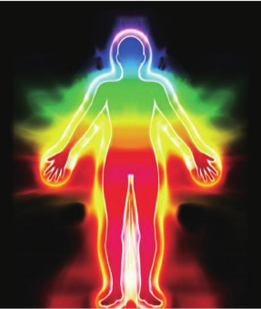

The singing bowl is an ancient musical tool that can clear and purify the surrounding aura by emitting a unique resonance. Its resonant sound produces frequency and vibration that can help people eliminate negative emotions, stress, and anxiety, while also enhancing the body's natural healing ability.

The bowl's resonant sound affects not only the human body but also the surrounding aura. The aura is an invisible energy field that surrounds people and objects, reflecting their state and energy.

If the aura is negatively affected, it may lead to physical and psychological discomfort. The bowl's resonant sound can help clear and purify the aura, dispel the negative influence, and make the surrounding environment more comfortable and calm.

The bowl's resonant sound produces an effect called "resonance." When the bowl's sound matches the frequency and vibration of surrounding objects, they can produce a powerful energy field that helps clear and purify the surrounding aura. At the same time, the bowl's sound also helps people relax body and mind, making the physical and mental state calmer and more relaxed.

#### Brow-Chakra Purification

The brow chakra, also called the sixth chakra or forehead chakra, is one of the body's seven major energy centers, located at the center of the eyebrows and the main energy center of the upper body.

Its function is to control the power of thinking, wisdom, intuition, and mind, and it is also related to the head, eyes, ears, nose, and nervous system.

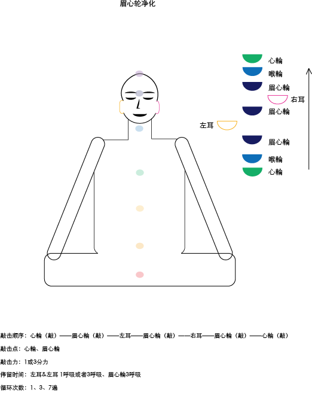

*(notes area)*

#### Ren-Meridian Purification

The Ren Meridian was first recorded in the *Huangdi Neijing* (Yellow Emperor's Inner Canon). It begins in the uterus within the lower abdomen, emerges at the perineum and pubic hair, passes the pubic mound, and ascends along the midline of the abdomen through Guanyuan and other points to the throat (Tiantu CV22), then ascends to inside the lower lip, encircles the lips, meets the Governing Vessel at Yinjiao (GV28), then passes beside both sides of the nose up to below the eye (Chengqi ST1), meeting the Stomach Meridian of Foot-Yangming.

It commands all the yin meridians of the body and regulates the qi and blood of the yin meridians — the "sea of the yin vessels." The Ren Meridian runs along the midline of the abdomen; the abdomen is yin, showing that the Ren Meridian has an overarching and commanding effect on all the yin meridians' qi. In addition, the three yin meridians of the foot intersect the Ren Meridian in the lower abdomen, and the three yin meridians of the hand connect with the Ren Meridian via the three foot yin meridians; therefore the Ren Meridian regulates the qi and blood of the yin meridians, hence the saying "commands all the yin."

The Ren Meridian begins in the uterus and regulates menstruation and promotes the female reproductive function, hence the saying "the Ren governs the womb."

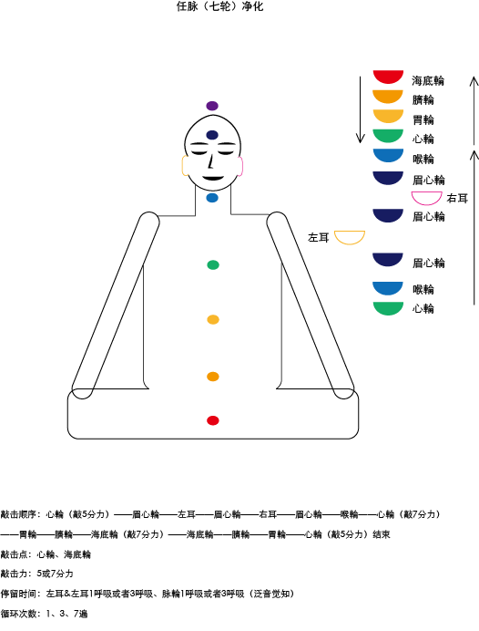

*(notes area)*

#### Du-Meridian Purification

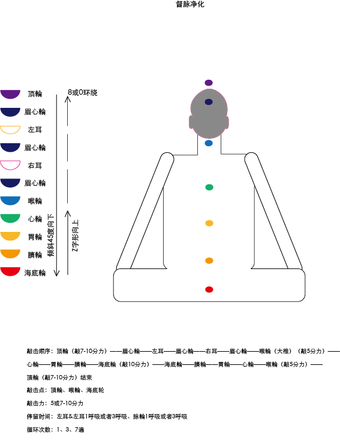

*(notes area)*

#### Three-Channel Purification

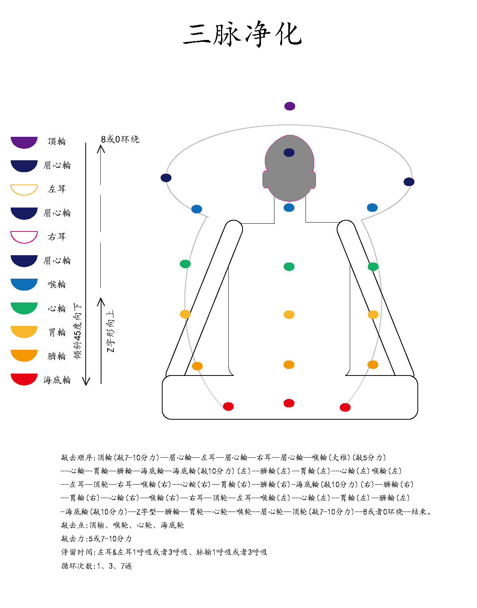

#### 3.1.1.5 Chakra Activation

**Sound-Eating Method (Food-Sound)**

After striking, bring the throat chakra close to the bowl, inhale through the mouth, and "eat the sound" — you can make a sound that causes the crystal bowl or singing bowl to vibrate, activating the oral muscle groups and cells, bringing deep perception and raising the activated cellular energy.

**Mutual-Impression Method**

Bring both hands close to the bowl, perceive the bowl's wave-vibration, feel the bowl's qi, build a deep experience of the bowl, and connect more with the bowl.

**Chakra Activation**

Chakra singing-bowl activation is an energy therapy that uses the singing bowl to balance and activate the body's seven major chakras (also called energy centers). These chakras are located in different parts of the body, each associated with different organs, emotions, and mental states.

Lie flat; strike different rhythms at different chakras, perceive the bowl — you can follow the heartbeat rhythm or the wooden-fish rhythm, feel the bowl's vibration and the body's connection. Regular, stable striking brings holistic activation of the chakra muscle groups, bones, etc., further building the perception of bowl and body-mind.

**SPA Massage**

Through the application of the bowl's vibration, heal and relax the muscles, performing a deep SPA massage.

The bowl SPA is not only detoxification and purification of the organs, but also detoxification and purification of the mind and spirit, protecting the aura energy.

It can even be applied directly to painful areas to reduce pain, for some stomach pain and liver-gallbladder discomfort.

As an auxiliary alongside medical drug treatment, it has unexpected effects, helping to strengthen the body's "internal alchemy system," especially the liver.

**Girdle-Vessel Unblocking**

Through the bowl combined with essential oils, movement, and tapping, relax and unblock the Girdle Vessel, with a promoting effect.

### 3.1.2 Space Clearing & Purification (Beginner)

#### Techniques for Field Purification

Singing-bowl field purification is an energy therapy that uses the bowl to clear negative energy and rebuild positive energy, creating a balanced and harmonious field.

*(notes area)*

#### Making Energy Water

Singing-bowl energy water can be used for drinking, spraying, or soaking the body. It can help balance body, emotion, and spirit, and promote health and healing.

*(notes area)*

#### Making Energy Flowers

*(notes area)*

### 3.1.3 Single-Bowl Healing Cases (Intermediate)

#### Emptying & Stress Relief

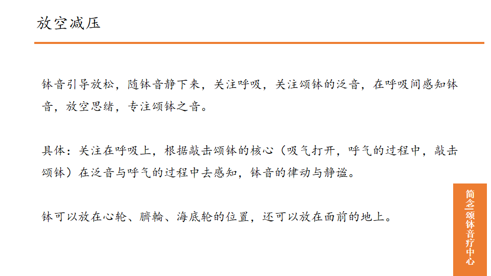 The bowl sound guides relaxation; settle down with the bowl sound, focus on the breath, attend to the bowl's overtones, perceive the bowl sound between breaths, empty the mind, and concentrate on the sound of the bowl.

*Principle*: parasympathetic nervous system · brain focus · consciousness emptying · breath observation · auditory meditation

#### Meditation

*Focus*: breath + vibration sensation + consciousness itself.

Meditative breathing + consciousness concentrated on the bowl's vibration.

Heart chakra — brow chakra — navel chakra.

Combined with energy-field purification (brow-chakra purification + Ren and Du vessels).

Fixed point 3 times, cycles of 1, 3, 7 times, 10–15 minutes.

Meditation: focus on breath, vibration sensation, and consciousness itself. Through meditative breathing and consciousness concentrated on the bowl's vibration, strengthen the purification of the heart, brow, and navel chakras, combined with energy-field purification (including brow-chakra purification and the Ren and Du vessels). Fixed point 3 times, cycle 1, 3, 7 times, each lasting 10–15 minutes.

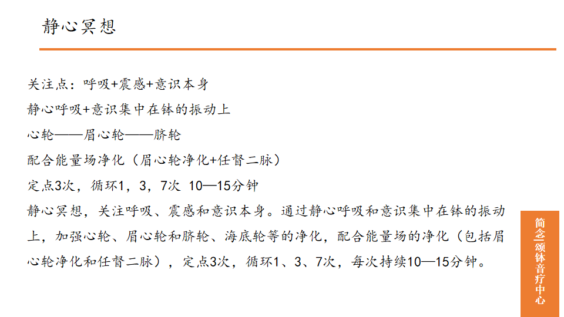

#### Intestinal Cleansing & Bowel Movement

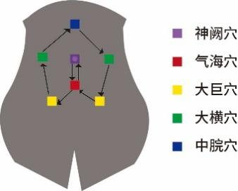

*Bowl selection*: lower three chakras (navel, stomach, root).

Start at the navel, proceed clockwise downward.

Shenque point, strike 3 times — Qihai point, strike 3 times — Daju point — Daheng point — Zhongwan point — Daheng point — Daju point — Qihai point — Shenque point.

15–30 minutes.

Or fixed-point (navel chakra) rubbing — clockwise — 10–15 minutes.

Use bowls of the lower three chakras (navel, stomach, root). Starting at the navel, proceed clockwise: first strike Shenque 3 times, then strike Qihai, Daju, Daheng, Zhongwan, Daheng, Daju, Qihai, and Shenque. Lasts 15–30 minutes, or fixed-point rubbing (navel chakra) rotating clockwise for 10–15 minutes.

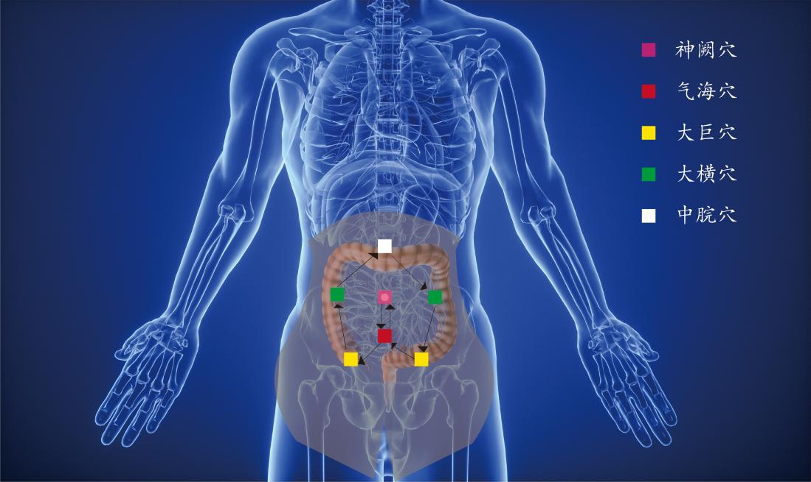

#### Unblocking Shoulder & Neck

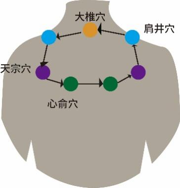

Heart-chakra bowl.

Dazhui point — to the coccyx.

Dazhui point — Jianjing point — Tianzong point — Xinshu point — Tianzong point — Jianjing point — Dazhui point.

20–30 minutes.

To unblock the shoulder and neck, use the heart-chakra bowl. Starting at Dazhui, proceed in order to the coccyx, then back to Jianjing, Tianzong, Xinshu, Tianzong, Jianjing, and Dazhui, for 20–30 minutes.

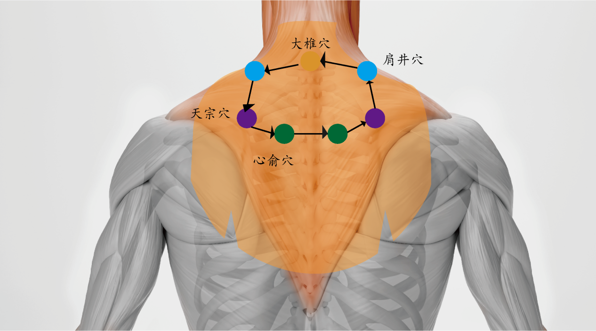

#### Relieving Dysmenorrhea

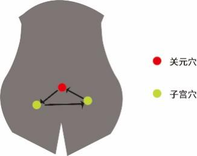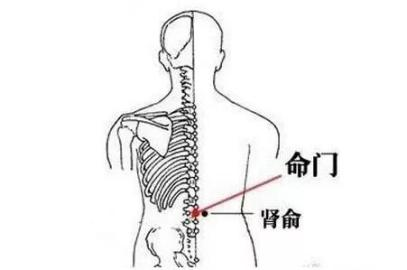

Guanyuan point — Zigong point (left and right) — 10–20 minutes.

Pour warm water (40°C) into the bowl — rub the bowl at Guanyuan for 10 minutes.

Turn over and lie prone — Mingmen point (to Shenshu point) — rub the bowl for 10 minutes.

To relieve dysmenorrhea: first massage Guanyuan and Zigong (left and right) for 10–20 minutes. Then pour 40°C warm water into the bowl and rub it at Guanyuan for 10 minutes. Next turn over and lie prone, massage Mingmen to Shenshu, then rub the bowl at Mingmen for 10 minutes.

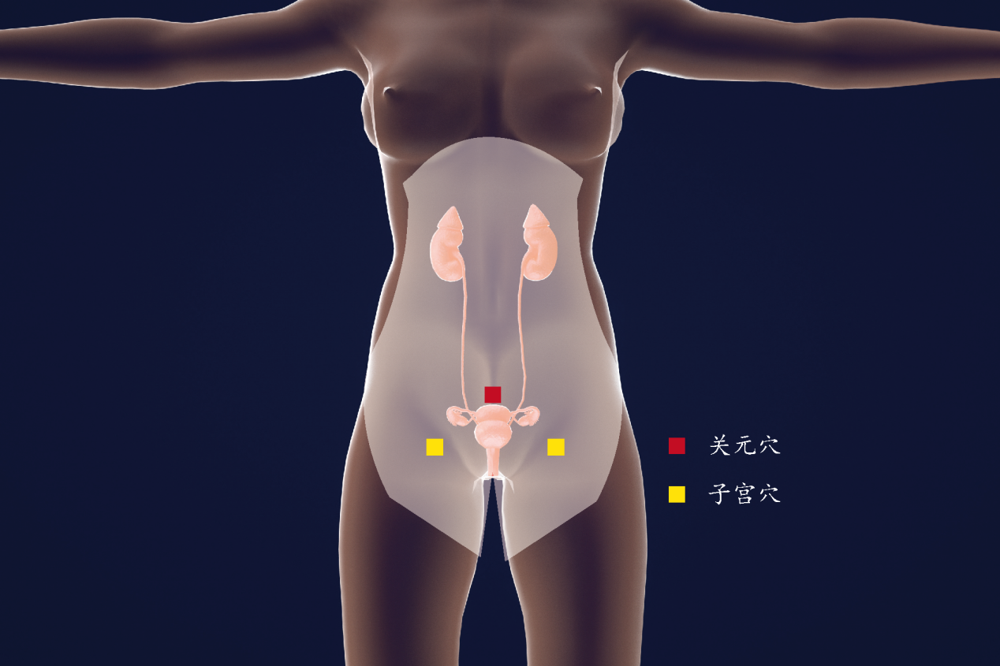

#### "Spaceman" Healing

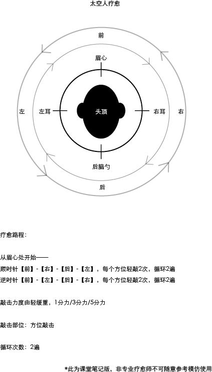

Those with tinnitus should not undergo this; it can be done via the tingsha.

*(notes area)*

### 3.1.4 Bladder-Meridian Unblocking & Detox (Intermediate–Advanced)

The Bladder Meridian is a meridian of the body, starting from the head and running along the back, buttocks, legs, soles, down to below the lower abdomen. There are many acupoints on it; stimulating these points can promote the body's qi and blood circulation, enhance immunity, improve sleep quality, relieve physical fatigue and pain, and promote the body's detoxification function.

It is suitable for physical fatigue, constipation, insomnia, headache, shoulder-neck pain, etc., and plays a good role in raising immunity and promoting health.

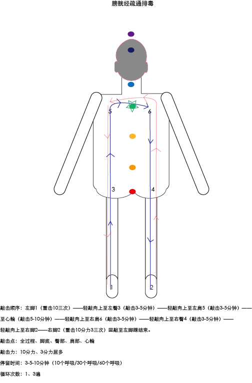

*(notes area)*

### 3.1.5 Du-Meridian Unblocking (Advanced)

The Du Meridian is a major meridian in the body's meridian system, originating in the perineum and extending upward along the spine to the top of the head. Its role is very important: it regulates the body's yin-yang balance, regulates qi and blood circulation, enhances immunity, and raises the body's resistance.

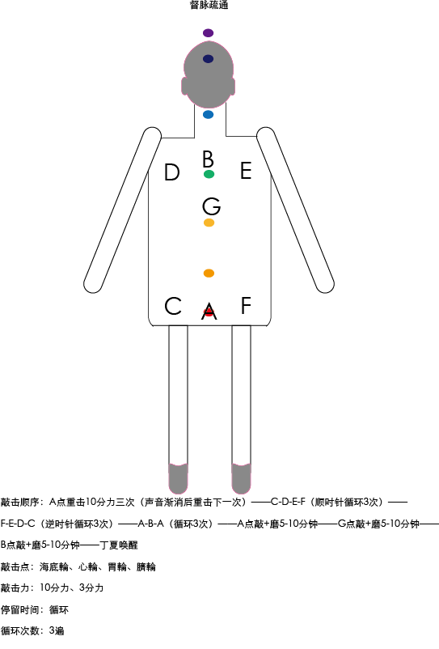

*(notes area)*

### 3.1.6 Heart-Chakra Pressure Relief & Qi Regulation (Intermediate)

Heart-chakra pressure relief and qi regulation can heal many heart-related diseases, such as palpitations, chest oppression, angina, and hypertension. In addition, it can relieve stress, raise immunity, promote blood circulation, and improve skin quality.

Note that heart-chakra pressure relief and qi regulation must be carried out under the guidance of a professional sound healer to avoid bodily injury. At the same time, it is not suitable for everyone — pregnant women, heart patients, etc. need to use it with caution.

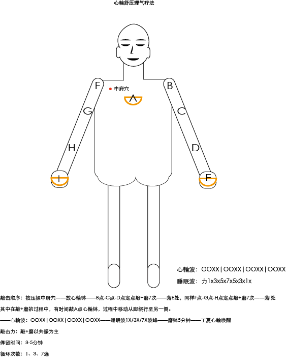

*(notes area)*

### 3.1.7 Three-Bowl Healing (Intermediate)

Three-bowl sound therapy is a therapy based on sound and vibration, using three bowls of different chakras to create a calm and relaxed atmosphere by striking the bowls and letting them sound. This therapy is said to help restore the balance of body and mind, reduce stress and anxiety, and promote the body's self-healing ability. It is usually combined with meditation, yoga, and other sound-healing programs.

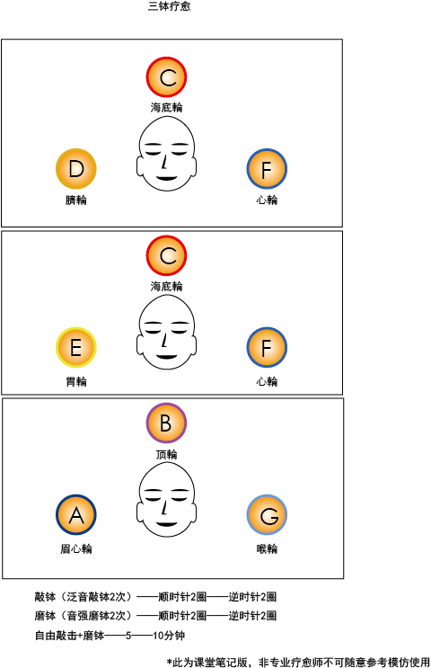

*(notes area)*

### 3.1.8 Insomnia & Headache Therapy (Advanced)

The singing bowl can quickly change our brainwaves into a meditative or sleep state. Many people, having experienced only very basic bowl healing, can fall into a deep snore within minutes. In a strange healing room, such deep sleep means a very profound relaxation and sense of safety, embraced by an especially warm, peaceful, and reassuring energy frequency. This frequency is a great comfort and nourishment for everyone. Many who have tried the bowl once thought the effect only works when the healer is doing it, but unexpectedly found that on the day after healing, sleeping at home brought a noticeably improved sleep quality.

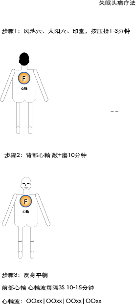

*(notes area)*

### 3.1.9 Women's Gynecological Care (Advanced)

Singing-bowl healing is a very gentle, natural therapy that can help women regulate body and mind, promote natural balance and self-healing. But it must be done under professional guidance.

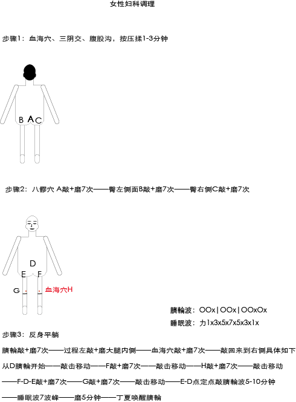

*(notes area)*

### 3.1.10 Liver-Soothing Qi-Regulating Sound Therapy (Advanced)

Step 1: Press the diaphragm left and right for 1 minute each.

Step 2: Strike along the Liver Meridian (see training class notes for specifics).

Step 3: Settle the heart chakra (heart-chakra pressure-relief therapy).

Step 4: Tingsha heart-chakra awakening.

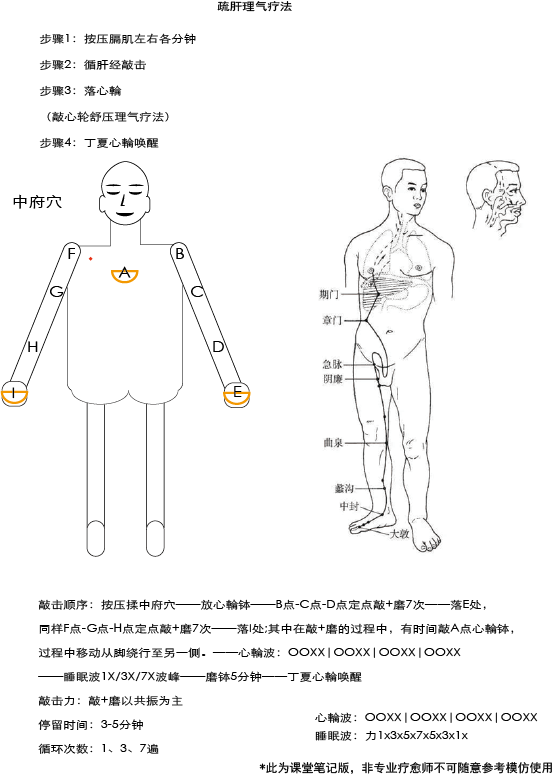

*(notes area)*

### 3.1.11 Stomach Regulation Therapy (Advanced)

Singing-bowl healing is a therapy based on sound and vibration that can help relieve stomach discomfort and regulate stomach health.

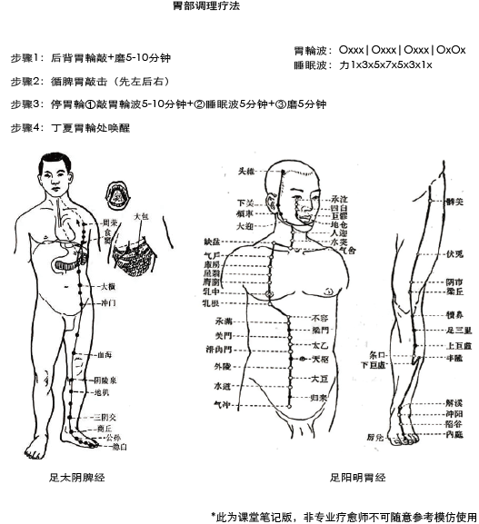

*(notes area)*

### 3.1.12 Chronic Migraine (Advanced)

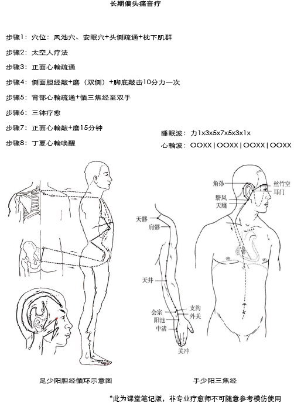

*(notes area)*

### 3.1.13 Simple Lumbar-Muscle Strain Sound Therapy (Advanced)

Simple lumbar-muscle strain is a common sports injury, usually caused by prolonged sitting or strenuous exercise.

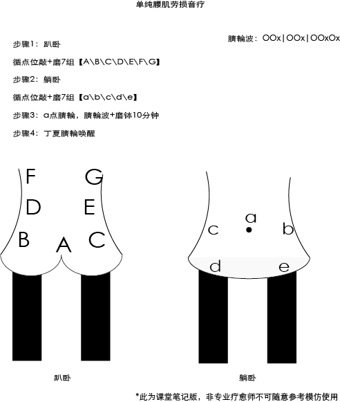

*(notes area)*

### 3.1.14 Seven-Bowl Comprehensive Therapy (Advanced)

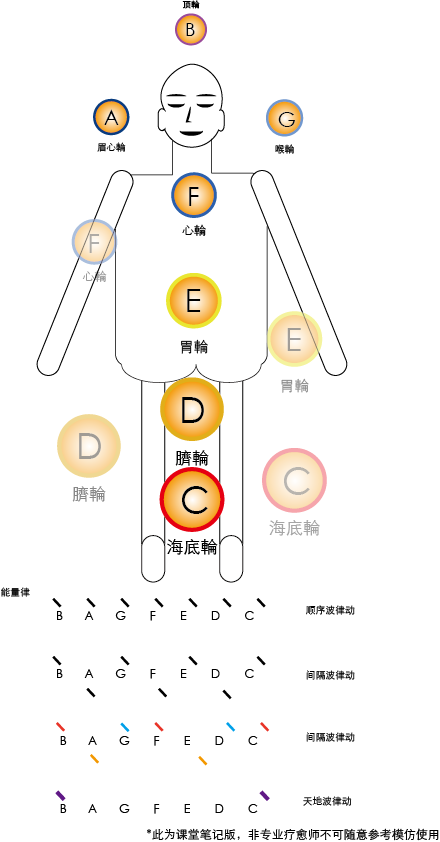

*(notes area)*

**Seven-Chakra Energy Therapy** — (the healer customizes healing based on chakra-energy learning)

**Flower-of-Life Ten-Bowl Therapy** — (the healer customizes healing based on number-geometry learning)

**Fourteen-Meridian Healing Method** — (the healer customizes healing based on meridian learning)

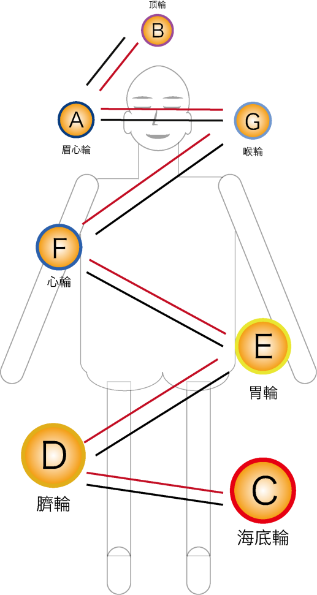 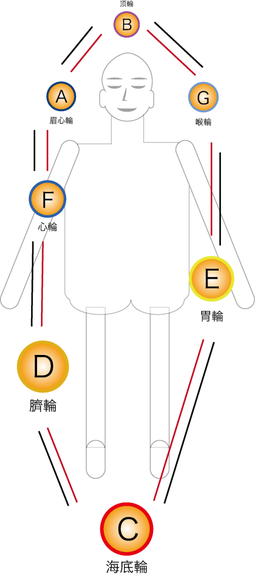

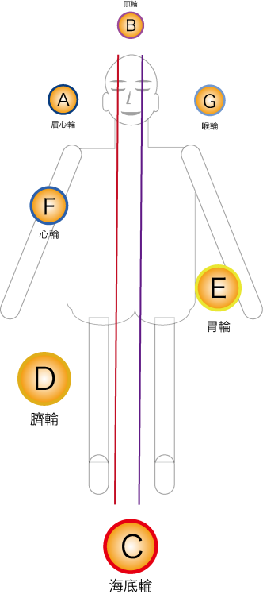

**Seven-Chakra Energy Therapy**

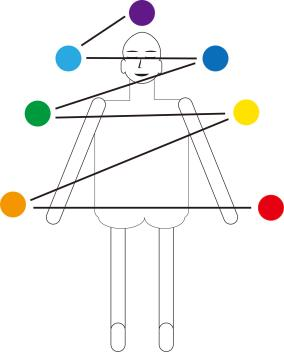 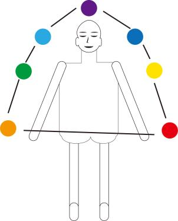 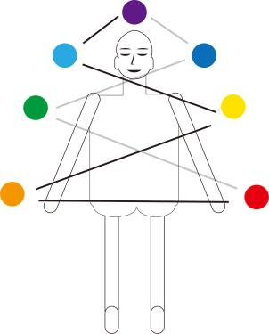

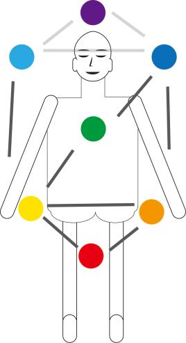 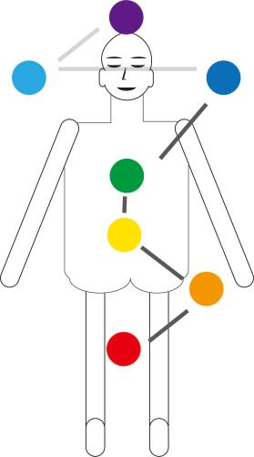

**Four-Bowl Therapy**

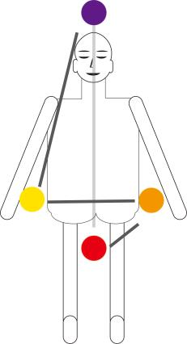

**Five-Bowl Therapy**

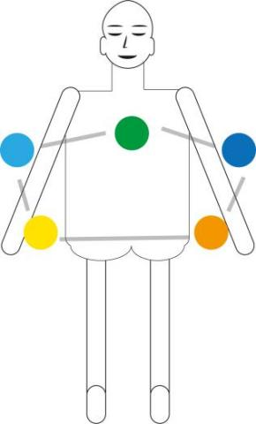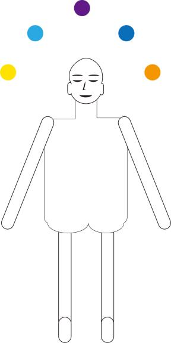

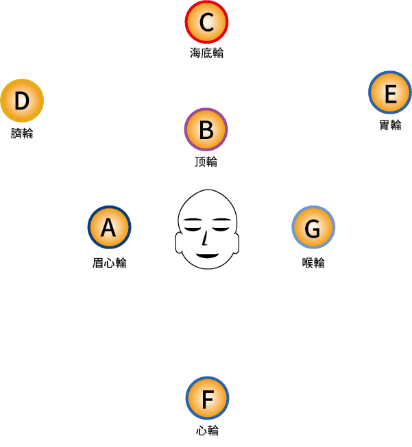

**Seven-Bowl Sound Therapy** (heart or stomach chakra for body-mind relaxation)

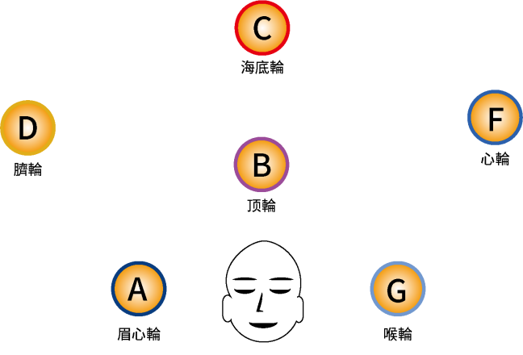

**Music-Healing Placement Guide**

### 3.1.15 Women's Care Categories (Advanced Elective)

#### Ovary & Uterus Care

The ovaries and uterus are female reproductive organs and important components of female fertility and physiological health.

#### Breast Care

Singing-bowl healing uses the bowl's resonance and sound-wave vibration to adjust the body's energy and balance. In breast care, it can help the breast lymphatic detoxification, promote lymphatic circulation, and enhance the health of breast tissue.

#### Facial Care

In facial care, the bowl can be used to massage the face, enhancing the massage effect, while also bringing deeper relaxation and pleasure.

#### Menopause Regulation

Menopause is an important stage in a woman's life, accompanied by physical and psychological changes. Menopause regulation can help relieve menopausal symptoms and improve quality of life. In addition to medication and lifestyle adjustment, singing-bowl healing can also serve as an auxiliary therapy to better regulate body and mind.

In singing-bowl healing, specially made bowls emit sound and vibration that, by stimulating the senses, promote the balance and relaxation of body and mind. This has a good effect on relieving menopausal symptoms such as anxiety, insomnia, and mood swings. At the same time, it can raise immunity and promote self-healing, playing a positive role in relieving menopausal symptoms and improving physical condition.

#### Menstrual Regulation

Menstrual regulation is an important link in a woman's physiological cycle and an important guarantee of women's health. It can help women relieve menstrual discomfort, regulate the menstrual cycle, and maintain reproductive-system health. As an auxiliary therapy, singing-bowl healing can help women better carry out menstrual regulation.

In singing-bowl healing, specially made bowls emit sound and vibration that, by stimulating the senses, promote balance and relaxation of body and mind. This has a good effect on relieving menstrual discomfort such as dysmenorrhea, mood swings, and insomnia.

At the same time, it can raise immunity and promote self-healing, also playing a positive role in maintaining reproductive-system health. Combining singing-bowl healing with menstrual regulation achieves better results — on the basis of bowl healing, combine other methods such as Chinese-medicine regulation, diet adjustment, and moderate exercise to comprehensively regulate body and mind, relieve menstrual discomfort, regulate the cycle, and maintain reproductive health.

#### Dysmenorrhea Relief

Dysmenorrhea is one of the common symptoms in a woman's physiological cycle, bringing great discomfort and pain. There are many causes, including physiological and psychological factors. As an auxiliary therapy, singing-bowl healing can help women relieve dysmenorrhea.

In singing-bowl healing, specially made bowls emit sound and vibration that, by stimulating the senses, promote balance and relaxation of body and mind. This has a good effect on relieving dysmenorrhea such as pain, mood swings, and insomnia. At the same time, it can raise immunity and promote self-healing, playing a positive role in relieving dysmenorrhea.

Combining singing-bowl healing with dysmenorrhea relief achieves better results — on the basis of bowl healing, combine other methods such as Chinese-medicine regulation, diet adjustment, and moderate exercise to comprehensively regulate body and mind, relieve dysmenorrhea, and improve quality of life. At the same time, women should also avoid doing bowl healing during the menstrual period, lest it affect health.

**Breast Distension & Pain**

Breast distension and pain is one of the common symptoms in women, usually occurring around the menstrual period, bringing discomfort and pain. There are many causes, including physiological and psychological factors. As an auxiliary therapy, singing-bowl healing can help women relieve breast distension and pain.

In singing-bowl healing, specially made bowls emit sound and vibration that, by stimulating the senses, promote balance and relaxation of body and mind. This has a good effect on relieving breast distension and pain such as soreness and discomfort. At the same time, it can raise immunity and promote self-healing, playing a positive role in relieving breast distension and pain.

#### Techniques for Easing the Couple Relationship

Combined two-person singing-bowl energy sound healing.

Energy healing | aura purification.

### 3.1.16 Emotional Regulation Categories (Advanced Elective)

**Anxiety**

Anxiety is an emotional and psychological state, usually manifesting as worry and unease about the future, accompanied by physical discomfort such as palpitations, rapid breathing, and sweating. Anxiety can affect a person's thinking, behavior, and emotion, and in severe cases affects daily life and work.

#### Depression

Depression is an emotional and psychological state, usually manifesting as low mood, loss of interest and pleasure, self-denial, and self-blame. Depression affects a person's quality of life and work performance, and in severe cases may lead to suicide.

#### Feeling Wronged

Feeling wronged is an emotional and psychological state, usually manifesting as feeling unfairly treated or falsely accused, yet unable to express it or obtain fair treatment. It affects a person's emotional and psychological state, and long-term accumulation may lead to mental-health problems.

#### Fear & Anger

*Fear*: Fear is an emotional and psychological state, usually manifesting as a strong reaction to something or a situation. Fear can be reasonable, such as fear of danger or unsafe things, or unreasonable, such as excessive fear of some harmless things. Fear can affect a person's thinking, behavior, and emotion; if uncontrollable it may lead to further deterioration.

*Anger*: Anger is an emotional and psychological state, usually manifesting as a strong reaction to something or a situation. Anger can be reasonable, such as anger at unfair treatment or violation of one's rights, or unreasonable, such as excessive anger over small matters. Anger can affect a person's thinking, behavior, and emotion; if uncontrollable it may lead to further deterioration.

Both fear and anger are among the basic human emotions; to a certain extent they play a positive role in human survival and development. However, if excessive or uncontrollable, they may lead to mental-health and social problems. Therefore, we need to learn how to control and manage our fear and anger to maintain mental health and social harmony.

#### Neurasthenia

Neurasthenia is a psychological and physical disease, usually manifesting as anxiety, depression, insomnia, fatigue, headache, stomach pain, and other symptoms. Its symptoms are usually caused by long-term mental stress and physical fatigue, requiring timely treatment and lifestyle adjustment.

## Section 2 — Singing Bowl Concert Performance (Advanced)

*(notes area)*

### 3.2.1 Hand-Purification Ritual

*Heart method*: be present in the moment, tune your own breath, start from a stable energy, speak slowly and with strength.

Make singing-bowl energy water: take about 1/2 to 2/3 water — ① strike the bowl with the mallet to vibrate and activate the water; ② rub the bowl with the mallet to vibrate and activate the water.

Touch the water surface with fingers to purify the hands, or use a long spoon to scoop water to purify the hands.

Back of hands: learn to let go, return to the present.

Palms: may body and mind go smoothly, may all things go as wished.

Palms together: gratitude to the universe, gratitude to parents, gratitude to oneself.

Observe the breath, return to the present, and open the class.

Communication: eye contact — firm and trusting eyes; language — non-restrictive guidance.

### 3.2.2 Venue Setup for the Singing-Bowl Concert

A sense of space, order, warmth, and ease.

- *Eyes*: light — soft, warm; eye pillows; candles (electronic candles); flowers (scentless); crystals.
- *Ears*: music.
- *Nose*: aromatic system — incense or essential-oil fragrance.
- *Tongue*: fruit, drinking water.
- *Body*: ground environment — warmth-preserving measures, etc.

1. *Eyes*: the lighting in the venue should be soft and warm, not too bright or glaring. Use warm-toned lights, or place soft lights in appropriate places, such as candles (electronic candles may be used), to create a warm atmosphere.
2. *Eye pillows*: let the audience enjoy a deeper relaxation while appreciating the bowl music. Soft fabric can be used so the audience feels more comfortable.
3. *Nose*: use an aromatic system in the venue, such as incense or essential-oil fragrance, so the audience feels a more comfortable aura. Place some scented candles or essential-oil diffusers in the venue.
4. *Tongue*: provide some fruit and drinking water in the venue, so the audience enjoys small surprises and deliciousness while appreciating the music.
5. *Body*: ensure the ground environment in the venue, such as ground temperature and humidity, so the audience feels a more comfortable environment. Provide warmth-preserving measures such as blankets and heaters.
6. *Intention*: (to be supplemented by yourself)

### 3.2.3 The Bowl-Playing Flow of the Music Salon

Breath bowl-playing.

Overtone bowl-playing.

Free bowl-playing.

One strike of the tingsha to gather attention and focus on the present.

Voice guidance (body-mind relaxed state) — during relaxation, crystal bowls may be combined (crystal bowl counterclockwise three circles, clockwise 3 / 5 circles) — music bowls open (3 / 5 / 7 bowls) — full-moon bowl, crystal bowl — slow and gentle rhythm — fast rhythm + gong bath — finally 5 / 10 / 15 minutes ocean drum, rain stick, wind chime (strike the full-moon bowl if time allows) — three strikes of the full-moon bowl — three tingsha to awaken.

- One strike of the tingsha to gather attention and focus on the present. Before the concert begins, one tingsha can be struck to let the audience put down stray thoughts, concentrate, and enter the concert atmosphere.
- Voice guidance (body-mind relaxed state). Before the concert begins, voice guidance can be given to let the audience enter a relaxed body-mind state, preparing for the music appreciation ahead.
- During relaxation, crystal bowls may be combined (crystal bowl counterclockwise three circles, clockwise 3 / 5 circles). During relaxation, the use of crystal bowls can be combined to let the audience relax more deeply.
- Music bowls open (3 / 5 / 7 bowls). After the music bowls open, 3, 5, or 7 music bowls can be used to play gentle melodies, letting the audience feel the beauty of the music.
- Full-moon bowl, crystal bowl. During the concert, full-moon bowls and crystal bowls can be added to let the audience feel deeper relaxation and meditation.
- Slow and gentle rhythm. During the concert, slow and gentle rhythms can be used to let the audience feel the music's tenderness and comfort.
- Fast rhythm + gong bath. During the concert, fast rhythms can be combined with a gong bath to let the audience feel the music's power and energy.
- Finally 5 / 10 / 15 minutes ocean drum, rain stick, wind chime (strike the full-moon bowl if time allows). In the final stage, instruments such as the ocean drum, rain stick, and wind chime can be used to let the audience feel the natural beauty of the music.
- Three strikes of the full-moon bowl. Before the concert ends, three strikes of the full-moon bowl can be made to let the audience return to the present.
- Three tingsha to awaken. After the concert ends, three tingsha can be struck to awaken the audience slowly back to the real world, ending the concert.

### 3.2.4 Notes for the Music Salon

1. Observe the state of the healed and make flexible adjustments. During the music salon, the state of the healed may change for various reasons. Therefore, observe the state of the healed and make corresponding adjustments to ensure the smooth conduct of the salon.
2. Move from the direction of the root chakra. During the salon, move from the root chakra direction, playing the music of each chakra in turn, to achieve the healing effect.
3. Throughout the process, maintain the connection and awareness among the bowl, the healed, the bowl sound, and oneself. During the salon, maintain the connection and awareness among the bowl, the healed, the bowl sound, and oneself, so the salon's effect is more obvious and the healed receives better healing.

## Section 3 — Premium Individual Session Flow (Advanced)

*(notes area)*

### Flow 1 — Self Energy Protection

Meditation, breath observation, bowl connection.

Breath observation is a simple and effective meditation skill that helps you relax body and mind. In breath observation, you only need to focus on the breath, noticing the feeling of breath entering and leaving the body, without thinking of other things.

Use of aromatic essential oils — the "On Guard" protective blend is recommended.

### Flow 2 — Pre-Session Communication

1. *Understand symptoms and needs*: Before the bowl-healing session, communicate with the healer so the healer understands your symptoms and needs — for example, whether you have physical pain, stress, anxiety, etc. This information helps the healer better provide healing service.
2. *Healing goals*: Communicate your healing goals with the healer — for example, you hope to relieve physical pain, relax body and mind, and balance energy through bowl healing. This helps the healer better formulate a healing plan.
3. *Health status*: Communicate your health status with the healer — for example, whether you have chronic diseases, allergies, etc. This helps the healer better adjust the healing method and the bowls used.
4. *Healing time and fees*: Communicate healing time and fees with the healer to ensure you clearly understand the healing process.
5. *Healer's experience and background*: Ask about the healer's experience and background — for example, whether they have relevant certificates or training, and their healing methods and philosophy.
6. *Healing environment*: Ask about the healing environment — for example, the atmosphere and music of the healing room, and what you need to bring.
7. *Preparation before healing*: Ask what needs to be done before healing — for example, whether fasting or stopping certain medications is required.
8. *Healing process*: Understand the healing process — for example, how the healer uses the bowl, what you need to do, and what to pay attention to during healing.
9. *Post-healing advice*: Ask for post-healing advice — for example, how long to rest, what to do, and how many healings are needed.

Through communication with the singing-bowl healer, you can better understand the healing process and effect, and also help the healer better provide healing service.

### Flow 3 — Healing-Field Purification

The environment for providing healing or meditation for yourself or others should be quiet, clean, tidy, orderly, and pleasant.

A safe, private, undisturbed environment.

*Contraindications (health survey form)*: religious belief & mental health & physiological disease & metal implants.

### Flow 4 — Guided Relaxation (Yoga Relaxation)

**Seated Meditation**

Now find a quiet and comfortable place, sit in a comfortable yoga posture, and gently pat the buttock muscles with both hands so the sit-bones press firmly on the cushion.

Let the hands rest naturally on the thighs, or hang down relaxed.

Close your eyes, follow the melody of the music, slow the breathing rhythm, from inside out. Relax the facial expression, relax the furrowed brow, relax the eyes, nose, and mouth.

Let the shoulders sink naturally, relax the arms, straighten the back, keeping the neck and spine in a straight line.

Feel a wall behind you; the lower back, upper back, and back of the head lightly lean against the wall; as you inhale, the spine extends upward infinitely.

Focus attention on the breath, inhale deeply, feel the airflow enter the nasal cavity, slowly into the chest, abdomen, and thighs, then slowly exhale.

Take another deep breath, feel all the energy, essence, and oxygen of the universe deeply inhaled into the body, nourishing every cell, slowly exhale all the toxins, waste gas, turbid air, and unhappy emotions.

Set aside external distractions, let the body become light and soft, the breath become even, smooth, and natural.

Concentrate the consciousness on the breath, quietly observe yourself, one inhale and one exhale, let the breath become deeper and longer, slower and slower, calm yourself down, feel every sound of the body, listen to the inner voice, let the mind become more and more tranquil, more and more peaceful.

Please find a comfortable seated posture, cross the legs sitting on the cushion, extend the spine upward, relax the shoulders, let the hands rest naturally on the knees, index finger and thumb touching, forming the yoga wisdom mudra.

Close your eyes, breathe deeply, exhale slowly. Each inhale, feel fresh oxygen enter the body; each exhale, expel waste gas, turbid air, nitrogen dioxide, expelling all anxiety and tension.

Focus on the breath; as long as the inhale is, so is the exhale.

At this time, the breath becomes even, smooth, and natural, the mind free of stray thoughts.

Along with the wonderful music, the breath becomes smoother and smoother, the body lighter and lighter, imagine yourself a blooming lotus, brilliantly blooming in the sunlight.

Slowly draw the consciousness back, gently move the fingers, turn the palms, slowly open the eyes, adapt to the brightness before you.

Please choose a comfortable cross-legged posture, rotate the shoulders back and sink down, let the chest extend upward, sit the sit-bones firmly down, while paying attention to drawing in the ribs.

Palms up, thumbs touching the index fingers forming the wisdom mudra, slightly tuck the chin, then slowly close the eyes.

Try to draw all the senses and intentions inward, listen to the body's voice, let it slowly quiet down.

Now, observe the breath, feel each inhale and exhale, let the breath become gentle and relaxed. Stay here for a moment. (stay one minute)

Slowly draw the consciousness back; at the next inhale, bring the palms together, thumb lightly against the heart chakra, slightly lower the head, index finger against the brow, raise the head and open the eyes, Namaste.

Choose your most comfortable seated posture and sit well, with the waist and back straight. Keep the spine vertical in the middle of the sit-bones, open the yoga mudra and place it on the left and right knees.

Slightly draw in the lower jaw, gently close the eyes.

Relax your brow, relax your facial expression, let the corners of the mouth rise slightly, give yourself a comfortable smile.

Draw all your consciousness back inward, to attend to your breath at this moment.

Slowly inhale, slowly exhale, observe the breath exiting and entering your body, feel this process.

At this moment, we sit here quietly, attending to our breath, drawing the heart back to the present, to find the truest self deep within, listening to the soothing music, feeling the music like streams of clear mountain spring, quietly flowing into our hearts, letting all the tension, stress, anxiety, and unhappy emotions within the body be eliminated.

Deep in the heart, give yourself a confident smile, feel the inner peace and calm at this moment, feel it like a lake clear to the bottom, clear and peaceful.

Let us face the family and every friend around us with a grateful heart; our life becomes rich and colorful because of their company.

Let our hearts be filled with tolerance, understanding, inclusion, and love, let everyone around us feel the joy of our hearts, and pass this joyful emotion to every friend and relative around us.

Continue to attend to your own breath; if at this moment scattered thoughts arise in your mind, do not rush, do not deliberately attend to them, quietly watch them, let them come and go naturally like clouds in the sky.

Quietly attend to your inner heart, feel the peace and tranquility of the inner heart at this moment. Each inhale, feel the air slowly enter the chest and abdominal cavity with your inhalation, slowly downward, spreading to the whole abdomen.

The abdomen naturally bulges outward as the airflow arrives, slowly exhale, exhaling the turbid air within the body.

In one inhale and one exhale, let the body relax, feel this relaxing force slowly spreading downward from the top of your head, to every corner of your body.

Let us maintain this relaxed state, slowly open the eyes, feel the brightness and clarity before us. Namaste.

Body straight, chest thrust outward and upward, shoulders relaxed parallel to the ground, chin drawn back, eyes closed, tongue against the palate, gazing at the tip of the nose. Now place the consciousness on abdominal breathing, inhale deeply, exhale slowly, feel the calm of the heartbeat and the peace of the body. Between one inhale and one exhale, quietly observe the body's sensations, to find the smoothness of the breath.

Let the body relax, gently close the eyes, perceive the natural breath.

Be aware from the feet to the knees, observe the spine, lumbar, thoracic, cervical; keep the breath centered, natural breathing is fine. Be aware of the chest, the flow state of the breath within the chest.

Attend to the space of both shoulders, quietly observe, without any judgment. Adjust the breath, then inhale deeply and slowly, open the mouth and exhale with a "ha," quickly inhale, exhale at a constant speed; the sound of the "ha" is made by the air. Quickly, slowly, and long, exhale the breath.

The breath drives the arms upward, feel the power of upward growth. Inhale arms extend, as you exhale, shoulders sink, count to 5 then slowly lower. Attend to natural breathing, observe the breathing state and body-mind state; whether soreness, numbness, distension, or pain, quietly observe the state, bring the breath to the relevant position, let the breath stretch it, without judgment, without any action, quietly observe, breath brought in.

**Supine Progressive Relaxation Meditation**

In the body-scan practice, we usually take a supine posture, bringing awareness to the corresponding body parts according to the guidance.

Now, please make yourself as comfortable as possible, sitting leaning or lying in this room.

When you are comfortable and stable enough, you can, when you want, close your eyes… take your time.

Attend to your breath. When you are ready, take a few deeper yet relaxed breaths.

Slowly draw air into your abdomen, then slowly let the air out. Deeply inhale fresh, beautiful air, slowly exhale the turbid, tense breath.

Very good, deeply inhale and exhale… continue to breathe like this, relaxed, and with each breath, imagine and feel the relaxation.

As you inhale, let the feeling of relaxation spread from the chest to the whole body… with each of your breaths, spreading…

Relax… the facial muscles… and… relax your scalp… forehead… eyebrows… and relax your eyelids, cheeks…

Especially relax your mouth, and the muscles around your lips. Relax your jaw, let the upper and lower jaw open a bit, the teeth and lips can open a bit, this will help the facial muscles relax more. (pause one second)

Very good, now let your breath return to an easy, comfortable, and natural way of breathing.

Continue to relax the neck, let the back of your neck, the back of your head, have good support or leaning, can relax your neck and shoulders, let all tension disappear from the shoulders, feel very comfortable. Now let your arms relax, the hands naturally hang there. You can feel the weight of the hands, the arms, elbows, and palms; notice each of your fingers is relaxed, imagine your whole hand is relaxed, heavy, sinking, needing no strength at all, all relaxed, like a wet towel, hanging heavily.

You will find your breath can be deeper than usual… feel your breath, the chest, and the rise and fall of the abdomen… and as you exhale, the chest also relaxes, down to your belly, the abdomen also relaxes…

Now let your back relax, from the back and below the waist, to the buttocks… downward, to the thighs, knees, calves, toes, soles… all the way down, all relaxed. Your feet rest on the floor, all the muscles of the legs are relaxed, you can enter a very deep, very comfortable relaxed state.

(pause about 3 seconds without sound)

Maintain this relaxed feeling, follow the sound of the bowl, enter the universe of the bowl sound.

In a moment, I will count from one to five; when you hear the number five, you will return here with clear consciousness, feeling everything is well. One,… two,… three,… four,… five.

(roughly, pause two breaths at each number)

Slowly regain consciousness, move the fingers and toes, extend the right hand over the head, slowly turn to the right side, push the ground with the left hand and slowly get up, sit up, eyes remain closed.

### Flow 5 — Project Opening

### Back Healing

### Front Healing

### Flow 6 — Withdrawing the Bowls

Strike in sequence; after the sound gradually fades, withdraw the bowls.

### Flow 7 — Awakening

Tingsha awakening.

During the healing, the cell layer to the whole body receives complete relaxation. Tingsha awakening can not only awaken the brain consciousness of the sleeping healed, but also awaken cellular awareness at the corresponding relaxed chakra areas, restoring the body's awareness from the cell layer and nerve layer, balancing body and mind, stably aware of the present, and obtaining a high-energy state.

### Flow 8 — Sharing the Healing Experience

After the session, give the person a cup of warm water, reminding them to replenish fluids throughout the day.

Light diet, foot-soaking before sleep, etc.

If you want to share the singing-bowl experience, here are some guiding directions:

1. *Describe your experience*: Describe what you felt when listening to the bowl, including physical sensations, emotional experiences, and mental states. Use specific words such as relaxed, calm, joyful, clear, etc.
2. *Share your insights*: Share the revelations, insights, and realizations you gained in the bowl experience. These may be understandings of life, the universe, and the self, or insights about yourself, others, and the environment.
3. *Explore the role of the bowl*: Explore the bowl's role in healing, meditation, and relaxation, and its influence on body, mind, and spirit. You can combine your own experience with scientific research.
4. *Share bowl-use techniques*: Share techniques and methods of using the bowl — how to select, how to play, how to use it for healing. These can help others better use the bowl.
5. *Exchange bowl culture*: Exchange the history, culture, and traditions of the bowl. Share knowledge of its origin, transmission, and evolution, and its application and meaning in different cultures.

Exchanging the bowl experience requires attending to your own experience, while also combining scientific research and cultural tradition. By sharing your experience and knowledge, you can help others better understand and use the bowl.

> Yesterday I was clever, so I wanted to change the world.
> Today I am wise, so I am changing myself.
> — Rumi, the 13th-century spiritual poet

### Chapter Summary

This chapter puts the theory of the previous two chapters into "hand" — providing a large number of reusable cases from stress relief and meridian unblocking to women's care, as well as standard flows for concerts and individual sessions. Technique becomes more proficient with practice, but the awareness of "healing others" takes much longer.

### Reflection Questions

1. What scenarios are respectively suited to single-bowl healing and seven-bowl comprehensive therapy?
2. In the individual-session flow, why is "self energy protection" placed first?
3. Design a healing sequence for a visitor with "insomnia + headache."

# Chapter 4 — Life Wisdom of the Singing Bowl (Advanced)

### Learning Objectives of This Chapter

- Embody the life view of "the human is the bowl";
- Understand the worldview (healing / I Ching / Tao Te Ching / Buddhism / energy manifestation) and the values (inner abundance, love overflowing, growth mindset);
- Clarify the healer's professional foundation and vital-energy self-restoration methods.

### The Bowl — Dao, Method, Technique, Instrument

As a vessel, the singing bowl is a tool. Yet through long development, the different ways of using it, combined with the human body's perceptual experience, have evolved into a professional set of techniques. The training of sound-healing instructors, beyond the overall theoretical study of the bowl, emphasizes the practice and application of bowl-playing methods — the same as the training of any tool's use.

As for the comprehension and practice of Dao and Method, one not only uses the bowl skillfully, but can also customize brand-new courses according to different states and different people — not limited to the repeated use of the tool, thus achieving "the gentleman is not a mere vessel," applying skilled technique to innovatively transmit the bowl's energy and solve clients' problems customarily.

In learning Dao and Method, while creating or innovating methods and instruments, maintain theoretical or essential unity, to avoid straying onto a wrong path that brings irreversible loss and harm to development.

The training of singing-bowl trainers will comprehensively unite the philosophical system, scientific system, application skills, and practical experience of the bowl, making one a genuine singing-bowl healer.

**01 — Choose a Good Bowl**

A good bowl will emit low, middle, high, and overtone sounds on its own… If you strike it correctly, it can produce different rhythms. A good singing bowl represents even sound, stable overtones, without broken or split tones — greatly helping emotion and body return to a comfortable, peaceful state.

**02 — Good Technique**

Coordinated striking-technique training and tendon-soothing hand movements are very much needed. With good striking technique and proper use of the striker, the bowl's characteristics come alive in richer variety.

**03 — Good Mindset**

A loving, meditative process and mindset are very important. The striker is also the listener, the feeler, and the observer; cultivate a kind, compassionate heart toward yourself and others, rather than using it to perform or vent.

When every strike is done with love — to act, to listen, to observe — over time, both you and the person you serve will undergo a great transformation of temperament, and the relationship between the two will grow better and better.

Here, a special note: singing-bowl healing is different from medical treatment. Medical treatment is a medical act aimed at physical illness; it treats symptoms and requires drugs or surgery. The bowl healing we speak of seeks to understand the causes behind illness — those unhealthy emotions, those fixed notions. Healing is not resisting disease, but using disease to explore the deeper levels of mind and emotion — health.

## Section 1 — Outlook on Life

### 4.1.1 Emptiness | The Human Is the Bowl

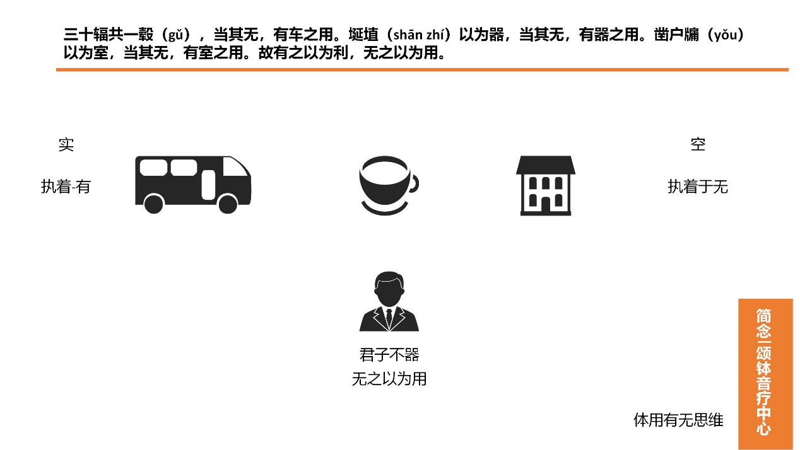

**The Dao of the bowl**

The bowl is for use; the bowl's space is its substance. Laozi said: "Clay is molded to make a vessel; it is precisely its emptiness that gives the vessel its use. Therefore, the existent is for benefit; the nonexistent is for use."

Through the use of the singing bowl, humanity realizes an inner tranquility, a unity of heaven and humanity — on this point the wisdom of the East is so close, whether in ancient India or China.

In the history of humankind, among the four great ancient civilizations, only China has been transmitted to the present. Among the excellent peoples of history, the Chinese nation has endured to this day — besides its own iteration and renewal, it has fused world civilizations with an open attitude, creating a cultural heritage rich in the spirit of the times.

### 4.1.2 Autonomy | Practice

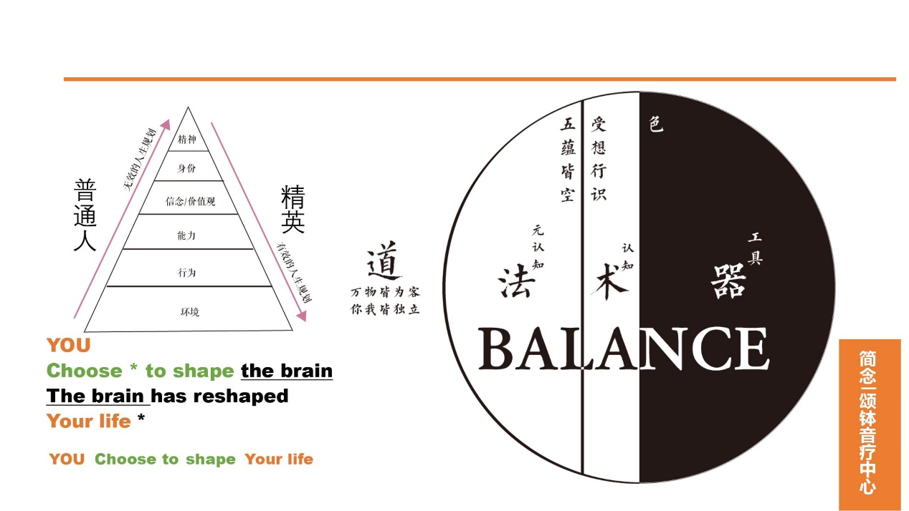

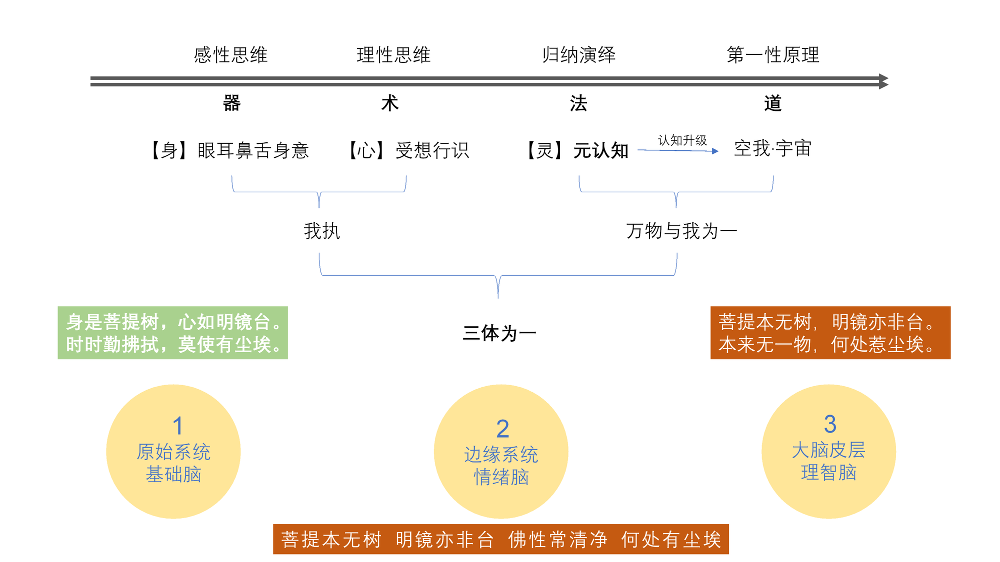

### 4.1.3 Innate | Complete

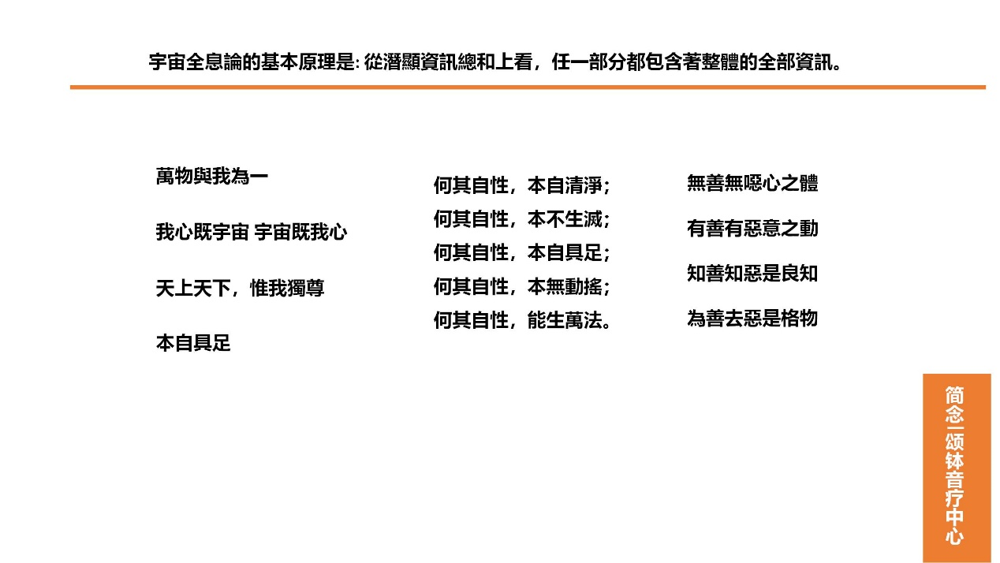

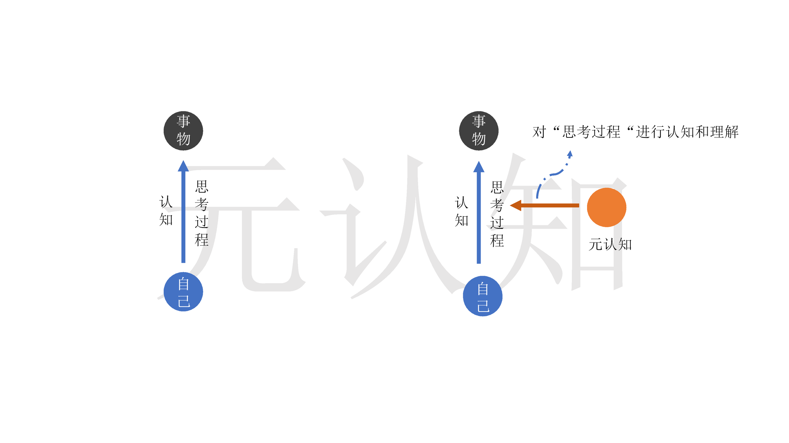

### 4.1.4 Self-Reliance | Altruism

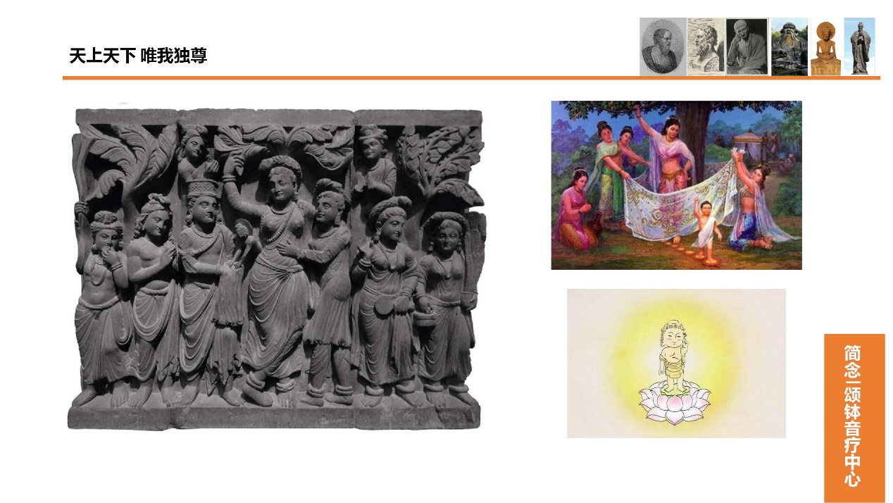

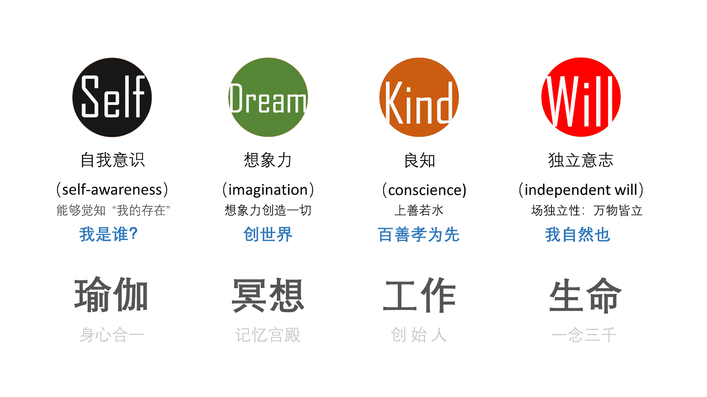

### 4.1.5 Moderation | Middle Way

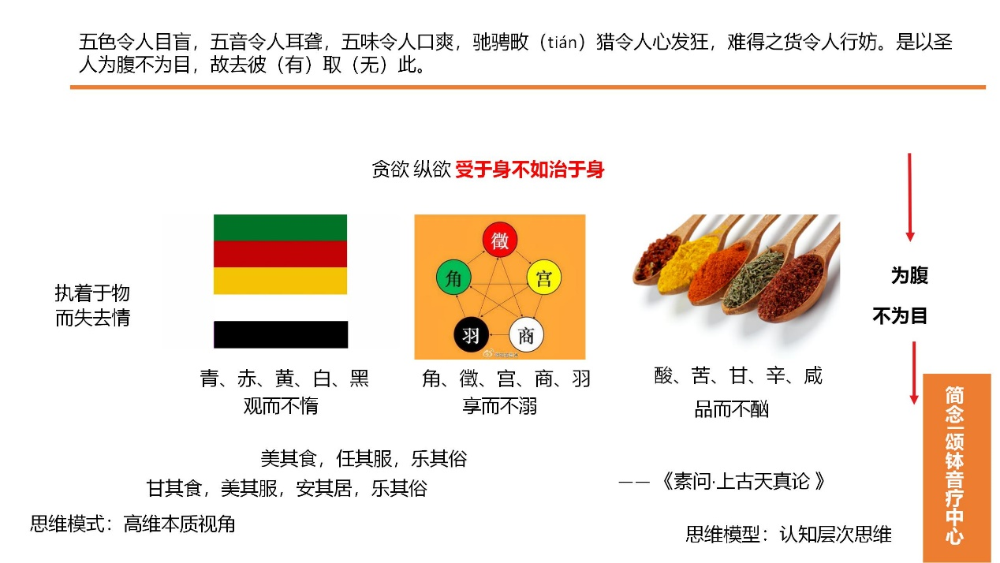

### 4.1.6 Harmony | Order

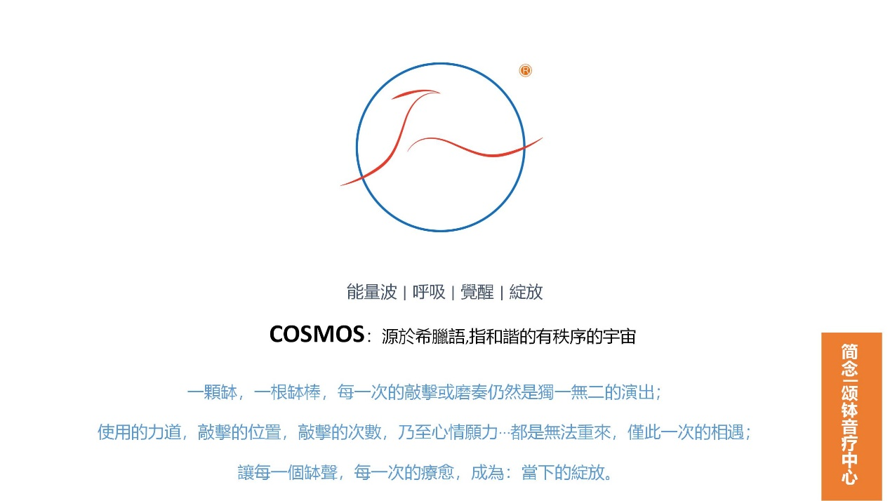

### 4.1.7 Life | Mindfulness

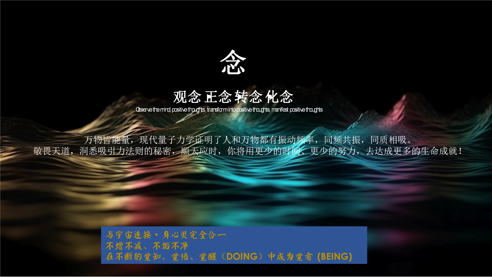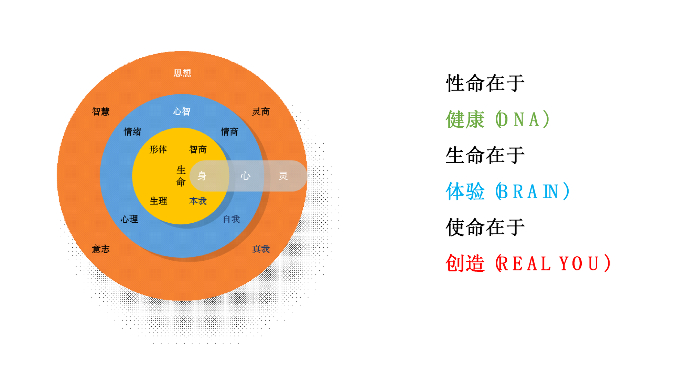

### 4.1.8 Life | Scale

### 4.1.9 Life | Pixels

## Section 2 — Worldview

### Albert Einstein — "The World As I See It"

How strange is the lot of us mortals! Each of us here for a brief sojourn; for what purpose, we know not, though sometimes we fancy we sense it. But it need not be wholly beyond comprehension if, from the everyday, we understand: a human being is here for the sake of other people — above all for those whose smiles and well-being are linked to our own; and for the many unknown ones whose destinies are bound to ours by sympathy. Daily I remind myself a hundred times that my inner and outer life depend on the labors of others, living and dead, and that I must exert myself to give in the same measure as I have received. I am strongly drawn to a frugal life, and it is my conviction that the dividing line between classes is unjust and ultimately rests on force. I believe a simple, unassuming life is good for the body and mind alike.

I do not at all believe in human freedom in the philosophical sense. Each person's actions are not only governed by external necessity but also by inner necessity. Schopenhauer's words — "A man can do what he wills, but he cannot will what he wills" — have been a very real consolation to me since my youth; they have always soothed me in the face of life's difficulties and been a source of endless tolerance. This awareness can lighten the sense of responsibility that easily makes one despondent, and prevent us from taking ourselves and others too seriously; it also leads to a view of life that gives humor its due place.

To inquire after the meaning or purpose of one's own or any other living being's existence, objectively considered, has always struck me as silly. Yet each person has certain ideals that determine the direction of his effort and judgment. In this sense I have never viewed comfort and happiness as life's purpose in themselves — that ethical basis I call the ideal of a pigsty. The ideals that light my way and again and again give me new courage to face life cheerfully are goodness, beauty, and truth. Without the affection of like-minded companions, without immersion in the objective world — that realm in science and art never to be fully reached — life would seem empty to me. The vulgar goals humanity strives for — property, vanity, the pursuit of luxury — I have always found contemptible.

My strong sense of social justice and social responsibility stands in odd contrast to my pronounced aloofness from direct contact with people and society. I am truly a "solitary traveler," never wholly belonging to my country, my family, my friends, even those closest to me; before all these relationships I always feel a certain distance and a need for solitude — and this feeling grows with the years. One clearly perceives that mutual understanding and harmony with others has its limits, but this is no cause for regret. Such a person surely loses some of his innocence and carefree ease; but on the other hand he can, to a large extent, be untroubled by others' opinions, habits, and judgments, and avoid building his inner balance on such unreliable foundations.

My political ideal is democracy. Let every person be respected as an individual, and none be made an idol. I have been showered with excessive praise and honor — not through my own fault or merit, but as a mockery of fate; the reason perhaps lies in people's wish to grasp the few ideas I won through constant struggle, a wish many have failed to realize. I fully understand that an organization needs someone to think, to command, and to bear full responsibility. But those led must not be coerced; they must be able to choose their leaders. To me, forced despotism soon corrupts; for violence always attracts the base, and I believe the tyrant of genius is always succeeded by the scoundrel — an unfailing law. For this reason I have always firmly opposed the systems we saw in Italy and Russia. The form of democracy in Europe today is discredited, but not through the democratic principle itself; it is the instability of government and the impersonal character of elections. I believe America has found the right path — electing a president with a long enough term and full power to fulfill his duties. On the other hand, what I value in the German system is its broader provisions for the sick and the poor. In the magnificent pageant of human life, what I find truly precious is not the political state, but the creative, feeling individual — the personality; only the individual creates the noble and the excellent, while the masses are always dull in thought and feeling.

Here I am reminded of the worst expression of mass life — the military system I abhor. That a man can strut with a military band in four columns is reason enough for me to despise him; he grew a brain only by mistake — a mere spinal cord would suffice. The evil breeding-ground of civilized nations should be abolished as soon as possible. Courage born of command, senseless brutality, and all the loathsome antics under the name of patriotism — I detest them all! How base and foul war seems to me! I would rather be torn to pieces than take part in such abominable work. Yet I hold humanity in very high esteem; I believe that if the healthy feelings of the people had not been systematically destroyed by commercial and political interests working through schools and newspapers, the demon of war would long since have vanished.

The most beautiful experience we can have is the mysterious. It is the fundamental emotion that stands at the cradle of true art and true science. Whoever does not know it, who no longer wonders or marvels, is as good as dead, with clouded eyes. It is this mysterious experience — though tinged with fear — that gives birth to religion. We sense the existence of something we cannot penetrate, the deepest reason and the brightest beauty that we can grasp only in their most primitive forms; this knowledge and this feeling constitute true religious sentiment. In this sense, and only this sense, am I a deeply religious man. I cannot imagine a God who rewards and punishes his creatures, nor one with a will like our own. I cannot and will not imagine a life after death for the individual; let the fragile soul, from fear or silly egoism, content itself with perceiving the wondrous structure of the present world, catching a glimpse of it, and with sincere effort comprehend a small part of the reason displayed in nature — that is enough for me.

*[Notes]*

Schopenhauer's German original: "Ein Mensch kann zwar tun, was er will, aber nicht wollen, was er will." — translator

During World War II, Einstein admitted that for a long period before the war he had been influenced by anti-Soviet propaganda, after which his view on the matter changed somewhat. See his speech at a banquet of the "American Jewish Council for Aid to Russia" on October 25, 1942, and his letter of March 16, 1950, to the American anti-Communist "theorist" Sidney Hook. — translator

Refers to the Weimar Republic, established at the end of World War I in 1918 and overthrown by Hitler in 1933. When first published, the text used not "the German political system" but "our political system." — translator

Having witnessed the spread of German militarism and the fascist plague, Einstein formed a very mistaken view of the masses and mass movements, a mistake that also appears in other articles. — translator

After July 1933, Einstein changed this absolute anti-war stance, actively calling on anti-fascist forces to arm themselves against fascist armed aggression. See his letter of July 20, 1933, to A. Nahon. — translator

This essay was first published in 1930 in *Forum and Century*, vol. 84, pp. 193–194, in the "Forum" series, no. 13, *Contemporary Philosophy*. The original title was "What I Believe." — translator

### 4.2.1 What Is Healing


First, we suggest that those about to receive bowl healing must understand the definitions of treatment and healing, and then distinguish the difference between the two, so as not to be biased in their expectations of adjustment later.

#### 4.2.1.1 What Is Treatment?

The broad health field has four stages: prevention, diagnosis, treatment, and rehabilitation. The middle stages — diagnosis and treatment — belong to medicine and must be performed in a proper hospital by a physician who immediately addresses the patient's illness, restoring bodily function by eliminating disease or relieving physical symptoms. Usually, diagnosis and treatment can restore only about 50%–60% of bodily function; with later rehabilitation after a major illness, the body can recover to about 80% of its pre-illness state. Take a small skin wound: even with good recovery today, the skin function at the wound is about 80% of normal — a proportion that does not affect the patient's normal life, but scientifically it is hard to return to the most original, pristine state.

When we are not physicians and cannot perform surgery or diagnose and prescribe, yet publicly claim we can "treat" illness, that is actually a very unreasonable claim.

#### 4.2.1.2 What Is Healing?

Of the four stages of the broad health field, healing has a broader scope, leaning more toward prevention and rehabilitation — more toward discovering pre-illness conditions and assisting repair after treatment, playing a supporting role in diagnosis and treatment. Singing-bowl healing is still being explored scientifically, but we do not rule out sound as a possible future medicine.

Developing conservatively, the application of the bowl extends beyond the hospital medical system into psychological, emotional, spiritual, and transcendent levels. Non-discriminating, non-harming bowl healing can accomplish holistic body-mind-spirit healing.

But healing is not local elimination or stopping of symptoms, nor merely returning the body to its pre-diagnosis state. It goes deeper, exploring inward — why specific symptoms arose — launching a tracing process beyond the bodily level, helping the patient reclaim their own power, so that their body-mind-spirit state returns to the health and vitality it should have, through a new lifestyle, way of relating, and emotion management, achieving overall restorative healing. Thus, when healing takes effect, the result is often better than the state before the illness appeared.

#### 4.2.1.3 The Occurrence of Healing


### 4.2.2 Wisdom of the I Ching


### 4.2.3 Tao Te Ching


### 4.2.4 Buddhist Wisdom


### 4.2.5 Brain Science


### 4.2.6 Energy Manifestation


### 4.2.7 Huangdi Neijing (Yellow Emperor's Inner Canon)

The East is associated with the color green/blue and connects to the liver; it opens at the eyes and stores its essence in the liver. Its disease manifests as fright; its flavor is sour; its class is plants and trees; its domestic animal is the chicken; its grain is wheat; it corresponds to the four seasons, above as the year-star (Jupiter), thus spring qi resides in the head. Its tone is *jue* (角), its number is eight; thus we know its disease is in the tendons; its odor is rancid.

The South is associated with red and connects to the heart; it opens at the ears and stores its essence in the heart, so its disease is in the five zang. Its flavor is bitter; its class is fire; its domestic animal is the sheep; its grain is millet; it corresponds to the four seasons, above as the flickering star (Mars). Thus we know its disease is in the vessels. Its tone is *zhi* (徵), its number is seven; its odor is scorched.

The Center is associated with yellow and connects to the spleen; it opens at the mouth and stores its essence in the spleen, so its disease is at the root of the tongue. Its flavor is sweet; its class is earth; its domestic animal is the ox; its grain is sorghum; it corresponds to the four seasons, above as the quiescent star (Saturn). Thus we know its disease is in the flesh. Its tone is *gong* (宫), its number is five; its odor is fragrant.

The West is associated with white and connects to the lung; it opens at the nose and stores its essence in the lung, so its disease is in the back. Its flavor is pungent; its class is metal; its domestic animal is the horse; its grain is rice; it corresponds to the four seasons, above as the white star (Venus). Thus we know its disease is in the skin and hair. Its tone is *shang* (商), its number is nine; its odor is fishy.

The North is associated with black and connects to the kidney; it opens at the two yin and stores its essence in the kidney, so its disease is in the streams. Its flavor is salty; its class is water; its domestic animal is the pig; its grain is beans; it corresponds to the four seasons, above as the morning star (Mercury). Thus we know its disease is in the bones. Its tone is *yu* (羽), its number is six; its odor is putrid.

Therefore, one skilled in pulse diagnosis carefully observes the five zang and six fu, the obverse and reverse, yin and yang, interior and exterior, the ordering of male and female, and keeps it in the heart's intent, uniting the heart with essence. Teach it not to the unworthy; transmit it not if it is not true — this is called attaining the Dao.

— *Plain Questions · Treatise on the Golden Chamber's True Words*


The East generates wind; wind generates wood; wood generates sour; sour generates the liver; the liver generates the tendons; the tendons generate the heart; the liver governs the eyes. In heaven it is mystery; in humanity it is the Dao; on earth it is transformation. Transformation generates the five flavors; the Dao generates wisdom; mystery generates spirit. Spirit in heaven is wind; on earth is wood; in the body is the tendons; in the zang is the liver; in color is blue-green; in tone is *jue*; in sound is shouting; in change is grasping; in orifice is the eyes; in flavor is sour; in emotion is anger. Anger injures the liver; grief overcomes anger; wind injures the tendons; dryness overcomes wind; sour injures the tendons; pungent overcomes sour.

The South generates heat; heat generates fire; fire generates bitter; bitter generates the heart; the heart generates blood; blood generates the spleen; the heart governs the tongue. In heaven it is heat; on earth is fire; in the body is the vessels; in the zang is the heart; in color is red; in tone is *zhi*; in sound is laughing; in change is worry; in orifice is the tongue; in flavor is bitter; in emotion is joy. Joy injures the heart; fear overcomes joy; heat injures the qi; cold overcomes heat; bitter injures the qi; salty overcomes bitter.

The Center generates dampness; dampness generates earth; earth generates sweet; sweet generates the spleen; the spleen generates flesh; flesh generates the lung; the spleen governs the mouth. In heaven it is dampness; on earth is earth; in the body is flesh; in the zang is the spleen; in color is yellow; in tone is *gong*; in sound is singing; in change is hiccup; in orifice is the mouth; in flavor is sweet; in emotion is thought. Thought injures the spleen; anger overcomes thought; dampness injures the flesh; wind overcomes dampness; sweet injures the flesh; sour overcomes sweet.

The West generates dryness; dryness generates metal; metal generates pungent; pungent generates the lung; the lung generates skin and hair; skin and hair generate the kidney; the lung governs the nose. In heaven it is dryness; on earth is metal; in the body is skin and hair; in the zang is the lung; in color is white; in tone is *shang*; in sound is weeping; in change is coughing; in orifice is the nose; in flavor is pungent; in emotion is worry. Worry injures the lung; joy overcomes worry; heat injures skin and hair; cold overcomes heat; pungent injures skin and hair; bitter overcomes pungent.

The North generates cold; cold generates water; water generates salty; salty generates the kidney; the kidney generates marrow and bone; marrow generates the liver; the kidney governs the ears. In heaven it is cold; on earth is water; in the body is the bone; in the zang is the kidney; in color is black; in tone is *yu*; in sound is groaning; in change is shivering; in orifice is the ears; in flavor is salty; in emotion is fear. Fear injures the kidney; thought overcomes fear; cold injures the blood; dryness overcomes cold; salty injures the blood; sweet overcomes salty.

— *Plain Questions · Treatise on the Correspondence of Yin and Yang*


The heart is the official of the monarch, from which the spirit emanates. The lung is the official of the minister, from which regulation and rhythm emanate. The liver is the general, from which planning emanates. The gallbladder is the official of impartiality, from which decision emanates. The chest center (Dan-zhong) is the official of the messenger, from which joy emanates. The spleen and stomach are the officials of the granary, from which the five flavors emanate. The large intestine is the official of transport, from which transformation emanates. The small intestine is the official of reception, from which things are transformed. The kidney is the official of strength, from which skill emanates. The triple burner is the official of drainage, from which the water passage emanates. The bladder is the official of the region, where the body fluids are stored; when transformed by qi, they can be discharged. These twelve officials must never fail one another.

Therefore, when the master is clear, the subordinates are at peace; thus nurturing life brings longevity, and no peril throughout one's days; governing the world thereby brings great prosperity. When the master is not clear, the twelve officials are endangered; the pathways are blocked and impassable, and the form is greatly wounded; thus nurturing life brings calamity, and governing the world puts its lineage in great peril — be cautious, be cautious.

The ultimate Dao is subtle, its changes inexhaustible; who knows its origin? How precarious — the observer is watchful, who knows its essence? In the fitting and proper, who is excellent? The number of the indistinct is born of the tiny; the tiny's number arises from measure; multiplied by thousands and tens of thousands, it can grow greater; pushed to the great, its form is established.

— *Plain Questions · Treatise on the Secret Canon of the Spirit*


## Section 3 — Values

### "The Power of the Mind" (Xin Zhi Li)

Written by Mao Zedong in May 1917 (the early summer month of the Ding-Si year).

The universe is my mind; my mind is the universe. From the finest hair tip to the vastness of heaven and earth, all is driven by the mind's thought-power.

Looking across the past and present, we know that humanity is the primate of all things precisely because, among the creatures of heaven and earth, it is the mind that most strives to evolve.

Our ancient China, the cradle of humanistic civilization, was the first to establish the justice, morality, and virtue of all nations precisely because among the peoples of the earth it most strove for the mutual cultivation of humanity and the virtue of heaven-earth. The sages and worthies of ancient China followed the Dao of nature, combining civil and martial, planning the world with such ease and such heroic greatness.

Yet heaven envied China: invasion without and turmoil within left the vast land benighted, and the people, under the insidious, violent penetration and attack of demonic bandits, gradually forgot their sacred mission; a brilliant Chinese populace was defeated by the accumulated ills of willing self-abasement, sinking, and dissipation. For five thousand years the central divine land stood in the universe, nurturing heaven's Dao, virtue transforming Kunlun, yet gradually forgot the great Dao-mission of exterminating demons and bandits. Treating demons well and sparing life, like Dongguo feeding the wolf, we gradually lost territory to the vast expanse. Demonic bandits invade and slaughter the globe, their blood-guilt reaching the heavens, greedy and brutal, hypocritical and sinister. The foolish restrain themselves and endure, the simple and good seek to influence with goodness, meeting evil with good — like fish and meat inviting the demon-bandits' blade.

Surveying the world's nations across a thousand years, judging their nature by their deeds, only the Western nations are like demonic bandits — their bloodthirst is so complete that if they are not demons, no other nation could be called a demonic rogue. Only divine-heroic China is like the divine knight-sage — its reverence for the Dao and honor of virtue is so complete that if it is not the divine knight, no other nation could be called a divine sage. The divine knight-sage is the progenitor who comprehended and created agricultural production and economy — diligent in tillage, moderate in taking and giving, devoted to life and virtue, cultivating body and nature, good and kind in dealing with the world, believing in the great Dao of the unity of heaven and humanity. The demonic bandit is the sinister, hypocritical plunderer and killer — not comprehending cultivation, greedy and rampant, cruel and dangerous, aggressively extorting, perfunctorily nomadic, firmly believing in the demonic Dao of parasitic exploitation. The divine knight and the demonic bandit have been mortal enemies since the creation; the knight nourishes life while the bandit destroys it — as incompatible as water and fire, as day and night. This is the universe's adjudication of light and darkness, the slaughter of survival and death; the wise must never lightly trust that the two can coexist in peace.

Loyalty and treason divide good and evil; historical fact distinguishes right from wrong; life and death adjudicate the divine and the demonic. The struggle between the divine and the demonic, the right and the wrong, has existed since ancient times, contending and battling, transforming into the human-world combat of light and darkness. Only the Dao of heaven is manifest, and the wrong can never finally overcome the right. Thus, once the divine knight stirs himself, he can exterminate the demons and bandits — never be timid with fear, and never turn traitor! The divine-demonic battle is life-or-death, never to be extinguished; therefore the knight is forever the mortal enemy of the bandit — to naively seek peace is to invite self-destruction. The bandits all take our annihilation as their essential evil; the knight must take the extermination of demons as his essential righteousness, passed down through generations, never slackening.

When the state is weak and the ruler foolish, the state is broken, with invasion without and internal strife; the virtuous find their mind-power and material power insufficient, and their wish to save the world is in vain. The villainous are shameless and fearless, in collusion — truly thieves who deceive the world. The ugly and corrupt seize the people's mandate, privatize the sacred instruments, and the dull-witted serve in office, harming the state and the people. The corrupt bureaucrat and the national traitor enrich their whole families, plundering the people's fat and the nation's wealth.

When the people's livelihood and hearts decline, the national power declines daily; when national power declines, the heart-power of the nation and its people also declines! Within, it can induce natural disaster and war, dynastic change; the bureaucrat, merchant, farmer, worker, and scholar all sink — not one egg remains unbroken. Without, it can entice the bandits' invasion, enslavement, and plunder; the traitor, han-jian, soldier, and student all lose home and family, with no good end. Those who emigrate to barbarian lands mostly live under others, humiliated for generations, their lives and interests unsafe.

For decades the divine land has been repeatedly savagely invaded and slaughtered; the national treasury and the people's wealth have been insidiously robbed. The Jiawu naval war, the Eight-Nation Alliance, the Twenty-One Demands… the unequal and base, cowardly traitorous treaties, inviting the wolf into the house, summoning the enemy to invade — were indeed acts of the foolish ruler and traitor harming the people.

Those who trade with the barbarians let foreign goods flood in, hoarding and gouging, and the people are all exploited. The vast China could not even produce the daily necessities of the people's lives, and not a few bureaucrats held power to relieve the people's hardships. All the world's demonic bandits, like entering an empty realm in China, gained much and were all astounded at China's exploitability. Thus the evil enemy's covetousness endures, its will to annihilate us never dies; we can only await the opportunity for a death-battle to repel the enemy, to exchange for temporary peace. Before the fierce war is opened and the towering national humiliation avenged, the barbarians, jackals, and fierce demons come like tasting sweet cane.

The running dogs of foreign powers run rampant, the han-jian are brazen; the people are all in peril because of the corrupt han-jian bureaucrats, warlords, and comprador families who sold out the country, incurring endless national-debt servitude to the foreigners. The state is broken, warlords divide the land, wars rage year after year, debt is deep, prices soar, food and shelter are hard, disasters come in succession — when will it end? Now though the Manchu Qing is defeated, the state, politics, and economy are still controlled by the benighted autocrat and the foreign slaves; the people's heart-power is a deep, weak illness, and the barbarian enemy tramples at will — in a daze we suddenly see the myriad people enslaved, the national wealth exhausted.

If we wish to save the people and govern the state, to revive China's martial vigor, though a hundred things await restoration, we can cast the remarkable and the great, becoming a generation unparalleled. The plan to save the nation and the people: the foremost principle is to strengthen the people's mind-power; and the first shortcut to renew and strengthen the people's thinking and mind-power is to break the benighted evil Dao of feudalism and bureaucracy, to punish the traitors who sold out the country and the han-jian compradors who slavishly followed the foreigners, clearly warning that their ill-gotten wealth be fined into the public treasury and that their families and descendants meet no good end — only then can the full way of education and deterrence be realized.

Rise up, original and wise, establish the state and reveal the grand strategy. The new mind-power and aspiration of the nation and people must create a new learning of humane, virtuous, brave, and civilizational brilliance; new learning is the cornerstone and beam of thought and theory. If new learning does not flourish, repelling the enemy is hard, and the foreign slaves will surely prosper and the state perish. Western learning and religion all display the sinister and false; if allowed to roam the world freely, human culture is destroyed. When China's new learning gathers the great achievements of ancient and modern, it will surely become humanity's new land. China's ancient-state enemy is the Western evil demonic bandit and the han-jian; with the dwarf-thief (Japan) sharing the hatred, this hatred has no solution — be doubly vigilant, then you can save yourself and others; never confuse them.

Now I advocate that in matters of the foreign affairs we should borrow the principle "learn the barbarians' strengths to control the barbarians," and fully know the ancestral teaching "those not of our kind must differ in heart; those not of our clan must be evil in nature." Dealing with the foreign bandits, repay every grievance, with thunder-like wisdom display maneuvering, strike and kill the enemy chief, only then can we win the self-reliant dignity and wealth of the Chinese nation and people. Examine closely the secret art of the Western demonic bandits' invasion and slaughter — the technique of plundering wealth to seize the world's invasion provisions, and the hypocritical mind-subduing religion that transforms the world's enslavement into a central hub. Thus countless petty, benighted, weak-nation politicians are all beguiled and paralyzed, with inferiority offering up the state-system to fawn on the foreign and be enslaved, cheaply selling the people's fat and the national soul.

Study the demonic bandits' way of strengthening the nation by plundering the people — all are tactics of banding together to expand outward. Our vast China must not imitate the demonic bandits' ship-strong-gun-power global invasion; we can greatly innovate the divine-knight's mutual-aid, friendly world improvement. Whoever unites against the outside, regardless of good or evil, is the best policy to eliminate internal strife and external humiliation. This "repel the foreign" policy is deeply understood by the wise who revive the nation. With the demonic bandits rampant in the world, how can China grow strong with one corner of one country? And how can it, with the Song-dynasty Zhao's weak, self-mutilating, compromising survival, naively hope to keep the gentleman's moral intercourse with the demonic bandits? All such are national traitors who sell out the country and harm the people. Only by raising the great banner of global counterattack against the demonic bandits can we execute the strategy of strengthening the state and enriching the people while repelling the enemy. He who does not plan for the whole does not deserve to plan for a corner; he who does not plan for ten thousand generations does not deserve to plan for a moment — how can we sit alone at the bottom of the well?

The fashion of studying abroad must not be indulged; the peak of national learning is of great benefit. Thus the savior must be within the country, and the aspirant abroad must not hide his will. The compatriots studying in the strong nations drift overseas; they must guard against the demonic bandits' misleading and harassment of our just souls, like wind-protection in cold winter, like warding off evil when weak and sick. Female students especially must protect their mind and will. With measured attack and relaxation, the foreign slaves, han-jian, and dwarf-thieves will find no opening and have no place to lodge. The heavenly Dao and wisdom of studying abroad lie in researching and pondering the demonic bandits' thousand-year plundering and enslavement of China's good and docile people — their heaven-given, life, and property, accumulating evidence of the thieves' crimes, pursuing the demons' atonement. Especially urgent is to see through the insidious, hidden thought and learning and the beguiling of mind-power, breaking the benightedness. Reflect on China's indulgent, compromising, enervated weakness; revive China's brave, martial defense of the Dao; devise the shortcut to surpass the demonic bandits; innovate the strange art of seizing the plunder. Lift the restrictions on the upward path for the aspiring among the people; refresh the governance to resolve the clash between the people's will and totalitarianism; release the popular will, nourish the people's livelihood; reward the commoner who is clean and public-spirited with public power.

China's pillars must birth a new image of self-reliance and self-strengthening; set preventive strategies against the barbarian bandits' slaughter; raise the great aspiration of the people to enrich the state and strengthen the army; care for the livelihood and welfare of the farmers, workers, and scholars. Open new learning to nurture the new people, supplemented by new-people models as citizens; with culture attack by virtue, with martial support by courage; resist the barbarian powers' plot to exterminate China's sacred inheritance; inherit the aspiration of the world's great unity and sacred civilization; fulfill the mission of justice, virtue, and education.

We hear that "the army can be deprived of its commander, but a common man cannot be deprived of his will" — the will is the power of the mind. The people's will first recommends the natural robustness of the nation's and the people's individuality, so that the pillars of the state emerge endlessly. For centuries, in foreign humiliation and internal strife, the people's individuality has been repeatedly harmed by the monarch and the bureaucrat; the ills are heavy, and the people's mind and body have been much injured — the weakness of the people is the weakness of the state. In the whole nation, whoever suppresses the individual and violates the people's individuality commits the greatest crime! Therefore China's three bonds must be removed, benighted rule and benighted governance wholly eliminated, before there is hope of shaping a strong people.

Since China opened its ports, feudalism, bureaucracy, benightedness, and foreign-affairs have harmed the state and the people. Tracing the reason: the church, the capitalist, the monarch, and the traitor — these four are the "inner four thieves"; banding together like a ghostly alliance of man-eaters, all are the world's demonic bandits. Among the four thieves, the bureaucrat who holds political power is the chief culprit! The sacred heavy instrument of the state must put the people first; it must never be used to abet evil, private greed. If benighted, shallow petty men steal and occupy the state's center, then foreign demons will surely invade and the people will surely perish.

Those who would annihilate China, with the great enemy of the "outer four thieves," have for a thousand years lain beside our bed; all of China's disasters originate from this. The outer four thieves are: the dwarf-thief royal house; the Jewish heretical cult of the demonic-bandit race and its derived sect chiefs; the European bandit royal houses; and the surrounding petty nations that betray and rebel. All wish to kill our hearts, capture our bodies, and plunder our wealth. As the powerful, fierce enemy for China's revenge, the washing away of humiliation, and the display of might, we must settle the historical accounts to the last detail, passing them to generation after generation — never forget. We may strike them heavily with the stratagems of war, supplemented by the new morality, conscience, and faith to assimilate them — this is the multi-pronged defense-and-attack policy.

Since the Manchu Qing's foreign-affairs movement, corrupt families have all stolen and exploited the people's fat to flee overseas, for the plot of family enjoyment. Given time, the myriad Chinese people's ancestral blessings, even flesh and marrow, will be wholly stripped and sent to the Western demonic bandits and the corrupt families! The people, like falling into an abyss in cold winter, are further poisoned while at death's door. The agricultural populace, backward and narrow, will surely sink into enslavement as a perished nation. And those who plunder the national wealth flee overseas, with no one at home to investigate and punish, and no one abroad to count and block — thus the traitors follow one after another, flocking like ducks. If we cannot punish them, how are we different from the dwarf-thief, the demonic bandit, the national traitor, the brute?

Looking far back to the Three-Kingdoms turbulent era, the Five Barbarians of the Northern and Southern dynasties nearly exterminated China; fortunately heaven-sent hero Ran Min saved the people; though the Tang was rich and strong, it was penetrated by the barbarian An Lushan, yet had the divine-race battle to mend the old rivers and mountains; the Song valued civil over martial, feared the outside and oppressed the inside, the root of the foreign enemy's great invasion; the Ming had rampant dwarf-thieves, repeated incursions that finally became the source of the Ming's decline; the Yuan and Qing barbarians used the whole nation's strength to raise many han-jian, the beginning of the perdition of nation and clan. Therefore the han-jian and national traitor are ultimately the crux of China's weakness.

The han-jian and national traitor are also of three kinds: the first are the spies of the dwarf-thief and demonic bandits, posing as missionaries, merchants, scholars, sneaking into China awaiting their chance; the second are those intentionally bought and won over by the enemy nation or heretical cult, willingly selling out the country for glory; the third are the benighted, narrow, self-abasing who fawn on the outside and despise the inside, misled and used in ignorance, actually carrying out the betrayal of country and harm to people. All three are the public enemy of nation and people; there should be good policy of education and purification, learning from the past to warn the future, studying the patterns, setting models — this is the rectification code to revive and forever end the han-jian.

Now the benighted forget their roots and fall into the abyss, yet race to dig their own graves, never thinking of the nation's and people's peril. They muddle through the present, lose the sacred mission, forget the nation's heavy responsibility; deviate from truth, violate the human root of wisdom, defile the ancestors' morality; intoxicated with pleasure, unaware of the world's upheaval, willing to be the foreign-slave fawning on the outside; immersed in self, ignoring the crisis on all sides, credulously believing the demonic bandit's slander! Thus the Western and dwarf-thief bandits can wantonly invade, plunder, and enslave our Han-Tang China, as if entering an unpeopled realm.

The saints of a thousand ages take education as the root. We happen to meet this era of chaos before our eyes; all chase material desire and lose the heart, follow trivialities and forget the true, intoxicate with entertainment and lightly regard the national will, scheme for small private gain and abandon the great benefit, recognize the barbarian as father, worship the demonic bandit as teacher, let the dwarf-thief seep in, and destroy civilization in shamelessness. How can you and I live in disgrace, turning a blind eye? At the critical juncture of the nation's survival, the aspirant can hardly breathe; we must take the world as our own responsibility, saving the people from fire and water.

Looking at the present, the world's structure is turbulent and shifting, the future of human civilization uncertain, the happiness of all under heaven in peril. Though technology brings material abundance, it still cannot fill the huge gulf of human desire; all factions rush about for their own private interest, and everyone is drawn into the rolling torrent. The bandit-rogues formulate the barbaric laws that adjudicate the world; the evil devil openly becomes the hypocritical leader of humanity; the nations do not think to raise the army of morality, but wholly worship the demonic bandit as teacher — the time until all grass and trees, all living beings of this planet are destroyed and extinct is not far.

Though there are wise and brave ones willing to be the pillar in the midstream, they are like a man's voice in a busy market, a fish's song below a waterfall. Ask around — how many still cling to truth? How many still seek the origin? One "as long as I'm happy" and they willingly drift with the current; one "none of my business" and they practice the universal fool; one "don't talk politics" and they take the people's rights as private instruments. Do they not know that the rise and fall of the world is the responsibility of every man? Ask: how to establish the heart for heaven and earth? How to establish the life for the people? How to continue the绝学 of the past sages? How to open the great peace for ten thousand generations? If our kind no longer has this heart, then China is about to perish! And if China perishes, humanity must perish!

If we wish to save China, we must raise the way of martial endeavor and flourishing industry. With the gentleman's wondrous aspiration, send forth the demon's wondrous troops; with thunder-like means, exterminate the warlords' division; set the strategy of great unity, cut the scattered and disorderly deliberation; create the good and upright strong party, avoid the harm of a hundred parties; annihilate the invading evil enemy, remove the traitor who sells the country; open the door of the weak nation, nourish the recovery of the national illness; strengthen the people's will and shape body and mind, cultivate the workers and farmers and heavy industry; replenish the people's original spirit, nurture China's strength. The people's heart under heaven cannot be deceived; the aspirant's mind-power should take the rest and recuperation of the people as the highest aim. The aspirant's mind should take insight into the demon-bandits' essence as the ruler's Dao, as the shortcut to a strong nation.

The foremost way to a strong nation is to cleanse the evil, private, old order, and indulge the people's heavenly heart. When the myriad people's body-mind-will burgeons, the reality of a great nation's revival can be nurtured; the parties should observe minutely, plan that every citizen has a profession, help women and children to read, advocate that all workers eliminate drought, flood, pestilence, abolish the bureaucrat's everywhere-displayed arrogance, keep the corrupt under constant supervision, train the heavenly troops globally brave and divine. And the invention and manufacture of machines are all the unconstrained mind-power; borrowing and creating on our own can burgeon, cracking the demonic bandits' top-secret thinking; looking down upon Western technique from above, the value lies in self-renewing thought and forging a unique path. Keep the mind-power ever new, strike the demonic bandits' science at its fatal point — then new technique can destroy the enemy and strengthen ourselves.

The male is the nation's body, strengthening sinew and bone, protecting and expanding industry; he must carry the aspiration to cultivate self, manage family, govern the state, and bring peace to the world. At present China's divine-race males cannot resist the demonic bandit without, and do not detect the han-jian within, addicted to the abuse of material and spiritual opium, blindly envying all the demonic bandit possesses, full of self-abasement and emptiness — then how can the offspring they raise be self-reliant? The female is the nation's meridian, nourishing the spirit, gestating the race; she must raise the sentiment of eugenics and good childbirth to assist the great enterprise. Today the central divine-race female binds her body-mind with foot-binding, refuses literacy, let alone the self-mutilation of talent-less and closed benightedness, even despising the divine-race's male kin, practicing the benightedness of recognizing the thief as lord — then how can the offspring she gestates be self-reliant? If the nation's female is self-abasing, then all she gestates is self-abasing! I observe that where the demonic bandit invades and slaughters, he enslaves and exterminates the males, beguiles and kills the females, the aim being to thoroughly perish the nation and change the race — thus the female's body-mind gestation is by no means a private sentiment of the small self; nurturing children and assisting the male are all the great-self nurturing of the nation, urgently needing to innovate the learning of womanly Dao. Therefore the strong-nation policy should have the male brave in war and willing to learn, the female releasing body-mind and diligent in virtue — practiced bit by bit.

Without, we can crush the demonic bandit's rotten, withered, overwhelming force to perish us; within, we can comprehend that all China's disasters originate from the demonic bandits' instigation, and with wise clarity turn calamity into fortune. The divine knight and demonic bandit must have many decisive battles; the evil cannot invade the right — we must never forget the just mission.

The greatest force of heaven is the sun; the greatest force of earth is electricity; the greatest force of man is the heart. Where the yang qi issues, even metal and stone are pierced; once the spirit arrives, what cannot be accomplished? To change dynasties, seek fortune for the people, punish the corrupt and the han-jian — what difficulty! If one is publicly loyal to the state, unyielding through a hundred setbacks, though a commoner of low station, he is not without the ability to shift the world's fortune. Can the aspirant not exert himself! The power of the heart is the mind's will and vow; one who rides the great Dao can fully manifest wondrous power, shape the nation's majesty, turn stone to gold, mold clay into troops, forge the state-body into a fortress of metal, and refine the myriad people into divine generals. Though there are evil demonic troops, how can they shake the towering China, the clear heaven and earth.

Man lives between heaven and earth; the tangible is called the flesh-and-blood body, the intangible is called the true mind and real nature. Flesh is formed of material; mind-nature is born before heaven and earth. Hence the theory of materialism and idealism. Living in the world, the flesh is the instrument, the mind-nature is the master, the spirit is the heavenly Dao. The flesh shows the appearance of birth and death; the mind-nature keeps the unchanging substance; all sentient life is not contrary to this principle. The truth of all civilizations past and present issues from the mind-nature and is completed in matter. Virtuous governance, literature, art, artifacts, and even personal deeds are all driven by wish, desire, and emotion; with fine comprehension one can change heaven and earth.

Therefore, what mind-nature an individual has, that outwardly is his life; what mind-nature a group has, that outwardly is its undertaking; what mind-nature a nation has, that outwardly is its civilization; what mind-nature all beings have, that outwardly is their karmic retribution. Thus the heart is the original force that forms the world's artifacts. The Buddha said: "When the mind arises, all dharmas arise; when the mind ceases, all dharmas cease." Thus Indian Buddhism perished through a passive extinguishing of mind.

The Western bandit religion also had the Old Testament's Lord's violent abuse of the people; later Jesus's New Testament improved it with the Buddha-nature of loving the people. The mind-natures of god and demon vary thus; hence the world is mostly bewitched by Jesus. The Buddha is "not of man"; "not" means "non," speaking to the Buddha-nature's weakness. Jesus understood this and thus spoke of repentance, knowing shame and not doing evil; Confucius understood and thus spoke of cultivating the mind, knowing restraint and not neglecting; Shakyamuni understood and thus spoke of the three vehicles, clarifying the mind and not being benighted; Laozi understood and thus spoke of non-action, clarity and quiet and not being private. Now Buddhism and foreign religions are all imported teachings; when the foreign religion flourishes, China's Daoism daily declines.

The heart is the root of all power; from inside out it can generate good, can generate evil, can create, can destroy; from outside in it can be polluted, can be pulled, can be acquiesced to, can be resisted. Cultivated with the right, it can transform all beings; cultivated with the wrong, it can devastate life. The heart's great power is such that the nation's scholar must not fail to observe it. The great man stands between heaven and earth, borrowing the vast righteous qi to nurture the aspiration of bright virtue, tuning the great power of heaven's Dao to shape the heart-power of a strong nation — thus manifesting the wondrous effect of sage-official and upright people.

Generally, the hero and the champion act on themselves: establish the great aspiration, issue its driving force, strive and leap, break and clear, advancing forward without turning back. Their strength is like a great wind issuing from a long gorge, like the lustful person's sexual impulse seeking his lover — absolutely nothing can block or turn it back, and there must be nothing that blocks it, for if it is blocked, the force disappears.

I have watched the brave general in battle: with the bearing of one man against ten thousand, the raging man's force is most fierce, all because he has no scruples, his driving force proceeds in a straight line, unblocked and undissipated, hence reaching the firmest and strongest. The mind-natures of all beings are originally the same; the spirit of the hero and the sage is also the same; the way of the king and sage who save the nation is also the same.

Therefore the responsibility of the youth of this age is to inherit the past and inspire the future, carry forward the strengths of the ancient sages and the hundred schools, open the heart to fuse the essence of Eastern and Western civilization, newly research the wonderful technique to surpass the strong nations' industry, advance with the times to meet the world's changing situation, liberate the mind to create a generation's magnificent spirit. Break the fetters of the sects, gather the cream of science, set the model of a strong nation, and spread truth across the world! Now rectify the source, and I wish to join hands with those of like mind who pursue the truth of saving and healing the world, issuing this great vow, unceasing through generations, contributing body and mind, upholding just morality.

Therefore our burden is heavy and the road long; if we can establish this great heart, gather love into action, then this tiny light will surely pierce the brightness of heaven, the spark will surely become a prairie fire, overturning heaven and earth, reversing the cosmos. Punish the corrupt national traitors within the seas, chastise the offspring of the han-jian abroad; nourish the wealth of the myriad people's economy, raise the pattern of the great nation's agriculture and industry; open the vanguard of the humane-martial world, destroy the cornerstone of the demonic bandits' international; create China's new-era strong nation, make the myriad people's thousand-generation welfare; raise China's ten-thousand-generation flourishing age, open the world's eternal peace! It is not impossible.

"The Power of the Mind" has thirty-nine paragraphs in full, six hundred thirty-nine sentences, totaling over six thousand two hundred and fifty characters. Copied in the spring of the Wuyin year (i.e., spring 1938), with the nation in peril, as if falling into an abyss, I borrowed and read this great work, a topping-on-the-head awakening, deeply feeling Runzhi's (Chairman Mao's style name, Runzhi) wondrous wisdom in saving the nation. Gazing afar, I pray for my teacher, Mao Qi (Chairman Mao the wondrous man), that heaven's favor keeps him well.

### 4.3.1 Inner Abundance, Love Overflowing

Openness.

Mindfulness.

Space, Flow.

Go with the flow.

See the nature clearly.

Love yourself first, then love others.

Awaken oneself and awaken others; perfect the practice.

Breath, Awareness.

Where my heart rests is home.

Heal yourself, influence others (the self-healed heal the other).

Slowly, more patience, time.

You can do it; believe you can.

I can see you.

Words of healing:

I'm sorry, please forgive me, thank you, I love you.

Meet yourself, meet beauty.

Surrender.

Sacred kingship.

### 4.3.2 Growth Mindset


### 4.3.3 State of Perfection


### 4.3.4 Life Blossoming


## Section 4 — Basic Professional Requirements for Healers

### 4.4.1 Appearance Requirements

Clothing should mainly be Zen-style, white-toned, with no metal objects carried, and no rings, bracelets, or other ornaments that easily contact the bowl and damage it or produce sharp sounds.

The healed person: mainly loose, comfortable, soft clothing without metal ornaments.

### 4.4.2 Professional Requirements

Striking technique, direction, amplitude, rhythm, etc.

First, it must begin with the sound healer's stability of sound waves when operating the bowl: each transmission of sound, in volume and in pitch, should achieve near-periodic stable controllability.

Sound is a vibration and also an energy. If the force, direction, and amplitude keep changing — force sometimes strong, sometimes weak; amplitude sometimes large, sometimes small; direction sometimes left, sometimes right — it causes the body's muscles, bones, and even nervous system to be unbearable, similar to the discomfort a passenger feels when the driver keeps pumping and releasing the accelerator.

Unstable direction, force, and amplitude often cause negative bodily sensations, and more seriously may cause harm — be cautious!

When moving, try to be silent so as not to affect the healed person's experience.

### 4.4.3 Mind-Intention and Vows


### 4.4.4 Ethical Considerations

Before healing, it is important to note and acknowledge that, although singing-bowl healing brings many positive effects, the sound healing related to the bowl still has much room for scientific research and currently should not be regarded as a substitute for or replacement of hospital medical methods. This disclaimer is also stated in the book.

The bowl-healing theoretical framework references the Eastern three channels, seven chakras, three great energies, five great elements, and the Huangdi Neijing, rooted in traditional experience. Although scientific development continuously verifies it, much healing still awaits scientific confirmation. Their effectiveness is mainly measured through the feedback provided by those who receive the healing.

Often, your reference basis comes from your own experience. Therefore, not only must the healer improve his own capacity for awareness and feeling, but also during the healing he needs present-moment awareness to refine the bowl-healing experience — this is a fundamental, key quality and ability of the profession, fully learned, experienced, and guided by richly experienced teachers.

Only when you heal for yourself or others and understand the effectiveness and limitations of traditional treatment methods, can you proceed with these healing techniques.

Furthermore, healing is a positive, uplifting life experience. If there is pathological condition of body or mind, it is recommended to seek treatment from a proper hospital and professional (Chinese or Western) physician, follow the physician's advice, and take active action.

### 4.4.5 The Healer's State

Accompany, do not interrupt; let the energy flow naturally.

Listen, maintain eye contact; avoid judgment, leading, digging, preaching, giving your own subjective advice.

If the experiencer's bodily or emotional state exceeds the controllable range, you may proactively intervene and guide the breath back (e.g., hold one hand, giving strength; place one hand behind on the heart chakra, giving love. Avoid patting, which interrupts the emotional-energy flow).

Share your own already-achieved, real, similar experiences.

Pay attention to every expression (non-restrictive vocabulary), supplement with positive energy.

*Contraindications*:

- During the female physiological period, do not place the bowl on the navel chakra to strike, and do no tactile work on the waist and abdomen.
- After major surgery, wait until the wound heals, then tactile bowl work may be done.
- During pregnancy, no tactile work; auditory meditation is allowed.
- At least 30 minutes after meals, tactile bowl work may be done.
- Perform the bowl experience in all safe states, when the body is comfortable or acceptable.

*Keywords*: stability, trust, open acceptance, compassion, empathy, unity of self and other.

### 4.4.6 The Healed Person's State

Relaxation, acceptance, quiet, peace, curiosity, ease, joy.

*Notes*:

- *Diet adjustment*: too hungry — gastrointestinal peristalsis accelerates; too full — not suitable for vigorous exercise or breathing-meditation practice; can supplement some warm water, beneficial to qi-blood circulation.
- Pay attention to emptying the bowels and bladder.
- During menstruation, pregnancy, or postpartum, do no "guarding the dantian" practice; do no forceful abdominal breathing or large limb movements, to avoid qi-blood overly descending.

*Reactions after bowl healing*: normal reactions & abnormal reactions.

Do not be curious, do not pursue, do not fear. Let it be natural, arise and cease on its own.

- Digestive-function adjustment: increased salivation, increased appetite, thirst, hiccups, flatulence.
- Blood system: sweating, accelerated qi-blood circulation.
- Neural-function regulation and adjustment: agile thinking, clearer train of thought, more active brain.
- Scattered stray thoughts: one thought replaces ten thousand thoughts; concentrate, do not suppress stray thoughts.
- Drowsiness and sleepiness: let a thread of light into the eyes to make the mind clearer, or simply rest to conserve energy.
- Head distension, head heaviness: over-guarding the intent; chest oppression, breath-holding: over-regulating the breath; heart palpitations, over-regulating the mind; muscle soreness, over-regulating the body.

You are not a drop in the ocean.

You are the entire ocean in a drop.

> You are not a drop in the ocean.
> You are the entire ocean in a drop.
> — Rumi, the 13th-century spiritual poet

## 4.5 Healer's Vital-Energy Self-Restoration

### Practitioner Levels: Beginner–Intermediate–Advanced

### 4.5.1 Three-Channel Balance

#### 4.5.1.1 Yin-Yang Breathing Method

The Yin-Yang breathing method is a practice using complete yoga breathing: inhale left, exhale right; inhale right, exhale left counts as one round, repeated 7 times. Then breathe through both nostrils 7 times to maintain the body's yin-yang balance. During practice, you can gently place your hands on the body, close your eyes, and feel the breath and the channels within body and mind. After the breathing practice, the body feels slightly warm and begins to sweat — because the practice activates the body's energy channels, making qi-blood circulation more stable and beneficial. The Yin-Yang breathing method is a simple, natural therapy that helps balance body and mind, raise immunity, relieve stress, and promote health.

#### 4.5.1.2 Moon Breathing Method

The Moon breathing (Chandra Bhedana) is a natural therapy that lowers blood pressure through left-inhale, right-exhale, and cooling breath. In practice, sit simply, with basic chest breathing; extend the thumb and ring finger of the right hand, bending the other three fingers, and place the left palm up at the navel chakra. Then, exhaling, press the right nostril with the right thumb, inhale slowly through the left nostril; then press the left nostril with the ring finger while releasing the right nostril, and exhale slowly through the right nostril. During practice, keep the exhale slower than the inhale. This practice helps balance body and mind, lower blood pressure, relieve stress, raise immunity, and promote health.

In addition, the Moon breathing can help regulate the endocrine system, improve sleep quality, and relieve anxiety and depression.

#### 4.5.1.3 Sun Breathing Method

Sun breathing (Surya Bhedana — right-inhale, left-exhale, heating breath, raising blood pressure):

*Guidance*: simple seated posture, basic chest breathing; extend the thumb and ring finger of the right hand, bend the other three fingers, place the left palm up at the navel chakra.

1. Exhale, press the left nostril with the right ring finger, inhale slowly through the right nostril.
2. Press the right nostril with the thumb, simultaneously release the left nostril with the ring finger, exhale slowly through the left nostril.
3. Keep the exhale slower than the inhale; during breathing, relax the body and focus on the breath.
4. Repeat the above steps, 10–20 breaths each time, practice 5–10 minutes.

The Sun breathing can help regulate the body's energy, enhance immunity, improve sleep quality, and relieve anxiety and stress, promoting physical and mental health. However, those with hypertension, heart disease, etc. must practice under a doctor's guidance.

*(notes area)*

#### 4.5.1.4 The Six-Syllable Breathing (Liu Zi Jue)

The breath-emission method in the Daoist "Marrow-Washing Scripture" is an ancient health-preservation experience: coordinated with exhalation, one emits the six syllable-sounds "Xu, He, Hu, Si, Chui, Xi." Through this coordination of breath and sound, it is a traditional exercise method aimed at balancing the yin and yang within the body — a deeper-level skill. It belongs to the elementary sound method within "breath emission." Mastering it can clear illness within the body.

Through breath emission — reverse abdominal breathing, the up-down movement of the diaphragm, and kidney-contracting practice — the function of these organs is markedly enhanced and aging delayed (in TCM called "tonifying the kidney"). When the function of producing adrenocortical hormone is enhanced, one may become energetic, with stronger resistance to external wind, cold, damp, and heat. For athletes, it can also improve competitive performance. In cultivating inner qi, the dantian is the source of vital energy; first form a qi-hill at the dantian, then it travels along the meridians, forming the body's meridian field. Thus those who cultivate the dantian achieve "kidney tonification"; when kidney qi is sufficient, martial skill can then be refined.

"All breath-cultivation uses the nose to inhale and the mouth to exhale, finely and extended — this is called long breathing. Inhaling has one; exhaling has six. The one inhalation is the breath drawn in. The six exhalations are: Chui, Hu, Xi, He, Xu, Si — all are exhalations.

The six-syllable sounds were anciently: spring qi often Xu, good for the liver. Summer qi often He, leveling the field. Autumn qi often Si, beautiful mid-meal. Winter also guards Hu, sleeping peacefully. The long summer should guard the central stove; Hu as the head, naturally so. Xi for the triple burner is joyful; long, fine, and keen lies in the land of longevity.

The Six-Syllable Formula is a breath-emission method handed down in our country. Sun Simiao, the King of Medicine, honored it as a longevity method and practiced it daily.

It uses the different pronunciations and mouth-shapes of Xu (xū), He (hē), Hu (hū), Si (sī), Chui (chuī), Xi (xī) — six characters — together with breathing, fully mobilizing the latent capacity of the organs to resist disease invasion and prevent aging. Zhao Zhixin, a national social-sports instructor, recommends it; the movements are gentle, and it can become one of the morning exercises for middle-aged and elderly friends.

The Six-Syllable Formula uses abdominal breathing: exhale first, then inhale; the sound is emitted on the exhale. The exhale should be slow, deep, and even, to enlarge lung capacity. Meanwhile, stand with feet apart, shoulder-width, head upright, neck straight, knees slightly bent, whole body relaxed. Each character is recited 6 times, then one breath-regulation.

**Xu — Protects the Liver**

Pronounced (xū): both hands slowly rise, backs of hands facing each other, past the ribs to shoulder level; arms like a bird spreading wings upward, opening left and right, palms slightly up. On inhale, bend the arms and the hands slowly descend past chest and abdomen. Treats poor appetite, dry and astringent eyes, etc.

**He — Tonifies the Heart**

Pronounced (hē): palms facing inward, lift from below the abdomen, up the front of the body to between the two breasts at chest level, turn palms outward, lift up to the eyes. At the end of exhale and start of inhale, flip palms toward the face, descend past the face and chest-abdomen. Treats insomnia, forgetfulness, night sweating, etc.

**Hu — Nourishes the Spleen**

Pronounced (hū): hands lift from below the abdomen, palms up, to the navel; the left hand rotates outward and lifts to above the head, while the right hand rotates inward and presses down to below the abdomen. At end of exhale and start of inhale, the left arm rotates inward to palm-inward, descends past the face; simultaneously the right arm rotates, palm inward, threads upward; the two hands cross at the chest, left outside, right inside; both rotate inward and press down to before the abdomen, then naturally hang at the sides. Treats abdominal distension, diarrhea, poor appetite, muscle atrophy, skin edema, and other spleen-meridian disorders.

**Si — Benefits the Lung**

Pronounced (sī): hands lift from below the abdomen, gradually turn palms up, to breast level; arms rotate outward, flip palms outward into a standing palm, fingertips facing the throat; spread arms wide like a bird's wings. At end of exhale, with the inhaling tendency the arms naturally descend and hang at the sides. Those with chronic bronchitis, etc. may practice more.

**Chui — Strengthens the Kidney**

Pronounced (chuī): toes grip the ground, the arch of the foot lifted; arms lift from the sides, arc forward and up the front of the body to collarbone level; arms rounded as if holding a ball, fingertips facing each other. Body squats; arms descend with it; at end of exhale the hands rest above the knees. At end of exhale, with the inhaling tendency slowly stand, arms naturally descend to the sides. Treats sore weak waist and knees, night sweating, seminal emission, impotence, premature ejaculation, uterine cold, and other kidney-meridian disorders.

**Xi — Regulates the Triple Burner**

Pronounced (xī): hands lift from the sides as if holding something, past the abdomen to breast level; arms rotate outward, palms out, and lift toward the head; palms turn up, fingertips facing each other. On inhale, fingers spread, descend along both sides of the body from the head. Treats dizziness, tinnitus, sore throat, chest and abdominal distension, difficult urination, and other disorders from triple-burner stagnation.

### 4.5.2 Taiji Fixed Stake (Taiji Ding Zhuang)

In the "Plain Questions" of the Huangdi Neijing over two thousand years ago, there is the record: "In high antiquity there were true persons who grasped heaven and earth, held the yin and yang, breathed the essence-qi, stood alone guarding the spirit, with muscles as one — thus their life spanned heaven and earth."

The Taiji fixed stake is a static practice method in Taiji (Tai Chi), also called Taiji stillness work. It is the foundational practice of Taiji, emphasizing static standing and breath regulation; by adjusting posture and breath, it regulates the flow of internal qi-blood, raising immunity and resistance to disease.

The practice posture is generally: feet apart shoulder-width, hands hanging naturally, body relaxed, head slightly lifted, eyes looking forward, breath natural and even. During practice, pay attention to the body's center of gravity and the rhythm of breath, maintaining balance and stability.

The practice time is generally 10–30 minutes, adjustable by individual. Increase time and frequency gradually; do not over-fatigue.

The benefits of the Taiji fixed stake are many: it helps regulate the body's internal environment, enhance immunity and disease resistance, improve blood circulation and respiration, relieve fatigue and stress, and raise health. At the same time, it enhances focus and awareness, and self-control and self-regulation — also good for mental health and stress relief.

#### 4.5.2.1 Standing Stake (Zhan Zhuang)

In the standing stake, one bends the elbows and lifts the arms, bends the knees and squats — the purpose being to lower the body's center of gravity, making the lower part substantial; when the lower part is substantial, the kidney essence is substantial; when kidney essence is substantial, the ancestral qi flows smoothly, the heart-lung qi descends, and the liver-kidney qi rises — thus one enters the state of "empty above, substantial below," and can be healthy and long-lived.

**Standing-stake practice method**

1. Face south; feet apart, heels about two-foot-width apart; left foot toes forward, right foot toes toward the southwest; both palms face each other, raised forward level with the shoulders, slightly wider than the shoulders; bend knees and squat.
2. Using the waist and hips as an axis, gradually turn left; shift weight to the left leg into a left-solid, right-empty step. Do not lift the right foot off the ground. Using the middle fingers as the axis, both hands simultaneously flip palms so the right palm faces up and the left palm faces down. Stop when the body turns until the nose tip, knee, and toe are in a line.
3. The left foot pushes off the ground; using the waist and hips as axis, gradually rotate right; shift weight to the right leg into a right-bow, left-arrow step. Simultaneously both hands flip palms using the middle fingers as axis, left palm up, right palm down. Stop when the body turns until nose tip, knee, and toe are in a line.
4. The right foot pushes off; body turns left, same as movement 2.
5. Practice time: beginners about 10 minutes each time, gradually increasing to half an hour.
6. Closing: when the posture is at movement 3, turn body left to face south; weight falls between the two legs; both hands flip palms to face each other; using the right heel as axis turn the toes forward; bend elbows, fingers facing each other, palms parallel gather to the chest, slowly press down to the lower abdomen; hands separate and hang at the sides; feet together shoulder-width; stand still 2–3 minutes, then finish.

Stand with feet parallel, shoulder-width, slightly splayed; knees slightly bent; upper body upright; hands lift and encircle before the two shoulders, palms inward, fingers naturally apart, slightly bent, slightly higher than the shoulders, about a foot apart, elbows slightly lower than the shoulders, armpits half-empty, arms half-round, like holding a ball. Form the posture of head-topping and neck-aligning, relaxed shoulders and horizontal elbows, contained chest and lifted back, upright spine. Then align the Baihui point, the Huiyin point, and the body's center of gravity between the two feet into a straight line (as shown). Thus close the eyes and remain still, the whole body relaxed and sinking naturally, the spirit not wandering outward, breath natural; neither guarding the dantian nor any intentional activity.

**Body state**: 1) the spine upright throughout; 2) head lifted up, chin slightly tucked, as if to "hide" the throat; face with a smile; 3) upper limbs: shoulders relaxed, forearms naturally sinking, upper elbows slightly lower than shoulders, hands slightly lower than elbows; 4) hands: "hold one" before the chest, fingertips facing each other about a fist's width apart, palms inward; 5) legs: feet shoulder-width, knees slightly bent, knees not past the toes, weight slightly forward onto the balls of the feet, body relaxed; 6) observe whether the whole body inside and out is relaxed or not — keep to the ordinary, do not be curious. Eyes open or closed as you like. Breathing: natural, inhale faintly, exhale continuously.

**Intentional activity**: one may have no intention, or recite the Buddha's name or mantra — e.g., if the mind is fairly calm, recite "Namo Amitabha" (na mo a mi tuo fo); if more time is needed to enter stillness, recite the six-syllable true mantra "Om Mani Padme Hum" (ōng mā nī bēi mēi hōng) to let body and mind gradually enter stillness. As Sun Chuo of the Jin dynasty said in his "Discourse on Illuminating the Dao": "The ears cut off lustful sound, the mouth forgets sweet and bitter, the intent releases sorrow and joy, the heart departs from burden — hold the one in the breast."

**Principle and key points**: the internal force sought by the "Hunyuan Stake" is the defensive-qi energy we spoke of earlier and its original driving force as it circulates in the human body. The centrifugal force when defensive-qi energy runs through the three yang meridians of hand and foot is the source of the traditional martial-art's "external-jin blasting" force; the centripetal force when defensive-qi energy coils back through the three yin meridians of hand and foot is the basis for stabilizing the body's center of gravity and executing the "internal-jin transformation" force. The reverse two-way operation of centrifugal and centripetal forces is the "contending force" called in internal-family boxing, jointly called the "whole force." But obtaining the whole force does not yet mean it can be used in combat — it only marks that we have crossed the threshold of traditional martial art's "internal-jin force."

**Closing dry-wash method of the standing stake**: use the remaining qi after practice to rub the head, face, ears, hands, feet, etc., so these parts receive the nourishment of the original qi — loosening the sinews and invigorating the meridians, moving qi and activating blood, strengthening the body and beautifying the skin, resisting skin aging.

Preparation: after closing, while the palm-center is still hot, rub the palms even hotter.

(1) Wash hands: rub palm, back of hand, between fingers with each other to unblock the hand's blood vessels, about five minutes.
(2) Wash head: with four fingers together, from both temples wipe back to the occiput, up over the crown to the forehead, to the Yintang point, turn to both sides and lightly rub the temples, then turn to the temporal side; repeat until the scalp is warm.
(3) Wash face: with the left hand wipe horizontally across the forehead; both hands rub the face from top to bottom; with the middle joints of both index fingers rub the upper and lower eyelids from inner to outer canthus; with the index finger rub both sides of the nose bridge, up to the nose root, down to the Yingxiang point, each 36 times.
(4) Wash ears: with index finger and thumb pinch the helix and earlobe, rubbing up and down on both sides; with the index fingertip press the depression inside the ear; pull the earlobe down several times; with the middle finger flick the back of the ear several times.
(5) Wash feet: first massage the Zusanli point 36 times; then from Zusanli rub down the lateral lower leg to the heel 36 times; finally rub with the palm on the sole, the Yongquan point, until warm.

**Standing-stake cautions**: 1) After practice, wipe off sweat, especially the sweat at Dazhui behind the neck; in summer do not immediately bathe (at least half an hour). 2) Avoid practicing under a fan or in an air-conditioned room — prone to wind-cold. Practice in a natural environment without cold wind and with fresh air for better effect. 3) Within at least half an hour after practice, avoid contact with cold water, especially in summer; avoid drinking water and bathing during this period; and best not to use the toilet within half an hour after practice — so best drink water and defecate before formal practice! 4) During practice, reduce or avoid sex; never have sex immediately after practice! 5) Beginners should avoid practicing in wind, rain, or thunder. 6) Heart patients should not over-practice. 7) After closing, rub the hands warm, stroke the knees, pat the arms, etc.

#### 4.5.2.2 Sitting Stake (Jing Zuo)

Sitting still not only makes the blood circulation excellent physiologically, but also unifies and concentrates the whole spirit psychologically, promoting the healthy development of psychological phenomena. The psychologist Teplov also said that holding a calm attitude is the only method to fight the distraction of attention. At the same time, when the mind is peaceful and normal, thought is clear and happy, naturally promoting gentle qi and peaceful body, preventing disease and prolonging life.

Moreover, what general psychology studies is nothing more than the phenomena of mind, the functions of mind, and the changes of mind, but it never gives a proper explanation of the mind's substance, the mind's origin, and the concrete method of settling and controlling the mind. If, through sitting still, the activities of consciousness are gradually stopped, the mind's static state will be clearly present, surely aiding the creative invention of psychological theory.

**Seven-point sitting method (Seven Limbs of Vairocana)**: refers to the seven key points of the limbs, including feet, spine, shoulders, hands, head, eyes, and tongue.

1. Both feet in lotus (double-crossed). If not, use single lotus — left foot on right, called the "as-you-wish" seat; or right foot on left, called the "vajra" seat. Beginners who cannot even single-cross may cross the legs propped up.
2. Spine erect. Waist naturally lifted, chest open; the weak or sick should not be overly rigid at first, nor use excessive force — with practice it naturally straightens.
3. Both hands ring-knot below the dantian (below the lower abdomen), naturally placed on the hip bones. Palms up, the right hand's back placed on the left hand's palm, the two thumbs lightly touching — called "forming the mudra." This gesture is also called the samadhi mudra (the seal of concentration). If the left hand is on the right, it is called the Amitabha mudra.
4. Both shoulders slightly opened level, moderate, not over-drooped or collapsed.
5. Head upright, the back of the skull slightly drawn back and straightened. The front jaw tucked in (not lowering the head), slightly pressing the two great carotid arteries' activity.
6. Eyes level, looking straight. Looking up easily produces a scattered, proud demeanor; looking down easily produces drowsiness. Eyes slightly open, as if closed yet open; gaze fixed at three or five steps before the seat. Beginners should close the eyes; with practice they naturally become slightly open.
7. Tongue lightly touches the upper palate (behind the two front teeth), like an infant asleep before teeth grow. If there is saliva, swallow it slowly.

**Sitting environment and cautions**: 1) Air must circulate, but no wind directly blowing on the body, to avoid future wind-damp disease. 2) Light not too dim (easy drowsiness) nor too bright (easy distraction). 3) In cool weather, cover and warm the two kidneys and back of head; even in summer, do not expose the knees, and do not sit in an air-conditioned room or under a fan. 4) Best to sit on dry rock, wood board, or tatami (thick straw mat), but still lay a moderately thick, soft cushion. 5) Beginners mostly cannot double-cross; use single cross with a cushion under the buttocks, height per individual, comfort the principle; too high or too low makes the nerves tense; cushion softness must be moderate or it affects mood and effect. 6) Best to wear a slight smile — when a person smiles, the nerves naturally relax. 7) Do not sit right after a full meal (poor digestion); can sit when hungry but not when overly hungry (scattered mind). 8) Beginners should not force long sitting; short time, many times. 9) Beginners may adjust posture before a mirror but not meditate looking at it; after sitting, lean the upper body forward slowly, return, then let the head sway naturally up and down to correct the posture. 10) Remove all constraints — watch, glasses, etc.

#### 4.5.2.3 Lying Stake (Wo Zhuang)

The lying stake: lie face-up flat, legs crossed, palms overlapped on the navel, whole body relaxed. For males, best place the left hand inside, left leg crossed outside; for females, the opposite — right hand inside, right leg crossed outside.

Lying stake: raise both shoulders to the chest, hands hold a ball, relaxed shoulders and propped elbows, elbows about half a foot off the bed; ten fingers apart, slightly bent, as if with tension and slack; shoulders spread open; knees lifted, heels on the bed; eyes slightly closed; whole body relaxed; natural breath; turn awareness inward, sense the body's reactions and changes. This method suits the bedridden sick and accelerates recovery.

This method can be called the first method of cultivation stakes, including posture and breath, conception and secrets. Its effect opens the whole body's skeletal network, generates and stimulates qi-blood, promotes meridian penetration, and has the effect of cultivating both life and nature; persistent practice brings the prenatal in sight.

This stake comprehensively regulates the human health state, has good care for the waist, kidneys, and organs, and auxiliary effect on bone disease and many illnesses.

**Intent**: from practice to closing, guard the dantian without relaxing.

**Breathing**: tongue at the upper palate, even and fine, natural breath, intent at the dantian.

**Force**: except the working part, relax bones and muscles; over time, with the breath do slight worming movement.

**Upper posture**: lie supine, waist on a soft place; legs apart shoulder-width; bend knees so the lower legs and feet are level with the ground. Hands each hold a knee; knees pressed together with force, feet still apart. Use the hands to support and lift the head and shoulders so the crown is level with the knees. Support the upper-body weight with hands and knees, not the waist. Progress gradually, persist longer.

**Upper conception**: the upper form is called "Dragon Coiling" — taking stillness amid movement, thinking of stillness at the extreme of motion, like a leaping dragon suddenly halting, a sudden rain stopping, finding stillness amid the body's boiling, a single thought among ten thousand.

**Lower posture**: kneel on a soft place, ten toes grip the ground; knees drawn inward, not necessarily together; feet apart shoulder-width; hands support slightly past the shoulders; head straight, facing the ground; palms push the ground forward with some force so the crown is roughly level with the fingertips; bend the elbows, key point bow the waist, gather power backward without releasing, in a state ready to spring up at any moment. Progress gradually, support longer.

**Lower conception**: the lower form is called "Tiger Crouching" — taking movement amid stillness, thinking of motion at the extreme of stillness, like a crouching tiger about to pounce, a thunder about to break, finding an extreme motion amid the body's silence, a single thought about to arise amid no-thought.

**Closing**: finally, dispel stray thoughts, sit with closed eyes, do even fine deep breathing as closing; sitting longer is better, best longer than the moving stake.

This stake is a Daoist cultivation method, yet also fits the Buddhist realm of "thus should you abide, thus subdue your mind." The upper half opens the whole body's skeleton, sitting and standing stakes, generating qi-blood, mainly; the lower half exercises the sinews and vessels, promotes circulation, and exercises the spirit. When essence-qi is abundant, it naturally breaks open the whole body's meridians, and the prenatal is only one step away.

The upper form is better for those with spine, bone disease, or organ problems — needs some force to close well; the inward-drawing adjusts the hip joint and drives the upper-body skeleton's relaxation; the knee-inward-drawing adjusts the hip joint, driving the upper-body skeleton's relaxation — without force the hands pry it open; the hands must use force, otherwise the upper-body weight falls on the waist and fails to relax the skeleton.

The lower form regulates the nerves, and the coiled posture nourishes the kidney and dantian. After doing the movement well, repeatedly experience the feeling that the waist, once it exerts force, will bounce up — but do not actually bounce up.

With each breath, do a slight forward-back movement like the belly's rise and fall during deep sleep, to experience that critical-point feeling. The very weak should start regulation from the lower form; the upper form can be shorter.

**Cautions**: when unable to persist, end with slow movement; after practice do not immediately catch wind or cold, to avoid illness. The elderly, after practice, should sit up not lie down; the elderly or those with vascular or blood-pressure issues must practice carefully under guidance, gentle movements, gradual progress. Women should not practice around menstruation.

### 4.5.3 Meridian Movement

#### 4.5.3.1 The Eight Brocades (Baduanjin)

The Eight Brocades is an internal-organ guidance art in Chinese traditional qigong, an ancient health-preserving exercise, alongside the Yijinjing and the Five-Animal Play known as the "three wonders of the martial world."

The ancients likened the set of movements to "brocade" (jǐn), meaning the movements are as beautiful and舒展 as brocade; and because the method has eight sections, each a movement, it is named "Eight Brocades."

The Eight Brocades is an independent, complete fitness method, a health-preservation way fusing qigong and aerobics; through "regulating body," "regulating breath," and "regulating mind," it unblocks the body's meridians, regulates organ function, improves bad psychological states, ensures smooth qi-blood, achieving the purpose of strengthening the body, preventing and treating disease, and prolonging life.


*Starting posture*: first train the legs — open the left foot, shoulder-width, slightly squat; both palms in a semicircle embrace before the abdomen.

Then regulate breath: breathe a few times to smooth body and mind. The national-standard version returns to basically this standing-stake posture after each form.

**Form 1: Two Hands Hold up the Heavens to Regulate the Triple Burner**

[Method] Five fingers apart, cross before the abdomen; straighten the legs; both palms up-lift to the chest, rotate inward and lift up, palms up, look up; then pause, look forward. Knees slightly bent; arms descend, palms up held before the abdomen. One up-and-down is one time, 6 times.

[Key point] The palm-root must push up with force, coordinated with the Baihui leading up, so the body's qi rises. The arm-up is basically parallel to the ears, forming a "pinch the spine" action at the back — done correctly.

"Two hands hold up the heavens" lifts and stretches the chest and abdomen, extends the spine and waist — the organs hung on the spine and triple burner are all lifted, the triple burner unblocked, dispelling the cold-damp turbidity of rainy weather. The "pinch spine" also squeezes the Jianjing point behind the neck and the Gaohuang point on the back; the whole Du meridian feels warm — because the yang qi is instantly lifted.

**Form 2: Drawing the Bow Left and Right Like Shooting the Hawk**

[Method] 1) Open the left foot left, both palms cross up before the chest. Horse-stance; like drawing a bow left and right — the right palm pulls to the right chest, the left palm forms the "eight" (thumb and index like a figure eight, other three fingers bent) pushes left, draw the bow to the fullest, eyes on the fingertip. 2) Then shift weight right, right hand arcs, left foot recovers, both palms hold before the abdomen, stand together. Then reverse once; 3 times total.

[Key point] Drawing the bow left and right not only opens the whole stiff shoulder-back. At full draw the index fingertip slightly numbs — this is Shangyang, the starting point of the Large Intestine Meridian of Hand-Yangming, also stretching the large intestine meridian along neck-shoulder and the whole arm; very useful for those with constipation and abdominal distension.

**Form 3: Regulating Spleen and Stomach Needs Single Lift**

[Method] Left palm-root up-supports, lifts to above the left head; right palm-root presses down. Then left arm descends before the abdomen; left and right 3 times.

[Key point] When supporting heaven and pressing earth, force is at the palm-root, fingertips facing each other, to fully stretch the large intestine meridian. The arms alternately loose and tight, up and down opposing-pull, knead and massage the spleen and stomach, good for digestion and absorption. It also stretches the liver and gallbladder on both sides, dispersing liver qi — those often depressed or angry can practice this often.

**Form 4: Looking Back to Cure Five Fatigue and Seven Injuries**

[Method] Knees slightly bent, knees straight; arms extend at the sides, palms rotate outward and up; head turns as far back as possible, gaze to the left-rear diagonally, pause. Arms rotate inward back to the sides, knees slightly bent, gaze forward. Left and right 3 times.

**Form 5: Swinging the Head and Shaking the Tail to Remove Heart Fire**

[Method] 1) Open the right foot to stand, knees slightly bent; both palms rise along the sides; legs half-squat into horse-stance; both arms descend to rest above the knee joints. 2) Shift weight right, bend forward past the right foot surface; lower the center, the coccyx leads the upper body to rotate left, past the left foot surface. Then shift weight back, the upper body shakes back, rotates right to left and forward, the body stands. Right and left 3 times.

[Key point] Try not to shortchange it; when the body sways, stretch the neck and coccyx as far as possible, slowly and continuously. The neck not stiff throughout; the jaw not deliberately tucked or raised, so the neck muscles stretch and lengthen as much as possible. If laborious, do right-left twice, then gradually increase. Those often with fire, mouth ulcers, sore throat, breaking out in acne — mostly deficient fire; the head-face floats deficient fire, the middle-lower burner is chronically cold-damp; doing this motion often can drag the floating deficient fire back to the dantian, warming the kidney water.

**Form 6: Two Hands Climb the Feet to Strengthen the Kidney and Waist**

[Method] 1) Knees straight, stand; both arms raise forward and up, palms forward, gaze forward. Bend elbows, palms down, press to the chest; palms reverse-thread to behind, rub down along the spine to the buttocks; simultaneously the upper body bends forward, palms along the legs to the foot surface; knees straight, gaze down-forward. 2) Both palms lift forward and up; the spine rises. One up-and-down is one time, 6 times.

[Key point] When massaging the lower back, legs, and behind with the hands, use some force, because you are warming and massaging the body's first great yang meridian, the Bladder Meridian — to have the whole body's yang qi you must mobilize this meridian. When rising, lead the body up arm-by-arm, joint by joint, to fully stretch the Ren and Du vessels before and behind, nourishing both yin and yang.

**Form 7: Clench the Fists and Glare Fiercely to Increase Strength**

[Method] Open left foot left, foot in horse-stance; both hands make fists at the waist, thumb inside, fist-eyes up. Left fist thrusts forward, fist-eye up, glare fiercely; the left fist turns to palm, then rotates the wrist and grips into a fist, returns to the waist. Left and right 3 times.

[Key point] Many details — e.g., toes grip ground, grip firm and thrust, glare with round eyes — can make liver qi smooth, peripheral qi circulate, the whole body has strength.

**Form 8: Seven Tremors Behind the Back to Dispel All Diseases**

[Method] 1) Both heels lift, head tops up, pause, gaze forward. Heels drop, lightly vibrate the ground. One up-and-down is one time, 7 times. 2) The Eight Brocades' closing gathers here: finally both palms join before the abdomen, even breath, whole body relaxed.

[Key point] Heel up-down trains balance; when up, like rising from flat ground, toes grip, anus lifted and abdomen drawn in, putting the six fu's qi in tension. When dropping, like a mountain-river earthquake, shaking the spine and Du meridian. "Seven tremors behind" is the closing of the Eight Brocades — equivalent to leading the qi back to the origin; after the full set, re-comb the body's qi, avoiding scattering.

Reminder: beginners not yet skilled should just coordinate with natural, smooth breathing. Do not deliberately breathe, big inhale-exhale; try not to hold breath, use abdominal breathing. As movements open and become skilled, "find" the breath within the movements; the body benefits more.

#### 4.5.3.2 Meridian Patting

30-minute meridian-patting exercise.

**Through patting**

One: it accelerates the metabolic process among blood, lymph, and organs, and helps unblock the waste produced by metabolism and the circulation obstacles encountered by blood and tissue circulation.

Two: it can unblock the meridians, strengthen sinew and bone, develop muscle, move the joints, promote blood circulation, enhance metabolism, raise disease resistance — thus strengthening the body and delaying aging. TCM holds that the meridians are the channels of qi-blood circulation; when the channels are unblocked, qi-blood flows smoothly, delivering more essence-qi-blood-body-fluid to our organs, letting them fully play their functions and keep the body healthy. Patting acts on the surface along the meridian course; under the external force's vibrational transmission and penetration, the vitality of the tissues and organs is stimulated, promoting the regulatory function of the nerve centers, accelerating the metabolic process among blood circulation, lymph circulation, and organ tissue, and helping unblock the waste produced by metabolism and the circulation obstacles of blood and tissue fluid — achieving the purpose of health preservation.

**Pat the whole head, focusing on Baihui**

Patting the head mainly has marked effect on headache, dizziness, numbness, cerebellar atrophy, memory decline, and stroke sequelae. Patting Baihui mainly targets hypertension and insomnia, with auxiliary effect on the cervical spine; per individual condition, the feeling varies — head distension, head stuffiness, deep pain points, etc.; after qi-blood unblocks, discomfort naturally disappears.

**Pat the whole face, focusing on the eyes**

Face patting can smooth wrinkles, dispel spots, vitalize skin, enhance dermal elasticity — a beauty effect. Eye patting mainly relieves fatigue, avoiding long-term overuse leading to vision decline. Of course, pat the eyes with moderate force, not too heavy, to avoid the opposite.

**Pat the kidney region**

Patting the kidney region mainly for those with kidney disease — nephritis, renal cyst, pyelonephritis, frequent urination, renal failure, reduced kidney function, sore waist, back pain, body weakness, insomnia, deafness, etc. Initially patting the kidney region brings sour, numb, stuffy, painful feelings — varies by person; from light to heavy, gradual, until the pain disappears.

**Pat the two ribs**

Pat the liver-gallbladder region and the spleen and pancreas. With palms or fists pat the two ribs under the armpits: left hand is spleen-pancreas, right hand is liver-gallbladder, the middle is the stomach — very effective for fatty liver, liver cirrhosis, hepatic cyst, liver-qi stagnation, cholecystitis, small gallstones, polyps, diabetes, spleen deficiency, various stomach pains, stomach distension, stomach-qi stagnation, spleen-stomach disharmony, etc. Patting this area brings: liver very uncomfortable, pain, irritability, distress, distension; stomach with stomach pain, distension, wrenching feeling; patting both sides simultaneously gives an ineffable taste. When patting until inside and outside are warm, after the above discomforts disappear, the whole body feels light.

**Yangming Large Intestine Meridian: helps you detox**

The large intestine meridian starts at Yingxiang by the wing of the nose, passes the neck, runs through the arm, ends at the index-fingertip. Often striking the large intestine meridian clears the intestine and moistens the stomach, makes your metabolism smooth, has a strong detox effect, makes your skin smooth and breath fresh! Its active time is 5–7 AM; it is recommended to strike it before breakfast to help the body metabolize the toxins accumulated overnight.

**Foot Yangming Stomach Meridian: makes your face fair with a rosy glow**

If wrinkles suddenly appear on the face, it is likely depletion of the stomach meridian's qi-blood. Its best striking time is 7–9 AM; persist, and you will find your face fair with a rosy glow, and even if you stay up late, you won't look too thin and weak.

**Points to note in patting**:

1. Do not pat heavily for long every day.
2. Do not pat over a wide area.
3. Use skillful force, not brute force.
4. The elderly, weak, seriously ill, and children should pat lightly.

#### 4.5.3.3 Shaking the Mountain, Rocking the Sea (Yao Shan Huang Hai)

Shaking the Mountain Rocking the Sea is a kidney-strengthening exercise that treats low-back pain and greatly tonifies kidney qi, without medicine. Rocking the Sea is a sitting exercise; by gently rotating and shaking the upper body, the five zang and six fu, the four limbs and hundred bones are moved, pushing the meridians to run normally, strengthening visceral function — treating illness when ill, strengthening when well. Rocking the Sea also self-massages the whole inside and outside, coordinates the qi of organs and meridians; it has good effect on indigestion, gastrointestinal disease, neurasthenia, insomnia, sore waist and back. At the same time, it corrects the discomfort felt after deviating in qigong practice.

**Concrete method of Rocking the Sea**

One: Cross-legged seated (try to sit the waist straight), both arms "as far back as possible" extended.

Two: led by the waist, the upper body "draws circles" from left to right; keep the buttocks from leaving the cushion as much as possible, then from right to left. A circle left-to-right counts one, right-to-left also counts one; beginners can each do 36 circles. If it remains comfortable, continue.

Three: single-cross, double-cross, or loose-cross all work. In single-cross, note: when rotating left to right, place the right foot on top; when rotating right to left, place the left foot on top.

Note: "Rocking the Sea" can strengthen the five zang and six fu, waist and legs; it is also the method masters use to "grind the temperament" of disciples. Practiced year-round, the legs become supple, and one can slowly double-cross. This method can be practiced alone as a health-preservation method.

Two: Level-seated Rocking the Sea — on the basis of the ordinary seat, relax the whole body; using the waist as axis, first from (male left, female right) left forward, right, bend the body; then rotate left; stand up and stretch, then turn to left, forward, right, shake — 36 times left to right, then 36 times right to left, total 72 shakes (the slower the better).

**Cautions of Rocking the Sea**: 1) Be slow, even, loose, still; never impatient or violent. 2) Never move the head; use the waist as axis, the whole upper body slowly sways; when swaying left, intend as if going right — better effect. 3) Never lean back; when standing up and stretching, keep the body straight, not arched back, otherwise it becomes a reverse bow and the essence-qi scatters. 4) During rocking, merge the whole heart-mind into the information of the material movement inside and outside the body, so all aspects of the whole body are better regulated. 5) The larger the shake amplitude the better, the slower the speed the better; but beginners should not force it — progress gradually.

To bring out the magical effect of "Shaking Mountain Rocking the Sea," when twisting the waist also "lift the gut internally."

What is "lifting the gut internally"? The "gut" (gudao) is the gastrointestinal tract, the path of digesting the five grains. How to lift it? Simply slightly contract the anus, as if retaining a bowel movement.

"Lifting the gut internally" has marked effect; the "Inner-Work Mind-Method" says: "Tightly gather the gut and lift internally; the bright moon flies above the crown; to avoid aging, return the essence to nourish the brain."

**Initial effect of well-practiced Rocking the Sea**: the whole body loose and relaxed, the muscles as if bounced open like cotton; skin becomes lustrous; walking with strong legs, more grounded in doing things; less irritable, emotion more controllable; physical and mental health markedly improved within 100 days.

### 4.5.4 Yoga Practice

#### 4.5.4.1 Classic Sun Salutation

The classic Sun Salutation, also called the Sun Hymn, is a posture sequence in yoga to pay respect to the sun, expressing reverence and gratitude to nature. It is a strongly flowing set requiring some flexibility and strength, while also paying attention to breath and awareness regulation.

1. Pranamasana (Prayer pose): feet together, palms together before the chest, close eyes, breathe deeply, thank the sun.
2. Hastauttanasana (Raised-arm pose): arms raised up, head tilted back, breathe deeply, feel the body's stretch.
3. Hasta Padasana (Hand-foot pose): bend forward, touch the ground as much as possible, exhale, feel the body's stretch.
4. Ashwa Sanchalanasana (Equestrian pose): right foot steps back, left knee bends, head up, breathe deeply, feel the body's balance.
5. Parvatasana (Mountain pose): hands on the ground, extend the right foot back, body lifts up, exhale, feel the body's stretch.
6. Ashtanga Namaskara (Eight-limb pose): body prostrates down, hands, knees, chest, and forehead on the ground, breathe deeply, feel the body's relaxation.
7. Bhujangasana (Cobra pose): body lifts up, head tilted back, exhale, feel the body's stretch.
8. Parvatasana (Mountain pose): hands on the ground, extend the left foot back, body lifts up, exhale, feel the body's stretch.
9. Ashwa Sanchalanasana (Equestrian pose): left foot steps back, right knee bends, head up, breathe deeply, feel the body's balance.
10. Hasta Padasana (Hand-foot pose): bend forward, touch the ground as much as possible, exhale, feel the body's stretch.
11. Hastauttanasana (Raised-arm pose): arms raised up, head tilted back, breathe deeply, feel the body's stretch.
12. Pranamasana (Prayer pose): feet together, palms together before the chest, close eyes, breathe deeply, thank the sun.

When practicing the twelve-step classic Sun Salutation, pay attention to each movement's breath and posture, flowing transitions.

The classic Sun Salutation has many benefits: it helps regulate the body's internal environment, enhance flexibility and strength, improve blood circulation and respiration, relieve fatigue and stress, raise health; at the same time it enhances focus and awareness, self-control and self-regulation — also good for mental health and stress relief.


#### 4.5.4.2 Yin Yoga

Yin Yoga was founded in 1979 by the American yoga teacher Paul Grilley, based on yoga practice and experience combined with medical strengths, blending the essence of Chinese Daoism and martial arts. Yin Yoga emphasizes whole-body relaxation, emptying all distractions and combining slow natural breath, holding postures for a long time — exercising the bones and their connective tissue while the muscles are completely relaxed, regulating the nervous system, enhancing endurance, to reach the realm of body-mind unity.

Yin Yoga is a more static practice relative to flow yoga. It mainly stimulates the body's deep tissue and joints by holding some basic postures for a long time, achieving the effect of relaxing the body and calming the mind. Yin Yoga emphasizes relaxation and stillness; relative to flow yoga, it pays more attention to the body's flexibility and inner feeling.

Yin Yoga postures usually need to be held static for 3–5 minutes, sometimes longer. These postures include twists, forward bends, backbends, leg stretches, held within a comfortable range. Yin Yoga postures are usually seated or reclining, needing breath to relax the body and calm the mind.

Yin Yoga has many benefits: it helps relieve the body's tension and stress, reduce fatigue and pain, raise flexibility and suppleness, promote blood and lymph circulation, enhance immunity and resistance; at the same time it helps calm the mind, reduce anxiety and stress, enhance focus and awareness, promote mental health and balance.

Note: Yin Yoga should be practiced within a comfortable range, not over-stretching or twisting, to avoid injury. Also practice under a professional coach's guidance to ensure correct posture and breathing.

### 4.5.5 Mantra Chanting

#### 4.5.5.1 The Yoga Sacred Sound Om


Om is one of the most important sacred sounds in the religions of the Indian subcontinent — Hinduism, Buddhism, Jainism, Sikhism. It is a simple three-syllable sound composed of "A-U-M." Om represents the origin, existence, and end of the universe. It is an important element of prayer, meditation, and yoga practice, believed to have the power to purify body and mind and bring calm and inner harmony. In yoga practice, Om is used as a "breath-regulation" tool, helping the practitioner breathe deeply and relax. Also, Om is considered a source of energy, helping people connect with their inner strength and the universe's energy, achieving body-mind-spirit balance and coordination.

Besides use in yoga practice, Om is widely used in Hinduism, Buddhism, Jainism, and Sikhism. In Hinduism, Om is considered one of the most important sacred sounds, viewed as "the sound of the universe" and "the language of the divine," representing the infinite, eternal, and divine. In Buddhism, Om is viewed as one of the necessary elements for reaching nirvana, used as a tool for meditation and practice. In Jainism and Sikhism, Om is also an important element of prayer and meditation.

Besides religion and yoga, Om is also used in music and art as an aesthetic element. In Indian music, Om is a basic note, viewed as the root of all music. In painting and sculpture, Om is a pattern or symbol representing the universe's creation and existence.

Om is a very important element of Indian culture, with deep philosophical and religious meaning, widely applied in yoga, meditation, prayer, music, and art. The initial sound-wave of the universe, collected, compressed, and organized by many scientific instruments, was found to come from a very simple, very primitive sound — that is OM (also written AUM).

OM (also written AUM) is an ancient Sanskrit word called Praṇava. Georg Feuerstein said: "OM is usually seen as the most primal sound, echoing in space-time in the most subtle way of the universe's existence." Ancient yoga wisdom and modern quantum mechanics both tell us: everything in the universe vibrates; nothing is absolutely still. When we chant OM, our chanting frequency is 432 Hz — exactly the frequency of all things' vibration — meaning we are connected with the whole external world. Sound is vibration; vibration is the essence of all creation. OM is symbolized in the yoga world, representing the symbol of the entire yoga world.

In Tibetan Buddhism, the root mantra-sound of all mantras has three sounds: Om — Ah — Hum.

Om: the sound of the universe's life energy, the crown sound.

Ah: the sound of all life's beginning, an open sound, from heart to throat.

Hum (hong): the sound of the material earth's latent energy, an open sound, rising from the dantian.

These three mantra-sounds connect the energy of universe, life, and earth, purifying our body, speech, and mind — the three gates.

**Static Om practice**

Om chanting is the simplest Sanskrit chant to learn, suitable for all ages; beginners learn easily. Om is composed of A-U-M: A and U together make the O sound (open), and the following M closes the mouth; the open and closed parts each take half the time. It is not the case that the longer you chant the better; each person's breath length differs; practicing breath methods can extend the breath.

**Iyengar** said: "God is beyond vibration, but vibration, as God's most subtle form of creation, is the closest to God in the material world." The sound of OM means "resonate in harmony with the inner"; it leads us inward. Chanting this simplest word acts on our nervous system and also makes us attend to our inner situation.

Meanwhile, OM is considered the most powerful and soothing chant in yoga; so when irritable and unable to settle, chanting OM calms breath and heartbeat, entering a focused, breath-held state, and brings awakening and a sense of reality to the body.

**Om chanting method**

Om has three syllables: A, U, M. A is pronounced "Ah"; U is pronounced "Ooh"; M is the closing "Mmm" sound, ending in a quiet, worry-free, peaceful state of mind.

**Pronunciation steps**: First wear yoga or sports clothes, lie flat or sit upright on the mat, hands on the knees. Generally, the sound of yoga Om is issued from the navel position, a bit like singing from the dantian. Then issue the first syllable A from the navel, feeling the vibration below the navel. Then issue the second syllable O from the navel, feeling the whole chest and arms vibrate. Then issue the third syllable M from the navel, feeling the whole head vibrate. Finally issue the fourth syllable from the navel — that is silence; after the "M" sound, there must be silence.

**Cautions**: when chanting yoga Om, first adjust the mindset.

**Dynamic Om practice**

AUM is the vibration from feet to crown, from beginning to end yet without beginning or end; each time a new beginning.

A — (Ah) is the first Sanskrit sound, vibrating below the navel.

U — (Ooh) is the central sustaining sound, vibrating from navel to shoulders.

M — (Mmm) is the last Sanskrit sound, vibrating the shoulder and crown region.

How to do Om chanting: (1) Relax the body, sit on the mat, straighten the back, root on the sit-bones, keep the body stable; open the shoulders, abdomen, and chest; palms together before the chest; close the eyes. (2) Issue the first sound Ah from the navel, feel the vibration below the navel. (3) Issue the second sound Ooh from the navel, feel the abdomen, chest, and arms vibrate. (4) Issue the third sound Mmm from the navel, feel the shoulder-to-head region vibrate. (5) Finally issue the fourth silent sound.

**Om effects**: (1) Calm the heart, relax the body, ease stress — as we chant Om, the body's energy releases with each sound, and with it the inner repression and bodily fatigue are exhaled; when chanting ends, the body is in a completely relaxed state. (2) Lower blood pressure, benefit heart health — as we chant Om, the body's different parts vibrate in sequence — the abdominal, heart, throat chakras, etc. — massaging all seven chakras, lowering blood pressure and soothing the heart; the feeling is beyond comfortable.

Om chanting, with its explosive energy and soothing effect in yoga practice — when you are irritable or depressed, try Om chanting; believe it will bring you a different experience.

#### 4.5.5.2 The Great Bright Mantra (Mani Mantra)

A mantra is a special note with a specific frequency that can vibrate the body's internal qi-channels.

The Great Bright Mantra, also called the Six-Syllable Mantra, is an important Buddhist mantra composed of six syllables: "Om, Ma, Ni, Pad, Me, Hum." It vibrates the body's internal qi-channels, promoting qi-blood circulation and physical-mental health.

In Tibetan-esoteric yoga, the Great Bright Mantra is used as a special qigong method called the "sound-emission method." It uses the unique circling and trembling of Tibetan-letter pronunciation; sound and breath combine, the sound leads the breath, the breath enters and exits with the sound, driving the qi to move, achieving the purpose of opening the channels. Each letter's pronunciation introduces a chakra, opening it. Specifically: Om represents the crown and brow chakras; Ma represents the throat chakra; Ni represents the heart chakra; Ba-Me represent the abdominal and solar chakras; Hum represents the navel and root chakras. By reciting the Great Bright Mantra, the wisdom qi-channels related to the mantra's parts are continuously vibrated open, and stray thoughts are led into the wisdom channel, transforming into the energy of compassion and wisdom.

Besides in Tibetan-esoteric yoga, the Great Bright Mantra is widely used in Buddhism. Reciting it helps purify the mind, strengthen inner power and wisdom, and improve practice effect. At the same time, it is used to heal physical disease and psychological problems, with certain efficacy. The Six-Syllable Mantra, as a sound-emission qigong method — each letter's pronunciation introduces a chakra, opening it.


Om (OM): the sound opens the crown chakra (+ brow chakra).

Ma (ma): the sound vibrates the throat, opening the throat chakra.

Ni (ni): the sound is a tongue-tip sound; the heart opens at the tongue; the sound vibrates the heart chakra.

Ba (ba) Mi (mi): the two characters' qi penetrates the abdomen, with a warm feeling, opening the abdominal chakra (+ solar chakra).

Hum (hōng): the sound rushes straight to the navel chakra, from the navel chakra descending along the two legs to the foot-sole centers.

Thus the wisdom qi-channels related to the mantra's parts are opened by continuous recitation and vibration; once opened, stray thoughts are led into the wisdom channel, transforming into the energy of compassion and wisdom.


#### 4.5.5.3 The Green Tara Mantra

A mantra is not writing, not speech, and has no semantic meaning.

A mantra is a wave, a vibration — take body and mind as the chime, as the bowl, as the automatic generator.

Through the universe's vowel, OM (嗡 ōng) opens stillness, tunes the frequency; then with the most devout heart, emit the Green Tara signal, completing body-mind same-frequency resonance, realizing body-mind embodiment.


In translating Buddhist Sanskrit into Chinese, there is the "five non-translations"; the first is that secret mantras are not translated — using transliteration; the eminent monks who translated the sutras believed the mantra's power lies not in the word's meaning but in the pronunciation when recited.

The Green Tara mantra is an important Buddhist mantra, also called the "Green Tara Mantra Mandala." The Green Tara mantra is not writing or speech, has no semantic meaning, but is a wave, a vibration — taking body and mind as the chime, as the bowl, as the automatic generator. Through the universe's vowel "Om (OM)" tuning resonance, it opens stillness, then with the most devout heart emits the Green Tara signal, completing body-mind same-frequency resonance, realizing body-mind embodiment.

The mantra's vibration is physical-level resonance, because the body-storage device in space can realize physical-material-level tuning resonance. And the wave is physical-level driving space-level sound and penetration, realizing body-mind purification and unblocking, completing a coordinated purification from body and spirit levels.

By reciting the Green Tara mantra, one can realize coordinated body-mind purification, achieving the purposes of purifying body and mind, unblocking qi-blood, and strengthening inner power and wisdom. At the same time, it is considered a way to resonate with the universe, completing a process of COSMOS and its light, with its dust.


#### 4.5.5.4 The Hundred-Syllable Mantra (Vajrasattva)

Om

Vajrasattva samaya, manu palaya

Vajrasattva tvenopa

Tishtha dridho me bhava

Suto kayo me bhava

Supo kayo me bhava

Anu rakto me bhava

Sarva siddhi me tra ya tsa

Sarva karma su tsa me

Tzayam shi tram e ham

Haha haha ho

Bhagavan

Sarva tathagata

Vajra ma me mun tsa

Vajra bhava maha samaya

Sattva ah

The Vajrasattva Hundred-Syllable Mantra is the mantra of Vajrasattva Bodhisattva. Vajrasattva is the substance of all beings' bodhicitta, as firm as a vajra (diamond), hence "Vajrasattva," also called the Vajra-Heart Bodhisattva; all beings, through this bodhisattva's blessing, arouse the mind. He is the same body but different name as the manifest-school's Samantabhadra Bodhisattva, the eldest son of all Tathagatas. After taking refuge in Buddhism, one vows and acts, cultivating from hearing; in the preliminary path many obstacles arise — past-life and present-life karmic obstructions. Because karma arises from birth, and the mind has defilement that can obstruct bodhicitta, therefore in this pure-circumstance karma, repentance and emergence, one should study. Among the many exoteric and esoteric repentance methods, the esoteric vehicle's practice of Vajrasattva is the supreme essential.

The Vajrasattva karma-cleansing method is one of the four preliminaries for esoteric practitioners, required of all, relying on the four powers: (1) the power of reliance; (2) the power of determination to remove; (3) the power of the remedial action; (4) the power of severing the karma — to eliminate all beings' evil-karma obstructions, making them pure. All evil thoughts are prevented from growing. It can break all afflictions, increasing immeasurable and boundless blessing and wisdom. For occasional errors, omissions, the protective deities will not fault.

The Hundred-Syllable Mantra is the mantra used to eliminate karmic obstruction, repent, and make up omissions, called "the king of all repentances."


#### 4.5.5.5 Chakra Vowels

In Sanskrit, "mantra" refers to "thought that brings liberation and protection," generally translated as "sacred mantra" or "true word."

The sound or text of the mantra, once repeated, can change the reciter's consciousness.

In the Hindu tradition, there are literally thousands of mantras, each with a different purpose and intent. Some mantras are used to unite the reciter with a deity or energy body. Some are used to bless the reciter, bringing specific "siddhi" or power.

Others are used to resonate with and activate the reciter's chakras.

Here we explore the use of vowels in the third function of the mantra — that is, making the chakras resonate.

Chakra: the body's energy centers are energy centers distributed along the body's midline. Clairvoyants and others who can see the subtle energy centers perceive them as vortices whose color, sound, and density constantly change.

Indeed, "chakra" in Sanskrit means "wheel"; they look like rotating wheels of energy. The knowledge of chakras is not limited to Eastern traditions, though most information comes from the Hindu and Tibetan systems. Many esoteric traditions mention energy centers distributed along the body, and anyone with true sensitivity seems able to feel them.

Specific vowels seem to have a direct relationship with different body parts; these vowel sounds seem themselves to make the chakras resonate. This resonance technique is said to be ancient — Edgar Cayce mentioned that ancient Egyptian priests learned to use vowel sounds to resonate with their own energy centers. When these vowel sounds combine with pitch, we have a very powerful sound module to make the body and subtle energy centers resonate.

Above we introduced different systems' vowel-chakra correspondences; find what suits you — that is the best sound-healing module.

### Chapter Summary

This chapter elevates healing from "technique" to "life wisdom," giving the healer's ethics and state requirements, as well as vital-energy self-cultivation methods such as three-channel balance, Taiji fixed stake, meridian movement, and mantra chanting. The premise of healing others is that the healed first takes good care of themselves.

### Reflection Questions

1. What does "the human is the bowl" mean to you?
2. Why must the healer first manage their own state and energy?
3. Which self-cultivation method would you incorporate into your daily routine?

# Chapter 5 — Natural Therapies

### Learning Objectives of This Chapter

- Become familiar with natural therapies such as breath, yoga, aroma, singing bowl, music, crystal, diet, incense, meditation, and qigong;
- Understand their synergistic relationship with the chakras and sound healing;
- Begin to form an "integrative self-care" way of thinking.

**Mindful Healthy Lifestyle**

The *Huangdi Neijing* (Yellow Emperor's Inner Canon) says: "In high antiquity there were those who understood the Dao. They modeled themselves on yin and yang, harmonized with the arts and numbers, were moderate in eating and drinking, regular in rising and resting, and never labored to excess — thus body and spirit were both preserved, and they fulfilled their heavenly years, passing a hundred years before departing."

"Therefore their will was at rest and their desires few; their hearts were at peace and they were without fear; their bodies toiled but were not weary; their qi moved in accord and each followed their own wishes, attaining all they desired. Hence they delighted in their food, were content in their clothing, found joy in their customs, and did not envy those above or below them — such people may be called simple."

The *Tao Te Ching* also says: "Savor your food, beautify your clothing, be at peace in your dwelling, and rejoice in your customs."

"Five colors blind the eye; five sounds deafen the ear; five flavors dull the palate; galloping and hunting madden the mind; rare goods lead one astray. Therefore the sage provides for the belly, not the eye — he rejects the latter and chooses the former."

The *Analects* records: "He did not dislike finely cleaned rice nor finely minced meat. When the rice was spoiled, the fish stale, or the meat putrid, he did not eat. When the color was bad, he did not eat. When the smell was bad, he did not eat. When it was not properly prepared, he did not eat. When it was not in season, he did not eat. When the meat was not cut properly, he did not eat. When he had no proper sauce, he did not eat. Even when there was much meat, it did not exceed the due proportion of grain. Only in wine there was no limit — yet he never drank to confusion. He did not drink wine bought in the market or eat dried meat from the market. He never dispensed with ginger at his meals, yet he did not eat much of it."

"The wise delight in water; the benevolent delight in mountains. The wise are active; the benevolent are still. The wise are happy; the benevolent live long."

All of these point toward a mindful, healthy way of living — comprehensive wisdom and action regarding health, and life and death, spanning dietary health, emotional management, and more.


## 5.1 Breath

Compared with other systems of the human body, breath is both the outward expression of the body's self-regulation and the connective link running through the reptilian brain, the emotional brain, and the thinking brain — the whole brain.

The reptilian brain controls breathing; even when we are not paying attention to it, our breath continues moment by moment, in and out. Our emotional brain, according to our emotional responses, affects the structure of breathing, making it rapid or slow. And as the thinking brain unique to humans, our mind can regulate the breath to bring ourselves a calm state of mind.

Breath is the only gateway through which the brain can regulate all three brains at once.


Whether it is Indian yoga — where breath is the soul of yoga, the word being *Prana*, meaning the source of life — or Chinese qigong, both make use of breath regulation. As a land of Eastern wisdom, over thousands of years we have formed a cognition and cultivation for perceiving higher-dimensional levels.

Breath, exhalation and inhalation, have become a favorable tool for us to use our bodies.

In a large speech contest, it is hard to avoid nervousness; a deep breath can ease the mood. Scientifically, it supplies abundant oxygen, and at the same time deep breathing is a way to let consciousness and body relax. From the perspective of human evolution, under the gaze of many eyes an impulse to flee arises; through tense emotion and rapid breathing the body prepares itself fully for escape.

Through awareness of the breath, we train our brain, master our emotions, and relieve the stress and anxiety the body carries because of emotion — this itself is a common form of natural therapy.

Breath is both the starting point of healing and the method of healing, and even more the endpoint of healing.

At the beginning of healing, our breath rhythm is unconsciously chaotic or shallow; during healing, by means of breath regulation we perceive and observe ourselves, meditating or relaxing, activating the body's self-healing mechanism. At the end of healing, our breath becomes deep, long, and powerful, and our whole energy is much elevated. With gradual practice, both our breath rhythm and our way of breathing can make irreversible progress.

The lungs govern qi and command breathing; regulating the breath can promote the circulation of qi and blood within the body.

Breath is the body's most direct exchange with the external world; regulating the breath makes the inner and outer environments more harmonious.

Breath can change the autonomic nervous system; though not directly controlled by consciousness, it can be influenced by it. The internal organs are governed by the autonomic nervous system, and breath can indirectly affect their function.

Of gastrointestinal peristalsis, glandular secretion, heartbeat, and breathing, only breathing can be most directly perceived.

- Internal-organ function
- Autonomic nerves
- Breath
- Conscious

*Breath regulation (Tiao Xi)* means, in the practice of health qigong, under the guidance of intention and with the cooperation of bodily movement, to actively and consciously adjust and control the breath — guiding the habitual chest breathing toward the soft, slow, fine, even, deep, long, and gentle abdominal breathing. (Deep, long, gentle, fine) — (slow, fine, even, long); "fine" means the breath sound is too faint to be heard.

The essence of breath regulation is to apply consciousness, adjusting the breath so that intention and qi unite, exchanging postnatal qi for prenatal qi. According to its purpose, Zhineng Qigong divides breath regulation into regulation in daily life and regulation in practice.

Breath regulation is one of the four essential principles of qigong, and one of the "three regulations" spoken of by the ancients — also called "adjusting the breath." The character *xi* (息) in "breath regulation" generally has three ancient meanings: 1. spirit; 2. breathing; 3. the pause between breaths.

In the term "breath regulation" it usually means the latter two. Its essence is to apply consciousness, adjusting the breath so that intention and qi unite, exchanging *postnatal qi* for *prenatal qi*. According to its purpose, Zhineng Qigong divides breath regulation into regulation in daily life and regulation in practice.

Breath regulation in daily life combines the various situations encountered in daily life, work, and study, adjusting the functions of all parts of the body through breath regulation. The aim is to cultivate good habits, train character, balance work and rest, and raise work efficiency.

**Points to note in breath-regulation practice**

**Choose the breath according to need:**

Health qigong emphasizes natural breathing, meaning to choose the breathing method according to the purpose of practice. There are methods such as natural breathing, reverse breathing, forward breathing, and pause breathing. For beginners, the frail, those with cardiopulmonary disease and cardiac insufficiency, the natural-breathing method should be adopted, so as not to burden the heart and lungs.

For those in good constitution who also have some foundation in health qigong, practicing outdoors where the air is good, the reverse-breathing method may be chosen, so as to better regulate the nervous system, absorb oxygen to the greatest extent, expel carbon dioxide, and improve health.

For rehabilitation patients with gastrointestinal disease, essential hypertension, and pulmonary disease, deep, long abdominal breathing may be chosen. The "exhale–pause–inhale" method can effectively raise sympathetic excitability, suiting those with low blood pressure and hyperactive digestive function; the "inhale–pause–exhale" method is the reverse.

**Combine movement and breath:**

Breath practice may be combined after the movements or postures are correct and proficient, emphasizing that movement serves the breath. The specific way to combine with movement is: inhale on rising, exhale on falling; inhale on opening, exhale on closing; inhale on relaxing, exhale on tightening; inhale first, then exhale. On inhalation, draw up the anus and lift the perineum, tongue touching the upper palate; on exhalation, the tongue drops, the abdomen and anus relax.

This is because it conforms to the needs of human anatomy and physiology: generally, the body's rising, opening, and relaxing, together with the contraction of the anus, increase thoracic negative pressure, facilitating air intake; while the body's falling, closing, and tightening, together with the relaxation of the anus, just reduce thoracic negative pressure, suiting the expulsion of carbon dioxide.

**Light inhale, heavy exhale:**

Deep, long abdominal breathing can strengthen the elastic fiber net around the alveolar walls and the diaphragm's strength, helping to improve the symptoms of emphysema. Physiology tells us the lungs themselves do not inhale; inhalation is produced by the contraction of the respiratory muscles enlarging thoracic volume and increasing intrathoracic negative pressure, so that atmospheric pressure presses air through the respiratory tract into the lungs.

The exhalation process is completed by the lungs themselves, because around the alveoli, besides a network of blood vessels, there is a crisscrossing elastic fiber net, like so many rubber bands. When inhaling, as the alveoli expand they are stretched and tightened; if an emphysema patient inhales too heavily or too violently, the already-elasticity-lost fiber net is overburdened and may even break, worsening the condition.

Therefore, emphysema patients should adopt a light-inhale method during exercise. Moreover, when the respiratory muscles relax and are no longer stretched and tightened, this crisscrossing elastic fiber net shortens accordingly, compressing the alveoli and squeezing the air out of them, forming exhalation. A heavy-exhale approach more easily expels the turbid air from the alveoli, and helps strengthen the elastic fiber net of the alveolar walls and the diaphragm's strength — thus preventing injury and improving respiratory function, to the end of promoting health.

**Emphasize nasal inhalation:**

Generally, breath practice is best done by nasal inhalation, which makes breath depth easier to control and is hygienic, less likely to cause pulmonary infection; on exhalation one may choose nasal or oral exhalation as the situation warrants.

*Exhale to emit the heart and lungs, inhale to receive the liver and kidneys.*

Exhalation-sound six-syllable formula: Xu, He, Hu, Si, Chui, Xi.

*Mind regulation (Tiao Xin)*: (meta-cognition) intention-holding, visualization, stillness (the psychological operation of eliminating all thought activity), formlessness (the relaxation stage, the tactile stage, the pleasure stage, the void stage).

**Breath exploration:**

*Upright breath:* advocates that breathing should be deep and fine, reaching the abdomen. Upright breath is also called reverse breath, using [on exhalation, slow and long, the lower abdomen below the navel expands] [on inhalation, deep and long, the lower abdomen below the navel contracts]. In breathing, it should be: extreme, still, fine — in seated meditation, when one cannot hear one's own breath sound, it is right.

*Pause breath:* adds a stillness segment within the breath change.

There are two kinds of pause breath: pausing after inhalation can train inhalation capacity, tonifying qi and blood; pausing after exhalation can train exhalation capacity, expelling turbid qi.

*The subtle use of breath:* exhale, inhale, pause.

A longer inhalation time raises sympathetic excitability; a longer exhalation time raises parasympathetic excitability. Insomnia: inhale–exhale–pause; cold hands and feet: inhale–pause–exhale.

*Cessation breath:* in breathing, pausing the breath helps attain cessation. At the moment of cessation, the brain stops thinking, life energy enters a state of stillness, and the chakra energy gradually activates. Cessation of breath, cessation of thought — one's true nature manifests.

## 5.2 Yoga

Yoga, originating in India and now风靡 worldwide, is itself a kind of natural therapy. At a shallow level it is a form of daily exercise; most people's current understanding leans toward it being a top choice of women's exercise. In fact yoga has existed in China for a fairly long time. Modern yoga was reintroduced to China from the West after World War II; before that, the brothers Su Shi and Su Zhe practiced yoga, as did Emperor Qianlong; among modern celebrities who came into contact with yoga, not a few were men such as Chen Kun. In Jin Yong's martial-arts novel *Tian Long Ba Bu* (Demi-Gods and Semi-Devils), Zhuang Ju Xian used the *Yi Jin Jing* (Tendon-Changing Classic) for detoxifying — which has a deep connection with yoga, using yoga's Cow-Face posture for detoxification.

Now yoga has initially formed a new business; yoga studios large and small across the country have become places for people's daily exercise. Many yoga teachers have also begun to explore the singing bowl, using it as an auxiliary tool to upgrade their professional skills or to restore their own energy. Relatively speaking, singing-bowl healers should also explore yoga more, understand yoga culture; the connection and combination of singing bowl and yoga will bring life itself more brand-new cognition and experience.

**The Eight Limbs of Yoga**

1. *Yamas* (restraints): external control, the universe's moral precepts. Five principles: non-violence, non-stealing, honesty and truth, moderation (non-indulgence), non-greed.
2. *Niyamas* (observances): internal control, self-purification through self-discipline. Purity, contentment, self-discipline, self-study (studying the knowledge of body, mind, intellect, and self), devotion to the divine (letting go of self, surrendering to nature and the universe).
3. *Asanas* (postures): yoga poses, also called body regulation. The body is always in the present; through cues, perceive stability and joy.
4. *Pranayama* (breath control): rhythmic breathing, control of exhalation, also called breath regulation. The control of breath.
5. *Pratyahara* (withdrawal of senses): the spirit is liberated from the slavery of the senses and external things; the senses vanish, the inner mind is controlled — also called mind regulation.
6. *Dharana* (concentration): focused attention, single-mindedness.
7. *Dhyana* (meditation): seated meditation.
8. *Samadhi*: from meditation, super-consciousness is fully concentrated into the soul, merging with the universe as one.

Yoga is a system that helps human beings fully realize their potential by raising consciousness.

Yoga postures use ancient, easy-to-master techniques to improve people's physical, psychological, emotional, and spiritual capacities — a form of exercise that unifies body, mind, and spirit, including the body-regulating asanas, the breath-regulating pranayama, and the mind-regulating dhyana, to attain the oneness of body and mind.

**The essence of the Eight Limbs of Yoga**

Yoga is a long-standing, unbroken method of cultivation, aimed at helping us attain bodily-emotional balance and inner peace.

The Eight Limbs of Yoga are an important part of yoga cultivation; they are called the "eight-limbed path," the compass of yoga practice.

First, the basic concept of the Eight Limbs. The eight-limbed path of yoga is composed of three parts: moral guidelines, postures and breath control, and meditation. They are respectively:

Moral guidelines: including the five aspects of non-harming, not lying, not stealing, not indulging, and non-attachment.

Postures and breath control: through practicing various yoga postures and breath control, purify body and mind, bringing body and mind to balance and coordination.

Meditation: through concentration and meditation, raise one's understanding of self and surroundings, thus realizing inner calm and peace.

Next, let us understand the connotations and cultivation methods of the Eight Limbs one by one.

The first and second limbs: moral guidelines.

Moral guidelines include the five aspects of non-harming, not lying, not stealing, not indulging, and non-attachment. These guidelines aim to help us establish a good mode of behavior, to maintain bodily-emotional balance. Moral guidelines are the foundation of yoga cultivation and the most basic behavioral principles of our lives. Only by observing these guidelines can we walk a healthy and beautiful path.

The third and fourth limbs: postures and breath control.

Yoga postures and breath control are the core of yoga cultivation; through practicing various postures and breath control, purify body and mind, bringing body and mind to balance and coordination. These practices can help improve physical health, strengthen immunity, and relieve stress and anxiety. In practicing yoga, we should focus on the breath and posture, to attain bodily-emotional balance.

The fifth, sixth, and seventh limbs: meditation.

The purpose of yoga is to help us realize inner calm and peace. To achieve this, we need to raise our understanding of self and surroundings through meditation. Meditation can help us reduce stress, soothe body and mind, and strengthen attention and concentration. In meditation, we should focus on the breath and the feeling of the body, constantly observing and becoming aware of our inner experience.

The eighth limb: liberation.

The ultimate purpose of yoga cultivation is liberation — that is, through cultivation we can free ourselves from the suffering of life and realize inner calm and peace. Liberation is not a simple process; it requires persistent cultivation and continuous improvement of our practice level. Only when we truly realize self-cognition and understanding at the depths of our hearts can we attain the state of liberation.

In summary, the eight-limbed path of yoga is a method of cultivation that helps us realize bodily-emotional balance and inner peace. By observing moral guidelines, practicing yoga postures and breath control, and meditating, we can raise our physical health and inner calm and peace.

## 5.3 Aroma


Aromatherapy originated in ancient civilizations such as Egypt and became popular in modern Europe. A French chemist, by chance, discovered that the oil of mint or lavender had special healing effects, confirming the scientific theoretical basis of plant essential oils. Because of their excellent permeability, essential oils can reach the deep tissues of the skin, be absorbed by the body's capillary vessels, and finally reach the healed organ through blood circulation. The name "aromatherapy" comes from Latin.

Guided by the science of aromatherapy, different methods — aromatic massage, inhalation, bathing, hot compresses — let the essential oils act on the human body, regulating the body's major systems, giving play to bodily function, self-healing ability, and balance and regenerative capacity, achieving the goals of strengthening the body, improving mental state, and even stimulating the cerebral cortex through the body's visual, tactile, and olfactory senses, enlightening human thought, providing spiritual comfort, and releasing the heavy psychological and spiritual burdens and diseases, so that people establish a positive attitude toward life.

The combination of essential oils and singing bowls can achieve a synergistic effect, purifying space and energy field and enhancing the healing effect.

True healing is to dissolve the present worries and sorrows, fill oneself with positive energy, and possess the courage to face the past and the future.

If we trace the history of aromatic healing deeply, it too is a cultural form with a thousand years of history. With the development of science and technology in modern times, we can extract the effective chemical components from plants; essential oils are also called "gifts of the earth." Amid the complex and varied nature, all kinds of intrusive development have made plants evolve a "cannot-run-away" defensive or evolutionary mechanism — on one hand protecting themselves, on the other continuing life.

It is on this basis that essential oils were discovered, fortunate to be found by humans and used in our lives and healing.

Essential oils are extracted from a great variety of plants; fundamentally they are the creation and crystallization of plants' life energy. Essential oils can promote the secretion of specific hormones; moreover, the positions of the endocrine glands overlap with the chakras, so it can be said that essential oils themselves also have the function and ability to activate the chakras. Beyond this, essential oils can also strengthen our energy body.

For example:

When we inhale Benzoin, we feel the energy of the first chakra (Root Chakra) become stable;

When inhaling Bergamot, we feel the energy of the fourth chakra (Heart Chakra) activated.

Root-type plants, in seeking a rooted strength, in this mode of thought and nature, plants such as Vetiver also make the mood become stable.

### First Chakra

With the meanings of foundation, root, and support, this chakra plays a considerable role in the foundational ability we establish related to survival, and in the foundational stage of bodily-emotional development.

It is the cornerstone of life's sense of security. The number one — the "one" of the first chakra — because it has the meaning of independence and autonomy, the number one itself also has the power of "I can create my own life," such decisive force. Gradually, we can give ourselves a sense of security at every moment.


The first chakra also has the meaning of "all things are one." Each person decides their own different life purpose and life lessons, then is born into the world. Do not imitate others; while thinking about why one was born, cultivate the strength to live out one's true nature — this can be said to be one of the core connotations of the first chakra.

Energy meaning: independence and autonomy, beginning, reality, evolution, grounding.

Red symbolizes flame, giving us a burning, warm impression; some say it is the color of passion, justice, and humanity, while also symbolizing civilization, with meanings of evolution and revolution.

Those who like red will not be satisfied with the status quo, can pour twice the enthusiasm of others into exploring all kinds of things, to achieve a better, more perfect life.

State when balanced:

Wanting to try brand-new things, or to launch a brand-new plan, full of drive, thinking pragmatically, living down-to-earth.

When imbalanced:

Exhausted, accumulating anger and frustration, troubled by money and material things.

When balanced, one dares to face challenges, is not satisfied with the status quo, does not parrot others, possesses the drive to explore all kinds of things to achieve a better, more perfect life. Not imitating others, knowing one's own life code, respecting different states of life, understanding one's own heaven-ordained destiny, seeking one's own way of life's expression, through open exploration, via one's infinite source of energy, living out one's true self, down-to-earth, self-reliant, creating one's own life with one's own strength, with material life and spiritual state matched and unified.

When balanced, one has the spirit of "standing" — as the saying goes, when a person stands, all things rise; one sheds slave mentality, yet does not rely on talent to be arrogant, pursuing power and status, making one's life more stable, but not enslaving others through power and status.

This accords with the independence and autonomy in *The 7 Habits of Highly Effective People*: be proactive, begin with the end in mind, put first things first (the habits of success in the private sphere).

Practice: one may choose baby crawling, or walking barefoot to connect with the earth.


**Recommended essential oils:**

*Benzoin*, sourced from resin, is a substance secreted by a tree to protect its bark when injured — hence it has a powerful protective effect, just as its name suggests, able to give people a calm and reassuring resinous aroma.

Those who possess the ability to protect and care for others resonate with benzoin; those who like benzoin can also be healed — it suits those who lack a sense of security and need protection.

Those who are always caring for the people and things around them and consuming their own energy will often have their bodily state disrupted because of insufficient "qi"; at this time, benzoin's aroma is highly recommended, because it can protect us, avoiding the body's "qi" continuously leaking outward. At the same time it lets us put down the state of over-thinking and over-worrying, relieving the mood of over-effort, inexplicable emo, and irritability.

*Vetiver*, extracted from the plant's roots, whose roots can extend two or three meters into the soil; its essential oil itself possesses a refined and profound aroma. Its roots plunge deep into the earth so its leaves can continuously stretch upward.

Thus vetiver can strengthen our grounding ability while raising our spirituality. As is well known, it is an aroma that unifies the energy of the first through seventh chakras, able to combine flesh and soul, promoting self-integration. It is also quite suitable for those who value material science and do not believe in spiritual energy.

It is an aroma that can dispel unease and anxiety, giving us calm and stability.

Vetiver itself also has the effect of purifying the energy body, and is highly recommended for healers to use.

*Patchouli*, with its unique growth requirements and purification process, has a distinctive charm on the first chakra; without fertile land it cannot grow smoothly, so it absorbs abundantly the nourishment from the earth. After its leaves are taken and dried and fermented, distillation is applied — thus like whiskey or brandy, the longer it ages the richer it becomes. Such a production background lets us advance steadily, letting us brew the fine wine of life; making good use of the settling of time, it is an aroma that gives us a feeling of steadiness, carefulness, and abundance.

We realize that pursuing abundance in real life is feasible (positive energy); when, because we already possess everything we need, we feel satisfied with the reality before us, we will find patchouli's aroma physically and mentally refreshing. It lets one perceive that no matter how much one changes, no matter when one begins to change, life is necessarily changeable — having clear values and wanting to make one's foundation more solid, patchouli is the best choice. Let us maintain toward reality the thought that "what is expected is not so"; when in a state of being unable to accept the abundance before us, one may feel this aroma is not so pleasant. Moreover, for those who cannot find their life purpose, do not know in what way they should live, and fundamentally do not understand the meaning of their own existence, this aroma seems hard for them to cope with.

Thus patchouli is precisely an indicator that lets us understand our own inner state.

For those preparing to lose weight or intending to lose weight, patchouli is a good starting point — it lets us face reality while making us worthy of the beautiful, initiating action and gaining a helpful hand for change.

### Second Chakra

The reproductive chakra, Sanskrit *Svadhishthana*, with the meaning of sweetness and sweetness. Existence itself is joy, 1+1=2, is a relationship; the life lesson of the second chakra means that we, as a person, must face another person, and in the process of getting along with that other person, mutually learn and share each other's feelings and joy — the so-called *interpersonal relationships*.

Emotional processing, intimate relationships, respecting the other (thoughts), valuing oneself (values).


Orange energy meaning: vitality, happiness, sociability, sexuality, connections, beauty, appearance.

Just as the life lesson of interpersonal relationships shows, the *emotion* produced by human exchange relates closely to orange. The positive and active aspect of emotion manifests as joy and happiness, while the negative and passive aspect manifests as shock, trauma, and dependency, etc. Discomfort related to the second chakra may appear, such as disorders of the intestines and reproductive organs.

Children aged 4–7 are in the period of emotional processing and relationship building, building connection with self and others in this process, becoming aware of their own emotions, getting along with people, respecting others' thoughts while being able to value their own values.

When balanced:

Showing kindness and friendliness to anyone, wanting to interact with many people.

Cheerful, energetic, very optimistic.

Surrounded by beautiful things and happy people, feeling very blessed.

When imbalanced:

Not believing life is happy.

Having suffered emotional blows and repressed them.

Easily acting spoiled, depending on others, having traumatic experience.


**Recommended essential oils:** Red Mandarin, Sweet Fennel, Clary Sage.

*Red Mandarin* can soothe the delicate heart of those sensitive to emotion, used to adjust children's emotional imbalance, called the "children's essential oil."

Because its aroma has the characteristic of delicacy, it can resonate with those highly sensitive to their surroundings, unable to smoothly express their own emotions and possessing a delicate sensibility.

Moreover, essential oils extracted from edible plants and fruits also benefit the digestive system, gently regulating its function, able to heal children with anorexia caused by relationship tension.

In interpersonal relationships, it warmly cares for the delicate heart unskilled at getting along with others, awakening the realization that one need not over-display oneself — just be oneself.

*Sweet Fennel*'s aroma can let one clearly distinguish one's own likes and dislikes. It has the two functions of regulating the digestive system and killing the *Lactobacillus* that causes tooth decay. Used simultaneously on intestinal detox, it improves constipation and abdominal bloating caused by gas accumulation. It has an estrogen-like effect promoting reproductive-system function.

This aroma can let one discover the joy hidden in the heart, and can endow us with courage, helping us open the door to the creativity of a life built with our own hands.

In relationships, it can release our over-repression of inner emotion, soothing our true inner self, especially in the handling of male-female relationships.

*Clary Sage* was once used in the treatment of the eyes, also named "clear eye." After the seeds formed from its flowering are soaked in water, then the seeds are pounded to release the sticky mucus. It is said this liquid has the effect of adsorbing foreign matter in the eyes.

To sum up, clary sage has the actual effect of making the eyes clear and bright. Therefore, its aroma can also endow us with "the power to see things invisible to the naked eye." Because it raises our intuition and sensitivity, opening the sensory feeling of "feel," we thereby are able to sense things invisible to the naked eye.

Clary sage's aroma can also help us open the perceptual ability invisible to the naked eye, and is known to regulate the body's hormonal balance. At the same time, clary sage's powerful "relaxing" effect can gently release our body, mind, and all emotions, and we sincerely hope that those who live every day in a highly tense environment, constantly consuming bodily energy, will use this aroma.

### Third Chakra

**Life lesson**

The solar plexus, located at the abdomen, is regarded as the center of all nerves; the third chakra is also called the Solar Plexus Chakra.

*Manipura* is translated as "lustrous gem," meaning each of us is a lustrous gem, a valuable, sparkling existence.

The sun is a unique existence; even as we build various relationships in society, we still ponder: in what way do I exist?

The third chakra's life lesson is — to display one's own personality, and gradually strengthen the power of being an *individual*.

The life lesson concerning self-life positioning and self-esteem.

A role is a mask; the true self chooses a role suited to one's own character — casting!

The third chakra's lesson: life positioning and self-esteem.


When we play our own role in society, whether we can feel happiness from the bottom of our hearts also belongs to the scope of the third chakra's lesson.

True happiness requires learning to follow one's inner voice while establishing one's role positioning in society.

To understand the state of the third chakra, we may use the sense of security and satisfaction from the first chakra's life lesson as a judging indicator.

Those brilliant, sparkling people are those who, after personally devoting themselves to their work, completing tasks and responsibilities, let themselves feel "so happy" from the bottom of their hearts. Anxiety is stomachache, or stress is gastric ulcer.

The third chakra's life lesson also contains *choice* and *decision*; from these experiences we will gradually temper the sense of responsibility of "my own life decided by myself," as well as the decisiveness and strong will to make one's own choices.

The vicious cycle between adrenaline and the hormone secreted by the pancreas:

① Because blood sugar concentration in the body drops, the adrenal glands secrete adrenaline and noradrenaline.

② One becomes irritable, easily angered; insecurity increases.

③ To dissipate such feelings, one begins to crave sweets.

④ After eating sweets, because of adrenaline and the like, blood sugar rises abruptly.

⑤ To lower blood sugar, excessive insulin is secreted, and blood sugar value drops abruptly again.

⑥ The body again becomes a low-blood-sugar environment, returning to ①.

When we fall into such a vicious cycle, the pancreas responsible for secreting insulin becomes weaker and weaker, causing insulin secretion to begin to decrease, and developing into diabetes. Moreover, the increase in adrenaline and noradrenaline secretion is because we feel stress, so stress itself is also one of the causes of high blood sugar.

Ages 8–11: beginning to think about one's life positioning and the role one chooses, the period of cultivating self-esteem and self-discipline; try to listen to the inner voice, seek the inner voice, purely pursuing one's own happiness.

Symbol in nature: sun, light.

Energy meaning: happiness, personality, freshness, intellect, hope.

Symbolizing sunlight, it is precisely the energy that lets living beings on earth grow and thrive. This lofty energy can help us build our own uniqueness, and endow us with wisdom and strength, leading us toward a happy life.

The supreme happiness of life is to truly live out oneself.

State when balanced:

Happiness overflowing.

Clear judgment.

Filled with the feeling of living out one's true self.

State when imbalanced:

Feeling much unease and fear.

Not knowing what to do, in a state of confusion.

Habitually criticizing others.


**Corresponding essential oils:** Cardamom, Lemongrass, Roman Chamomile.

Ylang-ylang, Juniper Berry, Black Pepper, Cardamom, Lemongrass, Peppermint can all be used to regulate third-chakra energy.

*Cardamom*'s composition is quite unique; half of cardamom's aroma is the main component of eucalyptus essential oil — cineole, which promotes emotional release and discharge; the other half is an ester with deep sedative action found in clary sage and roman chamomile. Release + sedation. Because cardamom belongs to spices, it also has the effect of raising appetite and promoting digestion.

So-called digestion means the process of transforming the food one takes in into the nutrition and survival energy needed by one's own body. If analyzed from the spiritual level, it represents us doing what we ought to do, and fully feeling the things obtained in this process, then transforming them into our own energy and resources. Therefore, this aroma has a deep relationship with the渴望 to live out oneself.

Through aromas such as cardamom promoting our digestive ability, we will raise such desires as "want to taste more of life," "want to enjoy life more," and "want to give oneself more unique happiness." Be a little kinder to yourself, while respecting food!

*Lemongrass*

Carrying the energy of self-reliance and strengthening individuality.

The self-reliant spirit of "I am myself," and supporting and strengthening our own core values.

When stomachache and loss of appetite appear because of unease and stress, use lemongrass to cross this problem; when the sympathetic nerve in the autonomic nervous system dominates, lemongrass has the effect of helping the parasympathetic nerve function, thus leading us into a state of easy relaxation.

It can help us express our core values well under conditions of uncertainty and wavering (wisdom).

*Roman Chamomile*

The language of chamomile: strength in adversity. Although chamomile's appearance looks very pitiable, when it is trampled to the ground, it will certainly stand up again and recover its original appearance. Outer softness, inner strength is one of the characteristics of this aroma.

When challenges to self-esteem are imminent, it can endow us with the strength and self-esteem needed to cross these challenges.

The aroma of surrender, able to relax body and mind and fully use this opportunity, must do one's utmost, personally complete everything. Occasionally also the courage to give up.

The certain effort under tension transforms into the all-out calm and stability under relaxation.

Roman chamomile also has a mother-like包容力, called the "mother's aroma," the encouragement of maternal love and one's own strength.

### Fourth Chakra

**Life lesson**

*Anahata* — never stopping, the sound emitted so the two do not conflict.

With both powerful creativity and destructive power, the place and accelerator of all emotions.

The lesson to learn is: unconditional love.


Begin learning love from loving and accepting oneself.

Do not control others, but simply love. Do not expect reward from others, but forgive the other's mistakes. Consciously learn to love.

When we, through loving ourselves, begin to awaken from unconditional love, we can learn and understand how to love others.

Therefore we unconditionally accept others without controlling them; such experience is the necessary process of learning and growth, and supports us to complete our personal天赋 mission.

Non-discriminatory treatment, for the sake of loving oneself, love overflowing.

Green.

Symbol in nature: forest, plant leaves, grassland.

Energy meaning: growth, change, harmony, learning, freedom, space.

State of energy when balanced:

Able to feel all emotions candidly.

Act according to one's inner truth.

Cherish oneself.

When imbalanced:

Habitually enduring, not knowing what one truly wants to do.

Depending on each other for survival, attempting to control others.

Strong sense of self-denial.


Bergamot, Green Mandarin, and Lime — essential oils with orange-colored peels.

Rose [queen of flowers] itself contains more than 1000 kinds of aromatic components; despite the variety, the whole is harmonious, symbolizing harmony and completeness.

Rose essential oil can support the normal operation of the heart chakra to a great extent. Rose's aroma is warm, aromatic, and sweet, able to penetrate deep into our hearts, bringing us full love and comfort, supporting our ability to express and receive love in life.

Rose essential oil has the effect of soothing emotion and comforting the heart. It can help relieve negative emotions such as loss, sadness, anxiety, and melancholy, letting our hearts become more calm, peaceful, and comfortable. At the same time, rose essential oil can also evoke our inner feelings and emotions, letting us more easily express and share our love and care.

Rose essential oil can also strengthen our ability for self-love and self-acceptance. It can promote our care for and respect of ourselves, raise our self-esteem and self-confidence, letting us have more courage and strength to face the challenges and difficulties of life.

*Geranium*'s greatest characteristic is its super-strong bodily-emotional balancing effect; geranium has the effect of regulating female hormones, but it actually has the efficacy of activating all hormones of the body and regulating the body's overall hormonal balance.

Geranium is also a good helper for healing edema and gynecological problems.

Geranium's very strong "qi" — this qi is precisely the driving force of blood and water circulation, releasing emotion, introspecting self-value.

Lime's aroma is one that can move our hearts and let us sincerely generate expectation and anticipation for ourselves. We want to do this thing; its aroma makes such a mood more clear, letting us feel we are worthy of doing this thing.

We often, wanting to do something, immediately enter the value judgment of benefit. Even if completing this thing, what help is it to me? We usually habitually use such a thinking pattern to view a thing.

Even so, we should be very clear that somewhere in our hearts we are telling ourselves: "live following the inner voice, deliberately letting us weave a happier life." At such times, we can actively use lime aroma in life, because it will support us to create our own life, and let us cultivate a kind of loving feeling named "cherishing oneself." Absorb solar energy, then grow oneself.

The preciousness of human beings lies in being the primate of all things, gathering all things into one body and using them! The heart chakra is more about acknowledging or surrendering, accepting one's own imperfections! As long as one's foundation is solid, our heart can be liberated, free and easy; it lets us experience from such a posture a joy like soaring freely in the sky.

*Palmarosa*, acknowledging one's own inner strength and weakness, letting oneself taste the sense of security arising from the heart, putting down the strong desire to control, whether strong or weak, both are important components of me; only after truly understanding all parts of oneself does stable security arise. At the same time it eliminates jealousy of others or the mind to constrain others; as long as one's own foundation is solid, our heart can be liberated, free and easy.

### Fifth Chakra

Coinciding with the position of the throat, it is the energy center governing sound, language, and speech. The fifth chakra relates to the whole process of communication; through its action we can express opinions to others to show ourselves, while not forgetting to listen to others' voices.

*Vishuddha* means purification.

What the fifth chakra wants to tell us is: every word and phrase of yours is continuously affecting the whole world; we will learn in this stage to take responsibility for the words we speak, because words already spoken, carrying energy, cannot be undone.

The first place one's own voice reaches, without doubt, is our own two ears.

To let oneself hear the true voice, try to perceive whether one is living in an honest way following the inner heart, whether the spoken words match the inner true feeling.

Furthermore, the fifth chakra is the entrance for us to understand the world as a whole and the future vision, raising spirituality. It can be said to be a bridge for us to live in a more spiritual way.

Color of the energy center: sky, water, ocean, earth.

Blue energy meaning: motherhood, femininity, inclusiveness, spiritual will, trust, communication, inner.

Blue represents the color of inclusiveness, while also containing maternal energy.

Trust is often thought of as trust of others, but first, the most important is self-trust.

State when balanced:

Attractive voice and way of speaking.

Able to express one's thoughts candidly.

Trust one's own life, wanting to live free and easy.

When imbalanced:

Unable to stop speaking negative words.

Not expressing one's own opinions, merely accommodating the other.

Unable to believe in oneself.


*Cypress*'s greatest characteristic is the effect of accepting things and making them flow; moreover, from the perspective of its effect of astringing excess water in the body, it can be said to be an essential oil with very strong purification ability, helping us expel all unwanted things.

*Scots Pine*'s characteristic is leaves in two-needle bundles, so it can be said to be an aroma that strengthens the boundary line between self and others (the ocean shelterbelt, the boundary between land and sea). Because it can strengthen in communication that self is self and other is other, this boundary line, in the healer community that easily resonates with clients, it is a very popular protective aroma.

*Eucalyptus* is a well-known essential oil that helps the respiratory organs stay clear. Eucalyptus oil can stimulate tracheal epithelial cells, promoting respiratory patency; at the same time, it also has a good anti-inflammatory effect, effectively reducing discomfort such as throat pain and swelling; preventing flu, purifying energy.

From the energy perspective, the throat chakra is closely linked to throat health; when we face communication difficulty or emotional change, the throat chakra becomes imbalanced. Eucalyptus essential oil can promote throat health and stabilize emotion, thus promoting the balance of the throat chakra.

Eucalyptus essential oil can also raise attention and concentration, letting us more easily focus on verbal and auditory activities. Eucalyptus essential oil has a close connection and interaction with the throat chakra; in daily life it can help us better express ourselves and listen to others through promoting throat and respiratory health.

The sixth chakra, the location of the third eye, *Ajna* means awareness.

### Sixth Chakra

It is one of the body's seven main chakras. *Ajna* means awareness.

It is located at the center of the forehead, the bridge connecting body and mind.

The sixth chakra is regarded as the center of wisdom, intuition, and extrasensory ability. It is also an important region of the mental, emotional, and spiritual levels.

When balanced:

Able to understand that the occurrence of all things in life is for one's own growth.

A calm and composed emotional state.

Having a strong spirit of self-reflection.

When imbalanced:

Repeatedly experiencing difficulties of the same pattern.

Strong sense of victimization.

Afraid to face one's true self.


Knowing beyond thought, understanding the essence of things, and letting us grow continuously, from dualistic opposition to harmonious unity, giving up judgment and prejudice toward problems, putting down accumulated self-esteem, pursuing deep insight, pursuing the sole truth, thus cultivating a strong spirit of self-reflection, acquiring wisdom and insight.


*Yarrow*

Whatever happens in the real world, try to accept "these are all necessary experiences for letting oneself grow," and trust oneself, gradually perceiving the essence revealed by this event. And yarrow's aroma can let this series of events flow smoothly.

Cares for seborrheic dermatitis caused by the fire of anger.

*Thymol Thyme*, the aroma of courage, can give us the energy to bravely take the first step toward the unknown future. It can let us change our perspective on things through moving forward, and support us to change our way of life through introspecting ourselves.

*Immortelle (Helichrysum)*, a golden state that never fades, whenever. Lets the user's soul shine, or can let one retrieve the radiance of one's own soul.

### Seventh Chakra

Awakening.

Wisdom and the oneness of the world, mysterious, sacred — only when we have completely developed all other chakra energies and balanced all chakra energies does the crown chakra's energy appear.

Doing what one likes while also contributing to society. The self-actualization chakra of spending a fulfilled life by giving full play to one's innate personality and potential.

When balanced:

Not attached to past and future, valuing living in the present very much.

The mood always bright and peaceful.

Feeling all things are connected, and one is a part of them.

When imbalanced:

Not knowing the meaning and purpose of one's own life.

Feeling one does not belong.

Feeling discordant with one's own life.


The crown chakra is an important concept in Eastern cultural traditions such as Hinduism, Buddhism, and yoga, referring to one of the body's seven main energy centers. The crown chakra is located at the center of the top of the head, the highest and purest energy center within the body, related to human spirituality, wisdom, and awakening.

*Sandalwood* essential oil is an aromatic substance obtained by distilling or extracting the wood of the sandalwood tree (*Santalum album*). Sandalwood essential oil has many effects, including soothing emotion, raising attention, promoting relaxation, and calming the nervous system.

In some yoga, meditation, and other practices, using sandalwood essential oil can help people reach a better state of relaxation and meditation, thus better opening, balancing, and activating the crown chakra's energy.

*Agarwood (Chen Xiang)* is a natural spice extracted from the agarwood tree (*Santalum*), used in aromatherapy, energy healing, and other aspects. Agarwood has effects such as soothing emotion, reducing stress and anxiety, and at the same time can help people enter a meditative state, enhancing attention and calmness.

Using agarwood in the crown chakra's energy-healing practice can help people, through breathing, meditation, and other means, deeply relax body and mind, balance and activate the crown chakra's energy. Agarwood's aroma can stimulate the nervous system, promote the body's relaxation, and at the same time clear negative energy, enhance the flow of positive energy, making people feel a more peaceful, serene state.

*True Lavender*: regulates the rhythm of the mind, thought, and consciousness, guiding us to live at our own pace.

*Spikenard*: says YES to the past that shaped the present self, and through reviewing the past, encourages us to fully accept our once-lived life path; the past shaped the present me, but does not determine the present me. Affirm and accept everything, live down-to-earth, letting the conscious life in the heart land into the future.

**Special note:**

The reference or used brand of essential oils is doTERRA essential oils.

*pursue what's pure*

To the utmost purity.

Essential oil is a natural, safe aromatic compound. Nowadays, more and more people begin to emphasize using natural, pure products in life; extracts from nature undoubtedly understand our body's needs better, and this trend is gradually becoming mainstream.

dōTERRA — gifts of the earth.

doTERRA is a global planting and sales multinational enterprise, with excellent cultural philosophy, huge market demand, and supremely pure product attributes, becoming the world's largest essential-oil group. To guarantee genuine products, the only official purchase channel (consult us) — through recommended purchase one may obtain first-purchase set discounts; later recommend partners to share usage experience together, obtain the supremely pure exquisite experience of essential oils, and raise quality of life.

## 5.4 Singing Bowl

Himalayan singing bowls originate from the Himalayan mountains, made by hand-forging seven local metals and natural ores. Each singing bowl has a unique texture and sound frequency, transmitting sound vibration deep into body and mind through striking or rubbing. Local people and monks both use the singing bowl, as one of the religious vessels. Some monks also use it to regulate psychological emotion, achieving the effect of relaxing body and mind and releasing stress.

The Himalayan bowl (Himalaya bowl) was originally a vessel monks used as tableware; gradually many people took it up for quiet meditation. The bowl's deep, far-reaching, clangorous sound, as if as long as the holder strikes it once, can let people enter a state of bodily-emotional ease, while balancing and harmonizing the body's seven chakras.

Singing-bowl music theory basics: the singing bowl is an energy vibration that can be heard, seen, and felt. In shamanism and Nada yoga / sound yoga, people believe that the vibration of sound can awaken the body; its stable energy can resonate with us and thus produce different influences. The frequency it emits can penetrate deep into the body's core, resonating with the inner frequency. It strengthens the immune system, produces a sense of happiness, releases traumatic emotion, and accelerates the healing of the body. It balances and harmonizes the body's seven chakras, opens blocked and painful areas, while liberating acid-tight muscles.

It lets the restless heart gradually settle and stabilize, the state of insomnia be balanced, releasing and dissipating accumulated stress and pain, soothing depressed emotion. When the energy within the body can flow harmoniously, the self-healing ability is also awakened. The vibration of sound waves crosses rational thinking and speaks directly to consciousness; when the mind is purified and organized through sound, body and mind experience a clarity and intuition.

Medicine has also begun to pay attention to and research this ancient sound-healing art, applying it to the healing of difficult and complicated medical conditions, such as insomnia, cancer, tumors, stroke, Alzheimer's disease, bone and joint, immune disorders, mental tension, anxiety, depression, etc. Singing bowls are used worldwide in meditation, music, relaxation, personal bodily-emotional recuperation, and religious rituals. Oncologists, psychological healers, massage therapists, and yoga practitioners all love the singing bowl's unique healing effect.

Singing-bowl healing was discovered as early as 600 BCE and endowed with various mysterious legends. Records of Asian use of singing bowls can be traced back to the Bronze Age 3000 years ago. In India, records of singing bowls can be traced to the four Vedas.

## 5.5 Music

Music therapy (Music Therapy) is a young applied discipline, involving a wide range of subjects, with a sprawling field of application and rich schools of thought, so from the development of music therapy there is no unified disciplinary definition standard. This is because music therapy is, after all, a relatively young discipline, and also because music therapists of different countries and nations are influenced by different cultures, histories, economies, politics, medical conditions, and many other factors, plus the different fields and healing methods experts of various countries carry out music therapy, so inconsistent definitions are produced. Simply put, music therapy is the use of all forms of musical activity — including listening, singing, playing, rhythmic movement, and various means — to stimulate and hypnotize the person, and use sound to stimulate bodily response, enabling the person to achieve health.

The definition of the American Music Therapy Association is: "Music Therapy is the clinical and evidence-based use of music interventions to accomplish individualized goals within a therapeutic relationship by a credentialed professional who has completed an approved music therapy program" (American Music Therapy Association, 2005).

## 5.6 Crystal

Natural crystals, tempered by the earth for tens of millions of years and in long-term resonance and interaction with nature, contain a positive magnetic field with grand and infinite energy waves. Natural crystals release 8 million oscillations per second, containing within them powerful and abundant energy, so wearing natural crystals has a certain auxiliary effect on improving the living environment.

The English word for crystal is "crystal," evolved from the Greek "krystallos," originally meaning clear ice, because the ancient Greeks believed these transparent raw stones were stone turned from frozen water. Crystals can release stable vibrations, helping to establish internal balance, possessing powerful healing power.

Quartz crystal is an energy converter, able to receive a certain form of energy and convert it into a higher form of energy; crystal is a kind of acousto-optic material, able to convert sound waves into light, sound into light.

Crystal can quiet the mind. Crystal minerals exist beautifully and colorfully, possessing a powerful strength that has always been a good helper of energy healing; they stably and quietly emit their own light and power, letting all who contact them obtain bodily-emotional healing. Crystal, in scientific and traditional research, is endowed with many different functions because it is rich in naturally accumulated minerals, crystals, silica, and many other chemical elements.

- Super Seven — attracts wealth, maintains health, attracts marriage, raises popularity.
- Obsidian — wards off evil, absorbs negative energy, eliminates stress.
- Fluorite — purifies the energy field, removes miscellaneous qi and balances the chakras.
- Amethyst — strengthens memory and helps thinking.
- Sunstone — raises positive energy, can resist depression, raises confidence.
- Black Rutilated Quartz — clears negative energy; for those who are unlucky in all things, physically weak and easily ill.
- Clear Quartz — purifies and calms the mind, brings peace of mind.
- Gold Rutilated Quartz — attracts wealth, also greatly helps career.
- Amazonite — relieves anxiety, clarifies thought, extracts from negative thinking.
- Rose Quartz — opens the heart, accepts oneself, releases the inner heart.

Root Chakra corresponding energy stones: Smoky Quartz, Black Tourmaline, Black Rutilated Quartz, Obsidian, Red Agate, etc.;

Navel Chakra corresponding energy stones: Garnet, Ruby, Red Phantom Crystal, etc.;

Solar Chakra corresponding energy stones: Citrine, Gold Rutilated Quartz, Tiger's Eye, Pyrite, etc.;

Heart Chakra corresponding energy stones: Emerald, Green Phantom, Green Rutilated Quartz, Peridot, etc.;

Throat Chakra corresponding energy stones: Aquamarine, Blue Chalcedony, Lapis Lazuli, etc.;

Brow Chakra corresponding energy stones: Purple Apex Crystal, Amethyst, Amethyst-Citrine, etc.;

Crown Chakra corresponding energy stones: Clear Quartz, White Phantom, White Moonstone, White Chalcedony, etc.

Crystal healing, actually also called energy restoration healing; what it uses is not only natural crystal, but natural minerals collectively called Power Stone. This healing art is analogous to the concept of traditional Chinese medicine. The crystal healer understands the client's bodily-emotional condition through tarot reading and hand scanning, applies the unique art of natural-mineral arrangement, supplemented by REIKI, Ayurveda, and other healing methods, injects the crystal's energy into the human chakras (Chakras, energy centers), purifies the human energy, causing body and mind to reach harmony, balance, and oneness, and bringing forth the wish and initiative of "becoming a beautiful self," to pursue a happy life. Therefore, this healing can be said to be a kind of "heart-healing art."

When we can resonate with the frequency of high-energy crystal minerals, it naturally also indicates that our present mind and thought are in a higher energy state. These high-energy crystals not only can activate our energy body, but also adjust the frequency state of the body's aura, raise immunity, increase vitality; as well as raise our inner awareness and insight, strengthen confidence, concentrate attention, dissolve worry, and thereby reduce erroneous decisions; in addition they can improve interpersonal relationships, win popularity or increase opposite-sex attraction.

## 5.7 Diet

Diet therapy, also called food therapy, is a method of using the characteristics of food to regulate body function under the guidance of TCM theory, so as to obtain health or cure disease and prevent illness. Diet therapy uses common foods in our daily lives, with accurate pairing and careful preparation to give play to their natural efficacy; accumulated over time, it assists the human body in stimulating its self-healing ability, thus obtaining natural health from the inside out.

**Recommended red vegetables:**


**Beetroot**

Beetroot is a highly nutritious health food; it also has various natural active components that can repair the human body's damaged gastric mucosa, and can prevent irritating substances from harming the human gastrointestinal mucosa. Eating more beetroot usually can prevent and relieve gastric ulcers, and also raise gastrointestinal digestive function; it can quickly reduce symptoms such as abdominal distension and pain, poor appetite, and indigestion.

Beetroot also has a very positive effect on the human cardiovascular system; the trace elements magnesium and folic acid it contains, after being absorbed by the body, can soften blood vessels, and reduce blood viscosity; it can prevent thrombus formation, and keep human blood pressure and blood lipids in a normal and stable state. Regular consumption will significantly reduce the probability of cardiovascular disease.

In nature, all vitamin B12 is synthesized by microorganisms; higher animals and plants cannot manufacture vitamin B12. The main physiological function of vitamin B12 is to participate in the manufacture of bone-marrow red blood cells, preventing pernicious anemia; preventing the brain nerves from being damaged.

**Recommended green vegetables:**


**Celery** belongs to the western- celery type of celery. Celery's cellulose content is higher than that of Chinese celery (i.e., common celery), and can promote defecation and detox, diuresis and detumescence. Celery has a longer shape, straight stems, leaf edges saw-toothed, leaf taste bitter but the rest of the parts relatively fragrant; it can be made into a dish to eat, or juiced into celery juice to drink. Celery is naturally cool-loving, strongly cold-resistant; in the world, celery is mostly distributed in humid areas or along the Mediterranean coast. Celery is rich in nutritional elements such as protein, vitamins, dietary fiber, minerals, etc. Eating celery can not only moisten the stomach and intestines, promote digestion, diuresis and dehumidification, but also calm the mind and lower blood pressure, beautify the skin, nourish the blood and blacken the hair, etc.

Celery has rich nutritional elements, such as protein, carbohydrates, dietary fiber, minerals, vitamins, etc. According to measurements, celery's dietary fiber is richer than common celery; eating celery can supplement dietary fiber, moisten the stomach and intestines, promote gastrointestinal peristalsis, promote digestion, diuresis and dehumidification.

In addition, celery is rich in iron; eating celery can supplement iron, avoid dry skin and pale complexion, and also blacken the hair, maintain the normal functioning of the nervous system, keep vitality. Celery is also rich in calcium; eating celery can supplement calcium, maintain bone health, reduce fatigue, strengthen the brain, maintain the body's acid-base balance, etc.

Celery has rich effects, such as promoting digestion, beautifying the skin, promoting bone health development, anti-cancer, etc.

Celery is generally edible by all people; celery is rich in nutritional elements; eating celery can promote gastrointestinal peristalsis, promote defecation, diuresis and dehumidification, lower blood pressure, lower cholesterol, and also beautify and blacken the hair, etc. But those with deficiency-cold spleen and stomach, insecure intestines, low blood pressure, and men in the childbearing-marriage period should eat less celery.

1. Suitable for obesity patients. Celery is low in calories — only 12 kcal per 100 g — and rich in dietary fiber; eating gives a sense of satiety, easily curbing appetite, and can promote gastrointestinal peristalsis, promote defecation and detox, suitable for obesity patients.

2. Suitable for hypertension and high-cholesterol patients. Celery contains acidic blood-pressure-lowering components and rich vitamins; eating celery can lower blood pressure and cholesterol, suitable for hypertension and high-cholesterol patients.

3. Suitable for anemia patients. Celery is rich in iron; eating celery can supplement iron, nourish the blood, and reduce anemia.

**Water health**

The World Health Organization (WHO) announced seven healthy standards for human drinking water:

1. The water contains no physical, chemical, or biological pollution harmful to human health.
2. The water contains appropriate beneficial minerals for human health, in ionic state.
3. The water's hardness is moderate, between 150–300 mg/L (calculated as calcium carbonate).
4. The water's pH value is weakly alkaline (7.3–8.3).
5. The water contains dissolved oxygen and carbonate ions.
6. The water has strong dissolving power and permeability.
7. The water's molecular clusters are small.

**Tea ceremony**

The tea ceremony is the way of appreciating the beauty of tea. It is also regarded as a life art of brewing and drinking tea, a life etiquette using tea as a medium, a life style of self-cultivation using tea. Through brewing, appreciating, smelling, and drinking tea, it enhances friendship, beautifies the mind and cultivates virtue, learns ritual, and appreciates traditional virtue — a very beneficial harmonious ritual. Drinking tea can quiet the mind and spirit, helping to cultivate sentiment and remove distracting thoughts.

The reason the tea ceremony can be called a "Dao" is that the natural and humanistic spirit it contains is enough to influence the development of Chinese people, the times, and consciousness. Tea originates from China and prospers worldwide.

Tea is not only itself endowed with health attributes; the rituals involved in the tea-tasting process can also let people engage in natural healing, harvesting inner health and fulfillment. This is the so-called "zen and tea are of one taste."

## 5.8 Incense

> Incense ceremony is a fashion etiquette with a long history, appreciated and comprehended through forms of incense appreciation such as eye observation, hand touch, and nose smell, cultivating body and mind in the aroma. The ancients burned incense to enjoy elegance and display noble status; as communicators of simple living, the great wisdom, in the noisy and busy living space, burns a furnace of incense, experiences the wonderful pleasure of life, lets the impetuous heart return to tranquility.
>
> The incense ceremony is the way of appreciating the beauty of incense, and together with the tea ceremony, flower arrangement, qin (zither) ceremony, and calligraphy ceremony is called the soul of Chinese tradition — namely: the "Five-Dao culture."
>
> "Calligraphy Dao to clarify aspiration, flower Dao to nourish the heart, tea Dao to harmonize, qin Dao to delight emotion, incense Dao to quiet the mind." The essence of the Five Daos lies in quieting the mind to comprehend the Dao; incense Dao especially takes quieting the mind as paramount — stillness brings calm, calm brings thought, thought brings comprehension, comprehension brings penetration.

## 5.9 Meditation


## 5.10 Qigong

Qigong is a bodily-emotional exercise skill of the unity of the three regulations — regulating the body, regulating the breath, and regulating the mind.

## 5.11 Others

**Flower essence**

In the 1930s, Dr. Edward Bach discovered flower essence, a pure plant-purified beauty product, applied in the fields of emotion, body, and women's beauty. If "essential oil" is compared to "gold," then "flower essence" is comparable to "diamond." The French Institut des Hautes Études Scientifiques achieved great results in 2011 — the birth of flower essence. It takes 1000 flowers to extract one drop of essential oil, and 1000 drops of essential oil to refine one drop of flower essence.

Flower essence is a higher-level re-extraction selectively based on plant essential oils. In this process, harmful and useless components are selectively discarded, retaining only the components needed and beneficial to the skin. Flower essence can assist humans in accepting their own emotions, raising self-awareness, and balancing the body's energy field. Our civilized life constantly accumulates various stresses and emotions; flower essence is a gentle and effective spiritual antidote, letting many long-term emotion-affected, psychosomatic, or chronic-disease patients find a new dawn on the road to health.

Flower essence is not essential oil, nor is it aromatherapy. Flower essence is the living information light-wave of flowers, recording the flower's loving life information through a photosynthesis-like thermal oscillation, preserved in pure water. After high-multiple dilution and oscillation steps, its latent energy wave frequency is massively released, becoming an energy wave with a healing mechanism. It can resonate with the cell energy within the human body, letting the body's endocrine, immune, digestive, metabolic, and nervous systems, etc., as well as the mental and spiritual levels, produce a harmonious energy magnetic field, displaying optimal functional condition, stimulating incredible healing effects.

**Color oil**

Color oil is a spiritual therapy, derived from the realm of color and light. It is composed of an upper colored oily liquid and a lower differently-colored watery liquid; all materials come from crystal, minerals, and plants. All plants are cultivated by the highest-level planting method — biodynamic farming. Color oil can eliminate bodily-level pain and sadness through direct application, while raising our original life force and wisdom. Color oil is a very effective therapy, letting us obtain balance and harmony of body, mind, and spirit.

**Tarot cards**

Tarot cards, transliterated from the word "TAROT," are called "nature's treasure house of mysteries." It is an ancient Western divination tool, popular in Europe since the Middle Ages; its origin has always been a mystery. Tarot is a tool for analyzing, predicting, and offering advice on people, events, and things.

**\**

**Art psychology**

Art psychology originated in late-18th-century Europe; at first it was a method psychiatrists used to diagnose patients by drawing. Later it was used by Freud, a pioneer of modern psychology, to analyze dreams — patients often expressed dreams they could not express in words through drawing, then these works were analyzed to understand the human inner world.

**Patting**

Patting therapy is a method of treating disease, using a mallet, wooden stick, or steel-wire-made beater to pat rhythmically with varying intensity at specific locations. There are many kinds of patting rhythms, such as the "seven-li beat" and "four-one-four." This therapy can help regulate the body's energy, promote blood circulation, relieve pain, strengthen immunity, achieving bodily-emotional balance. Patting therapy is a simple, easy-to-learn, safe, and side-effect-free natural therapy, suitable for people of all ages.

**Environment**

Environmental natural therapy is a therapy conducted by returning to the natural environment or in specific environments such as ultra-high negative-ion spaces and oxygen chambers. Behind this therapy reflects people's pursuit of high-quality life; outdoor activities, travel, etc. are all ways of returning to nature and relaxing body and mind. In such an environment, we can deeply breathe fresh air, contact the beautiful scenery of nature, feel the power of elements such as sunlight, wind, and water, thereby relieving stress, relaxing body and mind, and raising immunity. Environmental natural therapy is a simple, feasible, safe, and side-effect-free natural therapy, suitable for people of all ages.

**Hydrotherapy**

Hydrotherapy (Solus Par Agula) is a method of using water of different temperatures, pressures, and solute contents, acting on the human body in different ways to prevent and treat disease. The effects of hydrotherapy on the human body are mainly temperature stimulation, mechanical stimulation, and chemical stimulation. According to its use method it can be divided into immersion bath, shower, jet bath, whirlpool bath, bubble bath, etc.; according to its temperature it can be divided into high-temperature bath, warm bath, neutral-temperature bath, and cold bath; according to the drugs it contains it can be divided into carbonate bath, pine-resin bath, salt bath, and starch bath, etc.

Others also include: traditional Chinese medicine, acupuncture, patting, tuina (Chinese medical massage), massage, etc.

### Chapter Summary

This chapter places the singing bowl within a larger map of natural therapies, emphasizing "integration" — taking the chakras as the axis, connecting the all-around self-care of body, mind, breath, and environment. The singing bowl is not isolated; it is the best "linking" healing medium.

### Reflection Questions

1. Which two natural therapies would you most want to combine with the singing bowl, and why?
2. Why is "breath" placed as the first section of natural therapies?
3. How can crystal healing and sound healing be coordinated?

# Appendices

### Learning Objectives of This Chapter

- Master the structure and usage of meditation guidance words and relaxation guidance words;
- Be able to use the Athens Insomnia Scale, the anxiety/depression self-rating scales, and the Ayurvedic energy constitution scale for preliminary assessment.

## Meditation Guidance Words

### Seated Guidance

First guide the person being healed to sit comfortably on a yoga block / or a cushion 【please choose a comfortable seated posture and sit steady】. Shift the buttocks and sit on the yoga block, with both hands resting on the knees. Now bring awareness to the breath: as you inhale, feel the breath drawn in from the tip of the nose, flowing into the body; as you exhale, feel the breath leaving from the tip of the nose. Now we try a deep breath — inhale deeply, the spine upright and tall; exhale slowly, the shoulders sinking and stable. Keep perceiving the breath, (until) the body becomes more and more centered, the body and mind more and more relaxed.

Now, inhale through the nose, exhale through the mouth. On inhalation, draw the breath into our abdomen and chest, aware (of) the abdomen rising, the chest full; on exhalation, use the mouth, slowly release, feeling the turbid qi and pressure within the body completely expelled. Maintain this awareness until the body's pressure, tension, and discomfort are fully discharged from the body.

Now perceive your body again — the spine, centered and stable (3 breaths); the shoulders sinking, relaxed (3 breaths). Now gently turn the left hand upward, drop in essential oil; through the essential oil, open our body and mind, relax (our) brain nerves again and stabilize body-mind awareness.

Place the two hands gently, one over the other, slowly and softly; draw apart, transition, draw apart softly again (be aware of the process of drawing apart). Bring the palms together, fingertips touching, the center of the palms hollow, place at a suitable position by the nose, inhale the essential oil, soothe (our) body and mind. Inhale deeply, feel the fragrance enter our nasal cavity and rise to the brow center; on exhale, bring the palms together, the palms贴合, turn the head to the right of the clear fragrance, fully expel the breath, making more space for the next inhalation. Fingertips touching, palms apart, inhale deeply again — this time the breath fully enters our chest, the abdomen rising, the chest opening, the fragrance fully entering body and mind, healing our body and mind. Maintain this state, self-aware. (3–5 minutes)

Good. Now bring awareness to the connection between sound and body, and begin the singing-bowl / music healing.

Purify the energy field, purify the Du meridian, perceive the body-mind vibration.

*Writing meditation words*

### Lying Guidance

Let us lie down in the most comfortable lying posture, letting the legs relax naturally, the neck relax, both hands at the sides of the body, palms up, naturally relaxed.

(Use the ting-sha to gather awareness), focus on the breath, inhale deeply, exhale slowly, place awareness at the toes; on inhale, try to draw the breath into the toes, on exhale relax the toes, (with each exhalation, relax the body parts), relax the soles and the tops of the feet.

Relax the calves, the backs of the knees, the thighs.

Relax the buttocks, the lower back.

Relax the spine, the shoulders. (Feel oneself sleeping on the earth, completely relaxed)

Relax the arms, the elbows.

Relax our fingers. (Relax the wrists, the backs of the hands, the palms; relax the thumb, index, middle, ring, and little fingers)

Perceive the breath again, inhale deeply, exhale slowly.

Unfurrow the brow center, relax the facial expression, (with a smile).

Open the ears, listen quietly to the singing bowl, feel the connection of sound with the body.

### Exit Guidance

Now slowly withdraw awareness, focus on the breath; on inhale, be aware of the body-mind state, on exhale, focus on the body.

Slowly wiggle the toes, wiggle the fingers, roll the eyes, return attention to the breath, adjust body and mind, stretch upward, forward, give a big stretch, slowly rise from the right side, keep the eyes closed, sit cross-legged.

## Relaxation Guidance Words

*Right body (one yang):* the skeleton, the five zang and six fu are in their proper and normal positions.

*Right mind (one yin):* muscles, consciousness, meridians, qi and blood operate normally.

Standing, sitting, lying, walking.

**Stand like a pine**

The pine's "uprightness": upright like a pine tree, the five toes grip the ground; stability comes from the Root Chakra — the toes, soles, tops of feet, ankles, calves, backs of knees, thighs, buttocks, lower back, spine, shoulders, neck, head, and all the bones.

The pine's "relaxation": the feet control the ground with force, while everything above the knee joint should be relaxed. *Maximum relaxation* means maintaining only the strength needed to hold the current posture or movement, without adding any superfluous force.

Standing: face with a smile, the upper body upright, chest contained and back lifted, the waist extended, the buttocks as if sitting on a high stool.

**Sit like a bell**

Centered, the torso returns to the midline.

**Lie like a bow**, right lateral recumbent position.

**Walk like the wind:**

> **Jian Nian® Body-Mind State Record Form**
>
> The following is a pre-session client body-mind state collection form, for the healer to build the client's file.

**I. Basic Information**

- Name: __________
- Gender: Male □　Female □
- Residence: __________
- Phone: __________
- New client (membership type): Trial member □　Trainee □
- Pregnant or gave birth □

**II. Populations Who Cannot Have the Bowl Placed Directly on the Body (Contraindications)**

- □ Metal foreign body in body, IUD (intrauterine device), cardiac stent
- □ Within six months of surgery or with an open wound
- □ Less than one year after abortion
- □ Within four months of pregnancy
- □ Skin disease: boils…
- □ Severe varicose veins with breaks, epilepsy, sleepwalking
- □ Fever

**III. Lifestyle Habits**

- Eating habits: breakfast □　lunch □　dinner □　midnight snack □　meat □　vegetarian □
- Taste: spicy □　light □　salty □　sweet □
- Sleep quality: very good □　average □　insomnia □　frequent dreams □
- Sleep time: before 23:00 □　after 23:00 □　after 1:00 a.m. □
- Pre-sleep habits: drink water before sleep □　drink water after waking □　within one hour before sleep, habit of looking at electronic devices □
- Already adopted: TCM □　Western medicine □　TCM physiotherapy □　other: __________

**IV. Physical Condition** (multiple choice allowed)

- □ Migraine □ Hemiplegia □ Cerebral thrombosis □ Cerebral infarction □ Insomnia □ Forgetfulness □ Unclear thinking □ Drowsiness □ Declining memory
- □ Vegetative state □ Alzheimer's □ Parkinson's □ Premature graying □ Dizziness □ Hair easily falling
- □ Trachoma □ Myopia □ Eye pain and dryness □ Wind-sensitive eyes □ Floaters □ Eye disease from hypertension/diabetes
- □ Hearing impairment □ Nasal disease □ Pre-/post-auricular lymph nodes □ High stress
- □ Throat disease □ Dry mouth □ Thyroid □ Shoulder-neck frozen shoulder □ Cervical issues (wealth bump)
- □ Shoulder-neck strain □ Bone spurs □ Unclear expression
- □ Heart disease □ Three highs □ Breast hyperplasia □ Lobular hyperplasia □ Breast distension □ Chest green veins □ Benign tumor □ Easy fatigue
- □ Irritable/easily angered □ Liver-qi stagnation □ Hyperactive liver fire □ Fatty liver □ Gallstones □ Cholecystitis □ Axillary lymph □ Axillary blockage
- □ Depression □ Emotional instability
- □ Gastroenteritis □ Constipation □ Indigestion □ Poor appetite □ Gastric bloating □ Abdominal distension □ Diarrhea □ Belt-vessel blockage □ Weak spleen-stomach
- □ Gynecological inflammation □ Uterine fibroids □ Pelvic effusion □ Lumbar-abdominal soreness □ Lower-abdominal dragging distension □ Ovarian cyst
- □ Infertility □ Lumbar disc herniation □ Lumbar-back soreness □ Muscle stiffness □ Autism □ Fear of darkness
- □ Lower-limb atrophy □ Leg-foot swelling □ Arthritis □ Joint pain □ Varicose veins □ Cold hands and feet □ Numb hands and feet
- □ Limb weakness □ Gout □ Rheumatoid □ Whole-body soreness □ Dark groin color

**V. Informed Consent and Declaration**

- The part I hope to improve: __________
- □ I understand the effects and precautions of singing-bowl regulation; after the bowl, eat light that day, drink more water, increase qigong and other exercise
- Note: I am aware of the characteristics of the singing bowl and am willing to cooperate with the regulator for periodic regulation.
- To obtain better regulation effects with exercise, etc., whether to persist in the regulator-assigned homework: willing to persist □　try to persist □
- I am willing to make the singing-bowl regulation experience public (or not public) to share: __________　The above information is true: __________

## Athens Insomnia Scale

The Athens Insomnia Scale (AIS) is also called the Athens Insomnia Scale, an internationally recognized self-measurement scale for sleep quality. It can be used for public sleep-quality surveys. On World Sleep Day, China recommends using this scale to investigate sleep quality.

This scale records your self-assessment of sleep disorders you have encountered.

For the questions listed below, if within the past 1 month each occurs at least 3 times a week on you, please circle the corresponding self-assessment result.

(If a problem below occurs 3 times a week, assessment is needed)

**1. Sleep latency (time from lights-out to falling asleep)**

0 No problem; 1 Slightly delayed; 2 Markedly delayed; 3 Severely delayed or no sleep.

**2. Nocturnal awakenings**

0 No problem; 1 Slight impact; 2 Marked impact; 3 Severe impact or no sleep.

**3. Earlier awakening than desired**

0 No problem; 1 Slightly early; 2 Markedly early; 3 Severely early or no sleep.

**4. Total sleep time**

0 Sufficient; 1 Slightly insufficient; 2 Markedly insufficient; 3 Severely insufficient or no sleep.

**5. Overall sleep quality (regardless of duration)**

0 Satisfied; 1 Slightly dissatisfied; 2 Markedly dissatisfied; 3 Severely dissatisfied or no sleep.

**6. Daytime mood**

0 Normal; 1 Slightly low; 2 Markedly low; 3 Severely low.

**7. Daytime functioning (physical or mental: memory, cognition, attention, etc.)**

0 Sufficient; 1 Slightly affected; 2 Markedly affected; 3 Severely affected.

**8. Daytime sleepiness**

0 No sleepiness; 1 Slight sleepiness; 2 Marked sleepiness; 3 Severe sleepiness.

**Questionnaire construction and scoring**

The scale has 8 items, each scored 0, 1, 2, 3 from none to severe — simple, concise, and easy to use.

Total score below 4: no sleep disorder;

Total score at 6: suspected insomnia;

Total score above 6: insomnia.

Insomnia usually refers to a subjective experience in which the patient is dissatisfied with sleep time or quality and it affects daytime social function.

By clinical manifestation: ① Sleep latency: time to fall asleep exceeds 30 minutes; ② Sleep maintenance: awakenings more than 2 times a night or early awakening before dawn; ③ Sleep quality: many nightmares; ④ Total sleep time less than 6 hours; ⑤ Residual daytime effect: next morning feels dizzy, low spirit, sleepy, fatigued, etc.

By course: ① Transient or acute insomnia: course under 4 weeks; ② Short-term or subacute insomnia: course over 4 weeks but under 6 months; ③ Long-term or chronic insomnia: course over 6 months.

By severity: ① Mild: occasional, little impact on quality of life; ② Moderate: occurs every night, moderately affects quality of life, with certain symptoms (irritability, anxiety, fatigue, etc.); ③ Severe: occurs every night, severely affects quality of life, prominent clinical symptoms.

## Self-Rating Anxiety Scale (SAS)

The Self-Rating Anxiety Scale (SAS) was compiled by W.K. Zung in 1971, used to assess the subjective feelings of individuals with anxiety symptoms, as a basis for measuring the severity of anxiety states and their changes during healing. Anxiety is a common emotional disorder in counseling clinics; in recent years, SAS has been used as a self-rating tool to understand anxiety symptoms in counseling clinics.

SAS assesses the symptom level within the past week; scoring is not affected by age, gender, economic status, etc., but if the test-taker has low education or poor intelligence, self-assessment may not be possible.

Below are 20 statements; please read each carefully, understand its meaning, then choose according to your actual situation over the past week.

① Rarely = none or little time; ② Sometimes = a small part of the time; ③ Often = quite a lot of the time; ④ Continuous = most or all of the time.

1. I feel more nervous and anxious than usual
2. I feel afraid for no reason
3. I am easily upset or feel panic
4. I feel I might go crazy
5. I feel everything is fine and nothing unfortunate will happen
6. My hands and feet tremble or shake
7. I am troubled by headaches, neck pain, and back pain
8. I feel easily weakened and fatigued
9. I feel calm and can sit quietly easily
10. I feel my heart beating very fast
11. I am troubled by bouts of dizziness
12. I have fainting spells, or feel as if I might faint
13. I find it easy to breathe in and out
14. My hands and feet are numb and tingling
15. I am troubled by stomachache and indigestion
16. I need to urinate frequently
17. My hands are usually dry and warm
18. My face flushes and feels hot
19. I fall asleep easily and sleep well
20. I have nightmares

① Rarely ② Sometimes ③ Often ④ Continuous

**Scale description**

**Scoring:** For items 5, 9, 13, 17, 19: ① = 4 points; ② = 3 points; ③ = 2 points; ④ = 1 point. For the remaining items: ① = 1 point; ② = 2 points; ③ = 3 points; ④ = 4 points.

**Score calculation:** Add the scores of the 20 items to get the raw score; multiply the raw score by 1.25 and take the integer to get the standard score.

**Score interpretation:** China's anxiety cutoff is 50 points; the higher the score, the more obvious the anxiety tendency. Below 49 is normal; 50–59 is mild; 60–69 is moderate; above 69 is severe.

**Assessment notes:** SAS can reflect the severity of anxiety but cannot distinguish types of neurosis; it must be used together with other self-rating or clinician-rating scales such as HAMD to help classify neurosis clinically.

**[Special statement]**

This assessment scale is only a hypothesis about the assessor's psychological state and should not be the sole basis for any decision; it should be comprehensively analyzed together with other information about the assessor.

This assessment scale is not responsible for any decision.

This assessment scale is for reference only; for specific situations please defer to a doctor's diagnosis.

## Self-Rating Depression Scale (SDS)

The Self-Rating Depression Scale (SDS) contains 20 items, a self-rating scale with 4-level scoring; the prototype is the Zung Depression Scale (1965). Its characteristic is ease of use, and it can fairly directly reflect the depressive patient's subjective feelings.

Instructions: Please read each item below carefully, and based on the past week, choose the appropriate level and mark "√". 1 = none or little time; 2 = a small part of the time; 3 = quite a lot of the time; 4 = most or all of the time.

| Item | None/little | Small part | Quite a lot | Most/all |
| --- | --- | --- | --- | --- |
| 1. I feel depressed, low in mood | 1 | 2 | 3 | 4 |
| *2. I feel best in the morning |  |  |  |  |
| 3. I want to cry or feel like crying |  |  |  |  |
| 4. My sleep at night is poor |  |  |  |  |
| *5. I eat as much as usual |  |  |  |  |
| *6. I feel as happy as usual when in contact with the opposite sex |  |  |  |  |
| 7. I feel weight loss |  |  |  |  |
| 8. I am troubled by constipation |  |  |  |  |
| 9. My heart beats faster than usual |  |  |  |  |
| 10. I feel fatigued for no reason |  |  |  |  |
| *11. My mind is as clear as usual |  |  |  |  |
| *12. I do things not feeling as difficult as usual |  |  |  |  |
| 13. I am restless and find it hard to be calm |  |  |  |  |
| *14. I feel hopeful about the future |  |  |  |  |
| 15. I get angry more easily than usual |  |  |  |  |
| *16. I find it easy to make decisions |  |  |  |  |
| *17. I feel I am a useful and needed person |  |  |  |  |
| *18. My life is interesting |  |  |  |  |
| 19. I think others would be better off if I died |  |  |  |  |
| *20. I still enjoy the things I usually enjoy |  |  |  |  |

Note: Items marked * are reverse-scored.

**Result analysis:** The indicator is the total score. Add the scores of the 20 items to get the raw score. The standard score equals the integer part of the raw score multiplied by 1.25. The normal upper limit of the raw total is 41 points, and the standard total is 53 points.

**Notes:**

1. SDS is mainly applicable to adults with depressive symptoms; it can be used in counseling clinics and psychiatric outpatient or inpatient settings. For severely retarded depressive patients, assessment is difficult.
2. Regarding the grading of depressive symptoms, besides referring to scale scores, it mainly depends on clinical symptoms — especially the degree of drug-harm symptoms — to classify; the scale score can only serve as a reference indicator, not an absolute standard.
3. SDS's raw-total normal upper limit is 41 points; the lower the score the better the state. The standard score is the integer part of the raw total multiplied by 1.25. China uses SDS standard score ≥ 50 as indicating depressive symptoms.
4. Time range: past week.
5. Applicable to: adults with depressive symptoms.
6. 4-level scoring: none or little time, a small part of the time, quite a lot of the time, most or all of the time.
7. Note: there are 10 reverse-scored items. **When assessing, let the self-rater understand the reverse-scored items**; failure to understand will affect statistical results. For example, a depressed patient often feels life is meaningless, but the question asks whether one feels life is meaningful, so the scoring direction should be reversed. Such items are prefixed with * to remind the examiner and the examined.

**Result interpretation**

Rate your depression level:

53–62 is mild depression; 63–72 is moderate depression; above 72 is severe depression.

## Ayurvedic Energy Constitution Scale

Please rate each statement below, thinking about your life all along. If a statement completely does not match your life, score 0; if it completely describes your life, score 5; if it rarely happens, score 1 or 2; if it happens sometimes, score 3; if it often happens, score 4.

**Part One (Vata)**

| # | Statement | 0 | 1 | 2 | 3 | 4 | 5 |
| --- | --- | --- | --- | --- | --- | --- | --- |
| 1. I have always been thin and do not gain weight easily |  | 0 | 1 | 2 | 3 | 4 | 5 |
| 2. I walk fast and am always ahead of the group |  | 0 | 1 | 2 | 3 | 4 | 5 |
| 3. I am easily nervous or anxious |  | 0 | 1 | 2 | 3 | 4 | 5 |
| 4. I eat fast; family says I should slow down |  | 0 | 1 | 2 | 3 | 4 | 5 |
| 5. I am very creative |  | 0 | 1 | 2 | 3 | 4 | 5 |
| 6. I learn things fast, but also forget fast |  | 0 | 1 | 2 | 3 | 4 | 5 |
| 7. I like to pace when on the phone |  | 0 | 1 | 2 | 3 | 4 | 5 |
| 8. As a child, people always said I was restless |  | 0 | 1 | 2 | 3 | 4 | 5 |
| 9. I am often constipated |  | 0 | 1 | 2 | 3 | 4 | 5 |
| 10. My mind is very active and sometimes cannot stop |  | 0 | 1 | 2 | 3 | 4 | 5 |
| 11. When conflict arises, I always ask myself "what did I do wrong" |  | 0 | 1 | 2 | 3 | 4 | 5 |
| 12. Alone, my daily eating and sleeping times differ |  | 0 | 1 | 2 | 3 | 4 | 5 |
| 13. If I stay in one place too long, I feel bored |  | 0 | 1 | 2 | 3 | 4 | 5 |
| 14. When entering a room, I always feel it is too cold |  | 0 | 1 | 2 | 3 | 4 | 5 |
| 15. My skin is always dry and rough |  | 0 | 1 | 2 | 3 | 4 | 5 |
| 16. I am more easily affected than others by cold and windy weather |  | 0 | 1 | 2 | 3 | 4 | 5 |
| 17. Sometimes people accuse me of being "brainless" |  | 0 | 1 | 2 | 3 | 4 | 5 |
| 18. Friends say I am a chatterbox |  | 0 | 1 | 2 | 3 | 4 | 5 |
| 19. My sleep is light; hard to fall asleep or always can't sleep |  | 0 | 1 | 2 | 3 | 4 | 5 |
| 20. I like new projects, new activities, new hobbies, but always lose interest in 3 minutes, hard to persist |  | 0 | 1 | 2 | 3 | 4 | 5 |

Part One total: __________ points

**Part Two (Pitta)**

| # | Statement | 0 | 1 | 2 | 3 | 4 | 5 |
| --- | --- | --- | --- | --- | --- | --- | --- |
| 1. My eyes are sensitive to sunlight | 0 | 1 | 2 | 3 | 4 | 5 |
| 2. I am of medium build | 0 | 1 | 2 | 3 | 4 | 5 |
| 3. I have a good appetite | 0 | 1 | 2 | 3 | 4 | 5 |
| 4. I dislike wasting time | 0 | 1 | 2 | 3 | 4 | 5 |
| 5. I have a strong desire to learn new things | 0 | 1 | 2 | 3 | 4 | 5 |
| 6. I plan each day and like to follow a schedule | 0 | 1 | 2 | 3 | 4 | 5 |
| 7. When I overeat or feel unwell, I get acid reflux, heartburn, or a burning sensation in the stomach | 0 | 1 | 2 | 3 | 4 | 5 |
| 8. Many think I am stubborn | 0 | 1 | 2 | 3 | 4 | 5 |
| 9. My behavior is always mental and orderly | 0 | 1 | 2 | 3 | 4 | 5 |
| 10. I like to see things in their proper places | 0 | 1 | 2 | 3 | 4 | 5 |
| 11. When conflict arises, I think "why can't others see it my way" | 0 | 1 | 2 | 3 | 4 | 5 |
| 12. If I miss a meal, I become irritable and angry | 0 | 1 | 2 | 3 | 4 | 5 |
| 13. I like outdoor activities; they are exciting | 0 | 1 | 2 | 3 | 4 | 5 |
| 14. I always feel the room is too hot | 0 | 1 | 2 | 3 | 4 | 5 |
| 15. I easily get acne, hives, and various rashes; my skin reddens | 0 | 1 | 2 | 3 | 4 | 5 |
| 16. I usually have loose stools or defecate at least twice a day | 0 | 1 | 2 | 3 | 4 | 5 |
| 17. I am irritable but also forget fast | 0 | 1 | 2 | 3 | 4 | 5 |
| 18. Friends say I am warm/enthusiastic | 0 | 1 | 2 | 3 | 4 | 5 |
| 19. Spicy food irritates my stomach and intestines | 0 | 1 | 2 | 3 | 4 | 5 |
| 20. When I want something, I firmly get it through effort | 0 | 1 | 2 | 3 | 4 | 5 |

Part Two total: __________ points

**Part Three (Kapha)**

| # | Statement | 0 | 1 | 2 | 4 | 5 |
| --- | --- | --- | --- | --- | --- | --- |
| 1. People say I have a large frame | 0 | 1 | 2 | 4 | 5 |
| 2. I walk slowly; I don't understand why some are always in a rush | 0 | 1 | 2 | 4 | 5 |
| 3. Even if my life is very stressful, I don't want to deal with it | 0 | 1 | 2 | 4 | 5 |
| 4. I eat slowly; I am the last to finish at the table | 0 | 1 | 2 | 4 | 5 |
| 5. I take longer to learn than others, but once learned I don't forget | 0 | 1 | 2 | 4 | 5 |
| 6. Just one look at cake and I gain ten jin | 0 | 1 | 2 | 4 | 5 |
| 7. I like to curl up on the sofa reading, not moving for hours | 0 | 1 | 2 | 4 | 5 |
| 8. I like to sleep, especially in the morning; I am not a morning person | 0 | 1 | 2 | 4 | 5 |
| 9. I digest slowly and feel very full after meals | 0 | 1 | 2 | 4 | 5 |
| 10. I'd rather watch sports on TV than participate | 0 | 1 | 2 | 4 | 5 |
| 11. When conflict arises, I want to crawl into bed and forget it exists | 0 | 1 | 2 | 4 | 5 |
| 12. I don't understand those who say they aren't hungry; if food is before me, I want to eat | 0 | 1 | 2 | 4 | 5 |
| 13. I need at least eight hours of sleep to feel good the next day | 0 | 1 | 2 | 4 | 5 |
| 14. I hate cold, damp weather | 0 | 1 | 2 | 4 | 5 |
| 15. I think I am affected by seasonal affective disorder | 0 | 1 | 2 | 4 | 5 |
| 16. I dislike too much change; I like things to stay the same | 0 | 1 | 2 | 4 | 5 |
| 17. My friends and family say I am sincere and a good listener | 0 | 1 | 2 | 4 | 5 |
| 18. I have copious nasal mucus, phlegm; or chronic sinusitis and nasal sensitivity | 0 | 1 | 2 | 4 | 5 |
| 19. Weight issues often accompany me | 0 | 1 | 2 | 4 | 5 |
| 20. I move slowly, always methodical | 0 | 1 | 2 | 4 | 5 |

Part Three total: __________ points

**Total and Dosha**

Fill in each part's total in the blanks below. Then determine which of the three has the highest score, and match it against "Possible Body-Mind Types" to find the corresponding dosha. If your highest score exceeds 85, you may be a single-dosha type. If your Part Two score and Part One score are close, and exceed Part Three by more than 10 points, you are a dual-dosha type. For example, if your Part One is 73, Part Two 54, Part Three 27, then you are Vata-Pitta type. Rarely is someone a triple-dosha type — a body-mind type composed of equal amounts of all three doshas.

Part One total: __________ Vata

Part Two total: __________ Pitta

Part Three total: __________ Kapha

Possible body-mind types:

Vata　　　　　Pitta-Vata

Pitta　　　　　Pitta-Kapha

Kapha　　　　　Kapha-Vata

Vata-Pitta　　　Kapha-Pitta

Vata-Kapha

## Glossary

| Term | Explanation |
| --- | --- |
| Singing bowl | Traditional hand-forged copper bowl from the Himalayan region, widely used in modern sound healing |
| Overtone | Harmonic partials produced by a resonator besides the fundamental tone |
| Sympathetic resonance | The phenomenon where objects with close frequencies drive each other's vibration |
| Three channels and seven chakras | Yoga energy system: left/central/right channels and seven energy centers |
| Chakra | The seven main energy centers distributed in the human body |
| Stopping the sound | Using the hand or a soft pad to halt the bowl's sustained vibration, used to close the sound wave |
| Perfect fifth interval | A pitch relationship spanning five scale degrees, commonly used for tuning and pitch-setting |
| Vata / Pitta / Kapha | The three constitutional energies of Ayurveda (wind / fire / water) |
| Full-moon bowl | A larger singing bowl with long sustain, suited to space healing |

## Chakra Quick Reference

| Chakra | Position | Element | Theme |
| --- | --- | --- | --- |
| Root Chakra | Base of coccyx | Earth | Security, survival, grounding |
| Navel Chakra | Lower abdomen | Water | Creativity, sexual energy, pleasure |
| Stomach Chakra (Solar Plexus) | Upper abdomen | Fire | Power, will, action |
| Heart Chakra | Center of chest | Air | Love, connection, compassion |
| Throat Chakra | Throat | Ether | Expression, truth, communication |
| Brow Chakra | Between the brows | — | Intuition, insight, inner vision |
| Crown Chakra | Top of head | — | Spirituality, oneness, transcendence |

## References

**Recommended books:**

1. *Social Psychology*
2. The Erickson series of books
3. *Man's Search for Meaning*
4. *The Tibetan Book of Living and Dying*
5. *Singing Bowl | The Silence That Rings Through the Sky* — Zhao Ge
6. *Introduction to Singing-Bowl Healing* — Surin Shrisa
7. *Scientific, Medical, and Philosophical Singing-Bowl Meditation* — Kamala
8. *Understanding Singing-Bowl Sound Healing* — Zhang Da & He Guang
9. *Ayurvedic Self-Healing* — Bohlen
10. *Tibetan Esoteric Yoga* — Wang Chunhua
11. *Chakra Aromatherapy* — Kobayashi Kei
12. *The Complete Book of Chakra Healing* — Cindy Dale

**Recommended articles:**

1. "The Power of the Mind" — Mao Zedong, age 27
2. "Heart Sutra" — translated by Tang Xuanzang

**Recommended films and series:**

1. *The Legend of Buddha* — Indian film/TV series
2. *The Journey of Xuanzang* — Chinese documentary

**Academy official account**


**Training & bowl-order contact**


### Chapter Summary

The attachments are ready-to-use guidance-word templates and standardized self-assessment scales — a practical toolbox for teaching demonstrations and individual case evaluation. The scales serve only for preliminary screening and cannot replace professional diagnosis.

### Reflection Questions

1. Why do guidance words go from "seated / lying" to "exit"?
2. What are the limitations of self-assessment scales, and when must one refer to a professional?
