# Singing Bowl Healer Training 7.0 — English Edition

> Working translation of [`../docs/颂钵疗愈师培训7.0.md`](../docs/颂钵疗愈师培训7.0.md).
> Framing material and glossary are also summarized in [`README.md`](README.md).
> Chapters are translated section by section; remaining `<!-- TODO -->` blocks await translation.
> Contribute via [`../TRANSLATION.md`](../TRANSLATION.md).

---

## Preface (Editor's Note)

*Singing Bowl Healer Training 7.0 (Large-Print Edition)* is a systematic textbook for singing-bowl healing enthusiasts and aspiring healers. It begins with the *instrument*, bridges through *theory*, lands in *practice*, and finally returns to *life wisdom* and *natural therapies*.

We hope this open-source textbook lets more people encounter sound healing at low cost and zero barrier, and gives practitioners a teachable, self-study-friendly, and verifiable reference. The techniques and viewpoints herein come from long-term practical teaching. Limited by space and context, some expressions lean toward felt sense and experience; we welcome community revisions.

## Who This Is For

- Singing-bowl healing enthusiasts with zero foundation;
- Aspiring healers who want systematic study;
- Practitioners in yoga, meditation, and mind-body-spirit industries;
- Training institutions as a teaching outline.

## How to Use

- **Study order**: We recommend progressing along "Acquaint → Theory → Practice → Wisdom → Natural Therapies" — entering the Dao through the instrument.
- **Self-check tools**: Each chapter opens with "Learning Objectives" and closes with "Chapter Summary" and "Reflection Questions" to self-assess mastery.
- **Illustrations**: All figures are in the `docs/media/` folder; refer to them alongside the text.
- **Open collaboration**: This textbook is open-sourced under CC BY-NC-SA 4.0. Revisions are welcome via the repository (see `CONTRIBUTING.md`).

## Healing Safety Notice

> ⚠️ Singing-bowl healing is a *complementary* method for physical-emotional relaxation and self-exploration; it cannot replace medical diagnosis or treatment. For clear illness, seek timely medical care.

Contraindications and cautions:

- Pregnancy (especially the first trimester): avoid placing bowls directly on the abdomen or strong vibration;
- Pacemaker implants or metal in the body: avoid strong magnetic-field / strong-vibration areas;
- History of epilepsy: use caution with intense striking and strobe-like guidance;
- Acute severe mental illness: proceed only under professional medical guidance;
- Moderate volume: avoid prolonged loud striking that damages hearing;
- Before every individual session, always complete "Self Energy Protection" and "Pre-session Communication" (see Chapter 3 individual-session flow).

For more professional ethics and state requirements, see Chapter 4, *Basic Professional Requirements for Healers*.

---

# Chapter 1 — Acquainting with the Singing Bowl

### Learning Objectives of This Chapter

- Recognize the bowl's "form, name, substance" and its origins and development;
- Distinguish traditional vs. modern bowls, full-moon bowls, and other common categories;
- Master the basic technique chain: inviting, holding, striking, rubbing, moving, placing, and stopping;
- Understand key points for bowl selection and peripheral accessories.

**Further reading**: Healing theory and energy systems — see [Chapter 2, Theoretical Topics](../docs/颂钵疗愈师培训7.0.md#第二章-理论课题).

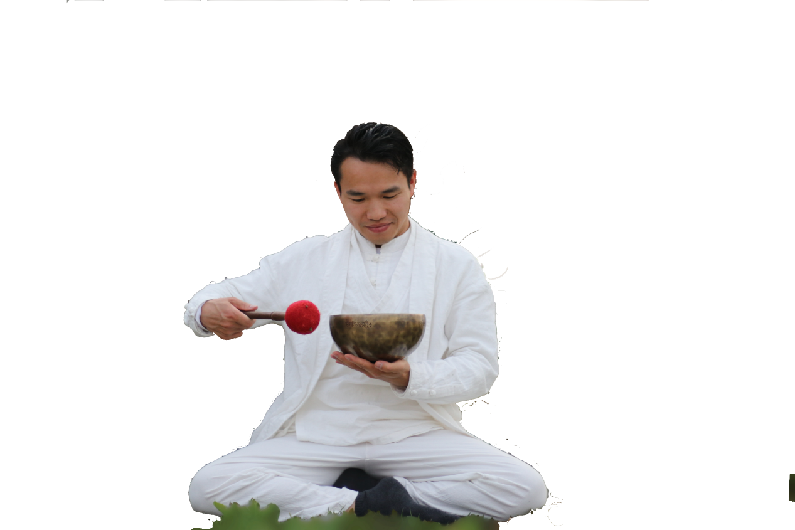

When a clear singing-bowl tone rings out,

body and mind quickly gather,

the brain empties,

entering a calm and peaceful state.

After a quarter of an hour,

there is a sense of clarity and lucidity,

refreshment,

and a feeling of body-mind transparency —

this is the charm of the singing bowl!

Today, whether in the East — China, India, Nepal — or in the Western world, the singing bowl has become a widely used medium or tool for physiotherapy (healing), sound massage, sound therapy, and chakra balancing. For sub-healthy populations and those seeking mind-body integration — people under high pressure suffering anxiety, restlessness, insomnia, and overthinking, as well as those facing life-stage crises, inner-child wounds, psychological trauma, and emotional imbalance — it is a deeply affirmed sound therapy and a precise, powerful healing and stress-relief tool.

Facing the most recent "black swan event" in human history — the three years of pandemic life and work from 2019 to 2022 — body-mind healing gradually came to be recognized, and as an exploration of life-balance in our era, singing-bowl healing shifted from religious practice toward a high-end, relaxing healing experience. At present, singing-bowl healing is steadily moving toward everyday life and commercial development; supporting singing-bowl products have begun appearing on major online marketplaces; and growing numbers of people, drawn by curiosity and experience, have come to know and love singing-bowl healing.

Singing-bowl healing in contemporary human development is only just beginning. A professional path built on singing-bowl healing ability has also become an option for those working with bowls or wishing to explore new experiences and new fields. More importantly, the singing bowl possesses an irresistible healing power, helping more and more fortunate souls who have experienced it to deeply relax, regain body-mind balance, and gain more energy — to face future uncertainties in this VUCA era.

## Section 1 — What Is a Bowl? (Beginner)

As a member of life on Earth, the emergence of the bowl form also began with human cultural development. Let us trace back to the source of all things and explore the genesis of the universe and the development of human culture.

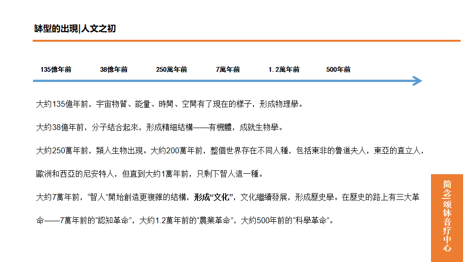

About 13.5 billion years ago, the matter, energy, time, and space of the universe took their present form, giving rise to physics.

About 3.8 billion years ago, molecules combined into fine structures — organisms — giving rise to biology.

About 2.5 million years ago, hominids appeared. About 2 million years ago, different human species coexisted across the world — including *Homo rudolfensis* in East Africa, *Homo erectus* in East Asia, and Neanderthals in Europe and West Asia — but only *Homo sapiens* remained, about 10,000 years ago.

About 70,000 years ago, "Homo sapiens" began creating more complex structures, forming "culture," which continued to develop into history. On history's path were three great revolutions — the "Cognitive Revolution" about 70,000 years ago, the "Agricultural Revolution" about 12,000 years ago, and the "Scientific Revolution" about 500 years ago.

— Reference: *Sapiens: A Brief History of Humankind*

From a historical perspective, the history of the bowl accompanies the development of human culture and civilization.

In a mere 70,000 years — just the most recent 10,000 or so — humans began exercising their ingenuity, using objects existing on Earth to create their own human-cultural journey.

The singing bowl is a "human-cultural experience" vessel created within human evolution, becoming the ancient human's way and medium for connecting with the universe in nature.

**The singing bowl became a dialog tool for humanity to explore — or attempt to decipher — the universe.**

The human-cultural development of the singing bowl: physically, it is a bronze-alloy spherical tool; psychologically, it is a healing tool that relaxes body-mind and brain; and from a higher-dimensional spiritual wisdom, the singing bowl itself is a vessel combining cosmic wisdom and human spirit.

In reality, that the singing bowl could be created and spread to today, and be encountered and experienced by our generation, is already a transmission across millennia.

**Through the bowl, we revere heaven and love humanity.**

The singing bowl is an excellent tool with immense charm. To revere and respect the bowl will bring us broader vision and life experience.

With this mind, the singing bowl can connect to the universe and open life wisdom. The singing-bowl healer is the transmitter of this energy — the charm of the bowl, and also the "weapon" that achieves the charm of the singing-bowl healer.

Let us continue exploring the singing bowl, traversing millennia to experience its human-cultural charm, broadening our vision and bringing richer cognitive experience.

First, let us explore the origin of the bowl's written character, to trace the bowl's origins.

### 1.1.1 The Form of the Bowl (钵之型)

Bowl (缽, *bō*): its character origin.

Keywords: pottery bowl · ancient times · eating vessel · culture and art

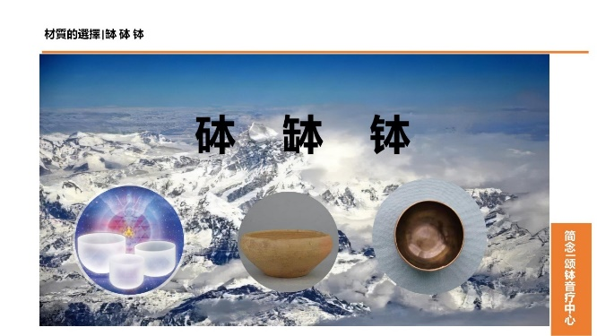

The 缽 (*bō*) is a common vessel, usually used to hold food or liquid. Yet why do we call it "缽" rather than other names such as bowl (碗, *wǎn*), plate (盘, *pán*), or basin (盆, *pén*)? In fact, the origin of this name can be traced to archaeologists' study of its shape and function, as well as the classification and summary of oracle-bone pictographs.

In archaeological research, the 缽 was found to be made of clay, typically fired from **earth**. This method gives the 缽 its **distinctive shape**: a flat bottom with edges sloping upward. This shape lets it better hold food or liquid, while also making it easier to grasp and move.

Beyond shape, the naming of the 缽 is also related to oracle-bone pictographs. Oracle bone script is an ancient writing whose shapes and structures resemble Chinese characters. Through studying it, archaeologists found some pictographs related to the bowl, whose shapes resemble the modern bowl. The existence of these pictographs led **archaeologists** to classify and collectively name this vessel "缽."

Thus, the name "缽" is formed on the basis of the vessel's physical features and historical making method. This name has been widely used and become a common word in daily life.

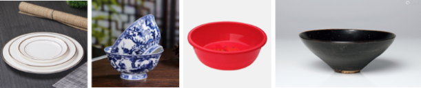

The 缽 is a relatively ancient and common vessel form. Like the bowl and basin, as a household utensil its form is simple and easy to make. Among the three vessel types — bowl, basin, and 缽 — it is ancient and common, appearing as early as the early and middle Neolithic period and used continuously to this day.

— Reference: *Qunwen Tiandi* (群文天地), 2018, Issue 04

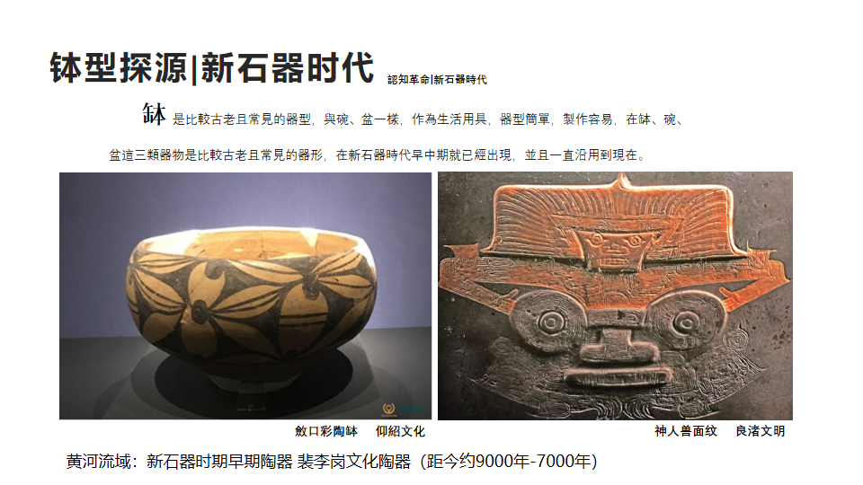

The 缽 shown in the image is a cultural relic from the Yangshao Culture, about 7,000 to 5,000 years ago, as well as a jade-carved "deity-and-beast mask" pattern (right image) found in the Liangzhu area of Hangzhou (Liangzhu Civilization), about 5,000 years ago. Its carved textures are as fine as a hair — enough to show that human wisdom and craftsmanship had already reached a very high level at that time. Compared to us today, it is hard to imagine how such exquisite jade carvings were made under then-existing conditions, inspiring awe.

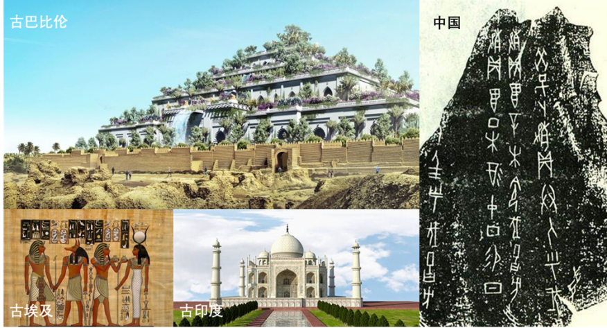

In the same period, about 6,000 years ago, the Sumerians founded one of the world's earliest civilizations — Mesopotamia (from Greek, "the land between the rivers"). They invented writing and gave rise to the concepts of city-state and nation, marking the transformation of human culture into civilization. Mesopotamia is the site of ancient Babylon, one of the four great ancient civilizations (the others being ancient India, ancient Egypt, and the unbroken continuity of China).

Archaeological teams discovered in the Mesopotamian plain objects similar to the "singing bowl," only differing slightly from the modern singing bowl in the metal (composition) used.

In addition, other archaeologists in Persia (present-day Iraq) found among numerous relics metal bowl-shaped implements similar to the "singing bowl."

The unearthing of these relics makes the history of the singing bowl ever more enigmatic: when people first met the Himalayan singing bowl, wasn't it originated in Tibet? Or by what path did it circulate to the Himalayas and then become popular worldwide?

Next, let us explore from the origin of the bowl's name.

### 1.1.2 The Name of the Bowl (钵之名)

The name "钵" (*bō*) comes from the Sanskrit transliteration of *PATRA*, as the shortened form of "鉢多罗" (*bōduōluó*). Within it, *tra* also carries the meanings of liberation, direction, and path.

From the perspective of **Chinese character formation**, the bowl character uses the metal radical (钅): from the earthen bowl (缶 + 本), it became (金 + 本). Whether viewed through character formation or not, the metal material already possessed the function of a metal instrument. In Indian culture, the bowl is also a common vessel form used in daily life.

It is understood that *Patra* (钵多罗) originated from the ancient Indian Śramaṇa (ascetic) tradition; Brahmanism also had the austere culture of carrying the bowl and begging for food.


In Buddhism, the earliest and most important *patra* was the **stone bowl** of Shakyamuni Buddha. By the time of the Northern and Southern Dynasties in China, the Indian prince Bodhidharma came to China to transmit the Dharma. In later Chan (Zen) history, "one flower with five petals" led to the Sixth Patriarch Huineng, who carried on the transmission of the "robe and bowl" (衣钵, *yībō*). At this point the bowl also indirectly became a vessel of **cultural-wisdom transmission**.

A Brahman's life should be divided into four periods, each with its duties and responsibilities; the fourth and final is the renunciate period. For liberation, one retreats into forest and wilderness, persists in ascetic practice (*dhūta*), carries the bowl to villages to beg for food, eating only once a day.

— *Manusmṛti* (The Laws of Manu)

The bowl is a vessel for holding food or water, usually made of metal, wood, or ceramic, shaped like a shallow bowl or plate, sometimes with a lid. In Buddhism, the bowl is a utensil used by monastics to receive offerings and alms from believers, and to hold food, water, and other daily necessities.

— *Buddhist Dictionary* (佛学大辞典)

The bowl is a Buddhist ritual instrument, also called the dharma-instrument bowl, Buddha bowl, or mantra bowl. It is usually made of metal, round or hemispherical in shape. In use, the holder lightly strikes the bowl's rim with a wooden mallet, producing a clear sound to guide practitioners into a meditative state. The singing bowl's sound is believed to have the effect of purifying body and mind, helping practitioners dispel afflictions, enhance concentration, and attain inner peace. The singing bowl is widely used in Buddhism for rituals, chanting, meditation, and other activities.

— *Encyclopedia of Buddhism* (佛教百科全书)

Therefore, the bowl holds profound historical and cultural depth in Chinese culture. It is not only a necessity of our dietary life but also an important component of our cultural tradition. Over time, the bowl's functions and uses have gradually evolved, yet it has always remained one of the indispensable vessels in our lives.

### 1.1.3 The Substance of the Bowl (钵之质)

**The singing bowl, also called the Himalayan bowl**, is said to have been made by ancient people who mined ore from the Himalayas, refined it into copper, and then forged it into such a vessel.

The singing bowl is composed of seven metals: gold, silver, copper, iron, tin, lead, and mercury.

Ancient people mined ore from the Himalayas, refined it into copper, and forged it into such a vessel.

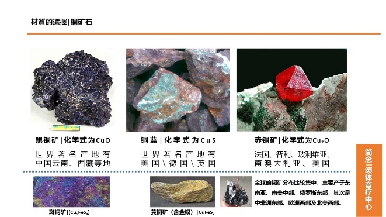

The bowl's main composition is a **copper–tin alloy**, where copper is smelted from copper ore. The image above shows a photo of copper ore; different chemical compositions display different copper-ore structures and morphologies. Except for a very few inactive metals (gold, silver) that exist in elemental form, metals in nature exist as compounds.

Concordia University in Canada once tested the material of singing bowls and found that old bowls indeed contained the elements mentioned, mainly a copper–tin alloy with other elements in very small proportions — a result of the limited refining and crafting techniques of the time. The proportions were not fixed. Crafting the singing bowl, though a cultural custom, some Western scientists always tend to verify through scientific testing. Of course this is only the content of individual bowls; old bowls are basically copper–tin alloy, i.e., bronze.

| **Element** | **Content** |
|:-----------|:------------|
| Gold       | 0.01%       |
| Silver     | 0.03%       |
| Copper     | 77.20%      |
| Iron       | 0.14%       |
| Tin        | 22.00%      |
| Lead       | 0.04%       |
| Mercury    | 0.02%       |

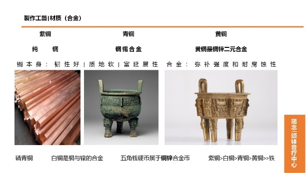

Bronze is the earliest alloy in the history of metal casting — an alloy of tin or lead added to pure copper (red copper). It holds special importance and historical significance. Compared with pure copper (red copper), bronze has higher strength and a lower melting point (with 25% tin, bronze's melting point drops to 800°C; pure copper's is 1083°C). Bronze has good castability, wear resistance, and chemical stability.

After bronze was invented, it immediately flourished, and human history entered a new stage — the Bronze Age.

In daily life, our five-jiao coin is a copper–zinc alloy coin, belonging to brass. The singing bowl's material is mainly copper–tin alloy, belonging to bronze — especially the ancient singing bowls.

From the perspective of the singing bowl's material and oxidation state, as a healing instrument with musical attributes, it is more often copper–tin alloy. As for the "seven-element" Tibetan singing bowl, in actual measured proportions it is negligible; yet from the perspective of singing-bowl culture, even the smallest compositional content is an indispensable cultural factor — like the trace elements in the human body: tiny, yet crucial to bodily function.

*Xiǎngtóng* (响铜, "sounding copper") is the name of an alloy — copper, lead, and tin mixed and smelted in certain proportions. Mainly used to make instruments, *xiǎngtóng* can produce pleasant sounds. In ancient times it was used to cast bells. As recorded in the Ming-dynasty *Tiangong Kaiwu* (天工开物), Chapter 8 on smelting and casting: "For casting bells, the higher ones are of copper quality, the lower of iron quality. Today's northern morning bell is made purely of *xiǎngtóng*." *Xiǎngtóng* is often made into instruments called *xiǎngqì* (sounding instruments) or *xiǎngtóngqì*. The most common *xiǎngtóng* instruments are the gong (锣, *luó*) and cymbals (铙钹, *náo bó*).

The singing bowl can be made of *xiǎngtóng*, bronze, and other alloys.

Now let us explore the true history of singing-bowl healing from a historical perspective.

### 1.1.4 Origins & Development

#### 1.1.4.1 The Origin of the Singing Bowl

The singing bowl — "the bowl that sings" — is handcrafted from **seven metals**: gold, silver, copper, iron, tin, lead, and zinc.

The origin of the **bronze bowl** can be traced back thousands of years to ancient India. In local custom, the "bowl" was first used to keep food fresh, and to hold warm nourishment for women who had just given birth. Indian *Āyurveda* held that the bowl aided recovery and healing, protecting new mothers as they regained their strength. Over time, people discovered that the singing bowl also carried a healing function of its own.

The wise ancients found that when you strike a bowl, it "sings" — its sound-vibration frequency naturally and rapidly relaxes the body and mind, drawing one into a state of **"zhōng" (centered equilibrium)**, and thereby awakening the body's own self-healing mechanisms. Its frequency acts with great subtlety upon the cells, helping the body's organs and tissues self-regulate and repair, restoring unhealthy (mis-tuned) cellular frequencies back to normal.

The singing bowl's English name, *Singing bowl*, literally means "the bowl that sings." Its original name was *bōduōluó* (Sanskrit *pātra*), shortened to *bō* (bowl). Beyond being a vessel for food, its unique material — modern science shows that copper ions and copper oxides possess antibacterial properties — meant that in ancient times people used it to ward off bacteria (then understood as demons and evil spirits). Combined with the fact that it produces sound that settles the spirit, it became one of the Buddhist ritual instruments: a *qìng* (磬) struck during sutra chanting.

The bowl's present-day healing function was, from the very birth of its material, already a means of regulating body and mind. It is therefore guessed that the earliest bowls arose from the choice of copper; and the bronze bowl's earliest history may reach back to ancient India, the twin-river region, or even farther — to Atlantis.

The singing bowl has since become a distinctive musical instrument, widely used in meditation, relaxation, and healing.

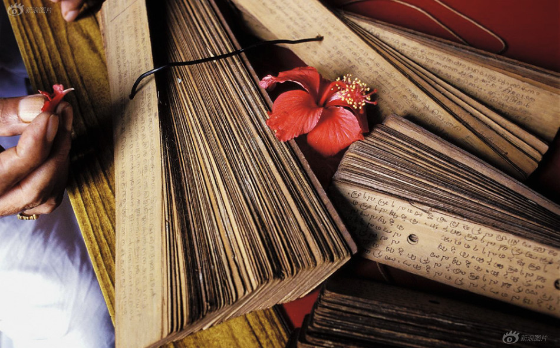

#### 1.1.4.2 Tracing the Bowl's Source

Following the thread of all history, the singing bowl very likely comes from a civilization of the last 100,000 years. According to Maya prophecy, the Earth has already passed through five civilizations; the planet is far older than we imagine, and other civilizations existed before our own. The **fourth** of these was the **civilization of Atlantis**.

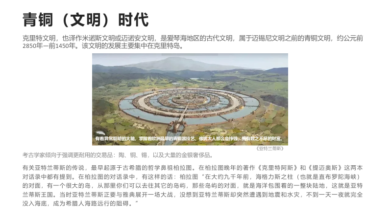

Atlantis, the Maya's conjectured fourth Earth civilization, is also called the "civilization of light." The earliest description appears in Plato's dialogues, which say it was destroyed by a great flood around 10,000 BCE. According to Maya-calendar lore, humanity's world undergoes five cycles of destruction and rebirth — the so-called "Sun Ages" — each ending in a cataclysmic tragedy. The fourth Sun Age is Atlantis, the civilization of light, which perished in a towering deluge.

The relevant written records:

The Atlantis legend originates with Plato, the fountainhead of ancient Greek philosophy, who mentions it in his late dialogues *Critias* and *Timaeus*. In Plato's words: some nine thousand years ago, opposite the Pillars of Heracles (the Strait of Gibraltar), there lay a great island from which one could reach other islands, and beyond those, a whole continent encircled by ocean — the kingdom of Atlantis. As Atlantis prepared for war with Athens, it was suddenly struck by earthquake and flood, and in less than a day and a night sank entirely beneath the sea, becoming an obstacle to Greek seafaring.

Archaeologists, too, have found evidence of an Atlantean civilization: people with extraordinarily keen minds who mastered Europe's earliest **bronze-casting** craft, who were as adept at making money as the Jews, and who possessed unfathomable wealth. Archaeologists lean toward emphasizing more durable trade goods: pottery, **copper, tin**, and abundant gold-and-silver luxuries.

Now let us trace the very beginning of human civilization to understand bowl culture. As Fuxi said: "To be human is to transform the world."

In the mere 5,000 years we can precisely date, humanity has built the world visible to our eyes — skyscrapers, artificial intelligence, and more.

*Sapiens* summarizes the Earth's and humanity's development in a single passage:

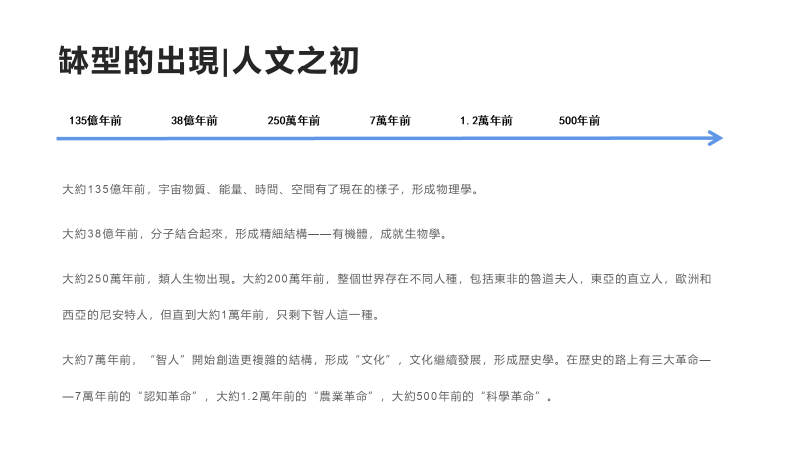

- About 13.5 billion years ago, matter, energy, time, and space took their present form — physics was born.
- About 3.8 billion years ago, molecules combined into intricate structures — organisms — giving rise to biology.
- About 2.5 million years ago, hominid beings appeared.
- About 2 million years ago, the world held different human species — *Homo rudolfensis* in East Africa, *Homo erectus* in East Asia, Neanderthals in Europe and West Asia — but by about 10,000 years ago only *Homo sapiens* remained.
- About 70,000 years ago, *Homo sapiens* began building more complex structures, forming "culture," which in turn developed into history.
- On history's road lie three great revolutions — the "Cognitive Revolution" (70,000 years ago), the "Agricultural Revolution" (about 12,000 years ago), and the "Scientific Revolution" (about 500 years ago).

Next, we examine the bowl's history through the lens of our understanding of the bowl, the Bronze Age, bronze music, the Tibetan singing bowl, and the scientific analysis of the bowl — one article to give you a complete picture of the singing bowl's origins.

The **bowl**: archaeologists use this name for vessels of this same material and form. The bowl is an ancient and common shape; like the bowl-shaped basin and the tub, it served as a daily utensil, simple in form and easy to make, and appeared as early as the early-to-middle Neolithic, continuing in use to the present day.

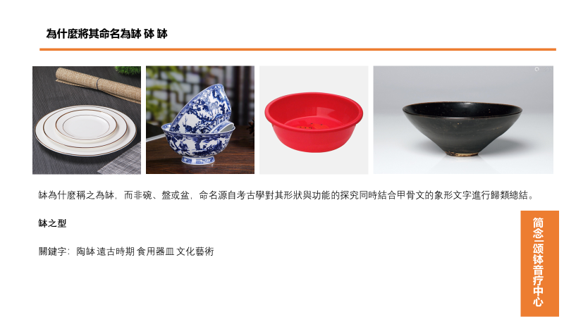

In terms of material, humanity's earliest vessels were pottery. Our Chinese characters make this distinction clearly.

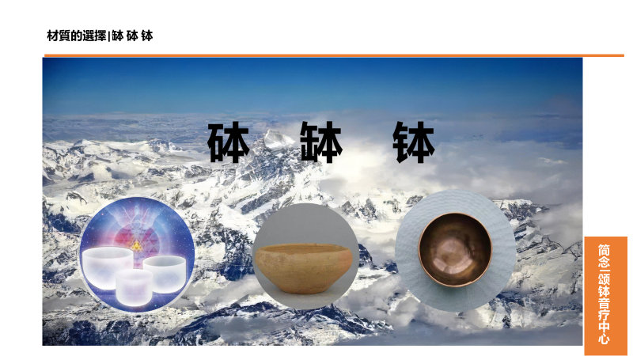

From the pottery *bō*, to stone or (now) quartz crystal bowls, to the metal-radical bowl we are studying — the singing bowl.

In the Neolithic period, humanity moved from nomadism and a matriarchal society toward settlement and tribal systems, entering an animist age of revering heaven and honoring earth. Utensils from around 10,000 years ago survived on Earth and were rediscovered through archaeology.

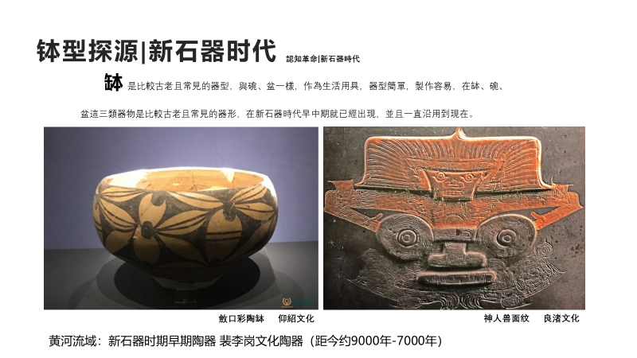

In Chinese archaeology, painted pottery bowls with decorative patterns have been found in the Yellow and Yangtze River basins — clearly daily eating vessels of the time, yet already bearing an artistic sensibility, showing that people had begun to pursue a "quality-art" way of life beyond basic utility. The Henan Museum holds a 9,000-year-old bone flute made from a crane's leg bone — the Jiahu bone flute — capable of producing different tones.

Later, in the Bronze Age, humanity began using bronze to make all manner of daily vessels, among them bronze bowls. In the late Warring States period, a single storage box for outings could hold a nesting set of bronze tableware — large and small, even including condiment dishes — sixty-two pieces in all.

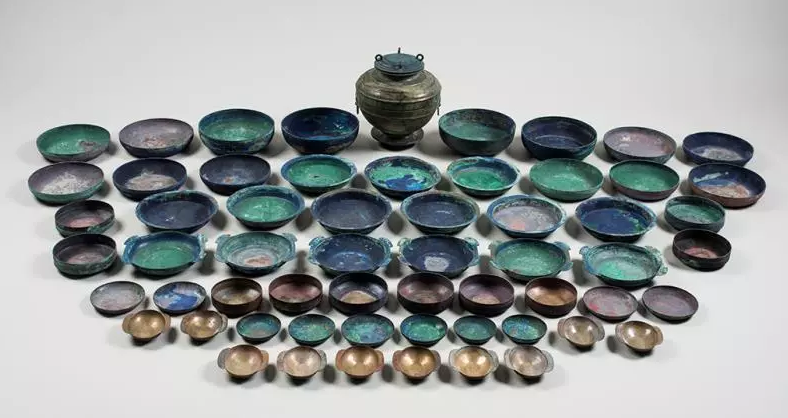

Among them were bowls identical in form and material to today's "singing bowls" — but they were eating vessels. A bowl, **even of bronze, can only be called a bronze bowl, not a singing bowl (singing bowl).**

From another angle, **the bronze bowl's history of use traces back to the very beginning of humanity's use of bronze.**

By the time of the Bronze Age, China's was already a late one. The earliest archaeological evidence places the first bronze casting in Anatolia (modern Turkey), with bronzes dated to 6000 BCE. Mesopotamia entered the Bronze Age around 3000 BCE, with ancient Egypt close behind; China's bronzes appeared somewhat later.

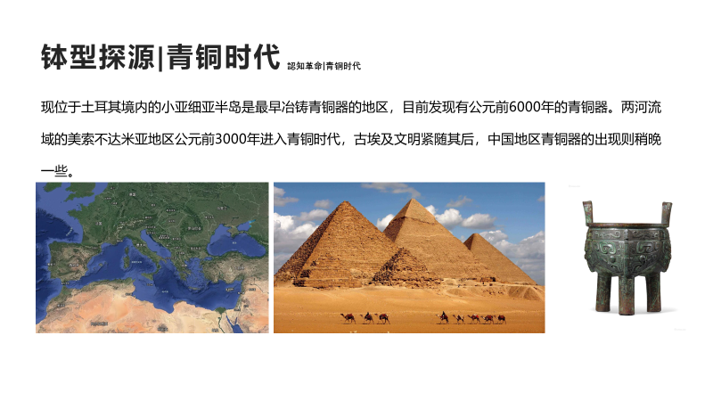

In Mesopotamia's Sumerian civilization — while China was still in its Three Sovereigns and Five Emperors era — the Sumerians were already keeping accounts, minting coins, entering agricultural society, and undertaking the great social division of labor.

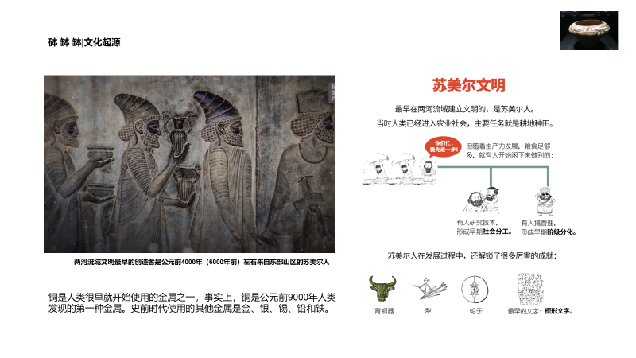

Archaeologists have also **found bowls of the same material in Mesopotamia**, but **there is no proof they were used as musical instruments or for healing — they were very likely still eating vessels or containers.**

Today, in popular understanding, the "singing" bronze bowl is said to originate in India and to have spread to Tibet. Is that truly so? We continue tracing.

Ancient India is one of the Eastern civilizations, yet now we must prefix it with "ancient." The path to exploring Indian history was opened by two Chinese scholar-monks: in the Northern and Southern Dynasties, **Faxian** wrote *Record of Buddhist Kingdoms*; in the Tang, **Xuanzang** wrote *Great Tang Records on the Western Regions* — the two reference works for exploring Indian history.

India became a colony of the British Empire in modern times; before that it had been ruled for nearly a century each by Greeks, Arabs, Islam, and the Yuezhi from Central Asia.

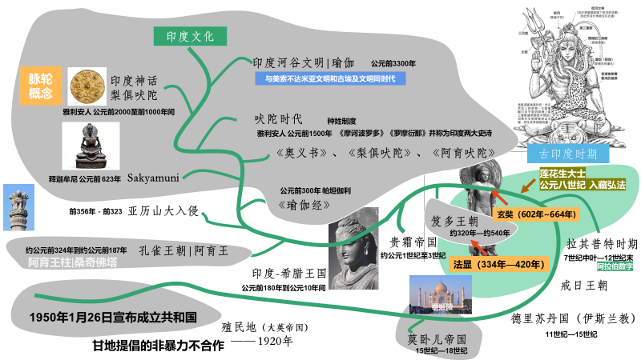

The chakra system now used with the singing bowl originates in **Aryan** literature. The Aryans came to the lands of ancient India and created a brilliant Eastern wisdom civilization — the *Rigveda* myths and more — along with a social governance system, the "caste system." Around 600 BCE, under the influence of the *śramaṇa* movement, Siddhārtha intended to break India's caste system and preached the equality of all beings; he was later recognized as the founder of Buddhism.

**Yoga, Āyurveda, and the Buddhist scriptures are all cultural treasures that ancient India left to the world.**

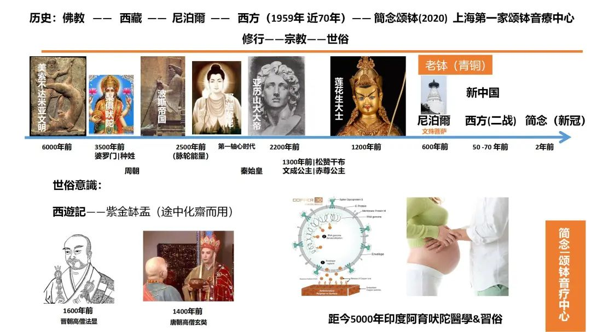

*Āyurveda* records an Indian custom: among the wealthy and powerful, a daughter's dowry was required to include a "bronze bowl" for use as a dietary vessel after childbirth. Although science had not yet developed, this custom and ritual already bore a scientific attribute — modern research shows copper ions or copper nanoparticles possess antibacterial and bacteriostatic properties. Monks, too, used bronze bowls for cooking. **These are all uses of the bronze bowl, but none entered the systems of spiritual practice, music, or healing.**

Faxian's 1,500-year-ago study-tour of India, and Xuanzang's 1,400-year-ago westward pilgrimage, brought back no such ritual instrument as the singing bowl — suggesting that in their time the "bronze bowl" was not yet used in Buddhist practice.

**So when did the bronze bowl come to be used in practice and healing?**

We trace further:

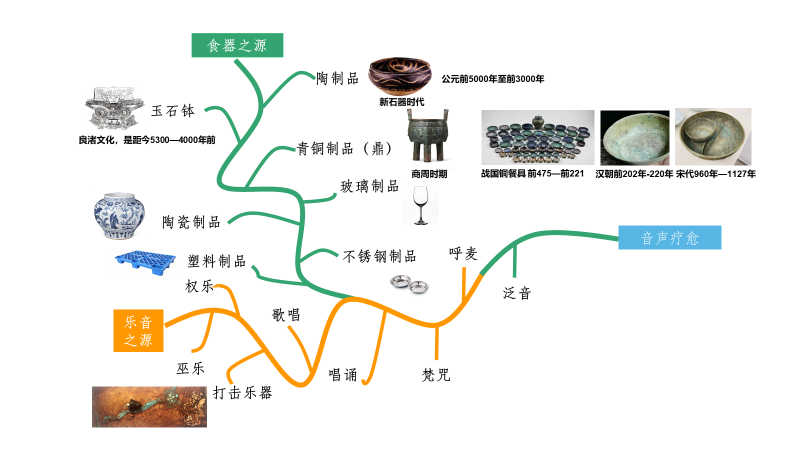

Between eating vessel and instrument, it slowly became a tool of sound healing. Among eating vessels, from the earlier pottery bowl to the bronze bowl (and basin), they always existed; archaeology has found Warring States bronze tableware, Han bronze bowls, and a Song-era set of bronze basin, bowl, and chopsticks — but none of these branched into instrument or healing vessel.

**Then what conditions were needed for the bronze bowl to become a singing bowl? We must clarify this line of thinking.**

Bronze percussion instruments have existed throughout archaeology. In China — in Henan — the Erlitou culture site yielded a turquoise dragon and, alongside it, a **bronze bell**, showing that whether in the great Bronze civilization of Sanxingdui or in the large assembled bell-sets, bronze was at its zenith of use, and in China bronze was already employed as an instrument — but **the bronze bowl had not yet become a singing bowl (instrument).**

Then at what time did the singing bowl begin to be used for practice and sound healing?

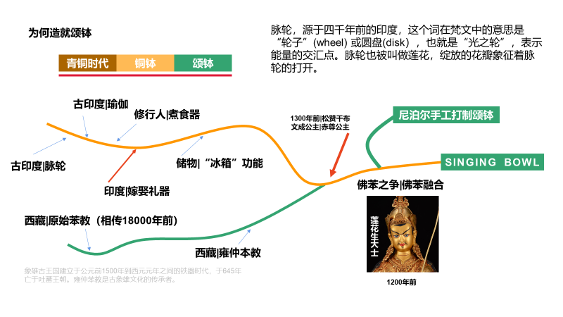

In the long course of development, by the 6th century CE — 1,300 years ago — Songtsen Gampo unified Tibet. To facilitate the governance of religion and state and to escape the situation where "the shaman outranked the king," he married two princesses and converted to Buddhism, taking Princess Wencheng from China and Princess Bhṛkutī from Nepal, who brought statues of Śākyamuni. A century later, another Tibetan ruler invited the Indian master **Padmasambhava** to Tibet to synthesize Buddhism and Bon; in this process Tibetan Buddhism (Vajrayāna) formed, merging mantra recitation with meaning-free chanting into the practice we know today.

Padmasambhava was not only an attained master but also a skilled craftsman; very likely on this basis **the bronze bowl was made anew — multiple artisans collaborating, striking to complete the making of the [singing bowl] — and the singing bowl's craft remains so to this day.**

**The singing bowl transformed from a container-like bronze bowl into a spiritual musical vessel; in Tibet (broadly the Himalayan region) it attained a new function and development.**

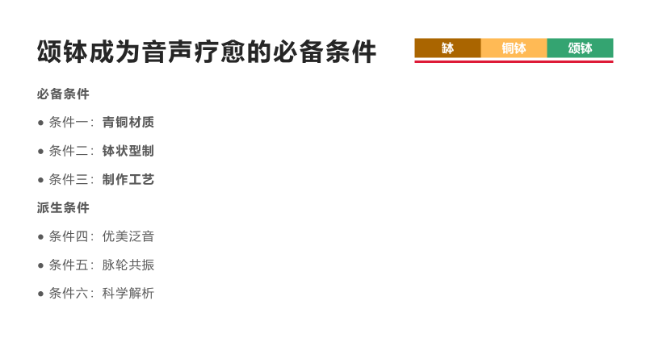

Nepal has now become the international trading market for singing bowls. Beyond the low cost of an underdeveloped economy, what matters more is the collaboration of Nepalese artisans, which lets the singing bowl shine with unending overtones and a sound-healing function.

Added to this, sound itself vibrates and heals; the practice of the "three mysteries of body, speech, and mind" resonates with the singing bowl's way of cultivating our body and mind.

Under these circumstances the singing bowl was rediscovered, assisting Tibetan Buddhist practice and becoming a medium of spiritual cultivation.

**We know the bronze bowl did not originate in Tibet — but the singing bowl was very likely created in Tibet, flourished in Tibet, and spread to the world.**

In many minds the singing bowl is called the Himalayan singing bowl — on one hand out of reverence for the world's highest peak, and on the other because it is steeped in humanistic spirit, which aids the bowl's spread and adds a religious and mysterious allure.

When modern people first encountered the singing bowl, their first impression was the *qìng* (磬) of the temple — a Buddhist instrument larger in form and specification than the everyday healing bowl. It was used more in daily sutra chanting and ritual, its powerful, crisp sound bringing inner stability and concentrated awareness.

Bowl culture flourished after Master Xuanzang, roughly in the era of Empress Wu Zetian of the Tang — the great Tang heyday and its supremely refined experience. The bowl-culture system is fully displayed in Buddhist sculpture and painting art.

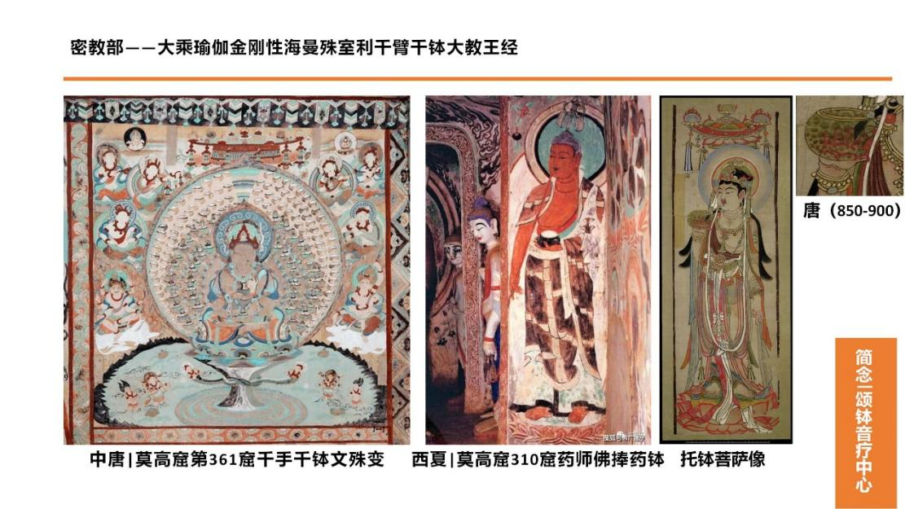

After the Second World War, Germany as a defeated nation bore immense psychological wounds; the inhuman experiences of Auschwitz were traumas its people could hardly survive.

Tibetan refugees reached the West, bringing with them the ritual instruments that meant survival: singing bowls, to heal body and mind.

The post-war psychological trauma was greatly eased; beyond psychological counseling, the bowls brought bodily and mental relaxation and stability. As time passed and the age advanced, the singing bowl's healing function showed ever more of its mystery and superiority in practice and in brain-science research.

Singing-bowl healing gained popularity in the West; because contact with the bowl came from Tibet, it was also called the Tibetan singing bowl, and given the lovelier name the Himalayan bowl.

**The famed psychic Edgar Cayce once prophesied: "Sound is the medicine of the future."**

Singing-bowl healing is among the earliest music therapies — a sound-healing tool handed down over a thousand years, helping humanity's physical and mental health in every era.

**Today, under new concepts of health, singing-bowl healing can not only heal body and mind but lead a new way of healthy living.**

At this point the bowl earned the name "singing bowl." Now the singing bowl has many branches and similar bowls — singing bowl | Buddha-sound bowl | prayer-turning bowl | practice bowl | bronze qìng — all of the same category as the singing bowl.

The *qìng* (磬) used by Daoism and Buddhism differs in craft from the singing bowl, and even in material.

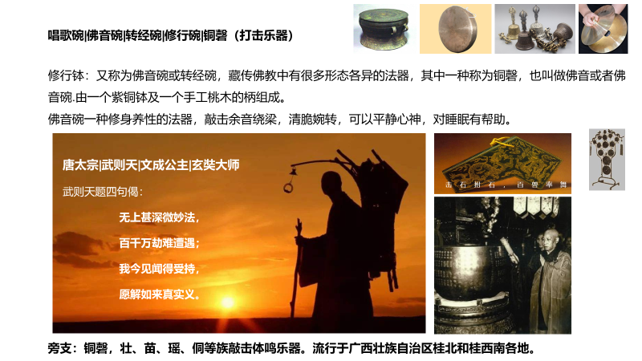

After hearing the story of the sutra's translation and transmission, Tang Empress Wu Zetian was deeply moved and wrote the four-line verse we recite or copy at every sutra session:

> *The unsurpassed, profound, and wondrous Dharma —\
> met in hundreds of thousands of eons, so hard to encounter;\
> I now see and hear it, receive and uphold it,\
> vowing to understand the Tathāgata's true meaning.*

The tracing of the singing bowl's history ends here; that the singing bowl could be discovered for the healing of body and mind crosses historical time and space, and is inherited by us.

It will also ease the body and mind after three years of pandemic; and more importantly, in this very present moment — humanity's dimensional ascension and energy uplift — it will lend a hand.

Tracing the singing bowl's history: the concept of chakras comes from ancient India over 4,000 years ago; the bronze bowl can be judged to have appeared since the Bronze Age; yet **the singing bowl as an instrument of practice and healing already has a history of more than 1,000 years, and under such historical source-flow the singing bowl brings ever more transformation and elevation to body and mind.**

In 2019, the Jiannian Singing Bowl Sound-Therapy Center was founded, spun off from a yoga brand to become Shanghai's first singing-bowl sound-therapy center, and a training-focused singing-bowl healing venue.

After years of absorbing the strengths of many and continuous inquiry and R&D, with student co-creation and the singing-bowl training system led by Mentor Muzi and Dr. Runze, the professional-skills training series was completed — a course system grounded in theory and practice that joins the Eastern chakra system, the TCM meridian system, Western neural and brain science, and energy studies.

The history of the singing bowl is varied; Dr. Runze, building on the history of Buddhist art and based on present archaeological finds and precise inference, has clarified the timeline and positioning of the singing bowl's healing history.

#### 1.1.4.3 The Development of the Singing Bowl

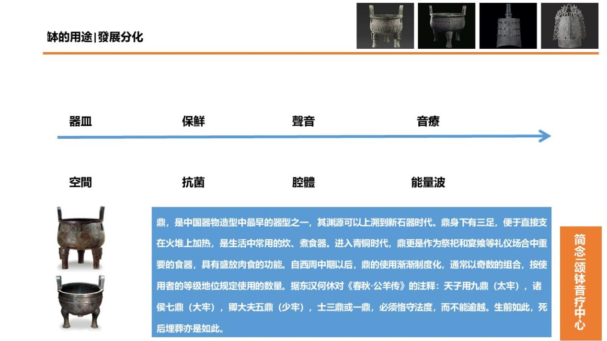

**001 The uncertainty of origins**

History records no one as the creator of the "Singing Bowl."

**002 Tracing in written language**

In Chinese characters, *bō* (钵) is a vessel shaped like a basin or bowl, generally used to hold food or tea. In antiquity, monks begging door-to-door carried such a vessel — an example of the bowl as tableware.

**003 The modern origin of the bowl**

In Sanskrit the bowl is also called *pātra*, meaning a Buddhist ritual instrument, implying purity and non-action. The penetrating origin of the sound produced by striking the bowl has been traced by historians to the 8th century CE, when a tantric master (Padmasambhava), following the Buddha's teachings, brought it from India into Tibet and the Himalayan mountains. Borrowing the bowl's sound, practitioners could concentrate during seated meditation.

Because the singing bowl was then used in music-making and swept the world, nearly everyone's understanding of it came from Tibet — which deepened the bond between the singing bowl and Tibet, so that in the popular mind the two became inseparable.

Records of bronze-bowl use reach back 6,000 years to the dawn of humanity's earliest known civilization (Mesopotamia), accompanying the Bronze Age (when bronze music flourished), through the cultural fusion of the first Axial Age (its spread), and 1,200 years ago, with Buddhism's entry into Tibet, into the Vajrayāna practice system — where the bronze bowl achieved a qualitative leap and became the singing bowl. Subsequently, with Buddhism's eastward transmission into East Asia, and after the end of the Second World War, from Tibet into the Western world — and thus the singing bowl brought global healing. With the advance of science, the scientific value of the singing bowl's body-mind healing is ever more researched and confirmed.

— Dr. Runze

Now, whether in Eastern India, Nepal, and China, or in the Western world, the singing bowl is commonly used as a medium or tool for therapy (healing), sound massage, sound therapy, and chakra balancing — its effect affirmed by academia. As a physical vibration therapy, simple to perform and markedly effective, it is widely applied in meditation, music, relaxation, personal bodily cultivation, and religious ritual; oncologists, psychotherapists, massage therapists, and yoga practitioners alike prize its distinctive healing effect.

**004 The development of the modern bowl**

Through a thousand years of flowing time, the bowl is no longer merely tableware, or a "refrigerator"-like storage vessel, or a religious object. Its capacity to heal the psychological and the physiological has been unearthed — a therapy called singing-bowl sound-frequency therapy, or singing-bowl sound therapy.

**005 The contemporary application of the singing-bowl natural therapy**

With technological progress, people today are more lost and imbalanced. As a natural therapy, the singing bowl relieves bodily and mental stress, improves quality of life, and helps recover one's true self; as part of the experience of life, many SPAs use it as a mind-purifying service to better provide clients with bodily and mental relaxation, and as an auxiliary tool in business.

Yoga, as one of the Eastern cultures of holistic body-mind-spirit health, is ever more closely knit with the singing bowl; many yoga venues and teachers study and teach the singing bowl, providing clients with whole-body healing services.

During the Second World War, the war brought psychological trauma — insomnia, depression, and other mental illnesses — giving rise to hypnotists and psychotherapists. Yet in psychological healing it was found that the root could not be solved; just then Tibetan refugees arrived in the West carrying their valuables, among them singing bowls, making a living through the bowls while healing post-war trauma — and the singing bowl came to be called the "Himalayan singing bowl," beginning to spread through sound healing.

Now more and more people commonly feel stress, unhappiness, anxiety, confusion, and sub-health; the singing bowl is undoubtedly a unique path that unites efficacy with artistry.

Medicine, too, has begun to attend to and study this ancient sound-healing art, applying it to the treatment of difficult and complex conditions — insomnia, cancer, tumors, stroke, Alzheimer's, bone and joint ailments, immune disorders, mental tension, anxiety, depression, and more.

And today, worldwide, the singing bowl is carried by oncologists, psychotherapists, massage therapists, and yoga practitioners into ever broader fields, continuing to settle the body and comfort the spirit.

The singing bowl harmonizes the body's energy flow, and inner joy is reborn. Through sound-wave massage it activates the body's cells, releases tension and stress, aids physical relaxation, soothes weary muscles and nerves, expels toxins, prevents and heals disease, and even accelerates fat burning with a notable slimming effect. Singing-bowl music healing is already widespread in some European and American countries, with high general awareness and acceptance.

Most modern illnesses are tied to emotion; singing-bowl music cuts off and releases negative emotion at its root. It does not merely target the disease, but through relieving anxiety, tension, and insomnia brings bodily and mental health, enhancing healthy life-force and life quality.

The yoga circle, too, has caught a "bowl" wind: when the singing bowl sounds, the molecules within the body resonate with its sound waves, forming a ripple-like vibrational massage and regulation that reawakens, purifies, and activates the body's cells and nerve tissue, smooths the flow of energy, opens blocked chakras and painful areas, and liberates tense muscles.

Yoga teachers not only use the singing bowl for breath regulation and meditation, but apply it in private yoga classes; through the bowl's sound waves and vibration they let practitioners instantly return to inner peace, and help them release the trauma stored in cellular memory.

**006 Jiannian Singing Bowl®**

In its modern development, as scientific inquiry deepened layer by layer, the singing bowl's healing function — fully evident after the Second World War in healing warriors' body-mind-spirit trauma — developed and was researched widely in the West, flourishing among Western society's celebrities.

From 2019 to 2022, humanity lived through a once-in-a-millennium global pandemic; people's body and mind were rebaptized, and they began to examine themselves and the future's development and life's value. They began to look inward, easing the anxiety of an era in revival.

As the singing bowl developed under the great Tang heyday, so the great rejuvenation of the Chinese nation is also the rejuvenation of the holistic body-mind-spirit health of the Chinese people on Chinese soil — seeking, for the development of one's own life, a Chinese life-path of mindful living and blossoming life.

The Jiannian Singing Bowl brand was founded and registered in May 2019, established in the metropolis of Shanghai as the first singing-bowl-themed healing center, training batch after batch of singing-bowl healers, spreading singing-bowl culture, and leading the blossoming of life energy.

## 1.2 Bowl Basics

### 1.2.1 Types of Singing Bowls

#### Traditional Bowl Categories

A bowl older than 40 years (measured from the 2020 reference point) may be called an "old bowl." Each old bowl is like an elder, with its own unique experience and story — akin to an antique or cultural relic — possessing extremely high collectible value. In the hands of a new owner this collection continues to be used, and through being struck it develops its own unique energy.

Although singing bowls can be made, the craft of that time — lower refinement techniques, the presence of mineral elements, differing eras, different makers, and varying energies — means they are non-renewable, one-of-a-kind, and bear the attributes of a collectible.

Below are the shape categories of traditional bowls. Modern handmade bowls also imitate traditional shapes and may be called by the same names.

##### Jambati

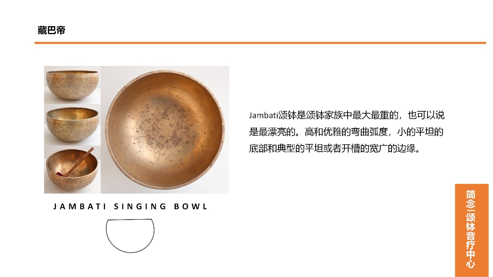

The Jambati is an essential healing singing bowl, traceable to the 17th–19th centuries. Earlier it was generally used in rituals; ancient Indians also used it to cook, boil water, or hold offerings in sacrifice.

"Jambati" means to drink water or wine; "bati" means bowl. The Jambati is the largest, heaviest, and most beautiful of the singing-bowl family. Its curvature is elegant, its bottom small and flat, and its rim characteristically flat or with a wide groove.

##### Thadobati

The Thadobati is one of the oldest bowl-shaped singing bowls, traceable as far back as the 15th century. Its characteristic is very straight walls, a broad flat bottom — heavy and sturdy.

The rim is usually flat; heavier bowls have thicker and wider rims; the bottom bears concentric circular patterns; the walls usually show slight lumps and unevenness. The bottom is fairly flat; where the bottom edge meets the side wall it is rounded, and the side walls curve inward. The Thadobati comes in thick-wall and thin-wall versions; the thick-wall produces a higher register, the thin-wall a deeper, lower tone.

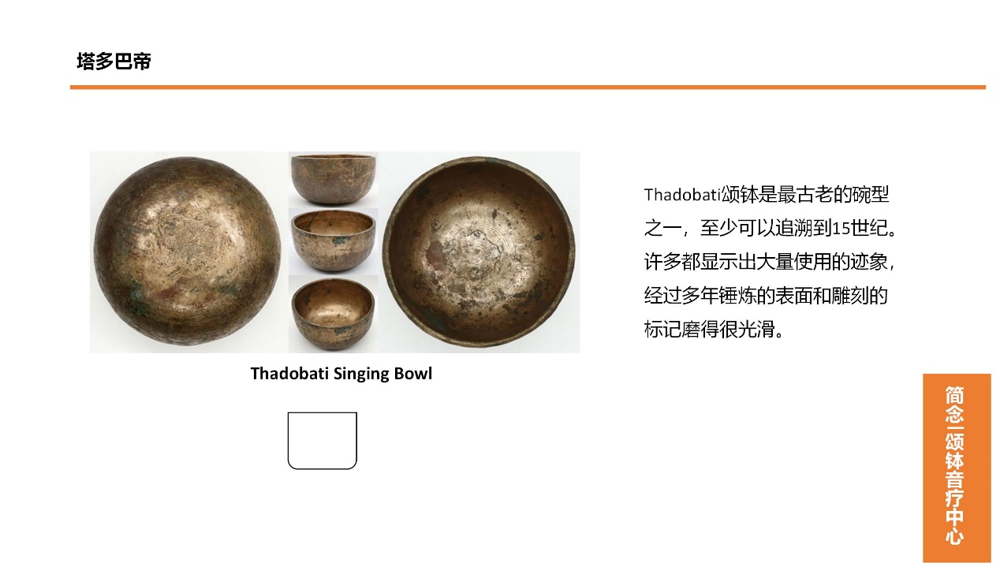

##### Other Traditional Bowls

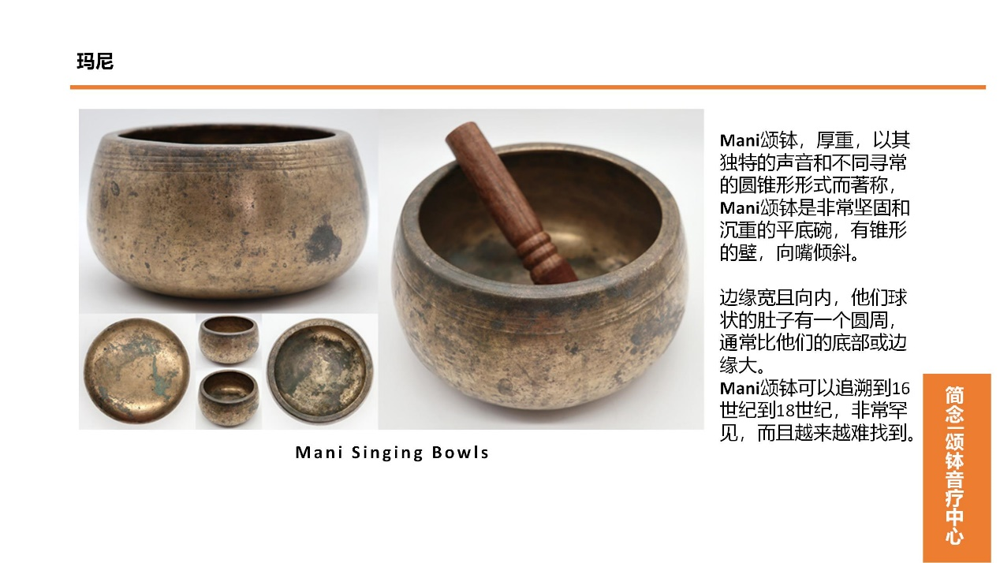
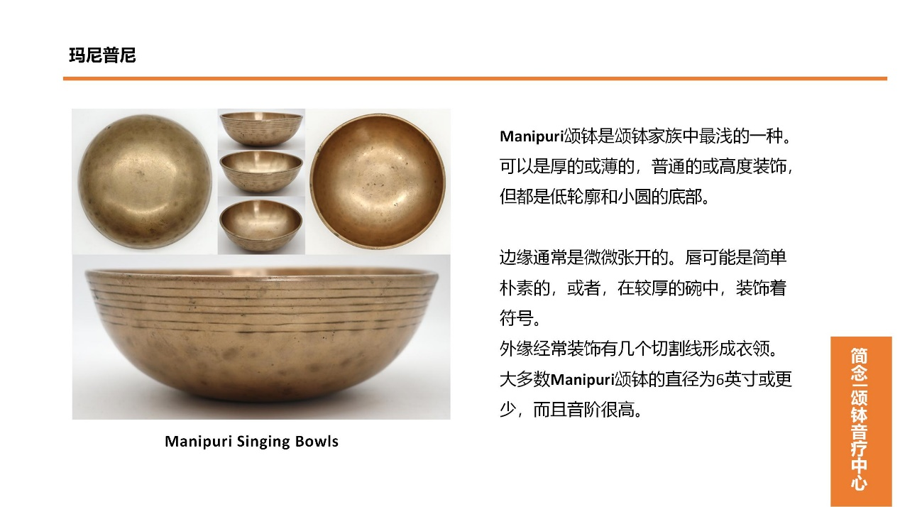
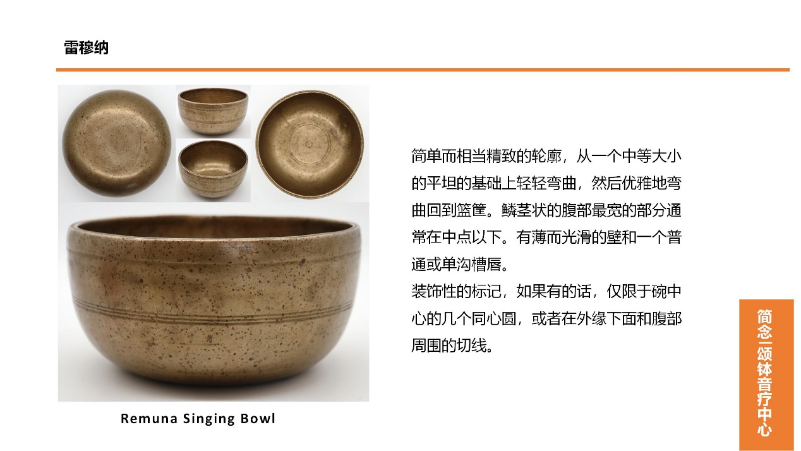
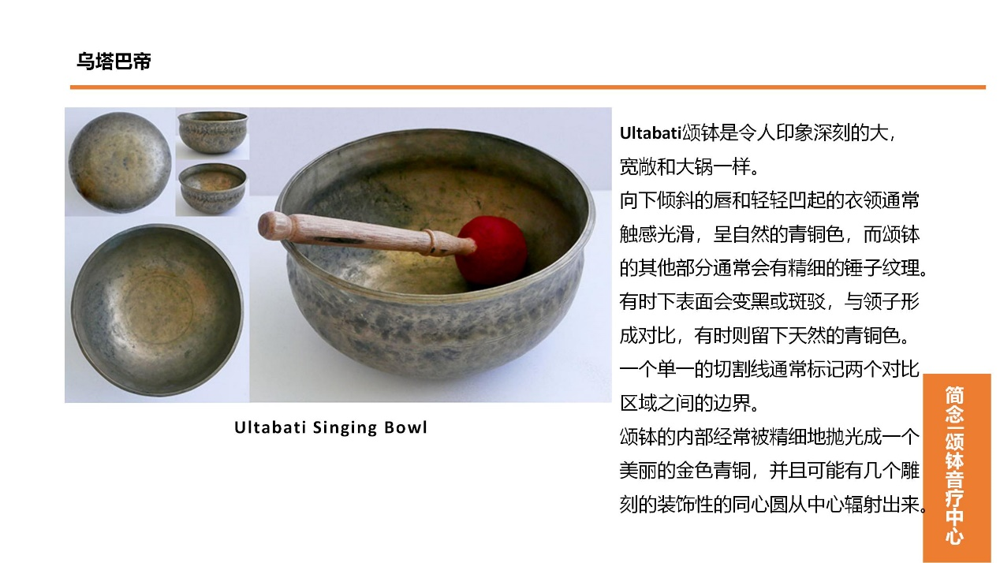
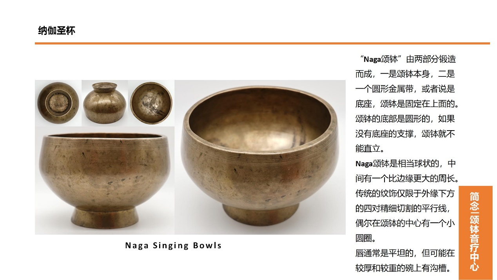
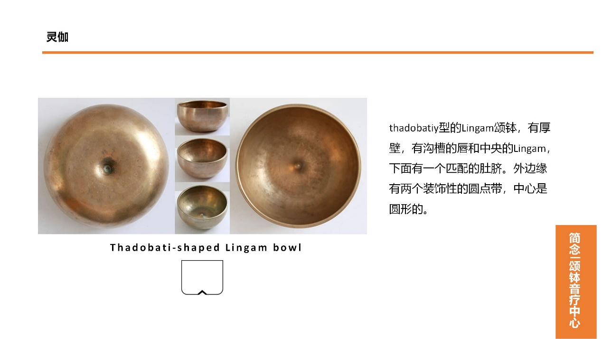
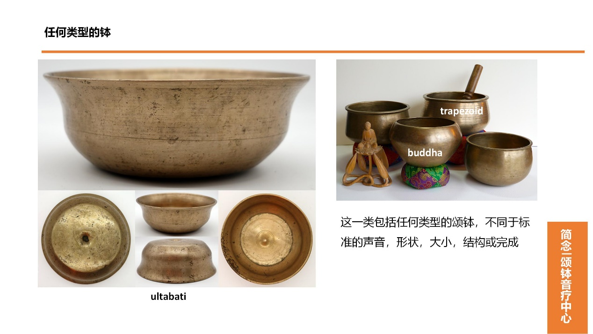

#### Modern Bowl Introductions

##### Full-Moon Bowl

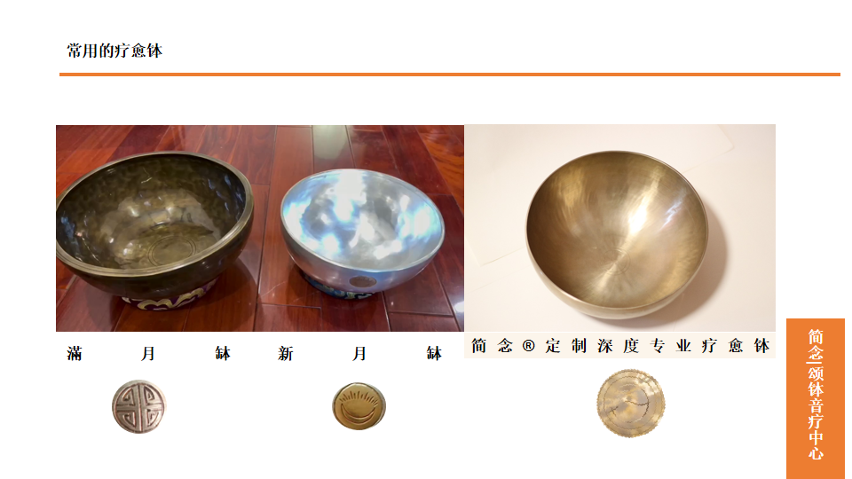

Unlike ordinary handmade bowls, a full-moon bowl can serve multiple chakras. Its sound is very clear and pleasing, effectively balancing the body's energy and promoting natural healing. The full-moon bowl is a top-tier cast, handmade singing bowl — one of the most popular and highest-quality healing bowls on the market.

It is a premier singing bowl developed and created by masters across generations of transmission, using the purest metals. Completed at the time of the full moon, invented by the Santa master family, it is used mainly for singing-bowl healing.

The making of the full-moon handmade bowl is exacting, with very low output; its sound-vibration frequency is very powerful and its healing effect the best. It is made only on the day of the full moon each month — and not even if it is overcast that day. The master who makes the bowl must fast and purify the mind two or three days in advance, and chant scriptures while making it. The workspace must be purified beforehand; only full-moon bowls are made that day. The raw materials use only original-ore metals: the seven metals — gold, silver, copper, iron, zinc, tin, lead — are all 100% raw-ore metal. Full-moon bowls are usually matched to chakras by note: **C = Root, D = Sacral, E = Navel, F = Heart, G = Throat, A = Brow, B = Crown**.

In singing-bowl healing, full-moon bowls are widely used for various physical and emotional issues — anxiety, depression, insomnia, pain, and more. They can also be used for meditation and relaxation, helping people calm the mind and improve focus and attention. The full-moon bowl is a very precious singing bowl — exacting in process, excellent in quality, beautiful in sound, and remarkable in healing effect. If you are looking for a high-quality bowl to help with physical and emotional issues, the full-moon bowl is an excellent choice.

##### New-Moon Bowl

The new-moon bowl is a new-concept bowl made with the same craft as the full-moon bowl, completed on a clear, windless new-moon night. They represent the power of rebirth and are the yin-yang complement of the full-moon bowl. Some believe the new-moon bowl is actually made by silver-plating a full-moon bowl, with a new naming to create new market demand and economic value. Regardless, the new-moon bowl is a very unique singing bowl, representing the power and hope of rebirth; it can help people balance body and emotion and improve focus and attention.

##### Bottomless (Deep-Therapy) Bowl

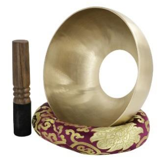

The deep-therapy bowl suits the knee and head; the body is thinner and lighter, with large amplitude. Designed specifically for the knee joint and head, with a hollowed-out bottom — when used on the knee it fits all around for a better effect; when used on the head it is lighter.

##### Purple-Gold Bowl (Zijin)

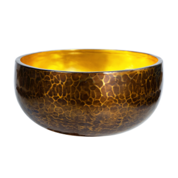

In *Journey to the West*, Tang Xuanzang exchanged a purple-gold bowl for true scriptures worth "more than three *dou* and three *sheng* of gold." Purple represents the sacred; the Forbidden City in Beijing is also called the Purple Forbidden City; "purple qi comes from the east" represents noble temperament and excellent aspiration. The purple-gold bowl, as the ceiling of contemporary singing bowls, is superb in sound, form, vibration intensity, and beauty — every detail honed and polished countless times; the inner bottom is rounded golden polish, the exterior ink-green with the sedimentation of time; every dimension and every tone discussed and refined several times. When using the purple-gold bowl, close your eyes and quietly listen to the ethereal, distant tones from the mountains, feeling the culture and spirit they contain.

##### Jiannian® Thin Deep-Therapy Bowl

A common body-mind healing bowl, often used for body healing; light and convenient, with obvious vibration, purely handmade, thin-polished, rich and full timbre, and abundant vibration — an essential healing bowl for the singing-bowl healer, and the type recommended by the Jiannian Singing-Bowl Sound-Therapy Center for venue healing.

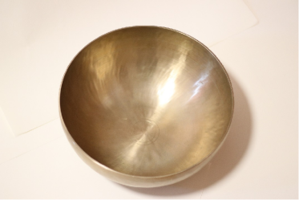

##### Meinl Bronze Bowl (Germany)

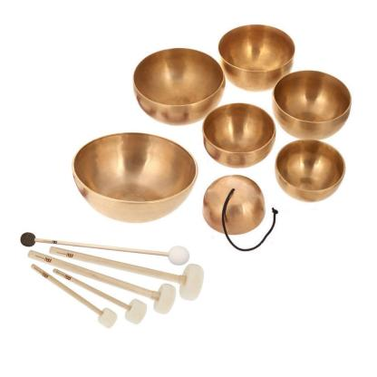

The Meinl singing bowl is one of the products under *Sonic Energy*, the renowned German percussion brand founded in 1951. The brand is devoted to crafting professional percussion instruments, including gongs, sound bars, tuning forks, and bronze bowls. The bronze-bowl series is all produced in India in cooperation with local artisans, conforms to European R&D and manufacturing standards, and is quality-inspected in Germany before shipping to China — a guarantee of German rigorous craft and quality. The bronze-bowl series has four products covering different application scenarios, from zero-basis to professional healer, giving users more choice and a quality experience.

##### Taiwanese Bronze Qing

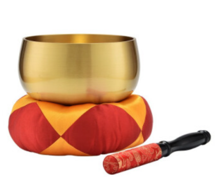
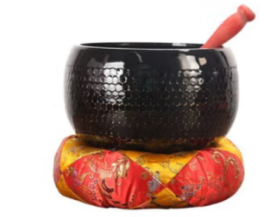

Made of pure copper; Japanese style: polished from a whole golden copper core; Taiwanese style: black, machine-made, hand-polished. Used for decoration or striking. The *qing* is a bronze bowl-shaped ritual instrument struck with a mallet; it is also called a *zan*.

The qing is one of humanity's earliest invented instruments, recorded in ancient books. Buddhist scriptures also mention the bronze qing; in ancient India's Jetavana monastery there was a bronze qing that could hold five *sheng*, its four sides inlaid with gold, engraved with images of the Buddha's past disciples, and a nine-dragon shape of purple-finished gold on the nose. On the back stands a celestial figure holding a jade mallet striking the qing, its sound spreading throughout the three thousand worlds. The qing is used mainly in religious practice — an instrument of sacred meaning.

##### Music Bowl

The music bowl has relatively strict pitch requirements, used mainly for sound healing, regulating brain-wave frequencies, and through sound bringing bodily and mental relaxation and deep sleep. It is also a music-type healing tool recommended by the Jiannian center. Music bowls can also be made from full-moon bowls; the sound is relatively distinctive, with matched pitches for each level of sound healing, with a layered sense of high and low frequencies.

##### Sanskrit-Sound Bowl (Fanyin)

Made of copper, machine semi-handmade; also used for listening, not a healing or music bowl; it produces sound but with insufficient overtones, and is generally not used in professional singing-bowl healing. Uses: entering stillness, struck or spun to produce sound.

##### Dolphin-Sound Bowl

A singing bowl that can produce dolphin sounds.

##### Taiwanese Yin-Qing

The yin-qing is a ritual instrument of monks and Daoists, mostly made of copper, shaped like a small bowl, with a button through the bottom and a wooden handle beneath. Used during sutra chanting and Buddha-name recitation to adjust the syllable. Bright, crisp timbre.

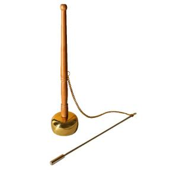

##### Machine-Made Bowl

Mostly used for decoration or display, with aesthetic, artistic, and ornamental value; not used for body or energy healing.

##### Khasa Bowl

Currently, Nepal has newly launched an innovative healing bowl on the market — the Khasa bowl.

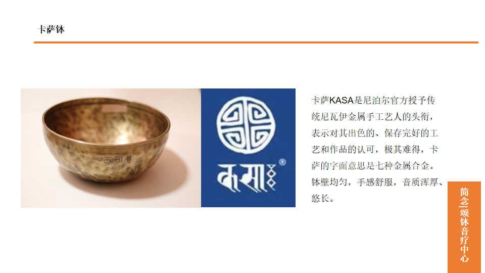
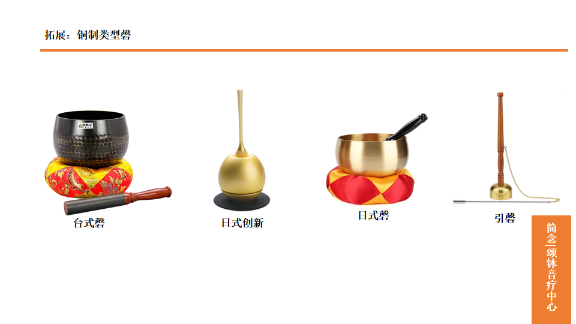
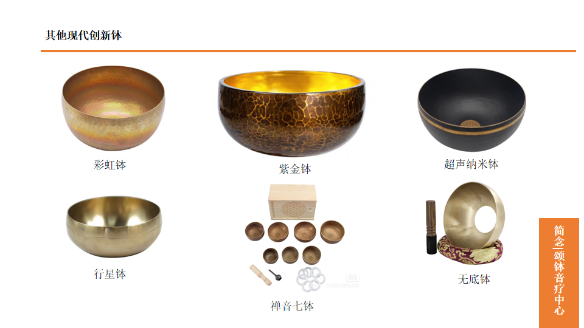

##### Crystal Bowl

The crystal bowl is made by refining high-purity natural crystal sand. Using high technology, 99.99%-pure natural crystal sand is melted into liquid at temperatures as high as 3000–4000°C and formed in one piece in a vacuum, dust-free environment, avoiding bubbles or impurities in the process, achieving a perfect one-piece bowl shape. Crystal itself is a vibration emitter, able to bring the vibration consciousness of the crystal into our cellular level. Our bodies are 65%–70% water — perfect receivers of this information; their vibrations permeate us.

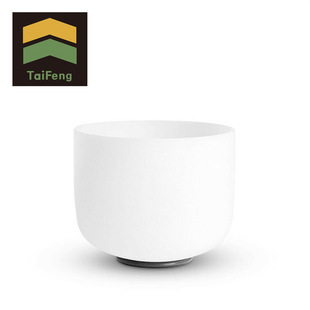

The crystal bowl has memory, focus, conduction, and energy-amplification functions, mainly used for purifying space and field. Method of use: light striking and rubbing. Crystal-bowl sound healing is a deeply penetrating crystal healing; the circle symbolizes perfection; through striking or friction it emits audible sound; the center of the circle is empty, symbolizing greater emptiness — when rubbing the bowl it is easy to open a space both outside and inside simultaneously; because of this space (nothingness), more possibilities flow and arise within. When the crystal bowl is struck, the sound is crisp and loud; when rubbed, it shows a grand momentum; its pitch is relatively high, and for those with overactive thoughts it may sound irritating. The crystal bowl suits space purification or large-space fields.

#### Other Healing Instruments

ASMR (Autonomous Sensory Meridian Response) is a perceptual phenomenon in which stimulation of vision, hearing, touch, smell, and other senses — and of the intracranial, scalp, back, and limb regions — produces a pleasant response such as scalp tingling or goosebumps.

| Instrument | Image |
| --- | --- |
| Gong 铜锣 | 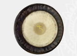 |
| Rain Stick 雨棍 | 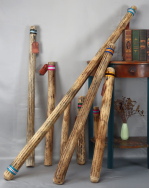 |
| Ocean Drum 海浪鼓 | 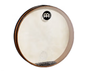 |
| Wind Chime 风铃 | 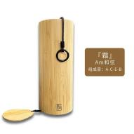 |
| Natural Shell Shaker 天然果壳摇铃 |  |
| Wind-Thunder Tube 风雷筒 |  |
| Tuning Fork 音叉 |  |
| Sound Bar 音束 |   |
| Kongling Drum 空灵鼓 |  |
| Handpan 手碟 |  |
| Thumb Piano / Kalimba 拇指琴 |  |
| Other Chinese & Western instruments 其他中外乐器 | coconut drum, *xun*, *xiao*, *dizi*, *qin*, bass drum, *erhu*, piano, harp, etc. |

### 1.2.2 Making the Singing Bowl

#### Smelting (Mineral Smelting)


Whether traditional craft or modern industrial smelting advances make smelting more convenient and efficient, the method and process are no different from tradition — selecting copper-rich natural copper ore.

**Natural copper ore**


Through grinding, copper ingots are refined, transforming the various chemical compound states of copper in the minerals into a collection form of copper atoms, achieving copper extraction. Compared with other metals, copper is the easiest for humans to extract; in the application of human materials, bronze came first — called in materials science the Bronze Age.

#### Grinding Powder and Refining Copper


Casting into shape is performed, preparing for further application.

#### Casting into Shape

#### Heating and Forging


Through continuous forging it takes shape, making various copper implements. In the making of the singing bowl, three or four experienced artisans collaborate, repeatedly tempering and annealing, shaping the singing bowl, reciting and chanting mantras to fix its form.

#### Tempering and Annealing

*Annealing*: heating the workpiece to an appropriate temperature, holding according to material and workpiece size, then slow cooling — aimed at bringing the metal's internal structure to or near equilibrium, obtaining good process and service performance.

*Tempering*: reheating a quenched workpiece to an appropriate temperature below the lower critical temperature Ac1 (the start temperature at which pearlite transforms to austenite on heating), holding for a time, then cooling in air or in media such as water or oil. Or heating an alloy workpiece after quenching to an appropriate temperature, holding for some time, then slow or fast cooling. Generally used to reduce or eliminate internal stress in quenched steel, or lower its hardness and strength to improve ductility or toughness. Quenched workpieces should be tempered promptly; only through the combination of quenching and tempering can the required mechanical properties be obtained.

#### Grinding and Polishing

*Grinding* is a surface-modification technique — generally using a rough object (sandpaper containing higher-hardness particles, etc.) to change the material's surface physical properties through friction, mainly to obtain a specific surface roughness. *Polishing* is a processing method that uses mechanical, chemical, or electrochemical action to reduce the workpiece's surface roughness, obtaining a bright, smooth surface.

#### Carving and Coloring


In the craft of making singing bowls, especially handmade bowls, beyond material selection it depends more on experienced singing-bowl artisans; technological development helps improve the bowl's precision and stability, but differs from industrialized production that pursues homogenization and mechanical mass output. As an emerging and niche market, the singing bowl has no huge market demand, yet has a sufficient consumer market; aside from machine-made bowls used for display, handmade bowls have their market and can drive local employment, stabilizing the livelihood basis on which artisans depend. Whether using or making singing bowls, development comes through flow, benefiting both ends of the bowl and blessing the world.

### 1.2.3 How to Choose a Bowl

As a professional singing-bowl sound therapist / healer, how does one walk the professional path and choose one's own singing bowl? The ancients said: "A worker who would do his work well must first sharpen his tools." Although we are not artisans sharpening our tools, as healers the singing bowl is both our essential healing tool and the carrier through which we convey healing skill and culture.

In healing, one must surely begin from healing oneself and influencing others; choosing a bowl is the same — be your true self and influence those around you. Choosing a bowl has corresponding professional principles, but none of this rational professional guidance surpasses perceiving, resonating, and choosing with the most real and sincere heart. Below, we collaborate from two aspects to select the bowl that belongs to you.

#### Clarify the Purpose

The purpose of using a singing bowl divides into two kinds: performance and healing. For performance purposes, consider whether the bowl's pitch and timbre quality meet performance standards. For healing purposes, first consider whether to use the sound-resonance method or the bowl-body vibration method — if sound is primary, consider the stability and sustain of its sound; if bowl-body vibration is primary, choose a bowl with good vibration intensity and sustain. Also weigh portability, size, and budget comprehensively.

#### Choose the Chakra

Choose by pitch and related chakra. Pitch: **C D E F G A B** correspond to numbers **1 2 3 4 5 6 7**. Corresponding chakras: Root, Navel (Sacral), Stomach (Solar Plexus), Heart, Throat, Brow, Crown.

**Advice for beginners:**
- *One bowl*: suggest a Heart-chakra bowl, or choose by individual chakra need. The Jiannian center suggests, for a first bowl: Root-chakra bowl, Stomach-chakra bowl, or thin Heart-chakra bowl, for sound and body-mind healing — convenient to begin the healer's first-bowl practice journey. E.g., the Stomach-chakra bowl can target stomach regulation and also heal the whole body; the Root-chakra bowl, besides targeting root energy, can also heal the whole body, corresponding to the Crown for relaxation and meditation — stable, low-frequency tones that make body and mind relaxed and comfortable. The lower three chakras are relatively larger and convenient for "spaceman" healing; choose a thin, moderately weighted bowl.
- For healers on the professional path, it is suggested to choose the Jiannian custom-recommended thin Root-chakra energy bowl for the first purchase, usable for professional body healing.
- *Three bowls (lower three)*: Root, Stomach (or Navel), Heart.
- *Three bowls (upper three)*: Heart, Crown, Throat.
- *Full seven-bowl healing set*: full set of full-moon bowls (bowl-body vibration), music bowls (music), light thin seven bowls (suitable for handheld, vibration), crystal bowls (mainly rubbing).

#### Choose Size / Color / Shape

Generally a set's sizes run from large to small in pitch order; choose the pitch by preference, then the size that suits you. Also choose size by the area of the healing space: large venues — choose full-moon bowls, color mainly dark; small occasions — suitable small full-moon bowls, size not too large.

**Price**

Hundred-yuan bowls (small music bowls), thousand-yuan bowls (mainly body-mind healing) — note: body-mind healing type bowls basically do not go below one thousand yuan; ten-thousand-yuan bowls (collecting | feng shui | artistic cultivation combined). Now, compared with before, many people engage in singing-bowl healing, and the Chinese market has promoted cooperation to build factories in Nepal; the price of singing bowls, while still a niche market, has also declined somewhat.

#### Choose Weight

Whether a performance bowl or a healing bowl, both differ in size and weight; the bowl's thickness is also an option — an even, thin healing bowl or an appropriately sized healing bowl suits women or has advantages in handheld healing. From a professional standpoint, we may choose a category or set of bowls selected through professional commonality; within the commonality, finding your own unique individuality is the emotional and energetic basis for choosing a bowl next.

In healing-culture philosophy, or in our TCM prescription philosophy, we emphasize exclusive customization — one person, one bowl; one person, one plan. Healing singing bowls are handmade by artisans — truly "a thousand bowls, a thousand sounds," each bowl with different energy. This requires us to find individuality within commonality. When we choose a life partner, it is not only about choosing the common parts, but more importantly: respect for individuality enables resonance and joint progress, common growth. Next, choosing a bowl is the same — how to choose the bowl suited to your present self? From three aspects, connect a more professional angle with emotion and intention to choose your "destined heavenly bowl."

#### Preference First

Prioritize choosing what suits you, with the strongest psychic resonance, as the entry point. On the premise of having selected a category of bowls by the above conditions, prioritize choosing what you like, within your budget — decide decisively. Meeting is beauty; once met, don't miss it. Among the vast sea of bowls, it need not be the most expensive or the largest, but it must be your favorite. This is much like picking up stones by the sea — following your own preference is the most real way to face yourself and build your first connection with the bowl.

Listen with your heart — use your whole body and mind to listen fully; you will hear not only the sound audible to the fleshly ear, but also that deeper secret sound that touches your inner being. You must have the experience of love at first sight with certain people; choosing a bronze bowl is the same. Once you meet your "destined heavenly bowl," you resonate with each other, and there is a clear understanding of "ten thousand words cannot compare with wordless."

#### Personal Experience

"A worker who would do his work well must first sharpen his tools." Singing bowls have complex composition; measured audio frequencies all differ. At the beginning, don't cling to needing a certain pitch or certain chakra bowl; a high-frequency small bowl makes one joyful and relaxed, a low-frequency large bowl makes one settled. At first, abandon knowledge-based brain analysis; set out from the heart, communicate with the heart, dialogue with the body, and through hearing and body-mind feeling choose the encounter that belongs uniquely to you.

**The choice and use of healing tools should both be experienced and felt personally (hand-feel & heart-feel); first connect with yourself, then through the singing bowl influence others with stable and powerful frequency and energy.**

#### Listen with Ears, Muscles, and Emotion

If you only intend to buy one bowl, then the best way is to follow your heart and listen with ears, muscles, emotion, and spirituality — no need for others' opinions, no need for a spiritual teacher to sense on your behalf. Follow the one you know, that pitch, with profound resonance; open yourself more freely to listen to infinite possibilities, and choose the bowl that belongs to you.

### 1.2.4 Identifying a Singing Bowl

#### Observation

*(material, craft, shape, pattern)* Observe the bowl's material, investigate its making craft, its shape and substance, and the decoration on the bowl body and color; investigate the bowl's age and making craft, as well as bowl shape and bowl decoration.

#### Striking

*(vibration-feel + frequency + amplitude)* Through testing the bowl's pitch, perceive and test the stability of the pitch through striking force, and while striking perceive the interval and length of the overtones. Perceive and judge through vibration-feel, sound sustain, and vibration sustain.

*1/4 striking*: divide the bowl into four directions, strike at the four fixed points, perceive balance and stability. Through long-term striking and use, the bowl's frequency stability will gradually settle; the bowl's healing attribute, together with the striker, forges a fixed healing tool.

*1/8 striking*: divide the bowl into eight regions, strike within each region, perceive the feel and stability of the bowl in different regions; the striking force may use a certain tilting angle, then let the mallet fall naturally to strike the bowl body.

#### Spinning the Bowl

*(stability + connectivity)* Perceive the stability of the bowl's vibration, its uniformity, balance, and stability in all directions. You can also add 1/3–2/3 water into the bowl and observe and perceive the state of the water ripples and their beating rhythm. Good rhythm, symmetry, and dispersion make the bowl's stability and sonic harmony a delight to behold. The method of identifying a singing bowl is also a path to choosing one; ultimately, combining goal with preference, choose the companion that will follow you on your healing journey.

#### Decoration and Flaws

Generally handmade bowls have more or less a few flaws — this is precisely the difference and identification between handmade and machine-made bowls. As the saying goes, "flaws do not obscure the jade"; beautiful jade generally also has flaws; truly flawless fine jade is either priceless or heavily processed imitation.

In terms of decoration, generally high-quality sounding bowls will not have decorative carving added; the natural state needs no gilding of the lily. On the other hand, adding decoration adds a layer of cultural meaning and faith, and through decoration also cultural-energy healing — such as the *lingam*, a bowl with a central protrusion symbolizing the male genital, occupying an important place in Indian culture; such a bowl gains an extra layer of cultural color, and the shape adjustment also differs from the sound resonance, adding a power of reverence for the gods, becoming one of the typical shapes among old bowls.

Other decorations — Buddha, Bodhisattva, mantras, patterns, Flower of Life, etc. — are mainly decorative, healing secondary. For a true healing bowl, like a jade-carving master, one carves following the natural shape of the jade, or even keeps the original state; a quality bowl is the same — not much decoration carved on it. But from a market perspective, decorated bowls more easily catch the eye and win market recognition and sales. Whether carved decoration or plain face, the final consideration is to shed the cultural and faith outer garments and simply listen to the bowl's original sound from timbre and tone; then consider the imagery of appearances, not over-pursuing appearances — this is also the cultivator's path of the singing-bowl healer.

### 1.2.5 Accessories

#### Mallet (Bowl Striker)


#### Rubbing Stick


#### Cushion Ring


#### Suction Cup

 *(not recommended; feeling with the hand is better)*

#### Anti-Slip Mat


#### Pillow


#### Eye Pillow


#### Massage Table / Sleep Mat


#### Yoga Blanket

### 1.3 Techniques of Use

#### 1.3.1 Inviting the Bowl

**Mind method:** with heart · focus · gratitude · devotion · reverence.
**Body posture:** stable not stiff; relaxed not slack.
**Intention:** composed not hasty.

#### 1.3.2 Holding the Bowl

Mind method: steady, sink, slow. Avoid contact with the sounding area as much as possible; hold stably, avoid shaking or even tipping.

**Non-metal preparation, perception, and non-influence holding:**
- Palming at the center below (Laogong point)
- Tilting-back palming
- Tilting-forward palming
- Three-finger steady hold
- Fingertip hold

#### 1.3.3 Striking the Bowl

Mind method: gentle, graceful, crisp, clean.


**Five striking rhythms:** dot strike (return to original position after striking) · scoop strike (water-scooping motion) · hook strike · flat strike · (extension) sun striking method · moon striking method · earth striking method.

**Intent-and-momentum preparation (three locks):** tuck the chin; draw in the abdomen and lift the anus (root lock); expand the chest and straighten the back (heart lock); raise the qi upward (throat lock).

**Intention:** focused, slow, composed, rhythmic; with compassion and reverence in the heart.

**Three breaths:** first breath — quiet the mind (ask the heart); second breath — align the body (ask the body); third breath — right view (ask the spirit).

**Practical method:** inhale to open, exhale to strike slowly.

**Connection:** Heart chakra — light strike 3 times (3, 5 parts force) — to the healee (3, 5 parts force), then return with both hands cupping.

#### 1.3.4 Rubbing the Bowl

Mind method: steady, still, soft, with breath-rhythm. Calm and focus the spirit; extend the left hand flat, place the bowl at the center of the palm; hold the wooden stick in the right hand, then with the lower end of the stick lightly wipe the bowl rim clockwise or counterclockwise, slowly circling. From fast to slow, as the bowl is rubbed it produces vibration and an agreeable resonant sound, growing louder, lingering and ethereal, deep and far.

**Two rubbing techniques:** light touch + hand grip; do not use the wrist, but the strength of elbow and shoulder. Left-right friction, back-and-forth friction. Rubbing is drawing circles at the bowl mouth — circles that may be fast or slow, casual and free, or sacred and forceful, insightful, breath-aware, contagious — elegant, harmonious, soft, compassionate rubbing.

**Key point:** the start is the end. Before rubbing: wash hands, quiet the mind, purify the bowl, prepare the healing intent. Hold the stick like a brush pen; sink the shoulders, drop the elbows, regulate the breath. Practice, practice, and practice again the rubbing — force, speed, angle, attitude (find your own rubbing experience through self-trial) — ultimately reaching the harmonious state of bowl-and-person as one.

#### 1.3.5 Moving the Bowl

Translation + rotation.

#### 1.3.6 Placing the Bowl

Place gently, on the bowl cushion. **Two-stage placing:** observe the healee's breathing; when inhaling, the chest or abdomen bulges upward; place the bowl according to the two-stage key.

Specifically: on inhalation the body gradually expands, the abdomen begins to bulge upward — this is the moment the healee is full of strength and able to bear; at this time we bring the bowl into contact with the bulging abdomen, noting that your two hands still support the bowl, bearing half its weight, slowly transmitting the other half to the healee. Note that we do not transfer the bowl's full weight; following the healee's breath, at the next inhalation place the bowl fully and stably on the healee. Such placing completed between two breaths does not easily arouse the healee's body awareness, while smoothly transitioning, completing the bowl's placement. In such a placing process, in the vast majority of cases the healee does not perceive the process of the bowl being placed on the body; for one already relaxed and asleep, the weight of the bowl is entirely unfelt.

#### 1.3.7 Striking Technique, Rhythm, Force

Striking technique is the process of using a wooden mallet or other tool to strike the singing bowl, producing resonance and vibration. Force can be adjusted as needed, generally ranging from 1 to 10 parts; the greater the force, the louder the sound the bowl emits. When using the singing bowl for healing, different striking techniques and forces can be chosen as needed to produce different effects.

Rhythm is also a very important factor in singing-bowl healing; different rhythms produce different effects. For example, a heartbeat rhythm helps the healee relax body and mind and enter a deeper meditative state, while a fast rhythm helps activate bodily energy and strengthen the body's self-healing ability.

When using the singing bowl for healing, maintain a focused and relaxed state, letting the bowl's energy lead the breath, assisting deeper breathing — inhaling more energy, exhaling more turbid qi. Through breath practice one can reach the state of breath-ceasing and concentration, further strengthening the healing effect.

**Force:** 1 part · 3 parts · 5 parts · 7 parts · 10 parts.

**Bowl-moving (行钵):** free bowl-moving · overtone bowl-moving. **Breath bowl-moving (essential skill).**

**Rhythm (intermediate):**

```
1000 0000 0000 0000 ~ ~ ~
1000 1000 1000 1000
1000000000 1000000000
heartbeat rhythm   1200 1200 1200 1200
slow heartbeat     1200 0000 1200 0000
wood-fish (muyu):
1111 1111 1111 1111
123456787654321
1111 2222 3333 4444 5555 6666 7777 8888 8888 7777 6666 5555 4444 3333 2222 1111
```

Relaxation and focus, combining bowl with breath, letting the bowl's energy lead the breath, transcending limits, assisting deeper breathing — inhaling more energy, exhaling more turbid qi — in breath practice reaching the state of breath-ceasing and concentration.

#### 1.3.8 Rubbing Angle, Speed, Force

**Exploration stage:** self-try angles — vertical, 30°, 45°, 60° — and your wrist/elbow comfort. **Relative speed:** accelerate, accelerate, constant (fast constant, slow constant), etc. **Force:** 0, 1, 2, 3, 5, 7, 10.

#### 1.3.9 Stopping the Sound

No stopping | natural decay. Mallet stopping. **Crystal bowl — cannot be stopped.**

#### 1.3.10 Ting-sha Technique and Occasions

In Tibetan called *ting-sha*; in the Chinese-speaking world also called collision bells or touch bells for their use — both instrument and healing tool. The ting-sha consists of two bells strung together; when the bells collide they produce a high, bright, ethereal, agreeable sound, or a distant ethereal tone; their extraordinary overtones help purify and elevate the frequency of personal and spatial auras. The ting-sha has a long history and varied uses; early on it was common in religious rituals and popular in the songs and dances of different peoples. In modern times, because the ting-sha is small and portable, it became a common carry-on meditation tool for practitioners; the ting-sha can also be used with the singing bowl to become an excellent partner in body-mind healing.

Traditionally, the music emitted by the ting-sha can clear the negative energy of a space and return the mind to the present; it is also used to heal tinnitus. In the spiritual domain, the collision bell is used to open the third eye, and to create a healing connection between healer and client, conducting positive energy; finally the ting-sha can also be used to balance the chakras. Usually applied at the beginning and end of healing, coordinated with the breathing rhythm, to gather or awaken body and mind — one of the essential sound-healing instruments for the healer.


For healing tinnitus, because the ear is a very delicate organ, strike the ting-sha about 24 inches (80 cm) from the ear, quickly move to 3 inches (10 cm) from the ear, hold for 5 seconds or until the sound fades, then move back to the original position; continue for 3–5 minutes. The healee may proceed in meditation or lying flat. A ting-sha of 8–10 cm is most suitable; overtones that are agreeable and long-lasting are the best choice. If accidental discomfort or a serious situation occurs and the sound cannot be borne, try striking gently, and keep a greater distance, slowly approaching.

#### 1.3.11 Cleaning and Care of the Singing Bowl

The greatest care is to **use it often** (striking + rubbing).

- *Dust deposit* — wipe with a soft cloth (clean the bowl with lemon juice + warm water).
- *Water stains* — rinse with clean water and wipe dry, air-dry (no sun exposure).
- *Copper oxidation (patina)* — toothpaste or white vinegar, with a soft cloth or white paper in circular motion gently rub until the green oxide disappears.
- *Smudging purification* — use dry matter such as white sage leaves, mugwort leaves, cedar leaves; the smoke produced after burning circles inside the bowl body, to remove the energy left by the previous client in the bowl.
- During use, keep dry, avoid collision.
- Store in a dry place; after use wipe clean with a cotton cloth until dry.
- Do not use acidic cleaners, alcohol, volatile solvents, chlorides, etc. to wash the bowl, to avoid corrosion.
- Do not use steel wool or other hard objects to wash the bowl, to avoid damaging the surface.
- When placing, do not put the bowl directly on hard objects, to avoid friction and collision.
- You may also open the bowl's energy clearing and blessing through rituals such as chanting scriptures, mantras, prayer, burning incense.
- Full-moon bowls may also be cleaned by offering, or by moonlight bathing on full-moon nights.
- The bowl's placement should be with devotion; place it in a principal position with offering and respect; avoid placing it in an uncommon corner or near a trash bin.
- The music world's method for maintaining struck bronze instruments: plant maintenance oil.

#### 1.3.12 Singing-Bowl Breath Practice

Sit quietly, hold the brush-pen posture, sink the shoulders, drop the elbows, regulate the breath, gather qi to the dantian. On the first exhale, exhale to 8–9 tenths, then begin to rotate the bowl clockwise, slowly inhale. On the second exhale, exhale to ten tenths, then slowly inhale. On the third exhale, try to exhale to eleven tenths, then slowly inhale. Gradually increase, trying to exhale a bit more than the previous time. Stay in natural relaxation; do not force yourself.

Likewise, on the first inhale, inhale only 8 tenths, then begin to exhale. On the second inhale, inhale to 10 tenths, then begin to exhale. On the third inhale, try to inhale to 11 tenths. Each time try to inhale a bit more than before. But please reach this naturally in a relaxed state.

**Non-violent breathing — avoid clinging to force.** Through repeated practice, you can hear your own breath, hear the stable bowl tone, as if experiencing the reality of breath's existence, returning to the most precious present, returning between breaths, receiving the energy of life, possessing abundant everything, full of love and gratitude.

#### 1.3.13 Single Gong Striking Technique


> Born with wings, why prefer to crawl through life?
> — Rumi, the Sufi poet (13th century)

### Chapter 1 Summary

This chapter set out from "what is a bowl," systematically sorting the bowl's form, name, material, and historical context, and breaking down the complete operating techniques from inviting the bowl to stopping the sound. Vessel and feel are the foundation of all theory and practice that follow — first "be with" the bowl, then speak of healing.

### Reflection Questions

1. What are the differences between traditional and modern bowls in material, timbre, and use?
2. Why does the textbook list "personal experience" as the first standard for choosing a bowl?
3. What energy logic is implied among inviting, holding, and striking the bowl?

# Chapter 2 — Theoretical Topics

### Chapter Learning Objectives

- Understand the elements of sound and bowl tones (pitch, overtones, the fifth interval);
- Master the relationship between same-frequency resonance, physical vibration, and the energy field (three channels and seven chakras, five great elements);
- Build a science–philosophy unified framework of "healing principles."

## Section 1 — Sound Fundamentals (Beginner–Advanced)

When the singing bowl is struck upon the body, every cell in the whole body vibrates. The body enjoys a cellular-level sound massage, drawing the brain into deep relaxation. After a quarter of an hour, one is comfortable, at ease, unwilling to wake. This contact and connection between bowl and body is the unique charm of singing-bowl sound therapy. Hearing and touch perceive the cellular-level vibration of water, achieving complete bodily and mental relaxation and healing — healing without medicine.


### 2.1.1 Form and Substance as One


**Keywords:** copper · hollow · round.

Imagine: if the singing bowl were triangular or square, could it still emit beautiful, long-sustaining sound? If the bowl were made of other materials — iron, lead, wood, or stone — could it still emit such long-sustaining sound? Clearly, the reason the singing bowl can produce such wonderful sound is the perfect combination of its form and material.

Let us explore the four elements of sound from the human vocal structure.


The physiological basis of voice is the human vocal organs, mainly composed of three parts: the power part, the vibration part, and the transmission-resonance part. The power part is the lungs; the vibration part is the vocal cords; the transmission and resonance parts include the chest cavity, throat cavity, oral cavity, and nasal cavity.

Likewise, the sound basis of the singing bowl is also composed of three parts. The power part is the striker; the vibration part is produced by the copper bowl form; the transmission and resonance parts are the air and the bowl cavity — that is, the hollow part of the singing bowl. Sound is produced by sound waves generated from the vibration of an object. We hear sound because it propagates as waves.

### 2.2.2 Elements of Sound


The four elements of sound are **pitch, intensity, duration, and quality**.

- **Pitch (tone):** as the name suggests, pitch refers to how high or low our sound is; it depends on how fast the sounding body vibrates. Fast vibration → high pitch; slow vibration → low pitch. Generally, a small, thin, short, tight sound vibrates fast and is high-pitched; a large, thick, long, loose sound vibrates slow and is low-pitched. Colloquially, women's voices tend higher, men's lower.


- **Frequency:** the number of periodic changes completed per unit time — a measure of how frequent a periodic motion is. Commonly denoted *f* or *ν*, unit s⁻¹. In honor of German physicist Hertz, the unit is named the hertz (Hz). Every object has a frequency determined by its own nature, independent of amplitude — called its **natural frequency**.


- **Intensity:** intensity refers to the strength of sound; it depends on the amplitude of the sounding body's vibration. Large amplitude → strong intensity; small amplitude → weak intensity. Simply put, the harder we speak, the larger the amplitude and the stronger the intensity, and vice versa.


The singing bowl's intensity comes from the striker's striking method and force, determining the sound's volume and the bowl's vibration amplitude, but it does not change its inherent frequency. The striking method or force, large or small, can be flexibly adapted to the field, the bowl's position, and the healee's body-mind state — a common way the healer changes the sound's elements.


- **Duration:** duration refers to the length of sound; it depends on how long the sounding body vibrates. Long vibration → long duration; short vibration → short duration. Duration has little distinguishing significance for us as speech, but is not wholly useless — when we speak slowly, duration is long; when arguing, short; when reciting, long; in everyday talk, short.


As an instrument, duration can be designed according to different environments and changes — for the singing bowl, different striking tools and techniques (striking, rubbing, colliding, stopping) realize different sounds and expressions from the same bowl, enriching its uses and creating and satisfying the design and output of bowl tones.

- **Quality:** quality is the quality, clarity of sound — high-quality sound means a lossless original waveform. But be clear that quality differs from timbre: whether a sound is pleasant refers to timbre, not quality. Quality is the sound's texture, coarseness, purity, springiness, and density. For the singing bowl, different forms and substances have fixed frequencies, unaffected by the striker's intention; the moment the bowl is finished, its frequency is essentially set. Grasping quality comes from the choice of bowl — a comprehensive, mostly physical consideration; the bowl's own charm means that, regardless of force or method, it yields excellent bowl tones and overtones.

### 2.1.3 Sound Reception


When sound waves pass through the outer ear into the eardrum, they are transmitted to the middle-ear tissue, then guided to the inner ear and cochlea; the auditory receptors within the cochlea then transmit the received sound waves via the auditory nerve to the brain, forming hearing.

In school we learned that sound reception comes from the connection between our auditory system and the brain, letting us hear part of nature's sounds. Science defines the human hearing range as 20 Hz–20 kHz; as we age this range shrinks further, so that in old age one must speak loudly to be heard — a feeling much like hearing sounds from shore while underwater.

### 2.1.4 Basic Bowl Tones

#### 2.1.4.1 The Bowl's Pitch

Different schools or regions classify differently; see the figure.


Through the chakra discourse, the Vedic system's pitch system is C D E F G A B. C D E F G A B are the British note names, corresponding: C=1=do, D=2=re, E=3=mi, F=4=fa, G=5=so, A=6=la, B=7=ti (si).

Since ancient times, sound has been considered one of the media through which humans communicate with sacred power; singing-bowl healing is a kind of sound healing. The bowl was originally a vessel Himalayan monks used to hold food, but because of its unique and wondrous sound it was extensively studied and clinically practiced by Europeans, who found the bowl's sound plays a fine role in promoting human health; gradually singing-bowl healing has been accepted by more and more people. Now the singing bowl has become a special instrument beloved for physiotherapy, sound massage, sound healing, and chakra balancing, and singing-bowl healing has been formally included in the internationally recognized natural-therapy system, recognized by mainstream medicine in Europe and America and incorporated as auxiliary medicine into local health insurance. The resonant universal vowel is *Aum* or *Om*.

The Tibetan system's planetary order is determined by the speed at which planets appear to move from Earth: the Moon feels fastest, Saturn slowest, and the Sun in the middle. This is the system used by ancient astronomers and alchemists.

- Doh ~ C
- Ray ~ D
- Me ~ E
- Fah ~ F
- Soh ~ G
- Lah ~ A
- Te ~ B

#### 2.1.4.2 The Five Viscera Have Sound

In traditional Chinese culture, "the five viscera each have sound" is an important concept. In the Chinese TCM five-element theory, nature has five heavenly sounds — *jue*, *zhi*, *gong*, *shang*, *yu*; matter also has five elements — wood, fire, earth, metal, water; correspondingly, the human body has five important organs — liver, heart, spleen, lung, and kidney. These organs correspond to the five elements, five flavors, and five sounds, so music benefits the healing of disease.


In Chinese character culture, both *music* (乐) and *medicine* (药) are means of healing. The mechanism of medicine, like music, regulates body-mind balance, bringing joy and health. More than two thousand years ago, the Chinese medical masterpiece *Huangdi Neijing* (Yellow Emperor's Inner Canon) recorded the connection between the five viscera and five frequencies. Liver belongs to wood, its sound *jue*, its emotion anger; heart belongs to fire, its sound *zhi*, its emotion joy; spleen belongs to earth, its sound *gong*, its emotion thought; lung belongs to metal, its sound *shang*, its emotion worry; kidney belongs to water, its sound *yu*, its emotion fear. The five sounds *jue, zhi, gong, shang, yu* are called the "five heavenly elements." Because the five viscera correspond to the five elements, five flavors, and five sounds, music benefits the healing of disease. When a piece ends, the illness recedes and the person is at peace.


> "Music has distant origins; it is born of measure, rooted in the Great One. The Great One births the two modes; the two modes birth yin and yang; yin and yang transform, rising and falling, harmonizing into pattern."
> — *Lüshi Chunqiu* (Spring and Autumn Annals of Master Lü)

> "It stirs the blood and vessels, circulates the spirit, and harmonizes and rectifies the heart."
> — *Shiji · Book of Music* (Records of the Grand Historian)

> "The five viscera have sound; when sounds harmonize, there is no disease."
> — *Huangdi Neijing* (Yellow Emperor's Inner Canon)

#### 2.1.4.3 The Magic of Overtones

In music-making and singing-bowl healing there is an important concept that gives sound its magical function and value — the **overtone**.

An overtone is a musical term. In professional music, the description of the overtone series: among all wave trains the longest-wavelength one is called the fundamental wavelength (fundamental), and its wavelength determines the pitch of the note the instrument plays. Almost all instruments, besides emitting the fundamental, also emit shorter-wavelength sounds — called overtones.

After these sounds are emitted, the lowest frequency is called the fundamental; all partials with frequency higher than the fundamental are called overtones. In instruments with clear pitch, between the string or air column there are waves of the same wavelength traveling in opposite directions due to reflection; because they interfere with each other they produce harmonics of different wavelengths — in music called overtones. The wavelengths of the overtone series are respectively 1/2, 1/3, 1/4, 1/5, 1/6… of the string length or air-column length.

The singing bowl is a traditional Tibetan Buddhist healing instrument and also a sounding instrument; its main feature is the ability to emit rich overtones. The singing bowl's overtones are determined by its special design and craft. Its making materials include copper, tin, lead, gold, silver, and other metals, and the craft produces sound through hammering and rotating the bowl. The singing bowl's sound is very special — it lets one feel strong resonance and also produces a healing effect.

Notably, after the singing bowl is struck, besides its inherent frequency, as the duration lengthens the overtone frequency becomes smaller and higher. Interestingly, its peak resonance frequency approaches an integer-ratio relationship, which gives the singing bowl its harmonious sound effect. The figure below is a model of the energy state and frequency change after striking a singing bowl, detected in scientific literature.

Overtones are not limited to the singing bowl; they also exist in many other instruments — piano, violin, guitar, etc. When an instrument emits sound, overtones change with the fundamental's change — which is also why instruments produce different pitches. At the same time, overtones are an important component of an instrument's timbre, letting it emit richer, deeper tone, so people feel stronger emotion and meaning while appreciating music.

Overtones are a very important concept in music — they exist not only in the sounds instruments emit, but can also produce healing effects. For music lovers, understanding the principle and application of overtones not only lets them better appreciate music, but better understand its inner construction and charm.


**Singing bowl: the fundamental frequency and overtone frequency of the struck sound become smaller and higher.**
**Interestingly, its peak resonance frequency approaches an integer-ratio relationship, which gives the singing bowl its harmonious sound effect.**

#### 2.1.4.4 The Fifth Interval

Music originates from mathematics. Sound is produced by the vibration of objects; the ancients arranged strings of different vibration frequencies by ratio, and could play musical tones, thus producing music. When a string vibrates it produces a fundamental frequency, called the fundamental, but the string vibrates not only as a whole — its halves, thirds, etc. also vibrate simultaneously, thus producing a combination of many tones including the octave and fifth — these partial tones are called overtones.

An interval is the mutual relationship between two scale degrees in pitch — that is, the distance in pitch between two tones; its unit name is the "degree."

An interval refers to the pitch relationship between two musical tones, expressed in "degrees." Taking numbered notation as an example, from 1 to 1, or 2 to 2, is a first (unison); from 1 to 3 or 2 to 4 is a third; from 1 to 5 is a fifth.

First, the degree is a unit that measures the auditory distance between tones — a metric whose size is artificially defined.


The "fifths-generated temperament" (Pythagorean) uses overtone generation, with only two frequency ratios: the octave is 1:2, the fifth is 2:3. The octave is mainly used to move a tone within one group; the fifth is mainly used to derive each tone's frequency, by means of the circle of fifths.


| CDEFG | GABCD | DEFGA | ABCDE | EFGAB | FGABC |
| --- | --- | --- | --- | --- | --- |
| DFACE | ACEGB | FACEG | GBDFA | BCDEF | CEGBD |
| EGBDF | BDFAC | CFBEA | DGCFB | EADGC | FBEAD |
| GCFBE | ADGCF | BEADG | CGDAE | DAFCG | EBFCG |

*Figure: Singing-bowl fifth-interval table*

## Section 2 — Vibration Fundamentals (Beginner–Advanced)

**Related reading:** elements of sound see [2.1.2 Elements of Sound](#212-elements-of-sound); healing principles see [2.4 Healing Principles](#section-4--healing-principles-beginneradvanced).

### 2.2.1 Same-Frequency Resonance (Wave Vibration)


Whether it is the striking-point vibration of a single bowl triggering the whole bowl's same-frequency resonance, amplifying the vibration's energy and completing the overall resonance — like the butterfly effect, from molecular-level vibration bringing macroscopic bowl resonance — or the bowl's vibration resonating at the same frequency with the human body, using vibration to move energy from disordered to ordered, achieving a tendency toward the same frequency.

A stable singing-bowl frequency, when struck, makes the unbalanced (disordered) body-mind frequency tend toward stability while regulating each chakra back to a stable, balanced energy frequency, building one's own strong energy resonance field, reaching high-energy balance and resonance amid the unceasing bowl sound.

#### 2.2.1.1 Chakra Same-Frequency (Energy Field)


The chakra, in medieval Indian tradition, is a profound belief in physiological and psychological centers, holding that human life exists simultaneously in two parallel dimensions — one physical, the other psychological, emotional, mental, non-physical — thus called the subtle body. This subtle body is energy, while the physical body is mass.

These chakras are important components of the human energy field; their operating state directly affects people's physical and mental health. Different chakras have different resonance frequencies, so choosing a chakra bowl of the same frequency for healing yields the best energy-resonance effect. Same-frequency resonance is a phenomenon of energy transfer that can amplify the vibration's energy and complete the overall resonance.

In singing-bowl healing, choosing a singing bowl of the same frequency as the target chakra helps people adjust their energy field, reaching high-energy balance and resonance, and carrying out the adjustment and transformation of our karma (daily routine, eating habits, personality traits [thought, emotion, physical energy, and nature's energy]).


The human chakra energy map is not an independent closed system, but an interactive whole; a strong field can drive a weak field, and a weak field also affects a strong field. The principle behind same-frequency resonance is a superposition of vibrations at the same frequency — strong joining strong, realizing the high-energy vibration of the energy field, raising the aura, and thereby bringing body-mind healing. Hence even a single bowl can heal the whole.

Take the chakra as an example: if a person's certain chakra is unbalanced, the singing bowl with the same resonance frequency will help that chakra restore balance. This is because the principle behind same-frequency resonance is a superposition of vibrations at the same frequency — strong joining strong, realizing the high-energy vibration of the energy field.

#### 2.2.1.2 What Is Resonance (Tuning)


Resonance, also called "sympathetic vibration," is a phenomenon in which an oscillatory system, under a periodic external force, has its amplitude sharply increase when the external force's frequency is the same as or very close to the system's natural oscillation frequency. This phenomenon also appears in the human body and is called "resonance frequency."

Resonance frequency is the optimal vibration frequency when the singing bowl's vibration is applied to the healing site. It is defined as the vibration frequency that can most activate muscle activity, producing the greatest influence on neuromuscular performance in the shortest time. This vibration frequency can produce benign manifestations in the human body, becoming a healing means.

In singing-bowl healing, by choosing a singing bowl whose resonance frequency matches the target site, one can realize energy resonance and achieve better healing effect. This energy-resonance healing method has been accepted by more and more people, becoming a popular physical-and-mental health therapy.

### 2.2.2 Physical Vibration (Vibration Sensation)


Physical vibration (vibration sensation) is a stimulus conducted through sound waves or physical vibration, able to directly affect all tissues and organs of the human body — starting from water molecules, causing water resonance through to cells, muscles, bones, nerves, brain, etc., realizing a deep, cellular-level, all-around, systematic body-mind resonance system. Therefore, sound is called the medicine of the future.

The dense-rarefied waves produced by the sound-wave conduction medium, or physical vibration sensation, can be directly delivered to the receptors within the body's cortex. When the receptor is stimulated, it produces a local potential in the body's nerve endings, and the local potential in turn causes a local current, conducting it to the central nervous system, finally reaching the brain and forming touch.

In modern medicine, physical vibration has been widely applied in various healing methods. For example, sound therapy, through sound-wave conduction, can regulate the human body's physiological and psychological states, relieving stress, anxiety, depression, and other symptoms. In addition, physical vibration can also be used to heal muscle diseases, bone diseases, and nervous-system diseases.

Beyond medical applications, physical vibration is also widely used in music, entertainment, and sports. For example, music's melody and rhythm, through sound-wave conduction, can directly affect people's emotional and psychological states. Some fitness equipment and training methods also use the principle of physical vibration, stimulating muscles and bones through vibration to achieve the purpose of exercising the body.

As a stimulus that directly affects the human body, physical vibration has been widely applied in medicine, music, entertainment, and sports. With the continuous development of science and technology, we believe physical vibration's future applications will be even broader and deeper.

#### 2.2.2.1 Water in the Human Body


The human body is about 70% water; thus its vibration wave frequency resonates and co-resonates with the body's inner molecular frequency, forming a ripple-vibration massage and healing effect — like a tuner, awakening and activating the body's self-healing ability, helping the body restore a balanced, harmonious, healthy state.

When we strike the singing bowl, the emitted sound-vibration resonates harmoniously with the universe's energy. This vibration is received by the human body, giving our energy the possibility of resonating along with it, and the body-mind energy changes accordingly, bringing deep, rapid relaxation.

The singing bowl is an instrument that can produce vibration; its vibration source is the water within the human body. We can put water into the singing bowl, strike or rub it, and observe the regular jumping of water waves and splashes.

This is because the singing bowl's orderly and regular vibration brings the dancing of water molecules; within the stable, regular bowl sound, the water's vibration tends toward stable and regular, and finally, in resonance, strong joining strong, forms visible physical phenomena such as water waves and splashes.

In the singing-bowl healing process, the water in the human body, besides the skin perceiving the bowl's vibration, can also, through cellular resonance, be directly transmitted via the nervous system, realizing deep, all-around massage from cells and organs — a miraculous natural therapy.

The singing bowl's vibration frequency and its vibration mode under physical phenomena can deeply "massage" from our cells and organs, relax the nerves, open the positive circulation of our body's water, and better unblock and metabolize.

After singing-bowl healing, the human body experiences thirst. This is a very normal bodily response — not thirst caused by water being expelled from the body, but thirst arising because water enters a deep balance. After the bowl, drinking water in small sips is very beneficial to the body's water absorption and metabolism — a rare body purification.

#### 2.2.2.2 Tissue Systems


**The body's seven chakras are located at different parts of the body, overlapping the positions of endocrine glands such as the adrenals, ovaries or testes, pancreas, thymus, thyroid, pituitary, and pineal gland.**

Hormones: meaning to awaken and stimulate. Hormones promote the body's growth and metabolism, awaken the sleeping body, and comprehensively affect functions such as pulse, body temperature, physical development, metabolism, sleep, and sensation.

Advanced singing-bowl healing, through massage and relaxation of the endocrine and nervous systems, achieves self-balance and coordination, realizing hormonal balance, also promoting chakra-balance regulation, and realizing a high-energy, healthy body-mind state.

Modern science holds that eight major systems maintain the body's normal operation: the circulatory system, respiratory system, endocrine system, nervous system, digestive system, immune system, motor system, and reproductive system. All things have their own unique vibration frequency, and in this way absorb and release energy. For the human body, down to the cell, hard as bone, fine as brainwaves, all fluctuate; if frequencies are consistent, resonance occurs, and seemingly weak energy can cause great influence.

Each person is a unique symphony; every cell, organ, muscle, tissue, thought, etc. constantly performs the song of perception, emotion, mind, and spirit.

Water can co-resonate with singing bowls of different chakras; whichever chakra's bowl it is, causing same-frequency resonance, it splashes water. The human body is constituted of water; this open same-frequency resonance is the foundation and basis of holistic body-mind healing. High-dimension's same-frequency resonance with low-dimension is approachable.

Humans are advanced beings, able to resonate with all things, reaching the wise state of "all things and I are one." Thus one can perceive and comprehend the joy of fish, and the four seasons and twenty-four solar terms — for human development and health preservation, follow the Dao, resonate with the four seasons to preserve health: spring birth, summer growth, autumn harvest, winter storage — the health preservation of the four seasons. The proud plum, the humble bamboo, the plain chrysanthemum, the secluded orchid — resonating with the gentleman's bearing; with infinite mind dwelling in bounded affairs, is the spirit of water — "the highest good is like water."

## Section 3 — Energy Fundamentals (Intermediate–Advanced)

The mystery of the three channels and seven chakras and their opening.

The human body has an inner energy system called the subtle body, composed of three parts: three channels (*Nadis*), seven energy centers (*Chakras*), and the spiritual energy (*Kundalini*).

The three channels are the left channel, central channel, and right channel, governing different energies.

The left channel governs memory, the past, and the emotional aspect; the right channel governs thought, the future, action, and planning; the central channel is the passage connecting the left and right channels — only when the central channel is open can the energies of the left and right channels be balanced and used.

The *Kundalini* is an important part of human spirituality, located in the sacrum at the base of the pelvis — a triangular, coiled energy of three and a half turns. Only under appropriate conditions is the Kundalini awakened and raised, passing through the five chakras to the nerve plexus at the top of the brain, finally crossing the crown chakra and skull to connect with the universe's energy, reaching the state of self-realization — the thoughtless yet aware state of stillness.

The seven energy centers are the seven convergence points of human energy, also called chakras. They are, respectively, the Root, Navel (Sacral), Solar Plexus, Heart, Throat, Brow, and Crown chakras, governing different energies and emotions. When these seven energy centers are opened and operate in balance, the body is healthy, inspiration good, physical strength good, thought clear and lucid, self-love and love of others, understanding one's life path, experiencing the wonderful feeling of thoughts becoming reality.

In daily life, we need to maintain body-mind-spirit balance and coordination, avoiding emotional and spiritual imbalance leading to chakra closure or energy imbalance. Through healing tools and methods such as yoga, meditation, singing bowls, and collision bells, we can open and balance the three channels, seven energy centers, and Kundalini, reaching body-mind-spirit balance and health.


### 2.3.1 The Three Channels (*Nadis*)


The left channel, central channel, and right channel are the body's three energy passageways, also called the three channels (*Nadis*). They are:

**Left channel** (*Ida Nadi*): also called the yin or moon channel. It rises from the left nostril into the brain, descends along the left side of the central channel, and meets the central channel about four fingers below the navel.

The left channel corresponds to the past, dullness, the emotional, and the superego (social conditioning); it also governs the power of desire. Those inclined toward the left channel tend to be introverted, emotionally rich, but indecisive, unsystematic, and easily swayed by others.

**Central channel** (*Sushumna Nadi*): located along the middle of the spine, running from the perineum straight to the crown of the head, connecting with the left and right channels. The central channel is the only passage through which the human being unites with the universal spiritual force; it is the source of joy and the key to spiritual ascent.

The central channel is the body's most important energy pathway. It runs through the entire body, connecting body and soul. Opening the central channel helps clear toxins from the body, strengthens immunity, and lets us understand our inner world more deeply, thus achieving balance and elevation of body, mind, and spirit.

**Right channel** (*Pingala Nadi*): also called the yang or sun channel. It rises from the right nostril into the brain, descends along the right side of the central channel, and meets the central channel about four fingers below the navel.

The right channel corresponds to the future, rational logic, domination, and ego; it also governs the power of action. Those inclined toward the right channel are usually extroverted, good at thinking, planning, and acting, with strong execution. The downside is they may be overly cool and rational, lacking emotion and feeling. They need to learn to connect better with their own emotions and inner world, to attain body-mind-spirit balance.

#### 2.3.1.1 The Left Channel

The left channel is an important concept in yoga theory, also called the yin or moon channel. It is one of the body's three main energy channels, originating at the perineum, rising from the left nostril into the brain, descending along the left side of the central channel, and meeting the central channel four fingers below the navel. The left channel is usually grayish-white, cool in nature, and governs the power of desire.

The left channel is associated with the past, the emotional, dullness, and the superego (social conditioning).

It is responsible for the reference of judgment and action. When the left channel stays active, a person has the desire to survive; when the left channel withers, the person dies; when the left channel is weak, it causes extreme emotionality and moodiness.

Those inclined toward the left channel are usually introverted, rich in feeling, but not good at expression. They tend to be sentimental, artistic, easy to get along with, and won't make trouble without cause. The downside is a rather lazy character, indecision, lack of system, and being easily dominated by others.

#### 2.3.1.2 The Central Channel

The central channel (*Sushumna Nadi*).

The central channel, also called the middle path or central passage, is an important concept in yoga theory. It is one of the body's three main energy channels, located between the left and right channels, rising from the perineum and passing through the entire spine up to the crown of the head. The central channel is a red passageway, representing yang energy, governing the body's consciousness and spirituality.

#### 2.3.1.3 The Right Channel

The right channel (*Pingala Nadi*), also called the yang or sun channel.

The right channel is an important concept in yoga theory, also called the yang or sun channel. It is one of the body's three main energy channels, located beside the central channel, rising from the right nostril into the brain and descending along the right side of the central channel to meet it four fingers below the navel.

The right channel is usually red, hot in nature, and governs the body's action and thinking ability.

The right channel is associated with the future, rational logic, domination, and ego. It supplies action and thinking ability. When the right channel is full of energy, a person's action is vigorous and thinking and attention are focused. When the right channel lacks energy, a person lacks drive and both thinking and attention decline. Those inclined toward the right channel are usually extroverted and active, good at thinking and planning, and brave in showing themselves, but lack emotional and artistic development. Their strength is competence, orderliness, and the ability to organize others to work for them. Because they have abundant energy, they act as if they never run out, and thus can have the boldness to do great things. In modern society such people often become politicians, officials, etc., with some achievement and status. Yet their weakness is often an oversized ego — thinking everything is in their grasp, seeing only themselves and not others. They will then sacrifice others to serve themselves. On a small scale this means commanding and exploiting others; on a large scale it means invading and plundering other nations. Those who over-rely on the right channel often have an overheated liver, a hot temper, and shout at others, causing them pain. The right channel (*Pingala*), representing the sun, also represents the hot, yang, active, dynamic, tense aspect — corresponding to the sympathetic nervous system.

#### 2.3.1.4 The Autonomic Nervous System

The autonomic nervous system is an internal self-regulating system of the body. It autonomously regulates many important physiological functions, such as heartbeat, blood pressure, breathing, digestion, and metabolism. The autonomic nervous system includes the sympathetic and parasympathetic nervous systems, whose actions on the body are complementary.

The sympathetic nervous system is mainly responsible for responding to emergencies, putting the body into a "fight or flight" state, while promoting the breakdown of liver glycogen and fat to help the body produce enough energy. When startled, the sympathetic nervous system is aroused: pupils dilate, heartbeat and blood pressure rise, breathing quickens, and large amounts of blood flow into the skeletal muscles so we can flee quickly, while blood flow to the digestive tract and skin decreases. Meanwhile the liver breaks down glycogen and fat tissue breaks down fat to help produce energy. Sympathetic arousal puts the body into a tense state.

The parasympathetic nervous system is mainly responsible for promoting the body's rest and recovery, putting it into a "rest and digest" state, while promoting the secretion of digestive juices and the release of insulin to help the body store energy. When eating, the parasympathetic nervous system is aroused, promoting digestive-tract movement, sending blood into the stomach and intestines, and promoting the secretion of saliva and other digestive juices. Blood flow to the intestines rises and insulin secretion is promoted, drawing blood sugar out of the bloodstream and storing it in the body. In other words, parasympathetic arousal puts the body into a relaxed state.

These two systems adjust with different environments and states to reach balance, enabling the body to function normally and maintain physiological operation. Irregular living habits disrupt the balance of the autonomic nerves, causing physiological disorder — this is called autonomic nervous system disorder. Autonomic nervous disorder can lead to various diseases, such as cardiovascular disease, digestive-system disease, and metabolic disorders.


#### 2.3.1.5 Brain Coordination and Balance


The human brain contains tens of billions of neurons. They look like a small tree; the tiny branches extending outward from the cell body are called dendrites. The role of neural synapses is to seek out other synapses, making connections with each other to receive and transmit messages. Every neuron stimulated by visual, olfactory, auditory, and tactile messages transmitted to the brain will spur the neuron to grow synapses outward, and all our daily messages are stored within.

Our brain is divided into the left brain and the right brain, which control different domains and have different functions.

The left brain is the abstract, academic brain, responsible for language, text, knowledge, and the five senses, determining analytic ability, judgment, and comprehension.

The right brain is the artistic, creative brain, responsible for imagination, creativity, the sixth sense, and musical rhythm, determining creativity, intuition, speed-reading, imagination, and memory.

Our brain does indeed look like two objects — the left and right hemispheres — pieced together. But in fact there is a bridge of connection between the two hemispheres, called the corpus callosum. The corpus callosum is the brain's largest white-matter band, containing about 200–250 million nerve fibers. Most communication between the two hemispheres is carried out through the corpus callosum. This means that even though the functions of the left and right brains are not entirely the same, the implementation of any of our activities cannot be separated from the joint completion by both hemispheres.

### 2.3.2 The Seven Chakras

**Related reading:** for a quick reference of the seven chakras, see [Seven-Chakra Quick Reference](#seven-chakra-quick-reference).


The chakra system originates in ancient India, which holds that the human soul contains seven chakras: the Root chakra, (Navel/Sacral) Sacral chakra, (Solar Plexus) Abdominal chakra, Heart chakra, Throat chakra, Brow chakra, and Crown chakra. Through these chakras one can receive and transmit spiritual or other kinds of energy. These chakras correspond to lights of different colors, and these lights are also one source of energy. Each chakra governs a different energy center, strings together a seven-colored radiance, and resonates with the universe, deeply influencing every choice and future on your path of love, career, and life.

Chakras are the body's energy centers and the gathering points of endocrine (glands) and neural networks.

Vedic system: C D E F G A B.

Perfect fifth interval: the five-bowl striking rule.

The seven chakras connect with the universe through the crown chakra.

The lower three chakras are the material foundation of life in the world, related to body consciousness.

The upper three chakras are the spiritual foundation of the person, related to higher-self consciousness, soul, and spirituality.

The Heart chakra lies in the middle, representing love, the bridge connecting humanity and divinity, matter and spirit.

#### 2.3.2.1 The Root Chakra


Root chakra (color: red).

Root chakra theme (root energy center): survival, the material world, safety (security), stability and trust, adapting to change, money and wealth.

Body location — coccyx, tailbone.

Governs: genitals, below the waist, both legs, below the dantian, adrenal glands, bones, skin, blood (red), large intestine, pelvis, buttocks, legs, feet, excretory system.

Corresponding emotion — fear.

Basic meaning: the lowest vibration frequency, most related to the material world, representing a primitive, nameless, instinctual, simple energy — humanity's basic needs for food, clothing, shelter, and security, i.e., material satisfaction.

Corresponding mantra: *I have*.

Corresponding element: Earth.

Color: crimson red.

Gemstones: ruby, garnet.

Endocrine system: adrenal glands.

The energy of the Root chakra mainly governs the connection with the physical body, making one feel safe and reassured. It represents life force and vitality, the chakra that satisfies our desire to survive. The Root chakra extends downward through both feet, like the trunk of a tree extending its roots into the earth. The Root chakra gives us the passion to pursue survival in the material world, the will to survive adversity, and the basic ability to ensure the reproduction of offspring, bringing a sense of security and stability, letting us experience the abundance of material life and the satisfaction and joy of the spirit. In character one also appears grounded and steady, doing things step by step.

When the Root chakra is balanced, you will feel "planted in the earth," stable and safe, instinctively trusting others, not doubting others unnecessarily, living in the present, tightly bonded with the body, feeling warmth, with a full sense of territory. When imbalanced, there will be spine, kidney, and sexual problems. Your thoughts are constantly surrounded by issues of life force, security, possessions, money, and survival.

When the Root chakra energy is too weak, you easily feel fear or tension, feel unwelcome, lack a sense of security, are unwilling to face uncertainty or change, and cannot feel real love or the fear of scarcity.

When the Root chakra is overactive, there will be strong material desire and greed, selfishness, over-pursuit of stability and convention, refusal to change, individualism above everyone's welfare, inability to consider others, sexual abuse, seeking sensory satisfaction at all costs, treating survival and entertainment as the primary pursuit of life.

Life theme: know why you were born, and be able to live out the strength of your true nature, cultivating the cornerstone of life.

#### 2.3.2.2 The Sacral Chakra


Sacral chakra (color: orange).

Sacral chakra theme (emotional center): conditional love, relationships, emotion, feeling, sensation, enjoyment, pleasure, desire, intimacy, longing, capacity to love, imagination, (original) creativity and productivity.

Body location — lower abdomen.

Governs: the whole belly (excluding stomach and diaphragm) including the lower back, prostate, ovaries, reproductive system, colon, cecum, and bladder, the digestive and urinary systems of the lower abdomen.

Corresponding emotion — passion.

Basic meaning: located at the bladder position of the lower abdomen, with a vibration frequency higher than the Root chakra; it is also where joy and pleasure arise, representing creativity and fertility, related to the interaction between intimate partners.

Corresponding mantra: *I feel*.

Corresponding element: Water.

Color: orange.

Gemstones: orange calcite, carnelian, bloodstone.

Endocrine system: gonads (testes/ovaries).

The Sacral chakra mainly governs how you feel within a group (social relationships).

Located from above the pubic bone to the navel, this chakra represents optimism, confidence, enthusiasm, courage, strength, creativity, and compassion, and also represents the ability to enjoy sexual pleasure. This chakra shows a longing for intimate relationships, such as the relationship between individual and spouse, individual and family, individual and society — the ability to connect socially, often expressed through intimate relationships and creativity. The positive expression of this chakra is the willingness to take risks and the ability to recover and self-heal from loss.

When the Sacral chakra is active (balanced), you feel in control and have sufficient self-confidence.

When the Sacral chakra energy is weak, you easily appear passive and indecisive, may become submissive and unable to get what you want, defensive, distrustful, confused about sex and love, overly fearful, depressed, with addictive behaviors: smoking, alcohol, drug addiction, excessive sexual desire, etc.

If this chakra is overactive, there may be strong control and aggression, fighting, fear of scarcity, loss of intimate relationships, blaming others, inexplicable anger, weak sexual ability, showing disease of the organs in this chakra's vicinity. This chakra's organs specifically govern the body's stress glands — the adrenals and the secretion of various hormones.

Life theme: respect others and yourself, find the optimal state of space and connection, and let life become colorful through savoring emotion.

#### 2.3.2.3 The Solar Plexus Chakra


Abdominal chakra (color: yellow).

Solar Plexus chakra theme (will center): (right and wrong, true and false) judgment, stance, fighting, boundaries, will, concentration, power, the outward tension of energy, about the direction of life, goals, action, persistence, strength, responsibility for self, and glorifying self, personal power, will, control, self-determination, energy, self-esteem, self-destiny, wisdom.

Body location: abdominal cavity, nerve plexus.

Governs: ribs, stomach, diaphragm, small intestine, liver, pancreas, spleen, gallbladder, and nervous system.

Corresponding emotion — anger.

Basic meaning: located between the ribs and the navel, responsible for warning of crisis and negative conditions, representing a center of self-consciousness.

Corresponding mantra: *I can*.

Corresponding element: Fire.

Color: yellow.

Endocrine system: pancreas.

Gemstones: amber, citrine, malachite.

Also called the Solar wheel. Located at the diaphragm above the navel and below the sternum. It represents the ability to take action, the ability to handle crisis, the courage to take risks, power, willpower, self-esteem, confidence, morality, and self-restraint, and the ability to dedicate to the public. When the third chakra operates normally, the body has enough energy to support all activities, realizing personal power to change society.

When the Solar Plexus is open, emotional expression is natural and not overly emotional; one takes an open attitude toward intimate relationships; feels full of passion and vitality; has no problem with sexuality.

If you usually feel stiff, lacking emotion, or often expressionless, lacking confidence, low self-worth, low self-esteem, worry, anxiety, weakness, abused, helpless, and a sense of powerlessness over things, then the personal-self wheel has not yet opened and you take a closed attitude toward others.

If the Solar Plexus is overactive, you are always overly emotional, self-inflated, controlling, plundering. Emotionally you will overly attach to whoever you think is sexy.

When disordered: disease of the organs in this chakra's vicinity appears; this chakra's important organs are the stomach, spleen, pancreas, and liver — the body's place of energy storage, with glucose as its store, concerning nutrition absorption and storage.

Life theme: develop the self, find the unique self, express personality, find the open, infinite energy gene code.

#### 2.3.2.4 The Heart Chakra


Heart chakra (color: green).

Heart chakra theme: love, unconditional love, love and acceptance, receptivity, allowance, inclusion, compassion and joy, balance, affinity, unconditional giving.

Body location — chest cavity.

Governs: heart, below the collarbones, arms, hands, immune system, lungs, thymus, blood, arterial and venous circulation, arms, palms.

Corresponding emotion — love.

Basic meaning: located at the depression of our chest cavity, mainly focused on love, harmony, and giving. The Heart chakra lies at the center of the upper and lower chakras, the hub of the body, a high-vibration-frequency chakra corresponding to higher levels of consciousness.

Corresponding mantra: *I love*.

Corresponding element: Space.

Color: green.

Endocrine system: thymus.

Gemstones: rose quartz, agate, emerald, malachite, gold, jade.

Located around the heart, the thymus. It is the axis of the whole chakra system, the chakra of emotional power. Through the Heart chakra we share love and intimacy. Those with an open Heart chakra are easily happy and like to make friends, are glad to share with others, are popular and thus have many friends, and have the ability to heal themselves or others.

The Heart chakra mainly governs emotions such as love and kindness.

When the Heart chakra is open, one has compassion, is friendly, and devotes oneself to harmonious interpersonal relationships.

When the Heart chakra is inactive, one is rather cold, keeps distance from others, cannot build intimate relationships, does not enjoy the pleasure of sharing, and unconsciously creates distance to protect oneself when interacting with others.

If this chakra is overactive, over-indulgent love is suffocating, and usually love has quite selfish reasons behind it — stingy, lonely, jealous, selfish, betraying, excluding others, arrogant, sad, abandoned, resentful, abusing or humiliating others, disliked by or disliking others.

Life theme: self-acceptance and empathy for others, unconditional love.

#### 2.3.2.5 The Throat Chakra


Throat chakra (color: blue).

Throat chakra theme (creativity center): expression — communication — creativity, the storehouse of belief, valve, belief.

Developed consciousness: expressing inner feelings, creativity, truth, and communication, resonance and reception.

Body location: throat. Governs: mouth, nose, throat. Throat chakra, thyroid, neck and shoulders, bronchial and vocal organs, esophagus, metabolic system, ears, nose, lips and teeth.

Basic meaning: located at the root in front of the neck, responsible for communicating and expressing our creativity; the throat area is the body's central gathering and concretization of different energies, representing the ability of self-expression and integration.

Corresponding mantra: *I speak*.

Corresponding element: Space.

Color: blue.

Endocrine system: thyroid, parathyroid.

Gemstones: lapis lazuli, sapphire, blue agate.

Located front and back of the throat. It is the hub of mental power, the communicative power of expressing emotion, related to the ability of self-expression. This chakra's ability comes from integrating the power of the first three chakras and then displaying it outward — how to present oneself before others, face one's true self bravely, have the courage to speak inner feelings, and the smooth expressive power of the mind, leadership ability, and creativity are all related.

The Throat chakra mainly governs self-expression and speech.

When the Throat chakra is active, one expresses oneself precisely without obstacles and understands action, thereby becoming an artist.

When the Throat chakra is inactive, one tends not to speak, fears expression, is autistic, with an introverted and shy personality. Not speaking the truth may close this chakra.

If the Throat chakra is overactive, one easily talks too much, usually likes to control the conversation so others cannot approach, is critical, maliciously slanders, betrays, becomes addicted, has sleep disorders, tells lies, is noisy.

When disordered, one may also show uncontrolled mental experiences and a borderline personality, making one unable to distinguish fantasy from reality.

The Throat chakra is the passage through which the energy of other chakras is released; if the Throat chakra is unbalanced, the energy of other chakras cannot be manifested.

Sound is the origin of the development of primitive symbols; the throat is a creative organ, manifesting a certain omnipotent essence.

Life theme: the words of truth you choose affect the world.

#### 2.3.2.6 The Brow Chakra


Brow chakra (color: indigo).

Brow chakra theme (wisdom energy center): vision, my relationship with the universe, wisdom, the sixth sense, prediction, intuition, intuitive knowledge, clairvoyance, intuitive power, perceptual power, spiritual energy.

Body location: between the two eyes, 1 cun inward, pineal gland. Governs: hypothalamus, pituitary, and eyes, sinuses (left eye), endocrine system, head, face.

Corresponding emotion: transcends all emotions.

Basic meaning: located at the center of the eyebrows, the position of intuition or the so-called third eye. It allows us to express and confirm our dreams and imagination, influences understanding and wisdom; calm, judgment, insight — a mature energy of inner certainty.

Corresponding mantra: *I see*.

Corresponding element: Space.

Color: indigo.

Endocrine system: pituitary.

Gemstones: diamond, sodalite, smoky quartz.

Also called the third eye, located at the center of the forehead. This energy is related to the pituitary and pineal glands, the brain and nervous system, eyes, ears, and nose. It is a super-perceptual power, intuitive ability, self-awakening, enlightenment, the insight ability to discover truth and penetrate illusion. It raises our consciousness from the material level to the spiritual level, letting us penetrate the appearance of things, no longer bound by past thoughts and feelings, with the ability of self-realization.

The Brow chakra mainly governs insight and visualization ability.

When this chakra is active, one has good intuition, handles things wisely, and likes to fantasize.

If this chakra is inactive, one tends to rely on authority rather than one's own thinking, may rely too much on belief rather than rational criticism, and may even easily fall into confusion. Physically it manifests as depression, autism, denying oneself, stress-related illness, and mental illusion.

If this chakra is too active, it makes us feel mentally arrogant and inflated, a sense of superiority, desire for power, attachment, seizing, controlling, or using mental ability to enslave others to satisfy one's own desires; one may live in a fantasy world and, in extreme cases, may have hallucinations.

Life theme: see through essence, self-reflect and elevate.

#### 2.3.2.7 The Crown Chakra


Crown chakra (color: purple).

Crown chakra theme (spiritual center): spirituality, great love, unity of heaven and humanity, religion, smooth unblocking, unconditional happiness, inspiration, wisdom, self-realization, spiritual connection, completion, cosmic consciousness.

Body location: top of head, scalp, and 1 meter outward. Governs: upper brain, right eye, pineal gland, nervous system, mind, and the whole body.

Corresponding emotion: none.

Basic meaning: located at the center of the top of the head, connected to the energy of the universe, a high-oscillation frequency, an inspiration, spirituality, a qualitative change from inside to outside, influencing spiritual elevation and the awakening of wisdom roots.

Corresponding mantra: *I know*.

Corresponding color: purple.

Endocrine system: pineal gland.

Gemstones: amethyst, ametrine, sugilite, white phantom.

The Crown chakra mainly governs wisdom and the feeling of being one with the world.

Located at the center of the top of the head, it is the gate to enter heaven. In this chakra we transcend the self and reach the consciousness of cosmic oneness, experiencing the feeling of unity of heaven and humanity — an ability to transcend the appearance of form, no longer having the separation of subject and individual, understanding that we are no different from all things, seeing me in all things and all things in me, helping us transcend the illusion of cause and effect, gain true freedom, and reach the state of enlightenment.

When this chakra is active, one tends to be unbiased and highly aware of this world and existence.

If this chakra is inactive, it makes us shrink back, negative, delusional, unaware of the existence of the spiritual world, and very limited in thinking.

If this chakra is overactive, one may overthink things, be overly enthusiastic about the pursuit of the spiritual world and ignore the body's needs. Insomnia, clamoring thoughts in the brain, inability to rest, degeneration, functional abnormalities of the organs.

Life theme: live in the present.

### 2.3.3 The Three Great Energies (Intermediate elective)


Ayurveda is an ancient Indian medical system. It holds that there are three life energies within the human body: Vata, Pitta, and Kapha.

These three life energies are composed of the five great elements: space, air, fire, water, and earth.

Among them, Vata is composed of space and air, with typical attributes of dry and variable; Pitta is composed of fire and water, with typical attributes of hot and intense; Kapha is composed of water and earth, with typical attributes of heavy and slow.

In Ayurveda:

- Vata mainly governs movement, including breathing, blood circulation, and nerve conduction;
- Pitta governs metabolism, including digestion, absorption, and metabolism;
- Kapha governs structure, including bones, muscles, and skin.

Every cell in our body possesses these three life energies, and the balance and coordination of these life energies is the key to maintaining physical and mental health. When these life energies are imbalanced, it leads to physical and mental discomfort and disease.

Vata, Pitta, and Kapha are the three life energies in Indian medicine, called the three great life elements. They are the three basic forces inside the human body, interacting to maintain the body's normal physiological functions.

- Vata represents air and movement, controlling the body's nervous system, respiratory system, muscles, etc.
- Pitta represents fire and digestion, controlling the body's metabolism, digestion, and absorption functions.
- Kapha represents water and structure, controlling the body's stability, tissue structure, and fluid balance.

In Indian medicine, doctors regulate the balance of Vata, Pitta, and Kapha according to individual constitution and illness, to heal disease and maintain health.

Ayurveda advocates adjusting and balancing these three life energies through diet, lifestyle, massage, yoga, and other methods, to improve physical and mental health.


#### 2.3.3.1 The Vata Theme


In Ayurveda, Vata is the most subtle energy, representing air and movement. It is associated with lightness, movement, cold, dryness, transparency, and irregularity — all traits that remind one of wind. Those with a Vata constitution are usually slim with poor endurance. They may have dry skin, cold hands and feet, or constipation. They are cheerful, lively, optimistic, and imaginative, with strong adaptability and comprehension but lacking persistence. They are easily anxious and restless, and walk quickly.

It is suggested that those with a Vata constitution practice any forward-bending yoga posture, which can help calm the mind; or sitting meditation and deep rest, which also help stabilize the floating mind.

Those with a Vata constitution are interesting, lively, and always have something to say.

When balanced, they are energetic, creative, and always come up with ideas that brighten others' eyes.

However, when imbalanced, they become nervous, confused, and tired, with stiff joints, unstable metabolism, and unstable emotions. They tend to be slim, with dry skin, rough complexion, small but spirited eyes, dry and thin hair, uneven teeth, and fragile, easily broken nails. They have low immunity, easily catch fevers, inflame, and fall ill; high neural activity, poor persistence, poor sleep quality, many dreams, poor memory, easily distracted; lively in character but unstable in faith.

For those with a Vata constitution, activities that balance and stabilize body and mind are recommended, such as yoga, meditation, and breathing exercises.

They should eat warm, moist, nutritious foods, such as brown rice, oats, chicken, milk, and beans, and avoid overly stimulating foods and drinks such as coffee, chili, and alcohol. They should maintain regular routines, avoid excessive fatigue and stress, keep a happy mood, interact with friends, and participate in social activities. At the same time, they should learn to relax, keep inner peace, and avoid overthinking and worrying.

#### 2.3.3.2 The Pitta Theme


**PITTA** — a steady energy, the fire element.

PITTA refers to a steady energy that governs mechanism and energy transformation. It has the qualities of hot, sharp, light, pungent, and flowing — traits that remind one of fire. Those with a fire constitution are of medium build, fear heat, sweat easily, and easily have diarrhea or skin problems. They are full of passion and intellect, with courage and leadership temperament, but also easily irritable, hot-tempered, and perfectionist. Medium persistence, correct movements, and rule-abiding.

Fire-type people have perseverance and constantly push themselves forward. When balanced, they easily succeed, full of vitality and very passionate.

When imbalanced, they speak bitterly and directly. Under excessive stress, the body easily collapses. Medium height, muscular build, medium weight, ruddy and shiny skin, rather oily, eyes easily inflamed, oily and thin hair. Teeth easily bleed, nails pink, good flexibility. Loose joints, good metabolism, very good appetite, greedy eater, easy to sweat but not for long, smooth bowel movements, more urination, yellowish, average immunity. Rather focused attention, various sleep conditions, rather romantic, clear and agile memory. High-pitched tone of speech, likes to ridicule, strong and firm faith.

Once Pitta energy is imbalanced, fire-type people easily lose their temper, become agitated and impulsive. Suitable yoga movements are chest-opening postures.

It is recommended that fire-type people avoid spicy, greasy, and irritating foods in their diet, and eat more light, cooling foods, such as vegetables, fruits, and soy products. At the same time, pay attention to keeping a happy mood and avoiding excessive tension and stress, which can be relieved through yoga, meditation, etc.

It is recommended that fire-type people choose suitable exercise, such as jogging, swimming, and yoga, which can help regulate the balance of body and mind.

#### 2.3.3.3 The Kapha Theme


**KAPHA** — the heaviest energy.

KAPHA refers to the heaviest energy, governing structure, shape, weight, and softness/hardness. It has the qualities of heavy, soft, cold, slow, and wet — traits that remind one of water. Those with an earth constitution are sturdy, easily overweight; because of the heavy internal dampness, they easily have respiratory problems. Good physical strength and endurance. Calm and steady, broad-minded. Gentle and honest, with a spirit of sacrifice and dedication. Slow comprehension but deep. Slow movement, strong patience. Easily attached to things, with a habit of hoarding.

Once Kapha energy is imbalanced, one may become lacking in vitality, making people feel lazy. Suitable yoga movements are the energizing Sun Salutation, and for improving the respiratory tract, one can practice the Camel pose, etc.

Earth-type people have a very solid and slow character and slow action. When balanced, they work seriously and patiently, are kindly, plain, steady, and lovely. When imbalanced, action and mind become slow. They have depressive symptoms. In severe imbalance, there is limb edema, weight gain, usually slow action, sturdy and burly build. Hard to lose weight, pale skin, moist texture, large eyes with much white, thick oily shiny hair, large neat teeth, white soft nails. Firm and large joints, average metabolism, average but stable appetite, normal bowel movements, moderate urination, high immunity, few diseases. Lungs easily get sick, do not sweat easily but sweat a lot once they do, good patience and activity, good sleep, few dreams, slow but very stable memory, slow speech. Generally easily satisfied, conservative, stable faith.

It is recommended that Kapha-type people avoid greasy, sweet, and high-calorie foods in their diet, and eat more light, warm foods, such as vegetables, fruits, and coarse grains. At the same time, pay attention to maintaining appropriate exercise, such as walking, jogging, and yoga, which can help regulate the balance of body and mind. It is recommended that Kapha-type people maintain a happy mood, avoid excessive gloom and negativity, and regulate emotions through socializing, travel, etc.

### 2.3.4 The Five Great Elements (Advanced elective)


The five great elements of the body refer to the five life-force (energy) elements of earth, water, fire, air, and space, which constitute the material world. In the human body, these elements also play important roles.

First is the space element, representing space. In the human body, the oral cavity, digestive tract, respiratory tract, alveoli, and capillaries all belong to the space element. These spaces provide the necessary sites for the various functions inside the body.

Next is the air element, representing the gaseous state of matter. Air has drive and explosive power, and can trigger various movements. For example, muscle movement, heart beating, lung contraction, gastrointestinal peristalsis, and nerve conduction are all related to the air element.

The fire element is a kind of force. Although formless and substanceless, it can transform solids into liquids and gases. In the human body, the fire element controls the role of metabolism and enzyme conversion, related to digestion, thinking, and vision.

The water element represents the liquid state of matter, with fluidity. In the human body, the water element includes digestive juices, saliva, various body fluids, etc., which play an important lubricating and regulating role inside the body.

Finally the earth element, representing the solid state of matter. In the human body, bones, cartilage, muscles, skin, nails, and hair all belong to the earth element. These tissues provide the body's structure and support.

The five great elements interact to jointly maintain the normal operation of the human body. Understanding the characteristics and roles of these elements can help us better protect our own physical health.

#### 2.3.4.1 Earth

The Root chakra, also called the base wheel or Muladhara Chakra, is one of the body's seven main chakras. It is located at the bottom end of the spinal column, representing humanity's most primitive and basic needs, including the needs for survival, safety, stability, and reproduction. The Root chakra corresponds to the earth element, the "heaviest" of all elements.

When the Root chakra is balanced, we feel the body is stable and steady, and emotionally feel safe, confident, rooted, and powerful. But when this chakra is imbalanced, we feel strong fear, insecurity, and a sense of scarcity. Therefore, keeping the Root chakra balanced is very important.

The Apana Vata in life energy corresponds to this chakra.

Vata mainly governs movement, and Apana Vata is the sub-life-energy that controls the body's excretory system. In addition, Apana Vata also controls sexual function, menstruation, etc. When Apana Vata is imbalanced, the body shows related symptoms such as constipation, flatulence, reproductive-organ disorders, and irregular menstruation, usually corresponding to Root chakra imbalance at the emotional and energy level.

Ayurvedic healing strategies include purgative herbal therapy, Ayurvedic massage therapy, etc. These therapies can help balance the Root chakra and Apana Vata, thereby promoting physical health and emotional stability.

#### 2.3.4.2 Water

The Sacral chakra, also called the second chakra or Svadhisthana Chakra, is one of the body's seven main chakras. It is located in the pelvic region, representing humanity's life-creation consciousness and the flow of emotion, desire, and creativity, and is also related to the reproductive system. The Sacral chakra corresponds to the water element, and is related to several of the body's major bones.

When the Sacral chakra is balanced, we feel it is easy to connect with others, feeling satisfied, peaceful, creative, and agile like water. But when this chakra is imbalanced, we feel the non-flow of emotion and a lack of felt support — which may be emotional, financial, or physical. This non-flow of emotion and lack of felt support is the manifestation of Sacral chakra imbalance, interacting with Kapha life-energy imbalance.

The Kapha life energy governs the body's immunity, strength, and stability, especially the sub-life-energy "Avalambaka Kapha," which maintains the "strength" of the chest, lungs, and back. Therefore, keeping the Sacral chakra balanced is very important for physical health and emotional stability.

When menstrual pain appears, the emotional association is usually a lack of a sense of support. Targeted exercise programs, such as Tai Chi, dance, belly dance, etc., can help balance the Sacral chakra. Emotional relaxation therapy, such as essential-oil massage, can also help relax body and mind and promote Sacral chakra balance.

The Sacral chakra is one of the body's important chakras, representing humanity's life-creation consciousness and the flow of emotion, desire, and creativity, and is also related to the reproductive system. Keeping the Sacral chakra balanced is very important for physical and emotional health.

#### 2.3.4.3 Fire

The Abdominal chakra, also called the Solar Plexus or Manipura Chakra, is located at the abdominal nerve plexus and is the seat of human personal-power consciousness. It corresponds to the Pitta life energy that governs digestion, especially Ranjaka Pitta, which is associated with our liver.

The Abdominal chakra's element is fire, representing energy, power, passion, and transformation. When the Abdominal chakra is balanced, our digestive system and metabolism are good, and we are confident with strong execution, power, passion, and enthusiasm. But when this chakra is imbalanced, emotions such as irritability, repression, and anger, victim mentality, etc. will also appear, thereby affecting the physical level such as abnormal functioning of the spleen and liver.

Ayurvedic healing strategies include deep relaxation programs, Shirodhara (head oil-pouring purification), high-intensity exercise such as martial arts, and psychological healing aimed at self-worth denial. These methods can help balance the Abdominal chakra and relieve related physical and emotional problems.

The Abdominal chakra is one of the body's important chakras, representing energy, power, passion, and transformation, corresponding to the Pitta life energy that governs digestion, especially Ranjaka Pitta. Keeping the Abdominal chakra balanced is very important for physical and emotional health.

#### 2.3.4.4 Air

The Heart chakra, also called Anahata Chakra, is one of the body's seven main chakras. It is located at the center of the sternum, between the two breasts, and is the seat of human group consciousness. The Heart chakra's element is the air element, and its corresponding life energy is Sadhaka Pitta, which controls the physiological function of the heart. Whether the Heart chakra is balanced is directly related to our emotional and physical health.

When the Heart chakra is balanced, our love flows, and we can receive and give. We feel light and open, with compassion, able to feel love. This state lets us be more confident, cheerful, and happy. However, when the Heart chakra is imbalanced, we feel sadness, anger, and inability to find our true mission and other negative emotions. These emotions are also reflected at the physical level, possibly leading to heart disease and other diseases.

Keeping the Heart chakra balanced is very important. There are many ways to balance the Heart chakra, such as Heart-chakra-related meditation, especially essential-oil massage and aromatherapy around the Heart chakra. These methods can help us relax body and mind, reduce stress, and enhance confidence and compassion. In addition, the Heart chakra can also be balanced through yoga, breathing exercises, music therapy, etc.

The Heart chakra is an important indicator of our emotional and physical health. By keeping the Heart chakra balanced, we can be more confident, cheerful, and happy, and at the same time prevent and heal many physical diseases.

#### 2.3.4.5 Space

The Throat, Brow, and Crown chakras are the body's upper three chakras among the seven main chakras, all representing the space element.

The Throat chakra is located at the throat, the seat of human expression consciousness, associated with Udana Vata, which controls the body's speech function. When imbalanced it causes sluggish speech, shyness, and throat problems.

Healing strategies include mantra chanting, writing records, and essential-oil massage that clears the nasal passages.

The Brow chakra is located at the brow, associated with Alochaka Pitta, which controls the body's vision and insight, awareness, and the sixth sense. When imbalanced, we feel decreased vision, lack of insight, declined memory, and even nightmares.

Healing strategies include the use of mantras or sacred geometry, color, visualization, and Shirodhara (head oil-pouring purification).

The Crown chakra is located at the top of the head, associated with Prana Vata, which controls the body's nervous system, perception, and all activities. When this chakra is balanced, the body shows the manifestation of balanced Prana Vata — agile thinking, full of vitality, feeling the unity of body, mind, and spirit; when imbalanced, one feels aimless, unclear thoughts, learning disabilities, and rigid creeds.

Healing strategies include meditation, as well as Shirodhara, and aromatherapy with sweet orange, lavender, and bergamot.

Whether the five great elements, the three great life energies, or the seven main chakras, they are all energy centers inside the human body, closely related to physical and mental health. Through healing strategies, we can adjust the balance of the chakras, promote physical and mental health, and improve self-awareness and insight.


Esoteric Buddhism (Vajrayana) is an important branch of Buddhism, emphasizing personal cultivation and practice, achieving the effects of purifying body and mind, increasing wisdom, and elevating cultivation attainment through various rituals and mantras. In Vajrayana practice, implements and tools are indispensable and important elements, among which the most important is the Five-Wheel Stupa.

The "Five-Wheel Stupa," also called the "Dharma-realm Five-Wheel Stupa," "Five Emancipation Wheels," "Dharma-realm Stupa," "Five-Wheel Stupa." It is in Vajrayana Buddhism the elements that constitute the generation of all things in the world: "earth," "water," "fire," "air," and "space," called the "five wheels," and the stupa-shaped objects piled up from geometric shapes symbolizing the five wheels — square, circle, triangle, semicircle, sphere — with functions of cultivation and blessing. Their respective representative colors are yellow, white, red, black, and blue, paired with Sanskrit seed syllables A (aṃ), Va (vaṃ), Ra (raṃ), Ha (haṃ), and Kha (khaṃ). Each part of the Five-Wheel Stupa has specific colors and Sanskrit seed syllables, such as yellow representing the earth wheel, white representing the water wheel, red representing the fire wheel, black representing the air wheel, and blue representing the space wheel.

In the Five-Wheel Stupa, each wheel has a corresponding Buddha or Bodhisattva: Earth Store Bodhisattva, Samantabhadra Bodhisattva, Manjushri Bodhisattva, Avalokiteshvara Bodhisattva, and Maitreya Bodhisattva.

The Five-Wheel Stupa holds an important position in Vajrayana practice, believed to be an implement that can eliminate karmic obstacles, increase wisdom, and elevate cultivation attainment. During practice, one can purify body and mind and increase merit and virtue through visualization of the Five-Wheel Stupa and recitation of the Sanskrit seed syllables.


### 2.3.5 Scientific Understanding

#### 2.3.5.1 The Nature of Waves


The nature of waves:

① Principle of independent propagation of waves — the waves excited by each wave source can propagate independently in the same medium; after they meet and separate again, their propagation conditions (frequency, wavelength, propagation direction, period, etc.) are the same as before they met, not interfering with each other, as if they had not met other waves;

② Principle of displacement vector superposition — in the region where they overlap, the medium's particles participate simultaneously in the vibrations caused by these several waves, and the displacement of the particle equals the vector sum of the displacements caused by each wave propagating alone;

③ All waves can produce interference, including water waves, light waves, etc. Interference is a phenomenon unique to waves. (Diffraction is also a phenomenon unique to waves.)

#### 2.3.5.2 Nikola Tesla


Nikola Tesla was a famous physicist, engineer, and inventor; many of his inventions and theories are related to energy, frequency, and vibration. He once said: "If you want to find the secrets of the universe, think in terms of energy, frequency, and vibration."

This sentence means we can understand the operation and essence of the universe through energy, frequency, and vibration. In physics, energy, frequency, and vibration are very important concepts. Energy is the attribute of matter and fields, describing the ability of matter and fields to do work and produce change. Frequency and vibration describe the motion mode and pattern of matter and fields.

Tesla believed that everything in the universe exists and operates through the interaction of energy, frequency, and vibration. His theories and inventions are based on these concepts, such as his radio transmission technology, AC generators, and high-frequency transformers. He believed that if we can understand and master these concepts, we can better understand the secrets of the universe.

Einstein believed that all tangible matter is composed of intangible inner energy forms. He proposed the famous mass-energy equation E=mc², where E represents energy, m represents the mass of an object, and c represents the speed of light, a constant of about 299792458 m/s. This equation shows an equivalence between matter and energy: matter can be transformed into energy, and energy can also be transformed into matter.

The unit of sound frequency is second only to light, the physical unit is hertz. Frequency is applied not only in mechanics and optics, but also often in quantum mechanics, electromagnetism, and radio technology. To commemorate the contribution of German physicist Hertz, people named the unit of frequency hertz, abbreviated "Hz." Every object has a natural frequency determined by its own nature, independent of amplitude.

Energy (energy), abbreviated as "energy," is a measure of the possible degree of change in the spatiotemporal distribution of mass, used to express the ability of a physical system to do work. Modern physics has clarified the quantitative relationship between mass and energy, namely Einstein's mass-energy relation: E=MC². This formula reveals the equivalence between mass and energy, showing that mass can be transformed into energy and energy into mass, which is of great significance for understanding the secrets of the universe.

#### 2.3.5.3 Emergence

"Emergence" refers to the appearance of new global properties or phenomena in a system due to the interaction between its parts and complex nonlinear relationships. These global properties or phenomena cannot simply be obtained by adding up the behaviors or characteristics of the individual parts, but are determined by the interactions and relationships among them.

Emergence can appear in various natural and artificial systems, such as biological systems, social systems, computer networks, etc. The appearance of emergent phenomena is often unpredictable because they are caused by the complex internal interactions of the system.

The study of emergence is of great significance for understanding the overall properties and behavior patterns of systems, and also provides inspiration for the development of fields such as artificial intelligence and machine learning.

Energy is relative; energy is a relative value.

Mass-energy equation.

Energy is manifested through mass.

Energy is the cause, mass is the effect.


You are energy, and energy cannot be created or destroyed, energy only changes form. That is you! Your true essence — your pure energy — has always existed and will always exist. You exist forever, you can never not exist.

#### 2.3.5.4 Energy

An energy wave is a physical phenomenon, referring to the wave form of energy propagating in space. Such waves can be electromagnetic waves, sound waves, gravitational waves, etc., characterized by having energy and frequency. The higher the frequency of an energy wave, the shorter the wavelength and the stronger the energy.

"The world is the manifestation of waves" is a physical theory holding that the entire universe is composed of waves. In this theory, matter is not composed of solid material particles, but of wave-like energy fields. Such energy fields can explain the properties and behaviors of matter — for example, electromagnetic fields explain electromagnetic force, and gravitational fields explain the gravity between objects.


In quantum physics, the nature of energy waves is widely studied. Quantum mechanics holds that the behavior of microscopic particles is determined by wave functions, and the wave function itself is also a wave form. This wave can explain the strange behaviors of microscopic particles, such as quantum entanglement and quantum tunneling.

An energy wave is a physical phenomenon that can explain the properties and behaviors of matter. The theory that the world is the manifestation of waves holds that the entire universe is composed of wave-like energy fields, a theory widely applied in quantum physics.

All things are energy — first the universe, our galaxy, the earth, then the individual; within the human body the five viscera and six bowels, cells, molecules, atoms, and finally energy. Therefore there are many levels we can think about, yet everything in the universe is energy.


All things in the world are composed of energy, including thoughts, consciousness, and emotions — all are energy, all exist in the form of waves.

#### 2.3.4.5 All Is Number

"All is number" is a philosophical view holding that all things in the universe can be described and explained with numbers. This view existed in ancient times; for example, ancient China's *I Ching* (Book of Changes) has the saying "The Tao gives birth to the one, the one gives birth to two, two gives birth to three, three gives birth to all things," meaning that all things in the universe are composed of numbers.


In modern science, this view has also been confirmed; for example, mathematics, physics, and other fields extensively apply the concept of numbers.

Mathematics is the core of the "all is number" view. Mathematics is a discipline that uses symbols and formulas to describe and solve problems; it can be applied to various fields, such as physics, engineering, computer science, etc. The numbers in mathematics can be used to describe and explain the laws and properties of all things in the universe, such as the motion of objects, the action of electromagnetic fields, and celestial motion. The concepts and formulas in mathematics can be used to solve various practical problems, such as engineering design, financial analysis, and data processing.

Physics also supports the "all is number" view. Physics is a discipline that studies the interrelationship between matter and energy; it can explain the essence and behavior of all things in the universe. In physics, numbers are widely used to describe the motion of objects, the action of electromagnetic fields, celestial motion, etc. For example, Newton's laws of motion can be described with numbers to express the laws of object motion, Maxwell's equations can be described with numbers to express the action of electromagnetic fields, and Einstein's relativity can be described with numbers to express the laws of celestial motion.

"All is number" is a philosophical view holding that all things in the universe can be described and explained with numbers. This view existed in ancient times and has also been confirmed in modern science. Mathematics and physics are the core of this view; they can use numbers to describe and explain the laws and properties of all things in the universe and solve various practical problems.


#### 2.3.5.6 The Seven-Color Rainbow


Color science is a discipline that studies color, exploring how colors are produced, perceived, and combined and used. In color science there are seven basic colors, including red, orange, yellow, green, blue, indigo, and purple. This is also called the "seven-color rainbow."

Each basic color has its corresponding complementary color. A complementary color is the color opposite the given color on the color wheel.

For example, the complement of red is green, the complement of orange is blue, the complement of yellow is purple, the complement of green is red, the complement of blue is orange, the complement of indigo is yellow, and the complement of purple is yellow-green.

The use of complementary colors is to achieve a strong contrast effect, which can be used in many aspects of design, such as color matching, typography, and graphic design.

#### 2.3.5.7 Energy Levels


**Enlightenment (700–1000):** Enlightenment is the energy level of all great figures in history who established spiritual models followed by countless people for generations. This is the energy level of powerful inspiration; the birth of these people forms a gravitational field affecting all humanity. At this level there is no longer a sense of separation between individual and individual; instead, consciousness and divinity become one. This is the peak of human consciousness evolution.

Arriving at this level, there is no longer attachment to the body as "I," no longer attention to it. The body becomes a tool for consciousness to descend upon the head; its primary value is to connect the two. This is non-dual, a completely unified energy level.

Among those in history who reached such a high level of wisdom, these great "Avatars" (God incarnate) are most fittingly called "the Lord": Lord Krishna, Lord Buddha, and Lord Jesus Christ. A person's energy level is sometimes high and sometimes low. His energy level is the average of all those times. The rise and fall of energy level is directly related to a person's state of mind. Therefore, keeping oneself in a peaceful, joyful, love-filled mood for a long time will naturally raise our average energy level.

**Love (500):** The love in love is not the love described in the usual sense by various media. The usual love easily puts on the mask of anger and dependence. Once frustrated, this kind of love immediately turns into resentment. Love that triggers resentment comes from pride rather than true love. This 500-level love is unconditional love, unchanging love, permanent love. This love does not waver; it does not come from external factors. Love is the basic state of existence. Love is tolerance, nourishing and sustaining this world. It is not intellectual love, not love from the head, it is love from the heart. Love always focuses on the good side of life and amplifies positive experience. This is a truly happy energy level. Only 0.4% of people in the world have ever reached this level of consciousness evolution.

**Joy (540):** Joy — when love becomes more and more infinite, it begins to develop into inner joy. This is joy rising from within rather than from without, in every present moment. The 540 level is also the energy level of healing and spiritual independence. Above this are the levels of many saints, advanced cultivators, and healers. The characteristic of people at this level is that they have great patience and a persistent optimistic attitude toward repeatedly appearing difficulties, as well as compassion. Those who reach this level have a significant influence on others. Their persistent attention brings love and calm. In the eyes of those above level 500, the world is full of shining beauty and perfect creation. Everything happens effortlessly at the same time. What they do as a matter of course is regarded as a miracle by ordinary people. Near-death experiences characteristically appear in their transformation, which also lets them experience energy floating between 540–600.

**Peace (600):** Peace — this energy level is related to so-called excellence, self-realization, and Christ consciousness. It is very rare; only one in ten million people can reach it. And once reached, the distinction between inner and outer disappears, the senses are shut off (the *Heart Sutra*: "no eye, ear, nose, tongue, body, mind; no form, sound, smell, taste, touch, dharma…"). The perception of those at level 600 and above is like slow motion; time and space hang suspended — nothing is fixed, and everything is vibrant and radiant. Although the world looks the same to others, in this person's eyes the world is a continuously floating, evolving flow dancing in coordination with the evolution of the universe's source. This is an extraordinary, ineffable phenomenon, so the head remains silent for a long time, no longer analyzing and judging. The observer and the observed become the same person; the observer dissolves into the observing, becoming the observing itself. Works of art, music, and architecture at energy levels 600–700 can temporarily bring us to what is usually considered a psychic and eternal state.

**Willingness (310):** Willingness — this level of consciousness can be seen as a door to higher levels. Those at the calm level will faithfully complete work tasks. But those at the willingness level usually complete tasks excellently and strive for success. The growth of people at this level is rapid; they are the candidates prepared for human progress. Those below energy level 200 are closed-minded, but those at level 310 are fully open. People at this level are usually sincere and friendly, and easily achieve social and economic success. They are always helpful and contribute to social progress. They are also willing to face internal conditions and have no major learning obstacles. Given that they have released pride, they can see their own shortcomings and learn from others' strengths.

**Acceptance (350):** Acceptance — at this energy level a huge transformation occurs: realizing that one is the master of one's own destiny, the creator of one's own life. Those below level 200 are powerless, usually seeing themselves as victims, completely at the mercy of life. The root of this view is the belief that a person's happiness and suffering come from some "external" thing. At the acceptance level, no "external" thing can make a person happy, and love is not something anyone can give or take away — all come from within. Acceptance means letting life be as it is, not deliberately shaping it into a specific pattern. People at this level are not interested in judging right and wrong; instead, they are happy to participate in how to solve difficulties. They care more about long-term goals; good self-discipline and self-control are their salient features.

**Reason (400):** Reason — beyond the emotional lower energy levels, one enters the stage of reason and intelligence. This is the energy level where science, medicine, and the ability to conceptualize and understand are formed. Knowledge and education become qualifications here. This is the level of Nobel Prize winners, great politicians, and senior court judges. Einstein, Freud, and many other historical thinkers were at this level. The weakness of people at this level is excessive focus on the distinction between symbols and the meanings the symbols represent. Reason cannot lead people to truth. It can only produce a large amount of information and documentation, but lacks the ability to resolve differences in data and results. Reason itself is the biggest obstacle to reaching higher energy levels. In our society, very few people can transcend this level.

**Anger (150):** Anger — if one can jump out of the cycle of indifference and guilt, break free from the control of fear, one begins to have desire, and desire brings frustration, then triggers anger. Anger is often manifested as resentment and a revenge mentality; it is volatile and dangerous. Anger comes from unmet desire, from a lower energy level than it. Frustration comes from magnifying the importance of desire. Anger easily leads to hatred, which gradually erodes a person's mind.

**Pride (175):** Pride — compared with other lower energy levels, people feel this energy level is positive. In fact pride makes one feel better, only relative to other lower levels. Pride is defensive and vulnerable because it is a feeling based on external conditions. Once the conditions are absent, one easily falls into a lower energy level. Ego inflation is the booster of pride and arrogance, and the ego is often vulnerable. Therefore the evolutionary trend of pride is arrogance and denial. And these resist growth.

**Courage (200):** Courage — only when one arrives at the energy level of 200 does momentum appear. Courage is the foundation for expanding the self, achieving success, perseverance, and decisive decision-making. At lower energy levels the world looks helpless, disappointing, frustrating, terrifying, but at the courage level life looks exciting, challenging, fresh, and interesting. At this active energy level, people have the ability to seize opportunities in life. Therefore personal growth and receiving education are feasible paths. The obstacles that can strike those below energy level 200 are a piece of cake for those who evolve to level 200. People at this level always give back enough energy to the world. Those below this level constantly draw energy from society without giving back. The collective consciousness level of humanity stayed at 190 for hundreds of years; strangely, in the last 10 years it suddenly jumped to 207, and the 2006 measurement result became 204, the 2007 measurement result 205.

**Neutrality (250):** Neutrality — at this energy level the energy becomes very active. Below 250, consciousness tends toward division and rigidity. The neutrality level is flexible and non-discriminating in viewing the problems of reality. Arriving at this level means detachment from results; one no longer experiences frustration and fear. This is a safe energy level. People at this level are easy to get along with and make one feel warm and reliable. Because they have no intention of disputes, competition, or crime. Such people are always calm and composed. They will not force others to do anything.

**Shame (20):** Shame — the energy level of shame is close to death; it is like the suicide of consciousness, cleverly taking away a person's life. In the state of shame we wish we could find a crack to crawl into, or hope we could become invisible. This is a condition that seriously damages physical and mental health, and will eventually make our body sick.

**Guilt (30):** Guilt — guilt is presented in many ways, such as regret, self-blame, masochism, and all victim plots. Unconscious guilt leads to physical and mental illness, and brings accidental injury and suicidal behavior; it is also often manifested as frequent anger and fatigue.

**Apathy (50):** Apathy — this energy level is manifested as poverty, disappointment, and helplessness; the world and the future both look hopeless. Apathy means helplessness, making one a victim in all aspects of life, lacking not only resources but also luck; unless there is an external helper to promote them, they are likely to die in destitution.

**Grief (75):** Grief — this is the energy level of sadness, loss, and dependence. People at this energy level live a life of dejection and depression for eight lifetimes. This life is full of regret, self-blame, and mourning over the past; those in grief see the world as gray and black.

**Fear (100):** Fear — from this energy level the world is full of danger, traps, and threats. Once people begin to focus on fear, there really will be countless unsettling things coming. Then compulsive fear forms, which hinders personality growth and finally leads to repression. Because it directs energy toward fear, this repressive behavior cannot be raised to a higher level.

**Desire (125):** Desire — makes us expend great effort to achieve our goals and obtain our rewards. This is also an addictive energy level; one never knows when a desire will become more important than life itself. Desire means accumulation and greed. Wishes can help us get on the path of achievement. But desire can become a springboard to a higher level than knowing.

Whether books, food, water, clothing, people, animals, buildings, cars, movies, sports, music, etc., all have a definite energy level. The vast majority of pop songs are below level 200. No wonder many people show behavior at low consciousness levels. Popular culture is mostly low-consciousness and low-energy. Most movies lower the audience's energy level below 200. 85% of the world's people are at energy levels below 200 (1994 measurement result).

Specifically, now (as of 2006) it is 78% of the total population. The average consciousness level of all humanity is 207 (1994 test result). It changes every year; the 2006 measurement result is 204, the 2007 test result is 205. Energy level 250 is the beginning of a meaningful, smooth life, because this is the energy level where confidence appears. When someone's energy level drops below 200 due to external conditions, they begin to lose energy and become more vulnerable and more at the mercy of the environment. A person's energy level is sometimes high and sometimes low. His energy level is the average of all those times. The rise and fall of energy level is directly related to a person's state of mind.

This also explains why a person is "in high spirits when good things happen" — and the fundamental reason why Abraham teaches us to be happy and joyful. When you are joyful, when you are in those high-energy states of mind, your attractiveness is enhanced thousands of times!

So how to raise one's personal energy level? Perhaps you have guessed — give up low-energy things and stay with high-energy things.

This includes people with higher energy levels, high-energy books, music, movies, video tapes, paintings, crafts, gentle cats, and lovely dogs.


#### 2.3.5.8 Human Design


Human Design is a comprehensive anthropological system combining Western astrology, the *I Ching*, Hindu philosophy, quantum physics, and genetics. It aims to help people understand their essence, discover their talents and potential, and better understand the relationship between themselves and others.

The Human Design system contains a personal chart, calculated from the individual's birth time, birth place, and birth date. This chart contains five energy types, nine centers, thirty-six channels, and sixty-four gates; each person's chart is unique.

By studying one's own Human Design chart, people can understand their inner traits, strengths, and weaknesses, and their best way of living and working. Human Design also provides some tools and techniques to help people better cope with challenges, enhance confidence, and improve efficiency.

Human Design has received increasing attention and application worldwide, and many people consider it a very useful tool for self-exploration and development.

### 2.3.6 Chakras and the Galaxy (Extended elective)


Jupiter planetary singing bowl: used at the crown-chakra area, transforming energy into positive thoughts.

Mercury planetary singing bowl: used at the throat-chakra area, stimulating mental activity and communication.

Om planetary singing bowl: used at the heart-chakra area, calming and relaxing people and freeing them from daily stress.

Sun planetary singing bowl: used at the sacral-chakra area, providing energy full of warm love and joy.

Moon planetary singing bowl: used at the navel-chakra area, balancing each individual's inner feminine energy.

Earth-day planetary singing bowl: used at the root-chakra area, giving people a sense of being fixed to the ground and being attended to.

When the ancient Himalayan singing bowls resonate harmoniously and in unison with the energy of the cosmic planets, the human body's energy has the possibility of resonating in unison accordingly; body-mind energy changes accordingly, bringing deep and rapid relaxation, the clogged energy in the seven chakras can be unblocked, reducing tension and stress, and the whole body's meridians can become smooth and unobstructed… balancing the chakras, opening intuition, eliminating negative energy. Breaking fixed minds and thought patterns, activating life force, awakening cellular memory, smoothing the meridians, and replenishing life energy.


#### 2.3.6.1 Jupiter

Crown chakra (Jupiter): the crown chakra is located at the top of the head, representing our spirit and thought. The Jupiter planetary singing bowl can help us transform negative energy into positive thoughts and actions, expand thinking, and thus better realize our dreams and goals.

#### 2.3.6.2 Saturn

Root chakra (Saturn): the root chakra is located at the very bottom of the body, representing our foundation and root. The Saturn planetary singing bowl can help us build a solid foundation, strengthen self-confidence and firm belief.

#### 2.3.6.3 Mercury

Throat chakra (Mercury): the throat chakra is located at the throat, representing our communication and expression ability. The Mercury planetary singing bowl can stimulate mental activity and communication, improving eloquence and expression ability.

#### 2.3.6.4 Sun

Solar plexus (Sun): the solar plexus is located above the spine, representing our self and creativity. The Sun planetary singing bowl can provide energy full of love and joy, letting us feel the vitality and power of life.

#### 2.3.6.5 Mars

Brow chakra (Mars): the brow chakra is located at the brow, representing our intuition and insight. The Mars planetary singing bowl can enhance our courage and determination, making us more decisive and firm.

#### 2.3.6.6 Venus

Heart chakra (Venus): the heart chakra is located at the chest, representing our love and beauty. The Venus planetary singing bowl can let us feel the power of love and beauty, enhancing our sensibility and aesthetic sense.

#### 2.3.6.7 Moon

Navel chakra (Moon): the navel chakra is located at the abdomen, representing our emotion and intuition. The Moon planetary singing bowl can balance each individual's inner feminine energy, enhancing our intuition and sensibility.

Different planetary singing bowls can help us balance and activate different chakras, thereby improving the health of body and mind.


## Section 4 — Healing Principles (Beginner–Intermediate–Advanced)

*Related reading: practical contraindications and client protection — see [Healing Safety Notice](#healing-safety-notice).*

### The Singing Bowl's Chant — "The Sound from the Universe"

The singing bowl is an ancient musical instrument that originated in the Himalayan region and is widely used for meditation, healing, and relaxation. Its chant is more than mere music; it conveys a sound that comes from the universe and forms a profound connection with the human heart.

The vibrational waves of the singing bowl are a form of energy that can connect with the energy of cosmic space, enabling the reception and transmission of energy.

Through language, humanity has come to know and transform the world. The singing bowl, by contrast, connects with the energy of cosmic space through vibrational waves, producing a resonance effect that brings deep and rapid relaxation, reduces tension and stress, and allows the body's meridians to flow freely and unobstructed. The creation of the singing bowl and the application of its effects arise from humanity's own self-knowledge and self-exploration.

Because of its long wavelength, the singing bowl's low-frequency sound can penetrate deep into the body's core and resonate with the inner frequency.

In practice, a wooden mallet is used to rub or strike the bowl's rim, producing a deep, full, harmonious, and far-reaching sound and vibration. This induces molecular resonance within the body, creating a ripple-like massage and healing effect.

During healing, bowls corresponding to the body's seven energy centers (chakras — roughly analogous to the acupoints and meridians of Chinese medicine) are placed beside or directly on the recipient's body.

As the bowl sounds, the body's molecules resonate with its sound waves, tuning the body's frequencies, activating the flow of energy, opening chakras that have long been knotted or blocked, dissolving areas of pain and discomfort, and allowing the body's organs to operate in harmony.

The singing-bowl healing experience is a mysterious and wonderful one. It is not merely music, but a way of transmitting energy and healing. When we resonate with the bowl, our body and mind receive deep relaxation and restoration.

The bowl experience lets us understand ourselves more deeply, break through rigid thinking, balance the chakras, awaken intuition, clear negative energy, and renew the vitality and liveliness of our body and mind.

### 2.4.1 The Basis of Sound (Waves)

Sound is a form of "energy" that travels mainly through air as a medium, advancing by means of compression and rarefaction waves, stimulating the human body's sense of hearing and touch.


Through its unique frequency and vibration, the singing bowl produces same-frequency resonance with the inherent frequencies of the body's chakras, repairing or purifying the energy field. At the same time, the bowl's beautiful frequency and the lovely melody created by the striker can coordinate brainwaves through hearing and stimulate the secretion of hormones — dopamine (the brain's "happiness substance"), oxytocin (the "love hormone"), endorphins, and serotonin. These four substances cause breathing, heartbeat, and even brainwaves to shift along with hormonal changes, further regulating the cerebral cortex, influencing brainwave frequency, tuning and awakening the brainwaves, and improving mood. At the same time, during deep sleep or a state of "body asleep, mind awake," they enable the body's self-healing mechanisms to operate in a state of profound relaxation and sleep.

- **Endorphins**: Reduce anxiety and let one experience a sense of ease, warmth, intimacy, and calm. They also counteract pain, lift the spirit, relieve depression, improve work efficiency, and make a person more loving, positive, and willing to communicate with others.
- **Serotonin**: Helps us relax and become more sunny and positive; a lack of serotonin leads to anxiety, depression, and irritability.
- **Oxytocin**: Commonly called the "love hormone" — and this love refers not only to romance, but also to family affection, friendship, and other love-filled feelings. Oxytocin builds intimacy and connection between people, producing a sense of trust and love; the more oxytocin, the more easily one forms a close, dependent bond with the other.
- **Dopamine**: Commonly called the "anticipation hormone." Dopamine ≈ *want* — it is a kind of "thirst," bringing craving, expectation, and fantasy. Its effect arises from the anticipation of reward, not from obtaining the reward. Dopamine does not bring satisfaction; it is merely the brain's "one more time" reward mechanism driving and enslaving you, and what it ultimately brings is more likely anxiety than happiness.
- **Phenylethylamine (PEA)**: Commonly called the "love hormone," a neuro-stimulant that makes one feel extremely excited, more energetic, confident, and courageous; also known as the "love excitant." PEA is present in romantic love for 1.5–3 years, during which lovers infinitely magnify each other's virtues and overlook the flaws, related to "love at first sight," "falling in love," and the "suspension bridge effect." Eating chocolate or bananas and creating a sense of danger can raise PEA secretion.

### 2.4.2 The Basis of Vibration (Shock)

The origin of the world is vibration; sound is the perfect expression of vibration and is essentially also vibration. But beyond the same-frequency resonance brought by sound, the vibration at a live singing-bowl healing session adds a physical "shaking" — a sense of tremor and healing that can only be experienced face to face. This is the greatest value of human-to-human presence in the moment, and precisely the biggest difference and value that distinguishes bowl healing from internet-based music therapy.


Singing-bowl healing is a vibrational therapy that uses the bowl's vibration to act directly or indirectly on the human body, causing local or systemic changes and thereby producing a certain healing effect on illness. The origin of bowl healing can be traced back to antiquity, when people already discovered that the bowl's vibration brings peace and relaxation to body and mind.

At the healing site, the therapist strikes the bowl, which emits beautiful sound and vibration. This sound and vibration act directly on the human body, relaxing and soothing it.

Furthermore, through vibration, bowl healing can comprehensively and holistically unblock the flow of qi and blood, relax muscles, and relieve nerve pain, achieving an all-around healing effect.

During the process of bowl healing, one can feel the body's tremor and the resonance of sound. This trembling sensation and resonance bring a very special feeling, making people feel physically and mentally joyful and relaxed. In addition, bowl healing can help relieve anxiety, depression, and stress, and raise both the body's immunity and its mental-health level.

Bowl healing is not only a healing method, but also a way of communicating and connecting between people. In this fast-paced, indifferent society, bowl healing provides people with a warm, intimate space where they can feel the deep connection and resonance between human beings.

### 2.4.3 Tuning the Brainwaves


As a form of natural therapy, the overtone frequencies emitted by the singing bowl can penetrate deep into the human body, induce molecular resonance within, purify, awaken, and adjust the flow of physical and mental energy, quickly leading one into deep relaxation, unblocking congested chakras and meridians, and improving insomnia, anxiety, and many emotional problems.

The greatest effect of the singing bowl is to lead the brainwaves down — from the anger of 30 Hz to the 8 Hz alpha wave. As one of the best natural therapies in the world today, its most obvious effect is the relief of emotional problems, sleep disorders, and depression.


### 2.4.4 Holistic Natural Therapy

As a method of sound healing, bowl healing works by striking or rubbing the bowl to emit specific-frequency sound and vibration that act on the human body, regulating the vibrational frequencies of the body's various organs. This method can cross consciousness and act directly on the body, producing large amounts of alpha waves in the brain within a short time, entering a state of deep relaxation, and启动 both the physical and the spiritual levels of self-repair. Bowl healing can also regulate biological rhythms such as sleep, replenish energy, relieve pain, promote detoxification, purify and repair the aura, and improve focus and intuition. It is a safe, non-invasive, non-intrusive healing method that helps people relieve physical and psychological stress, raise the body's immunity, and promote a healthy lifestyle.


The bowl's sound and vibration can unblock the congested energy in the seven chakras, reduce tension and stress, and make the body's meridians flow freely and unobstructed — thereby achieving the effects of balancing the chakras, awakening intuition, and clearing negative energy.

In the process of experiencing the bowl, immerse body and mind in such a vast, far-reaching, mysterious, and ancient magnetic field; break through rigid minds and thought patterns; expand the field of thinking; and elevate spiritual wisdom… producing good improvement and elevation for body, mind, and spirit.

The origin of the world is vibration, and sound is the perfect expression of vibration. The mysterious, far-reaching audio always lets people quickly relieve physical and mental stress, reaching deep relaxation, tranquility, and peace, becoming a highly respected alternative therapy for the integration of body, mind, and spirit.

Sound healing with the bowl is a healing method that restores the body's vitality and harmony by adjusting its vibration. When we are in a state of harmony, resonance, and balance, our bodily functions reach their optimal state; the body's organs work in mutual support and resonance, and life naturally feels smooth and happy.

The influence of a bowl-healing session touches all levels of body, mind, and spirit. When our five roots (eye, ear, nose, tongue, body) contact the five external dusts (form, sound, smell, taste, touch), these messages are then transmitted into our sixth root (consciousness), influencing our mind and shaping our "world of meaning," giving rise to the ever-changing [Dharma-realm].

In terms of all levels of body, mind, and spirit, they are in fact closely interrelated; the seven chakras also influence and depend on one another. Any form of healing — whether you approach it from the physical, the psychological, or the spiritual level — ultimately moves the whole body with a single pull of one hair. Therefore, in the ultimate sense, no matter what skill or method is used, the direction of healing that is hoped for is not different.

- **The art of hearing**: about the brain, sleep…
- **The enjoyment of touch**: about vibration, massage
- **Easing the accumulation of emotion, creating space for flow, opening the channels of emotional unblocking**
- **The clarity of intention**: about energy, higher dimensions

### 2.4.5 The Life Value of the Singing Bowl (Beginner–Intermediate–Advanced)

Different cells and parts of the human body each have their own vibrational frequency. When a normal cell vibrates normally, it can maintain that part's energy state and operate as usual. Conversely, once the frequency of a body's cells or organs falls out of balance, it causes insufficient energy supply — affecting not only that part but sometimes even the functioning of the whole body — and thus disease arises. And with the disharmony of cells in different parts, corresponding symptomatic signs appear in the body.

Our body normally stays in a constant, unchanging state of balance, which we call homeostasis (maintaining a steady state). But when this state is disrupted and becomes different from usual, the endocrine glands go to work — secreting hormones to bring the body back to its original, or even a better, balance.

The word "hormone" comes from the ancient Greek *HORME*, meaning to awaken and stimulate. Hormones promote bodily growth and metabolism, awaken the sleeping body, and comprehensively affect our pulse, body temperature, physical development, metabolism, sleep, and sensory functions.

Scientific experiments prove that under alpha brainwaves the brain secretes a neurotransmitter called β-endorphin. Endorphin is an endogenous chemical produced by the body itself, a neuro-transmitter that helps the body deal with pain, stress, and emotion; it can calm the emotions of anxious patients and produce a sense of pleasure in depressed patients. Endorphin is also called the "happiness hormone" or "youth hormone," meaning it helps people maintain a young and happy state.

The energy body is not composed of substances such as muscle and bone, but of energies of various frequencies; the source of disease is the disharmony of these frequencies, which causes imbalance in the energy body and entanglement in the aura, ultimately manifesting in the material flesh as concrete symptoms.

When the bowl's sound touches the body's tissues and cells, it then affects blood circulation, metabolism, and the endocrine system, balances the chakras, purifies the aura, and simultaneously influences the brain hemispheres — this sound healing creates a flow of light that pervades the whole body.

#### What Causes Our Energy Imbalance?

*(notes area)*

- **Internal causes**: awareness, emotion
- **External causes**: environment, things, water


#### 2.4.5.1 The Physical Level

At the physical-physiological level:

- Induces deep, rapid relaxation and creates a feeling of ease
- Increases systemic circulation and helps qi and blood flow smoothly
- Promotes rapid energy replenishment
- Helps clear the head, relieve gout, arrhythmia, and chest tightness
- Relieves bodily pain, headaches, migraines, low-back pain, back pain
- Relieves stomach aches, gastrointestinal discomfort, constipation; improves digestion
- Supports drug therapy
- Relieves tinnitus, hemiplegia
- Reduces the chance of stroke
- Accelerates rehabilitation after stroke
- Assists childbirth
- …

At the physical level: the sound of the singing bowl can restore disharmonious cell frequencies to harmony and calm, improve the body's magnetic field, awaken and activate the body's self-healing ability, help the body's organs and tissues self-regulate and repair, and promote the restoration of a balanced, harmonious, healthy state. Within the bowl's harmonious resonance, the body's cells seem to be washed clean and returned to their rightful places.

Singing-bowl healing is a therapy that uses sound-wave vibration to promote the body's self-repair and restore balance. It can produce many positive effects at the physical-physiological level, including improving arrhythmia and blood pressure, stimulating self-healing and regulating bodily functions, promoting blood circulation, improving sleep quality, relieving insomnia, headaches/migraines, neurasthenia, and other symptoms, coordinating energy, and rebalancing physical health.

The human body is composed of roughly 70% water; the influence of emotional energy changes the structure of water, leading to the occurrence of disease. After the bowl's sound-wave frequency enters the body, it can resonate with every cell, restoring disharmonious cell frequencies to harmony and calm, improving the body's magnetic field, awakening and activating the body's self-healing ability, and helping the body's organs and tissues self-regulate and repair, promoting the restoration of a balanced, harmonious, healthy state.

When the singing bowl's sound and vibration act on the human body, the bowl's frequency is transmitted, via water's resonance characteristics, to the organs of corresponding frequency in the body, thereby regulating function and completing transformation and regulation within the fluids.

The intervention of sound healing can precisely play a "tuning" role at this moment: the sound healer, outside the client's body, uses the resonance of "sound waves" to import healing audio energy into the human body, triggering the body's resonance response (heart-rate speed, breathing rhythm, pulse rise and fall, gastrointestinal peristalsis, and muscle contraction).

The purpose is to use the rhythm of sound waves to drive and regulate the vibrational frequency of the body's imbalanced parts, returning the body to its proper frequency and original balance. It can ease chronic headaches or migraines caused by stress or high blood pressure.

It improves endocrine function: when we are under stress, the release of adrenaline and cortisol causes multiple changes in the body's endocrine system. These neurochemicals then affect how other hormones in the body operate, throwing the endocrine system into chaos. The stress relief achieved through sound healing happens to bring significant improvement to the endocrine system.

Research shows that vibration is an important mechanism for improving neuromuscular performance; vibration can cause a rise in local muscle temperature, an increase in blood-flow speed, an increase in hormone secretion, and changes in muscle-cell volume.

Neural factors are the reason for increased muscle strength; their regulation of strength is mainly reflected in impulse frequency, neural coordination, inhibition level, and reflex regulation.

In bowl healing, the bowl's vibration can cause rapid changes in muscle length; by vibrating and stimulating receptors such as muscle spindles and tendon organs, it induces the stretch reflex of neurally-innervated skeletal muscle to enhance its neuromuscular function, and by activating the inhibitory neurons of antagonistic muscles, suppresses the excitation of antagonistic muscles, thereby enhancing the flexibility and coordination of limb movement.

#### 2.4.5.2 The Psychological Level

At the psychological-emotional level:

- Relaxes and reduces stress, calms the mind
- Releases fear and anxiety, reduces excessive dreaming, insomnia, depression, and restlessness
- Anti-aging, detoxification, purification, repair of the aura
- Opens congested, blocked energy within the body, unties heart-knots (emotional knots)
- Improves learning ability and memory, raises work efficiency and productivity
- Improves focus, restores intuition, opens creativity, unlocks cellular memory
- Strengthens inner energy in both men and women
- Heals the inner child

At the psychological-emotional level: the bowl's ripple-like vibrational healing effect, like a tuner, can very subtly influence the frequency of the body's cells, helping emotional balance and stability, relieving stress and mental tension, releasing fear and anxiety, and thereby improving the body's magnetic field.

**Releasing fear, strengthening confidence**

Using sound healing, one can gradually release the deep fears once repressed within the heart, and thereby recreate a new, positive experiential pattern in the brain, bringing us confidence and courage. Through the building of confidence, we can have ample courage to meet the various challenges of the future and make new changes in life.

Will our emotions change because of external, objective factors?

Of course they will, because they are not stable or strong enough. But the vibration frequency emitted by the singing bowl is very stable and strong; it does not change because of external factors.

So healers thought of using this stable and powerful frequency to influence the unstable small frequencies — using the bowl to improve sleep and regulate the bodies of those with emotional problems. Many people, because of the appearance of the singing bowl, have had their sleep and emotions repaired.

It can be said that the singing bowl's evolution from a household utensil into a healing tool that can regulate people's sleep, improve emotion, and include bodily function has been verified by countless people, countless times.

For example: the healthy frequency of the heart chakra is 100 Hz. If it is affected by emotion, it will fluctuate. When it fluctuates, the frequency changes — like blood pressure: the healthy value of blood pressure is 90–120; if your blood pressure reaches 180, problems will appear over time, and if it drops to 60, problems will also appear.

When a chakra's frequency deviates from the healthy value for a long time, disease gradually appears. So we have scientifically measured that the frequency of the singing bowl happens to be 100 Hz — right within the range of the healthiest value.

When emotional fluctuation makes the frequency unstable — too high or too low — placing the corresponding frequency on the corresponding position and striking it, the person will be influenced by its stable and powerful vibration.

#### 2.4.5.3 The Spiritual Level

At the spiritual level:

- Cultivates character, elevates the aura
- Raises awareness, perceives the present moment
- Helps with meditation, strengthens spiritual practice
- Connects with the universe, opens wisdom
- Purifies negative energy in the space and environment

At the spiritual level: the vibration frequency of the singing bowl can lead the brain into an alpha-wave state — the state in which consciousness connects with the subconscious. In this state, we can develop the brain's potential and connect with higher wisdom. It helps with meditation and awakening wisdom.

Experiencing bowl healing and spiritual sound helps and stimulates different hormones and glands, seeks one's own inner resonance frequency, and balances one's own energy field. Elevating the energy state can not only stimulate the brain to release its potential, but also replenish the energy needed by body and mind, thereby raising the overall state.

When we strike and rub the singing bowl, the sound emitted can resonate with the frequency of cosmic energy and of nature itself, and can also influence the vibrational frequency of the molecules that compose nearby objects. When the bowl is close to the human body, the body's tiniest atoms also change with the bowl's sound-wave vibration — including our thoughts and thinking, especially the frequency of our body.

Let the restless molecules gradually settle and stabilize; the state of insomnia is balanced; the accumulated pressure and wounds are released and dissipated; depressed emotions are soothed. When the energy within the body can flow harmoniously, the self-healing ability is also awakened.

The vibration of the bowl's sound waves crosses rational thought and speaks directly to consciousness. After the mind is purified and organized through sound, body and mind experience a clear intuition. The low-frequency sound emitted by the bowl, because its wavelength is longer than that of higher frequencies, can penetrate deep into the body's core and resonate with the inner frequency; the physiological sensations of soreness, numbness, itch, and pain vary from person to person — and those with high sensitivity can even feel the feedback after the bowl interacts with the body, experiencing the messages transmitted from the body.

The singing bowl can be said to be the best fine-tuner that simultaneously influences both body and mind, and naturally it is also the best tool to help people attain health, beauty, joy, and ease.

## Section 5 — Chakra Rhythm (Beginner–Intermediate–Advanced)

### 2.5.1 The Navel-Chakra Wave

The navel chakra (the third chakra) is one of the body's seven major energy centers, located at the navel. Its color is yellow, representing self-esteem, confidence, willpower, and personality traits. The healthy functioning of the navel chakra helps people maintain physical and mental health and balance.

The wave pattern of the navel chakra is usually described as `OOx|OOx|OOxOx`, where "O" represents a peak of energy and "x" represents a trough. This waveform represents the flow state of the navel chakra's energy, and also reflects a person's emotional and mental state. When the navel-chakra energy flows normally, the waveform shows a steady `OOx|OOx|OOxOx` shape, meaning the person's emotion and mental state are balanced.

However, when the navel-chakra energy is disturbed by external factors, the waveform becomes irregular or jittery, meaning the person's emotional and mental state may have been affected.

For example, when a person feels inferior, lacks confidence, or has insufficient willpower, the navel-chakra energy is affected and the waveform becomes unstable.

Therefore, maintaining the normal flow of navel-chakra energy is very important. Yoga, meditation, and sound healing can be used to adjust and balance it, raising confidence, willpower, and personality traits, and keeping body and mind healthy and balanced.

`OOx|OOx|OOxOx`

### 2.5.2 The Stomach-Chakra Wave

The stomach chakra is one of the body's important energy centers. It is the main energy center of the digestive and metabolic systems, closely linked with the stomach, liver, gallbladder, spleen, intestines, and other organs, playing an important regulatory role in physical health and the function of the internal organs.

The main function of the stomach chakra is to regulate the operation of the digestive and metabolic systems, including promoting digestion and absorption of food, regulating gastrointestinal peristalsis, and maintaining the body's metabolism.

In addition, the stomach chakra is closely related to emotional and mental states; it can balance the body's energy and emotions, relieve stress and anxiety, and raise immunity and resistance.

The stomach chakra's energy can be regulated by various methods, including yoga, meditation, massage, singing-bowl massage, tuina (Chinese manipulative therapy), and acupuncture. Among these, massage and tuina are among the most commonly used.

By massaging and pressing the acupoints around the stomach chakra, its energy can be stimulated and regulated, promoting bodily health and balance.

`Oxxx|Oxxx|Oxxx|OxOx`

### 2.5.3 The Heart-Chakra Wave

The heart chakra is the main energy center of the body's emotional and mental systems, closely linked with the heart, lungs, circulatory system, and other organs, playing an important regulatory role in physical health and emotional state.

The main function of the heart chakra is to regulate emotion and mental state, including balancing emotions, relieving stress, raising self-confidence, and enhancing love and compassion. In addition, the heart chakra is closely related to the body's circulatory and respiratory systems; it can balance the body's energy and emotions and raise immunity and resistance.

`OOxx|OOxx|OOxx|OOxx`

### 2.5.4 The Three Upper and Three Lower Chakras

Chakra theory holds that there are seven major chakras in the human body, located in different parts of the body, each related to different organs and emotional states. Among them, the upper three chakras comprise the seventh, sixth, and fifth chakras, located in the upper half of the body; the lower three chakras comprise the third, second, and first chakras, located in the lower half of the body.

**The upper three chakras:**

1. Seventh chakra (crown): located at the top of the head, related to spirituality, wisdom, and a realm beyond the worldly.
2. Sixth chakra (brow): located at the center of the forehead, related to thinking, judgment, decision-making, and creativity.
3. Fifth chakra (throat): located at the center of the throat, related to expression, communication, and creative expression.

**The lower three chakras:**

1. Third chakra (navel): located at the center of the abdomen, related to self-worth, self-esteem, and self-confidence.
2. Second chakra (dantian): located below the abdomen, related to sexuality, emotion, and creativity.
3. First chakra (sacrum): located at the lower part of the body, related to survival, safety, and a sense of stability.

Understanding and balancing the energy of the upper and lower three chakras can help people achieve balance and health at the physical, emotional, and spiritual levels.

### 2.5.5 The Melody of Energy


## Section 6 — Acupoints & Meridians (Beginner–Intermediate–Advanced)

### 2.6.1 Common Acupoints

Acupoints: Fengchi (GB20), Xuehai (SP10), Sanyinjiao (SP6), Guanyuan (CV4), Zusanli (ST36).

- **Fengchi (Wind Pool)**


Fengchi is an acupoint at the upper part of the body, located at the back of the neck, in the depression between the cervical spine and the skull. It belongs to the Gallbladder Meridian of Foot-Shaoyang, and is also where the Shaoyang of hand and foot and the Yangwei vessel meet, and where the Yangqiao vessel enters. Fengchi has the effects of calming the liver and extinguishing wind, dispelling wind and releasing the exterior, clearing the head and brightening the eyes, and unblocking the orifices. It is an important point for treating wind syndromes and a commonly used point for head diseases, clinically often treated with reducing technique.

According to the chapter "Lingshu · Rebing" (Miraculous Pivot · Heat Diseases), Fengchi is an important acupoint for treating headache, dizziness, heat disease with no sweating, malaria, wind-stroke with aphasia, goiter, stiffness and pain of the neck, unclear vision, red and painful eyes, eye strain, ear diseases, nasal congestion, and convulsions caused by wind-pathogen. Because wind is a yang evil with a light, rising nature, and only wind can reach above the head, while Fengchi is located in the temporal depression behind the hairline — the meeting point of Hand-Shaoyang and Yangwei — it governs wind-stroke hemiplegia and Shaoyang headache, and is where wind-pathogen accumulates; hence its name, "Wind Pool."

Pressing and stimulating Fengchi can promote blood circulation, relieve head pain and discomfort, resolve eye and ear problems, and at the same time raise immunity and improve the body's overall condition.

- **Xuehai (Sea of Blood)**


Xuehai is located on the inner side of the thigh, in the groove of the muscle about three finger-widths above the upper inner angle of the kneecap. It is one of the body's acupoints. Xuehai can relieve and treat irregular menstruation, dysmenorrhea, functional uterine bleeding, abdominal distension, diarrhea, and abdominal pain, and can also relieve and treat knee pain, anemia, rubella, eczema, and neurodermatitis.

In addition, Xuehai can treat menopausal disorders, leg slimming, blood tonification, liver nourishment, and skin moisturizing — especially skin diseases caused by blood deficiency and blood viscosity, which can be treated with the patting method.

Xuehai is a very important acupoint that can effectively regulate the body's blood circulation and promote health. In daily life, we can stimulate Xuehai through massage, patting, and other methods to achieve therapeutic and health-care effects.

- **Sanyinjiao (Three Yin Intersection)**


Sanyinjiao is an acupoint on the inner side of the lower leg, belonging to the Spleen Meridian of Foot-Taiyin. It is located three finger-widths above the inner ankle, in the depression at the upper edge of the tibia directly above the ankle tip. Sanyinjiao is a very important acupoint with multiple effects and functions.

First, Sanyinjiao can relieve physiological pain such as dysmenorrhea and irregular menstruation. Second, it can also relieve swelling of the soles of the feet — especially after prolonged standing or walking, massage of Sanyinjiao can relieve the feeling of swollen soles.

In addition, Sanyinjiao can regulate the body's metabolism and relieve problems of being overweight or underweight.

Finally, Sanyinjiao can also help treat infertility and promote fertility.

- **Guanyuan (Gate of Origin)**


Guanyuan is located three cun below the navel — a very important acupoint. It is called the gateway where the primordial yin and yang qi are stored and concealed, and is an important site where men store essence and women store blood. At the same time, Guanyuan is also the seat that commands the primordial qi, playing a very important role in human health.

Moxibustion on Guanyuan can make the true fire of the Gate of Life (Mingmen) abundant, strengthen the small intestine's absorption function, thereby tonifying qi and blood, and mainly treating various deficiency conditions.

In addition to moxibustion, methods such as massage and acupuncture can also stimulate Guanyuan to achieve therapeutic and health-care effects. For example, massaging Guanyuan can relieve abdominal discomfort and gastrointestinal dysfunction; acupuncture on Guanyuan can treat infertility, menstrual disorders, and prostatitis.

- **Zusanli (Three Miles on Foot)**


Zusanli is an acupoint on the foot, located below the knee, in front of the fibular head, three finger-widths from the anterior border of the tibia. It is the He-Sea point of the Stomach Meridian of Foot-Yangming, and can treat diseases of the digestive organs, headache, toothache, neuralgia, nasal diseases, heart disease, respiratory-organ diseases, gastroptosis, poor appetite, dysentery, abdominal distension, vomiting, and all other chief complaints of the stomach, abdomen, and intestines. In addition, Zusanli also helps raise immunity, promote metabolism, improve sleep quality, and relieve anxiety and stress.

When massaging Zusanli, press with the thumb or middle finger for 5–10 minutes each time, 2–3 times a day, to relieve the above symptoms. Therefore, Zusanli is widely used in traditional Chinese medicine, massage, acupuncture, and moxibustion — a simple, safe, and effective method of self-care.

### 2.6.2 The Bladder Meridian

The Bladder Meridian of Foot-Taiyang is one of the meridians in the body's meridian system. It begins at the inner canthus (Jingming BL1), ascends to the forehead, and meets at the top of the head (Baihui GV20). A branch from the top of the head reaches the upper ear; another straight branch leaves the top of the head, travels back to the occiput, enters the cranial cavity, connects with the brain, exits and descends to the nape (Tianzhu BL10), then divides left and right along the inner side of the scapula and both sides of the spine (1.5 cun lateral to the spine midline) down to the waist (Shenshu BL23), enters the muscles beside the spine, penetrates deep into the abdominal cavity, connects with the kidney, and belongs to the bladder.

A branch from the waist travels down along both sides of the spine, passes through the buttocks, descends along the lateral posterior thigh to the popliteal fossa (Weizhong BL40). Another branch separates from the nape (Tianzhu) and descends, passing the inner side of the scapula, then along the spine (3 cun lateral to the midline) down to the hip joint (Huantiao GB30), through the posterior thigh to the popliteal fossa where it meets the previous branch, then descends through the gastrocnemius, exits behind the lateral malleolus, along the lateral dorsum of the foot to the lateral end of the little toe (Zhiyin BL67), connecting with the Kidney Meridian of Foot-Shaoyin.

The main function of the Bladder Meridian is to excrete waste from the body and regulate water metabolism, with a certain regulatory effect on the urinary, reproductive, and nervous systems. In TCM theory, the Bladder Meridian is also closely related to the liver, kidney, spleen, and stomach zang-fu organs, helping to regulate their functions. Clinically it is often used to treat urinary tract infections, cystitis, neuralgia, headache, dizziness, insomnia, and neck-shoulder pain. Acupuncture, massage, and moxibustion can all stimulate the Bladder Meridian to treat disease and maintain health.


**Bladder Meridian of Foot-Taiyang**

*The waterway that reaches the whole body.*

**Diseases**

When the Bladder Meridian is diseased, it mainly manifests as follows:

- *Meridian syndrome*: deficiency-cold of the meridian makes one easily wind-averse and cold-averse, with runny nose and sneezing, and pain and movement disorder along the meridian's path such as the neck, back, lower back, and lower leg.
- *Zang-fu syndrome*: difficult urination, enuresis, turbid urine, blood in urine.
- *Exhaustion of bladder qi*: enuresis, eyes staring upward (three-white-eye).
- *Hyperactive symptoms*: urinary and reproductive-organ diseases, stiffness and soreness of back muscles, lower-limb spasm and pain, front and back headache.
- *Deficient symptoms*: scanty urine, genital swelling, back-muscle swelling, heavy and weak limbs, dizziness, weak lower back.

**Care**

The Bladder Meridian has 134 points from head to foot on both sides. Use both thumbs and index fingers to pinch the muscles on both sides of the spine (or use the palm heel) and push from the cervical spine all the way to the tailbone as far as possible, then bring the index fingers together, press on the spine, and push back up to the starting position.

The leg portion of the Bladder Meridian can be fully stimulated by pressing-circular or tapping the points. Once a day, repeat several times.

The Shen period (15:00–17:00) is when the Bladder Meridian is in command; the bladder is responsible for storing water and body fluids — water is excreted, while body fluids circulate within. Drinking water at this time is appropriate.

Body temperature is higher in the Shen period, most pronounced in yin-deficient people. Appropriate activity at this time helps the body's fluid circulation; drinking yin-nourishing, fire-purging tea is most effective for yin-deficient people.

*Contraindication*: Never hold urine after drinking, otherwise it hinders detoxification. Also, a noontime nap helps ensure energy in the Shen period.

### 2.6.3 The Spleen & Stomach Meridians

The Stomach Meridian of Foot-Yangming is the longest meridian in the body's meridian system. It begins beside the wing of the nose, ascends along the face, the root of the nose, and the inner canthus, intersecting the Bladder Meridian of Foot-Taiyang, then enters the upper teeth along the lateral side of the nose bridge, exits and flanks the mouth, encircles the lips, meets left and right at the mentolabial groove (Chengjiang CV24), and finally retreats along the posterior-inferior border of the mandible to Daying ST5. The Stomach Meridian of Foot-Yangming is mainly responsible for the body's digestion, absorption, transportation, and excretion, and is also related to the body's qi and blood and body fluids.

The Stomach Meridian has many branches, including the branch from Daying down to Dazhui, the branch from the pylorus down to Qijie, the branch three cun below the knee down to the lateral end of the middle toe, and the branch from the dorsum of the foot to the medial end of the great toe (Yinbai SP1). Among these, the branch from the pylorus is one of the important branches — it penetrates the diaphragm, enters the thoracic cavity, belongs to the stomach meridian, connects with the spleen, and is also related to respiration and the heart.

The Stomach Meridian is also very important in TCM treatment, used for gastrointestinal diseases, indigestion, and edema. Commonly used points include Zusanli, Hegu, Chengshan, and Yanglingquan. Stimulating its points through acupuncture and massage can regulate the balance of qi, blood, and body fluids, thereby treating disease and maintaining health.


**Spleen Meridian of Foot-Taiyin**

*Nourish yin and nourish blood; no disease arises.*

The spleen meridian is a yin meridian, most closely connected with the zang-fu organs. When it is blocked, the body shows the following illnesses:

- *Meridian syndrome*: when the spleen meridian is not smooth, the inner side of the great toe, the inner edge of the foot, the lower leg, the knee or inner thigh, and the groin show cold, soreness, distension, numbness, and pain.
- *Zang-fu syndrome*: declined spleen function brings general fatigue or general pain, stomach pain, abdominal distension, loose stools, chest oppression, and acute pain below the heart. Exhaustion of spleen qi brings soft, atrophied muscles and emaciation.
- *Hyperactive symptoms*: hypochondriac distending pain, vomiting, pain and difficulty moving the foot and knee, insomnia.
- *Deficient symptoms*: indigestion, gastric flatulence, upper-abdominal pain, vomiting, limb fatigue, numbness, leg varicose veins, drowsiness, easily damaged skin.

**Care**

The spleen meridian is on the front and side of the body and can be maintained by patting stimulation, but the force should be moderate — pat the front side every morning, about 10 minutes per side. Moxibustion can also be used, especially on Yinbai, which stops bleeding well.

The spleen is the general dispatcher of digestion, absorption, and excretion, and also the commander of the body's blood.

The Si period (9:00–11:00) is when the spleen is on duty; patting and stimulating the spleen meridian then is the best care for it. Avoid dry-heat and pungent foods then, lest you damage the stomach and spleen.

Good spleen function means good digestion and absorption, good blood quality, and rosy lips. Pale lips signal insufficient blood qi; purple lips signal cold entering the spleen meridian.

*Contraindication*: Pregnant women should not massage Sanyinjiao on the spleen meridian. Literature records that combining Sanyinjiao with Hegu can cause miscarriage, so use with caution.

**Stomach Meridian of Foot-Yangming**

*The acquired foundation of the human body.*

**Diseases**

When the stomach meridian is troubled, one often shows the following symptoms:

- *Meridian syndrome*: this meridian runs from head to foot; if blocked, one easily develops high fever, sweating, swollen neck, sore throat, toothache, deviated mouth, runny nose, or nosebleed.
- *Zang-fu syndrome*: declined stomach function brings stomach pain and distension, indigestion, vomiting, acid reflux, borborygmus and abdominal distension; in severe cases, total loss of appetite.
- *Hyperactive symptoms*: body heat, abdominal distension, hiccups, constipation, increased appetite, spastic stomach pain, excessive stomach acid, dry cracked lips.
- *Deficient symptoms*: abdominal pain, diarrhea, or vomiting after meals, indigestion, insufficient stomach acid, depression, lower-limb fatigue.

**Care**

The stomach meridian is on the front of the body, a line from head to foot. For it, use patting stimulation to smooth the meridian's qi and blood; key facial points can be rubbed with the index or middle finger for 1 minute, with moderate force, and the leg portion can be patted a bit harder — 3 times a day (Chen period, 1 hour after meals, 1 hour before sleep), 5–10 minutes each time. Moxibustion can also relieve discomfort.

In the Chen period (7:00–9:00) eat breakfast to replenish energy and settle the stomach and intestines. This is when breakfast is most easily digested and best absorbed. Arrange mild, stomach-nourishing foods such as congee and cereal. Pressing the stomach meridian 1 hour after meals starts the body's "power-generation system" and regulates gastrointestinal function.

*Contraindication*: Overly dry-heat foods easily cause stomach-fire, leading to dry cracked lips and lip sores. But also avoid stomach-cold to protect the care effect.

The Spleen Meridian of Foot-Taiyin begins at Yinbai (SP1) at the medial end of the great toe, ascends along the medial red-white border, passes the anterior border of the medial malleolus, ascends along the midline of the medial lower leg, meets the Liver Meridian of Foot-Jueyin at 8 cun above the medial malleolus, then ascends along the anterior medial border of the thigh into the abdomen, belongs to the spleen, and connects with the stomach. It is mainly responsible for digestion, absorption, transportation, and excretion, and is also related to qi, blood, and body fluids.

Its branches include a vessel separating from the stomach that ascends through the diaphragm and pours into the heart, meeting the Heart Meridian of Hand-Shaoyin. Its points include Jing-well and He-Sea points such as Taibai (SP3), Yinlingquan (SP9), and Zusanli (ST36). Stimulating its points regulates digestion, absorption, transportation, and excretion, and promotes the circulation of qi, blood, and body fluids, thereby treating disease and maintaining health.

In TCM the Spleen Meridian of Foot-Taiyin is also an important therapeutic meridian, commonly used for spleen-stomach weakness, poor appetite, edema, and fatigue. It is also related to emotion and sleep, so it has application value in treating emotional disorders and insomnia.


### 2.6.4 The Lung Meridian

The Lung Meridian of Hand-Taiyin is an important meridian in the body's meridian system. It begins in the middle jiao, descends to connect with the large intestine, returns along the stomach orifice, ascends through the diaphragm, and belongs to the lung. Its main function is to govern the lung's qi-blood circulation and respiratory function; its path and point distribution are closely related to the lungs and respiratory system. It travels horizontally from the lung system (the trachea, bronchi, and throat connected to the lung) to the upper outer chest, exits the axilla, descends along the anterior border of the medial upper limb, passes the cubital fossa, enters the cun-kou, goes over the thenar eminence, and straight out to the radial end of the thumb (Shaoshang LU11).

At the same time, it has a branch separating behind the wrist, traveling along the dorsum of the hand to the radial end of the index finger, meeting the Large Intestine Meridian of Hand-Yangming.

The Lung Meridian of Hand-Taiyin is often applied in TCM diagnosis and treatment of respiratory-system diseases, and its points are widely used in acupuncture, tuina, and other TCM physical therapies. Therefore, understanding and skillfully using it is of great significance for maintaining the health of the respiratory system.


**Lung Meridian of Hand-Taiyin**

*The general manager of smooth breathing.*

**Diseases**

The lung meridian is closely connected with the lung, large intestine, and throat. A smooth lung meridian ensures the normal function of these related organs.

When the lung meridian is abnormal and blocked, the body develops the following diseases:

- *Meridian syndrome*: swelling, numbness, cold, or soreness along the lung meridian's path, generally appearing in the supraclavicular fossa, upper arm, and medial upper edge of the forearm — i.e., toward the thumb.
- *Zang-fu syndrome*: the lung itself shows cough, asthma, shortness of breath, chest distension and pain; and because the lung connects with nose and mouth, also nasal congestion, common cold, runny nose, and wind-cold aversion.
- *Emotional disease*: abnormal lung-meridian qi easily causes emotional abnormality. Lung-qi deficiency produces sadness, inferiority, and psychological stress; lung-qi excess produces arrogance and presumption.
- *Skin disease*: the lung meridian is closely related to the skin; abnormal lung qi can cause skin changes such as allergic skin disease, spots, and loss of luster.

Because human lung qi never increases, it only decreases.

### 2.6.5 The Gallbladder & Liver Meridians

The Gallbladder Meridian of Foot-Shaoyang is an important meridian. It starts at the outer canthus (Tongziliao GB1), ascends to the head angle (Jianyan GB4), then descends to behind the ear (Wangu GB12), folds upward through the forehead to above the brow (Yangbai GB14), then folds back to Fengchi (GB20), descends along the neck to the shoulder, meets at Dazhui (GV14) left and right, then separates and travels forward into the supraclavicular fossa. Its main function is to regulate the qi-blood circulation of the gallbladder, liver, and triple-burner meridians and harmonize the body's yin-yang balance.

Its three main branches: one separates from Wangu behind the ear, enters the ear via Yifeng, exits in front of the ear, passes Tinggong, to behind the outer canthus; one separates from the outer canthus, descends to Daying at the mandible, joins the branch of the Triple Burner Meridian on the cheek, returns below the eye socket, then descends along the mandibular angle to the neck, meets the previous vessel at the supraclavicular fossa, enters the thoracic cavity, descends through the diaphragm, connects with the liver, belongs to the gallbladder, emerges superficially at Qijie, encircles the pubic hair, and travels horizontally to Huantiao (GB30); one separates from the dorsum of the foot (Zulinqi GB41), travels forward to the lateral end of the great toe, folds back through the nail, to behind the nail of the great toe, meeting the Liver Meridian of Foot-Jueyin.

Its straight branch descends from the supraclavicular fossa to the axilla, along the chest side, past the floating ribs, down to Huantiao where it meets the previous vessel, then down along the lateral thigh and outer knee, in front of the fibula, straight down to the lower end of the fibula (Juegu GB39), exits in front of the lateral malleolus, travels along the dorsum of the foot to the lateral end of the fourth toe (Xiaoyin GB44). It is often used to regulate the qi-blood circulation of the gallbladder, liver, and triple-burner meridians and harmonize yin-yang, and its points are widely used in acupuncture and tuina.


The Liver Meridian of Foot-Jueyin is an important meridian. It starts behind the nail of the great toe, ascends along the dorsum of the foot to 1 cun in front of the medial malleolus (Zhongfeng LR4), ascends along the medial border of the tibia, crosses behind the Spleen Meridian of Foot-Taiyin at 8 cun above the medial malleolus, ascends past the medial knee, along the midline of the medial thigh into the pubic hair, encircles the genitals, reaches the lower abdomen, flanks the stomach on both sides, belongs to the liver, connects with the gallbladder, ascends through the diaphragm, distributes in the hypochondriac region, along the back of the throat, ascends into the nasopharynx, connects with the eye system, exits at the forehead, and ascends to meet the Governing Vessel at the top of the head. Its main function is to regulate the liver's qi-blood circulation and harmonize the body's yin-yang balance.

Its two main branches: one separates from the eye system, descends inside the cheek, encircling the inner side of the lips; one separates from the liver, passes through the diaphragm, and pours upward into the lung, meeting the Lung Meridian of Hand-Taiyin.

It is often applied to regulate the liver's qi-blood circulation and harmonize yin-yang, and its points are widely used in acupuncture and tuina. Therefore, understanding and skillfully using it is of great significance for maintaining liver health.


**Gallbladder Meridian of Foot-Shaoyang**

*A meridian with miraculous health-preserving functions.*

**Diseases**

When the gallbladder meridian is diseased, it mainly manifests as:

- *Meridian syndrome*: bitter and dry mouth, migraine, white hair, hair loss, cold-heat aversion, axillary swelling and pain, knee or joint pain, sciatica.
- *Zang-fu syndrome*: fullness and bitterness in the chest and hypochondrium, timidity and easy fright, poor appetite, frequent sighing, insomnia, irritability, sallow skin, constipation, etc. Exhaustion of gallbladder qi makes the eyebrows droop and hair fall.
- *Hyperactive heat symptoms*: bitter mouth, chest and rib distension, neck or mandibular pain, throat discomfort, insomnia, headache, constipation, spasm and pain of the lateral lower leg/ankle/knee, heat under the foot.
- *Deficient cold symptoms*: weakness, joint swelling, lower-limb weakness, yellow eyes, spitting bitter water, drowsiness, night sweating, fright and sighing, heavy breathing, loose stools.

**Care**

The gallbladder meridian is long, from head to foot, with many regions and broad functions. If you choose to fall asleep at the Zi period, you can pat the gallbladder meridian before sleep; the head can be scraped with fingers, but keep the force comfortable — too heavy hinders sleep. About 3 minutes each time.

The Zi period (23:00–1:00) is when the first yang is born, like a seed beginning to sprout; damage to the tender sprout has the greatest impact. Do not stay up late; go to bed promptly. Falling asleep before Zi brings a clear head and rosy complexion without dark circles the next morning. Conversely, those who often cannot sleep in the Zi period have a pale complexion and dark circles. Also, poor bile detoxification and metabolism easily form crystals and stones.

*Contraindication*: In the Zi period it is best not to eat late-night snacks or do strenuous exercise, lest it hinder falling asleep.

**Liver Meridian of Foot-Jueyin**

*The key to cultivating character.*

**Diseases**

The liver meridian relates to the liver, gallbladder, stomach, lung, eyes, and throat. Though its path is not long and it has few points, its role is not small. Liver disease shows:

- *Meridian syndrome*: dry and bitter mouth, dizziness (hypertension), heavy falling sensation at the top of the head, dry eyes, hypochondriac distending pain, intercostal neuralgia, lower-abdominal distending pain, and diseases along its path.
- *Zang-fu syndrome*: fullness and bitterness in the chest and hypochondrium, emotional depression, fatty liver, irregular menstruation, breast hyperplasia, uterine fibroids, prostatic hypertrophy, hernia, etc.
- *Hyperactive heat symptoms*: headache, yellow skin, low-back pain, difficult/painful urination, dysmenorrhea, irritability, excitement, impulsiveness.
- *Deficient cold symptoms*: dizziness, pale face, low libido, thigh and pelvic pain, lower-limb weakness, easy fatigue, blurred vision, easy fright.

**Care**

The liver meridian runs from Qimen (LR14) on the chest to Dadun (LR1) on the foot, 28 points on both sides. At night keep still and rest; do not stimulate its points. When in low spirits, cupping on Qimen and Riyue (GB24) of the gallbladder meridian can maintain the liver meridian.

TCM holds that "the liver stores blood" and "when a person lies down, blood returns to the liver."

The Chou period (1:00–3:00) is when deep sleep best cares for the liver. If you cannot sleep in the Chou period, the liver is still outputting energy to support thought and action and cannot complete metabolism.

*Contraindication*: Staying up late greatly harms the liver meridian; those who fail to sleep before Chou have a greenish-gray complexion, sluggish and restless emotions, easily develop liver disease, and a dull, spot-prone face.

### 2.6.6 The Triple Burner Meridian

The Triple Burner Meridian of Hand-Shaoyang is an important meridian. It starts at Guanchong (SJ1) at the ulnar end of the ring finger, ascends along the ulnar side of the ring finger to the dorsal wrist, then along the forearm and outer upper arm up to the shoulder, finally enters the supraclavicular fossa, distributes at Danzhong (CV17), scatters to connect with the heart, passes through the diaphragm, and belongs successively to the upper, middle, and lower burners.

Its main function is to regulate the body's qi-blood circulation, especially the circulation of the upper limb and head, and it also regulates water metabolism, body temperature, and immune function.

It has two main branches: one separates from Danzhong, ascends through the shoulder, nape, behind the ear, and cheek, finally reaching below the eye socket, meeting the Gallbladder Meridian of Foot-Shaoyang; another separates from behind the ear, enters the ear, exits in front of the ear, meets the previous branch on the cheek, and finally reaches the outer canthus.

Its regulatory role is of great significance to health and is widely used in TCM to treat various diseases. Its health care is also important — massage, acupuncture, and moxibustion can regulate it.


**Triple Burner Meridian of Hand-Shaoyang**

*Defends the safety of the head and brain.*

**Diseases**

When the triple burner meridian is diseased, it mainly manifests as:

- *Meridian syndrome*: migraine, tinnitus and deafness, sore throat, eye pain, and other head-face-sense-organ diseases, as well as movement disorders along its path such as neck pain, shoulder-back pain, and elbow-arm pain.
- *Zang-fu syndrome*: upper-burner disease easily brings restlessness, chest oppression, palpitations, cough, and asthma; middle-burner disease easily brings spleen-stomach distension and pain and poor appetite; lower-burner disease easily brings edema, enuresis, and abnormal urination/defecation.
- Exhaustion of upper-burner qi brings frequent belching; middle-burner exhaustion brings inability to eat; lower-burner exhaustion brings incontinence of urine and stool.
- *Hyperactive heat symptoms*: tinnitus, ear pain, severe headache, upper-limb pain, shoulder-neck weakness, poor appetite, insomnia, irritability.
- *Deficient cold symptoms*: upper-limb weakness and numbness, pale face, shallow breathing, cold, scanty urine, mental and physical fatigue, depression, loose and weak muscles, hearing impairment.

**Care**

The triple burner meridian concentrates on the head, neck, and outer arm. Before sleep, gently pat its path for 3–5 minutes, with moderate force. If you do not want to sleep then, listen to music, read, watch TV, or do yoga, but最好 don't sleep later than the Hai period.

The Hai period (21:00–23:00) is when the triple burner is in command. The triple burner is the largest of the six fu organs, the place of origin, grain-water, and body-fluid movement.

It is the last of the twelve periods, when people rest and sleep. Sleeping in the Hai period lets all vessels get the best rest and recovery — very beneficial to the body and beauty. Centenarians share the common trait of sleeping in the Hai period.

*Contraindication*: Staying up late may cause endocrine disorders, so it is best not to form the habit.


### 2.6.7 The Pericardium Meridian

The Pericardium Meridian of Hand-Jueyin is one of the twelve meridians. It begins in the chest, emerges and belongs to the pericardium, descends through the diaphragm, and connects successively with the upper, middle, and lower burners. Its main function is to regulate the qi-blood circulation of the heart and chest, protecting the health of the heart and chest organs.

Its branches include one separating from the chest, emerging at the axilla 3 cun (Tianchi PC1), ascending to below the armpit, along the midline of the medial upper limb into the elbow, past the wrist, into the palm (Laogong PC8), along the radial side of the middle finger, exiting at the radial end of the middle finger (Zhongchong PC9). This branch mainly regulates the qi-blood circulation of the arm and fingers, relieving pain and numbness of the arm and fingers.

Another branch separates from the palm, along the ulnar side of the ring finger (Guanchong SJ1), meeting the Triple Burner Meridian of Hand-Shaoyang. This branch mainly regulates the qi-blood circulation of the fingers and hand, relieving pain and numbness.

Overall, its branches cover the arm, fingers, and hand, playing a role in regulating qi-blood circulation and relieving related pain symptoms.


**Pericardium Meridian of Hand-Jueyin**

*The great general that guards the heart-master's circulation.*

**Diseases**

When the pericardium meridian is diseased, it mainly shows:

- *Meridian syndrome*: insomnia, excessive dreaming, easy waking, forgetfulness, mouth ulcers, bad breath, whole-body itching, etc.
- *Zang-fu syndrome*: restlessness, palpitations, heart pain, chest oppression, mental disorder, etc.
- Exhaustion of pericardium qi brings large, spiritless eyes and a body sallow as if smoked by smoke.

*Hyperactive heat symptoms*: restlessness, irritability, insomnia, excessive dreaming, chest pain, hot head pain, upper-limb pain, red eyes, constipation.

*Deficient cold symptoms*: palpitations, bradycardia, dizziness, difficulty breathing, upper-limb weakness, chest pain, easy waking, difficulty falling asleep.

**Care**

The pericardium meridian is on the inner side of the arm and includes Tianchi on the chest.

A walk after dinner is appropriate; while walking, gently pat its points until flushed, with moderate force, 3–5 minutes each time.

The pericardium is the heart's protective tissue and also a qi-blood channel. The pericardium meridian is most prosperous in the Xu period (19:00–21:00); those with poor heart health should best press it then.

At this time also create conditions for peaceful sleep: keep a happy mood, read, listen to music, or do tai chi to relax and release stress.

*Contraindication*: Dinner should not be too greasy, otherwise it easily generates excess heat and chest oppression and nausea.

**Heart Meridian of Hand-Taiyin**

*The king who governs human life and death.*

**Diseases**

When the heart meridian is abnormal, the body shows:

- *Meridian syndrome*: insomnia, excessive dreaming, easy waking, difficulty falling asleep, forgetfulness, dementia; pain, numbness, cold, and unstable blood pressure along the arm the meridian passes.
- *Zang-fu syndrome*: restlessness, palpitations, chest oppression, heart pain. Exhaustion of heart qi brings lustreless hair, emaciation, and a dull complexion.
- *Hyperactive symptoms*: palpitations, excitement, dry mouth after exercise; under stress, with a sense of pressure, depression, numbness of the inner shoulder, pain of the little finger.
- *Deficient symptoms*: chest oppression, difficulty breathing, pale face, shoulder and forearm pain, heavy limbs, dizziness.

**Care**

The heart meridian is on the inner side of the arm, 18 points on both sides. Before meals, gently pat its points along the path, with five fingers together and slightly bent, tapping comfortably, 3–5 minutes each time.

The Wu period (11:00–13:00) is when the heart meridian is in command. Do not do strenuous exercise then; a short nap is greatly beneficial to the heart and keeps energy high from afternoon to evening. Quiet lying with closed eyes or a short nap — even just resting the eyes — is very good for the body.

*Contraindication*: Though a nap is good, don't exceed 1 hour, otherwise it easily causes insomnia; also don't overeat at lunch — excess in anything is as bad as deficiency.

### 2.6.8 The Girdle Vessel (Daimai)

The Girdle Vessel is one of the body's eight extraordinary meridians. It encircles the waist like a horizontal meridian. All other meridians in the body are vertical; this one is like a rope tying all the meridians together, hence its name, "Girdle Vessel."

It can restrain the longitudinal meridians — the three yin and three yang of the foot and the two qiao vessels are all restrained by the Girdle Vessel, strengthening the connections among the meridians.

First: it governs the body's fourteen meridians.

Second: it connects upward to the stomach and intestines, downward to the uterus and ovaries.

Third: it protects the kidneys; insufficient foundation qi shows kidney-deficiency phenomena.

Traditional TCM holds that regularly tapping and maintaining the Girdle Vessel has many benefits.

One: it helps fat metabolism and reduces excess flesh, especially miraculous for slimming the abdomen and the sides of the waist.

Two: it increases intestinal peristalsis, with a good laxative effect for constipated people.

Three: it speeds up the circulation of meridian qi and blood, with the effect of regulating menstruation and stopping leucorrhea and soothing the liver and moving stagnation, clearing the blood stasis and heat accumulated here by all meridians — helping with cold, aching waist, dysmenorrhea, and the prevention and treatment of gynecological diseases.

In addition, because the three points on the Girdle Vessel — "Daimai" (same name as the meridian), Wushu, and Weidao — all lie on the gallbladder meridian, tapping the Girdle Vessel is also like tapping the gallbladder meridian, able to expel toxins from the body.


### 2.6.9 Other Meridians

**Ren Meridian (Conception Vessel)**

*The general manager of female gestation and nourishment.*

**Diseases**

When the Ren meridian is disordered, the following diseases may appear:

- Reproductive and urinary-system diseases: irregular menstruation, dysmenorrhea, various gynecological inflammations, infertility, excessive leukorrhea, difficult urination, hernia, lower-abdominal skin itch, perineal swelling and pain, premature ejaculation, seminal emission, enuresis, prostate disease, etc.
- Upper-abdominal digestive-system and chest-respiratory diseases: abdominal distension, vomiting, hiccups, poor appetite, chronic pharyngitis, asthma, etc.

**Care**

Several important points on the Ren meridian — focusing stimulation on them — maintain it. Select Zhongji (CV3), Qihai (CV6), and Guanyuan (CV4); massage with the middle-finger pad for about 5 minutes each, with a slight numb-distending feeling. Moxa sticks can also be used for gentle moxibustion, 10–15 minutes each time. This has a good health-care effect on the female reproductive system, maintaining the whole system and preventing premature aging.

There is no specific time for maintaining the Ren meridian.

**Governing Vessel (Du Meridian)**

*The governor that regulates the qi and blood of the yang meridians.*

**Diseases**

When the Governing Vessel's qi-blood is abnormal, the body mainly develops head, sense-organ, spinal-cord, and limb diseases.

Excess Governing-vessel yang: neck-back low-back pain, stiff neck, irritability, insomnia, excessive dreaming.

Governing-vessel deficiency-cold: cold aversion and cold limbs, unsteady walking, dizziness, limb trembling, convulsions, numbness, and wind-stroke, neurasthenia, forgetfulness, dementia, schizophrenia, etc., as well as diseases along its path such as hemorrhoids, rectal prolapse, and uterine prolapse.

**Care**

Maintain the Governing Vessel by scraping along it with a gua-sha board, relieving headache, heat disease, and neck-back low-back pain.

On the Governing Vessel, Mingmen (GV4), Yaoyang (GV3), Shenzhu (GV12), and Dazhui (GV14) are important health points; gentle moxibustion on two of them for 10–15 minutes each time gives good overall care and also raises the body's yang and resistance.

There is no specific practical time for maintaining the Governing Vessel.

**Kidney Meridian of Foot-Shaoyin**

When the kidney meridian is abnormal, the body shows:

- *Meridian syndrome*: kidney-yin deficiency mainly shows heat-aversion — dry mouth and throat, chronic pharyngitis, shortness of breath and asthma, restlessness and heart pain, insomnia and excessive dreaming, and heat in the five centers (two palms, two soles, and the heart). Kidney-yang deficiency mainly shows cold-aversion — easily cold hands and feet, dark and withered face, dizziness, sore waist and weak knees. If both symptoms exist — some are cold in winter and heat-averse in summer, some have upper heat (sore throat) and lower cold (cold hands and feet) — it indicates dual deficiency of kidney yin and yang and the approach of aging. Why some age prematurely while others stay youthful comes down to the kidney.
- *Zang-fu syndrome*: mainly failure of water governance causing edema, difficult urination, seminal emission, impotence, palpitations, easy fright, easy fear, tinnitus, blurred vision. Kidney-qi deficiency leaves marrow unnourished — osteoporosis, loose teeth, withered hair, lustreless complexion.
- *Hyperactive heat symptoms*: yellow and scanty urine, dry mouth, heat in the mouth, dry tongue, fatigue, heat under the foot, pain on the inner thigh, increased libido, abnormal menstruation.
- *Deficient cold symptoms*: frequent urination, clear urine, swelling, cold legs, cold under the foot, lower-limb numbness and weakness, easy fright, indecision, decreased libido, weakened intestinal function.

**Care**

The kidney meridian is on the inner upper body, the inner leg, and the Yongquan (KI1) point on the sole — 54 points on both sides. At rest, use the palm or a massage hammer to pat and stimulate its points; for key points (Yongquan, Taixi KI3) use massage or moxibustion. Pat the kidney meridian 5–10 minutes each time.

The You period (17:00–19:00) is when the kidney meridian is in command. It is the meridian that coordinates the body's yin-yang energy and maintains water-fluid balance; after the Shen period's fire-purging and detox, the kidney enters the stage of storing essence in the You period.

*Contraindication*: In the You period avoid excessive exercise and drinking too much water.

**Large Intestine Meridian of Hand-Yangming**

*The protector of the body's lymphatic system.*

**Diseases**

When the large intestine meridian is diseased, it mainly shows:

- *Meridian syndrome*: blockage causes pain, soreness, distension, and numbness along its path — the index finger, arm, upper limb, and posterior shoulder.
- *Zang-fu syndrome*: borborygmus and abdominal pain, constipation, diarrhea, rectal prolapse, etc. Exhaustion of large-intestine qi brings uncontrollable diarrhea and fecal incontinence.
- *Sense-organ disease*: yellow eyes, dry mouth, dry and sore eyes, runny nose or nosebleed, swollen and painful gums, sore throat, and a series of symptoms.
- *Hyperactive heat symptoms*: constipation, abdominal distending pain, headache, shoulder and forearm pain, finger pain, body heat, dry mouth.
- *Deficient cold symptoms*: loose stools, diarrhea, abdominal pain, dizziness, upper-limb weakness, cold hands and feet.

**Care**

The large intestine meridian is on the outer upper limb and effectively prevents skin disease. Patting and stimulating it to move the bowels is the best maintenance; pat along its path once a day, about 12 minutes, alternating hands. Gua-sha can also scrape out the toxins accumulated in the intestine, especially the Erjian and Quchi points.

The Mao period (5:00–7:00) is when the large intestine peristalses and expels toxic waste. The lung and large intestine are exterior-interior related: the lung spreads ample fresh blood throughout the body, then promotes the large intestine into an excited state to absorb water and nutrients from food and expel residue.

After getting up in the morning, develop the habit of defecating. After getting up, drink a cup of warm water, then go to the bathroom to expel the waste accumulated the day before. A morning cup of warm water also dilutes the blood and helps prevent thrombus formation.

*Contraindication*: Pregnant women must not press Hegu.

**Small Intestine Meridian of Hand-Taiyang**

*The mirror that reflects heart capacity.*

**Diseases**

When the small intestine meridian is diseased, it mainly shows:

- *Meridian syndrome*: deafness, yellow eyes, mouth ulcers, sore throat, swelling and pain of the jaw and neck, and arm pain along its path.
- *Zang-fu syndrome*: pain around the navel, restlessness and chest oppression, falling pain at the top of the head, low-back and spine pain radiating, testicular hernia, dark-red and scanty urine, urinary retention, blood in urine, uncontrolled spontaneous sweating.
- *Hyperactive symptoms*: pain from the neck, back of the head, and temple to the ear; pain around the navel and lower abdomen; constipation; pain from the posterior scapula to the outer posterior arm.
- *Deficient symptoms*: swelling of the jaw and neck, tinnitus, declining hearing, vomiting, diarrhea, cold hands and feet, weak body.

**Care**

The small intestine meridian is on the shoulder and outer arm. Pressing its points along the path after lunch gives the best effect; the shoulder can be pressed by a family member, with moderate force. Press 5–10 minutes each time. Shoulder-neck pain patients can focus on Houxi (SI3); the elderly can press more on Yanglao (SI6).

The Wei period (13:00–15:00) is when the small intestine is in command — the best time to maintain it. Drinking water or tea then helps the small intestine detox and reduce fire. Finish lunch before 13:00, when the small intestine is most active and absorbs nutrients best; otherwise it is wasted. Lunch must be good — high, refined, and rich in nutritional value.

*Contraindication*: Try to finish lunch before 13:00, but don't rush to eat at 12:00, because then the body's blood qi is at its daily peak and the body is in its most excited state.

> The wound is the place where the Light enters you.
> — Rumi, the 13th-century spiritual poet

# Chapter 3 — Practical Operation

## 3.1 Case Practice

<!-- TODO: translate 3.1 (case studies by condition / level) -->

## 3.2 Singing Bowl Concert Performance

<!-- TODO: translate 3.2 -->

## 3.3 Premium Individual Session Flow

<!-- TODO: translate 3.3 (self protection, pre-session talk, space purification, relaxation, project opening, back/front healing, withdrawing, awakening, sharing) -->

# Chapter 4 — Life Wisdom of the Singing Bowl (Advanced)

## 4.1 Outlook on Life

<!-- TODO: translate 4.1 -->

## 4.2 Worldview

<!-- TODO: translate 4.2 -->

## 4.3 Values

<!-- TODO: translate 4.3 -->

## 4.4 Basic Professional Requirements for Healers

<!-- TODO: translate 4.4 -->

## 4.5 Healer's Vital-Energy Self-Restoration

<!-- TODO: translate 4.5 (breathing methods, standing/sitting/lying post, meridian movement, yoga, mantra chanting) -->

# Chapter 5 — Natural Therapies

## 5.1 Breath
## 5.2 Yoga
## 5.3 Aroma
## 5.4 Singing Bowl
## 5.5 Music
## 5.6 Crystal
## 5.7 Diet
## 5.8 Incense
## 5.9 Meditation
## 5.10 Qigong
## 5.11 Others

<!-- TODO: translate each section of Chapter 5 -->

# Appendices

## Meditation Guidance Words
## Relaxation Guidance Words
## Athens Insomnia Scale
## Self-Rating Anxiety Scale (SAS)
## Self-Rating Depression Scale (SDS)
## Ayurvedic Energy Constitution Scale

<!-- TODO: translate appendices (guidance scripts and standardized self-assessment scales) -->
